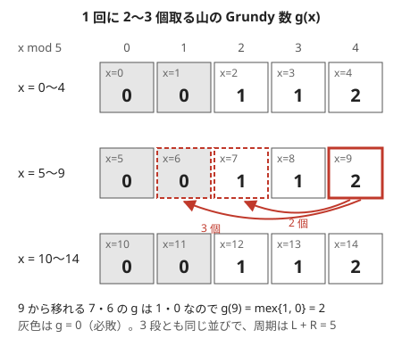

!!! abstract "要点"
    - **何ができるか**：[不偏ゲーム](../guide/glossary.md#impartial-game)の局面に Grundy 数 $g = \mathrm{mex}\{\text{次の局面の } g\}$ を割り当てると、$g = 0$ の局面がちょうど必敗になる。独立なゲームの和の Grundy 数は各 Grundy 数の XOR になるので、ゲームごとの小さな表から全体の勝敗と勝つ手が分かる。状態が大きければ、小さい局面の表から周期や式を見つける。
    - **いつ使うか**：
        - 複数の山（盤面）があり、どれか 1 つを選んで操作する。
        - 先手と後手の取れる手が同じ。
        - 山の大きさが $10^{18}$ 程度まであり、小さい山から全部の局面を調べられない。
    - **計算量**：1 つのゲームの Grundy 数の表は、局面の数 × 1 局面の手の数。和の勝敗は、各ゲームの Grundy 数の XOR を取るだけで $O(\text{ゲームの数})$。
    - **前提**：[Nim と XOR](../comb/nim.md)

<!-- textlint-disable -->
別名：nimber・Sprague-Grundy の定理・ゲームの和・Grundy 数の周期性・Sprague-Grundy theorem・Grundy number
<!-- textlint-enable -->

Grundy 数は、不偏ゲーム（どちらの手番でも打てる手が同じゲーム）の各局面に、「Nim の山の何個分に当たるか」を表す 0 以上の整数を割り当てたものである。Sprague-Grundy の定理により、独立なゲームを並べて「どれか 1 つを選んで 1 手進める」ゲームの勝敗は、各ゲームの Grundy 数の XOR で決まる。ゲームごとの表は小さな DP で作り、山が大きすぎるときは表の規則を見つけて式にする。

このページでは、どのゲームも「動けなくなった方が負け」で、有限の手数で必ず終わるものとする。

## mex と Grundy 数の定義 {#definition}

Grundy 数が要るのは、独立なゲームがいくつも並ぶときである。山が $N$ 個あり、どれか 1 つを選んで石を取るゲームを考える。[勝敗の DP](../comb/game-basics.md#game-dp) を全体に使うと、局面は山の大きさの組なので、大きさが $10^5$ まででも $(10^5)^N$ 通りになる。山ごとの表なら $10^5$ 個ずつで済むが、山ごとの「勝ち・負け」だけでは全体の勝敗が決まらない。

1 回に 1・3・4 個のどれかを取る石取りで確かめる。石が 1 個の山も 4 個の山も、単独なら手番の人の勝ちである。ところが、石が 1 個の山を 2 つ並べると先手の負けで、1 個の山と 4 個の山を並べると先手の勝ちになる（どちらも小さいので、勝敗の DP で全部の局面を調べて確かめられる）。勝ち・負けの 2 値より細かい値が要る。その値が Grundy 数である。

**mex**（minimum excludant）は、0 以上の整数の集合 $S$ に対し、$S$ に含まれない最小の 0 以上の整数である。$\mathrm{mex}\{0, 1, 3\} = 2$、$\mathrm{mex}\{1, 2\} = 0$、空集合なら $\mathrm{mex}\{\} = 0$ になる。mex そのものの求め方と性質は [mex](../patterns/mex.md) のページにまとめる。

局面 $v$ の **Grundy 数** $g(v)$ は、1 手で移れる局面の Grundy 数の mex である。

$$
g(v) = \mathrm{mex}\{\, g(w) \mid v \text{ から 1 手で } w \text{ へ移れる} \,\}
$$

手のない局面（終局）は行き先が空なので $g = 0$ である。行き先はどれも手数が短い局面なので、[勝敗の DP](../comb/game-basics.md#win-lose) と同じく、終局から順にすべての局面の値が決まる。

1・3・4 個を取る石取りで、石が $x$ 個の山の $g(x)$ を $x = 0, 1, 2, \dots$ と求めると、次のようになる。

| $x$ | 0 | 1 | 2 | 3 | 4 | 5 | 6 | 7 | 8 | 9 |
| --- | --- | --- | --- | --- | --- | --- | --- | --- | --- | --- |
| $g(x)$ | 0 | 1 | 0 | 1 | 2 | 3 | 2 | 0 | 1 | 0 |

たとえば $x = 5$ からは 4・2・1 個の山へ移れて、その値は $2, 0, 1$ なので $g(5) = \mathrm{mex}\{2, 0, 1\} = 3$ である。$g = 0$ になるのは $x = 0, 2, 7, 9$ である。[必勝・必敗の図](../comb/game-basics.md#win-lose)（石が 0〜8 個）で負けだった 0・2・7 とちょうど一致する。

これは偶然ではない。**$g(v) = 0$ と、$v$ が必敗であることは同じ**である。

- $g(v) = 0$ なら、0 は行き先の値の集合に含まれない。どの手で移っても $g \ne 0$ の局面になる
- $g(v) \ne 0$ なら、mex が 0 でないので 0 は集合に含まれる。$g = 0$ の局面へ移る手がある

「$g = 0$」を「負け」と読めば、これは勝ち負けを決める規則（負けへ移れるなら勝ち、どこへ移っても勝ちなら負け）そのものである。終局は $g = 0$ で負けなので、終局から順に帰納法で一致が続く。Grundy 数は勝ち負けの情報をすべて含み、さらに「勝ちの局面がどれくらい勝ちか」を整数で区別している。

## Grundy 数を Nim の山の大きさとみなせる理由 {#as-nim}

Nim の山（1 個以上なら何個でも取れる）で、石が $k$ 個の山の Grundy 数は $k$ である。$k$ 個の山からは $0, 1, \dots, k - 1$ 個の山へ移れて、$\mathrm{mex}\{0, 1, \dots, k - 1\} = k$ になるからである。

一般の局面 $v$ で $g(v) = k$ のとき、mex の定義から次の 2 つが言える。

1. **$k$ より小さい値へはすべて移れる**：$0, 1, \dots, k - 1$ はどれも行き先の値の集合に入っている
2. **値 $k$ へは移れない**：$k$ は集合に入っていない

これは「$k$ 個の Nim の山」の手とまったく同じ形である。違いは、$k$ より大きい値の局面へ移る手があるかもしれないことだけである。1・3・4 個を取る石取りでは、$g(6) = 2$ の山から 1 個取ると $g(5) = 3$ の山になり、値が増える。

この「値を増やす手」は勝敗を変えない。相手が値 $k$ の局面を値 $m > k$ の局面に変えたら、自分はそこから値 $k$ の局面へ移れる（$m$ の局面からは $m$ 未満のすべての値へ移れる）。値を元に戻されると、増やした手は無駄になる。ゲームは有限なので、増やす手を永遠に続けることもできない。だから、値 $k$ の局面は「$k$ 個の Nim の山」として扱ってよい。正確な主張と証明は次の節で述べる。

## ゲームの和は XOR {#sum}

いくつかのゲーム $G_1, \dots, G_N$ を並べ、手番の人は「どれか 1 つのゲームを選び、その中で 1 手進める」とする。すべてのゲームで動けなくなった人が負けである。これを**ゲームの和**と呼ぶ。山がいくつもある石取りは、1 山だけの石取りの和である。

**Sprague-Grundy の定理**：和の局面の Grundy 数は、各ゲームの局面の Grundy 数の XOR である。

$$
g(v_1, v_2, \dots, v_N) = g(v_1) \oplus g(v_2) \oplus \dots \oplus g(v_N)
$$

したがって、和の局面が必敗なのは XOR が 0 のときだけである。[Nim の判定](../comb/nim.md#bouton)は、各山の Grundy 数が山の個数そのもの、という特別な場合にあたる。全体の局面は各ゲームの局面の組なので数が積になるが、Grundy 数の表はゲームごとに作れば足りる。

??? note "証明（2 つのゲームの和）"
    2 つのゲームの和で示せば、くり返し使って $N$ 個に広がる。和の局面 $(v, w)$ で $a = g(v)$、$b = g(w)$ とし、行き先の局面では定理が成り立つと仮定する（行き先は手数が短いので帰納法が使える）。$g(v, w) = a \oplus b$ を示すには、次の 2 つを確かめればよい。

    - **値 $a \oplus b$ の行き先はない**：1 手で変わるのは片方だけである。$v$ を $v'$ に変えたとすると、$g(v') \ne a$（mex の定義で、値 $a$ の行き先はない）なので、$g(v') \oplus b \ne a \oplus b$ である。$w$ を変えたときも同じである。
    - **$a \oplus b$ より小さい値 $c$ の行き先はすべてある**：$d = (a \oplus b) \oplus c$ とする。$c < a \oplus b$ なので、2 つが初めて違う位（$d$ の最上位の 1 の位）で、$a \oplus b$ は 1、$c$ は 0 である。$a \oplus b$ のその位が 1 なので、$a$ と $b$ のちょうど一方がその位に 1 を持つ。それを $a$ とすると、$a \oplus d$ はその位を 0 にし下の位だけを変えるので $a$ より小さい。mex の定義から、$v$ には値 $a \oplus d$ の行き先 $v'$ がある。$(v', w)$ の値は $(a \oplus d) \oplus b = c$ である。

    行き先の値の集合は $a \oplus b$ 未満をすべて含み、$a \oplus b$ を含まないので、mex は $a \oplus b$ である。後半は [Bouton の定理の証明](../comb/nim.md#bouton)の「XOR を 0 にする山の選び方」と同じ議論である。

**勝つ手の見つけ方**も Nim と同じ形になる。全体の XOR を $s \ne 0$ とすると、

1. $g(v_i) \oplus s < g(v_i)$ となるゲーム $i$ を選ぶ（$g(v_i)$ が $s$ の最上位の 1 の位を持てばよい）
2. ゲーム $i$ の中で、Grundy 数がちょうど $g(v_i) \oplus s$ の局面へ移る。mex の定義から、そういう行き先が必ずある

Nim と違い、2 の行き先は「石を何個取るか」の式では決まらないので、ゲーム $i$ の行き先を表と照らして探す。次のコード片は、取れる個数の集合 `moves` が決まった石取りの和で、勝つ手（山の番号と取る個数）を探す。表 `g` は[次の節](#dp)のコード片で作る。

```cpp
--8<-- "grundy-number/subtraction.cpp:move"
```

[インタラクティブ](../comb/game-basics.md#interactive)でジャッジと対戦する問題では、毎手この探索で XOR を 0 に戻し続ければ勝てる。

## Grundy 数を DP で求める（区間・2 種類の石） {#dp}

1 つのゲームの Grundy 数の表は、[勝敗の DP](../comb/game-basics.md#game-dp) の「勝ちか負けか」を「mex」に置き換えるだけで作れる。行き先が先に決まる順（石取りなら石の少ない順）に埋める。順が分かりにくければ[メモ化再帰](../dp/memoized-recursion.md)で書く。計算量は、局面の数 × 1 局面の手の数である。

mex を求めるには、行き先の値に印を付けて、印のない最小の値を探す。行き先が $k$ 個なら値は $k$ 個以下しかないので、mex は $k$ 以下である。印の配列は大きさ $k + 1$ で足り、$k$ 以上の値は無視してよい。各局面で $O(k)$ で mex が求まる。

```cpp
--8<-- "grundy-number/subtraction.cpp:core"
```

取れる個数が $k$ 種類なら Grundy 数は $k$ 以下に収まる。Nim のように「何個でも取れる」ゲームでは値が山の大きさまで育つので、表の値の上限は手の数から見積もる。

**状態が 2 つの数の組のとき（2 種類の石）**。1 つの山に 2 種類の石が入っているなど、局面が数の組 $(a, b)$ になるゲームでは、$g[a][b]$ の 2 次元の表を作る。行き先が先に埋まる順に回すことだけが注意点である。どの手でも $a$ と $b$ がどちらも増えないなら、両方を小さい順に回せばよい。「$a$ が 1 減る代わりに $b$ が増える」手があるなら、$a$ を外側のループにして小さい順に回し、$b$ の上限は増えうる分まで広げて表を作る。$b$ が増えた行き先も、$a$ の小さい段なのですでに埋まっている。

**1 手で局面が独立な部分に分かれるとき（区間）**。並んだものの途中を取り除くと、左右が二度と影響し合わない 2 つのゲームになることがある。分かれた後の局面はゲームの和なので、その値は左右の Grundy 数の XOR である。

$$
g(\text{局面}) = \mathrm{mex}\{\, g(\text{左}) \oplus g(\text{右}) \mid \text{取り除き方} \,\}
$$

残っている範囲を[半開区間](../guide/glossary.md#half-open-interval) $[l, r)$ で表すと、$g[l][r]$ は範囲の中で選べる手ごとに $g[l][x] \oplus g[y][r]$（取り除いたのが $[x, y)$）を集めた mex になる。短い範囲から順に埋める[区間 DP](../dp/interval-dp.md) である。範囲の位置によらず長さだけで手が決まるなら、状態は長さ 1 つで済む。

長さだけで決まる例として、$x$ 本並んだピンから「1 本」か「隣り合う 2 本」を倒すゲーム（Kayles）を求める。$t$ 本倒すと、残りは長さ $a$ と $x - t - a$ の 2 列に分かれる。

```cpp
--8<-- "grundy-number/kayles.cpp:core"
```

長さ $x$ の局面の行き先はおよそ $2x$ 個なので、全体で $O(X^2)$ である（$X$ は長さの上限）。XOR した値は手の数を超えることがあるが、mex は手の数以下なので、印の配列からはみ出す値は無視してよい。

## 規則を見つける：小さい局面の表と周期 {#patterns}

山の大きさが $10^{18}$ のように大きいと、表を全部は作れない。そのときは小さい局面の表を作って眺め、周期や式を見つける。手順は次のとおりである。

1. 小さい局面（山の大きさ数百〜数千）の表を、上の DP で作って出力する
2. パラメータ（取れる個数の範囲など）をいくつか変えて表を並べ、周期・式を予想する
3. 予想した式を、小さい範囲のすべてで表と比べて確かめる（[ランダムテスト](../guide/stress-testing.md)と同じ考え方）。証明できれば理想だが、比べるだけでも誤りの多くは見つかる

1 回に $L$ 個以上 $R$ 個以下を取る山で、$L = 2$、$R = 3$ の表を 5 個ずつ折り返して並べると次の図になる。



どの段も $0, 0, 1, 1, 2$ の並びで、周期は $L + R = 5$ である。各段の中では $L = 2$ 個ずつ値が 1 増える。ここから $g(x) = \lfloor (x \bmod (L + R)) / L \rfloor$ と予想できる。次のコード片の `table(L, R, n)` は、[上の DP](#dp) の `grundy_table` で取れる個数を $L$ 以上 $R$ 以下にしたものと同じである。コード片は、表を出力したうえで、$L \le 10$、$R \le 20$ のすべてで $x \le 500$ まで式と表が一致することを確かめる。

```cpp
--8<-- "grundy-number/range-formula.cpp:core"
```

式が分かれば、山 1 つの値は $O(1)$ で求まる。山の大きさによらず全体が $O(N)$ になる。

**周期が出る理由**：取れる個数の集合が有限で最大が $m$ なら、$g(x)$ は直前の $m$ 個の値 $g(x - m), \dots, g(x - 1)$ だけで決まる。値はどれも手の数以下なので、「直前の $m$ 個の並び」は有限通りしかなく、いつか同じ並びが現れて、その先はくり返す。これは[周期性](../basics/periodicity.md#rho)の「尾と周期」と同じ形で、周期の前に尾（前周期）があってよい。

**尾が長いことがある**。[DP の節](#dp)の Kayles（1 本か隣り合う 2 本のピンを倒すゲーム）の表を計算すると、$x \ge 71$ では $g(x) = g(x + 12)$ が続く。一方、$x = 70$ ではまだ成り立たない。小さい範囲だけで周期を決めると誤る。周期を探すときは、計算した範囲の終わりから「周期が崩れない限り始まりを前へ伸ばす」形にし、何周も続くことを確かめる。

```cpp
--8<-- "grundy-number/kayles.cpp:period"
```

周期のほかに、次のような形の規則もある。

- **数の性質で決まる**：値を約数に置き換えるゲームなら、素因数の個数が山の大きさの役をする（[ABC368 F](#abc368_f)）
- **例外の点だけ持つ**：ほとんどの局面で「$g(x)$ はそれまでの最大値 + 1」のような単純な規則が成り立つことがある。規則の崩れる点が入力で与えられる少数だけなら、その点の値だけを求めて持つ（[力試し](#challenge)の ABC255 G）

## 使えない場合（1 手で複数を動かす・非不偏） {#limitations}

Grundy 数の XOR で判定できるのは、次をすべて満たすときだけである。どれかが崩れると、XOR の答えは一般に正しくない。

- **1 手で動かすのは 1 つのゲームだけ**：2 つの山から同じ個数を同時に取れる（Wythoff のゲーム）、すべての山から同時に取れる、のようなルールは和ではない。山が $1, 1$ で「1 つの山から何個でも、または 2 つの山から同じ個数」を取れるなら、2 山から 1 個ずつ取って先手が勝つ。Nim の値どうしの XOR $1 \oplus 1 = 0$ は先手の負けを示し、誤る。このときは全体を 1 つのゲームとして、組 $(a, b)$ を状態にした表を作り、規則を探す
- **両者の打てる手が同じ（不偏）**：手番によって打てる手が違うと、同じ局面でも値が手番で変わり、mex の定義が成り立たない。[先手と後手で取れる数が違うとき](../comb/nim.md#asymmetric)の戻す戦略か、[非不偏ゲーム](../comb/partizan-games.md)の考え方を使う
- **動けなくなった方が負け**：最後に動いた方が負け（逆形）だと、$g = 0$ と必敗の対応が崩れ、和も XOR では決まらない。Nim の逆形だけは[逆形 Nim](../comb/nim.md#misere) の結論がある。一般の逆形は、小さければ[勝敗の DP](../comb/game-basics.md#game-dp) で全体を調べる
- **有限の手数で終わる**：同じ局面に戻れて引き分けがありうると、mex の再帰が止まらない。[後退解析](../comb/game-retrograde-analysis.md)を使う

## 落とし穴 {#pitfalls}

**ゲームごとの勝ち負けを XOR する**。各ゲームの「勝ち = 1、負け = 0」を XOR しても、全体の勝敗は分からない。[定義の節](#definition)の例のとおり、単独では勝ちのゲームどうしを並べても、全体は勝ちにも負けにもなる。値は 0・1 ではなく Grundy 数の表で持つ。

**分かれた局面の値を足す**。1 手で 2 つの独立な部分に分かれたら、行き先の値は $g(\text{左}) \oplus g(\text{右})$ である。$g(\text{左}) + g(\text{右})$ や $\max$ にすると、値が変わる（$1 + 1 = 2$ だが $1 \oplus 1 = 0$）。

**mex の印の配列を大きく取り、毎回まとめて初期化する**。値の上限が分からないからと大きさ $10^5$ の配列を局面ごとに 0 で埋めると、それだけで局面の数 × $10^5$ かかる。印の配列は「行き先の数 + 1」の大きさにし、それ以上の値は無視する（mex は行き先の数を超えない）。

**小さい範囲だけを見て周期を決める**。Kayles（[DP の節](#dp)）の周期 12 は $x = 71$ から始まる。表を $x \le 50$ までしか見ないと、別の規則を予想してしまう。周期を見つけたら、予想に使わなかった大きい範囲でも表と比べる。

**先手と後手の出力を逆にする**。全体の XOR が 0 なのは手番の人の負けである。最初の局面では先手が手番なので、0 なら後手を出力する。

## 例題 {#examples}

### 鉄則本 A34. Game 3 {#tessoku_book_ah}

<div class="kp-problems" data-role="example" markdown>

- [鉄則本 A34. Game 3](https://atcoder.jp/contests/tessoku-book/tasks/tessoku_book_ah)（diff —）：N 個の山から交互に 1 つを選び、X 個か Y 個の石を取り、取れなくなった方が負けのとき、勝つのはどちらかを求める。

</div>

各山は「X 個か Y 個を取る石取り」で、全体はその和である。石の数ごとの Grundy 数を mex で表にし、全山の Grundy 数の XOR が 0 でなければ先手、0 なら後手が勝つ。

??? note "解法の詳細"
    - 取れる個数は 2 種類なので、行き先は 2 個以下で、Grundy 数は 0・1・2 のどれかである。印の配列は大きさ 3 で足りる。
    - 石の数の上限まで、[DP の節](#dp)のコード片 `grundy_table` で表を作る（`moves` は $\{X, Y\}$）。$X > x$ のように取れない手は行き先に入れない。
    - 全山の `g[A_i]` の XOR を取る。表を作るのに $O(\max A_i)$、判定に $O(N)$ である。

### ABC368 F. Dividing Game {#abc368_f}

<div class="kp-problems" data-role="example" markdown>

- [ABC368 F. Dividing Game](https://atcoder.jp/contests/abc368/tasks/abc368_f)（diff 1180）：N 個の整数から交互に 1 つを選んで自分以外の約数に置き換え、置き換えられなくなった方が負けのとき、勝つのはどちらかを求める。

</div>

整数 1 つが 1 つのゲームで、全体はその和である。各整数の Grundy 数は、素因数分解したときの素因数の個数（同じ素数も重ねて数える）になる。だから、全整数の素因数の個数の XOR で勝敗が決まる。

??? note "解法の詳細"
    - 素因数の個数を $\Omega(A)$ と書く。$A$ の自分以外の約数は、素因数のいくつか（1 個以上）を取り除いた数である。$\Omega(A) = k$ の数からは、$\Omega$ が $0, 1, \dots, k - 1$ のどの数へも移れて、$\Omega$ が $k$ 以上の数へは移れない。これは石が $k$ 個の Nim の山の手と同じなので、$g(A) = k$ である。
    - 1 は約数が自分しかなく、終局で $\Omega(1) = 0$ と一致する。
    - $\Omega(A_i)$ は試し割りか、[最小素因数の表](../math/spf-sieve.md#build-and-factor)で求める。値の範囲が小さければ、約数への行き先を倍数の側から配って mex を直接取る表でも求まる。
    - 全整数の $\Omega(A_i)$ の XOR が 0 でなければ先手、0 なら後手が勝つ。出力の名前は問題文のとおりにする。

### ABC297 G. Constrained Nim 2 {#abc297_g}

<div class="kp-problems" data-role="example" markdown>

- [ABC297 G. Constrained Nim 2](https://atcoder.jp/contests/abc297/tasks/abc297_g)（diff 1834）：N 個の山から交互に 1 つを選び、L 個以上 R 個以下の石を取り、取れなくなった方が負けのとき、勝つのはどちらかを求める。

</div>

山が大きいので表は作れない。[規則を見つける節](#patterns)のとおり、小さい山の表から $g(x) = \lfloor (x \bmod (L + R)) / L \rfloor$ を見つけ、全山の値の XOR で判定する。

??? note "解法の詳細"
    - 小さい $L, R$ で表を作り、周期が $L + R$ で、各周期の中で $L$ 個ずつ値が 1 増えることを見つける。[規則を見つける節](#patterns)のコード片で、予想した式を表と比べて確かめられる。
    - 各山の値を式で $O(1)$ で求め、XOR を取る。全体で $O(N)$ である。
    - 山の大きさが `int` に収まらないなら `long long` で読み、余りを取ってから割る。

## 練習問題 {#practice}

<div class="kp-problems" data-role="practice" markdown>

- [典型90 031. VS AtCoder（★6）](https://atcoder.jp/contests/typical90/tasks/typical90_ae)（diff —）：白石と青石の 2 種類が入った山がいくつかあり、決まった取り方で交互に取るゲームで、勝つのはどちらかを求める。
- [ABC206 F. Interval Game 2](https://atcoder.jp/contests/abc206/tasks/abc206_f)（diff 2221）：区間を 1 つ選ぶと重なる区間が使えなくなるゲームで、勝つのはどちらかを求める。

</div>

??? note "練習の方針"
    - **典型90 031**：1 つの山の局面を（白石の数, 青石の数）の組にし、Grundy 数の 2 次元の表を作る。白石を減らすと青石が増える手があるので、白石の数を外側のループにして小さい順に回し、青石の上限は増えうる分まで広げる（[2 種類の石](#dp)）。全山の XOR で判定する。
    - **ABC206 F**：残っている範囲 $[l, r)$ を状態にする。範囲に収まる区間を 1 つ選ぶと、左右の範囲は独立なゲームになるので、行き先の値は左右の Grundy 数の XOR である。短い範囲から[区間 DP](../dp/interval-dp.md) で埋める（[区間](#dp)）。

## 力試し {#challenge}

<div class="kp-problems" data-role="challenge" markdown>

- [ABC278 G. Generalized Subtraction Game](https://atcoder.jp/contests/abc278/tasks/abc278_g)（diff 2533）：1〜N のカードの列から、L 枚以上 R 枚以下の連続するカードを交互に取るゲームを、ジャッジと対戦して勝つ（インタラクティブ）。
- [ABC255 G. Constrained Nim](https://atcoder.jp/contests/abc255/tasks/abc255_g)（diff 2734）：山の大きさごとに取れない手が決まっている Nim で、勝つのはどちらかを求める。

</div>

??? note "力試しの方針"
    - **ABC278 G**：残ったカードは連続する列の集まりで、各列は長さだけで決まる独立なゲームである。長さ $x$ の列から連続する $t$ 枚を取ると 2 列に分かれるので、長さごとの Grundy 数を XOR の mex で表にする。先手か後手かを全体の値で選び、毎手、全体の XOR を 0 にする手（どの列のどこから何枚取るか）を探して出力する（[勝つ手の見つけ方](#sum)）。
    - **ABC255 G**：取れない手がなければ普通の Nim で $g(x) = x$ である。取れない手がある大きさ（例外の点）以外では、$g(x)$ はそれまでの最大値 + 1 になる。例外の点の値だけを小さい順に求め、各山の値はその点からの距離で計算する。例外の点で、取れない手によって行き先から消える値を数えるには、2 回以上現れる値だけを数で持つ。

## 確認問題 {#quiz}

??? question "確認問題：1〜3 個取れる石取りの Grundy 数"
    1 回に 1〜3 個の石を取る山で、石が $x$ 個の山の Grundy 数を求めよ。山が $5, 6, 7$ のとき、先手は勝てるか。勝てるなら勝つ手を 1 つ答えよ。

    ??? success "答え"
        $g(x) = x \bmod 4$ である。$g(0) = 0$ から始め、$x$ 個の山は $x - 1, x - 2, x - 3$ 個へ移れるので、直前の 3 つの値の mex になる。値は $0, 1, 2, 3, 0, 1, \dots$ とくり返す。山が $5, 6, 7$ なら値は $1, 2, 3$ で、XOR は $1 \oplus 2 \oplus 3 = 0$ なので、先手の勝つ手はない（後手必勝）。

??? question "確認問題：0 でない局面から 0 へ"
    Grundy 数が 0 でない局面から、Grundy 数が 0 の局面へ必ず移れるのはなぜか。

    ??? success "答え"
        Grundy 数は行き先の値の mex なので、それが 0 でないなら 0 は行き先の値の集合に含まれている。すなわち値が 0 の行き先がある。

??? question "確認問題：分かれる局面の値"
    1 手で 2 つの独立な部分に分かれ、左の Grundy 数が 3、右が 3 だった。この行き先の局面の Grundy 数はいくつか。この局面を相手に渡したらどうなるか。

    ??? success "答え"
        $3 \oplus 3 = 0$ である。値 0 の局面は手番の人の負けなので、この局面を相手に渡す手は勝つ手である。左右の値が等しい 2 つのゲームの和は、いつも値 0 になる。

??? question "確認問題：2 山から同時に取れるとき"
    「1 つの山から何個でも取るか、2 つの山から同じ個数を取る」ゲームで、山が $2, 2$ のとき、Nim として XOR を取ると何を予想し、実際にはどうなるか。

    ??? success "答え"
        $2 \oplus 2 = 0$ なので後手必勝と予想するが、先手は 2 山から 2 個ずつ取って全部なくし、勝つ。1 手で 2 つのゲームを動かせるので、ゲームの和ではなく、XOR は使えない（[使えない場合](#limitations)）。

## 使い分け {#comparison}

- 1 つのゲームだけで、局面が小さいなら、Grundy 数は要らない。[勝敗の DP](../comb/game-basics.md#game-dp) で勝ち負けを求める
- 各ゲームが「1 個以上なら何個でも取れる山」そのものなら、[Nim](../comb/nim.md) の XOR で足りる。取れる個数に上限だけがあるなら[上限つき Nim](../comb/nim.md#bounded) の余りで済む
- 得点を取り合うゲームは、勝ち負けではなく値の最大化なので[ミニマックス](../comb/minimax.md)を使う
- 手番で打てる手が違う、1 手で複数のゲームを動かす、引き分けがある、のどれかなら、[使えない場合](#limitations)の行き先を見る

## 参考 {#references}

- [「Sprague–Grundy theorem」（Wikipedia 英語版）](https://en.wikipedia.org/wiki/Sprague%E2%80%93Grundy_theorem)：mex と Grundy 数の定義、和の Grundy 数がニム和になること
- [「Kayles」（Wikipedia 英語版）](https://en.wikipedia.org/wiki/Kayles)：Kayles の Grundy 数が周期 12 でくり返すこと（始まりの位置はコード片の計算で確かめた）
- [E869120「kyopro-tessoku」answer_A34.cpp](https://github.com/E869120/kyopro-tessoku/blob/main/codes/cpp/chap05/answer_A34.cpp)：例題 鉄則本 A34 の表の作り方（値が 0〜2 に収まる mex）
- [programming-hiroba「ABC368 F」](https://programming-hiroba.com/abc368-f/)：例題 ABC368 F の問いと、素因数の個数の XOR で判定する方針
- [hyouri「ABC368 F」（Qiita）](https://qiita.com/hyouri/items/f80a169412d5a969c25d)：例題 ABC368 F を約数への mex で表にする方法
- [kmjp「AtCoder ABC #297 : G - Constrained Nim 2」](https://kmjp.hatenablog.jp/entry/2023/04/19/1000)：例題 ABC297 G の式（実験で見つける方針）
- [E869120「kyopro_educational_90」031.cpp](https://github.com/E869120/kyopro_educational_90/blob/main/sol/031.cpp)：練習 典型90 031 の表の回し方と大きさ
- [drken「AtCoder ABC 206 F - Interval Game 2」](https://drken1215.hatenablog.com/entry/2021/06/19/224100)：練習 ABC206 F の区間 DP（左右の XOR の mex）
- [kmjp「AtCoder ABC #278 : G - Generalized Subtraction Game」](https://kmjp.hatenablog.jp/entry/2022/11/24/0900)：力試し ABC278 G の列の長さごとの Grundy 数と、XOR を 0 に保つ方針
- [kmjp「AtCoder ABC #255 : G - Constrained Nim」](https://kmjp.hatenablog.jp/entry/2022/06/12/0900)：力試し ABC255 G の例外の点だけを持つ方針
