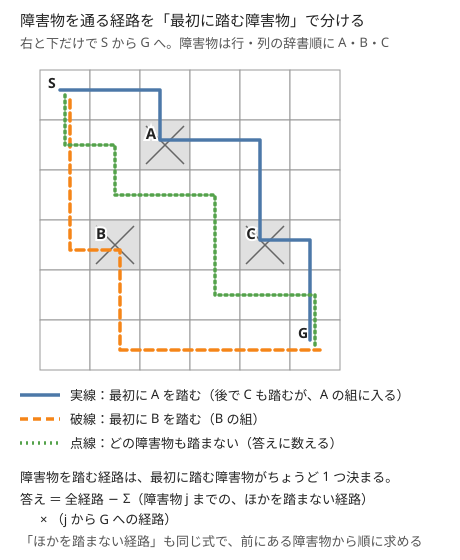

!!! abstract "要点"
    - **何ができるか**：包除の和 $\sum_S (-1)^{\lvert S \rvert} N(S)$ の項が多すぎて列挙できないとき、$S$ を作る過程を DP にし、符号を DP の値に掛けて運ぶ。障害物を並べて最初に踏む障害物で分類し、全体から引く形も同じ仲間である。
    - **いつ使うか**：
        - $H, W \le 10^5$ のグリッドに障害物が $N \le 3000$ 個。
        - 禁止条件が列や木に沿って並ぶ数え上げ。
        - $\lvert P_i - i \rvert$ など、位置と値の差に制約がある順列の個数。
        - 隣り合う値が異なる数列の個数。
    - **計算量**：最初に踏む障害物で分ける形は、二項係数の前計算 $O(H + W)$ のあと $O(N^2)$。違反の個数を状態に持つ形は（状態数）×（遷移数）で、ABC309 G の形なら $O(N^2 X 4^X)$。等しい区間にまとめる形は素朴に $O(N^2)$、単調スタックで $O(N)$。
    - **前提**：[包除原理](../comb/inclusion-exclusion.md)、[DP の基本](../dp/dp-basics.md)、[格子路の数え上げ](../comb/lattice-paths.md)

<!-- textlint-disable -->
別名：符号付き DP・最初に踏む障害物で分類・障害物 DP・包除原理を DP に載せる
<!-- textlint-enable -->

包除 DP は、[包除原理](../comb/inclusion-exclusion.md#general)の和 $\sum_S (-1)^{\lvert S \rvert} N(S)$ を、条件の集合 $S$ を 1 つずつ列挙せずに DP でまとめて求める方法である。条件が $M$ 個（数千個）あって $2^M$ 通りの bit 全探索ができず、条件どうしの位置関係があるので[破る個数 k ごとにまとめる](../comb/inclusion-exclusion.md#symmetric)こともできないときに使う。条件が列・グリッド・木に沿って並んでいれば、$S$ を左から（または葉から）作っていく過程が DP になる。

## 包除の和を「S を作る過程」の重みの和と見る {#weighted-sum}

包除の和は、条件の集合 $S$ ごとの重み $(-1)^{\lvert S \rvert} N(S)$ をすべて足したものである。[DP の基本](../dp/dp-basics.md)で経路の数を数えるときと同じく、「重みの総和」は $S$ を作る手順を DP にすれば求められる。そのためには次の 2 つが要る。

- **作る順序**：$S$ の要素を決まった順（位置の順・ソートした順・葉から根の順）に 1 つずつ選んでいける。
- **重みの分解**：$N(S)$ が「直前に選んだ要素と次の要素だけで決まる値」の積に分かれる。または、少ない状態（使った値の範囲・今の区間の長さなど）を持てば積に分かれる。

符号 $(-1)^{\lvert S \rvert}$ は、要素を 1 つ選ぶたびに $-1$ を掛けることと同じである。だから DP の値に符号を掛けたまま運べば、$\lvert S \rvert$ やその偶奇を状態に持たなくてよい。偶奇を状態に足して最後に「偶数 − 奇数」を取っても同じ答えになるが、状態が 2 倍になる。

小さい例で確かめる。$3 \times 3$ のグリッドを左上 $(0, 0)$ から右下 $(2, 2)$ へ右と下だけで進み、障害物 $A = (1, 1)$ と $B = (1, 2)$ を通らない経路を数える。行・列とも 0-indexed で書く。条件を「$A$ を通らない」「$B$ を通らない」とし、$N(S)$ を「$S$ の障害物をすべて通る経路の数」とする。

| $S$ | $N(S)$ | 符号付きの重み |
| --- | --- | --- |
| $\emptyset$ | 全経路 $\binom{4}{2} = 6$ | $+6$ |
| $\{A\}$ | $(0,0) \to A$ が 2、$A \to (2,2)$ が 2 で $4$ | $-4$ |
| $\{B\}$ | $(0,0) \to B$ が 3、$B \to (2,2)$ が 1 で $3$ | $-3$ |
| $\{A, B\}$ | $(0,0) \to A \to B \to (2,2)$ で $2 \cdot 1 \cdot 1 = 2$ | $+2$ |

合計は $6 - 4 - 3 + 2 = 1$ で、実際に通れるのは「下・下・右・右」の 1 本だけである。$\{A, B\}$ の $N(S)$ は、$A$ と $B$ を通る順に並べたとき、隣どうしの経路の数の積になっている。これが重みの分解で、「最後に選んだ障害物」を状態にした DP で全部の $S$ をまとめて足せる。

$S$ を作る過程と状態の取り方は、条件の並び方で決まる。

| 条件の並び方 | 作る順序 | 状態 | 節 |
| --- | --- | --- | --- |
| グリッドの障害物 | 障害物をソートした順 | 最後に選んだ障害物 | [最初に踏む障害物で分類する](#first-obstacle) |
| 順列の各位置 | 位置の順 | 選んだ個数と、近くの値の使用状況 | [違反の個数を状態に持つ](#count-violations) |
| 列の隣接 | 左から | 最後の区間の右端 | [「等しい」を区間にまとめる](#equal-blocks) |
| 木の辺 | 葉から根へ | 根を含む成分の大きさ | [符号付きの木 DP](#tree) |

## 最初に踏む障害物で分類する（ソート順と終点の扱い） {#first-obstacle}

$H, W \le 10^5$ のグリッドで、右と下だけで左上から右下へ行き、$N$ 個の障害物のマスを通らない経路を数える。マスが $10^{10}$ 個あるので[グリッドの DP](../dp/dp-grid.md) の表は作れない。障害物がなければ経路の数は二項係数 $\binom{H + W - 2}{H - 1}$ で求まる（[格子路の数え上げ](../comb/lattice-paths.md#basic)）ので、障害物を通る経路を引くことを考える。

障害物を通る経路は、最初に踏む障害物がちょうど 1 つに決まる。そこで次の値を障害物ごとに求める。

$$
\mathrm{dp}[i] = \text{始点から障害物 } i \text{ まで、ほかの障害物を通らずに行く経路の数}
$$

始点から障害物 $i$ へ行く経路のうち、途中で別の障害物を通るものは、最初に通った障害物 $j$ で分類できる。$j$ までは $\mathrm{dp}[j]$ 通り、$j$ から $i$ へは障害物を気にせず $\mathrm{paths}(j \to i)$ 通りなので、次の式になる。

$$
\mathrm{dp}[i] = \mathrm{paths}(\text{始点} \to i) - \sum_{j \ne i} \mathrm{dp}[j] \cdot \mathrm{paths}(j \to i)
$$

終点を $N + 1$ 番目の障害物として足せば、答えは終点の $\mathrm{dp}$ そのものになる。答えを別の式で書く必要がなくなり、終点に障害物がある場合も 0 と正しく出る。



図の実線は $A$ と $C$ の両方を踏むが、この経路は「最初に踏む $A$」の組で 1 回だけ引かれる。$C$ の組には「$C$ より前に障害物を踏まずに $C$ に着く経路」しか入らないので、2 回引かれることはない。

この式は、[前の節](#weighted-sum)の包除の和をまとめたものでもある。$i$ に着くまでに通る障害物の列を $S$ とみて、障害物 $i$ で終わる $S$ の符号付きの重みの和を $g[i]$ と置く。すると $g[i] = -\bigl(\mathrm{paths}(\text{始点} \to i) + \sum_j g[j] \cdot \mathrm{paths}(j \to i)\bigr)$ である。$\mathrm{dp}[i] = -g[i]$ と置き直すと上の式になる。

**ソート順**。$\mathrm{dp}[j]$ を $\mathrm{dp}[i]$ より先に求めるため、$j$ から $i$ へ行けるなら $j$ が先に来るよう並べる。（行, 列）の辞書順でも、行 + 列の昇順でもよい。$j$ から $i$ へ行けないとき（列が戻るとき）は $\mathrm{paths}(j \to i) = 0$ とすれば、和の範囲を「$i$ より前のすべて」にしてよい。

処理の流れは次のとおりである。

1. 階乗とその逆元を $H + W$ まで[前計算](../comb/binomial-precompute.md#table-size)し、$\mathrm{paths}$ を $O(1)$ で求められるようにする。行か列の差が負なら 0 を返す。
2. 障害物を辞書順にソートし、末尾に終点を足す。
3. 前から順に $\mathrm{dp}[i]$ を上の式で求め、終点の $\mathrm{dp}$ を出力する。

```cpp
--8<-- "inclusion-exclusion-dp/first-obstacle.cpp:core"
```

計算量は、前計算が $O(H + W)$、DP が障害物の組ごとに $O(1)$ で $O(N^2)$ である。$N = 3000$ なら約 $4.5 \times 10^6$ 回で間に合う。

- **応用の型**（通ってはいけない点が少ない数え上げ）：グリッドに限らず、「点 $a$ から点 $b$ へ行く方法の数」が式で求まり、通ってはいけない点に半順序（$a$ から $b$ へ行けるなら $a$ が先）があれば、同じ式が使える。3 次元の格子路や、右・下以外の 2 種類の移動（例：$(1, 2)$ と $(2, 1)$）を組み合わせる格子路（[移動を回数の組に直す](../comb/lattice-paths.md#move-counts)）でも、$\mathrm{paths}$ を差し替えるだけである。
- **応用の型**（ちょうど 1 回で分ける）：「条件を満たす最初の位置」で分ける考え方は、重複を避けて数える方法としても使う（[DP の中で代表を決める](../comb/counting-dedup.md#in-dp)）。

## 違反の個数を状態に持ち、最後に符号と残りの自由度を掛ける {#count-violations}

順列 $P$ で「すべての $i$ で $\lvert P_i - i \rvert \ge X$」のように、位置ごとに禁止の値がある数え上げを考える。位置 $i$ の条件を破るのは、$P_i$ を禁止の値にしたときである。破ると指定した位置の集合 $S$ について、$N(S)$ は「$S$ の位置に互いに異なる禁止の値を割り当てる方法の数」×「残りの $N - \lvert S \rvert$ 個の並べ方 $(N - \lvert S \rvert)!$」になる。残りは自由で、そこで禁止の値を使ってもよい（$N(S)$ は「少なくとも $S$ を破る」数だから）。

$\lvert S \rvert = k$ のものをまとめると、答えは次の形になる。

$$
\sum_{k=0}^{N} (-1)^k \, r_k \, (N - k)! \qquad (r_k = \text{行と列が重ならない } k \text{ 個の禁止のマスの選び方})
$$

$N \times N$ の盤面の行を位置、列を値とみると、$r_k$ は禁止のマスにルークを $k$ 個、互いに取り合わないように置く方法の数である。$(N - k)!$ は $k$ ごとに変わるので、$k$ を DP の状態に持ち、符号と $(N - k)!$ は最後に掛ける。前の節のように符号だけを運ぶのでは足りない。

[撹乱順列](../comb/inclusion-exclusion.md#derangement)は $X = 1$（禁止のマスが対角線だけ）の場合で、$r_k = \binom{N}{k}$ になる。$X \ge 2$ では禁止のマスが帯状に並び、置き方が近くのマスに左右されるので、$r_k$ を DP で求める。

**状態**。行 $i$ の禁止のマスは列 $i - X + 1$ から $i + X - 1$ までの $2X - 1$ 個である。この窓の中で、すでに使った列を bit 集合で持つ。行 $i$ から行 $i + 1$ へ進むと窓が 1 つ右へずれ、左端の列 $i - X + 1$ は以後の行で禁止のマスにならないので、忘れてよい。

$$
\mathrm{dp}[j][\mathrm{mask}] = \text{ここまでの行で禁止のマスを } j \text{ 個選び、今の窓で使った列が mask である選び方の数}
$$

**遷移**。各行で「禁止のマスを選ばない」か「窓の中の、使っていない列を 1 つ選んで $j$ を 1 増やす」かを決める。最後に $r_k = \sum_{\mathrm{mask}} \mathrm{dp}[k][\mathrm{mask}]$ とし、上の式で足す。

```cpp
--8<-- "inclusion-exclusion-dp/ban-permutation.cpp:core"
```

状態数は $N \cdot N \cdot 2^{2X-1}$、遷移は $2X$ 通りなので、計算量は $O(N^2 X 4^X)$ である。$X = 5$ のとき $2^{2X-1} = 512$ で、$N = 100$ なら $N^2 \cdot 2X \cdot 512 \approx 5 \times 10^7$ 回ほどである。

- **応用の型**（2 つの順列の両方と異なる）：$r_i \ne p_i$ かつ $r_i \ne q_i$ のように禁止の値が位置ごとに 2 つあるときも、答えは $\sum_k (-1)^k r_k (N - k)!$ である。値 $p_i$ と $q_i$ を辺で結ぶと、グラフは閉路の集まりになる。$r_k$ は、$k$ 本の辺に端点を 1 つずつ重ならずに割り当てる方法の数である。閉路ごとに DP で数え、閉路どうしを[ナップサック](../dp/knapsack-01.md)のように畳み込む（力試しの [ABC214 G](#challenge)）。
- **応用の型**（違反の個数ごとの表を先に作る）：「ちょうど $t$ 個の位置で条件を破るもの」を問われても、$r_k (N - k)!$ の表から二項係数で戻せる。$r_k (N - k)!$ は $k$ 個の位置を指定して数えた数の和で、ちょうど $t$ 個破るものを $\binom{t}{k}$ 回数えている。そのため $e_t = \sum_{k \ge t} (-1)^{k - t} \binom{k}{t} r_k (N - k)!$ で戻る。

## 「等しい」を区間にまとめる符号付き DP {#equal-blocks}

$1 \le X_i \le A_i$ で、隣り合う項が異なる長さ $N$ の数列を数える。条件 $i$ を「$X_i \ne X_{i+1}$」とすると、破るのは $X_i = X_{i+1}$ である。等しいと指定した隣接の集合 $S$ を決めると、列は等しい項が続く区間に分かれ、区間ごとに「区間のすべての $A$ 以下の値を 1 つ選ぶ」ので、$N(S)$ は区間の $A$ の最小値の積になる。

$S$ は「列を区間に分ける分け方」と 1 対 1 に対応する。長さ $\ell$ の区間の中には等しいと指定した隣接が $\ell - 1$ 個あるので、符号は区間ごとに $(-1)^{\ell - 1}$ と分解できる。最後の区間 $[j, i)$ で場合分けすると、次の DP になる（0-indexed、$\mathrm{dp}[0] = 1$、答えは $\mathrm{dp}[N]$）。

$$
\mathrm{dp}[i] = \sum_{j=0}^{i-1} \mathrm{dp}[j] \cdot (-1)^{i - j - 1} \cdot \min(A_j, \dots, A_{i-1})
$$

$A = (2, 2)$ で確かめる。区間 $[0, 2)$ の 1 つに分けると $-2$、$[0, 1)$ と $[1, 2)$ に分けると $2 \cdot 2 = 4$ なので、答えは $4 - 2 = 2$ である。実際に $(1, 2)$ と $(2, 1)$ の 2 つと一致する。

```cpp
--8<-- "inclusion-exclusion-dp/equal-blocks.cpp:core"
```

このままでは $O(N^2)$ で、$N$ が $5 \times 10^5$ 程度だと間に合わない。$h[i] = (-1)^i \mathrm{dp}[i]$ と置くと、式は $h[i] = -\sum_{j < i} h[j] \cdot \min(A_j, \dots, A_{i-1})$ になり、符号が $j$ によらなくなる。$i$ を 1 つ進めると、今の $\min$ が $A_{i-1}$ より大きい $j$ だけが変わり、どれも $A_{i-1}$ になる。そこで「$\min$ の値」と「その値を持つ $j$ の $h[j]$ の和」の組を[単調スタック](../ds/monotonic-stack.md#dp-transition)に積む。$i$ を進めるたびに、$A_{i-1}$ 以上の組を取り出し、それらの $h$ の和に新しく加わる $h[i-1]$ を足して、$(A_{i-1}, \text{和})$ の組を 1 つ積む。全体の $\sum$（値 × $h$ の和）は、取り出した組の分を引き、積んだ組の分を足して保てば、ならし $O(N)$ になる（練習の [ARC115 E](#practice)）。

- **応用の型**（隣り合う値が異なる）：「隣と同じ色にしない」「同じ文字が続かない」の数え上げのうち、各項の範囲が項ごとに違うものに使う。範囲がすべて同じ $M$ なら $M (M - 1)^{N-1}$ で済む。
- **応用の型**（等しい区間を状態に持つ）：区間の値の数え方が $\min$ でなくても、区間の長さや端だけで決まれば同じ DP になる。

## 符号付きの木 DP {#tree}

この節は[木 DP](../dp/tree-dp.md#product-of-children) と[二乗の木 DP](../dp/tree-dp-square.md) を前提にする。

$N$ 頂点（$N$ は偶数）の木の頂点を 2 つずつ組にし、各組を木のパスで結ぶ。すべての辺がどれかのパスに含まれる組み方を数える。条件を辺ごとに置き、辺 $e$ がどのパスにも含まれないことを「破る」とみる。破ると指定した辺の集合 $S$ を木から切ると、組は同じ成分の中で作るしかないので、$N(S)$ は成分ごとの組み方の積である。大きさ $s$ の成分の組み方は、$s$ が偶数なら $g(s) = (s - 1)(s - 3) \cdots 1$、奇数なら 0 である。

$S$ を葉から根へ決めていく。根を含む成分はまだ閉じていないので、その大きさを状態に持つ。

$$
\mathrm{dp}[v][s] = v \text{ の部分木で切る辺を決めたときの、} v \text{ を含む成分の大きさが } s \text{ の場合の符号付きの重みの和}
$$

子をまとめる前は $v$ だけの成分なので、$\mathrm{dp}[v][1] = 1$ から始める。子 $c$ をまとめるとき、辺 $(v, c)$ を切らなければ成分がつながって大きさが足され、切れば $c$ の成分がそこで閉じて $g$ と符号 $-1$ が掛かる。

$$
\mathrm{dp}'[v][s + t] \mathrel{+}= \mathrm{dp}[v][s] \cdot \mathrm{dp}[c][t], \qquad \mathrm{dp}'[v][s] \mathrel{+}= \mathrm{dp}[v][s] \cdot \Bigl(-\sum_t \mathrm{dp}[c][t] \, g(t)\Bigr)
$$

答えは根で $\sum_s \mathrm{dp}[\mathrm{root}][s] \, g(s)$ である。切った本数の偶奇を状態に足して最後に「偶数 − 奇数」を取る書き方もあるが、符号を値に掛ければ状態が半分で済む。マージの和を部分木の大きさの範囲だけで回せば、二乗の木 DP と同じ理由で全体 $O(N^2)$ になる（力試しの [ARC101 E](#challenge)）。

## 落とし穴 {#pitfalls}

**行だけでソートする**。障害物を行だけでソートすると、同じ行の障害物の順が入力の順のままになる。同じ行で列が小さい障害物 $j$ が後ろに来ると、$\mathrm{dp}[i]$ を求める時点で $\mathrm{dp}[j]$ がまだ 0 で、引くべき経路が漏れる。（行, 列）の辞書順か、行 + 列の順にする。

**行けない組に二項係数を使う**。$j$ から $i$ へ列が戻る組で、階乗の式 $\mathrm{fact}[dr + dc] \cdot \mathrm{ifact}[dr] \cdot \mathrm{ifact}[dc]$ をそのまま使うと、負の添字で表の外を読む。差のどちらかが負なら 0 を返す関数にしておく（$k < 0$ か $k > n$ で 0 を返す二項係数の関数でもよい）。階乗の表は、始点から終点までの歩数 $H + W - 2$ 以上の大きさにする。

**$N(S)$ を「ちょうど」で数える**。[違反の個数を状態に持つ](#count-violations)形で、残りの $N - k$ 個を「禁止の値を使わない並べ方」で数えると、包除が二重になって答えが合わない。残りは自由に並べた $(N - k)!$ である。逆に、$(N - k)!$ を掛け忘れると $r_k$ の交代和という別の値になる。

**符号の指数を取り違える**。区間にまとめる DP の符号は、区間の数ではなく区間の中の隣接の数 $\ell - 1$ で決まる。小さい $N$ で全探索の答えと比べると、指数の取り違えはすぐ見つかる。

**引き算で負になる**。mod を取った値で引き算するときは、`long long` のままなら $\bmod$ を足してから余りを取る。[modint](../math/modint.md) を使えば自動で正規化される。mod の値どうしは大小を比べられないので、「答えが負になったら 0」のような処理は書けない。

## 例題 {#examples}

### EDPC Y. Grid 2 {#dp_y}

<div class="kp-problems" data-role="example" markdown>

- [EDPC Y. Grid 2](https://atcoder.jp/contests/dp/tasks/dp_y)（diff なし）：H×W のグリッドに N 個の壁のマスがあるとき、左上から右下へ右と下だけで進み、壁を通らない経路の数を求める。

</div>

$H, W \le 10^5$ で表は作れず、壁は $N \le 3000$ 個と少ない。[最初に踏む障害物で分類する](#first-obstacle)の形そのもので、壁をソートし、終点を最後の壁として足して、各壁に「ほかの壁を通らずに着く経路の数」を前から求める。

??? note "解法の詳細"
    - 階乗と逆元を $H + W$ まで前計算し、$\mathrm{paths}(a \to b)$ を $\binom{dr + dc}{dr}$（差が負なら 0）で求める。
    - 壁を（行, 列）の辞書順にソートし、末尾に終点 $(H, W)$ を足す。
    - $\mathrm{dp}[i] = \mathrm{paths}(\text{始点} \to i) - \sum_{j < i} \mathrm{dp}[j] \cdot \mathrm{paths}(j \to i)$ を前から求め、終点の $\mathrm{dp}$ を $10^9 + 7$ で割った余りとして出力する。
    - $O(H + W + N^2)$。コードは[最初に踏む障害物で分類する](#first-obstacle)の節のものと同じである（入力は 1-indexed）。

### ABC309 G. Ban Permutation {#abc309_g}

<div class="kp-problems" data-role="example" markdown>

- [ABC309 G. Ban Permutation](https://atcoder.jp/contests/abc309/tasks/abc309_g)（diff 2372）：すべての i で |P_i − i| ≥ X となる 1〜N の順列 P の数を求める。

</div>

$\lvert P_i - i \rvert < X$ となる位置を「違反」とし、違反を $k$ 個指定する包除にする。違反のマスは行ごとに幅 $2X - 1$ の窓に収まり、$X \le 5$ と小さいので、窓の中で使った列を bit 集合で持てる。[違反の個数を状態に持つ](#count-violations)形で $r_k$ を求め、$(-1)^k (N - k)!$ を掛けて足す。

??? note "解法の詳細"
    - 盤面の行を位置、列を値とする。行 $i$ の違反のマスは列 $i - X + 1$ から $i + X - 1$（盤面の中だけ）。
    - $\mathrm{dp}[j][\mathrm{mask}]$：ここまでの行で違反のマスを $j$ 個、列が重ならないように選び、今の窓で使った列が mask である選び方の数。
    - 行を 1 つ進めるたびに mask を 1 bit 右へずらし、「選ばない」か「窓の空いている列を 1 つ選んで $j + 1$」へ遷移する。
    - $r_k = \sum_{\mathrm{mask}} \mathrm{dp}[k][\mathrm{mask}]$、答えは $\sum_k (-1)^k r_k (N - k)!$ を $998244353$ で割った余り。
    - $O(N^2 X 4^X)$。コードは[違反の個数を状態に持つ](#count-violations)の節のものと同じである。
    - 包除を使わず、位置と値の両方で「まだ相手が決まっていないもの」を状態に持つ DP でも解ける（[挿入 DP](../dp/insertion-dp.md#hakone-ekiden-dp)）。

## 練習問題 {#practice}

<div class="kp-problems" data-role="practice" markdown>

- [ABC462 G. Completely Wrong](https://atcoder.jp/contests/abc462/tasks/abc462_g)（diff 2232）：色の付いた N 個の玉を一様に無作為な順に取り出すとき、どの i 番目に取り出す玉も指定の色 G_i と違う確率を mod 998244353 で求める。
- [ARC115 E. LEQ and NEQ](https://atcoder.jp/contests/arc115/tasks/arc115_e)（diff 2363）：各項が 1 以上 A_i 以下で、隣り合う項が異なる長さ N の数列の数を求める。

</div>

??? note "練習の方針"
    - **ABC462 G**：一致する組を $k$ 組指定する包除にする。色 $c$ が玉に $x$ 個、指定に $y$ 個あるとき、一致を $i$ 組指定する方法は $\binom{x}{i} \binom{y}{i} i!$ である。色ごとの多項式を掛けて $r_k$ を作り、$\sum (-1)^k r_k (N - k)! / N!$ を取る。多項式の積は分割統治で掛ける。
    - **ARC115 E**：等しいと指定した隣接で列を区間に分け、符号 $(-1)^{\ell - 1}$ と区間の $A$ の最小値を掛ける DP にする。$N \le 5 \times 10^5$ なので、符号を $h[i] = (-1)^i \mathrm{dp}[i]$ にまとめ、$\min$ が同じ $j$ を単調スタックでまとめて $O(N)$ にする。

## 力試し {#challenge}

<div class="kp-problems" data-role="challenge" markdown>

- [ARC121 E. Directed Tree](https://atcoder.jp/contests/arc121/tasks/arc121_e)（diff 2645）：頂点 1 を根とする N 頂点の根付き木で、各 i について a_i から辺を 1 本以上たどって i に着かない順列 a の数を数える。
- [ABC214 G. Three Permutations](https://atcoder.jp/contests/abc214/tasks/abc214_g)（diff 2893）：2 つの順列 p, q が与えられ、すべての i で r_i ≠ p_i かつ r_i ≠ q_i となる順列 r の数を求める。
- [ARC101 E. Ribbons on Tree](https://atcoder.jp/contests/arc101/tasks/arc101_c)（diff 2913）：N 頂点（N は偶数）の木の頂点を 2 つずつ組にして結ぶとき、すべての辺がどれかの組の間のパスに含まれる組み方の数を求める。

</div>

??? note "力試しの方針"
    - **ARC121 E**：条件を破る頂点を $k$ 個指定する包除にする。部分木ごとに「指定した個数」を状態に持つ木 DP（二乗の木 DP で $O(N^2)$）で $r_k$ を求め、$\sum (-1)^k r_k (N - k)!$ を取る。
    - **ABC214 G**：$p_i$ と $q_i$ を辺で結ぶと、グラフは自己ループと閉路の集まりになる。違反の $k$ 個の選び方は、各辺にその端点の 1 つを、同じ頂点を 2 回使わないように割り当てる方法の数である。閉路ごとに辺の向きを DP で数え、閉路どうしをナップサックのように畳み込んで $r_k$ を求め、$\sum_k (-1)^k r_k (N - k)!$ を取る。長さ $L$ の閉路ですべての辺を選ぶ方法は 2 通り（向きが 2 つ）で、一部だけなら選んだ辺がパスに分かれる。
    - **ARC101 E**：どのパスにも含まれない辺の集合を切ると決め、[符号付きの木 DP](#tree) で根を含む成分の大きさを状態に持つ。大きさ $s$ の成分の組み方は $s$ が偶数のとき $(s - 1)(s - 3) \cdots 1$ である。

## 確認問題 {#quiz}

??? question "確認問題：障害物が 1 つのとき"
    障害物が $o$ の 1 つだけのとき、[最初に踏む障害物](#first-obstacle)の式で答えを書き下し、包除原理の式と一致することを確かめよ。

    ??? success "答え"
        $\mathrm{dp}[o] = \mathrm{paths}(\text{始点} \to o)$ で、終点の $\mathrm{dp}$ は $\mathrm{paths}(\text{始点} \to \text{終点}) - \mathrm{paths}(\text{始点} \to o) \cdot \mathrm{paths}(o \to \text{終点})$ である。包除原理では $N(\emptyset)$ が全経路、$N(\{o\})$ が $o$ を通る経路で、$N(\emptyset) - N(\{o\})$ と同じ式になる。

??? question "確認問題：行 + 列の順でよい理由"
    障害物を「行 + 列」の昇順にソートすると、同じ値の障害物どうしの順は決まらない。それでも正しい答えになるのはなぜか。

    ??? success "答え"
        右か下へ 1 歩進むと行 + 列は 1 増えるので、$j$ から別のマス $i$ へ行けるなら $j$ の行 + 列は $i$ より真に小さい。行 + 列が同じ 2 つの障害物の間は行き来できず $\mathrm{paths} = 0$ なので、どちらを先に計算しても互いの値を使わない。

??? question "確認問題：X = 1 のとき"
    [違反の個数を状態に持つ](#count-violations)の式で $X = 1$ とすると、$r_k$ は何になり、答えは何になるか。

    ??? success "答え"
        禁止のマスは対角線の $N$ 個で、どの 2 つも行と列が重ならないので $r_k = \binom{N}{k}$ である。答えは $\sum_k (-1)^k \binom{N}{k} (N - k)!$ で、撹乱順列の数になる。

## 使い分け {#comparison}

- 条件が 20 個程度までなら、$S$ を [bit 全探索](../comb/inclusion-exclusion.md#bit-enumeration)すれば DP は要らない。$N(S)$ が $\lvert S \rvert$ だけで決まるなら、[個数 k ごとにまとめる](../comb/inclusion-exclusion.md#symmetric)方が簡単である。
- グリッドが小さくて表を作れるなら、障害物のマスを 0 にする[グリッドの DP](../dp/dp-grid.md) の方が簡単である。
- 条件が約数の構造（gcd・周期）なら[約数包除](../comb/divisor-inclusion-exclusion.md)を使う。
- 順列の位置と値の差の条件は、包除を使わずに[挿入 DP](../dp/insertion-dp.md) でも数えられることがある。窓が小さく「違反の個数」で分けやすいなら包除 DP、未確定の個数を持つ方が自然なら挿入 DP を選ぶ。

## 参考 {#references}

- [drken「EDPC (Educational DP Contest) Y - Grid 2」](https://drken1215.hatenablog.com/entry/2019/01/16/000100)：例題の EDPC Y の方針（壁のソートと、符号の偶奇を持つ包除の DP）
- [tibrella「ABC309G Ban Permutation 题解」](https://blog.tibrella.space/post/abc309g-solution/)：例題の ABC309 G の方針（盤面のルークとみなし、違反の個数と窓の bit 集合を持つ DP）
- [kmjp「AtCoder ABC #309 (デンソークリエイトプログラミングコンテスト2023) : G - Ban Permutation」](https://kmjp.hatenablog.jp/entry/2023/07/08/1000)：ABC309 G を包除を使わずに数える別の解き方
- [drken「AtCoder ARC 115 E - LEQ and NEQ (3E, 黄色, 700 点)」](https://drken1215.hatenablog.com/entry/2021/03/21/235000_1)：練習の ARC115 E の方針（区間にまとめる符号付き DP と単調スタック）
- [kmjp「AtCoder ABC #214 : G - Three Permutations」](https://kmjp.hatenablog.jp/entry/2021/08/16/0900)：力試しの ABC214 G の方針（閉路ごとの DP と包除）
- [drken「AtCoder ARC 101 E - Ribbons on Tree (赤色, 900 点)」](https://drken1215.hatenablog.com/entry/2019/06/21/024200)：力試しの ARC101 E の方針（切る辺の集合で包除する木 DP）
- [kmjp「AtCoder ABC #462 (CodeQUEEN 2026 予選) : G - Completely Wrong」](https://kmjp.hatenablog.jp/entry/2026/06/13/0900)：練習 ABC462 G の色ごとの多項式と包除
- [ikatakos「CodeQUEEN 2026 予選 (AtCoder Beginner Contest 462)E,F,G問題メモ」](https://ikatakos.com/pot/programming_algorithm/contest_history/atcoder/2026/0613_abc462)：練習 ABC462 G の同じ方針（解説の部分だけを参照）
- [kmjp「AtCoder ARC #121 (NOMURA プログラミングコンテスト 2021) : E - Directed Tree」](https://kmjp.hatenablog.jp/entry/2021/06/20/0930)：力試し ARC121 E の符号付きの木 DP
