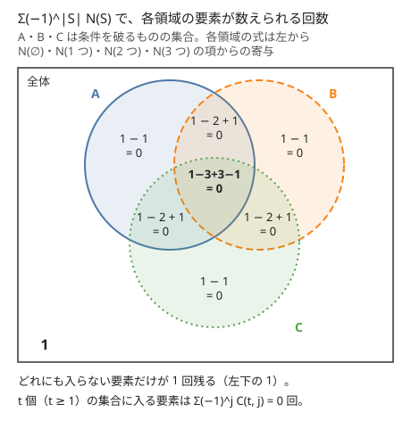

!!! abstract "要点"
    - **何ができるか**：どの条件も破らないものの個数を、条件の集合 $S$ を少なくとも破るものの個数 $N(S)$ の符号付きの和 $\sum_S (-1)^{\lvert S \rvert} N(S)$ で求める。条件が少なければ $S$ を bit 全探索し、$N(S)$ が $\lvert S \rvert$ だけで決まるなら破る個数 $k$ ごとにまとめて、撹乱順列や[全射](../guide/glossary.md#surjection)の数も求める。
    - **いつ使うか**：
        - すべて異なる・$A_i \ne B_i$ となるものの個数。
        - どの禁止条件も満たさないものの個数。
        - 各色（各行・各列）を少なくとも 1 回使うものの個数。
        - 禁止条件が $M \le 20$ 個程度。
    - **計算量**：条件 $M$ 個の組を bit 全探索すると $O(2^M T)$（$T$ は $N(S)$ を 1 回求める計算量）。$N(S)$ が $\lvert S \rvert$ だけで決まるなら、二項係数の前計算のあと $M + 1$ 項の和で済む。
    - **前提**：[数え上げの考え方](../comb/counting-mindset.md)、[余事象](../thinking/complement.md)、[bit 全探索と順列全探索](../basics/bit-full-search.md)

<!-- textlint-disable -->
別名：包除・撹乱順列・完全順列・モンモール数・全射の数・min-max 包除・inclusion-exclusion principle・derangement
<!-- textlint-enable -->

包除原理は、「どの条件も破らない」ものを直接数える代わりに、「指定した条件を少なくとも破る」ものの個数を足し引きして求める方法である。直接数えると条件どうしが絡み合うのに、条件を破る側に固定すると残りが自由になり、積の法則で数えられることが多い。2〜3 条件の足し引きは[余事象](../thinking/complement.md#two-conditions)で済むので、ここでは条件が多い場合と、条件が対称な場合の式を扱う。

## 一般形と、N(S) が「少なくとも」である理由 {#general}

数える対象の全体を $U$、条件を $1, \dots, M$ とする。条件 $i$ を破るものの集合を $A_i$ とし、条件の集合 $S \subseteq \{1, \dots, M\}$ について次の量を考える。

$$
N(S) = \Bigl\lvert \bigcap_{i \in S} A_i \Bigr\rvert \quad (\text{$S$ の条件をすべて破るもの。$S$ の外の条件は破っても破らなくてもよい})
$$

空集合では $N(\emptyset) = \lvert U \rvert$ である。このとき、どの条件も破らないものの個数は次の式で求まる。

$$
\Bigl\lvert U \setminus (A_1 \cup \dots \cup A_M) \Bigr\rvert = \sum_{S \subseteq \{1, \dots, M\}} (-1)^{\lvert S \rvert} N(S)
$$

和集合の大きさを求めたいときは、$\lvert U \rvert$ から引いて $\lvert A_1 \cup \dots \cup A_M \rvert = \sum_{S \ne \emptyset} (-1)^{\lvert S \rvert + 1} N(S)$ と書いてもよい。どちらの形でも、数えるのは共通部分（「少なくとも $S$ を破る」）だけである。

**なぜ正しいか**。ちょうど $t$ 個の条件を破るもの $x$ を 1 つ取る。$x$ が $N(S)$ に数えられるのは、$S$ が $x$ の破る $t$ 個の条件の部分集合のときだけである。大きさ $j$ の部分集合は $\binom{t}{j}$ 個あるので、右辺で $x$ が数えられる回数は次のとおりである。

$$
\sum_{j=0}^{t} (-1)^j \binom{t}{j} = (1 - 1)^t = \begin{cases} 1 & (t = 0) \\ 0 & (t \ge 1) \end{cases}
$$

条件を 1 つも破らないものだけが 1 回残り、ほかは 0 回になる。次の図は条件が 3 つのときに、ベン図の各領域が数えられる回数を書いたものである。



小さい例で確かめる。1 以上 30 以下の整数のうち、2・3・5 のどれでも割り切れないものを数える。$A_2$ を 2 の倍数の集合などとすると、$N(S)$ は「$S$ の数の最小公倍数の倍数」の個数 $\lfloor 30 / \operatorname{lcm}(S) \rfloor$ である。

$$
30 - (15 + 10 + 6) + (5 + 3 + 2) - 1 = 8
$$

実際に 1・7・11・13・17・19・23・29 の 8 個である。次の動く図では、3 つの集合を順に足し引きして、足しすぎた領域と引きすぎた領域が打ち消し合う様子を 1 段ずつ追える。

<div class="kp-viz" data-viz="inclusion-exclusion-venn" data-config='{"n": 30, "divisors": [2, 3, 5]}'></div>

図の段の流れは次のとおりである。まず全体の 30 を数える。1 つの集合の大きさを引くと、2 つの集合に入る数は 2 回引かれ、3 つに入る数（30）は 3 回引かれる。2 つの共通部分を足すと、2 つに入る数は 0 回に戻り、30 は 3 回足されて 1 回に戻る。最後に 3 つの共通部分を引くと、30 も 0 回になり、どれにも入らない 8 個だけが残る。

$N(S)$ を「$S$ の条件を**ちょうど**破るもの」にすると、この打ち消しが起きない。ちょうど $S$ を破るものは $S$ ごとに排反なので、符号を付けて足しても、どの条件も破らないものの個数にはならない。包除原理で使う $N(S)$ は、$S$ の条件を破ることだけを決め、ほかは自由にしたものである。だから積の法則で数えやすい。

## 条件の組を bit 全探索する（M ≤ 20） {#bit-enumeration}

条件の数 $M$ が 20 程度までなら、条件の集合 $S$ を $2^M$ 通りすべて [bit 全探索](../basics/bit-full-search.md#bitmask)し、$N(S)$ を 1 つずつ求めて符号付きで足す。$2^{20} \approx 10^6$ なので、$N(S)$ が $O(M)$ で求まれば全体で $2 \times 10^7$ 回ほどになり間に合う。

処理の流れは次のとおりである。

1. 条件を $0, \dots, M - 1$ と番号を付け直し、mask を $0$ から $2^M - 1$ まで回す。mask の $i$ ビット目が 1 なら条件 $i$ を $S$ に入れる（mask $= 0$ は空集合で、全体を数える）。
2. $S$ の条件を同時に破るときに残る自由度を求め、$N(S)$ を計算する。
3. $\lvert S \rvert$（mask の [popcount](../guide/glossary.md#popcount)）が偶数なら足し、奇数なら引く。

$N(S)$ の求め方は、条件を同時に破ったときに何が「共通部分」になるかで決まる。

- **割り切れる**：$S$ の数すべてで割り切れることは、最小公倍数で割り切れることと同じである（[GCD・LCM](../math/gcd-lcm.md)）。
- **使える文字・使える辺**：各条件を bit 集合で表すと、共通部分は AND、和集合は OR で 1 回ずつ求まる。
- **位置を固定する**：$S$ の位置の値がすべて決まり、残りの位置は自由に選べる。

次のコードは、1 以上 $n$ 以下の整数のうち、$a_0, \dots, a_{m-1}$ のどれでも割り切れないものを数える。最小公倍数が $n$ を超えた時点で $N(S) = 0$ と分かるので、それ以上は掛け算をしない。

```cpp
--8<-- "inclusion-exclusion/none-divisible.cpp:core"
```

計算量は、$S$ ごとに $O(M)$ 個の要素を見るので $O(2^M M)$ である（gcd の分の $O(\log)$ を除く）。$N(S)$ を mask から 1 ビット外した集合の値から $O(1)$ で更新できるなら、[lowbit](../guide/glossary.md#lowbit) を使って $O(2^M)$ にできる。

- **応用の型**（木のパスの条件）：木の辺を白か黒に塗り、指定した $M$ 本のパスのどれにも黒い辺がある塗り方を数える。条件 $i$ を破るのは「パス $i$ の辺がすべて白」で、$S$ のパスの辺の和集合が $p$ 本なら $N(S) = 2^{N - 1 - p}$ である。パスの辺を bit 集合にしておけば和集合は OR で求まる（練習の [ABC152 F](#practice)）。
- **応用の型**（共通の選択肢の数の累乗）：$N(S)$ が「$S$ のすべてで使える選択肢の数 $c(S)$ の $L$ 乗」になる形は、[例題の ABC246 F](#abc246_f) がそのまま当てはまる。
- **応用の型**（上下左右の 4 条件）：グリッドから選んだマスの最小の外接長方形を考えるとき、あるマスが長方形に入らないのは、選んだマスがすべてそのマスの上側・下側・左側・右側のどれかに収まるときである。この 4 つの和集合を、条件 4 つの $2^4 = 16$ 通りで包除する。上側と下側、左側と右側は同時に起きないので、共通部分で残るのは 4 つの角の領域だけである（練習の [ABC297 F](#practice)）。

## 対称なら破る個数 k ごとに足す {#symmetric}

$N(S)$ が $S$ の中身によらず大きさ $\lvert S \rvert = k$ だけで決まるときは、大きさ $k$ の $S$ が $\binom{M}{k}$ 個あるので、和をまとめられる。

$$
\sum_{S} (-1)^{\lvert S \rvert} N(S) = \sum_{k=0}^{M} (-1)^k \binom{M}{k} f(k) \qquad (f(k) \text{ は } \lvert S \rvert = k \text{ のときの } N(S))
$$

項は $M + 1$ 個に減るので、$M$ が $10^5$ 以上でも計算できる。二項係数と階乗は[前計算](../comb/binomial-precompute.md)しておき、各項を $O(1)$ で求める。答えは [modint](../math/modint.md) で求めることが多く、引き算で負にならないよう気をつける（[余事象の mod の引き算](../thinking/complement.md#mod-and-empty)）。

条件が対称かどうかは、「破ると決めた条件の選び方を入れ替えても $N(S)$ が変わらないか」で確かめる。位置・色・行や列のように、どの条件も同じ役割を持つなら対称である。

- **応用の型**（上限つきの重複組合せ）：$x_1 + \dots + x_n = K$、$0 \le x_i \le c$ を満たす整数解の個数を数える。条件 $i$ を破るのは $x_i \ge c + 1$ で、$k$ 個の変数から $c + 1$ ずつ先に引くと、上限のない[重複組合せ](../comb/stars-and-bars.md)になる。$n \ge 1$ なら、答えは次の式で求まる。$K - k(c + 1) < 0$ の項は 0 とする。

$$
\sum_{k=0}^{n} (-1)^k \binom{n}{k} \binom{K - k(c + 1) + n - 1}{n - 1}
$$

たとえば $n = 3$、$K = 5$、$c = 2$ なら $\binom{7}{2} - 3 \binom{4}{2} + 3 \cdot 0 = 21 - 18 = 3$ で、$(2, 2, 1)$ の並べ方の 3 通りと一致する。

## 撹乱順列（完全順列） {#derangement}

撹乱順列は、$1, \dots, n$ の順列 $p$ のうち、すべての $i$ で $p_i \ne i$ となるもの（[固定点](../guide/glossary.md#fixed-point)を持たない順列）である。その個数 $D_n$ をモンモール数と呼ぶ。条件 $i$ を破るのは $p_i = i$ で、$k$ 個の位置を固定点に指定すると残りの $n - k$ 個は自由に並べられるので $f(k) = (n - k)!$ である。対称なので次の式になる。

$$
D_n = \sum_{k=0}^{n} (-1)^k \binom{n}{k} (n - k)! = n! \sum_{k=0}^{n} \frac{(-1)^k}{k!}
$$

$D_0, D_1, \dots, D_6$ は $1, 0, 1, 2, 9, 44, 265$ である。$n = 3$ なら $3! - 3 \cdot 2! + 3 \cdot 1! - 1 = 2$ で、$(2, 3, 1)$ と $(3, 1, 2)$ の 2 つと一致する。

```cpp
--8<-- "inclusion-exclusion/derangement.cpp:core"
```

同じ値は漸化式 $D_n = (n - 1)(D_{n-1} + D_{n-2})$（$D_0 = 1$、$D_1 = 0$）でも求まる。$p_1 = j$（$j \ne 1$ の $n - 1$ 通り）と決め、$p_j = 1$ なら残り $n - 2$ 個の撹乱順列、$p_j \ne 1$ なら $j$ に「1 を取らない」制約を移した $n - 1$ 個の撹乱順列になるからである。上のコード片では、両方の値が一致することを assert で確かめている。

$D_n / n!$ は $n$ が大きくなると $1/e \approx 0.368$ に近づく。ランダムな順列に固定点がない確率は、$n$ が 4 程度以上なら $n$ によらずほぼ 37% である。

撹乱順列の考え方は、「位置 $i$ で一致してはいけない」形の条件に広く使える。一致させる位置を $k$ 個指定し、その位置の値を決めたうえで残りを自由に数えればよい。[例題の ABC172 E](#abc172_e) は、2 つの列の両方を数える形への一般化である。値に重複がある場合は、値ごとに「何か所で一致させるか」の数え方を多項式にまとめ、積を取る（力試しの [ABC462 G](#challenge)）。

## 全射の数（各色を少なくとも 1 回使う） {#surjection}

$n$ 個の区別できる玉を $k$ 色で塗り、どの色も 1 回以上使う塗り方を数える。これは $n$ 元の集合から $k$ 元の集合への全射の個数である。条件を色ごとに置き、その色を使わないことを「破る」とみる。$j$ 色を使わないと決めると各玉は残りの $k - j$ 色から選ぶので $f(j) = (k - j)^n$ である。

$$
\sum_{j=0}^{k} (-1)^j \binom{k}{j} (k - j)^n
$$

$n = 3$、$k = 2$ なら $8 - 2 \cdot 1 + 0 = 6$ で、$2^3 = 8$ 通りから 1 色だけの 2 通りを除いたものと一致する。この値は第 2 種スターリング数 $S(n, k)$（条件の集合の $S$ とは別の記号で、区別できる $n$ 個を区別しない $k$ 組に分ける方法の数）を使って $k! \, S(n, k)$ とも書ける（[第 2 種スターリング数とベル数](../comb/bell-number.md)）。$n$ 個を「ちょうど $k$ 種類の値」で埋める数も、使う $k$ 種類を選んでからこの式を掛ければよい。

```cpp
--8<-- "inclusion-exclusion/surjection.cpp:core"
```

計算量は、二項係数の前計算のあと各項の累乗に $O(\log n)$ かかるので $O(k \log n)$ である。境界では $0^0 = 1$ に注意する。$n = k = 0$ のとき答えは 1（空の塗り方）で、modint の `pow(0)` は 1 を返すのでそのまま正しい。

- **応用の型**（行と列をすべて使う）：$r \times c$ の盤面に $B$ 個の駒を置き、すべての行と列に駒がある置き方は、使わない行を $I$ 個、使わない列を $J$ 個指定する 2 重の包除で求まる。

$$
\sum_{I=0}^{r} \sum_{J=0}^{c} (-1)^{I + J} \binom{r}{I} \binom{c}{J} \binom{(r - I)(c - J)}{B}
$$

行と列のどちらにも対称なので、条件が $r + c$ 個あっても $(r + 1)(c + 1)$ 項で済む。色ごとに使う行と列を先に選んでおけば、色が違う駒どうしの条件を分離できる（力試しの [ABC242 F](#challenge)）。

## 使い分け：余事象・包除 DP・約数包除 {#when-to-use}

包除原理の系統は、条件の数と構造で選ぶ。

| 条件の形 | 使う方法 | ページ |
| --- | --- | --- |
| 1 つ、または 2〜3 個 | 全体から引く、共通部分を書き出す | [余事象](../thinking/complement.md) |
| 20 個程度まで | 条件の集合を bit 全探索する | [条件の組を bit 全探索する](#bit-enumeration) |
| 対称（破る個数だけで数が決まる） | 個数 $k$ ごとにまとめる | [対称なら破る個数 k ごとに足す](#symmetric) |
| 列・木に沿って並ぶ、障害物が多い | 符号を DP の値に掛けて運ぶ | [包除 DP](../comb/inclusion-exclusion-dp.md) |
| 約数の構造（gcd・周期） | 大きい約数から引いていく | [約数包除](../comb/divisor-inclusion-exclusion.md) |

$2^M$ 項が多すぎて bit 全探索できず、対称でもないときは、$S$ を作る過程を DP にして符号 $(-1)^{\lvert S \rvert}$ を値に掛けて運ぶ。これが包除 DP である。たとえば $N(S)$ が「$S$ の要素の重みの和」だけで決まるなら、和を状態にした DP で $S$ をまとめて数えられる。

全部の集合 $T$ について「$T$ の部分集合 $S$ にわたる和」が要るときは、$T$ ごとに部分集合を回すと $O(3^M)$ かかる。[部分集合の高速ゼータ変換とメビウス変換](../comb/zeta-mobius-subset.md)を使えば $O(2^M M)$ になる。グラフの彩色数を数えるときもこの形の包除を使う（[彩色数](../graph/chromatic-number.md#chromatic-number)）。

## min-max 包除（全種類がそろうまでの期待値） {#min-max}

この節は[期待値の線形性](../comb/linearity-of-expectation.md)と[幾何分布とコンプリートガチャ](../comb/coupon-collector.md#geometric)を前提にする。

確率変数（実数でもよい）の組 $X_1, \dots, X_n$ と、空でない集合 $T$ について、最大値を最小値の符号付きの和に直せる。

$$
\max_{i \in T} X_i = \sum_{\emptyset \ne S \subseteq T} (-1)^{\lvert S \rvert + 1} \min_{i \in S} X_i
$$

**なぜ正しいか**。値の大きい順に $X_{(1)} \ge X_{(2)} \ge \dots$ と並べる（同じ値は添字で順を決める）。$\min_{i \in S} X_i$ が $X_{(j)}$ になるのは、$S$ が $X_{(j)}$ を含み、残りを $X_{(1)}, \dots, X_{(j-1)}$ から選ぶときである。その符号の和は $\sum_{s=0}^{j-1} (-1)^{s} \binom{j-1}{s} = [j = 1]$ なので、右辺には最大値 $X_{(1)}$ だけが 1 回残る。一般形の証明と同じく、$(1 - 1)^t$ で打ち消し合う。

両辺の期待値を取ると、期待値の線形性で $E[\max] = \sum_{S} (-1)^{\lvert S \rvert + 1} E[\min_S]$ になる。最大値の期待値は直接求めにくいが、最小値の期待値は求めやすいことが多い。

**全種類がそろうまでの回数**。1 回ごとに種類 $i$ が確率 $p_i$ で出るくじを、全種類がそろうまで引く。種類 $i$ が初めて出る回を $X_i$ とすると、そろう回は $\max_i X_i$ である。$\min_{i \in S} X_i$ は「$S$ の種類のどれかが初めて出る回」で、1 回ごとの成功確率が $p(S) = \sum_{i \in S} p_i$ の幾何分布なので、期待値は $1 / p(S)$ である。

$$
E\Bigl[\max_i X_i\Bigr] = \sum_{\emptyset \ne S} (-1)^{\lvert S \rvert + 1} \frac{1}{p(S)}
$$

確率がすべて $1/n$ なら、大きさ $k$ の $S$ で $1 / p(S) = n / k$ なので、$\sum_{k=1}^{n} (-1)^{k+1} \binom{n}{k} \frac{n}{k}$ になる。$n = 2$ では $2 \cdot 2 - 1 \cdot 1 = 3$ で、段階ごとに足す方法の $2 \cdot (1 + 1/2) = 3$ と一致する。

項は $2^n$ 個あるが、$p_i = w_i / W$（$w_i$ は整数）と書けるなら、$1 / p(S) = W / \sum_{i \in S} w_i$ は重みの和だけで決まる。「重みの和が $s$ になる $S$ の符号付きの個数」を、重みの和を状態にした DP か、多項式 $\prod_i (1 - x^{w_i})$ の係数として求めれば、$n$ が大きくても計算できる（力試しの [ABC331 G](#challenge)、[形式的冪級数と多項式の演算](../math/fps-basics.md#signs)）。

## 落とし穴 {#pitfalls}

**$N(S)$ を「ちょうど」で数える**。$N(S)$ は「$S$ の条件をすべて破り、ほかは自由」である。「$S$ の条件だけを破る」ものを数えると、ほかの条件まで決める必要があり、数えにくいうえに式も成り立たない。$f(k)$ を書いたら、「残りの条件を破るものも含めて数えているか」を確かめる。

**符号と空集合**。符号は $(-1)^{\lvert S \rvert}$ で、空集合（mask $= 0$）の項は $+N(\emptyset) = $ 全体である。和集合を求める形 $\sum_{S \ne \emptyset} (-1)^{\lvert S \rvert + 1} N(S)$ と混ぜると、符号が全部逆になったり、空集合を二重に数えたりする。どちらの形で書くかを決めてから、条件が 1〜2 個の小さい例で手計算と比べる。

**最小公倍数のオーバーフロー**。$\operatorname{lcm}$ を掛け重ねると、$10^9$ 程度の数が 3 つで `long long` を超える。上限 $n$ を超えたら $N(S) = 0$ と決めて打ち切り、掛ける前に `t > n / a[i]` のように割り算で比べる（[整数のオーバーフローと __int128](../cpp/cpp-integer-overflow.md)）。`l * a[i] / gcd(l, a[i])` の順に書くと、答えが収まる場合でも途中であふれる。

**mod の引き算**。modint を使わずに余りで計算するときは、引いた後に法を足して負の数を直す。また、mod の値は大小比較できないので、「途中の和が 0 になったら打ち切る」ような判定はできない。

**項の範囲と境界**。対称な式で $\binom{K - k(c + 1) + n - 1}{n - 1}$ の上の数が負になる項は 0 にする。$n = 0$ や $k = 0$ のような空の場合は、範囲外を 0 とする約束で 1 を落とすことがあるので、別に値を確かめる（[二項係数の前計算](../comb/binomial-precompute.md#table-size)）。全射の数の $0^0 = 1$ も同じ種類の境界である。

**$2^M$ が大きすぎる**。$M = 30$ なら $2^{30} \approx 10^9$ 項で、$N(S)$ が $O(1)$ でも間に合わない。対称性でまとめるか、[包除 DP](../comb/inclusion-exclusion-dp.md) にする。

## 例題 {#examples}

### ABC246 F. typewriter {#abc246_f}

<div class="kp-problems" data-role="example" markdown>

- [ABC246 F. typewriter](https://atcoder.jp/contests/abc246/tasks/abc246_f)（diff 1677）：N 台（N ≤ 18）のタイプライターはそれぞれ打てる文字の集合が決まっており、どれか 1 台で長さ L の文字列を打つとき、打てる文字列の種類数を求める。

</div>

「タイプライター $i$ で打てる文字列」の集合を $A_i$ とし、和集合 $\lvert A_1 \cup \dots \cup A_N \rvert$ を包除で求める。$T$ のタイプライターのすべてで打てる文字列は、$T$ に共通の文字だけで作った長さ $L$ の文字列なので、共通の文字の種類数を $c(T)$ として $c(T)^L$ 個ある。$N \le 18$ なので $T$ を bit 全探索できる。

??? note "解法の詳細"
    - 各タイプライターの打てる文字を 26 bit の集合にする。$T$ に共通の文字は、$T$ の集合の AND で求まり、その popcount が $c(T)$ である。
    - 空でない $T$ について、$\lvert T \rvert$ が奇数なら $c(T)^L$ を足し、偶数なら引く。$L$ は大きいので、累乗は繰り返し二乗法で mod を取って求める。
    - 計算量は $O(2^N (N + \log L))$ である。

### ABC172 E. NEQ {#abc172_e}

<div class="kp-problems" data-role="example" markdown>

- [ABC172 E. NEQ](https://atcoder.jp/contests/abc172/tasks/abc172_e)（diff 1880）：1〜M の整数からなる長さ N の列の組 (A, B) で、A も B も要素がすべて異なり、すべての i で A_i ≠ B_i となるものの数を求める。

</div>

$A$ を 1 つ固定すると、残りは「$B$ の要素がすべて異なり、どの $i$ でも $B_i \ne A_i$」という、撹乱順列と似た条件になる。条件 $i$ を破るのは $B_i = A_i$ で、$k$ 個の位置で一致させると決めれば、残りの $N - k$ 個の位置へ、まだ使っていない $M - k$ 種類の値を並べる。条件が位置について対称なので、$k$ ごとにまとめる。

??? note "解法の詳細"
    - $A$ の選び方は $M$ 個から $N$ 個を選んで並べる $\dfrac{M!}{(M - N)!}$ 通りで、どの $A$ でも $B$ の数は同じである。
    - $A$ を固定し、一致させる位置を $k$ 個選ぶと $\binom{N}{k}$ 通り、残りの $B$ は $\dfrac{(M - k)!}{(M - N)!}$ 通りである。
    - 答えは $\dfrac{M!}{(M - N)!} \displaystyle\sum_{k=0}^{N} (-1)^k \binom{N}{k} \frac{(M - k)!}{(M - N)!}$ である。階乗とその逆元を前計算すれば、全体で $O(M)$ になる。

## 練習問題 {#practice}

<div class="kp-problems" data-role="practice" markdown>

- [ABC152 F. Tree and Constraints](https://atcoder.jp/contests/abc152/tasks/abc152_f)（diff 1965）：N 頂点の木の各辺を白か黒に塗るとき、指定された M 組（M ≤ 20）の頂点対すべてについて、その間のパスに黒い辺が 1 本以上ある塗り方の数を求める。
- [ABC297 F. Minimum Bounding Box 2](https://atcoder.jp/contests/abc297/tasks/abc297_f)（diff 1990）：H×W のグリッドから K マスを一様に選んだとき、選んだマスをすべて含む最小の長方形の面積の期待値を求める。

</div>

??? note "練習の方針"
    - **ABC152 F**：条件 $i$ を破るのは「パス $i$ の辺がすべて白」である。各パスの辺を bit 集合（辺は 49 本以下なので 64 bit に収まる）にしておき、$S$ のパスの OR の popcount を $p$ とすると $N(S) = 2^{N - 1 - p}$ である。$M \le 20$ なので $S$ を bit 全探索する。
    - **ABC297 F**：面積を「長方形に含まれるマスの個数」と見て、[期待値の線形性](../comb/linearity-of-expectation.md#indicator)でマスごとの確率の和にする。マス $(i, j)$ が長方形に入らないのは、選んだマスがすべて上側・下側・左側・右側のどれかに収まるときで、この 4 つの和集合を包除で数える。上側と下側のように同時に起きない組は共通部分が 0 なので、残るのは 4 つの角の領域だけである。

## 力試し {#challenge}

<div class="kp-problems" data-role="challenge" markdown>

- [ABC462 G. Completely Wrong](https://atcoder.jp/contests/abc462/tasks/abc462_g)（diff 2232）：重複を含む列をランダムに並べ替えたとき、どの位置も指定の値と一致しない確率を求める。
- [ABC242 F. Black and White Rooks](https://atcoder.jp/contests/abc242/tasks/abc242_f)（diff 2268）：N×M の盤面に黒い駒 B 個と白い駒 W 個を置くとき、同じ行・同じ列に白と黒が並ばない置き方の数を求める。
- [ABC331 G. Collect Them All](https://atcoder.jp/contests/abc331/tasks/abc331_g)（diff 2668）：出る確率が種類ごとに決まった N 種類のくじを引き続けるとき、全種類がそろうまでの回数の期待値を求める。

</div>

??? note "力試しの方針"
    - **ABC462 G**：撹乱順列と同じく「一致する組」を $k$ 個指定して包除する。値（色）ごとに、その値の個数と、その値を指定された位置の数から $j$ 組を一致させる選び方の数を、$x^j$ の係数にした多項式を作る。全部の積の $x^k$ の係数に $(-1)^k (N - k)!$ を掛けて足し、$N!$ で割る。多項式の積は畳み込みで求める。
    - **ABC242 F**：同じ行や列には 1 色しか置けないので、黒が使う行と列、白が使う行と列を、重ならないように選ぶ。選んだ行と列を**すべて**使う置き方を、[全射の数](#surjection)の 2 重の包除で求め、黒と白の値を掛けて足す。包除の値を行数と列数ごとに前計算しておく。
    - **ABC331 G**：[min-max 包除](#min-max)で、種類の集合 $S$ ごとの「$S$ のどれかが出るまでの回数」の期待値の符号付きの和に直す。種類 $i$ の出やすさを整数の重み $w_i$（確率は $w_i / W$）とすると、期待値は $S$ の重みの和だけで決まるので、$\prod_i (1 - x^{w_i})$ の係数で重みの和ごとに符号付きの個数を求める。

## 確認問題 {#quiz}

??? question "確認問題：3 つの条件"
    1 以上 100 以下の整数のうち、2・3・5 のどれでも割り切れないものは何個か。

    ??? success "答え"
        $100 - (50 + 33 + 20) + (16 + 10 + 6) - 3 = 26$ 個である。$N(S) = \lfloor 100 / \operatorname{lcm}(S) \rfloor$ で、2 つの組は 6・10・15、3 つは 30 の倍数を数えている。

??? question "確認問題：ちょうど S を破るもの"
    $N(S)$ を「$S$ の条件をちょうど破り、ほかの条件は破らないもの」の個数にして $\sum_S (-1)^{\lvert S \rvert} N(S)$ を計算すると、何が求まるか。

    ??? success "答え"
        どの対象もちょうど 1 つの $S$（その対象が破る条件の集合）でだけ数えられる。だから和は「破る条件の個数が偶数のもの」から「奇数のもの」を引いた値になり、どの条件も破らないものの個数にはならない。包除原理の $N(S)$ は、$S$ を破ることだけを決めた「少なくとも」の個数である。

??? question "確認問題：撹乱順列の値"
    $D_4$ を包除の式と漸化式の両方で求めよ。

    ??? success "答え"
        包除の式では $24 - 4 \cdot 6 + 6 \cdot 2 - 4 \cdot 1 + 1 = 9$ である。漸化式では $D_2 = 1$、$D_3 = 2$ から $D_4 = 3 \cdot (2 + 1) = 9$ となり、一致する。

??? question "確認問題：全射が 0 になる場合"
    $n = 2$ 個の玉を $k = 3$ 色で塗り、どの色も使う塗り方の数を包除の式で計算せよ。

    ??? success "答え"
        $3^2 - 3 \cdot 2^2 + 3 \cdot 1^2 - 0 = 9 - 12 + 3 = 0$ である。玉が色より少ないので全射はなく、式も 0 になる。

## 参考 {#references}

- [Wikipedia「包除原理」](https://ja.wikipedia.org/wiki/%E5%8C%85%E9%99%A4%E5%8E%9F%E7%90%86)：一般形の記法の確認
- [drken「AtCoder ABC 246 F - typewriter (1D, 青色, 500 点)」](https://drken1215.hatenablog.com/entry/2022/04/03/212800)：例題の方針（共通の文字の種類数の累乗を符号付きで足すこと、計算量）
- [kmjp「AtCoder ABC #172 : E - NEQ」](https://kmjp.hatenablog.jp/entry/2020/06/27/1000)：例題の方針（一致させる位置を指定する包除の式）
- [drken「AtCoder ABC 152 F - Tree and Constraints (2D, 青色, 600 点)」](https://drken1215.hatenablog.com/entry/2020/01/26/164200)：練習の方針（パスの辺を bit 集合にして OR を取ること）
- [kazun「AtCoder Beginner Contest 297 F問題 Minimum Bounding Box 2」](https://kazun-kyopro.hatenablog.com/entry/ABC/297/F)：練習の方針（マスごとの確率と 4 方向の包除）
- [kmjp「AtCoder ABC #462 (CodeQUEEN 2026 予選) : G - Completely Wrong」](https://kmjp.hatenablog.jp/entry/2026/06/13/0900)：力試しの方針（色ごとの多項式と積）
- [Flkanjin「AtCoder Beginner Contest 242のきろく」](https://flkanjin.hatenablog.com/entry/abc242)：力試しの方針（行と列を色ごとに選び、すべて使う置き方を 2 重の包除で数えること）
- [navel_tos「ABC331 勉強メモ」](https://qiita.com/navel_tos/items/9dd39a3c8e3f9f7010c7)：力試しの方針（高々 n 回でそろう確率の包除から得る、集合ごとの符号付きの和と、重みの和ごとにまとめる多項式。min-max 包除と同じ式になる）
