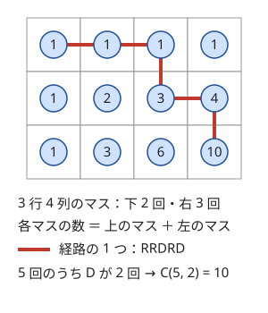
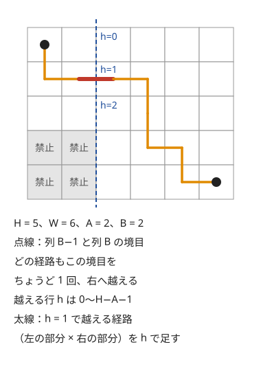

!!! abstract "要点"
    - **何ができるか**：$(0, 0)$ から $(a, b)$ への右・上の最短路は $\binom{a+b}{a}$ 通りで、R と U の列に 1 対 1 に対応する。移動の種類が違えば回数の組に直し、禁止領域は境界を越える点で分けて数える。
    - **いつ使うか**：
        - グリッドの左上から右下への最短路の数。
        - $H, W \le 10^5$ のグリッドで、左上から右下への経路の数を求める。
        - 通れない長方形の領域がある経路の数。
        - 2 種類の移動を組み合わせて目的地へ行く方法の数。
    - **計算量**：階乗の表の前計算 $O(H + W)$ の後、経路数 1 つは $O(1)$。禁止領域を境界で分けるときは、境界の長さ $L$ に対して $O(L)$。
    - **前提**：[二項係数の前計算](../comb/binomial-precompute.md)

<!-- textlint-disable -->
別名：格子路・グリッドの最短経路の数・障害物のある経路・lattice path
<!-- textlint-enable -->

格子路の数え上げは、格子の上を決まった向きにだけ進む経路を、移動の文字列に言い換えて二項係数で数える方法である。$H \times W$ のグリッドの DP は $O(HW)$ かかるが、障害物がなければ答えは二項係数 1 つで、$H, W \le 10^5$ でも $O(H + W)$ で済む。応用の多くは「回数の組に直す」「境界で分ける」「軸ごとに分ける」のどれかで、二項係数の積や和に帰着させる。

## 基本：C(a+b, a) と R・U の列 {#basic}

$(0, 0)$ から右（R）か上（U）に 1 ずつ進んで $(a, b)$ に着く経路を数える。どの経路もちょうど $a$ 回の R と $b$ 回の U を使うので、長さ $a + b$ の R・U の列になる。逆に、R を $a$ 個・U を $b$ 個含む列を 1 つ決めると、経路が 1 つに決まる。経路と列は 1 対 1 に対応するので（[対応づけ](../comb/counting-bijection.md#bijection)）、経路の数は「$a + b$ か所のうち R を置く $a$ か所の選び方」に等しい。

$$
\#\{(0, 0) \to (a, b)\} = \binom{a+b}{a} = \frac{(a+b)!}{a!\, b!}
$$

各点への経路の数が「左の点の数 ＋ 下の点の数」になり、パスカルの漸化式と同じになることは[二項係数の図](../comb/binomial-coefficient.md#meanings)のとおりである。[グリッド上の DP](../dp/dp-grid.md) を障害物なしで解くと、表の値が二項係数になる。

グリッドの問題で数えるのは、点ではなくマスであることが多い。$H$ 行 $W$ 列のマスを左上から右下まで右と下だけで進むなら、移動は下 $H - 1$ 回・右 $W - 1$ 回である。次の図は、3 行 4 列のマスに左上から各マスへの経路の数を書き込んだものである。



経路の数は $\binom{H+W-2}{H-1}$ で、表は $H + W$ 程度まで作れば足りる（[表の大きさ](../comb/binomial-precompute.md#table-size)）。

??? question "確認問題：途中の点を通らない経路"
    $(0, 0)$ から $(3, 2)$ への右・上の最短路のうち、$(1, 1)$ を通らないものは何通りか。

    ??? success "答え"
        4 通りである。全体は $\binom{5}{3} = 10$ 通り。$(1, 1)$ を通る経路は、$(0, 0) \to (1, 1)$ の $\binom{2}{1} = 2$ 通りと $(1, 1) \to (3, 2)$ の $\binom{3}{2} = 3$ 通りの積で 6 通りある。通る点で経路を前後に切ると、前半と後半は独立に選べるので積になる。$10 - 6 = 4$ である。

## 移動の種類を回数の組に直す {#move-counts}

移動が R・U でなくても、移動の種類が 2 つで、各種類の回数が終点から決まるなら、同じ考え方が使える。経路は「どの順に移動を並べるか」で決まり、回数が決まれば並べ方は二項係数で数えられる。

例として、1 回に $(+1, +2)$ か $(+2, +1)$ だけ動いて $(X, Y)$ に着く方法を数える。$(+1, +2)$ を $n$ 回、$(+2, +1)$ を $m$ 回使うとすると、次の連立方程式が成り立つ。

$$
X = n + 2m, \qquad Y = 2n + m
$$

2 式を足すと $3(n + m) = X + Y$ なので、$X + Y$ が 3 の倍数でなければ 0 通りである。3 の倍数なら $n = (2Y - X) / 3$、$m = (2X - Y) / 3$ は整数になる。$n$ と $m$ がどちらも 0 以上なら、答えは $n + m$ 回のうちどの $n$ 回を $(+1, +2)$ にするかで $\binom{n+m}{n}$ 通りである。

```cpp
--8<-- "lattice-paths/knight.cpp:core"
```

完全なプログラム：[`knight.cpp`](https://github.com/yuukougun/kyopro-atlas/blob/main/snippets/lattice-paths/knight.cpp)（GitHub）
{ .kp-code-src }

この形に直せるかは、次の順に確かめる。

- **回数が終点から 1 通りに決まるか**：移動のベクトルが 2 つで一次独立なら、回数の組は連立方程式の解として 1 通りに決まる。移動が 3 種類以上なら、回数の組は 1 通りとは限らない。平面なら、自由に選べる回数（3 種類なら 1 つ、4 種類なら 2 つ）でループし、各組の並べ方を[多項係数](../comb/multinomial-coefficient.md)で数えて足す
- **解が 0 以上の整数か**：割り切れない・負になる場合は 0 通り。前計算の `binom` が範囲外で 0 を返すようにしておくと、負の場合は自然に 0 になるが、割り切れない場合は整数の割り算で丸められるので先に調べる
- **途中の制約がないか**：「途中で座標が負にならない」などの制約があると、並べ方のすべてが有効とは限らない。その場合は次の節か[鏡像法](../comb/reflection-principle.md#reflection)を使う

## 禁止領域を避ける：境界を越える点で分類する {#forbidden-region}

この節は、通る点で経路を前後に分けて積を取る考え方（[基本の確認問題](#basic)）を使う。長方形の禁止領域が 1 つあるときは、経路を「禁止領域の境界をどこで越えるか」で分類すると、重複も漏れもなく数えられる。

$H$ 行 $W$ 列のマスを、左上 $(0, 0)$ を出て右下 $(H-1, W-1)$ まで、右と下だけで進む。この節では、マスを $(行, 列) = (r, c)$ の 0-indexed で表す（基本の節の $(x, y)$ とは、順と向きが違う）。禁止するのは、下の $A$ 行と左の $B$ 列が重なる長方形（$r \ge H - A$ かつ $c < B$ のマス）である。ここに入らない経路を数える。



どの経路も、列 $B - 1$ から列 $B$ への右の移動をちょうど 1 回だけ行う。右にしか進まないので、列の境目を越えるのは 1 回きりである。その行を $h$ とすると、禁止領域に入らないことは $h < H - A$ と同じになる。$h$ で経路を分類すると、各経路はちょうど 1 つの $h$ に属する。

- 前半：$(0, 0) \to (h, B - 1)$ は、下 $h$ 回・右 $B - 1$ 回の移動なので $\binom{h + B - 1}{h}$ 通り
- 後半：$(h, B) \to (H - 1, W - 1)$ は、下 $H - 1 - h$ 回・右 $W - 1 - B$ 回の移動なので $\binom{H + W - 2 - h - B}{H - 1 - h}$ 通り

答えは $h = 0, 1, \dots, H - A - 1$ についての積の和である。前半の終点は列 $B - 1$ の行 $h < H - A$ なので、前半は禁止領域の上だけを通る。後半は列 $B$ 以降だけを通る。どちらの部分も禁止領域に触れない。

```cpp
--8<-- "lattice-paths/forbidden.cpp:core"
```

完全なプログラム：[`forbidden.cpp`](https://github.com/yuukougun/kyopro-atlas/blob/main/snippets/lattice-paths/forbidden.cpp)（GitHub）。`mint` は ACL の `modint1000000007`（[modint](../math/modint.md)）。
{ .kp-code-src }

分類に使う境目は、どの経路も必ず 1 回だけ通るものを選ぶ。「禁止領域の角の点を通るか」のような分け方では、通らない経路が残ったり、2 回数えたりする。禁止のマスが散らばっているときは、境目ではなく「最初に踏む障害物」で分類する（[包除 DP](../comb/inclusion-exclusion-dp.md#first-obstacle)）。

??? question "確認問題：角の点で分けられない理由"
    経路を「禁止領域の右上の角のすぐ上のマス $(H-A-1, B-1)$ を通るか」で 2 つに分けて数えようとすると、なぜうまくいかないか。

    ??? success "答え"
        どちらの組にも、禁止領域に入る経路と入らない経路が混ざるからである。このマスを通ってから下へ進めば禁止に入り、右へ進めば入らない。通らない経路も、列 $0$ を下りれば禁止に入り、上の行を右へ進めば入らない。「通るか」では禁止に入るかどうかが決まらない。境目を越える行 $h$ は経路ごとにただ 1 つ決まり、しかも $h < H - A$ と禁止に入らないことが同じなので、$h$ で分けると数えられる。

## 経路数の総和と、二項係数の和を経路数として一括で求める {#sum-of-paths}

この節は[二項係数の恒等式](../comb/binomial-identities.md)を前提にする。多くの終点・始点への経路数の総和は、二項係数を 1 つずつ足すと間に合わないことがある。そのときは和そのものを別の経路数と見る。

**縦の和を 1 つの経路数にする**。$(0, 0)$ から $(i, r)$ への経路数を $i = 0, \dots, n$ について足すと、次の式になる（[縦の和の公式](../comb/binomial-identities.md#hockey-stick)）。

$$
\sum_{i=0}^{n} \binom{i + r}{r} = \binom{n + r + 1}{r + 1}
$$

右辺は $(0, 0)$ から $(n, r + 1)$ への経路数である。各経路を「最後の U の後に何回 R をするか」で分けると、その直前の点は $(i, r)$ で、$i$ ごとの経路数が左辺の各項になる。長方形の各点への経路数の総和は、行ごとにこの式を 2 回（右端までと左端の手前まで）使った差の和になり、$O(\text{行数})$ で求まる。

**二項係数の和を、多始点・多終点の経路数にする**。$\binom{a_i + a_j + b_i + b_j}{a_i + a_j}$ は、$(-a_i, -b_i)$ から $(a_j, b_j)$ への右・上の経路数である。すべての組 $(i, j)$ についての和は、各始点の位置に 1 を足してから（同じ始点が複数あればその個数になる）格子の上で DP を 1 回回し、終点の値を足せば求まる。組の数が $N^2$ でも、座標の絶対値が $M$ 以下なら、$(2M+1)^2$ の格子の DP で $O(N + M^2)$ で済む。組 $(i, i)$ の項を引く、順序のない組なら 2 で割る、の後処理を忘れない。

## 移動を軸ごとの回数に分けて独立にする（45 度回転） {#independent-axes}

この節は[マンハッタン距離と 45 度回転](../geometry/manhattan-chebyshev.md)を前提にする。上下左右のどれかへ 1 だけ動くことを $n$ 回繰り返し、$(X, Y)$ に着く方法を数える。戻る移動があるので R・U の列の形にはならない。しかし座標を $u = x + y$、$v = x - y$ と取り直すと、移動は 2 つの軸で独立する。

| 移動 | $(\Delta x, \Delta y)$ | $(\Delta u, \Delta v)$ |
| --- | --- | --- |
| 右 | $(+1, 0)$ | $(+1, +1)$ |
| 左 | $(-1, 0)$ | $(-1, -1)$ |
| 上 | $(0, +1)$ | $(+1, -1)$ |
| 下 | $(0, -1)$ | $(-1, +1)$ |

4 方向は $(\Delta u, \Delta v) \in \{+1, -1\}^2$ の 4 通りと 1 対 1 に対応する。だから 4 方向の列を選ぶことは、$u$ の $\pm 1$ の列と $v$ の $\pm 1$ の列を別々に選ぶことと同じである。$u$ が $n$ 回で $X + Y$ に着くには $+1$ が $(n + X + Y) / 2$ 回要るので、答えは次の積になる。

$$
\binom{n}{(n + X + Y)/2} \binom{n}{(n + X - Y)/2}
$$

$n + X + Y$ が奇数なら 0 通りで（$n + X - Y$ も同じ偶奇になる）、二項係数の下の数が範囲外でも 0 通りである。回転しない方法もある。横に動く回数 $k$ を決めると、横と縦は独立な 1 次元の移動になる。$\binom{n}{k}$ と各軸の 1 次元の移動の数の積を $k$ について足すと $O(n)$ で求まる。3 次元なら、1 つの軸の回数で分けてから残りの平面を回転する。

??? question "確認問題：2 歩で戻る方法"
    上下左右に 1 ずつ $n = 2$ 回動いて $(0, 0)$ に戻る方法は何通りか。式で求め、列を書き出した数と合うか確かめよ。

    ??? success "答え"
        4 通りである。$X = Y = 0$ なので式は $\binom{2}{1}\binom{2}{1} = 4$。書き出すと RL・LR・UD・DU の 4 つで一致する。

## 落とし穴 {#pitfalls}

**マスの数と移動の回数を取り違える**。$H \times W$ のマスの左上から右下までは、下 $H - 1$ 回・右 $W - 1$ 回の移動である。$\binom{H+W}{H}$ と書くと、$(H+1)$ 行 $(W+1)$ 列のグリッドの答えになる。$1 \times 1$ のグリッドで 1 通りになるかを確かめるとよい。

**階乗の表が足りない**。必要な $n$ の最大は、使う二項係数の上の数の最大である。格子路なら $H + W$、回数の組に直すなら回数の合計である。上限を問題の制約から計算し、`binom` に表の範囲の `assert` を入れておくと、足りないときにすぐ分かる。

**到達できない条件を見落とす**。回数が整数にならない（割り切れない）・負になる・偶奇が合わない場合は 0 通りである。整数の割り算 `(2 * y - x) / 3` は切り捨てられるので、割り切れるかを先に調べる。45 度回転の後は、$u$ と $v$ の偶奇の条件を落としやすい。

**分類が重複する**。禁止領域や障害物で場合を分けるときは、各経路がちょうど 1 つの場合に入るかを確かめる。「境目を越える行」「最初に踏む障害物」のように、経路ごとにただ 1 つ決まる量で分ける。小さいグリッドで DP の答えと比べると確実である。

**mod を取った値で比べる**。$\binom{n}{k} \bmod p$ が 0 でも、経路が 0 通りとは限らない。経路数の大小や「行けるか」を mod の値で判定せず、行けるかは回数の条件で決める。

## 上位の手法へのつながり {#next-steps}

格子路は、数え上げの多くの手法の土台である。

- **直線を越えない経路**：「どの接頭辞でも U の数が R の数以下」のような、斜めの境界を越えない経路は、最初に越えた点から先を折り返して数える（[鏡像法とカタラン数](../comb/reflection-principle.md#reflection)）。括弧列もこの形に直る
- **障害物が多い**：障害物を並べ、「最初に踏む障害物」ごとに全体から引く DP で、障害物の数 $N$ について $O(N^2)$ で数える（[包除 DP](../comb/inclusion-exclusion-dp.md#first-obstacle)）
- **交わらない複数の経路**：始点と終点の組がいくつもあり、経路どうしが交わってはいけないときは、経路数を並べた行列の行列式で数える（[LGV 補題](../comb/lgv-lemma.md#with-lattice-paths)）
- **言い換えの的として**：問題の対象を R・U の列や格子路に言い換えられれば、ここまでの道具がそのまま使える（[対応づけ・数える対象の言い換え](../comb/counting-bijection.md#to-lattice-paths)）

## 例題 {#examples}

### ABC145 D. Knight {#abc145_d}

<div class="kp-problems" data-role="example" markdown>

- [ABC145 D. Knight](https://atcoder.jp/contests/abc145/tasks/abc145_d)（diff 1009）：原点から (+1, +2) か (+2, +1) の移動を繰り返して、点 (X, Y) に着く方法の数を求める。

</div>

移動は 2 種類で、どちらも座標を増やすだけなので、経路は 2 種類の移動を並べた列と 1 対 1 に対応する。各移動の回数は終点から連立方程式で決まり、方法の数は並べ方の数 $\binom{n+m}{n}$ になる。

??? note "解法の詳細"
    - $(+1, +2)$ を $n$ 回、$(+2, +1)$ を $m$ 回とすると、$X = n + 2m$、$Y = 2n + m$。
    - $X + Y$ が 3 の倍数でなければ 0。3 の倍数なら $n = (2Y - X)/3$、$m = (2X - Y)/3$ で、どちらかが負なら 0。
    - 答えは $\binom{n+m}{n} \bmod (10^9 + 7)$。$n + m = (X + Y)/3$ は $X, Y \le 10^6$ のとき約 $6.7 \times 10^5$ 以下なので、表はその大きさまで作れば足りる。
    - コードは[回数の組に直す節](#move-counts)のものと同じである。

## 練習問題 {#practice}

<div class="kp-problems" data-role="practice" markdown>

- [ABC154 F. Many Many Paths](https://atcoder.jp/contests/abc154/tasks/abc154_f)（diff 1775）：r_1 ≤ i ≤ r_2、c_1 ≤ j ≤ c_2 のすべての (i, j) について、原点から (i, j) への右・上の最短路の数を求め、その総和を求める。
- [ABC011 D. 大ジャンプ](https://atcoder.jp/contests/abc011/tasks/abc011_4)（diff 1843・参考値）：1 回に上下左右のどれかへ距離 D だけ等確率で動くことを N 回繰り返したとき、点 (X, Y) にいる確率を求める。
- [ARC058 D. Iroha and a Grid](https://atcoder.jp/contests/arc058/tasks/arc058_b)（diff 1905）：H×W のグリッドの左上から右下へ右と下だけで進むとき、左下の A×B の領域に入らない経路の数を求める。

</div>

??? note "練習の方針"
    - **ABC154 F**：1 行ぶんの和を縦の和の公式で二項係数 2 つの差にし、行について足す。表は $r_2 + c_2 + 2$ 程度まで要る
    - **ABC011 D**：座標を $D$ で割り切れなければ 0。割った後、横に動く回数で分けて各軸の 1 次元の移動の数を掛けるか、45 度回転で 2 つの二項係数の積にする。経路の数は $4^N$ 近くまで大きくなり `double` からあふれる。パスカルの三角形の各段を 2 で割って $\binom{n}{k}/2^n$（$n$ 回のうち $k$ 回が $+$ になる確率）の表を作り、確率どうしを掛ける。45 度回転なら $\binom{N}{p}/2^N \cdot \binom{N}{q}/2^N$ で済む
    - **ARC058 D**：禁止領域の右の境目を越える行で分類し、前半と後半の二項係数の積を足す。[禁止領域の節](#forbidden-region)のコードがそのまま使える

## 力試し {#challenge}

<div class="kp-problems" data-role="challenge" markdown>

- [AGC001 E. BBQ Hard](https://atcoder.jp/contests/agc001/tasks/agc001_e)（diff なし）：N 組の (A_i, B_i) について、すべての i < j の組の C(A_i+B_i+A_j+B_j, A_i+A_j) の和を求める。
- [ABC240 G. Teleporting Takahashi](https://atcoder.jp/contests/abc240/tasks/abc240_g)（diff 2462）：3 次元の格子で、1 回に 6 方向のどれかへ 1 だけ動くことを N 回繰り返して点 (X, Y, Z) に着く方法の数を求める。

</div>

??? note "力試しの方針"
    - **AGC001 E**：各項は、$(-A_i, -B_i)$ から $(A_j, B_j)$ への経路の数である。各始点の位置に 1 を足して格子の DP を 1 回回し、終点の値を足す。最後に $i = j$ の項を引いて 2 で割る
    - **ABC240 G**：$z$ 軸の移動の回数 $m$ で分ける。$m$ ごとに、どの時刻を $z$ の移動にするかの $\binom{N}{m}$、$z$ の 1 次元の移動の数、残りの平面の移動を 45 度回転した 2 つの二項係数を掛けて足す

## 参考 {#references}

- [drken「AtCoder ABC 145 D - Knight (2Q, 緑色, 400 点)」](https://drken1215.hatenablog.com/entry/2020/04/26/180000)：例題の連立方程式と 0 になる条件
- [drken「AtCoder ABC 042 D - いろはちゃんとマス目 (ARC 058 D) (1Q, 青色, 400 点)」](https://drken1215.hatenablog.com/entry/2020/04/06/235844)：禁止領域を境目を越える行で分類する方法
- [drken「AtCoder ABC 154 F - Many Many Paths (2D, 青色, 600 点)」](https://drken1215.hatenablog.com/entry/2020/02/09/225000)：縦の和の公式と、行ごとの差で長方形の和を求める方法
- [drken「AtCoder ABC 011 D - 大ジャンプ (1D, 試験管青色)」](https://drken1215.hatenablog.com/entry/2020/11/14/084800)：横に動く回数で分ける方法と、確率の計算の精度
- [drken「AtCoder AGC 001 E - BBQ Hard (5D, 1400 点)」](https://drken1215.hatenablog.com/entry/2019/05/18/152000)：二項係数の和を多始点の格子の DP で求める方法
- [kmjp「AtCoder ABC #240 : G - Teleporting Takahashi」](https://kmjp.hatenablog.jp/entry/2022/02/23/0900)：$z$ の回数で分けて平面を 45 度回転する方法
