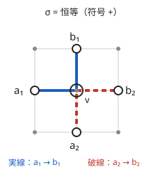
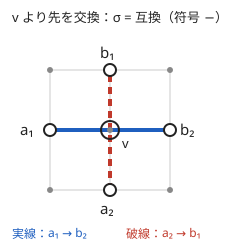

!!! abstract "要点"
    - **何ができるか**：DAG 上で $k$ 個の始点から $k$ 個の終点への、互いに頂点を共有しない経路の組の数（置換の符号付き）を、始点 $i$ から終点 $j$ への経路数を並べた行列の行列式で求める。交わる組は符号で打ち消し合う。
    - **いつ使うか**：
        - K 本の経路が互いに交わらない組の個数。
        - 複数の駒が衝突せずに動く確率。
    - **計算量**：経路数の $k \times k$ 行列を作る時間 ＋ 行列式 $O(k^3)$（mod 素数の掃き出し）
    - **前提**：[格子路の数え上げ](../comb/lattice-paths.md)、[行列式](../math/determinant.md)

<!-- textlint-disable -->
別名：Lindström-Gessel-Viennot の補題・交わらない経路の組・LGV lemma
<!-- textlint-enable -->

LGV 補題は、[DAG](../guide/glossary.md#dag) の上で「どの 2 本も頂点を共有しない $k$ 本の経路の組」を、1 本ずつの経路数だけから数える定理である。1 本の経路数は DP や二項係数で求まるので、それを $k \times k$ の行列に並べて[行列式](../math/determinant.md)を取れば済む。互いに交わらないという大域的な条件を、行列式の符号の打ち消し合いが引き受けてくれる。

## 何ができるか（行列式で数える） {#what}

DAG の始点 $a_1, \dots, a_k$ と終点 $b_1, \dots, b_k$ を決め、$a_i$ から $b_j$ への経路の数を $e(a_i, b_j)$ とする。行列 $M$ を $M_{ij} = e(a_i, b_j)$ で作ると、次が成り立つ。

$$
\det M = \sum_{\sigma} \operatorname{sgn}(\sigma) \cdot \#\{\, (P_1, \dots, P_k) : P_i \text{ は } a_i \to b_{\sigma(i)} \text{、どの 2 本も頂点を共有しない} \,\}
$$

和は $1, \dots, k$ の置換 $\sigma$ すべてにわたり、$\operatorname{sgn}(\sigma)$ は[置換の符号](../comb/permutation-parity.md#sign)（偶置換なら $+1$、奇置換なら $-1$）である。

競技プログラミングで使うのは、たいてい次の特別な場合である。

- **頂点を共有しない組が $\sigma$ ＝ 恒等置換でしか作れないとき**：右辺は恒等置換の項だけになり、$\det M$ は「$a_i$ と $b_i$ を結ぶ $k$ 本が互いに交わらない組の数」そのものになる。
- **辺に重みがあるとき**：$e(a, b)$ を「経路の重み（辺の重みの積）の和」にすれば、右辺も重みの和になる。各辺に確率を載せれば、交わらずに動く確率が求まる。

「交わらない」は頂点を共有しないことで、辺を共有しないことではない。始点や終点が一致していれば、その時点で共有しているので組は 0 になる。

## 符号付きで数える理由（交わる組が打ち消し合う） {#why-signed}

行列式を置換で展開すると $\det M = \sum_\sigma \operatorname{sgn}(\sigma) \prod_i e(a_i, b_{\sigma(i)})$ である。各項の $\prod_i e(a_i, b_{\sigma(i)})$ は「$a_i \to b_{\sigma(i)}$ の経路を 1 本ずつ選ぶ組」の数である。つまり $\det M$ は、交わるかどうかを気にせずに選んだ経路の組すべての、符号付きの個数である。ここから交わる組の分が消えることを示せばよい。

交わる組には、次の規則で相手を 1 つ決める。

1. 他の経路と頂点を共有する経路のうち、番号 $i$ が最小のものを選ぶ
2. $P_i$ の上で、他の経路と共有する最初の頂点 $v$ を選ぶ
3. $v$ を通る他の経路のうち、番号 $j$ が最小のものを選ぶ
4. $P_i$ と $P_j$ の $v$ より先の部分を入れ替える

入れ替えた後も経路の集合が通る頂点は同じなので、同じ $i$・$v$・$j$ が選ばれ、もう一度入れ替えると元に戻る。重み（辺の重みの積）も変わらない。一方で行き先が $b_{\sigma(i)}$ と $b_{\sigma(j)}$ で入れ替わるので、置換は互換を 1 つ掛けたものになり、符号が反転する。こうして交わる組は符号の違う相手と 2 つずつ組になり、和の中で打ち消し合う。残るのは交わらない組だけである。

次の 2 枚は、右か上に 1 歩ずつ進む格子で、$a_1 = (0, 1)$、$a_2 = (1, 0)$、$b_1 = (1, 2)$、$b_2 = (2, 1)$ としたときの、打ち消し合う 1 組である。





この例では $M = \begin{pmatrix} 2 & 1 \\ 1 & 2 \end{pmatrix}$ で、$\det M = 4 - 1 = 3$ である。恒等置換の $2 \times 2 = 4$ 組のうち、2 本とも $(1, 1)$ を通る 1 組が、互換の 1 組（図の 2 枚目）と打ち消し合う。全列挙しても、$a_1 \to b_1$ と $a_2 \to b_2$ が交わらない組は 3 つである。

厳密な証明（DAG であることをどこで使うか、組み合わせが本当に 1 対 1 か）は、学ぶための資料に任せる。

??? question "確認問題：終点の順を入れ替えると"
    上の例で $b_1 = (2, 1)$、$b_2 = (1, 2)$ と番号を入れ替えると、$\det M$ はいくつになるか。それは何を数えているか。

    ??? success "答え"
        $M = \begin{pmatrix} 1 & 2 \\ 2 & 1 \end{pmatrix}$ で $\det M = -3$ になる。$a_1 \to b_1$・$a_2 \to b_2$ は必ず交わるので恒等置換の項は 0 で、交わらない 3 組はどれも互換の項に入り、符号 $-1$ が付く。行列式が数えるのは常に符号付きの和なので、交わらない組が恒等置換でしか作れないように番号を付けることが大切である。

## 格子路と組み合わせる {#with-lattice-paths}

右（$+x$）か上（$+y$）に 1 歩ずつ進む格子では、$e(a, b)$ は[格子路の数](../comb/lattice-paths.md#basic)で、$dx = b_x - a_x$・$dy = b_y - a_y$ がどちらも 0 以上なら $\binom{dx + dy}{dx}$、そうでなければ 0 である。二項係数は[階乗の表](../comb/binomial-precompute.md)で $O(1)$ に求まるので、行列は $O(k^2)$ で作れる。

残る問題は「頂点を共有しない組が恒等置換でしか作れない」ことの確かめ方である。格子では、次の形なら成り立つ。

- 始点がすべて同じ斜めの線 $x + y = s$ の上にあり、$x$ の小さい順に $a_1, a_2, \dots$ と番号が付いている。
- 終点も同じく、斜めの線 $x + y = t$ の上で $x$ の小さい順に $b_1, b_2, \dots$ と番号が付いている。

理由は中間値の議論である。経路は斜めの線 $x + y = c$ を 1 つずつ通り、その上の点の $x$ は 1 歩ごとに 0 か 1 しか増えない。$i < j$ なのに $a_i \to b_l$ と $a_j \to b_m$（$l > m$）を選ぶと、2 本の $x$ の差は始めは負、終わりは正である。差は 1 段ごとに $-1$・$0$・$+1$ しか変わらないので、途中のどこかで 0 になり、そこで同じ点を通る。よって順を入れ替える組はどれも交わり、交わらない組は恒等置換だけになる。

同じ議論は、「段（格子なら $x + y$、時刻なら $t$）ごとに頂点が一列に並び、始点はすべて同じ段、終点もすべて同じ段にあり、1 歩で位置が変わらないか一方向に 1 つだけ進む」形の DAG ならそのまま使える。位置が両向きに動けるときは、隣どうしの 2 つが同時に位置を入れ替えると、頂点を共有せずに順が入れ替わるので使えない。数直線上を動く駒の問題がこの形である。始点や終点が斜めの線にそろっていないときは、$a_i \to b_l$ と $a_j \to b_m$（$i < j$、$l > m$）が必ず交わるかを自分で確かめる。

中心の部分は次のとおりである（完全なプログラムは `snippets/lgv-lemma/grid-paths.cpp`。座標が小さいときは全列挙の符号付きの和と一致することを確かめている）。

```cpp
--8<-- "lgv-lemma/grid-paths.cpp:lgv"
```

## 行列式を bitDP で展開する例 {#bitdp}

終点が決まっておらず、「$k$ 本が交わらずにどこかで止まる組」の総数（や確率）を問われることがある。終点の位置の集合 $y_1 < y_2 < \dots < y_k$ ごとに LGV 補題を使うと、答えは

$$
\sum_{y_1 < \dots < y_k} \det\bigl( e(a_i, y_j) \bigr)_{i, j}
$$

になる。終点の選び方は膨大なので、行列式を置換の和に展開し、終点を小さい順に始点へ割り当てる DP で和をまとめて計算する。

始点は位置の小さい順に $a_1, \dots, a_k$ と番号を付けておく（入力がそうでなければ並べ替える）。

- 状態：$\mathrm{dp}[S]$ ＝ ここまでに見た終点の候補のうちいくつかを選び、始点の集合 $S$ の各始点に 1 つずつ割り当てたときの、符号と経路数の積の和。
- 遷移：次の候補 $y$ を使わないか、まだ割り当てていない始点 $i \notin S$ に割り当てる。割り当てるときは $e(a_i, y)$ を掛け、$S$ の中で $i$ より大きい番号の個数だけ $-1$ を掛ける。1 つの候補で更新する間は更新前の値から新しい配列を作る（その場で書き換えると、同じ候補が 2 つの始点に割り当たる）。
- 初期値と答え：$\mathrm{dp}[\emptyset] = 1$ から始め、候補をすべて見た後の $\mathrm{dp}[\{1, \dots, k\}]$ が答え。

符号の付け方の根拠は[転倒数](../ds/inversion-number.md)である。$j$ 番目に小さい終点を始点 $\tau(j)$ に割り当てると、置換の符号は $\tau$ の転倒数の偶奇で決まる。転倒数は「$\tau(j)$ を加えるとき、すでに $S$ にある $\tau(j)$ より大きい番号の個数」の和なので、遷移のたびに $-1$ を掛けていけば符号が正しく付く。同じ候補を 2 つの始点に割り当てる組は DP で作らない（行列式でも同じ列が 2 つあれば 0 である）。

候補の位置の数を $L$ とすると、状態は $2^k$ 個、遷移は各 $k$ 個で、$O(2^k k L)$ になる。$k$ が 10 程度までなら間に合う。[bitDP](../dp/bit-dp.md) の書き方は、集合を整数で表すいつもの形でよい。

??? question "確認問題：なぜ終点を小さい順に割り当てるのか"
    終点の候補を順に見るのをやめ、各始点について終点を自由に選ぶ DP にすると、何が困るか。

    ??? success "答え"
        LGV 補題を使えるのは、終点の集合を $y_1 < \dots < y_k$ と番号付けたときに、交わらない組が恒等置換でしか作れないからである。終点を自由に選ぶと、同じ終点の集合が番号の付け方の数だけ現れ、行列式の和に対応しなくなる。小さい順に見れば、各集合はちょうど 1 回だけ数えられ、どの始点に割り当てたかが置換 $\tau$ になる。

## 計算量と自作するときの要点 {#library}

計算は「1 本ずつの経路数で $k \times k$ 行列を作る」と「行列式を求める」の 2 段である。行列式は[掃き出し法](../math/gaussian-elimination.md#mod-p)で上三角にし、対角成分の積に行の交換の回数だけ $-1$ を掛けて $O(k^3)$ で求める。答えを mod 素数で求めるなら、ピボットで割る代わりに逆元を掛ける。法が素数でないときは、互除法で掃き出す方法を[行列式](../math/determinant.md#modulus)のページで扱う。

```cpp
--8<-- "lgv-lemma/grid-paths.cpp:det"
```

自作するときに気をつける点は次のとおりである。

- **始点と終点の番号の付け方**：交わらない組が恒等置換だけになるように並べる。並べ方を誤ると、答えの符号が反転したり、別の置換の項が混ざったりする。小さい例で全列挙と比べると確実である。
- **行の交換で符号を反転する**：ピボットが 0 の列で行を入れ替えたら、結果に $-1$ を掛ける。列のどこにも 0 でない値がなければ行列式は 0 である。
- **答えの mod の値が 0 のとき**：交わらない組の個数が法の倍数なだけで、組は存在しうる。組が存在するかどうかを判定したいなら、mod の値ではなく座標の条件などで確かめる。
- **確率で求めるとき**：各辺に確率を載せた重みで行列を作るか、経路の数で行列式を求めてから全体の場合の数で割る（[有理数の mod](../comb/rational-mod.md)）。

ACL に行列式はない。自作した行列式は Library Checker で確かめる。LGV 補題そのものを問う問題はない。

- [Determinant of Matrix](https://judge.yosupo.jp/problem/matrix_det)：$N \le 500$ の行列式を mod 998244353 で求める。
- [Determinant of Matrix (Arbitrary Mod)](https://judge.yosupo.jp/problem/matrix_det_arbitrary_mod)：法が素数とは限らない場合。

## 学ぶための資料 {#resources}

- 英語版 Wikipedia の「Lindström-Gessel-Viennot lemma」：重み付きの一般形の主張と、打ち消し合いによる証明の概略。応用（Schur 多項式など）にも触れている。
- OI Wiki の「LGV 引理」（中国語）：定義・証明と、格子上の 2 本の経路を数える例題がある（文章と図の利用条件は CC BY-SA）。
- kmjp 氏の ABC216 H の記事：終点を固定しない場合に、置換の和を集合の DP にまとめる実装の例。

## 例題 {#examples}

### ABC216 H. Random Robots {#abc216_h}

<div class="kp-problems" data-role="example" markdown>

- [ABC216 H. Random Robots](https://atcoder.jp/contests/abc216/tasks/abc216_h)（diff 3295）：数直線上の異なる位置にいる K 台のロボットが、N 秒間、毎秒それぞれ独立に確率 1/2 で正の向きに 1 進むか止まるとき、どの 2 台も同じ時刻に同じ位置にいることがない確率を求める。

</div>

方針：（時刻, 位置）を頂点とし、止まる辺と 1 進む辺を持つ DAG を考えると、各ロボットの動きは経路になり、衝突しないことは経路が頂点を共有しないことになる。1 秒で位置は変わらないか 1 進むだけなので、追い越すには必ず同じ位置に並ぶ。よって始点と終点をそれぞれ位置の小さい順に並べれば交わらない組は恒等置換だけになり、[行列式を bitDP で展開する例](#bitdp)の形がそのまま使える。

??? note "解法の詳細"
    - 始点 $X_i$ から終点 $y$ への経路の数は、$N$ 秒のうち進む秒を $y - X_i$ 個選ぶ数 $\binom{N}{y - X_i}$ である（範囲外は 0）。
    - 始点は $X_i$ の小さい順に番号を付けておく（そうでなければ並べ替える）。終点の候補の位置を小さい順に見て、$\mathrm{dp}[S]$ に「始点の集合 $S$ に終点を割り当てたときの、符号と経路数の積の和」を持つ。始点 $i$ に割り当てるときは $\binom{N}{y - X_i}$ を掛け、$S$ の中の $i$ より大きい番号の個数だけ $-1$ を掛ける。
    - 最後の $\mathrm{dp}[\text{全体}]$ は交わらない動き方の数なので、全体の動き方の数 $2^{NK}$ で割って確率にする（mod では逆元を掛ける）。
    - 計算量は候補の位置の数を $L$ として $O(2^K K L)$ である。

## 参考 {#references}

- [「Lindström–Gessel–Viennot lemma」（英語版 Wikipedia）](https://en.wikipedia.org/wiki/Lindstr%C3%B6m%E2%80%93Gessel%E2%80%93Viennot_lemma)：主張（重み付き・置換の符号）と、交わる組を打ち消し合わせる証明の筋
- [OI Wiki「LGV 引理」](https://oi-wiki.org/graph/lgv/)：学ぶための資料として節の構成と例題を確かめた（文章と図は使っていない）
- [kmjp「AtCoder ABC #216 : H - Random Robots」](https://kmjp.hatenablog.jp/entry/2021/09/02/0900)：例題の問いの確認と、置換を集合の DP で数える方針
- [Library Checker「Determinant of Matrix」の問題定義（GitHub）](https://github.com/yosupo06/library-checker-problems/tree/master/linear_algebra/matrix_det)：問題の内容と制約（$N \le 500$、mod 998244353）
