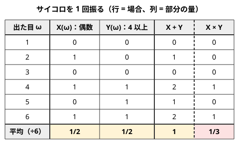

!!! abstract "要点"
    - **何ができるか**：$E[X + Y] = E[X] + E[Y]$ は $X$ と $Y$ が独立でなくても成り立つので、複雑な量を部分の和に分けて各部分の期待値を足せる。個数の期待値は各候補が条件を満たす確率の和で、一様なら「期待値 = 総和 / 総数」になる。
    - **いつ使うか**：
        - 〜の個数（種類数）の期待値
        - 転倒数・連結成分の数などの期待値
        - ランダムな操作の後の値の総和の期待値
        - 全パターンについての和を求め、総数で割る
    - **計算量**：部分の数 × 1 つの部分の期待値を求める時間。$N$ 個の候補に分ければ $O(N)$ 項、ペアごとに分ければ $O(N^2)$ 項を足す（まとめて数えれば速くできる）
    - **前提**：[確率の基本](../comb/probability-basics.md)

<!-- textlint-disable -->
別名：期待値の線形性・和の期待値は期待値の和・指示確率変数・indicator・ペアごとの確率・総和と期待値の行き来・linearity of expectation
<!-- textlint-enable -->

期待値の線形性は、和の期待値が期待値の和に等しいという性質である。起こりうる場合をすべて追うと指数個になる量でも、小さな部分の和に分ければ、部分ごとの期待値を求めて足すだけで済む。とくに「個数」を「各候補が条件を満たすなら 1」の和に分けると、個数の期待値は確率の和になる（指示確率変数）。

このページで使う記法：確率変数 $X$ の期待値を $E[X]$、事象 $A$ の確率を $P(A)$ と書く。条件 $C$ が成り立てば 1、成り立たなければ 0 になる値を $[C]$ と書く（[記法と用語の約束](../start/notation.md#probability)）。

## 線形性と独立性（積は独立なら分かれる） {#linearity}

期待値の線形性とは、確率変数 $X, Y$ と定数 $c$ について、次の 2 つが成り立つことである。$X$ と $Y$ が独立かどうかは問わない。

$$
E[X + Y] = E[X] + E[Y], \qquad E[cX] = c\,E[X]
$$

繰り返し使えば、$N$ 個の確率変数について $E[X_1 + \dots + X_N] = E[X_1] + \dots + E[X_N]$ となる。

**なぜ成り立つか**：起こりうる場合（根元事象）$\omega$ が有限個で、それぞれ確率 $P(\omega)$ で起こるとする。期待値の定義どおりに書いて、和を 2 つに分けるだけである。

$$
E[X + Y] = \sum_\omega P(\omega)\bigl(X(\omega) + Y(\omega)\bigr) = \sum_\omega P(\omega) X(\omega) + \sum_\omega P(\omega) Y(\omega) = E[X] + E[Y]
$$

この式変形のどこにも独立性は出てこない。確率変数を表に書くと見やすい。行を起こりうる場合、列を部分の量にすると、「行ごとに和を取ってから平均する」のと「列ごとに平均してから足す」のは、表の全マスを重み付きで足す順序を変えただけである。



図の $X$（偶数なら 1）と $Y$（4 以上なら 1）は独立でない。$P(X = 1, Y = 1) = P(\{4, 6\}) = 1/3$ で、$P(X = 1)P(Y = 1) = 1/4$ と違うからである。それでも $E[X + Y] = 1 = 1/2 + 1/2$ が成り立つ。

一方、積の期待値 $E[XY] = E[X]E[Y]$ は、独立なら成り立つが、独立でないと一般には成り立たない。図の例では $E[XY] = 1/3$ で、$E[X]E[Y] = 1/4$ と一致しない。$X$ と $Y$ が独立なら $P(X = x, Y = y) = P(X = x)P(Y = y)$ なので、$\sum_{x, y} xy\,P(X = x)P(Y = y)$ が $E[X]E[Y]$ に分かれる。

??? question "確認問題：サイコロを 100 回振る。前の回と同じ目が出る回数の期待値は？"
    2 回目から 100 回目までの各回 $i$ について、$X_i = [\text{$i$ 回目の目} = \text{$i - 1$ 回目の目}]$ とおく。$E[X_i] = 1/6$ なので、答えは $99 \times 1/6 = 33/2$ である。

    $X_i$ と $X_{i+1}$ はどちらも $i$ 回目の目にかかわるが、線形性は独立性を使わないので、そのまま足してよい。

## 量を和に分けて各部分の期待値を足す {#split}

求める量 $X$ を、期待値を求めやすい部分 $X_1, \dots, X_K$ の和 $X = X_1 + \dots + X_K$ に書き直せれば、$E[X] = \sum_k E[X_k]$ で求まる。起こりうる場合をすべて調べる必要はない。

たとえば $N$ 個のサイコロを振り、$i$ 番目は $1$ から $p_i$ までの目が等確率で出るとする。目の和の起こりうる場合は $p_1 p_2 \cdots p_N$ 通りあるが、目の和の期待値は、各サイコロの期待値 $(1 + p_i)/2$ を足すだけで求まる。

分け方の手順は次のとおりである。

1. 求める量を、要素・位置・ペア・操作などの単位ごとの量の和として書く。各部分は単純な量（0 か 1、1 つの値）になるように選ぶ
2. 部分ごとに期待値を求める。部分どうしの依存は気にしなくてよい
3. 足す。同じ形の部分がたくさんあれば、まとめて数える（同じ確率になる部分を個数倍する、累積和や BIT で数える）

分け方に迷ったら、[寄与](../thinking/contribution.md)の考え方と同じく「答えの中で各要素が何回・どれだけ数えられるか」を見る。

## 操作が期待値に線形に作用するなら期待値のまま追う {#linear-operations}

ランダムな操作を繰り返す問題では、値の列 $v = (v_0, \dots, v_{N-1})$ そのものは確率的に枝分かれする。それでも、期待値の列 $E[v] = (E[v_0], \dots, E[v_{N-1}])$ なら 1 本の列として追えることがある。まず例で確かめてから、条件をまとめる。

**例**：区間 $[l, r)$ の値をすべて集めて合計 $S$ を作り、区間内の一様に選んだ位置 $x$ に置く（区間のほかの位置は 0 にする）。操作の後の位置 $j \in [l, r)$ の値は $[x = j] \cdot S$ で、これは $x$ を決めれば値の 1 次式である。また $x$ は今の値と独立に選ばれるので、積の期待値が分かれる。

$$
E[v'_j] = E\bigl[[x = j]\bigr]\,E[S] = \frac{1}{r - l} \sum_{i = l}^{r - 1} E[v_i]
$$

期待値の列で見ると「区間の各位置の期待値を、区間の期待値の平均で上書きする」という確定した操作になる。区間の和と区間の上書きは[遅延セグメント木](../ds/lazy-segment-tree.md)で行える（[ABC417 F](#abc417_f)）。遅延セグメント木の節点に（区間の和 `sum`、区間の長さ `len`）を持たせ、作用 `F{true, v}` を「値 $v$ で上書き」とすると、1 回の操作は次の 2 行になる。

```cpp
--8<-- "linearity-of-expectation/range-average.cpp:core"
```

**一般の条件**：次の 2 つが成り立てば、期待値の列のまま追える。

- 操作の選び方 $c$ を決めると、操作の後の値が各値の 1 次式 $v'_j = \sum_i a^{(c)}_{ji} v_i + b^{(c)}_j$ になる
- 選び方 $c$ が、それまでの値と独立に決まる（今の値を見て選び方の確率が変わらない）

このとき $E[v'_j] = \sum_i \bar a_{ji} E[v_i] + \bar b_j$ となる。$\bar a_{ji}$・$\bar b_j$ は、係数 $a^{(c)}_{ji}$・$b^{(c)}_j$ を $c$ について平均したものである。係数と値の積の期待値を分けるところで、2 つ目の条件（独立性）を使っている。

毎回同じ確率で操作を選ぶとし、平均の係数を行列 $\bar A = (\bar a_{ji})$ にまとめる。定数項 $\bar b$ が 0 なら、$K$ 回の操作の後の期待値は $\bar A^K E[v]$ になる（$\bar b \ne 0$ なら、値の列に定数 1 を足した $N + 1$ 次の行列にする）。$K$ が大きければ[行列累乗](../math/matrix-power.md)で求める。

この方法が使えないのは、操作が値について 1 次式でないとき（「大きい方を残す」「値が正なら半分にする」など）と、選び方が今の値に依存するとき（値に比例する確率で位置を選ぶなど）である。どちらも、期待値だけでは次の期待値が決まらない。

## 指示確率変数：個数の期待値 = 確率の和 {#indicator}

「条件を満たすものの個数」の期待値は、候補ごとの確率の和になる。候補 $i$ について $X_i = [\text{$i$ が条件を満たす}]$ とおくと、個数は $X = \sum_i X_i$ と書ける。この $X_i$ を指示確率変数（indicator）という。$X_i$ は 0 か 1 なので $E[X_i] = 1 \cdot P(X_i = 1) + 0 \cdot P(X_i = 0) = P(\text{$i$ が条件を満たす})$ であり、線形性から次が成り立つ。

$$
E[\text{個数}] = \sum_i P(\text{$i$ が条件を満たす})
$$

**小さい例**：$1, 2, 3$ の一様ランダムな順列 $p$ で、$p_i = i$ となる位置（固定点）の個数の期待値を求める。6 通りを全列挙すると、固定点の個数は次のとおりである。

| 順列 | 固定点の個数 |
| --- | --- |
| $(1, 2, 3)$ | 3 |
| $(1, 3, 2)$・$(2, 1, 3)$・$(3, 2, 1)$ | 1 ずつ |
| $(2, 3, 1)$・$(3, 1, 2)$ | 0 |

合計は 6 個で、期待値は $6/6 = 1$ になる。指示確率変数で考えると、位置 $i$ が固定点になる確率は $1/3$ なので、$3 \times 1/3 = 1$ と全列挙なしで出る。長さ $N$ でも $N \times 1/N = 1$ である。

この方法で数えると、重複も漏れもない。各候補 $i$ はちょうど 1 つの $X_i$ にだけ対応し、条件を満たせば 1、満たさなければ 0 として数えられるからである。候補の決め方を誤ると、同じものを 2 回数えてしまう。たとえば「連結成分の個数」を「頂点 $v$ がどこかの成分に属するか」で数えると、1 つの成分を頂点数だけ数えてしまう。ランダムな状況では成分そのものが変わるので、候補は固定した頂点にし、$X_v = [\text{$v$ が自分の属する成分で番号が最小}]$ とおく。各成分でちょうど 1 頂点が 1 になる。森なら「成分の数 = 頂点数 − 辺数」なので、辺ごとの指示確率変数で辺の数の期待値を求めてもよい。

使える場面は多い。

- 種類数の期待値：種類ごとに「1 つ以上含まれる確率」を求めて足す。$N$ 個から $K$ 個を一様に選ぶとき、$c$ 個ある種類が含まれない確率は $\binom{N - c}{K} / \binom{N}{K}$ である
- 操作の回数の期待値：操作 1 回ごとに「その回の主役」を 1 つ決め、各候補が主役になる確率を足す
- 部分木・連結成分に含まれる頂点の個数の期待値：頂点ごとに「含まれる確率」を求めて足す

??? question "確認問題：区別できる $N$ 個の箱に $M$ 個の玉を独立に一様に入れる。空の箱の個数の期待値は？"
    箱 $i$ について $X_i = [\text{箱 $i$ が空}]$ とおく。1 個の玉が箱 $i$ に入らない確率は $1 - 1/N$ で、玉は独立に入るので $P(X_i = 1) = (1 - 1/N)^M$ である。答えは $N(1 - 1/N)^M$ になる。

    $X_1, \dots, X_N$ は独立でない（全部が 1 にはならない）が、足してよい。

## ペアごとの確率と対称性 {#pairs}

この節では[対称性で確率を求める](../comb/probability-symmetry.md)考え方を使う。転倒数のように「条件を満たすペアの個数」の期待値は、ペア $(i, j)$ ごとの指示確率変数に分けて、ペアごとの確率の和にする。

$$
E[\text{転倒数}] = \sum_{i < j} P(\text{$i$ 番目の値} > \text{$j$ 番目の値})
$$

ペアは $N(N-1)/2$ 個あるので、そのまま足すと $O(N^2)$ 項になる。ペアの確率が少ない種類に分かれるなら、種類ごとにまとめて数える（同じ確率のペアの個数を掛ける）。

ペアの確率は対称性で求まることが多い。一様ランダムな順列では、2 つの位置の値を入れ替える操作が順列全体の 1 対 1 の対応になるので、「$i$ 番目の方が大きい」と「$j$ 番目の方が大きい」は同じ確率で、どちらも $1/2$ である。よって一様ランダムな順列の転倒数の期待値は $\frac{N(N-1)}{2} \times \frac{1}{2} = \frac{N(N-1)}{4}$ になる。

**小さい例**：$N = 3$ の 6 個の順列の転倒数は $(1, 2, 3)$ から順に $0, 1, 1, 2, 2, 3$ で、平均は $9/6 = 3/2$ である。式の値 $3 \cdot 2 / 4 = 3/2$ と一致する。

連続した区間 $[l, l + K)$ だけをシャッフルする場合は、ペアを「両方とも区間の中」「片方だけ中」「両方とも外」に分ける。両方とも中のペアは確率 $1/2$ で転倒し、両方とも外のペアは元のままである。片方だけ中のペアは、1 つずつ見ると変わりうるが、和は元のままである。外の要素 1 つから見ると、区間の位置はすべて同じ側にある。だから区間の中の値との転倒の数は、区間の中の並び方によらない。よって期待値は「元の転倒数 − 区間の中の転倒数 + $K(K-1)/4$」になる。

区間が連続でないと、この議論は崩れる。たとえば $(0, 1, 2, 3)$ の位置 0 と 2 だけをシャッフルすると、期待値は $3/2$ だが、式の値は $1/2$ になる。

各要素の値が独立に選ばれるなら、ペアの確率は 2 つの値の分布だけで決まる。たとえば $X_i$ が閉区間 $[L_i, R_i]$ から一様に選ばれるとする。このとき $P(X_i > X_j)$ は、組 $(X_i, X_j)$ の $(R_i - L_i + 1)(R_j - L_j + 1)$ 通りのうち、$X_i > X_j$ となるものの割合である。

## 総和と期待値の行き来 {#sum-vs-expectation}

起こりうる場合が $M$ 通りで、どれも同じ確率 $1/M$ なら、期待値の定義から次の関係がある。

$$
E[X] = \frac{1}{M} \sum_{\omega} X(\omega), \qquad \sum_{\omega} X(\omega) = M \cdot E[X]
$$

「期待値を求めよ」は「全パターンの和を求めて $M$ で割れ」と同じであり、逆に「全パターンについての和を求めよ」は「一様に選んだときの期待値に $M$ を掛けよ」と同じである。どちらで考えやすいかで行き来してよい。

- 期待値 → 総和：選ぶ対象が 1 つ（どのマスを塗るか、どの区間を選ぶか）なら、対象ごとに結果を計算して足し、$M$ で割る。対象ごとの計算を前計算で $O(1)$ にできれば全体で $O(M)$ になる
- 総和 → 期待値：「全パターンの和」を求める数え上げの問題も、一様ランダムな 1 パターンの期待値として指示確率変数・ペアごとの確率で考え、最後に $M$ を掛けられる。[寄与](../thinking/contribution.md)による数え上げと、指示確率変数による期待値は、同じ計算を $M$ 倍だけ違う形で書いたものである

この関係は一様なときだけ成り立つ。場合ごとに確率が違うときは、単純な和を $M$ で割るのではなく、確率で重み付けた和 $\sum_\omega P(\omega) X(\omega)$ を求める。

答えを mod 998244353 で出す問題では、$M$ で割る代わりに $M$ の逆元を掛ける（[確率・期待値を mod で答える](../comb/rational-mod.md)）。

## 線形性が使えない量（積・二乗・max） {#nonlinear}

線形性が使えるのは和と定数倍だけである。次の量は、部分の期待値から直接は求まらない。

| 量 | 誤った計算 | 正しい扱い |
| --- | --- | --- |
| 積 $XY$ | $E[X]E[Y]$ | 独立なら $E[X]E[Y]$ |
| 二乗 $X^2$ | $E[X]^2$ | [二乗の期待値](../comb/expectation-of-square.md#difference) |
| $\max(X, Y)$ | $\max(E[X], E[Y])$ | $\sum_k P(\max \ge k)$（[期待値と確率の変換](../comb/expectation-tail-sum.md#kth-value)） |

たとえばサイコロ 1 個の目 $X$ では $E[X] = 7/2$ なので $E[X]^2 = 49/4$ だが、$E[X^2] = (1 + 4 + 9 + 16 + 25 + 36)/6 = 91/6$ である。サイコロ 2 個の目の大きい方の期待値は $161/36$ で、$\max(7/2, 7/2) = 7/2$ より大きい。

二乗は $X = \sum_i X_i$ と分けて $X^2 = \sum_i \sum_j X_i X_j$ と展開すれば、ペアごとの $E[X_i X_j]$ の和になり、ふたたび線形性が使える。$\max$ は「$\max \ge k$」という事象の指示確率変数の和 $\max = \sum_{k \ge 1} [\max \ge k]$（値が非負整数のとき）に書き直すと線形性が使える。

## 落とし穴 {#pitfalls}

- 期待値の積を答えにしてしまう：たとえば「ランダムに選んだ長方形の面積の期待値」を「幅の期待値 × 高さの期待値」で求めてよいのは、幅と高さが独立なときである。独立でなければ一般には正しくない
- 同じものを 2 回数える：指示確率変数の候補は、数えたいもの 1 つにちょうど 1 つが対応するように選ぶ（[連結成分の例](#indicator)）
- 「期待値が最大になる選択」を mod の値で比べる：mod 998244353 の値は大小比較できない。比べる必要があれば実数で計算するか、比べなくて済む式にする
- 操作の後の値に max や条件分岐が入るのに、期待値の列のまま追う（[期待値のまま追える条件](#linear-operations)を満たさない）

## 例題 {#examples}

### ABC334 E. Christmas Color Grid 1 {#abc334_e}

<div class="kp-problems" data-role="example" markdown>

- [ABC334 E. Christmas Color Grid 1](https://atcoder.jp/contests/abc334/tasks/abc334_e)（diff 1195）：グリッドの赤マスから一様に 1 つ選んで緑に塗ったときの、緑マスの連結成分の数の期待値を mod 998244353 で求める。

</div>

選ぶ赤マスは $R$ 通りで一様なので、期待値は「各赤マスを塗ったときの連結成分の数の総和 / $R$」である（[総和と期待値の行き来](#sum-vs-expectation)）。あとは各赤マスについて、塗った後の連結成分の数を $O(1)$ で求めればよい。

??? note "解法の詳細"
    最初に緑マスの連結成分に番号を付け、成分の数 $G$ を数える（DFS か BFS、または Union-Find）。赤マス 1 つを塗ると、上下左右の緑マスが属する成分のうち番号が異なるものの数を $k$ として、成分の数は $G + 1 - k$ になる。$k = 0$ なら新しい成分が 1 つ増え、$k \ge 1$ なら $k$ 個の成分と新しいマスが 1 つにまとまるからである。同じ成分を 2 回数えないよう、隣の番号は重複を除いて数える。

    $G + 1 - k$ をすべての赤マスについて足し、$R$ の逆元を掛ける。全体で $O(HW)$ である。

### ABC417 F. Random Gathering {#abc417_f}

<div class="kp-problems" data-role="example" markdown>

- [ABC417 F. Random Gathering](https://atcoder.jp/contests/abc417/tasks/abc417_f)（diff 1414）：区間の石をすべて集めて区間内の一様に選んだ皿に置く操作を順に行ったあとの、各皿の石の数の期待値を求める。

</div>

石の置き場所は分岐するが、各皿の石の数の期待値は確定した操作で変わる。操作のたびに「区間の各皿の期待値を、区間の期待値の平均で上書きする」のである（[操作が期待値に線形に作用するなら期待値のまま追う](#linear-operations)）。期待値の列で、区間の和と区間の上書きを繰り返せばよい。

??? note "解法の詳細"
    区間 $[l, r)$ に石を置く皿 $x$ は、それまでの石の数と独立に一様に選ばれる。区間の石の合計を $S$ とすると、操作の後の皿 $j \in [l, r)$ の石の数は $[x = j] \cdot S$ である。その期待値は $E[S]/(r - l)$ で、$E[S]$ は区間の各皿の期待値の和になる。

    [遅延セグメント木](../ds/lazy-segment-tree.md)に各皿の期待値を mod 998244353 で載せる。節点には（区間の和、区間の長さ）を持たせ、作用は「値 $v$ で上書き」（長さ $\ell$ の節点の和を $v\ell$ にする）とする。作用を合成するときは後の上書きを優先し、「上書きなし」を単位元にする。各操作で区間の和を取り、長さの逆元を掛けて平均を出し、区間を上書きする。構築 $O(N)$、各操作 $O(\log N)$ で、全体は $O((N + M) \log N)$ である。長さの逆元は $1, \dots, N$ について前計算する。毎回求めても各操作に $O(\log p)$（$p = 998244353$）増えるだけである。中心の 2 行は[期待値のまま追う節](#linear-operations)のコード片にある。

### 典型90 066. Various Arrays（★5） {#typical90_bn}

<div class="kp-problems" data-role="example" markdown>

- [典型90 066. Various Arrays（★5）](https://atcoder.jp/contests/typical90/tasks/typical90_bn)（diff —）：各 i で値を L_i 以上 R_i 以下から一様に選んだ数列の、転倒数の期待値を求める。

</div>

転倒数をペア $(i, j)$（$i < j$）ごとの指示確率変数の和に分け、ペアが転倒する確率を足す（[ペアごとの確率と対称性](#pairs)）。各値は独立に選ばれるので、ペアの確率は 2 つの範囲だけで決まる。

??? note "解法の詳細"
    ペア $(i, j)$ が転倒する確率を求める。$a \in [L_i, R_i]$ と $b \in [L_j, R_j]$ の組は $(R_i - L_i + 1)(R_j - L_j + 1)$ 通りで、そのうち $a > b$ となるものの割合が確率である。制約は $N \le 100$、値は 100 以下である。組を全部数えても $\frac{N(N-1)}{2} \times 100^2 \approx 5 \times 10^7$ 回で間に合う。$a$ を固定して $b < a$ となる個数を式で数えれば、さらに速くできる。

    すべてのペアの確率を足したものが答えである。ペアどうしは独立でない（同じ $i$ を共有する）が、線形性には関係ない。

## 練習問題 {#practice}

<div class="kp-problems" data-role="practice" markdown>

- [ABC154 D. Dice in Line](https://atcoder.jp/contests/abc154/tasks/abc154_d)（diff 485）：N 個のサイコロが並び、i 番目は 1〜p_i の目が等確率で出るとき、隣り合う K 個を選んで投げた目の和の期待値の最大値を求める。
- [ABC276 F. Double Chance](https://atcoder.jp/contests/abc276/tasks/abc276_f)（diff 1562）：先頭 K 枚から 2 枚を復元抽出したときの最大値の期待値を、各 K について求める。
- [AGC049 A. Erasing Vertices](https://atcoder.jp/contests/agc049/tasks/agc049_a)（diff 1922）：N 頂点の有向グラフで、残っている頂点から一様に 1 つ選び、そこから到達できる頂点をすべて消す操作を繰り返すとき、操作回数の期待値を求める。
- [ABC380 G. Another Shuffle Window](https://atcoder.jp/contests/abc380/tasks/abc380_g)（diff 1995）：長さ K の区間を一様に選んでシャッフルした後の転倒数の期待値を求める。

</div>

??? note "方針"
    - **ABC154 D**：各サイコロの期待値 $(1 + p_i)/2$ の列を作り、連続する $K$ 個の和の最大を累積和で求める（[量を和に分ける](#split)）
    - **ABC276 F**：先頭 $K$ 枚からの $K^2$ 通りの組について、最大値の総和 $T_K$ を持つ。答えは $T_K / K^2$ である（[総和と期待値の行き来](#sum-vs-expectation)）。$K$ 枚目を足すと、総和は $A_K + 2\sum_{i < K} \max(A_i, A_K)$ だけ増える。この和は「$A_K$ 以下の個数 × $A_K$」と「$A_K$ より大きい値の和」に分かれる。どちらも値で座標圧縮した [BIT](../ds/fenwick-tree.md) で求まる
    - **AGC049 A**：頂点 $v$ がほかの頂点の操作で消されず自分で選ばれるのは、$v$ に到達できる頂点（$v$ 自身を含む）のうち $v$ が最初に選ばれたときである。その確率は 1 /（$v$ に到達できる頂点の数）になる。操作 1 回ごとに選ばれた頂点が 1 つ対応するので、この確率の和が答え（[指示確率変数](#indicator)）
    - **ABC380 G**：区間を固定すると、区間の中のペアは確率 $1/2$ で転倒し、それ以外のペア（外どうし・外と中）の転倒の数の和は元のまま。よって期待値は「全体の転倒数 − 区間の中の転倒数 + $K(K-1)/4$」である（[ペアごとの確率と対称性](#pairs)から導ける）。区間の中の転倒数は区間をずらしながら BIT で差分を更新する。最後に区間の選び方で平均する

## 力試し {#challenge}

<div class="kp-problems" data-role="challenge" markdown>

- [ABC199 F. Graph Smoothing](https://atcoder.jp/contests/abc199/tasks/abc199_f)（diff 2065）：N 頂点 M 辺のグラフで、辺を 1 本一様に選んで両端の値をその平均に置き換える操作を K 回行ったあとの、各頂点の値の期待値を mod 10^9+7 で求める（N ≤ 100、K ≤ 10^9）。
- [ABC149 F. Surrounded Nodes](https://atcoder.jp/contests/abc149/tasks/abc149_f)（diff 2208）：木の各頂点を確率 1/2 で黒に塗り、黒い頂点をすべて含む最小の部分木に含まれる白い頂点の数の期待値を求める。
- [ABC215 G. Colorful Candies 2](https://atcoder.jp/contests/abc215/tasks/abc215_g)（diff 2276）：N 個のキャンディから K 個を一様に選んだときの色の種類数の期待値を、各 K について求める。

</div>

??? note "方針"
    - **ABC199 F**：1 本の辺の操作は値の 1 次式で、辺は値と独立に選ばれるので、期待値は平均の行列 $\bar A$ で変わる（[期待値のまま追う](#linear-operations)）。$\bar A^K$ を行列累乗で求める
    - **ABC149 F**：白い頂点 $v$ が最小の部分木に含まれるのは、$v$ を取り除いてできる部分のうち 2 つ以上に黒い頂点があるときである。各部分の大きさは部分木の大きさから求まり、部分は互いに素なので独立に計算できる。頂点ごとの確率を足す
    - **ABC215 G**：色ごとに「1 つ以上含まれる確率」$1 - \binom{N - c}{K}/\binom{N}{K}$ を足す。同じ個数 $c$ の色をまとめると、異なる $c$ は $O(\sqrt{N})$ 種類なので、全体で $O(N\sqrt{N})$

## 確認問題 {#quiz}

??? question "確認問題：$1, \dots, N$ のカードを一様にシャッフルする。$i$ の直後に $i + 1$ が来る箇所の数の期待値は？"
    隣り合う位置の組 $N - 1$ 個ごとに指示確率変数を置く。位置 $k, k+1$ の 2 枚には、異なる 2 枚の順序付きの組 $N(N-1)$ 通りが等確率で現れる。そのうち「$i$ の直後に $i + 1$」になるのは $i = 1, \dots, N - 1$ の $N - 1$ 通りなので、確率は $1/N$ である。答えは $(N - 1)/N$ になる。

??? question "確認問題：一様ランダムな順列で、$p_i > p_{i+1}$ となる $i$ の個数の期待値は？"
    $i = 1, \dots, N - 1$ ごとに $X_i = [p_i > p_{i+1}]$ とおく。隣の 2 つの値を入れ替える対応から、$P(p_i > p_{i+1}) = 1/2$ である。答えは $(N - 1)/2$ になる。$X_i$ と $X_{i+1}$ は $p_{i+1}$ を共有していて独立でないが、足してよい。

## 使い分け {#comparison}

| 求めるもの | 使う方法 |
| --- | --- |
| 和・個数に分けられる量の期待値 | このページ（線形性・指示確率変数） |
| 最大値・$K$ 番目の値の期待値 | [期待値と確率の変換](../comb/expectation-tail-sum.md#kth-value) |
| 終わるまでの回数・コストの期待値 | [期待値 DP](../comb/expected-value-dp.md) |
| 二乗・分散 | [二乗の期待値](../comb/expectation-of-square.md) |

終わるまでの回数でも、操作 1 回ごとに「主役」を決めて指示確率変数に分けられることがある（AGC049 A）。

## 参考 {#references}

- [E869120「競プロ典型 90 問」の解答コード 066](https://github.com/E869120/kyopro_educational_90/blob/main/sol/066a.cpp)：典型90 066 のペアごとの確率を足す方針と制約
- [プログラミングのひろば「ABC334 E」](https://programming-hiroba.com/abc334-e/)：ABC334 E で赤マスごとの連結成分の数の変化を数える方針
- [ikatakos の競プロ Wiki「ABC417」](https://ikatakos.com/pot/programming_algorithm/contest_history/atcoder/2025/0802_abc417#f_-_random_gathering)：ABC417 F の期待値の列を区間の平均で上書きする方針と遅延セグメント木の作用（解法の節だけを読んだ）
- [drken「AGC049 A - Erasing Vertices」](https://drken1215.hatenablog.com/entry/2020/11/15/104400)：AGC049 A の頂点ごとの確率 1 /（到達できる頂点の数）の理由
- [drken「AtCoder ABC 380 G - Another Shuffle Window (3D, 青色, 575 点)」](https://drken1215.hatenablog.com/entry/2024/11/17/113336)：ABC380 G のペアの分け方（ペアごとの確率を BIT で足す、本文とは別の方法）。本文の方針は #pairs の議論から導き、小さい N の全数で確かめた
- [drken「ABC215 G - Colorful Candies 2」](https://drken1215.hatenablog.com/entry/2023/09/04/015942)：ABC215 G の色ごとの確率と個数の種類が $O(\sqrt{N})$ になる理由
- [kmjp「AtCoder ABC #149 : F - Surrounded Nodes」](https://kmjp.hatenablog.jp/entry/2019/12/30/0930)：ABC149 F の白い頂点が含まれる条件
- [kmjp「ABC199 F」](https://kmjp.hatenablog.jp/entry/2021/04/24/0900)：ABC199 F の平均の行列と行列累乗
- [gotoki_no_joe「ABC276 A～F をHaskellで」](https://qiita.com/gotoki_no_joe/items/a1f1755cfe99192773d6)：ABC276 F の総和の差分と BIT の使い方
- [drken「ABC154 D - Dice in Line」](https://drken1215.hatenablog.com/entry/2020/02/10/235800)：ABC154 D の方針（台帳の裏付け）
