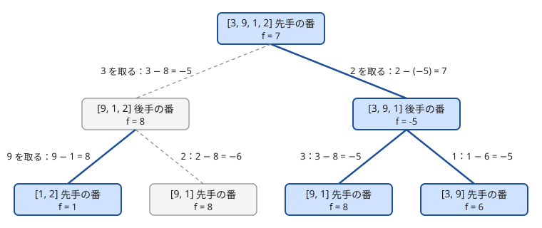

!!! abstract "要点"
    - **何ができるか**：両者が「自分の得点 − 相手の得点」を最大化するゲームで、$f(\text{局面})$ ＝ 手番の人が以後に得る差の最大値とおくと、$f = \max(\text{その手の得点} - f(\text{次の局面}))$ と 1 本の式で書け、終局から後ろ向きに値が決まる。
    - **いつ使うか**：
        - 両者が最適に行動したときの得点（の差）を求める。
        - 太郎は $X - Y$ を最大化し、次郎は最小化する。
        - 列の両端から交互に取る。
        - 交互に駒を進めて得点を取り合う。
    - **計算量**：局面の数 × 1 局面の手の数。列の両端から取るなら $O(N^2)$、$H \times W$ のグリッドを進むなら $O(HW)$。
    - **前提**：[ゲームの基本と勝敗の DP](../comb/game-basics.md)

<!-- textlint-disable -->
別名：negamax・得点差 DP・自分 − 相手の最大化・得点差を最大化するゲーム・minimax
<!-- textlint-enable -->

ミニマックスは、2 人が交互に手を選んで得点を取り合うゲームで、両者が最適に動いたときの結果を求める方法である。一方は値を最大に、もう一方は最小にしようとするので、手番ごとに max と min を取りながら終局から値を決めていく。得点差を「手番の人から見た差」で持つと、符号を反転するだけで max の 1 本の式にまとまる。勝ち負けだけを決める[ゲームの基本と勝敗の DP](../comb/game-basics.md)を、得点のあるゲームに広げたものである。

## 得点差を 1 本の式で書く（符号の反転） {#negamax}

得点を取り合うゲームで「両者が最適に動く」とは、先手は（先手の得点 − 後手の得点）を最大に、後手は同じ量を最小にしようとすることである。後手から見れば、（後手の得点 − 先手の得点）を最大にしようとしているのと同じである。そこで、どちらの手番でも「手番の人から見た差」を考える。

$$
f(s) = \text{局面 } s \text{ で手番の人が、以後に得る（自分の得点 − 相手の得点）の最大値}
$$

局面 $s$ で手 $m$ を選び、その手で $g(m)$ 点を得て局面 $s'$ に移るとする。$s'$ では相手の手番なので、以後の差は相手から見て $f(s')$、自分から見て $-f(s')$ になる。よって次の式が成り立つ。

$$
f(s) = \max_{m} \bigl( g(m) - f(s') \bigr), \qquad f(\text{終局}) = 0
$$

終局で値が決まるゲームなら、$f(\text{終局})$ にはその値を、終局で手番になっている人から見た向きで置く。途中で得点を積むだけなら 0 である。

手番が替わるたびに符号を反転するので、この書き方を negamax と呼ぶ。両者の選べる手と得点の規則が同じなら、手番を状態に入れなくてよく、max と min の場合分けも要らない。答えの $f(\text{初期局面})$ は先手から見た差である。

この式が正しいのは、ゲームが零和だからである。自分が 1 点得ることと相手が 1 点失うことは、差の上では同じ効果を持つ。$s'$ から先は「相手が手番の同じ形のゲーム」なので、相手も同じ式で最適に動き、相手の最適は自分にとって最悪になる。有限のゲームなら終局までの手数で帰納法を使えて、終局から順に $f$ が確定する。

??? note "証明（終局までの残り手数の帰納法）"
    局面の残り手数を、そこから終局までの最長の手数とする。次を残り手数の帰納法で示す：「手番の人は差を $f(s)$ 以上にでき、相手は手番の人の差を $f(s)$ 以下に抑えられる」。

    残り手数が 0 の局面（終局）では、以後の差は $f(\text{終局})$ に決まっているので、主張は成り立つ。残り手数が $k$ 以下の局面で主張が成り立つとする。残り手数が $k + 1$ の局面 $s$ で手 $m$ を選ぶと、移った先 $s'$ の残り手数は $k$ 以下である。$s'$ での相手の差は、自分の差の符号を反転したものである。

    - 自分が手 $m$ を選べば、相手の差を $f(s')$ 以下に抑えられるので、自分の差を $g(m) - f(s')$ 以上にできる。最もよい手を選べば、差を $f(s)$ 以上にできる。
    - 自分がどの手 $m$ を選んでも、相手は差を $f(s')$ 以上にできるので、自分の差は $g(m) - f(s')$ 以下、したがって $f(s)$ 以下に抑えられる。

    よって $s$ でも主張が成り立ち、$f(s)$ は両者が最適に動いたときの差に等しい。

列 $(3, 9, 1, 2)$ の両端のどちらかから交互に 1 つずつ取り、取った数の和を競うゲームで確かめる。次の図は、局面（残りの列）ごとの $f$ と、各手の値 $g(m) - f(s')$ である。太線は手番の人が選ぶ最適な手、破線はそうでない手を表す。



先手が 2 を取ると、後手は 3 と 1 のどちらを取っても 9 を先手に渡してしまう。後手の局面 $(3, 9, 1)$ の値は $-5$ で、先手から見ると $2 - (-5) = 7$ になる。実際に、先手は 2 と 9 で 11 点、後手は 4 点を得て、差は 7 である。

区間のゲームなら、局面は残りの[半開区間](../guide/glossary.md#half-open-interval) $[l, r)$ で表せる。次の局面は 1 つ短い区間なので、短い区間から順に埋める。

```cpp
--8<-- "minimax/deque.cpp:core"
```

問題が「先手の得点」を問うときは、差から戻す。得点の総和 $S$ が戦略によらず一定なら、先手の得点 $X$ と後手の得点 $Y$ は $X + Y = S$、$X - Y = f$ を満たすので、$X = (S + f) / 2$ である。総和が一定でないゲーム（費用を払う手があるなど）では、この戻し方は使えない。

## max と min を手番で使い分ける書き方 {#max-min}

negamax と同じ値を、先手から見た値 1 つで持つこともできる。$v(s)$ を「局面 $s$ からの、先手から見た最終的な値」とし、先手の手番なら max、後手の手番なら min を取る。

```text
v(終局) = その局面での先手から見た値
v(s) = max over m ( g(m) + v(s') )    … s が先手の手番のとき（g は先手の得点を正で数える）
v(s) = min over m ( -g(m) + v(s') )   … s が後手の手番のとき（後手の得点は先手から見て負）
```

2 つの書き方は、先手の手番で $f(s) = v(s)$、後手の手番で $f(s) = -v(s)$ という関係にある。どちらで書いても計算量は同じである。

max と min を使い分ける方が素直なのは、得点を途中で積み上げるのではなく、終局の値だけで結果が決まるときである。たとえば駒が最下段に着いたときのマスの値を一方は最大に、他方は最小にしたいとする。終局で値を置き、上の段へ向けて手番に応じて max と min を交互に取るだけでよい。終局の値が「通った頂点の中央値」のように積み上げで書けないものでも、そのまま扱える（[木の上のゲーム](#tree)）。

手番は状態に入れるか、局面から計算する。グリッドを右か下に 1 マスずつ進むなら、何手目かは $i + j$ で決まり、木を根から降りるなら深さで決まる。そうでないときは、手番を状態に 1 ビット足す（両者の手が違うゲームの扱いは[ゲームの基本と勝敗の DP](../comb/game-basics.md) と同じ）。

??? question "確認問題：符号の反転を忘れたら"
    negamax の式を $f(s) = \max_m (g(m) + f(s'))$ と書いてしまった。列 $(3, 9, 1, 2)$ では何を計算したことになるか。

    ??? success "答え"
        相手の得点も自分の得点として足し、さらに相手の手番でも自分に都合のよい手を選ぶことになる。全部を自分で取る 1 人ゲームの最大値で、どの順でも和は $3 + 9 + 1 + 2 = 15$ になる。相手の値は必ず符号を反転して引く。

## 区間・グリッド・盤面を状態にする {#states}

ミニマックスの状態に要るのは、以後の手と以後の得点を決める情報だけである。これまでの得点は状態に入れない。$f$ は「以後に得る差」なので、過去の得点が違っても同じ局面なら同じ値になる。これが、得点を取り合うゲームでも状態が小さく済む理由である。

| 局面の形 | 状態 | 局面の数 | 計算順序 |
| --- | --- | --- | --- |
| 列の両端から取る | 残りの区間 $[l, r)$ | $O(N^2)$ | 区間の短い順 |
| 2 つの山の上から取る | 各山の取った個数 $(i, j)$ | $O(AB)$ | $i + j$ の大きい順 |
| グリッドを右か下に進む | 駒の位置 $(i, j)$ | $O(HW)$ | 右下から |
| $3 \times 3$ の盤面を埋める | 各マスの状態（空・先手・後手） | $3^9$ 以下 | メモ化再帰 |
| $N \le 16$ 程度のものを選ぶ | 使ったものの集合 | $O(2^N)$ | [bitDP](../dp/bit-dp.md) |

区間の状態は[区間 DP](../dp/interval-dp.md)と同じ形で、手の数が 2 通りなら全体で $O(N^2)$ になる。グリッドは、$H, W \le 2000$ でも局面は $4 \times 10^6$ 個で間に合う。グリッドの計算順序は、次の局面が必ず右か下にあることから決まる（例題の [ABC201 D](#abc201_d)）。

盤面の状態のように、計算順序を自分で決めにくいときは[メモ化再帰](../dp/memoized-recursion.md)で書く。盤面は 9 桁の 3 進数にすれば配列の添字にできる。両者が交互に置くので、空きマスの数から手番も分かる。

## 貪欲が最適でない例 {#greedy-fails}

得点を取り合うゲームで「今いちばん得点の大きい手を選ぶ」貪欲は、一般には最適でない。自分の手が相手にどんな局面を渡すかを見ていないからである。

列 $(3, 9, 1, 2)$ の両端から取るゲームで、両者が「大きい方の端を取る」貪欲で動くとする。先手は 3 を取り、後手は 9 を取り、先手が 2、後手が 1 を取る。先手は 5 点、後手は 10 点で、差は $-5$ である。最適な先手は 2 を取って 9 を相手に見せず、差は 7 になる（[得点差を 1 本の式で書く](#negamax)の図）。

貪欲が壊れるのは、ある手の価値が「その手で得る点」と「相手に渡す局面の価値」の両方で決まるからである。ミニマックスの式 $g(m) - f(s')$ はこの 2 つを足し合わせて比べている。グリッドを進むゲームでも、隣の + のマスへ進むと、その先が − ばかりの道に追い込まれることがある。

貪欲で解けるゲームもあるが、それは「どの手を選んでも渡す局面の価値が変わらない」などの性質を示せたときだけである。示せないなら、局面の数が間に合う限り DP で全部比べる。

??? question "確認問題：貪欲が負ける列を作る"
    列の両端から取るゲームで、先手が「大きい方の端を取る」貪欲で動くと最適より悪くなる、長さ 4 の列を 1 つ作れ。後手は最適に動くとしてよい。

    ??? success "答え"
        たとえば $(1, 2, 5, 3)$ である。貪欲な先手は 3 を取り、後手は $(1, 2, 5)$ から 5 を取る。先手は 2 を取り、後手が 1 を取るので、先手は 5 点、後手は 6 点で差は $-1$ である。最適な先手は 1 を取り、後手が 2 と 3 のどちらを取っても 5 を取れるので、差は $1$ になる。大きい端を取ると、その奥の大きい数を相手に見せることがある。

## 木の上のゲーム {#tree}

この節は[木 DP](../dp/tree-dp.md)と[根からのパスを DFS で持ち回る](../tree/root-path-dfs.md)を前提にする。

根付き木の根に駒を置き、2 人が交互に駒を子へ進め、葉に着いたら終わるゲームを考える。終局の値が葉で決まるなら、値は葉から根へ向けて決まる。手番は深さの偶奇で決まるので、手番を状態に入れなくてよい。

```text
v(葉) = その葉に着いたときの値
v(u) = max over 子 c ( v(c) )   … 深さが偶数（先手の手番）
v(u) = min over 子 c ( v(c) )   … 深さが奇数（後手の手番）
```

1 回の DFS で全頂点を 1 度ずつ見るので、葉の値が求まっていれば $O(N)$ である。

難しいのは葉の値の方である。「根から葉までに通った頂点の値の中央値」のように、パス全体で決まる値を考える。DFS で頂点に入るときは値を集合へ足し、出るときに取り除く。葉に着いた時点の集合が根からのパスなので、そこで中央値を求める。中央値は、2 つの multiset（小さい半分と大きい半分）か、値を[座標圧縮](../basics/coordinate-compression.md)した BIT の二分探索で、1 回 $O(\log N)$ で求まる。個数が偶数のときの中央値の定義は問題に従い、真ん中の 2 つを両方取り出せるようにしておく。全体は $O(N \log N)$ になる。

木が細長いと DFS の再帰が $N$ 段まで深くなる。$N = 10^5$ 程度なら AtCoder では通ることが多いが、心配なら明示的なスタックで書く。

## 答えを決め打ちして勝敗に直す {#binary-search}

この節は[答えで二分探索](../basics/binary-search-answer.md)の[判定を DP で作る](../basics/binary-search-answer.md#dp-check)を前提にする。

結果が 1 つの値で決まるゲームでは、「結果を $x$ 以上にできるか」という勝ち負けのゲームに直せる。値が $x$ 以上になる終局を「最大化する側の勝ち」、それ以外を「負け」とすれば、両者の目的は勝つか負けるかだけになる。最大化する側が $x$ 以上を保証できるなら、$x$ より小さい $x'$ 以上も保証できるので、判定は $x$ について単調である。最大の可の $x$ が答えになる。

直す意味があるのは、値のままでは状態が大きすぎるが、勝ち負けなら小さな状態で判定できるときである。典型は、両者の手が違うゲームである。たとえば一方が木の上で駒を進め、他方が毎手どこか 1 つの頂点を壊すゲームでは、壊された頂点の集合まで状態に入れると大きすぎる。$x$ 以上の頂点に印を付けると、「印のある頂点に駒を止められるか」になり、各頂点で「相手の妨害を何手分しのげるか」という 1 つの数を[木 DP](../dp/tree-dp.md) で求めれば判定できる（力試しの [ABC246 G](#challenge)）。

計算量は、判定 1 回の計算量 × $O(\log V)$（$V$ は値の範囲）である。値の候補が頂点の値に限られるなら、値をソートして添字で二分探索してもよい。

## 落とし穴 {#pitfalls}

**誰の得点になるかを読み違える**。「駒を動かした人が移動先のマスの点を得る」のか「手番の人が今いるマスの点を得る」のかで、$g(m)$ の置き場所が変わる。初期位置のマスを数えるかどうかも問題で違う。negamax では、$g(m)$ は必ず「手 $m$ を選んだ人の得点」として足す。

**メモの「未計算」の印に 0 や −1 を使う**。得点差は 0 や負の値にもなるので、計算済みの値と区別できない。未計算かどうかは別の bool の配列で持つ。

**−∞ の符号を反転してあふれる**。`best` の初期値を `LLONG_MIN` にして、それが $f(s')$ として返ると、`g - f` が `long long` に収まらない。手のない局面は「終局」として 0（または問題の終局の値）を返し、−∞ を外に出さない。初期値を使うなら $-10^{18}$ のように、反転しても収まる値にする。

**「自分の得点の最大化」と「差の最大化」を同じだと思い込む**。得点の総和が一定なら同じ戦略になる。費用を払う手や得点が消える手があると、2 つは違う。問題文が何を最大化すると言っているかを読み、差なら差で、自分の得点ならそれに合わせて式を立てる。

**勝敗を問われているのに差の符号の 0 を忘れる**。差が 0 なら引き分けである。「得点が多い方の勝ち、同点なら引き分け」の問題では、$f$ の正・負・0 の 3 通りを出し分ける。「3 つ並んだら即座に勝ち」のように途中で決着するルールなら、手を試す前に終局かどうかを判定する。

**同じ局面に戻れる**。局面の遷移に閉路があると、メモ化再帰は止まらず、後ろからの計算順序も作れない。閉路があるゲームは[後退解析](../comb/game-retrograde-analysis.md)で扱う。

## 例題 {#examples}

### EDPC L. Deque {#dp_l}

<div class="kp-problems" data-role="example" markdown>

- [EDPC L. Deque](https://atcoder.jp/contests/dp/tasks/dp_l)（diff —）：列の両端のどちらかから交互に 1 つずつ取り、先手は (先手の和 − 後手の和) を最大化、後手は最小化するときの値を求める。

</div>

残りの列は区間 $[l, r)$ で表せるので、$f[l][r]$ ＝ 残りが $[l, r)$ のときの手番の人から見た差の最大値とおく。左端を取るか右端を取るかの 2 通りを比べ、相手の値は符号を反転して引く。

??? note "解法の詳細"
    - 状態：$f[l][r]$（$0 \le l \le r \le N$）。空区間 $f[l][l] = 0$。
    - 遷移：$f[l][r] = \max(a_l - f[l+1][r],\ a_{r-1} - f[l][r-1])$。
    - 計算順序：区間の長さの短い順。どちらの遷移も 1 つ短い区間を見るからである。
    - 答え：$f[0][N]$。$O(N^2)$ で、$N \le 3000$ なら約 $9 \times 10^6$ 回の計算で済む。値は $10^9 \times 3000$ に届くので `long long` で持つ。
    - コードは[得点差を 1 本の式で書く](#negamax)の節のものと同じ形である。

### ABC201 D. Game in Momotetsu World {#abc201_d}

<div class="kp-problems" data-role="example" markdown>

- [ABC201 D. Game in Momotetsu World](https://atcoder.jp/contests/abc201/tasks/abc201_d)（diff 1317）：マスに + か − が書かれたグリッドで、駒を右か下に交互に進めて得点を取り合うとき、両者が最適に動いた結果の勝敗を求める。

</div>

駒の位置だけで以後のゲームが決まるので、$f[i][j]$ ＝ 駒が $(i, j)$ にあるときの手番の人から見た差の最大値とおく。駒は右か下にしか進まないので、右下から左上へ埋められる。最後に $f[0][0]$ の符号で勝敗を決める。

??? note "解法の詳細"
    - 得点：駒を動かした人が、移動先のマスが + なら 1 点を得て、− なら 1 点を失う。最初のマスは数えない。
    - 遷移：$f[i][j] = \max(g(i+1, j) - f[i+1][j],\ g(i, j+1) - f[i][j+1])$（グリッドの外へは動けない）。右下のマスは終局で $f = 0$。
    - 答え：$f[0][0] > 0$ なら先手の勝ち、$< 0$ なら後手の勝ち、$= 0$ なら引き分け。$O(HW)$。
    - max と min で書くなら、$(i + j)$ の偶奇で手番が決まることを使う。
    - コードの例（出力の文字列は問題に合わせる）：

    ```cpp
    --8<-- "minimax/grid.cpp:core"
    ```

## 練習問題 {#practice}

<div class="kp-problems" data-role="practice" markdown>

- [鉄則本 A35. Game 4](https://atcoder.jp/contests/tessoku-book/tasks/tessoku_book_ai)（diff —）：ピラミッドの頂上の駒を、2 人が交互に左下か右下へ動かし、最下段の値を一方は最大化、他方は最小化するときの値を求める。
- [TDPC B. ゲーム](https://atcoder.jp/contests/tdpc/tasks/tdpc_game)（diff —）：2 つの山の上から交互に 1 つずつ取り、両者が自分の得る価値の合計を最大にするとき、先手が得る価値の合計を求める。
- [ABC349 E. Weighted Tic-Tac-Toe](https://atcoder.jp/contests/abc349/tasks/abc349_e)（diff 1464）：3×3 のマスに得点が書かれ、交互に塗って得点を取り合う三目並べで、両者が最適に動いたときに勝つのはどちらかを求める。
- [ABC025 C. 双子と○×ゲーム](https://atcoder.jp/contests/abc025/tasks/abc025_c)（diff 1640）：3×3 のマスを 2 人が交互に埋めたあと、隣り合うマスの組ごとの得点の決まり方のもとで、両者が自分の得点を最大化するときの両者の得点を求める。

</div>

??? note "練習の方針"
    - **鉄則本 A35**：終局（最下段）の値で決まるので、下の段から、段の偶奇で決まる手番に応じて max と min を交互に取る
    - **TDPC B**：状態は各山から取った個数 $(i, j)$。価値の総和は一定なので、自分の得点の最大化は差の最大化と同じになる。「残りの総和 − 相手が以後に取る価値」の形で、得点そのものを negamax 風に書いてもよい
    - **ABC349 E**：盤面を状態にしてメモ化探索する。3 つ並んだら即座に決着がつくので、手を試す前にその判定をする。埋まったら得点の合計で勝敗が決まる
    - **ABC025 C**：得点の総和は一定なので、差を negamax で求め、総和 $S$ と差 $D$ から $(S + D)/2$ と $(S - D)/2$ に戻す。盤面は $3^9$ 通り以下

## 力試し {#challenge}

<div class="kp-problems" data-role="challenge" markdown>

- [ABC218 G. Game on Tree 2](https://atcoder.jp/contests/abc218/tasks/abc218_g)（diff 2217）：木の根から 2 人が交互に子へ駒を進め、葉で止まったときの通った頂点の値の中央値を、一方は最大化、他方は最小化するときの値を求める。
- [ABC246 G. Game on Tree 3](https://atcoder.jp/contests/abc246/tasks/abc246_g)（diff 2313）：根から子へ駒を進める人と、毎手 1 つの頂点の値を 0 にする人の 2 人ゲームで、両者が最適に動いたときの、駒を止めた頂点の値を求める。
- [ABC303 G. Bags Game](https://atcoder.jp/contests/abc303/tasks/abc303_g)（diff 2736）：列の袋を、端から 1 つ取るか、費用を払って両端から合わせて決まった個数（残りが少なければ全部）取るかを交互に選ぶ。両者が最適に動いたときの (先手の金額 − 後手の金額) を求める。

</div>

??? note "力試しの方針"
    - **ABC218 G**：DFS で根からのパス上の値を集合に出し入れし、葉で中央値を求める。葉から根へ、深さの偶奇で max と min を取る（[木の上のゲーム](#tree)）
    - **ABC246 G**：答えを $x$ と決め、値が $x$ 以上の頂点に印を付けて「印のある頂点に駒を止められるか」を判定する。各頂点で妨害を何手分しのげるかを木 DP で求める（[答えを決め打ちして勝敗に直す](#binary-search)）
    - **ABC303 G**：残りの区間 $[l, r)$ ごとに手番の人から見た差を区間 DP で求める。まとめて取る手では、残る区間の長さが決まり、開始位置だけが範囲で動くので、同じ長さの区間についての区間の最大値（セグメント木など）で遷移を速くする。全体で $O(N^2 \log N)$

## 確認問題 {#quiz}

??? question "確認問題：過去の得点を状態に入れないのはなぜか"
    グリッドを進んで得点を取り合うゲームで、状態を駒の位置だけにした。それまでの得点を状態に入れなくてよいのはなぜか。

    ??? success "答え"
        $f$ は「以後に得る差」の最大値で、以後の手と得点は駒の位置だけで決まるからである。最終的な差は「これまでの差 + 以後の差」で、これまでの差は手の選び方に影響しない。勝敗を最後に判定するときも、初期局面ではこれまでの差が 0 なので $f$ の符号を見ればよい。

??? question "確認問題：先手の得点を答える"
    両端から取るゲームで、列の和が 15、negamax で求めた先手から見た差が 7 だった。先手と後手の得点はそれぞれいくつか。

    ??? success "答え"
        先手を $X$、後手を $Y$ とすると $X + Y = 15$、$X - Y = 7$ なので、$X = 11$、$Y = 4$ である。

??? question "確認問題：勝ち負けのゲームとの関係"
    勝ち負けだけのゲームで、勝ちを $+1$、負けを $-1$ の終局の値とし、途中の得点を 0 として negamax を使うと、何が求まるか。

    ??? success "答え"
        $f(s) = \max_m (-f(s'))$ になり、相手が負ける局面（$f(s') = -1$）へ移れれば $+1$、どこへ移っても相手が勝つなら $-1$ である。必勝・必敗の DP と同じになる。

## 使い分け {#comparison}

- 勝ち負けだけを問うなら、[ゲームの基本と勝敗の DP](../comb/game-basics.md)の true・false の DP で足りる。得点や値を問うときにミニマックスを使う
- 独立なゲームをいくつも並べ、どれか 1 つを選んで動かすゲームの勝敗は、[Grundy 数](../comb/grundy-number.md)で分けて考える。ミニマックスで全部の組を状態にすると大きすぎる
- 手番の人の選択に加えてサイコロなどの偶然が入るなら、偶然の局面では max の代わりに平均を取る（[最適な戦略の期待値](../comb/optimal-strategy-expectation.md)）
- 同じ局面に戻れるゲームは[後退解析](../comb/game-retrograde-analysis.md)を使う

## 参考 {#references}

- [drken「ゲームを解く！Educational DP Contest K, L 問題の解説」](https://qiita.com/drken/items/4e1bcf8413af16cb62da)：得点差を 1 本の式で書く考え方と、例題 dp_l の区間の状態
- [drken「AtCoder ABC 201 D - Game in Momotetsu World (1Q, 水色, 400 点)」](https://drken1215.hatenablog.com/entry/2023/07/21/235300)：例題 abc201_d の得点の数え方と、右下から埋める DP
- [drken「TDPC B - ゲーム」](https://drken1215.hatenablog.com/entry/2023/07/22/023939)：練習 tdpc_game の状態と、総和が一定のときの書き方
- [drken「AtCoder ABC 025 C - 双子と○×ゲーム」](https://drken1215.hatenablog.com/entry/2023/07/22/192817)：練習 abc025_c の差から両者の得点に戻す方法と盤面の状態
- [programming-hiroba「ABC349 E」](https://programming-hiroba.com/abc349-e/)：練習 abc349_e の途中で決着がつくルールの扱い
- [E869120「kyopro-tessoku」](https://github.com/E869120/kyopro-tessoku/blob/main/codes/cpp/chap05/answer_A35.cpp)：練習 tessoku_book_ai の max と min を交互に取る DP
- [kmjp「AtCoder ABC #218 : G - Game on Tree 2」](https://kmjp.hatenablog.jp/entry/2021/09/12/0900)：力試し abc218_g のパスの中央値と max・min の取り方
- [drken「AtCoder ABC 246 G - Game on Tree 3 (3D, 黄色, 600 点)」](https://drken1215.hatenablog.com/entry/2022/04/04/023800)：力試し abc246_g の決め打ちと、しのげる手数の木 DP
- [kmjp「AtCoder ABC #303 : G - Bags Game」](https://kmjp.hatenablog.jp/entry/2023/05/27/0900)：力試し abc303_g の区間の状態と、長さごとの区間の最大値で遷移を速くする方法
