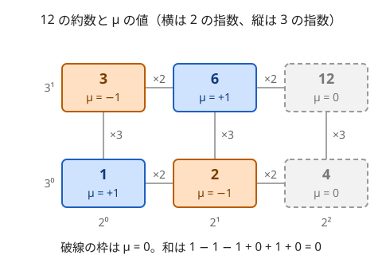

!!! abstract "要点"
    - **何ができるか**：約数にわたる和 $F(n) = \sum_{d \mid n} f(d)$ から、元の $f$ をメビウス関数 $\mu$ で $f(n) = \sum_{d \mid n} \mu(n/d) F(d)$ と戻す（メビウス反転）。$[\gcd(i, j) = 1] = \sum_{d \mid \gcd(i, j)} \mu(d)$ と置き換えて和の順序を入れ替えるのが典型である。
    - **いつ使うか**：
        - $\gcd(i, j) = 1$ となる組の個数・和を求める。
        - $\sum \gcd$ や $\sum \operatorname{lcm}$ を求める。
        - $N \le 10^6$ 程度で、$\mu$ を篩で前計算できる。
    - **計算量**：$\mu$ の表は値の上限 $V$ まで篩で $O(V \log \log V)$（線形篩なら $O(V)$）。$1 \le i \le N$・$1 \le j \le M$ の互いに素な組の数は、表の後 $O(\min(N, M))$、$\mu$ の累積和と商の列挙で束ねれば 1 回 $O(\sqrt{N} + \sqrt{M})$。
    - **前提**：[約数包除](../comb/divisor-inclusion-exclusion.md)、[エラトステネスの篩](../math/sieve-eratosthenes.md)

<!-- textlint-disable -->
別名：メビウス関数・μ・メビウス反転・Möbius function・Mobius inversion
<!-- textlint-enable -->

メビウス関数 $\mu$ は、「約数すべてについて足す」という操作を打ち消すための符号の表である。[約数包除](../comb/divisor-inclusion-exclusion.md)で「倍数の側から順に引く」と書いていた計算を、$\mu$ を係数にした 1 本の和に書ける。和の形になるので、$\sum$ の順序を入れ替える式変形に乗せられるのが強みである。

このページで使う記法：$[P]$ は条件 $P$ が成り立てば 1、成り立たなければ 0 を表す。$d \mid n$ の和は $n$ の正の約数 $d$ すべてについて取る。ほかの記法は[記法と用語の約束](../start/notation.md)にそろえる。

## μ の定義と、約数についての和が n = 1 のときだけ 1 になる性質 {#definition}

正の整数 $n$ について、メビウス関数 $\mu(n)$ を次のように決める。

- $\mu(1) = 1$
- $n$ が 1 より大きい平方数で割り切れる（ある素数 $p$ で $p^2 \mid n$）なら $\mu(n) = 0$
- そうでなく、$n$ が相異なる $r$ 個の素数の積なら $\mu(n) = (-1)^r$

0 でないのは [squarefree](../guide/glossary.md#squarefree) な数だけで、符号は素因数の個数の偶奇で決まる。$n = 1, \dots, 12$ の値は次のとおりである。

$$
\mu(1), \mu(2), \dots, \mu(12) = 1, -1, -1, 0, -1, 1, -1, 0, 0, 1, -1, 0
$$

$\mu$ の性質のうち、使うのはほぼ次の 1 つだけである。

$$
\sum_{d \mid n} \mu(d) = [n = 1]
$$

$n = 12$ で確かめる。約数は $1, 2, 3, 4, 6, 12$ で、$\mu$ の和は $1 - 1 - 1 + 0 + 1 + 0 = 0$ になる。



なぜ和が 0 になるかを、図に沿って説明する。$n$ の素因数の集合を $\{p_1, \dots, p_r\}$ とする。$\mu(d) \ne 0$ の約数は、この集合から何個かを選んで掛けたものと 1 対 1 で対応する。12 なら、部分集合 $\varnothing$・$\{2\}$・$\{3\}$・$\{2, 3\}$ が約数 $1, 2, 3, 6$ にあたる。$k$ 個を選んだ約数の $\mu$ は $(-1)^k$ なので、和は次のようになる。

$$
\sum_{d \mid n} \mu(d) = \sum_{k=0}^{r} \binom{r}{k} (-1)^k = (1 - 1)^r
$$

$n \ge 2$ なら $r \ge 1$ なので 0、$n = 1$ なら $r = 0$ で空の和の項 $\binom{0}{0} = 1$ だけが残る。これは素因数ごとに「$p_i$ で割り切れる」を条件にした[包除原理](../comb/inclusion-exclusion.md)と同じ形である。$\mu(d)$ は、$d$ に含まれる素因数の集合 $S$ についての包除の符号 $(-1)^{\lvert S \rvert}$ にあたる。

## メビウス反転 {#inversion}

約数についての和で作った $F$ から、元の $f$ を取り出す公式をメビウス反転と呼ぶ。

$$
F(n) = \sum_{d \mid n} f(d) \quad \Longrightarrow \quad f(n) = \sum_{d \mid n} \mu\!\left(\frac{n}{d}\right) F(d)
$$

右辺に $F$ の定義を入れ、和の順序を入れ替えると確かめられる。$e \mid d \mid n$ となる組 $(e, d)$ を、$e$ を外側にして数え直すと、$d = ek$ の $k$ は $n/e$ の約数を動く。

$$
\sum_{d \mid n} \mu\!\left(\frac{n}{d}\right) \sum_{e \mid d} f(e) = \sum_{e \mid n} f(e) \sum_{k \mid n/e} \mu\!\left(\frac{n/e}{k}\right) = \sum_{e \mid n} f(e) \, [n/e = 1] = f(n)
$$

内側の和は $n/e$ のすべての約数についての $\mu$ の和なので、[定義の節](#definition)の性質から $n/e = 1$、すなわち $e = n$ のときだけ 1 が残る。

**例**：$1, \dots, n$ のうち $n$ との gcd がちょうど $d$ である数は $\varphi(n/d)$ 個ある。$i = d i'$ と書くと、$\gcd(i, n) = d$ は「$i' \le n/d$ かつ $\gcd(i', n/d) = 1$」と同じだからである。どの数の gcd も $n$ の約数のどれか 1 つなので、$\sum_{d \mid n} \varphi(d) = n$ が成り立つ（[オイラーの φ 関数](../math/euler-phi.md)）。反転すると $\varphi(n) = \sum_{d \mid n} \mu(n/d) \, d$ になる。$n = 12$ では、0 でない項は $d = 2, 4, 6, 12$ の 4 つで、$2 - 4 - 6 + 12 = 4$ となり、$\varphi(12) = 4$（1・5・7・11）と一致する。

約数の代わりに倍数について足した形でも、同じく反転できる。$f(m)$ が上限 $V$ を超える $m$ で 0 なら、次のとおりである。

$$
F(d) = \sum_{k \ge 1} f(kd) \quad \Longrightarrow \quad f(d) = \sum_{k \ge 1} \mu(k) \, F(kd)
$$

[約数包除](../comb/divisor-inclusion-exclusion.md)の「すべて $g$ の倍数」の個数 $F(g)$ と「gcd がちょうど $g$」の個数 $f(g)$ はこの関係にある。周期の数え上げ（最小の周期が $d$ の文字列）は約数の形で、[KMP 法の周期を数える節](../string/kmp.md#count-periodic)にある。

!!! info "反転を使える条件"
    $f$ と $F$ のどちらかが分かれば、もう片方が決まる。反転は「$F$ を作るのは易しいが $f$ を直接数えるのは難しい」ときに使う。$F$ を $n$ の約数すべてについて求められることが条件で、$n$ 自身 $d = n$ の項も落とさない。

## 「gcd が 1」の条件の置き換えと和の入れ替え {#gcd-one}

[定義の節](#definition)の性質に $n = \gcd(i, j)$ を入れると、$d \mid \gcd(i, j)$ は「$d \mid i$ かつ $d \mid j$」と同じなので、次の置き換えができる。

$$
[\gcd(i, j) = 1] = \sum_{d \mid i,\ d \mid j} \mu(d)
$$

左辺の条件は $i$ と $j$ が絡み合っていて数えにくい。右辺は「$d$ で割り切れる」という $i$ と $j$ で別々の条件になる。この置き換えの後、$d$ を一番外側の和に移すのが定石である。

**互いに素な組の数**。$1 \le i \le N$、$1 \le j \le M$ の順序つきの組で、$\gcd(i, j) = 1$ となるものを数える。

$$
\sum_{i=1}^{N} \sum_{j=1}^{M} [\gcd(i, j) = 1]
= \sum_{d \ge 1} \mu(d) \Bigl(\sum_{i \le N} [d \mid i]\Bigr) \Bigl(\sum_{j \le M} [d \mid j]\Bigr)
= \sum_{d = 1}^{\min(N, M)} \mu(d) \left\lfloor \frac{N}{d} \right\rfloor \left\lfloor \frac{M}{d} \right\rfloor
$$

$d$ を固定すると、$i$ と $j$ の和は独立になり、それぞれ $d$ の倍数の個数になる。$N = M = 4$ なら $\mu(1), \dots, \mu(4) = 1, -1, -1, 0$ なので、$16 - 4 - 1 + 0 = 11$ である（$i = j$ の $(1, 1)$ を含む 11 組）。$\mu$ の表があれば $O(\min(N, M))$ で求まる。

```cpp
--8<-- "mobius-function/coprime-pairs.cpp:coprime"
```

**gcd の関数の和**。ここからは、長さ $N$ の列 $A$ から 2 つ選ぶ組を考える。$[\gcd = 1]$ は「$f(1) = 1$、ほかは $f(n) = 0$」という関数の値 $f(\gcd)$ である。一般の $f$ でも、[メビウス反転](#inversion)で $w(n) = \sum_{d \mid n} \mu(n/d) f(d)$ を作れば $f(n) = \sum_{d \mid n} w(d)$ なので、同じ置き換えができる。

$$
\sum_{i, j} f(\gcd(A_i, A_j)) = \sum_{d} w(d) \, C(d)^2 \qquad (C(d) = d \text{ の倍数である } A_i \text{ の個数})
$$

$f = [n = 1]$ なら $w = \mu$、$f(n) = n$（gcd の総和）なら $w = \varphi$ である。$f(n) = 1/n$ とすると、$\operatorname{lcm}(x, y) = xy / \gcd(x, y)$ を使って lcm の総和に使える。ただし各項に重み $A_i A_j$ が付くので、$C(d)$ の代わりに「$d$ の倍数である $A_i$ の和」$s(d)$ が入り、$\sum_d w(d) \, s(d)^2$ になる（[例題の AGC038 C](#agc038_c)）。$w$ は $f$ と $\mu$ から倍数を回して、値の上限を $V$ として $O(V \log V)$ で作れる（[調和級数](../math/harmonic-sum.md)）。

**応用の型**：

- **ある数と互いに素な数の和**：$\sum_{i \le N,\ \gcd(i, K) = 1} i = \sum_{d \mid K} \mu(d) \, d \, T(\lfloor N/d \rfloor)$（$T(x) = x(x + 1)/2$）。$K$ が $10^9$ でも、$\mu(d) \ne 0$ の約数は $K$ の素因数の部分集合だけなので、素因数が $r$ 個なら $2^r$ 項で済む。サインは「$\sum_{i=1}^{N} \operatorname{lcm}(i, K)$」で、$\gcd(i, K) = g$ ごとに分けるとこの形が出る。
- **gcd が 1 でない組**：$[\gcd \ne 1] = 1 - \sum_{d \mid \gcd} \mu(d)$ で、$d = 1$ の項 $\mu(1) = 1$ が先頭の 1 と打ち消し合う。$\nu(1) = 0$、$d \ge 2$ で $\nu(d) = -\mu(d)$ とおくと $[\gcd(i, j) \ne 1] = \sum_{d \mid i,\ d \mid j} \nu(d)$ と書け、$1 \le i, j \le N$ の組の数は $\sum_{d \ge 2} \nu(d) \lfloor N/d \rfloor^2$ になる。
- **2 つの gcd の条件が同時にある**：添字の gcd と値の gcd の両方に条件があるなら、両方を $\mu$ の和に置き換え、$(a, b)$ の二重和にする（[力試しの ABC230 G](#challenge)）。大きい順に引く書き方では 2 次元の表が要るところを、$\mu(a)\mu(b) \ne 0$ の組だけを回せばよくなる。
- **3 つ以上の組**：$\gcd(i, j, k) = 1$ の組の数も、同じ置き換えで $\sum_d \mu(d) \lfloor N/d \rfloor^3$ になる。

## μ を篩で作る {#sieve}

$\mu$ の表は、[エラトステネスの篩](../math/sieve-eratosthenes.md)を少し変えて作る。表を全部 1 で始め、素数 $p$ を見つけるたびに次の 2 つを行う。

1. $p$ の倍数すべてについて符号を反転する（素因数 $p$ を 1 つ持つので $-1$ を掛ける）。
2. $p^2$ の倍数すべてを 0 にする。

どの $n$ も、素因数の数だけ符号が反転し、平方因子があれば 0 になるので、定義どおりの値になる。素数の判定は $\mu$ と別の表で持つ（$\mu(n) = -1$ でも素数とは限らない。$\mu(30) = -1$ である）。

```cpp
--8<-- "mobius-function/coprime-pairs.cpp:sieve"
```

計算量は篩と同じ $O(V \log \log V)$ である（$V$ は表を作る値の上限）。$p^2$ の倍数を 0 にする回数は $\sum_p V/p^2$ で、$V$ の定数倍しかない。$V = 10^7$ でも `int` の表で約 40 MB に収まる（[篩のメモリの見積もり](../math/sieve-eratosthenes.md#memory)）。

- **線形篩で作る**：最小素因数の篩と同時に $\mu$ を埋める方法は、[線形篩の節](../math/spf-sieve.md#linear-sieve)にある。$O(M)$ だが、実際の速さはエラトステネスの変形とほぼ変わらない。
- **1 つの数だけなら**：$\mu(n)$ を 1 つだけ求めるなら、$O(\sqrt{n})$ の試し割りで素因数分解し、同じ素数が 2 回出たら 0、そうでなければ素因数の個数の偶奇で決める。
- **0 でない項だけを回す**：$\mu(d) = 0$ の項は和に効かない。$n$ の約数を回すときは、素因数の部分集合（$n \le 10^6$ なら素因数は 7 個以下なので 128 通り以下）だけを列挙すれば足りる。

## 商の列挙で同じ値の範囲を束ねる {#quotient}

この節は[商の列挙](../math/floor-quotient-enum.md)を前提にする。$\sum_{d} \mu(d) \lfloor N/d \rfloor \lfloor M/d \rfloor$ のように、$\mu(d)$ 以外の部分が $\lfloor N/d \rfloor$ と $\lfloor M/d \rfloor$ だけで決まる和は、商が同じ $d$ をまとめられる。

$\mu$ の累積和 $S(k) = \mu(1) + \dots + \mu(k)$（$S(0) = 0$）を前計算しておく。閉区間 $[l, r]$ で 2 つの商がどちらも一定なら、その区間の寄与は $(S(r) - S(l - 1)) \lfloor N/l \rfloor \lfloor M/l \rfloor$ である。右端は、2 つの商それぞれが変わらない右端の小さい方で、$r = \min(\lfloor N / \lfloor N/l \rfloor \rfloor, \lfloor M / \lfloor M/l \rfloor \rfloor)$ になる。

```cpp
--8<-- "mobius-function/coprime-pairs.cpp:quotient"
```

$\lfloor N/d \rfloor$ は $O(\sqrt{N})$ 種類の値しかとらず、商の組が変わる境目は 2 つの境目を合わせたものなので、区間は $O(\sqrt{N} + \sqrt{M})$ 個である。前計算 $O(\min(N, M))$ の後、1 回の問い合わせは $O(\sqrt{N} + \sqrt{M})$ で済む。「互いに素な組の数を、$N$ と $M$ を変えて $10^5$ 回答える」のように、問い合わせが多いときに効く。

$N$ が $10^9$ 以上で累積和の表が置けないときは、$S(N)$（メルテンス関数）そのものを篩なしで求める必要がある。$\sum_{d \mid n} \mu(d) = [n = 1]$ を使って $S$ を商の値だけの再帰に直す方法（杜教篩）で $O(N^{2/3})$ になる。これは[乗法的関数](../math/multiplicative-function.md)の範囲である。

## 約数包除との書き換え {#vs-divisor-ie}

[約数包除](../comb/divisor-inclusion-exclusion.md)の「$g$ の大きい順に $f(g) = F(g) - f(2g) - f(3g) - \cdots$ と引く」計算と、倍数の形のメビウス反転 $f(g) = \sum_k \mu(k) F(kg)$ は、同じ値を求める。前者の右辺の $f$ を同じ式で展開し続けると後者になる（[約数包除の対応の節](../comb/divisor-inclusion-exclusion.md#vs-mobius)）。どちらを使うかは、何が欲しいかで決める。

| 欲しいもの | 向く書き方 | 理由 |
| --- | --- | --- |
| すべての $g$ の $f(g)$ | 大きい順に引く | $\mu$ が要らず、$O(V \log V)$ でまとめて出る |
| $f(1)$ など 1 つだけ | $\mu$ の式 | $f$ の表を作らずに $\sum_k \mu(k) F(k)$ の 1 本で済む |
| 式変形を続けたい | $\mu$ の式 | 和なので順序の入れ替えや商の列挙に乗る |
| $V$ が大きく $O(V \log V)$ が重い | ゼータ・メビウス変換 | 素数ごとの差分で $O(V \log \log V)$ |

[約数・倍数のメビウス変換](../comb/zeta-mobius-divisor.md)は、$\mu$ の表を作らずに反転を全添字について行う計算である。結果は $\mu$ の式と同じで、ループの形が違うだけである。答えの式に $\mu$ が残る（$\mu$ を係数にした和を、さらに束ねたり入れ替えたりする）ときに、$\mu$ の表そのものが要る。

## 落とし穴 {#pitfalls}

**篩の内側を $p^2$ から始める**。素数の判定の篩は $p^2$ から消してよいが、$\mu$ の符号の反転は $p$ の倍数すべて（$p$ 自身を含む）に要る。$p^2$ から始めると、$p$ や $2p$ では素因数 $p$ の分の反転が抜ける。$\mu(2) = 1$（正しくは $-1$）、$\mu(6) = -1$（正しくは $1$）のような誤った値が残る。$p^2$ から回すのは「0 にする」ループの方だけである。

**$[\gcd \ne 1]$ の符号と $d = 1$ の項**。「gcd が 1 でない」を数えるとき、$\sum_{d \ge 2} \mu(d) \lfloor N/d \rfloor^2$ をそのまま答えにすると符号が逆になる。正しくは $N^2 - \sum_{d \ge 1} \mu(d) \lfloor N/d \rfloor^2 = -\sum_{d \ge 2} \mu(d) \lfloor N/d \rfloor^2$ である（[応用の型の「gcd が 1 でない組」](#gcd-one)）。

**順序つきと順序なしの取り違え**。$\sum_d \mu(d) \lfloor N/d \rfloor^2$ が数えるのは順序つきの組で、$i = j$ の $(1, 1)$ も 1 組入る。$i < j$ の組なら、$(1, 1)$ を除いて 2 で割り、$(X - 1)/2$ にする。lcm や gcd の総和でも、$i = j$ の項（$\operatorname{lcm}(a, a) = a$）を引いてから 2 で割る。小さい $N$ で総当たりと比べて確かめる（[小さいケースの全探索で式を検算する](../comb/counting-mindset.md#verify-small)）。

**束ねるときの右端を片方の商だけで決める**。2 つの商 $\lfloor N/d \rfloor$ と $\lfloor M/d \rfloor$ を掛ける和で、右端を $\lfloor N / \lfloor N/l \rfloor \rfloor$ だけにすると、区間の途中で $\lfloor M/d \rfloor$ が変わっても同じ値として掛けてしまう。右端は 2 つの右端の小さい方である。

**mod の引き算と値の大きさ**。$\mu(d) = -1$ の項を `long long` で余りを取りながら足すと、途中が負になる。modint を使うか、法を足して直す（[負の数を 0 以上に直す](../math/mod-arithmetic.md#negative)）。mod を取らない場合、$\lfloor N/d \rfloor \lfloor M/d \rfloor$ は $N = M = 10^9$ で $10^{18}$ になり、`long long` にぎりぎり収まる。$N = 10^{10}$ なら `__int128` を使う。

## 例題 {#examples}

### AGC038 C. LCMs {#agc038_c}

<div class="kp-problems" data-role="example" markdown>

- [AGC038 C. LCMs](https://atcoder.jp/contests/agc038/tasks/agc038_c)（diff 2327）：長さ N の列 A について、全ペア i < j の lcm(A_i, A_j) の総和を求める。

</div>

$N \le 2 \times 10^5$、$A_i \le 10^6$ で、答えは mod 998244353 で求める。$i = j$ を含む順序対の和 $X$ を求めれば、答えは $(X - \sum A_i)/2$ である。$\operatorname{lcm}(x, y) = xy \cdot \frac{1}{\gcd(x, y)}$ と書き、$\frac{1}{\gcd}$ を[gcd の関数の和](#gcd-one)の形で約数についての和に直す。

??? note "解法の詳細"
    - **$1/\gcd$ を約数の和にする**：$f(n) = 1/n$ のメビウス反転を $w(t) = \sum_{g \mid t} \mu(t/g) / g$ とすると、$\frac{1}{\gcd(x, y)} = \sum_{t \mid x,\ t \mid y} w(t)$ である。
    - **和を入れ替える**：$X = \sum_{i, j} A_i A_j \sum_{t \mid A_i,\ t \mid A_j} w(t) = \sum_t w(t) \, s(t)^2$ になる。ここで $s(t)$ は $t$ の倍数である $A_i$ の和である。
    - **前計算**：値の上限を $V = 10^6$ とする。$w$ は $g$ を外側、$g$ の倍数 $t$ を内側に回して $\mu(t/g) \cdot g^{-1}$ を足すと $O(V \log V)$ で作れる。$s$ も値ごとの和の表から倍数を回して $O(V \log V)$ で作る。逆元 $g^{-1}$ は mod 998244353 で求める。
    - 全体で $O(N + V \log V)$ である。素数ごとの累積和で GCD 畳み込みとして解く方法は[約数・倍数のゼータ変換の力試し](../comb/zeta-mobius-divisor.md#challenge)にある。

    ```cpp
    --8<-- "mobius-function/lcm-sum.cpp:core"
    ```

## 練習問題 {#practice}

<div class="kp-problems" data-role="practice" markdown>

- [AGC039 C. Division by Two with Something](https://atcoder.jp/contests/agc039/tasks/agc039_c)（diff 2379）：N 桁の 2 進数で与えられる X 以下の各整数 k について、「奇数なら 1 引いて 2 で割り、偶数なら 2 で割って 2^(N−1) を足す」操作を何回で k に戻るかを求め、その総和を求める。

</div>

??? note "練習の方針"
    - **AGC039 C**：$k$ の $N$ bit の後ろに、その bit を反転した $N$ bit をつなげた $2N$ bit の列を考えると、操作はこの列の巡回シフトになる。戻るまでの回数は $2N$ の約数で、$N/d$ が奇数である $N$ の約数 $d$ について $2d$ の形をとる。「回数が $2d$ の約数になる $k$」の個数 $F(d)$ は、$X$ の上位 $d$ bit を使って $O(N)$ で数えられる。$F(d)$ は回数がちょうど $2e$（$e \mid d$、$d/e$ は奇数）の個数の和なので、[反転](#inversion)で $d$ の小さい順に約数の分を引き、回数ごとに $2d$ を掛けて足す。

## 力試し {#challenge}

<div class="kp-problems" data-role="challenge" markdown>

- [ABC230 G. GCD Permutation](https://atcoder.jp/contests/abc230/tasks/abc230_g)（diff 2516）：1〜N の順列 P について、gcd(i, j) ≠ 1 かつ gcd(P_i, P_j) ≠ 1 となる組 (i, j) の数を求める。

</div>

??? note "力試しの方針"
    - **ABC230 G**：[応用の型の「gcd が 1 でない組」](#gcd-one)の $\nu$（$\nu(1) = 0$、$d \ge 2$ で $\nu(d) = -\mu(d)$）で、2 つの条件をどちらも約数の和にする。添字の側の $a$ と値の側の $b$ について、$c(a, b)$ を「$a \mid i$ かつ $b \mid P_i$ となる $i$ の個数」とする。組は $1 \le i \le j \le N$（$i = j$ を含む）なので、答えは $\sum_{a, b} \nu(a)\nu(b) \cdot c(a, b)(c(a, b) + 1)/2$ になる。$a$ ごとに $a$ の倍数の $i$ を回し、$P_i$ の squarefree な約数 $b \ge 2$ ごとに個数を数える。$b$ は $P_i$ の素因数の空でない部分集合の積だけで、$N \le 2 \times 10^5$ なので素因数は 6 個以下、1 個あたり 63 個以下で済む。$a$ の倍数を回す回数の和は $O(N \log N)$ なので、全体で約 $63 N \log N$（$N = 2 \times 10^5$ で $10^8$ 程度）である。

## 確認問題 {#quiz}

??? question "確認問題：μ の値"
    $\mu(1)$、$\mu(30)$、$\mu(60)$ を求めよ。

    ??? success "答え"
        $\mu(1) = 1$。$30 = 2 \cdot 3 \cdot 5$ は相異なる 3 個の素数の積なので $\mu(30) = (-1)^3 = -1$。$60 = 2^2 \cdot 3 \cdot 5$ は $4$ で割り切れるので $\mu(60) = 0$ である。

??? question "確認問題：30 の約数についての和"
    $\sum_{d \mid 30} \mu(d)$ を、約数を素因数の個数ごとに分けて計算せよ。

    ??? success "答え"
        30 の約数 8 個はどれも squarefree で、素因数 0 個が 1 個（1）、1 個が 3 個（2・3・5）、2 個が 3 個（6・10・15）、3 個が 1 個（30）である。和は $1 - 3 + 3 - 1 = 0$ で、$(1 - 1)^3 = 0$ と一致する。

??? question "確認問題：長方形の範囲の互いに素な組"
    $1 \le i \le 3$、$1 \le j \le 7$ の順序つきの組で、$\gcd(i, j) = 1$ となるものの個数を $\mu$ の式で求めよ。

    ??? success "答え"
        $d$ は $\min(3, 7) = 3$ まででよい。$\mu(1) \cdot 3 \cdot 7 + \mu(2) \cdot 1 \cdot 3 + \mu(3) \cdot 1 \cdot 2 = 21 - 3 - 2 = 16$ である。$i = 1$ で 7 組、$i = 2$ で奇数の $j$ の 4 組、$i = 3$ で 3 の倍数でない $j$ の 5 組を足しても 16 になる。

??? question "確認問題：gcd が 1 でない組"
    $N = 4$ で、$1 \le i, j \le 4$ の順序つきの組のうち $\gcd(i, j) \ne 1$ となるものの個数を、$\nu$ の式で求めよ。総当たりの個数とも比べよ。

    ??? success "答え"
        $\nu(2) = 1$、$\nu(3) = 1$、$\nu(4) = 0$ なので、$1 \cdot 2^2 + 1 \cdot 1^2 + 0 \cdot 1^2 = 5$ である。総当たりでは $(2, 2)$・$(2, 4)$・$(4, 2)$・$(4, 4)$・$(3, 3)$ の 5 組で一致する。全体の 16 組から互いに素な 11 組（[互いに素な組の数](#gcd-one)の例）を引いても 5 になる。

??? question "確認問題：反転の向き"
    $F(n) = \sum_{d \mid n} f(d)$ で、$F(1), \dots, F(6) = 1, 3, 4, 7, 6, 12$ である。$f(6)$ を求めよ。

    ??? success "答え"
        $f(6) = \sum_{d \mid 6} \mu(6/d) F(d) = \mu(6)F(1) + \mu(3)F(2) + \mu(2)F(3) + \mu(1)F(6) = 1 - 3 - 4 + 12 = 6$ である。この $F$ は約数の和 $\sigma(n)$ なので、$f(n) = n$ が戻るはずで、一致する。

## 使い分け {#comparison}

- すべての $g$ について「gcd がちょうど $g$」の個数を出すなら、[約数包除](../comb/divisor-inclusion-exclusion.md)の大きい順に引く形が素直である。$\mu$ の式は、1 つの値だけが欲しいときや、和の入れ替えを続けたいときに使う。
- 値の上限 $V$ が $10^7$ を超えて $O(V \log V)$ が重い、あるいは GCD・LCM の畳み込みをするなら、[約数・倍数のゼータ変換とメビウス変換](../comb/zeta-mobius-divisor.md)を使う。
- gcd の総和だけが要るなら、$w = \varphi$ として[オイラーの φ 関数](../math/euler-phi.md)の式 $\sum_d \varphi(d) C(d)^2$ で書く方が短い。
- 条件の重なりが約数・倍数ではなく、一般の集合の包含で決まるなら[包除原理](../comb/inclusion-exclusion.md)を使う。
- $\sum_{n \le N} \mu(n)$ や乗法的関数の和を $N = 10^9$ 以上で求めるなら、[乗法的関数](../math/multiplicative-function.md)の手法（杜教篩など）を使う。

## 参考 {#references}

- [drken「エラトステネスの篩の活用法を総特集！ 〜 高速素因数分解・メビウスの反転公式 〜」](https://qiita.com/drken/items/3beb679e54266f20ab63)：μ の定義、篩で μ を作る手順、倍数の形の反転公式
- [drken「AtCoder AGC 038 C - LCMs (3D, 黄色, 700 点)」](https://drken1215.hatenablog.com/entry/2020/11/06/031600)：例題の制約と、gcd ごとに分けて約数のゼータ・メビウス変換で求める方針（本文ではそれを 1/gcd の約数の和として書き直した）
- [drken「AtCoder AGC 039 C - Division by Two with Something (黄色, 800 点)」](https://drken1215.hatenablog.com/entry/2020/11/11/035400)：練習の方針（ビット列の周期と、約数の周期で重複した分を除くこと）
- [kmjp「AtCoder ABC #230 : G - GCD Permutation」](https://kmjp.hatenablog.jp/entry/2021/12/08/1000)：力試しの方針（変形した μ で 2 つの gcd の条件を約数の和にし、個数から組の数を作ること）
- [Kodaman「ABC230 - G. GCD Permutation (600)」](https://scrapbox.io/Kodaman/ABC230_-_G._GCD_Permutation_(600))：力試しの方針の確認（squarefree な約数に絞って数える見積もり）
