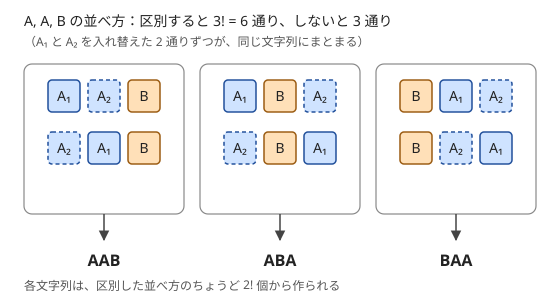

!!! abstract "要点"
    - **何ができるか**：種類ごとの個数が $a_1, \dots, a_m$ の並べ方を $\dfrac{(a_1 + \cdots + a_m)!}{a_1! \cdots a_m!}$ 通りと数える。全部を区別した並べ方を、同じ種類の中の入れ替えで割って得る。大きさを指定したグループ分けも同じ式で数える。
    - **いつ使うか**：
        - 文字を並べ替えてできる文字列の個数を求める。
        - 各種類を使う個数が決まっている並べ方を数える。
        - 大きさを指定してグループに分ける方法の数を求める。
    - **計算量**：階乗・逆階乗を $O(N + \log p)$ で前計算すれば 1 回 $O(m)$（$N$ は全体の個数、$m$ は種類数）。各種類の個数を決めながら合流する DP は $O(N^2 + mN)$（$m \le N$ なら $O(N^2)$）。
    - **前提**：[二項係数の前計算](../comb/binomial-precompute.md)

<!-- textlint-disable -->
別名：同じものを含む順列・並べ替えの数・グループ分けの数・多項定理・multinomial coefficient
<!-- textlint-enable -->

多項係数は、同じものを含む列の並べ方の数である。$m = 2$ のときは二項係数 $\binom{n}{a_1}$ そのもので、種類が 3 つ以上に増えても「全部区別してから、区別しない分で割る」という同じ考え方で数えられる。競技プログラミングでは式を 1 回使うより、DP の遷移や挿入の数え方の部品として現れることが多い。

以下では、数え上げの答えを素数 $p$（多くは $998244353$）で割った余りとして求める場面を主に考える。階乗 $\mathrm{fact}[n] = n!$ と逆階乗 $\mathrm{ifact}[n] = (n!)^{-1}$ の表は[二項係数の前計算](../comb/binomial-precompute.md)で作ってあるものとする。

## 式の意味（全部区別した n! を入れ替えで割る） {#meaning}

数える対象は、種類 $i$ のものが $a_i$ 個ずつ、合わせて $n = a_1 + \cdots + a_m$ 個あるときの、長さ $n$ の列である。同じ種類のものは区別しない。小さい例として A を 2 個、B を 1 個並べると、AAB・ABA・BAA の 3 通りになる。

これを式で数えるため、いったん同じ種類のものにも番号を付けて A₁・A₂・B とする。番号付きの並べ方は $3! = 6$ 通りあり、番号を消すと 2 通りずつが同じ文字列になる。



一般に、番号を消してできる 1 つの文字列には、番号付きの並べ方がちょうど $a_1! \, a_2! \cdots a_m!$ 個対応する。種類 $i$ が入る $a_i$ か所に番号 $1, \dots, a_i$ をどう割り当てるかが $a_i!$ 通りで、種類ごとに独立に選べるからである。この個数はどの文字列でも同じなので、全体をこれで割ればよい。

$$
\binom{n}{a_1, a_2, \dots, a_m} = \frac{n!}{a_1! \, a_2! \cdots a_m!}
$$

割れるのは「どの文字列も同じ回数だけ数えられている」からである。重複の回数が文字列ごとに違うときは割り算では直せない（[重複の除き方](../comb/counting-dedup.md#representative)）。

同じ式は、番号の付いた $n$ 人を、名前の付いたグループ $1, \dots, m$ に大きさ $a_1, \dots, a_m$ で分ける方法の数でもある。人を番号順に並べ、各人に入るグループの名前を書くと、グループ $i$ の名前がちょうど $a_i$ 回現れる長さ $n$ の列になる。この対応は 1 対 1 なので、数は列の並べ方と同じである。

$(x_1 + \cdots + x_m)^n$ を展開したときの $x_1^{a_1} \cdots x_m^{a_m}$ の係数もこの数になる（多項定理）。$n$ 個のかっこから 1 つずつ変数を選ぶ選び方は、$x_i$ がちょうど $a_i$ 回現れる長さ $n$ の列と 1 対 1 に対応するからである。

mod $p$ では $\mathrm{fact}[n] \cdot \mathrm{ifact}[a_1] \cdots \mathrm{ifact}[a_m]$ で計算する。逆階乗の表があれば 1 回 $O(m)$ である。

```cpp
--8<-- "multinomial-coefficient/reorder.cpp:core"
```

??? question "確認問題：MISSISSIPPI"
    MISSISSIPPI の 11 文字を並べ替えてできる文字列は何通りか。

    ??? success "答え"
        M が 1 個、I が 4 個、S が 4 個、P が 2 個なので $\dfrac{11!}{1! \, 4! \, 4! \, 2!} = \dfrac{39916800}{1152} = 34650$ 通りである。

## 二項係数の積として順に場所を決める {#product-of-binomials}

多項係数は、種類ごとに場所を順に選ぶ見方でも数えられる。まず $n$ か所から種類 1 の場所を $a_1$ か所選び、残りの $n - a_1$ か所から種類 2 の場所を $a_2$ か所選ぶ、と続ける。

$$
\frac{n!}{a_1! \cdots a_m!} = \binom{n}{a_1} \binom{n - a_1}{a_2} \cdots \binom{a_m}{a_m}
$$

右辺を階乗で書くと、隣り合う項の $(n - a_1)!$ などが打ち消し合って左辺になる。積の順を逆にして「これまでに置いた個数の合計 $s$ に $a_i$ 個を足す」と見れば、$\binom{s + a_i}{a_i}$ を順に掛けることになる。この形は次の 3 つの場面で役に立つ。

- **法が素数でない・逆元がない**：この形なら割り算が要らない。$n$ が数千までなら[パスカルの三角形](../comb/binomial-precompute.md#composite-mod)で二項係数を作り、掛けるだけでよい
- **mod を取らない正確な値**：$20! \approx 2.4 \times 10^{18}$ は `long long` に収まるが $21!$ は収まらない。階乗を作ってから割る方法はすぐにあふれるので、二項係数を 1 つずつ正確に求めて掛ける（[正確な値の求め方](../comb/binomial-precompute.md#exact)）。答えそのものが `long long` を超えるなら `__int128` か多倍長が要る
- **種類を 1 つずつ足していく DP**：「これまで $s$ 個の列に、新しい種類を $k$ 個混ぜる」方法が $\binom{s + k}{k}$ 通りなので、DP の遷移にそのまま使える（次の節）

## DP で個数を決めながら合流ごとに二項係数を掛ける {#dp-merge}

各種類を使う個数が決まっていれば式 1 つで済むが、「種類 $i$ は $c_i$ 個まで使ってよい」のように個数が自由なら、個数の組ごとに多項係数を足し合わせることになる。組は最大で $\prod (c_i + 1)$ 個あり、全部を試すことはできない。そこで種類を 1 つずつ足していく DP にする。

- **状態**：$\mathrm{dp}[j][\ell]$ ＝ 最初の $j$ 種類だけを使った長さ $\ell$ の列の個数
- **遷移**：種類 $j$ を $k$ 個（$0 \le k \le c_j$）足すと、$\mathrm{dp}[j + 1][\ell + k] \mathrel{+}= \mathrm{dp}[j][\ell] \cdot \binom{\ell + k}{k}$
- **初期値と答え**：$\mathrm{dp}[0][0] = 1$（空の列が 1 つ）。答えは $\mathrm{dp}[m][\ell]$ を必要な長さについて足したもの

遷移の $\binom{\ell + k}{k}$ は、長さ $\ell + k$ の列の中で新しい種類が入る $k$ か所を選ぶ数である。残りの $\ell$ か所には、これまでの種類だけでできた長さ $\ell$ の列が順にそのまま入る。逆に、できあがった列から新しい種類を取り除けば元の列と $k$ か所の位置が一意に戻る。だからこの遷移は重複も漏れもなく数える。

具体例として A が 2 個まで、B が 1 個まで使えるときを考える。A だけの段階では $\mathrm{dp}[1] = (1, 1, 1)$（長さ 0・1・2 が 1 通りずつ）である。B を 1 個足すと、長さ 1 の A に B を混ぜる方法が $\binom{2}{1} = 2$ 通り（AB・BA）、長さ 2 の AA に混ぜる方法が $\binom{3}{1} = 3$ 通りになる。

| 長さ $\ell$ | 0 | 1 | 2 | 3 |
| --- | --- | --- | --- | --- |
| A だけ | 1 | 1 | 1 | 0 |
| B を足した後 | 1 | 2 | 3 | 3 |

長さ 3 の 3 通りは AAB・ABA・BAA で、[式の意味の節](#meaning)の例と一致する。

計算量は、種類 $j$ の段で $(\text{それまでの長さの最大} + 1) \times (c_j + 1)$ なので、合計で $O(N^2 + mN)$（$N = \sum c_j$、$m$ は種類数）である。$m \le N$ なら $O(N^2)$ で、個数 0 の種類を飛ばしてもよい。次の `count_strings` は、空でない列の個数を返す。

```cpp
--8<-- "multinomial-coefficient/reorder.cpp:merge"
```

この DP は、各種類の $\sum_{k} \frac{x^k}{k!}$ を掛け合わせた多項式の $x^\ell$ の係数に $\ell!$ を掛ける計算と同じである。$N$ が大きいときは、この積を畳み込みで速く求める（[母関数による数え上げ](../comb/generating-function-counting.md)）。

## 一部を先に並べて残りを挿入する {#insert-rest}

この節は[重複組合せ](../comb/stars-and-bars.md)を前提にする。隣り合い方に条件がある並べ方は、多項係数だけでは数えられない。条件に関わる一部の種類を後回しにし、残りを先に並べてから、後回しにした種類を隙間に入れると数えやすくなる。

最も簡単な例は「A を $a$ 個、B を $b$ 個並べ、A どうしが隣り合わない」並べ方である。先に B を $b$ 個並べると、両端を含めて $b + 1$ 個の隙間ができる。A は 1 つの隙間に 1 個までしか入れられないので、$\binom{b + 1}{a}$ 通りになる。

種類が増えても手順は同じである。

1. 条件に関わらない種類を先に並べる。並べ方は多項係数で数える
2. 後回しにした種類を入れてよい隙間と、1 つの隙間に入れてよい個数を決める
3. 「1 か所に 1 個まで」なら二項係数、「何個でもよい」なら重複組合せで、入れ方を数える
4. 1 と 3 の数を掛ける

掛けてよいのは、できあがった列から後回しにした種類を取り除くと、先に並べた列と入れ方が一意に戻るからである。どの隙間に入れると条件を満たし、どこに入れると壊れるかを、小さな例で 1 つずつ確かめてから式にする。たとえば「X の直後に Y を置かない」なら、Y を先に並べたとき「Y の直前の隙間」には X を入れられない。

「AB がちょうど $k$ 回」のように回数が決まった条件では、まず条件を満たす $k$ か所を選んで固定し、残りは条件を新しく作らない隙間にだけ入れる、と 2 段に分ける。どの隙間が使えるかの取り違えが誤答の原因になりやすいので、全探索の結果と小さいケースで比べるとよい。

位置ではなく値の大小関係に条件がある順列は、要素を 1 つずつ挿入する [挿入 DP](../dp/insertion-dp.md) で数える。

## 区別しない同じ大きさのグループを割る {#same-size-groups}

この節は [DP の基本](../dp/dp-basics.md)を前提にする。番号の付いた $n$ 人をグループに分けるとき、グループに名前がなければ、同じ大きさのグループどうしの入れ替えでさらに割る必要がある。

大きさ $s$ のグループが $k_s$ 個ずつ（$\sum_s s \cdot k_s = n$）あり、グループに名前がないとする。グループに名前を付けた分け方は多項係数 $\dfrac{n!}{\prod_s (s!)^{k_s}}$ 通りである。名前を消すと、同じ大きさのグループどうしの名前の入れ替え $\prod_s k_s!$ 通りが同じ分け方になる。

$$
\frac{n!}{\prod_s (s!)^{k_s} \, k_s!}
$$

割ってよいのは、どのグループも 1 人以上を含み、中身が互いに違うからである。名前の入れ替えは必ず別の「名前付きの分け方」を作るので、重複の回数はどの分け方でも $\prod_s k_s!$ でそろう。大きさの違うグループは中身の人数で区別できるので、入れ替えの対象にならない。空のグループを許すと重複の回数がそろわなくなり、この割り算は使えない（[写像 12 相](../comb/twelvefold-way.md#why-not-divide)）。

大きさの組を全部試せないときは、大きさごとにグループの数を決める DP にする。

- **状態**：$\mathrm{dp}[s][i]$ ＝ 大きさ $s$ 未満のグループだけで $i$ 人を分け終えた方法の数
- **遷移**：大きさ $s$ のグループを $k$ 個作るなら、まだ分けていない $n - i$ 人から $sk$ 人を選び、名前のない $k$ 個のグループに分ける。$\mathrm{dp}[s + 1][i + sk] \mathrel{+}= \mathrm{dp}[s][i] \cdot \binom{n - i}{sk} \cdot \dfrac{(sk)!}{(s!)^k \, k!}$
- **初期値と答え**：$\mathrm{dp}[1][0] = 1$。答えは $\mathrm{dp}[n + 1][n]$（大きさに制限があれば、その範囲の $s$ だけで遷移する）
- **計算量**：大きさ $s$ では $k \le n / s$ なので、遷移の数は $\sum_s n \cdot \frac{n}{s} = O(n^2 \log n)$（調和級数）

大きさの小さい順に決めるので、同じ分け方を 2 回数えることはない。どの大きさのグループを何個作るかが決まれば、分け方は上の式のとおり一意に数えられる。$(s!)^k$ の逆元は $\mathrm{ifact}[s]$ の $k$ 乗で、$k$ を 1 つずつ増やしながら掛けていけば毎回累乗を計算しなくて済む。

??? question "確認問題：2 人ずつ 3 組"
    6 人を、名前のない 2 人ずつの 3 組に分ける方法は何通りか。

    ??? success "答え"
        名前付きの組に分ける方法は $\dfrac{6!}{2! \, 2! \, 2!} = 90$ 通りで、3 組の名前の入れ替え $3! = 6$ 通りで割って 15 通りである。直接数えると、1 番の人の相手が 5 通り、残る 4 人のうち番号の最も小さい人の相手が 3 通り、最後の 2 人は 1 通りで、$5 \times 3 \times 1 = 15$ と一致する。

## 落とし穴 {#pitfalls}

**同じ大きさのグループの入れ替えで割り忘れる**。「グループに分ける」と書かれていてグループに名前がないなら、同じ大きさのグループが $k$ 個あるごとに $k!$ で割る。名前があるか（「チーム 1・チーム 2」「赤・青」）を問題文から読み取ってから式を選ぶ。小さい $n$ で全探索した値と比べれば、割り忘れはすぐ分かる。

**空のグループを許すのに $k!$ で割る**。空のグループどうしの入れ替えは同じ分け方を作るので、重複の回数が分け方ごとに変わる。空を許すなら、空でないグループの個数で場合分けしてから割るか、[写像 12 相](../comb/twelvefold-way.md#table)の該当するマスの数を使う。

**階乗の表が足りない**。多項係数の分子は全体の個数 $n$ の階乗なので、表は $n$ まで要る。DP の中で $\binom{\ell + k}{k}$ を使うなら、$\ell + k$ の最大まで作る。

**$n \ge p$ で逆階乗を使う**。$n \ge p$ では $n! \equiv 0 \pmod{p}$ になり、割り算の形が使えない。法が小さい問題では[二項係数の積](#product-of-binomials)に直し、各二項係数を [Lucas の定理](../comb/binomial-precompute.md#lucas)などで求める。

**選び方の数と文字列の数を取り違える**。「部分列を並べ替えてできる文字列の個数」では、どの位置を選んだかではなく、各文字の個数だけで結果が決まる。位置の選び方で数えると、同じ文字列を何度も数える。数える対象が「選び方」か「できあがる列」かを最初に決める。

**mod を取った値を比べる**。多項係数を mod $p$ で求めた値は大小比較できない。最大の並べ方を探すなど大小が要るときは、正確な値か対数で比べる。

## 使い分け {#comparison}

- 区別しないものを区別する箱に配る（各箱の個数だけを決める）なら[重複組合せ](../comb/stars-and-bars.md)。多項係数は個数が決まった後の並べ方を数える
- 重複の回数がそろわない数え方の直し方は[重複の除き方](../comb/counting-dedup.md#representative)
- 玉と箱の区別と制限の組合せで式を選ぶなら[写像 12 相](../comb/twelvefold-way.md)
- swap などの操作で列を並べ替えられる範囲を問うときは、操作の偶奇で作れない並べ方を除く（[置換の偶奇](../comb/permutation-parity.md)）

## 例題 {#examples}

### ABC234 F. Reordering {#abc234_f}

<div class="kp-problems" data-role="example" markdown>

- [ABC234 F. Reordering](https://atcoder.jp/contests/abc234/tasks/abc234_f)（diff 1596）：文字列 S の空でない部分列を並べ替えてできる文字列の種類数を求める。

</div>

部分列を並べ替えてできる文字列は、各文字の個数が S の中の個数以下である文字列とちょうど一致する。どの位置を選んだかは関係なく、文字ごとの個数が決まれば文字列の種類は多項係数で決まる。文字ごとの個数は自由なので、[合流の節](#dp-merge)の DP で個数の組をまとめて数える。

??? note "解法の詳細"
    - $c_j$ を S の中の $j$ 番目の文字の個数とする。$\mathrm{dp}[\ell]$ ＝ これまでの文字だけで作る長さ $\ell$ の文字列の個数とし、$\mathrm{dp}[0] = 1$ から始める。
    - 文字を 1 種類ずつ足す。その文字を $k$ 個（$0 \le k \le c_j$）使うなら $\mathrm{dp}'[\ell + k] \mathrel{+}= \mathrm{dp}[\ell] \cdot \binom{\ell + k}{k}$。
    - 26 文字を足し終えたら、$\ell \ge 1$ の $\mathrm{dp}[\ell]$ の和が答えである（空文字列を除く）。
    - 計算量は $O(\lvert S \rvert^2)$。二項係数は前計算した階乗で $O(1)$ に求める。コードは[合流の節](#dp-merge)の `count_strings` と同じ形である。
    - 各文字の $\sum_{k \le c_j} \frac{x^k}{k!}$ を掛け合わせ、$x^\ell$ の係数に $\ell!$ を掛けても同じ値になる（参考の記事はこの形で数えている）。

## 練習問題 {#practice}

<div class="kp-problems" data-role="practice" markdown>

- [ABC470 F. Googol Swaps](https://atcoder.jp/contests/abc470/tasks/abc470_f)（diff 1604）：許された位置の組の swap をちょうど 10^100 回行ったあとにできる文字列の種類数を求める。
- [ABC266 G. Yet Another RGB Sequence](https://atcoder.jp/contests/abc266/tasks/abc266_g)（diff 2045）：R・G・B の個数が決まった文字列のうち、RG がちょうど K 回現れるものの数を求める。

</div>

??? note "練習の方針"
    - **ABC470 F**：swap できる位置の組を辺としたグラフの連結成分ごとに、文字を自由に並べ替えられる。並べ方の総数は、成分ごとの多項係数の積である。ただし swap の回数が決まっているので、置換の偶奇が片方に限られる。どこかの成分に同じ文字が 2 個以上あれば、その 2 つの swap で偶奇を調整できる。このときは総数のままである。なければ半分になる。辺は 1 本以上あるので大きさ 2 以上の成分が必ずあり、偶奇の両方が同数ずつ現れる（[置換の偶奇](../comb/permutation-parity.md#duplicates)）
    - **ABC266 G**：G と B を先に並べ（$\binom{G + B}{G}$ 通り）、RG を作る $K$ 個の G を選んで直前に R を置く。残りの $R - K$ 個の R は、新しい RG を作らない隙間（B の直前・末尾・置いた R の直前の $K + B + 1$ か所）に重複組合せで配る

## 力試し {#challenge}

<div class="kp-problems" data-role="challenge" markdown>

- [ARC067 E. Grouping](https://atcoder.jp/contests/arc067/tasks/arc067_c)（diff 2190）：N 人を、各組の人数が A 以上 B 以下で、同じ人数の組の数が 0 か C 以上 D 以下になるように分ける方法の数を求める。

</div>

??? note "力試しの方針"
    - **ARC067 E**：組の人数を $A$ から $B$ まで順に見て、その人数の組を 0 個か $C$〜$D$ 個作る DP にする。$k$ 個作るときは、残りの人から選んで名前のない $k$ 組に分ける数 $\binom{n - i}{sk} \cdot \dfrac{(sk)!}{(s!)^k \, k!}$ を掛ける（[同じ大きさのグループを割る節](#same-size-groups)）。人数 $s$ では $k \le N / s$ なので、全体は調和級数で $O(N^2 \log N)$

## 参考 {#references}

- [Kazun「AtCoder Beginner Contest 234 F 問題 Reordering」](https://kazun-kyopro.hatenablog.com/entry/ABC/234/F)：例題の言い換え（各文字の個数だけで決まる）と、指数型の多項式の積として数える見方
- [ikatakos「JPRSプログラミングコンテスト2026#2 （AtCoder Beginner Contest 470）E,F,G問題メモ」](https://ikatakos.com/pot/programming_algorithm/contest_history/atcoder/2026/0808_abc470)：練習の方針（連結成分ごとの多項係数と偶奇。解説の部分だけを参照）
- [drken「AtCoder ABC 266 G - Yet Another RGB Sequence (黄色, 600 点)」](https://drken1215.hatenablog.com/entry/2023/05/04/185000)：練習の方針（先に並べてから R を挿入する数え方）
- [drken「AtCoder ARC 067 E - Grouping (黄色, 600 点)」](https://drken1215.hatenablog.com/entry/2018/06/14/151800)：同じ大きさの組の入れ替えで割る式と、調和級数による計算量の見積もり
