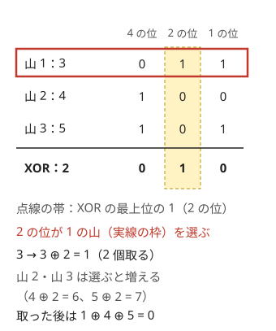

!!! abstract "要点"
    - **何ができるか**：山から 1 個以上取り合い最後の石を取った方が勝つゲームは、全山の個数の XOR が 0 なら後手必勝、そうでなければ先手必勝である。XOR が 0 の局面からは必ず 0 でなくなり、0 でない局面からは 0 にできる。
    - **いつ使うか**：
        - いくつかの山から石を取り合い、最後に取った人が勝ち。
        - 1 回に取れる個数に上限（範囲）がある。
        - 先手が勝てるように最初の配置を変えられるか。
    - **計算量**：勝敗の判定は XOR を取るだけで $O(N)$。勝つための手（どの山を何個にするか）も $O(N)$ で見つかる。
    - **前提**：[ゲームの基本と勝敗の DP](../comb/game-basics.md)、[bit 演算の基本と XOR の性質](../basics/bit-operations.md)

<!-- textlint-disable -->
別名：ニム・ニム和・石取りゲーム・上限つき Nim・逆形 Nim・Bouton の定理・misère Nim
<!-- textlint-enable -->

Nim は、いくつかの石の山から 2 人が交互に「1 つの山を選んで 1 個以上好きなだけ取る」ゲームである。最後の石を取った方が勝ち（動けなくなった方が負け）とする。山の数も石の数も大きいと、[勝敗の DP](../comb/game-basics.md) では局面が多すぎて表を作れない。ところが勝敗は、全山の個数の XOR（ニム和）が 0 かどうかだけで決まる。

このページでは、山の個数を $A_1, \dots, A_N$、ニム和を $s = A_1 \oplus A_2 \oplus \dots \oplus A_N$ と書く。実装（コード片）では山の番号を 0-indexed にする。

## Bouton の定理と証明の筋 {#bouton}

Bouton の定理は「$s = 0$ の局面は手番の人の負け（必敗）、$s \ne 0$ の局面は手番の人の勝ち（必勝）」と主張する。最初の局面で言えば、$s = 0$ なら後手必勝、$s \ne 0$ なら先手必勝である。

必勝・必敗は終局から後ろ向きに決まる（[ゲームの基本](../comb/game-basics.md)）。だから次の 3 つを確かめれば、石の総数についての帰納法で定理が成り立つ。

1. **終局は $s = 0$**：すべての山が 0 個なら $s = 0$ で、手番の人は動けずに負ける。
2. **$s = 0$ からは、どう取っても $s \ne 0$ になる**：1 手で変わる山は 1 つだけである。山 $i$ を $A_i$ から $A_i' \ne A_i$ に変えると、新しいニム和は $s \oplus A_i \oplus A_i'$ になる。$s = 0$ なら、これは $A_i \oplus A_i' \ne 0$ である。
3. **$s \ne 0$ からは、$s = 0$ にする手がある**：山 $i$ を $A_i \oplus s$ に変えれば、新しいニム和は $s \oplus A_i \oplus (A_i \oplus s) = 0$ になる。これが「石を取る」手になるには $A_i \oplus s < A_i$ が要る。$s$ の最上位の 1 のビットを $d$ とし、$d$ が 1 の山 $i$ を選ぶ（$s$ の $d$ のビットが 1 なので、奇数個の山で $d$ が 1 であり、少なくとも 1 つある）。$A_i \oplus s$ は $A_i$ の $d$ のビットを 0 にし、それより下の位だけを変えるので、$A_i$ より小さい。

2 と 3 から、$s \ne 0$ の側の人は毎回 $s = 0$ の局面を相手に渡し続けられる。相手は $s \ne 0$ の局面しか返せず、石は毎手減るので、いつか相手が終局（$s = 0$）を受け取って負ける。

XOR が効くのは、XOR が「各ビットの 1 の個数の偶奇」だからである。ニム和が 0 とは、どの位でも 1 を持つ山が偶数個あることを意味する。1 つの山を変えると、変わった位の偶奇が必ず崩れる。崩れた偶奇は、最上位の崩れた位に 1 を持つ山を 1 つ直すだけでそろえ直せる。XOR の打ち消しの性質は [XOR の性質](../basics/bit-operations.md#xor-properties)にまとめてある。

??? question "確認問題：2 山の Nim"
    山が 2 つだけのとき、後手必勝になるのはどんな場合か。そのときの後手の戦い方も答えよ。

    ??? success "答え"
        $A_1 \oplus A_2 = 0$、すなわち $A_1 = A_2$ のときである。後手は、先手が取ったのと同じ個数をもう一方の山から取り、2 山を同じ個数に戻し続ければよい（真似戦略）。最後の石は後手が取る。

## 勝つための手（XOR を 0 にする山の選び方） {#winning-move}

先手必勝の局面で実際の手を答える問題や、自分で戦うインタラクティブの問題では、ニム和を 0 にする手を作る。手順は次のとおりである。

1. ニム和 $s$ を求める。$s = 0$ なら勝つ手はない（どう取っても負ける）。
2. $A_i \oplus s < A_i$ となる山 $i$ を 1 つ選ぶ。これは「$A_i$ が $s$ の最上位の 1 のビットを持つ」ことと同じである。
3. 山 $i$ を $A_i \oplus s$ 個にする。取る個数は $A_i - (A_i \oplus s)$ 個である。

山が $3, 4, 5$ の例で動かす。$s = 3 \oplus 4 \oplus 5 = 2$ で、最上位の 1 は 2 の位にある。2 の位が 1 なのは山 1（$3$）だけなので、山 1 を $3 \oplus 2 = 1$ 個にする（2 個取る）。



図のとおり、山 2（$4$）は $s = 2$ より大きいのに選べない。$4 \oplus 2 = 6$ は 4 より大きく、石を「足す」手になってしまうからである。判定は $A_i > s$ ではなく、$A_i \oplus s < A_i$（$A_i$ が $s$ の最上位のビットを持つ）で行う。

```cpp
--8<-- "nim/nim.cpp:core"
```

判定も手の構成も、山を 1 回ずつ見るだけなので $O(N)$ である。石の数が $10^{18}$ まであっても、XOR は `long long` のまま計算できる。

??? question "確認問題：勝つ手を探す"
    山が $1, 2, 4, 7$ のとき、先手の勝つ手をすべて挙げよ。

    ??? success "答え"
        $s = 1 \oplus 2 \oplus 4 \oplus 7 = 0$ なので、勝つ手はない（後手必勝）。山が $1, 2, 4, 6$ なら $s = 1$ で、最上位の 1 は 1 の位にある。1 の位が 1 の山は 1 個の山だけなので、その山を $1 \oplus 1 = 0$ 個にする（1 個取る）手だけが勝つ手である。

## 上限つき（x mod (k+1)）・範囲つきの変種 {#bounded}

1 回に取れる個数が「1 個以上 $k$ 個以下」に制限された Nim は、各山の個数を $k + 1$ で割った余りで作った Nim と同じ勝敗になる。すなわち $(A_1 \bmod (k+1)) \oplus \dots \oplus (A_N \bmod (k+1)) = 0$ なら手番の人の負けである。

山が 1 つなら理由は見やすい。$k = 3$ で山が 4 個のとき、相手が $t$ 個（$1 \le t \le 3$）取れば自分は $4 - t$ 個取り、2 人で合わせて 4 個ずつ減らせる。余りが 0 の山は、相手が何個取っても自分が「合わせて $k + 1$ 個」に戻せる。

山が複数でも、Bouton の定理と同じ 3 つを、余り $r_i = A_i \bmod (k+1)$ のニム和 $s$ について確かめればよい。

- **終局は $s = 0$**：すべて 0 個なら余りもすべて 0 である。
- **$s = 0$ からは $s \ne 0$ になる**：1 手で取る $t$ 個は $1 \le t \le k$ で $k + 1$ の倍数でないので、取った山の余りは必ず変わる。変わるのは 1 つの山だけなので、ニム和は 0 でなくなる。
- **$s \ne 0$ からは $s = 0$ にできる**：Nim と同じく、$r_i \oplus s < r_i$ となる山 $i$ がある。その山から $r_i - (r_i \oplus s)$ 個取ると、余りが $r_i \oplus s$ になる。取る個数は 1 以上 $r_i \le k$ 以下で、山には $A_i \ge r_i$ 個あるので取れる。

```cpp
--8<-- "nim/nim.cpp:bounded"
```

$k$ が $\max A_i$ 以上なら余りは $A_i$ そのもので、普通の Nim に戻る。だから「上限 $k$ を自分で選べる」問題では、普通の Nim で先手必勝なら $k$ をいくらでも大きくしてよい（[ARC168 B](#arc168_b) の例題）。

取れる個数が「$L$ 個以上 $R$ 個以下」のような範囲のときも、1 つの山だけを見ると、勝敗が個数について周期的になることが多い。ただし余りの Nim に置き換えるだけでは足りず、山ごとの値（Grundy 数）を表にして規則を探す。これは [Grundy 数と Sprague-Grundy の定理](../comb/grundy-number.md)の話題で、そこでは「各山が Nim の何個の山と同じか」を mex で求め、その XOR で判定する。

??? question "確認問題：上限が 2 のとき"
    1 回に 1〜2 個だけ取れる Nim で、山が $4, 5, 7$ のとき、先手の勝つ手を 1 つ答えよ。

    ??? success "答え"
        3 で割った余りは $1, 2, 1$ で、ニム和は $1 \oplus 2 \oplus 1 = 2$ なので先手必勝である。最上位の 1（2 の位）を持つ余りは山 2 の $2$ なので、その余りを $2 \oplus 2 = 0$ にする。山 2 から 2 個取って 3 個にすればよい。余りは $1, 0, 1$ でニム和は 0 になる。

## 先手と後手で取れる数が違うとき {#asymmetric}

この節は[ゲームの基本](../comb/game-basics.md)の、手番を状態に入れる考え方を前提にする。「先手は 1 回に $X$ 個、後手は $Y$ 個取る」のように、同じ局面でも手番によって打てる手が違うゲームでは、Bouton の定理も XOR も使えない。XOR の議論は「どちらの手番でも同じ手が打てる」（不偏ゲーム）ことを使っているからである。手番で手が違うゲームの一般論は難しく、[非不偏ゲーム](../comb/partizan-games.md)のページで扱う。

AtCoder でよく出る形では、次の 2 つの考え方で片づくことが多い。1 手で複数の山から同時に取れるルールでも、考え方は同じである。

- **戻す戦略**：「相手がどう動いても、自分が元の種類の局面に戻せる」局面の集まりを見つける。先手が $X$ 個、後手が $Y$ 個取るなら、後手は先手が触った山から $Y$ 個取れば、2 人で合わせて $X + Y$ 個を減らせる。すると山を $X + Y$ で割った余りは変わらない。どの山の余りも $X$ 未満なら、先手が取れる山は $X + Y$ 個以上あるので、後手はいつでも同じ山から $Y$ 個取り返せる。最後に動けなくなるのは先手である。上限つきの Nim で「合わせて $k + 1$ 個」に戻すのと同じ発想である。
- **最初の 1 手で戻す側に回る**：戻す戦略で勝てる局面に、自分の 1 手で持ち込めるかを調べる。余りが $X$ 以上の山だけを相手より先に処理できるかで、勝敗が場合分けで決まる。

どちらも、手番ごとに「自分の手の後に相手に渡す局面の種類」を決めて、それが閉じていることを確かめる。小さい場合は[勝敗の DP](../comb/game-basics.md) で全部調べられる。手番を状態に入れた表から規則を見つけると、場合分けを見落としにくい。

## 逆形 Nim（最後に取った方が負け） {#misere}

この節は [Bouton の定理の証明](#bouton)を前提にする。最後の石を取った方が負けになる逆形（misère）の Nim では、結論が少しだけ変わる。

- **どの山も 1 個以下のとき**：手は「1 個の山を取る」だけに決まる。1 個の山が偶数個なら手番の人の勝ち、奇数個なら負けである（最後の 1 個を取らされるのが誰かで決まる）。
- **2 個以上の山が 1 つでもあるとき**：普通の Nim と同じで、ニム和が 0 でなければ手番の人の勝ちである。

戦い方は「普通の Nim と同じに戦い、2 個以上の山が最後の 1 つになった時点で切り替える」である。2 個以上の山がちょうど 1 つの局面は、ニム和が 0 にならない（その山だけが 2 以上の位に 1 を持つ）。この局面の手番の人は、その山を 0 個か 1 個にして「1 個の山が奇数個」を相手に渡せば勝つ。

勝つ側は、それまで普通の Nim のとおりニム和が 0 の局面を渡し続ける。ニム和が 0 で 2 個以上の山があるなら、そういう山は 2 つ以上ある。相手は 1 手で 1 つの山しか変えられないので、2 個以上の山を残して返すしかない。それが 1 つだけになったら、勝つ側が上の切り替えを行う。

最初の局面で言えば、全部の山が 1 個以下のときだけ判定を逆にし、それ以外は普通の Nim のまま答えればよい。この結論は、コード片の自己検査（3 山・各 0〜7 個の全局面の DP）でも確かめてある。

??? question "確認問題：1 個の山が 2 つ"
    山が $1, 1$ の逆形 Nim で、勝つのはどちらか。普通の Nim ではどうか。

    ??? success "答え"
        逆形では先手が勝つ。先手が 1 個取ると後手は最後の 1 個を取らされて負ける。普通の Nim ではニム和が $1 \oplus 1 = 0$ なので後手が勝つ。どの山も 1 個以下のときは、逆形の勝敗が普通の Nim とちょうど逆になる。

## 必勝局面の数え上げ（XOR 畳み込み） {#counting}

この節は [XOR 畳み込み（アダマール変換）](../math/hadamard-transform.md)を前提にする。「各山の個数を候補から選んで並べるとき、先手必勝の並べ方はいくつか」という数え上げは、ニム和が 0 になる並べ方を数えて全体から引けばよい。

- **値が小さく山が少ないとき**：「$\mathrm{dp}[i][x]$ ＝ 山を $i$ 個決めたときニム和が $x$ になる並べ方の数」とする。候補の値 $a$ ごとに $\mathrm{dp}[i+1][x \oplus a] \mathrel{+}= \mathrm{dp}[i][x]$ と配る。値の上限を $V$（2 のべき）、候補の数を $K$ とすると $O(NKV)$ である。
- **山が多いとき**：1 個の山の分布 $f$（候補の値に 1 を立てた長さ $V$ の列）を XOR 畳み込みで $n$ 回かけたものが、山 $n$ 個の分布になる。アダマール変換をすると XOR 畳み込みが各点の積になるので、各点で $n$ 乗（山の数が範囲なら等比数列の和）を取ってから逆変換し、0 番目の値を読む。変換は $O(V \log V)$ である。

先手必勝の数は「全体 − ニム和が 0 の数」である。山が $n$ 個なら、全体は候補の数の $n$ 乗になる。答えを mod で求める問題では、引き算の後に負にならないよう法を足しておく。

## 落とし穴 {#pitfalls}

**ルールが Nim の形かを確かめずに XOR を取る**。XOR で判定できるのは、次の 4 つをすべて満たすときだけである。1 手で動かす山が 1 つだけ。1 個以上なら何個でも取れる。動けなくなった方が負け（最後に取った方が勝ち）。両者の打てる手が同じ。取れる個数に制限があれば[上限つき](#bounded)か Grundy 数を使う。複数の山から同時に取れるなら[戻す戦略](#asymmetric)などの別の考察が要り、最後に取った方が負けなら[逆形](#misere)の結論を使う。

**勝つ手を探すとき $A_i > s$ で山を選ぶ**。山 $4$ とニム和 $s = 2$ のように、$A_i > s$ でも $A_i \oplus s$ が $A_i$ より大きくなることがある。条件は $A_i \oplus s < A_i$ で書く（[勝つための手](#winning-move)の図）。

**先手と後手の出力を逆にする**。ニム和が 0 なのは手番の人の「負け」である。最初の局面では先手が手番なので、0 なら後手（Second）を出力する。

**同じ値の山を見落とす**。同じ個数の山 2 つは、XOR でも、$k + 1$ で割った余りでも打ち消し合う。「最大の山を変えれば状況が変わる」と考えると、最大の値が 2 つあるときに誤る（[ARC168 B](#arc168_b) の解法の詳細）。

**XOR を `int` で取る**。石の数が $10^9$ を超えうるなら、ニム和も `long long` で持つ。XOR は桁上がりしないので、`long long` に収まる値どうしの XOR は必ず収まる。

## 使い分け {#comparison}

- 局面が小さく、ルールが Nim の形でないなら、[勝敗の DP](../comb/game-basics.md) で全部の局面を調べる
- 独立な複数のゲームの「どれか 1 つを選んで 1 手」で、1 つのゲームが Nim の 1 山でないなら、[Grundy 数](../comb/grundy-number.md)で各ゲームを Nim の山に直してから XOR を取る
- 手番によって打てる手が違うなら、XOR は使えない。戻す戦略や[非不偏ゲーム](../comb/partizan-games.md)の考え方を使う
- 「XOR が 0 になるように値を選べるか」が主題で、ゲームの形をしていないなら、[XOR 基底](../math/xor-basis.md)を考える

## 例題 {#examples}

### 鉄則本 A33. Game 2 {#tessoku_book_ag}

<div class="kp-problems" data-role="example" markdown>

- [鉄則本 A33. Game 2](https://atcoder.jp/contests/tessoku-book/tasks/tessoku_book_ag)（diff —）：N 個の山から交互に好きな山の石を 1 個以上取り、最後の石を取った方が勝つとき、勝つのはどちらかを求める。

</div>

ルールが Nim そのものなので、Bouton の定理をそのまま使う。全山の個数の XOR を取り、0 でなければ先手、0 なら後手が勝つ。

??? note "解法の詳細"
    - 入力の山の個数を順に XOR していく。$O(N)$ である。
    - 勝つ手は聞かれていないので、[勝つための手](#winning-move)のコード片の `nim_sum` だけで足りる。

### ARC168 B. Arbitrary Nim {#arc168_b}

<div class="kp-problems" data-role="example" markdown>

- [ARC168 B. Arbitrary Nim](https://atcoder.jp/contests/arc168/tasks/arc168_b)（diff 1289）：1 回に取れる石の数の上限 k を決めた Nim で、先手が必ず勝てるような k の最大値を求める（いくらでも大きくできる場合と、存在しない場合はその旨を出力する）。

</div>

上限 $k$ の Nim は、各山を $k + 1$ で割った余りの Nim と同じである（[上限つきの変種](#bounded)）。そこで「余りのニム和が 0 でなくなる最大の $k$」を探す。普通の Nim で先手必勝なら、$k$ を最大の山以上にすれば普通の Nim に戻るので、$k$ はいくらでも大きくできる。

??? note "解法の詳細"
    - 全山の XOR が 0 でなければ、$k$ はいくらでも大きくできる（出力は問題文の指定に従う）。
    - XOR が 0 のとき、同じ値の山の組は、どんな $k$ でも余りが同じで打ち消し合う。そこで出現回数が奇数の値だけを集めた集合 $D$ を考える。$D$ のニム和も 0 である。
    - $D$ が空なら、どの $k$ でも余りのニム和は 0 なので、先手が勝つ $k$ はない。
    - $D$ が空でなければ、その最大値を $M$ とする。$k + 1 > M$ だと $D$ の値はどれも変わらず、ニム和は 0 のままなので先手は勝てない。$k = M - 1$ なら $M$ の余りだけが 0 になり、ほかの $D$ の値は $M$ 未満で変わらない。ニム和は $0 \oplus M = M \ne 0$ になるので先手が勝つ。答えは $M - 1$ である。
    - ニム和 0 の $D$ には異なる値が 3 つ以上あるので $M \ge 3$ で、$k = M - 1 \ge 2$ は正しい上限になる。
    - 「最大の山 − 1」とすると、最大の値が 2 つあるときに誤る。たとえば山が $5, 5, 1, 2, 3$ なら、$k = 4$ では余りのニム和が $0 \oplus 0 \oplus 1 \oplus 2 \oplus 3 = 0$ で先手は勝てない。最大値の組は打ち消し合うので、奇数回の値の最大 $M = 3$ を使い、$k = 2$ が答えになる。

## 練習問題 {#practice}

<div class="kp-problems" data-role="practice" markdown>

- [ARC143 C. Piles of Pebbles](https://atcoder.jp/contests/arc143/tasks/arc143_c)（diff 1805）：先手は X 個、後手は Y 個ずつ山から取るゲームで、勝つのはどちらかを求める。

</div>

??? note "練習の方針"
    - **ARC143 C**：1 手で選べる山は 1 つ以上で、選んだ山すべてから同じ個数を取る。各山を $X + Y$ で割った余りで考える。すべての余りが $X$ 未満なら、後手は先手が触った山から $Y$ 個ずつ取り返して余りを戻せるので後手が勝つ。余りが $X$ 以上の山があり $X \le Y$ なら、先手がそれらを 1 手でまとめて取ると余りがすべて $Y$ 未満になり、立場が入れ替わって先手が勝つ。$X > Y$ なら、余りが $Y$ 以上 $X$ 未満の山が 1 つでもあると先手は戻す側に回れず、後手が勝つ。そういう山がなければ、先手は余りが $X$ 以上の山をまとめて取って勝つ（[先手と後手で取れる数が違うとき](#asymmetric)）。

## 力試し {#challenge}

<div class="kp-problems" data-role="challenge" markdown>

- [ABC172 F. Unfair Nim](https://atcoder.jp/contests/abc172/tasks/abc172_f)（diff 2216）：Nim を始める前に、1 番目の山から 2 番目の山へ何個か石を移して後手必勝にできるとき、移す最小の個数を求める。
- [ABC212 H. Nim Counting](https://atcoder.jp/contests/abc212/tasks/abc212_h)（diff 2741）：K 種類の整数から長さ 1 以上 N 以下の列（Nim の山の大きさ）を作るとき、先手が勝つものの個数を 998244353 で割った余りで求める。

</div>

??? note "力試しの方針"
    - **ABC172 F**：移した後の山 1・山 2 を $a, b$、残りの山のニム和を $X$ とすると、後手必勝の条件は $a \oplus b = X$ である。和 $a + b = S$（元の 2 山の和）は変わらない。$a + b = (a \oplus b) + 2 (a \text{ AND } b)$ なので $a \text{ AND } b = (S - X) / 2$ が決まる。これが非負の整数で、$X$ と共通のビットを持たないことが必要である。$a$ は $a \text{ AND } b$ のビットを必ず持ち、$X$ のビットは $a$ と $b$ のどちらか一方に入る。移すのは山 1 から山 2 なので $1 \le a \le A_1$ の範囲で $a$ をできるだけ大きくし（$X$ のビットを上の位から貪欲に足す）、答えは $A_1 - a$ である。条件を満たす $a$ がなければ、その旨を出力する
    - **ABC212 H**：先手が勝つ列の数は「全体 − ニム和が 0 の列の数」である。1 個の山の分布をアダマール変換し、各点で長さ 1〜$N$ の等比数列の和を取ってから逆変換すると、ニム和ごとの列の数が出る（[必勝局面の数え上げ](#counting)）。等比数列の和は、項の数を半分にする再帰で $O(\log N)$ 回の掛け算で求める

## 参考 {#references}

- [「ニム」（Wikipedia 日本語版）](https://ja.wikipedia.org/wiki/%E3%83%8B%E3%83%A0)：ニム和による判定と逆形の必勝条件
- [E869120「kyopro-tessoku」answer_A33.cpp](https://github.com/E869120/kyopro-tessoku/blob/main/codes/cpp/chap05/answer_A33.cpp)：例題の判定（全山の XOR）
- [ikatakos「AtCoder Regular Contest 168 B 問題メモ」](https://ikatakos.com/pot/programming_algorithm/contest_history/atcoder/2023/1119_arc168)：例題 ARC168 B の方針（奇数回の値の最大を使う。解説の部分だけを参照）
- [ikatakos「AtCoder Regular Contest 143 C 問題メモ」](https://ikatakos.com/pot/programming_algorithm/contest_history/atcoder/2022/0626_arc143)：練習の方針（X + Y で割った余りと場合分け。解説の部分だけを参照）
- [kmjp「AtCoder ABC #172 : F - Unfair Nim」](https://kmjp.hatenablog.jp/entry/2020/06/27/1030)：力試しの問いの確認（移す個数の範囲）
- [drken「AtCoder ABC 212 H - Nim Counting」](https://drken1215.hatenablog.com/entry/2021/08/01/025200)：力試しの方針（アダマール変換と等比数列の和）
