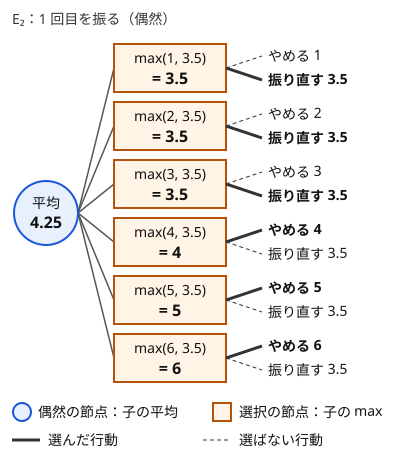

!!! abstract "要点"
    - **何ができるか**：選択と偶然が交互に来る確率過程で、期待値を最大（最小）にする戦略のもとでの期待値を求める。残すものや知っている情報を状態にし、選択の状態では max（費用なら min）、偶然の状態では平均を取りながら後ろから埋める。mod で答える問題でも比較は実数で行い、最初からやり直せるなら答えを仮定して二分探索する。
    - **いつ使うか**：
        - 最適に行動したときの期待値（勝率）。
        - 好きなタイミングでやめられる・最初からやり直せる。
        - どれを残すか（どれを選ぶか）を選びながら進む。
    - **計算量**：状態数 ×（偶然の分岐の数 × 選択肢の数）。やり直しがあれば、それに二分探索の反復回数（100 回ほど）を掛ける。
    - **前提**：[期待値 DP](../comb/expected-value-dp.md)

<!-- textlint-disable -->
別名：最適停止・expectimax・期待値の最大化・optimal stopping
<!-- textlint-enable -->

最適戦略の期待値は、プレイヤーが選んだ行動と偶然の結果が交互に来る過程で、期待値が最もよくなるように行動したときの期待値である。式の形は[期待値 DP](../comb/expected-value-dp.md#choice)の「選択は max、偶然は平均」のままで、難しさは 3 つの点にある。何を状態にすれば足りるか、mod の値では選択の比較ができないこと、やり直しで答えが自分自身の式に入ることである。

このページで使う記法：$E[s]$ は状態 $s$ から最適に行動したときの、終わるまでの得点（または費用）の期待値である。期待値を最大にする問題で書き、費用を最小にする問題では max を min に読み替える。

サイコロを最大 2 回振れ、1 回目の目を見て「やめてその目を得点にする」か「振り直す」かを選べる遊びで、値の決まり方を確かめる。2 回目は必ず受け取るので、その期待値は $E_1 = 3.5$ である。1 回目の目 $d$ を見た選択の状態では $\max(d, 3.5)$ を取り、それを 6 つの目で平均すると $E_2 = 4.25$ になる。



図の円が偶然の節点、四角が選択の節点である。選択の節点の値は、その時点で見えている情報（ここでは 1 回目の目）だけから決まる。この形を後ろから計算するのが、このページのすべての手法の土台になる。

## 残すもの・知っている情報を状態にする {#state-design}

状態に入れるのは、それから先の遷移と得点に効くものすべてで、それまでの経緯は要らない。選択がある問題では、選択の前後で何が変わるかを見て、次の 3 つのどれかを状態にすることが多い。

- **手元に残したもの**：振り直しのないサイコロ・取っておいたカードなど。順序が効かないなら[多重集合](../guide/glossary.md#multiset)（同じ値の重複を許す集合）にする。6 面のサイコロ 5 個から残す目の多重集合は、個数 0〜5 を合わせて $\binom{11}{6} = 462$ 通りしかない（順序を区別すると、5 個すべてを残す列だけでも $6^5 = 7776$ 通りある）
- **持っている 1 つのもの**：選んだら残りは元の場所へ戻すなら、場の側は一定で、持っているものだけが状態になる
- **知っている情報の量**：位置を覚えたカードなど、情報で選択が変わるときは、情報そのものではなく「何枚を知っているか」のような個数を状態にする。どのカードを知っているかは対称なので、個数が同じなら期待値も同じになる

選択と偶然の順序も状態の一部である。「振る前」の状態と「振った後、何を残すか選ぶ前」の状態を分けて考えると、式が次の形に決まる。

$$
E[s] = \sum_{o} P(o) \max_{a \in A(s, o)} E[\mathrm{next}(s, o, a)]
$$

ここで $o$ は偶然の結果、$A(s, o)$ はその結果を見た後に選べる行動の集合である。max が平均の内側にあるのは、行動を $o$ を見てから選べるからである（[「最大値の期待値」との違い](#vs-max)）。

状態数の見積もりは、状態ごとの「偶然の結果の数 × 選べる行動の数」との積で行う。サイコロ 5 個を最大 3 回振り、毎回残す目を選べる型（[ABC421 E](#abc421_e)）では、残した目の多重集合と残りの回数が状態になる。振る個数が $m$ 個なら、結果は $6^m$ 通り、残し方は $2^m$ 通りで、全部を足しても $10^6$ 回ほどの計算で済む。

- 応用の型：「出た目のどれを残すか」は残したものの多重集合、「2 つのうちどちらを持っておくか」は持っているもの、「めくって覚える」は知っている枚数を状態にする

??? question "確認問題：残す目を多重集合にせず、5 個のサイコロの目の列を状態にすると何が困るか"
    同じ多重集合を表す列がいくつもあり、それぞれを別の状態として計算するので、状態数が最大 $6^5 = 7776$ 通りに増える。値はどれも同じなのでむだになる。メモ化再帰で書くなら、目を並べ替えてから鍵にすれば、同じ多重集合が同じ状態になる。

## 止めるタイミングを選ぶ（相手の得点の分布と比べる） {#stopping}

止めるか続けるかだけを選べる問題では、各状態の値は「今止めたときの値 $g(s)$」と「続けたときの期待値」の大きい方である。

$$
E[s] = \max\Bigl(g(s),\ \sum_t P(s \to t) E[t]\Bigr)
$$

$g(s)$ が得点そのものなら、[期待値 DP の例](../comb/expected-value-dp.md#choice)と同じである。$g(s)$ が「相手の得点との比較」になる形もある。相手が自分の行動と関係なく決まった規則で動くなら、相手の最終得点の分布は自分の戦略によらない。だから先に相手の分布を[確率 DP](../comb/probability-dp.md)で求め、そこから $g(s)$ を計算しておける。

次の遊びで手順を示す。自分は 1〜$D$ の目が等確率のサイコロを振って合計を増やし、いつ止めてもよい。合計が $N$ を超えたら負けである。相手は同じサイコロをちょうど $K$ 回振り、その合計を $Y$ とする。$Y$ が $N$ を超えたら相手の負けである。両方とも $N$ 以下なら合計の大きい方が勝ち、引き分けは勝ちの半分（得点 $\frac{1}{2}$）とし、得点の期待値を最大にする。

1. 相手の最終得点 $Y$ の分布を前向きの確率 DP で求める。$j$ 回振った後の合計 $y$ の確率を $y + 1, \dots, y + D$ に配る遷移は区間への加算なので、[いもす法](../basics/imos.md)で 1 回分を $O(KD)$、全体を $O(K^2 D)$ にする
2. 合計 $x$（$x \le N$）で止めたときの得点の期待値は $g(x) = P(Y > N) + P(Y < x) + \frac{1}{2} P(Y = x)$ である。分布の累積和を取っておけば、各 $x$ で $O(1)$ になる
3. $x > N$ は負けなので $E[x] = 0$ とし、$x = N, N - 1, \dots, 0$ の順に $E[x] = \max\bigl(g(x),\ \frac{1}{D} \sum_{i=1}^{D} E[x + i]\bigr)$ を求める。和は後ろからの累積和で $O(1)$ にする
4. 答えは $E[0]$ で、全体は $O(N + D + K^2 D)$ である

勝率を最大にするときは、勝ちを 1、負けを 0 とした得点の期待値を最大にすればよい。上の遊びは引き分けに $\frac{1}{2}$ を置いた形で、止めたときの値 $g(x)$ を葉に置くだけで、式の形は得点のときと同じである。

止める戦略は「合計が閾値以上なら止める」の形になることが多いが、いつでもそうとは限らない。$g(x)$ が $x$ について単調でなければ、止める $x$ と続ける $x$ が入り交じることもある。DP は各 $x$ で比べるので、戦略の形を仮定せずに済む。

相手も自分の行動を見て最適に応じるなら、相手の分布は自分の戦略で変わるので、この方法は使えない。そのときは手番ごとに max と min を使い分ける[ミニマックス](../comb/minimax.md)の形になる。

- 応用の型：「相手は決まった規則で振る」「先に相手の結果が決まる」なら、相手の分布を先に確率 DP で求めて、自分の DP の葉の値にする

??? question "確認問題：上の遊びで、相手が自分の止めた合計を見てから振り始めるとしても、手順は同じでよいか"
    相手の規則が「ちょうど $K$ 回振る」のまま変わらないなら、同じでよい。相手の行動は自分の合計によらないので、$Y$ の分布は同じである。相手が「自分の合計を超えるまで振る」のように自分の合計を見て規則を変えるなら、$Y$ の分布は $x$ ごとに違うので、$g(x)$ を $x$ ごとに別に求める必要がある。

## 比較は実数で、答えは mod で（比較できない落とし穴） {#compare-real}

答えを mod 998244353 で出す問題でも、選択の状態では値の大小を比べる必要がある。mod の値は分数の大小を保たないので、mod の値どうしで max を取ると答えが壊れる（[mod の値では大小比較できない](../comb/rational-mod.md#no-compare)）。避け方は 2 つある。

1 つ目は、同じ値を実数と mod の 2 通りで持つ方法である。選ぶのは実数の値だけで行い、mod の値は選ばれた方を写す。サイコロを最大 $K$ 回振れる遊びで、答えを mod で出すなら次のようになる。

```cpp
--8<-- "optimal-strategy-expectation/real-and-mod.cpp:core"
```

完全なプログラム：[`real-and-mod.cpp`](https://github.com/yuukougun/kyopro-atlas/blob/main/snippets/optimal-strategy-expectation/real-and-mod.cpp)（GitHub）。`mint` は ACL の `modint998244353`（[modint](../math/modint.md)）。
{ .kp-code-src }

実数の値は比べるためだけに使い、出力には使わない。誤差が問題になるのは、真の値が近い 2 つの候補を `double` で逆に比べたときである。そのときは選ぶ行動が変わり、mod の答えはまったく違う値になる。分子と分母が小さいなら、分数を整数の組で持って比べる。

2 つ目は、最適な行動を性質から先に決めてしまう方法である。「枚数の多い色を手元に残すのが常によい」のように、どちらがよいかが入力の値の大小だけで決まると示せれば、DP の中で期待値を比べる必要はない。行動が決まれば、残りは mod のままの普通の期待値 DP である（[ABC412 F](#abc412_f)）。性質は、小さい入力で全部の戦略を試す実数の DP と比べて確かめられる。

どちらの方法でも、選択を比べるのは自己ループを移項した後の値である。選んだ行動が自分自身へ戻る遷移を含むなら、その行動の値は移項してから求まる（[自己ループの移項](../comb/expected-value-dp.md#self-loop)）。

- 応用の型：「mod 998244353 で出力」かつ「最適に行動したとき」なら、実数と mod の 2 本立てか、性質で行動を先に決めるかのどちらかになる

??? question "確認問題：2 つの候補の値が実数でちょうど等しいとき、どちらを選んでも mod の答えは同じか"
    同じである。実数として等しい 2 つの値は同じ分数なので、mod の値も等しい。危ないのは、真の値がわずかに違うのに `double` の誤差で等しく見えたり逆に見えたりする場合である。

## やり直しがあるときは答えを仮定して二分探索する {#guess-answer}

「最初からやり直す」行動があると、やり直した後の期待値は答え $X$ そのものなので、$X$ が自分の式の max・min の中に入る。行動が決まっていれば、[未知数を残して a + bX で運ぶ](../comb/expectation-linear-equations.md#unknown)方法で一次方程式に直せるが、min の中に入ると 1 次式にならない。そこで $X$ を仮定する。

次の遊びで示す。1 回 1 の費用で 6 面のサイコロを振り、目 $d$ が出たら、仕上げの費用 $c_d$ を払って終えるか、最初から振り直すかを選ぶ。$c_d = 2(6 - d)$、すなわち $(c_1, \dots, c_6) = (10, 8, 6, 4, 2, 0)$ とする。答え $X$ は次の式を満たす。

$$
X = 1 + \frac{1}{6} \sum_{d=1}^{6} \min(c_d, X)
$$

右辺の $X$ を仮の値 $y$ に置き換えたものを $f(y)$ とする。$f(y)$ は「振り直した後の期待値が $y$ だとしたときの、始めの期待値」である。$y$ が小さすぎると振り直しを安く見積もるが、それでも 1 回振る費用が掛かるので $f(y) > y$ になる。$y$ が大きすぎると $f(y) < y$ になる。

- $y = 3$：$f(3) = 1 + \frac{1}{6}(3 + 3 + 3 + 3 + 2 + 0) = \frac{10}{3} > 3$ なので $X > 3$
- $y = 5$：$f(5) = 1 + \frac{1}{6}(5 + 5 + 5 + 4 + 2 + 0) = 4.5 < 5$ なので $X < 5$
- $y = 4$：$f(4) = 1 + \frac{1}{6}(4 + 4 + 4 + 4 + 2 + 0) = 4$ なので $X = 4$。目が 4 以上なら終え、3 以下なら振り直す

$f(y) > y$ なら $y$ を下限に、そうでなければ上限にする二分探索で $X$ が求まる。

```cpp
--8<-- "optimal-strategy-expectation/restart.cpp:core"
```

完全なプログラム：[`restart.cpp`](https://github.com/yuukougun/kyopro-atlas/blob/main/snippets/optimal-strategy-expectation/restart.cpp)（GitHub）
{ .kp-code-src }

上限には「振り直さずに必ず終える」戦略の期待値 $1 + \frac{1}{6}\sum c_d$ を使える。最適な戦略はこれより悪くないので、$X$ はこれ以下である。反復の回数は[実数の二分探索](../basics/binary-search-answer.md#real-number)と同じく固定する（100 回なら `double` の精度を使い切る）。

**なぜ二分探索でよいか**：$g(y) = f(y) - y$ は $y$ について増えることがなく（広義に減少）、$y < X$ で正、$y > X$ で負になるからである。

??? note "証明"
    振り直すかどうかを目ごとに決めた 1 つの戦略 $\pi$ を固定すると、その戦略での $f$ は $f_\pi(y) = a_\pi + b_\pi y$ の 1 次式になる。$b_\pi$ は 1 回の試行で振り直しになる確率で、$a_\pi > 0$ である。$f(y)$ は各状態で安い方を選んだ値なので、$f(y) = \min_\pi f_\pi(y)$ である。

    - 必ず振り直す戦略は $b_\pi = 1$ で、$f_\pi(y) - y = a_\pi > 0$ が常に成り立つ
    - それ以外の戦略は $b_\pi < 1$ で、$f_\pi(y) - y = a_\pi - (1 - b_\pi) y$ は狭義に減少する

    $g(y) = \min_\pi (f_\pi(y) - y)$ は、狭義に減少する関数と正の定数の最小値である。$g(y) \le 0$ となる $y$ では、最小を取るのは減少する方の関数なので、$g$ は $g(y) > 0$ の範囲から $g(y) \le 0$ の範囲へ一度だけ移り、根はただ 1 つである。本当の期待値 $X$ は、振り直した後も同じ状況から最適に動くので $X = f(X)$ を満たし、$g(X) = 0$ である。したがって $g(y) > 0$ と $y < X$ は同値になる。

この証明は、遊びの細部ではなく「戦略を固定すると $f$ が $y$ の 1 次式で、傾きが 1 未満」という性質だけを使っている。状態が多く DP で $f(y)$ を計算する問題でも、1 回の試行で費用が正なら同じ議論で二分探索が使える。計算量は DP 1 回の計算量 × 反復回数である。

戦略の形が分かっていて候補が少ないときは、二分探索をせず、候補ごとに一次方程式 $X = a_\pi + b_\pi X$ を解いて最小を取ってもよい。上の例では「目が $t$ 以上なら終える」の $t = 1, \dots, 6$ を試せば足りる。答えを mod で出す問題では二分探索の値は使えないので、実数で最適な戦略を決めてから、その戦略の一次方程式を mod で解く。

- 応用の型：「何度でも最初からやり直せる」「リセットできる」「振り直すと最初の状態に戻る」

??? question "確認問題：上の例で、仕上げの費用が $(c_1, \dots, c_6) = (0, 100, 100, 100, 100, 100)$ のとき $X$ は？"
    1 の目が出たときだけ終え、ほかは振り直すのが最適である。この戦略では $X = 1 + \frac{1}{6} \cdot 0 + \frac{5}{6} X$ なので、$X = 6$ になる。$f(6) = 1 + \frac{1}{6}(0 + 6 \times 5) = 6$ で、二分探索の不動点とも一致する。

## 「最大値の期待値」との違い {#vs-max}

「期待値が最大になる戦略のもとでの期待値」と「最大値の期待値」$E[\max]$ は別のものである。違いは、max を取るときに何が見えているかにある。

最大 2 回振るサイコロの遊びで、3 つの量を比べる。

| 選ぶ時点 | 値 | 式 |
| --- | --- | --- |
| 何も見ずに、何回目で受け取るかを決める | $3.5$ | $\max(E[D_1], E[D_2])$ |
| 1 回目を見てから、受け取るか振り直すかを決める | $4.25$ | $E[\max(D_1, E_1)]$ |
| 2 回とも見てから、大きい方を受け取る | $\frac{161}{36} \approx 4.47$ | $E[\max(D_1, D_2)]$ |

本当の遊びは 2 行目で、1 回目の目は見えるが 2 回目の目はまだ見えない。3 行目は、まだ振っていない 2 回目の目を知っているとして選んだ値で、実際には取れない戦略である。一般に、max を取る位置を平均の外から内へ移すほど値は大きくなり、正しい値は「その時点で見えている情報」まで max を内側に入れたところにある。

この取り違えは式を立てるときに起きる。$\max$ の中に、まだ決まっていない偶然の結果が入っていないかを確かめる。「残したサイコロをどれにするか」は目を見てから決めるので平均の内側、「めくる前にどこをめくるか」はカードを見る前に決めるので平均の外側である。

目的が期待値か確率かも取り違えやすい。得点の期待値を最大にする戦略と、勝つ確率を最大にする戦略は一般に違う。勝率を問われたら、葉の値を勝ちなら 1、負けなら 0 にして同じ式で計算する（[止めるタイミングを選ぶ](#stopping)）。

??? question "確認問題：最大 3 回振れるときの $E_3$ はいくつか。また $E[\max(D_1, D_2, D_3)]$ より小さいか"
    $E_3 = \frac{1}{6} \sum_{d=1}^{6} \max(d, E_2) = \frac{1}{6}(4.25 \times 4 + 5 + 6) = \frac{14}{3} \approx 4.67$ である。1 回目は目が 5 以上なら止める。3 個の最大値の期待値は $\frac{1}{216}\sum_{k=1}^{6} k(k^3 - (k-1)^3) = \frac{1071}{216} \approx 4.96$ で、$E_3$ はそれより小さい。

## 落とし穴 {#pitfalls}

- **mod の値で max を取る**：答えが mod 998244353 でも、選択の比較は実数か分数で行う（[比較は実数で、答えは mod で](#compare-real)）
- **max を平均の外に出す・内に入れすぎる**：行動を選べるのは、その時点で見えている情報だけからである（[「最大値の期待値」との違い](#vs-max)）
- **移項の前に比べる**：自己ループを含む行動の値は、移項した後でないと決まらない。行動ごとに移項した値を求めてから比べる
- **状態に経緯を入れすぎる**：残したサイコロを列のまま持つと状態が何倍にも増える。多重集合や個数にまとめる
- **二分探索の終わり方**：`while (ng - ok > 1e-9)` のように差で止めると、値が大きいとき差が縮まらず止まらないことがある。反復の回数を固定する
- **出力の桁数**：実数で答えるなら `cout << fixed << setprecision(10)` のように桁を指定する

## 例題 {#examples}

### ABC412 F. Socks 4 {#abc412_f}

<div class="kp-problems" data-role="example" markdown>

- [ABC412 F. Socks 4](https://atcoder.jp/contests/abc412/tasks/abc412_f)（diff 2038）：色ごとの枚数が決まった靴下のうち 1 枚を手に持ち、引き出しから 1 枚ずつ取り出して、手の靴下と同じ色ならやめ、違えばどちらか 1 枚を引き出しへ戻すことを繰り返すとき、戻す靴下を最適に選んだときの取り出す回数の期待値を mod で求める。

</div>

状態は手に持っている色だけである。戻した靴下は引き出しに入るので、引き出しの中身は「手の色が何か」で決まる。どちらを戻すかは、手に持った分も含めた枚数の多い色を残すのが常に最適で、比較は値の大小だけで決まる（[比較は実数で、答えは mod で](#compare-real)）。枚数の多い順に色を並べると、各色からは自分より多い色へ移るか、自分にとどまるかしかないので、多い順に埋められる。

??? note "解法の詳細"
    - 手に持った分も含めた色 $i$ の枚数を $B_i$、引き出しの枚数を $S = \sum_i B_i - 1$ とする（取り出しても戻すので $S$ は一定）。$E[x]$ ＝ 色 $x$ を持っているときから終わるまでの取り出す回数の期待値
    - 色 $x$ を持って 1 枚取り出すと、確率 $(B_x - 1)/S$ で同じ色が出て終わる。色 $j \ne x$ は確率 $B_j / S$ で出る。$B_j > B_x$ なら色 $j$ に持ち替え、$B_j \le B_x$ なら取り出した方を戻して色 $x$ のままである。枚数が等しいなら期待値も等しいので、どちらを残してもよい
    - とどまる確率を $p_x = \sum_{j \ne x,\ B_j \le B_x} B_j / S$ として移項すると、$E[x] = \bigl(1 + \sum_{B_j > B_x} \frac{B_j}{S} E[j]\bigr) / (1 - p_x)$
    - $1 - p_x = \bigl(\sum_{B_j > B_x} B_j + B_x - 1\bigr) / S$ なので、色を $B$ の大きい順に処理し、自分より真に多い色の $\sum B_j$ と $\sum B_j E[j]$ を累積で持つ（同じ $B$ の色はまとめて処理してから累積に足す）。これで並べ替えの $O(N \log N)$ と逆元の計算で全体が求まる。答えは最初に持っている色の $E$
    - 「多い方を残す」が最適であることは、小さい入力で、各状態で両方の行動を比べる実数の値反復と一致することで確かめられる

### ABC421 E. Yacht {#abc421_e}

<div class="kp-problems" data-role="example" markdown>

- [ABC421 E. Yacht](https://atcoder.jp/contests/abc421/tasks/abc421_e)（diff 2122）：サイコロを振って出た目の一部を残しながら決まった回数まで振り直すゲームで、最適に行動したときの得点の期待値を求める。

</div>

状態は、残りの振る回数と、残した目の多重集合である（[残すもの・知っている情報を状態にする](#state-design)）。振る部分は出方の平均、残す目の選び方は max を取る。残した目の多重集合は 462 個しかないので、メモ化再帰で全部の出方と残し方を試せる。

??? note "解法の詳細"
    - サイコロは 5 個で、振れるのは 3 回までである。$V(r, K)$ ＝ 残り $r$ 回振れ、残した目の多重集合が $K$ のとき、振る前から最適に動いたときの得点の期待値。答えは $V(3, \emptyset)$
    - 残していない $m = 5 - \lvert K \rvert$ 個を振り、出方 $o$（$6^m$ 通り、各確率 $6^{-m}$）ごとに、出た目から残す部分 $T$（$2^m$ 通り）を選んで $V(r - 1, K \cup T)$ の最大を取る。$r = 1$ なら振った後は全部の目で得点を計算する。$\lvert K \rvert = 5$ なら振らずに得点を計算する
    - 多重集合は目を並べ替えた列や、目ごとの個数の組で表し、`map` でメモ化する
    - 出方は順序を区別して $6^m$ 通りを全部回せば、重複の数え方を考えずに済む。多重集合で回すなら、出方ごとの並べ方の数（多項係数）を確率に掛ける
    - 計算は全部で $10^6$ 回ほどである。実数で答えるので出力の桁数を指定する

## 練習問題 {#practice}

<div class="kp-problems" data-role="practice" markdown>

- [ABC314 E. Roulettes](https://atcoder.jp/contests/abc314/tasks/abc314_e)（diff 1722）：N 個のルーレットからどれを回すかを選びながら M 点以上を得るまで繰り返すとき、払う費用の期待値の最小値を求める。
- [ABC470 E. Concentration](https://atcoder.jp/contests/abc470/tasks/abc470_e)（diff 2096）：N 組のカードの神経衰弱で、決まった回数失敗するかすべてのカードを取ると終わるとき、最適にめくったときの、取ったペアの得点の和の期待値を求める。
- [ABC342 F. Black Jack](https://atcoder.jp/contests/abc342/tasks/abc342_f)（diff 2141）：サイコロで得点を重ねるブラックジャック型のゲームで、止めるタイミングを最適に選んだときの勝率を求める。

</div>

??? note "練習の方針"
    - **ABC314 E**：得点ごとの費用の期待値を後ろから求める。ルーレットごとに 0 点の目の自己ループを移項した値を計算してから、最小のルーレットを選ぶ（移項の前に比べない）
    - **ABC470 E**：取ったペアの数・位置を知っているカードの数・まだ見ていないカードの数などの個数を状態にし、最適な行動の期待値をメモ化再帰で求める（[知っている情報の量](#state-design)）。めくる前に決める行動と、めくった結果を見て決める行動を分ける
    - **ABC342 F**：相手の止め方が自分の行動によらないので、相手の最終得点の分布を先に求めて、止めたときの勝率を葉の値にする。遊びとの違い（相手がいつまで振るか・引き分けの扱い）に合わせて、分布の DP と $g(x)$ を作り直す（[止めるタイミングを選ぶ](#stopping)）

## 力試し {#challenge}

<div class="kp-problems" data-role="challenge" markdown>

- [ABC224 G. Roll or Increment](https://atcoder.jp/contests/abc224/tasks/abc224_g)（diff 2374）：1〜N の目のサイコロの出目 S を、A 円払って 1 増やすか B 円払って振り直すかを選びながら T にするとき、費用の期待値の最小値を求める。

</div>

??? note "力試しの方針"
    - **ABC224 G**：振り直した直後の期待値を $X$ とおくと、出目 $s \le T$ の状態の値は $\min(A(T - s), B + X)$、$s > T$ なら $B + X$ で、$X$ はその平均である。1 度振り直すと決めたら、増やした後に振り直しても得をしないので、最適な戦略は「$T$ との差が $x$ 未満なら 1 ずつ増やし、ほかは振り直す」の形になる。$x$ を決めると $X$ は一次方程式で求まり、和の公式で $x$ の式になる。その式は $x$ について凸なので、三分探索か最小点の近くを調べて最小を取る（候補ごとに一次方程式を解く方法。[やり直しがあるときは答えを仮定して二分探索する](#guess-answer)の最後の段落）。最初の出目が増やす範囲にあるなら、答えは $A(T - S)$ である

## 確認問題 {#quiz}

??? question "確認問題：期待値 DP で「選択は max」を使うには、どんな計算順序が要るか"
    選択の状態で比べる行動の値が、すべて計算済みである必要がある。だから行動の先の状態が先に埋まる順（後ろから）に計算する。やり直しのように行動の先が始めの状態に戻るなら、その値は未計算なので、答えを仮定して二分探索するか、未知数として一次方程式にする。

??? question "確認問題：答えを mod で出す問題で、実数の値で選んだ行動に従って mod の値を計算した。実数の誤差で行動を取り違えると、答えはどれくらいずれるか"
    mod の値は分数の大小と関係なく散らばるので、取り違えた時点でまったく違う値になり、「少しずれる」ことはない。実数での答えなら誤差の範囲で済む取り違えでも、mod では誤答になる。値が近い候補があるなら、分数のまま整数で比べる。

## 使い分け {#comparison}

- 選択がなく、偶然だけで進むなら[期待値 DP](../comb/expected-value-dp.md)。選択があっても、比べる値がすべて計算済みで実数で答えるなら、期待値 DP の「選択は max」の節で足りる
- 行動が決まっていて、戻る遷移があるだけなら、[期待値の方程式を解く](../comb/expectation-linear-equations.md)。戻る先の値が min・max の中に入るなら、このページの二分探索
- 相手も最適に応じる 2 人のゲームで偶然がなければ[ミニマックス](../comb/minimax.md)。偶然と相手の手番が両方あるなら、偶然の状態の平均を足したミニマックスになる

## 参考 {#references}

- [gotoki_no_joe「ABC412 A～F をHaskellで」](https://qiita.com/gotoki_no_joe/items/dbd1cf6437edd867afa3)：例題 ABC412 F の、多い方を残す方針と、多い順に並べて移項する漸化式
- [yamanoue「ABC421」](https://yamanoue.tslmuse.com/abc_421/)：例題 ABC421 E の、残した目の多重集合を状態にする設計と、出方の確率の数え方
- [KCPC ブログ「【ABC421】重実装を乗り越え全完！！！」](https://kcpc.hatenablog.com/entry/ABC421)：例題 ABC421 E の、出方を全部と残し方を全部試すメモ化再帰で間に合うこと
- [kmjp「AtCoder ABC #224 : G - Roll or Increment」](https://kmjp.hatenablog.jp/entry/2021/10/26/0900)：力試し ABC224 G の方針
