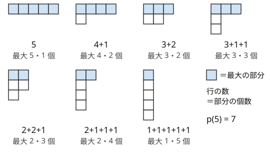

!!! abstract "要点"
    - **何ができるか**：$n$ を順序を区別せずに正の整数の和で表す方法の数（分割数 $p(n)$）を、最大の部分による場合分けの漸化式 $p(n, k) = p(n, k-1) + p(n-k, k)$ で数える。部分を大きい順に並べた列だけを作れば、分割を重複なく全列挙できる。$p(30) = 5604$、$p(50) = 204226$ と少ないので、$n \le 50$ 程度なら全部の分割を試せる。
    - **いつ使うか**：
        - $N \le 50$ 程度で、長さ（個数）の組合せ（[多重集合](../guide/glossary.md#multiset)）を全部試す。
        - 和が $N$ になる多重集合の個数を問われる。
        - 区別のない玉を区別のない箱へ配る方法の数を問われる。
        - 順列を巡回の長さの組ごとに分類して数える。
    - **計算量**：$p(n, k)$ の表は $O(nk)$（$p(n)$ だけなら $O(n^2)$）。分割の全列挙は、再帰の節点が $p(0) + p(1) + \dots + p(n)$ 個（$n = 50$ で約 $1.3 \times 10^6$）で、節点 1 つを $O(1)$ で処理できればその個数に比例する。
    - **前提**：[再帰による全列挙](../basics/recursive-enumeration.md)、[DP の基本](../dp/dp-basics.md)、[置換の巡回分解](../comb/permutation-cycles.md)

<!-- textlint-disable -->
別名：分割数・p(n,k)・分割の全列挙・巡回型・partition number・integer partition
<!-- textlint-enable -->

整数の分割は、$n$ を正の整数の和で表す方法のうち、足す順番だけが違うものを同じとみなしたものである。その個数が分割数 $p(n)$ で、$p(5) = 7$ である。競技プログラミングでは個数そのものより、「長さの組合せを全部試しても $p(N)$ 通りしかない」という見積もりと、その全列挙の書き方が効く。置換の巡回の長さの組（巡回型）も $N$ の分割なので、順列を巡回型ごとにまとめて数える問題にも現れる。

## 分割数の漸化式 p(n,k) {#recurrence}

数える対象をはっきりさせる。$n$ の**分割**とは、和が $n$ になる正の整数の多重集合である。中身を大きい順に並べた列 $\lambda_1 \ge \lambda_2 \ge \dots \ge \lambda_r \ge 1$ で表し、各 $\lambda_i$ を部分と呼ぶ。$4 + 1$ と $1 + 4$ は同じ分割である。$n = 5$ の分割は次の 7 通りである。



各部分を 1 行の箱にして上から大きい順に積んだ図を Young 図形という。この図を対角線で折り返す（行と列を入れ替える）と、別の分割の図になる。$4 + 1$ は $2 + 1 + 1 + 1$ に、$3 + 2$ は $2 + 2 + 1$ に移り、$3 + 1 + 1$ は自分自身に移る。折り返すと「最大の部分」と「部分の個数」が入れ替わるので、次の 2 つの数は等しい。

- 部分がどれも $k$ 以下である $n$ の分割の数
- 部分の個数が $k$ 個以下である $n$ の分割の数

この数を $p(n, k)$ と書く。$p(n) = p(n, n)$ である。以下では前者（部分が $k$ 以下）の見方で漸化式を立てる。

**漸化式**：部分 $k$ を使うかどうかで場合を分ける。

$$
p(n, k) = p(n, k-1) + p(n-k, k) \qquad (n \ge 1,\ k \ge 1)
$$

- **$k$ を 1 つも使わない**：部分はどれも $k - 1$ 以下なので $p(n, k-1)$ 通り
- **$k$ を 1 つ以上使う**：$k$ を 1 つ取り除くと、和が $n - k$・部分が $k$ 以下の分割になる。逆に、そのような分割に $k$ を 1 つ足せば元に戻る。この対応は 1 対 1 なので $p(n-k, k)$ 通り（$n < k$ なら 0 通り）

どの分割も「$k$ を含むか」でちょうど一方に入るので、重複も漏れもない。2 つ目の場合で取り除く $k$ は「どの $k$ か」を区別しない。多重集合なので、$k$ の個数によらず、取り除いた結果は 1 つに決まる。

境界は $p(0, k) = 1$（0 の分割は「何も使わない」1 通り）と、$n \ge 1$ での $p(n, 0) = 0$ である。$p(0, k) = 1$ を置き忘れると、2 つ目の場合で $n = k$ のとき（部分 $k$ が 1 つだけの分割）を数えそこない、その結果、表全体が 0 になる。表を埋めるコードは次のとおりで、$O(nk)$ である。

```cpp
--8<-- "partition-number/partition.cpp:core"
```

この表は、[個数制限なしのナップサック](../dp/knapsack-01.md#knapsack-unbounded)で「重さ $1, 2, \dots, k$ の品物を何個でも使って和をちょうど $n$ にする組合せ」を数えるのと同じものである。品物を外側のループに置き、和を小さい方から回す 1 次元の配列 $\mathrm{dp}[s] \mathrel{+}= \mathrm{dp}[s - x]$ で書くと、品物 $x$ まで回した時点の $\mathrm{dp}[s]$ が $p(s, x)$ になる。品物と和のループを入れ替えると順序を区別した和（$1 + 4$ と $4 + 1$ を別に数える）になるので、分割数にはならない。

**ちょうど $k$ 個の部分**：部分の個数がちょうど $k$ 個の分割は、各部分から 1 を引くと「和が $n - k$・部分の個数が $k$ 個以下」の分割になる。1 を引いて 0 になった部分は消えるとすれば、この対応は 1 対 1 である。よって $p(n - k, k)$ 通りである。区別のない $n$ 個の玉を区別のない $k$ 個の箱へ、空の箱を許して入れるなら $p(n, k)$、どの箱も空にしないなら $p(n - k, k)$ になる（[写像 12 相](../comb/twelvefold-way.md#table)）。

??? question "確認問題：p(5,3) を漸化式で"
    $p(5, 3)$ を漸化式で求め、図の 7 通りのうちどれが数えられているかを答えよ。

    ??? success "答え"
        $p(5, 3) = p(5, 2) + p(2, 3)$ である。$p(5, 2) = p(5, 1) + p(3, 2) = 1 + 2 = 3$（$2+2+1$、$2+1+1+1$、$1+1+1+1+1$）、$p(2, 3) = p(2, 2) = 2$（3 を取り除いた残りが $2$ か $1 + 1$。元は $3 + 2$ と $3 + 1 + 1$）で、合わせて 5 通りである。部分が 3 以下でない $5$ と $4 + 1$ の 2 つが除かれている。

## 降順の列だけを作る全列挙 {#enumeration}

分割を 1 つずつ実際に作って調べたいときは、部分を大きい順に並べた列だけを再帰で作る。次に置く値を「直前に置いた値以下」に制限すれば、各分割は降順に並べた 1 つの列としてちょうど 1 回だけ現れる。$4 + 1$ は作るが $1 + 4$ は作らない。

```cpp
--8<-- "partition-number/partition.cpp:enumerate"
```

- **状態**：残りの和 `rest` と、次に置いてよい最大の値 `mx`（直前に置いた値）。最初は `rest = n`、`mx = n` で呼ぶ
- **葉**：`rest == 0` で 1 つの分割ができあがる。葉の数はちょうど $p(n)$ である
- **行き止まりがない**：`rest > 0` ならいつでも 1 を置けるので、途中で詰まる枝がない。そのため、すべての節点が少なくとも 1 つの葉につながり、計算量は節点の数で見積もれる（[次の節](#size)）

順序を区別した和をすべて作ってから、ソートして `set` で重複を除く方法は使わない。順序を区別した和は $2^{n-1}$ 通りあり、$n = 30$ でも約 $5.4 \times 10^8$ 通りになる。重複を後から除くのではなく、代表の形（降順）だけを作るのが要点である（[重複の除き方](../comb/counting-dedup.md#representative)）。

**葉で値を計算し直さない**：葉ごとに分割全体を見て値を計算すると、葉 1 つに $O(n)$ かかる。部分を 1 つ置くたびに変わる量（和・lcm・積など）を再帰の引数で持ち、差分で更新すれば、葉では $O(1)$ で値が分かる。[例題](#abc226_f)では、lcm と巡回型ごとの数の分母をこの形で持つ。

**部分の個数に上限があるとき**：「部分は $L$ 個まで」なら、置いた個数を引数で持ち、$L$ 個置いたのに `rest > 0` の枝を打ち切る。「部分の値は $V$ 以下」なら、最初の `mx` を $\min(n, V)$ にすればよい。

## 全列挙の個数の見積もり（p(30) = 5604、p(50) = 204226） {#size}

分割を全列挙して間に合うかは、分割の数 $p(n)$ と再帰の節点の数で決まる。節点は「和が $s$ 以下の降順の列」で、和が $s$ の降順の列は $s$ の分割そのものなので、節点の数は $p(0) + p(1) + \dots + p(n)$ である。

| $n$ | $p(n)$ | 節点の数 $\sum_{s \le n} p(s)$ |
| --- | --- | --- |
| 10 | $42$ | $139$ |
| 20 | $627$ | $2714$ |
| 30 | $5604$ | $28629$ |
| 40 | $37338$ | $215308$ |
| 50 | $204226$ | $1295971$ |
| 60 | $966467$ | $6639349$ |
| 80 | $15796476$ | $123223639$ |
| 100 | $190569292$ | $1642992568$ |

$p(n)$ は $n$ について指数関数よりゆっくり増え、およそ $\exp(\pi \sqrt{2n/3}) / (4 \sqrt{3} \, n)$ で近似できる（Hardy と Ramanujan の漸近式）。$n = 50$ 前後では、$n$ が 10 増えるごとに 5 倍ほどになる。判断の目安は次のとおりである（1 秒に $10^8$ 回が目安。[計算量の見積もり](../basics/complexity-estimation.md#count-candidates)）。

- **$n \le 30$**：$p(30) = 5604$ 通りなので、分割ごとに $O(n^2)$ や $O(n^3)$ の処理をしても間に合う。分割ごとに DP を 1 回回してもよい
- **$n \le 50$**：$p(50) \approx 2.0 \times 10^5$、節点は約 $1.3 \times 10^6$ 個である。分割ごとに $O(n)$〜$O(n \log n)$ の処理（繰り返し二乗法など）なら十分間に合う
- **$n = 60$〜$80$**：$p(80) \approx 1.6 \times 10^7$、節点は約 $1.2 \times 10^8$ 個で、節点 1 つ $O(1)$ に抑えればぎりぎり届く
- **$n \ge 100$**：$p(100) \approx 1.9 \times 10^8$ で、全列挙は間に合わない。分割の性質を DP の状態に押し込む（[分割数型の DP](#partition-dp)）

節点の数は、$n = 30$〜$80$ で葉の数の 5〜8 倍ほどである。「$n$ の分割は $n$ を 1 ずつの和に分けた $2^{n-1}$ 通り以下」という見積もりは正しいが大きすぎて、$n = 50$ で $5.6 \times 10^{14}$ になり、間に合う方法を捨てることになる。値の目安として、集合の分け方の数（ベル数）は $B_{12} = 4213597$ と小さい $n$ で大きくなるのに対し、分割数は $p(12) = 77$ である（[ベル数との比較](../comb/bell-number.md#size)）。要素に名前があるかどうかで、全列挙できる $n$ の大きさが一桁変わる。

??? question "確認問題：N = 40 で何ができるか"
    和が $N = 40$ になる正の整数の多重集合をすべて試し、それぞれで $O(N^2)$ の DP を回したい。間に合うか。

    ??? success "答え"
        多重集合は $p(40) = 37338$ 通りで、$37338 \times 1600 \approx 6 \times 10^7$ 回なので間に合う見込みが高い。再帰の節点は $215308$ 個で、こちらの重さは無視できる。

## 置換の巡回型ごとの数 N!/Π(ℓ^m_ℓ · m_ℓ!) {#cycle-type}

この節は[置換の巡回分解](../comb/permutation-cycles.md)を前提にする。長さ $N$ の順列（置換）を巡回に分けると、巡回の長さの多重集合は $N$ の分割になる。これを置換の**巡回型**という。巡回の個数や、元に戻るまでの回数（巡回の長さの $\operatorname{lcm}$。[K 回の合成](../comb/permutation-cycles.md#power)）のように、巡回型だけで決まる量を全順列について足し合わせる問題では、$N!$ 個の順列を $p(N)$ 個の巡回型にまとめて数える。

長さ $\ell$ の巡回が $m_\ell$ 個ある巡回型（$\sum_\ell \ell \, m_\ell = N$）の置換の数は次のとおりである。

$$
\frac{N!}{\prod_{\ell} \ell^{m_\ell} \, m_\ell!}
$$

**なぜか**：巡回型に合わせて、長さ $\ell$ の「枠」を $m_\ell$ 個ずつ並べておき、$1, \dots, N$ を並べた $N!$ 通りの列を順に枠へ詰める。各枠を 1 つの巡回 $(a_1\ a_2\ \cdots\ a_\ell)$（$a_1 \to a_2 \to \dots \to a_\ell \to a_1$）と読めば、その巡回型の置換が 1 つできる。同じ置換は次の分だけ重複して作られる。

- 各巡回の書き始めを $\ell$ 通りに回せる（$(1\ 2\ 3)$ と $(2\ 3\ 1)$ は同じ巡回）。巡回ごとに $\ell$ 倍
- 同じ長さの巡回どうしの枠の順番を入れ替えられる。長さ $\ell$ ごとに $m_\ell!$ 倍

重複の数はどの置換でも同じなので、$N!$ を割ればよい。長さの違う巡回は枠の長さで見分けがつくので、入れ替えの重複は同じ長さの中だけに起きる。

$N = 4$ で確かめると、巡回型ごとに次のようになり、合計は $4! = 24$ と一致する。

| 巡回型 | 式 | 置換の数 |
| --- | --- | --- |
| $4$ | $24 / 4$ | $6$ |
| $3 + 1$ | $24 / (3 \cdot 1)$ | $8$ |
| $2 + 2$ | $24 / (2^2 \cdot 2!)$ | $3$ |
| $2 + 1 + 1$ | $24 / (2 \cdot 1^2 \cdot 2!)$ | $6$ |
| $1 + 1 + 1 + 1$ | $24 / (1^4 \cdot 4!)$ | $1$ |

**全列挙に組み込む**：降順の列を作る再帰では、同じ長さの部分が続けて置かれる。長さ $x$ を置くたびに $1/x$ を掛ける。それが同じ長さの $c$ 個目なら $1/c$ も掛ける。こうすると葉に着いたときに $1 / \prod_\ell \ell^{m_\ell} m_\ell!$ がそろう。$1/c$ を $c = 1, \dots, m_\ell$ について掛けると $1/m_\ell!$ になるからである。mod で割り算をするには逆元を使い、法は $N$ 以下の数と互いに素（$N$ より大きい素数など）でなければならない。

```cpp
--8<-- "partition-number/cycle-type.cpp:core"
```

lcm は mod を取らずに整数のまま持つ。長さの和が $N$ の巡回たちの lcm は、$N = 50$ でも最大 $180180$ と小さい（Landau の関数 $g(50)$）。mod を取った値で `lcm` を計算すると、gcd の値が変わって誤る。$N$ が大きく lcm があふれる問題は、全列挙の範囲を外れている。

ちょうど $k$ 個の巡回からなる置換の数（巡回の個数で分類する）なら、巡回型を全列挙するより[第 1 種スターリング数](../comb/stirling-first.md#recurrence)の漸化式の方が速い。巡回型の全列挙が要るのは、lcm のように巡回の長さの組全体で決まる量を扱うときである。

## 分割数型の DP {#partition-dp}

この節は[ナップサック DP](../dp/knapsack-01.md) を前提にする。$N$ が数千になると分割の全列挙はできないので、「部分の個数」と「和」を状態にした DP で数える。全列挙で使った「最大の部分で場合分け」とは別に、**最小の部分が 1 かどうか**で場合分けする形がよく使われる。

$\mathrm{dp}[k][s]$ ＝ ちょうど $k$ 個の正の整数からなり、和が $s$ の多重集合の数、とする。

$$
\mathrm{dp}[k][s] = \mathrm{dp}[k-1][s-1] + \mathrm{dp}[k][s-k]
$$

- **1 を含む**：1 を 1 つ取り除くと、$k - 1$ 個で和が $s - 1$ の多重集合になる。$\mathrm{dp}[k-1][s-1]$ 通り
- **1 を含まない**：全部の要素から 1 を引くと、$k$ 個の正の整数で和が $s - k$ の多重集合になる。どの要素も 2 以上だったので、1 を引いても正のままである。$\mathrm{dp}[k][s-k]$ 通り

初期値は $\mathrm{dp}[0][0] = 1$ で、表全体は $O(N^2)$ である。$\mathrm{dp}[k][s - k]$ は同じ $k$ の行の左側を読むので、$s$ を小さい順に埋める。

**同じ値の個数に上限 $M$ があるとき**：「同じ値は $M$ 個まで」という条件は、1 を含まない場合（全部から 1 を引く）では保たれる。値が全部 1 ずれるだけだからである。崩れるのは 1 を含む場合で、1 を $M$ 個含む多重集合に 1 を足すと $M + 1$ 個になる。この分を引く。1 をちょうど $M + 1$ 個含む多重集合では、残りの $k - M - 1$ 個はどれも 2 以上である。残りから 1 ずつ引くと、和は $s - (M+1) - (k - M - 1) = s - k$ になる。よって「$k - M - 1$ 個で和が $s - k$」の多重集合と 1 対 1 に対応する。

$$
\mathrm{dp}[k][s] = \mathrm{dp}[k-1][s-1] + \mathrm{dp}[k][s-k] - \mathrm{dp}[k-M-1][s-k]
$$

```cpp
--8<-- "partition-number/count-multiset.cpp:core"
```

コードでは上限 $M$ を入力の `m` で受け取る。最後の項の添字は $k - M - 1 \ge 0$ のときだけ使う。小さい $N$ で全列挙と比べると、引く項の添字のずれに気づける（コード片は $N \le 30$ で全列挙と照合している）。

**$p(n)$ を大きい $n$ まで**：$p(n)$ だけを $n = 10^5$ 程度まで求めるなら、$O(n^2)$ の表は重い。五角数定理による $O(n \sqrt{n})$ の漸化式や、母関数 $\prod_{k \ge 1} 1/(1 - x^k)$ を形式的冪級数の演算で $O(n \log n)$ で展開する方法がある（[母関数の考え方](../comb/generating-function-counting.md)）。Library Checker の Partition Function がこの問題である。

## 落とし穴 {#pitfalls}

**順序を区別した和を数えてしまう**。$1 + 4$ と $4 + 1$ を別に数えると、和の総数は $2^{n-1}$ 通りで、分割数ではない。数えるときは部分の値をループの外側に置き（[ナップサックの個数制限なし](../dp/knapsack-01.md#knapsack-unbounded)と同じ）、列挙するときは降順の列だけを作る。小さい $n$ で $p(4) = 5$（$4$、$3+1$、$2+2$、$2+1+1$、$1+1+1+1$）になるか確かめる。

**$p(n, k)$ の意味を取り違える**。「部分が $k$ 以下（＝個数が $k$ 個以下）」「個数がちょうど $k$ 個」「0 を含めて $k$ 個」で式が変わる。ちょうど $k$ 個は $p(n - k, k)$、0 を含めた $k$ 個（空の箱を許す）は $p(n, k)$ である。資料によって記号の定義が違うので、$p(5, 2)$ のような小さい値（部分が 2 以下なら 3 通り、ちょうど 2 個なら 2 通り）で確かめてから使う。

**巡回型の数で $m_\ell!$ を忘れる**。同じ長さの巡回が複数あるとき、それらの順番の入れ替えで割らないと数えすぎる。$N = 4$ の $2 + 2$ 型は $24 / 2^2 = 6$ ではなく $3$ 通りである。全部の巡回型の数を足して $N!$ になるかで確かめられる。

**lcm を mod の値で計算する**。lcm の $K$ 乗を mod で求めるとき、底の lcm は整数のまま求めてから mod を取る。途中で mod を取った値に `gcd` を使うと、約数の関係が壊れて誤る。

**$p(0) = 1$ を忘れる**。表の $p(0, k)$ を 0 のままにすると、部分がちょうど $n$ の分割（$n$ そのもの）を数えそこなう。$p(1,1) = p(1,0) + p(0,1) = 0$ から始まって、すべての値が 0 になる。全部 0 が出たらここを疑う。全列挙でも、$n = 0$ では空の列を 1 つの分割として数える。

## 例題 {#examples}

### ABC226 F. Score of Permutations {#abc226_f}

<div class="kp-problems" data-role="example" markdown>

- [ABC226 F. Score of Permutations](https://atcoder.jp/contests/abc226/tasks/abc226_f)（diff 2086）：1〜N の順列それぞれについて、何回適用すると元に戻るかを求め、その K 乗の総和を求める。

</div>

順列が元に戻る回数は巡回の長さの lcm で、巡回型だけで決まる。そこで $N!$ 個の順列を巡回型（$N$ の分割）ごとにまとめ、「巡回型ごとの置換の数 × lcm の $K$ 乗」を足す。$N \le 50$ なので巡回型は $p(50) = 204226$ 通り以下で、全列挙が間に合う。

??? note "解法の詳細"
    - $N$ の分割を降順の列で全列挙する。再帰の引数に、ここまでの lcm（整数のまま）と、$1 / \prod \ell^{m_\ell} m_\ell!$ のここまでの値（mod 998244353）を持つ。長さ $x$ を置くたびに $1/x$ を掛け、同じ長さの $c$ 個目なら $1/c$ も掛ける（[巡回型ごとの数](#cycle-type)）。
    - 葉では $N! \times (\text{分母の逆数}) \times \operatorname{lcm}^K$ を答えに足す。$\operatorname{lcm}^K$ は繰り返し二乗法で $O(\log K)$ である。
    - 全体で $O(p(N) \log K)$ に、節点の数 $\sum_{s \le N} p(s) \approx 1.3 \times 10^6$ の分を足したもので、十分間に合う。コードは[巡回型ごとの数](#cycle-type)の節のものがそのまま使える。
    - 別解：lcm の値は $N = 50$ でも 1056 種類しかないので、$\mathrm{dp}[i][L]$ ＝ $i$ 個の要素の巡回を決めて lcm が $L$ である場合の数、とする DP でも解ける。重複を防ぐため、新しく作る巡回には残りの最小の番号を必ず入れる（[グループ分けは最小番号から](../comb/counting-dedup.md#min-index)）。

### ABC404 F. Lost and Pound {#abc404_f}

<div class="kp-problems" data-role="example" markdown>

- [ABC404 F. Lost and Pound](https://atcoder.jp/contests/abc404/tasks/abc404_f)（diff 2162）：N 個のボタンのうち 1 つだけが当たりで、ボタンの並びは毎回見分けられないように入れ替わる。1 回に合計 M 回ボタンを押すことを T 回くり返すとき、当たりを合計 K 回以上押せる確率の最大値を求める。

</div>

ボタンは毎回入れ替わるので、前の回の結果から当たりのボタンを絞り込めない。1 回の押し方は「何個のボタンを、それぞれ何回押すか」だけで決まり、どのボタンを押すかは関係ない。押す回数の多重集合は、和が $M$ で部分が $N$ 個以下の分割である。$M \le 30$ なら押し方は $p(30) = 5604$ 通り以下なので、全部試して最適なものを選ぶ。

??? note "解法の詳細"
    - $f(t, k)$ ＝ 残り $t$ 回で、あと $k$ 回当たりを押せば勝ちのときの最大の勝率、とする。$k \le 0$ なら 1、$k > 0$ で $t = 0$ なら 0 である。
    - 押し方を分割 $(x_1, \dots, x_q)$（$q \le N$）とする。当たりが $i$ 番目に押したボタンである確率は $1/N$ で、そのとき残りは $f(t - 1, k - x_i)$ になる。どれも当たりでない確率は $(N - q)/N$ で、残りは $f(t - 1, k)$ である。
    - $f(t, k) = \max_{\text{押し方}} \left( \sum_{i=1}^{q} \frac{f(t-1, k - x_i)}{N} + \frac{N - q}{N} f(t-1, k) \right)$ を、$t$ の小さい方から求める。勝率の大小を比べるので、mod ではなく実数で計算する。
    - 1 回で押せるのは $M$ 回までなので、$k > tM$ なら $f(t, k) = 0$ で、調べなくてよい。$K$ が大きくても、$k$ は $\min(K, tM)$ までに絞れる。
    - 状態が $O(TK)$ 個、各状態で押し方 $p(M)$ 通りを $O(M)$ ずつ調べて、全体で $O(TK \cdot M \, p(M))$ である。押し方の一覧は最初に 1 回だけ全列挙して配列に持つ。
    - 確率の最大化を状態ごとに選ぶ形は[最適戦略の期待値](../comb/optimal-strategy-expectation.md)と同じである。

## 練習問題 {#practice}

<div class="kp-problems" data-role="practice" markdown>

- [DWACON2018-PRELIMS C. Kill/Death](https://atcoder.jp/contests/dwacon2018-prelims/tasks/dwacon2018_prelims_c)（diff —）：キル数が広義単調減少の 2 チームについて、自分のデス数の合計が相手のキル数の合計に等しく、同じキル数の人どうしではデス数が広義単調減少になるデス数の割り当ての数を求める。
- [ARC107 D. Number of Multisets](https://atcoder.jp/contests/arc107/tasks/arc107_d)（diff 2099）：1, 1/2, 1/4, … の形の有理数をちょうど N 個選んで和を K にする多重集合の数を求める（K ≤ N ≤ 3000）。

</div>

??? note "練習の方針"
    - **DWACON2018-PRELIMS C**：同じキル数の人が $n$ 人いるまとまりでは、デス数の合計 $k$ への割り当てが「$k$ を $n$ 個以下の部分に分ける」分割数 $p(k, n)$ になる。これを重みにして、まとまりごとに合計を進める DP で数える
    - **ARC107 D**：1 を含むかどうかで場合分けする。含むなら 1 を取り除いて $f(N-1, K-1)$、含まないなら全体を 2 倍して $f(N, 2K)$ になる。漸化式 $f(N, K) = f(N-1, K-1) + f(N, 2K)$ を、同じ行の右側を先に埋める順（$K$ の降順）で $O(N^2)$ で求める。分割数の DP と同じく「含まなければ全体を変換して同じ形に戻す」考え方である

## 力試し {#challenge}

<div class="kp-problems" data-role="challenge" markdown>

- [ABC221 H. Count Multiset](https://atcoder.jp/contests/abc221/tasks/abc221_h)（diff 2793）：各 k = 1, …, N について、和が N で、同じ値を M 個以下しか含まない k 個の正の整数の多重集合の数を求める。

</div>

??? note "力試しの方針"
    - **ABC221 H**：[分割数型の DP](#partition-dp) の、同じ値の個数に上限 $M$ がある形そのものである。$\mathrm{dp}[k][s]$ を「1 を含む・含まない」で場合分けし、1 が $M + 1$ 個になる分を引く。答えは $\mathrm{dp}[k][N]$ を $k = 1, \dots, N$ について並べたもので、全体で $O(N^2)$ である。表が $N^2$ 個の mod の値になるので、メモリの上限に収まるか（`int` の 2 次元配列にするなど）も確かめる

## 確認問題 {#quiz}

??? question "確認問題：6 の分割"
    $6$ の分割をすべて書き、$p(6) = 11$ であることを確かめよ。そのうち部分がちょうど 3 個のものはいくつか。

    ??? success "答え"
        $6$、$5+1$、$4+2$、$4+1+1$、$3+3$、$3+2+1$、$3+1+1+1$、$2+2+2$、$2+2+1+1$、$2+1+1+1+1$、$1+1+1+1+1+1$ の 11 通りである。ちょうど 3 個は $4+1+1$、$3+2+1$、$2+2+2$ の 3 通りで、$p(6 - 3, 3) = p(3) = 3$ と一致する。

??? question "確認問題：玉と箱"
    区別のない 7 個の玉を、区別のない 3 個の箱に入れる方法は何通りか。空の箱を許す場合と許さない場合で答えよ。

    ??? success "答え"
        空の箱を許すなら、部分が 3 個以下の 7 の分割で $p(7, 3) = 8$ 通り（$7$、$6+1$、$5+2$、$5+1+1$、$4+3$、$4+2+1$、$3+3+1$、$3+2+2$）である。空の箱を許さないなら、ちょうど 3 個で $p(4, 3) = 4$ 通り（$5+1+1$、$4+2+1$、$3+3+1$、$3+2+2$）である。

??? question "確認問題：巡回型の数"
    長さ 6 の順列のうち、巡回型が $3 + 3$ のもの、$2 + 2 + 1 + 1$ のものはそれぞれ何個か。

    ??? success "答え"
        $3 + 3$ は $6! / (3^2 \cdot 2!) = 720 / 18 = 40$ 個である。$2 + 2 + 1 + 1$ は $6! / (2^2 \cdot 2! \cdot 1^2 \cdot 2!) = 720 / 16 = 45$ 個である。

## 使い分け {#comparison}

- **[写像 12 相](../comb/twelvefold-way.md)**：玉と箱の区別の有無と各箱の個数の制限から、どの数を使うかを引く。玉も箱も区別しないマスが分割数である
- **[重複組合せ](../comb/stars-and-bars.md)**：箱（変数）に名前があり、$x_1 + \dots + x_k = n$ の解を順序を区別して数えるなら $\binom{n+k-1}{k-1}$ で、分割数ではない
- **[第 2 種スターリング数とベル数](../comb/bell-number.md)**：玉（要素）に名前があり、箱を区別しないなら集合の分割で、数はずっと大きい（$B_{12} = 4213597$ に対し $p(12) = 77$）
- **[第 1 種スターリング数](../comb/stirling-first.md)**：置換を巡回の個数だけで分類するならこちらで、巡回型の全列挙は要らない
- **[Young 図形とフック長公式](../comb/young-tableaux.md#hook-length)**：分割の図に数を書き込む方法（標準 Young 盤）を数えるときに使う

## 参考 {#references}

- [drken「よくある「写像12相」を総整理！ 〜 数え上げ問題の学びの宝庫 〜」](https://qiita.com/drken/items/f2ea4b58b0d21621bd51)：分割数の位置づけと漸化式
- [drken「分割数と、問題まとめ」](https://drken1215.hatenablog.com/entry/2018/01/16/222843)：$P(n, k) = P(n, k-1) + P(n-k, k)$ の導出、ちょうど $k$ 個の分割、上限付きの分割の漸化式
- [ikatakos「AtCoder Beginner Contest 226 F,G,H 問題メモ」](https://ikatakos.com/pot/programming_algorithm/contest_history/atcoder/2021/1107_abc226)：例題 ABC226 F の方針（巡回の長さの lcm、最小番号を入れる DP、lcm の種類数）（解説の部分だけを参照）
- [sansaqua「ABC 226 F - Score of Permutations」](https://competitive12.blogspot.com/2021/11/abc-226-f-score-of-permutations.html)：例題 ABC226 F の方針（lcm の最大値 $g(50) = 180180$、分割の全列挙で解けること）
- [yamate11「ABC226 参加記」](https://yamate11.github.io/blog/posts/2021/11-08-abc226/)：例題 ABC226 F の DP の遷移
- [ikatakos「AtCoder Beginner Contest 404（Promotion for Engineer Guild）F,G問題メモ」](https://ikatakos.com/pot/programming_algorithm/contest_history/atcoder/2025/0503_abc404)：例題 ABC404 F の方針（押し方を M の分割として全列挙すること、$p(30) = 5604$、勝率の漸化式）（解説の部分だけを参照）
- [merom686「ABC404」](https://merom686.hatenablog.com/entry/2025/05/04/203436)：例題 ABC404 F の着眼（ボタンの区別がなくなること、分割数が大きくないこと）
- [kmjp「AtCoder ABC #221 : H - Count Multiset」](https://kmjp.hatenablog.jp/entry/2021/10/03/1030)：力試し ABC221 H の方針（1 を含む・含まないの場合分けと、M + 1 個目の 1 を引く項）
- [drken「第4回 ドワンゴからの挑戦状 予選 2018 C - Kill/Death (500 点)」](https://drken1215.hatenablog.com/entry/2023/05/07/160611)：練習 DWACON2018 予選 C の分割数を重みにした DP
- [drken「AtCoder ARC 107 D - Number of Multisets (黄色, 600 点)」](https://drken1215.hatenablog.com/entry/2020/11/01/175900)：練習 ARC107 D の漸化式と埋める順
- [kmjp「AtCoder ARC #107 : D - Number of Multisets」](https://kmjp.hatenablog.jp/entry/2020/11/04/0900)：練習 ARC107 D の同じ漸化式
