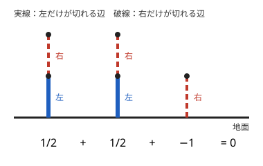

!!! abstract "要点"
    - **何ができるか**：先手と後手で取れる手が違うゲームでは Grundy 数が使えないので、局面に数（超現実数）を割り当て、独立な部分の和の符号で勝敗を判定する。
    - **いつ使うか**：
        - 先手と後手で動かせる駒や手が違う
        - 独立な部分の和で勝敗を判定したい
    - **計算量**：各部分の値は、その部分の局面の DAG を後ろから $O(\text{局面数} \times \text{手の数})$ で求める。全体の判定は値を足すだけで $O(\text{部分の数})$
    - **前提**：[Grundy 数と Sprague-Grundy の定理](../comb/grundy-number.md)

<!-- textlint-disable -->
別名：超現実数・組合せゲーム理論・Hackenbush・partizan game・combinatorial game theory
<!-- textlint-enable -->

非不偏ゲームは、同じ局面でも手番によって打てる手が違う 2 人のゲームである。組合せゲーム理論では、こうしたゲームの局面に数を割り当て、いくつかの独立な部分を並べたゲームの勝敗を、値の和の符号で判定する。ABC では difficulty 3300 前後の問題に 2 問現れた程度で、知らなければ解けないが、知っていれば実装は短い。

## 何ができるか {#what}

2 人を**左**と**右**と呼ぶ。左だけが打てる手と右だけが打てる手があり、手番の人が打てなくなったら負けとする。問題の先手を左に当てるのがふつうである。

局面 $G$ の勝敗は、どちらが先に打つかで 4 通りに分かれる。

| 分類 | 左が先に打つとき | 右が先に打つとき |
| --- | --- | --- |
| 正（$G > 0$） | 左が勝つ | 左が勝つ |
| 負（$G < 0$） | 右が勝つ | 右が勝つ |
| ゼロ（$G = 0$） | 右が勝つ | 左が勝つ（後に打つ方が勝つ） |
| どちらとも比べられない | 左が勝つ | 右が勝つ（先に打つ方が勝つ） |

いくつかの盤面を並べ、手番の人がどれか 1 つを選んで 1 手進めるゲームを**和**という。[不偏ゲーム](../guide/glossary.md#impartial-game)で [Grundy 数の XOR を取る和](../comb/grundy-number.md#sum)と同じ形である。和の局面に「数」を割り当てられるなら、和の値は各部分の値の和になり、その符号が上の表の分類を決める。問題の先手を左とすれば、**和が正なら先手の勝ち**で、和が 0 なら後手の勝ちである。

問題文のサインは次のとおりである。

- 先手が動かせる駒（白）と後手の駒（黒）が決まっていて、盤の列や行ごとに独立して動く。
- 部分ごとに局面の数は小さい（$3^N$ 通りなど）が、部分の組み合わせ全体は大きすぎて勝敗の DP ができない。

部分の数が少なく全体の局面が小さいなら、[手番を状態に入れた勝敗の DP](../comb/game-basics.md#turn) で足りる。数を割り当てる方法が要るのは、全体を DP できないときである。

## Grundy 数が使えない理由 {#why-not-grundy}

[Grundy 数](../comb/grundy-number.md#definition)は「どちらの手番でも同じ手が打てる」ことを使っている。$g = \mathrm{mex}\{\dots\}$ の右辺は行き先の集合だけで決まり、誰が打つかを見ない。手番で手が違うと、同じ局面の行き先が手番ごとに 2 通りあるので、mex を取る集合が決まらない（[使えない場合](../comb/grundy-number.md#limitations)）。

部分ごとの勝敗を調べても足りない。左だけが 1 手打てる盤面 $A$ と、右だけが 1 手打てる盤面 $B$ を考える。

- $A$ だけなら、左は先に打っても後に打っても勝つ（右は最初から打てない）。$B$ だけなら右が勝つ。
- $A$ と $B$ の和では、先に打った方が手を使い切り、後に打つ方が勝つ。
- $A$ を 2 つと $B$ の和では、左は先に打っても後に打っても勝つ。

「$A$ は左の勝ち」「$B$ は右の勝ち」という情報からは、和の勝敗が決まらない。必要なのは「左が何手ぶん得をしているか」という量である。$A$ を $1$、$B$ を $-1$ とすれば、$A$、$A + B$、$A + A + B$ の値は $1$・$0$・$1$ になり、勝敗と符号が一致する。

## 局面に数を割り当てて和を取る {#surreal}

局面 $G$ で、左が 1 手で移れる局面の値の集合を $L$、右が移れる局面の値の集合を $R$ とし、$G = \{L \mid R\}$ と書く。値は終局から後ろ向きに決める。

- $L$ のすべての値が $R$ のすべての値より小さいとき、$G$ の値は $\max L$ と $\min R$ の間（両端を含まない）にある**最も単純な数**である。$L$ が空なら下の端はなく、$R$ が空なら上の端はない。
- 最も単純な数の選び方：間に整数があれば絶対値が最小の整数を選ぶ。整数がなければ、分母が 2 の累乗の分数 $m / 2^d$ のうち $d$ が最小のものを選ぶ（$d$ が最小のものは 1 つに決まる）。

小さい例で値を決める。

- どちらも打てない局面は $\{\ \mid\ \} = 0$。
- 左だけが打てて 0 へ移る局面は $\{0 \mid\ \} = 1$、右だけなら $\{\ \mid 0\} = -1$。$\{1 \mid\ \} = 2$ のように、左だけの手が $n$ 手続く局面は $n$ になる。
- 左が 0 へ、右が 1 へ移れる局面は $\{0 \mid 1\} = 1/2$。

値の例として、Hackenbush という辺を切るゲームを使う。地面から伸びる辺の列で、左は実線の辺だけ、右は破線の辺だけを切れる。切った辺より上の辺は地面から離れて消える。地面に近い方から実線・破線の順の列は、左が切ると何も残らず（0）、右が切ると実線 1 本（1）が残るので $\{0 \mid 1\} = 1/2$ である。



この 3 本の和は $1/2 + 1/2 - 1 = 0$ なので、後に打つ方が勝つ。左が先に実線を切ると、残りは $1/2 - 1$ になる。右は残った列の上の破線を切り、実線 1 本と破線 1 本（$1 - 1 = 0$）にして左に手番を渡せば勝つ。右が先に打つと、どの破線を切っても残りの値は $1/2$ か $1$ で正になり、左が勝つ。$1/2$ は「2 つ集まると左の 1 手ぶん」という得の大きさを表している。和の値が部分の値の和になること、値の符号が勝敗を決めることの証明は、[学ぶための資料](#resources)に任せる。

$L$ のある値が $R$ のある値以上のときは、その局面は数にならない。たとえば両者とも 0 へ移れる局面 $\{0 \mid 0\}$ は先に打つ方が勝ち、0 と比べられない。こうした局面を含む和は、値を足すだけでは判定できない（[手数の貯金として見る](#tempo)の形は例外的に扱える）。

??? question "確認問題：地面に近い方から実線・破線・破線と並ぶ列の値は"
    左が実線を切ると 0、右が下の破線を切ると実線 1 本で 1、上の破線を切ると実線・破線の列で $1/2$ になる。$\{0 \mid 1/2, 1\}$ なので、$0$ と $1/2$ の間の最も単純な数 $1/4$ である。

## 手数の貯金として見る {#tempo}

値が整数 $n > 0$ の部分は、左が自由に使える手を $n$ 手ぶん持っている状態と同じである。相手と関わらずに打てる手は、手番を相手に渡す「パス」として使える。互いにパスを持つなら、差し引きの $(\text{左のパス}) - (\text{右のパス})$ が値になる。

両者が同じ手を打てる部分（[Nim](../comb/nim.md) の山のような[不偏ゲーム](../guide/glossary.md#impartial-game)）と、パスの貯金とが混ざる問題もある。不偏な部分の Grundy 数の XOR を $g$、パスの差し引きを $S$ とすると、先手（左）の勝敗は次で決まる。

- $S > 0$ なら先手の勝ち、$S < 0$ なら後手の勝ち。
- $S = 0$ なら不偏な部分だけの勝負になり、$g \ne 0$ なら先手の勝ち、$g = 0$ なら後手の勝ち。

直感としては、不偏な部分は両者に同じ手を与えるだけで、手数の差を作れない。パスが多い方は、不偏な部分で負けそうになったらパスを 1 手使って手番をずらせる。組合せゲーム理論では、Grundy 数が 0 でない不偏な部分の値は、どんな正の数より小さく、どんな負の数より大きい量である。そのため、正の数を足すと全体が正になる。

この形は、両者が同じ手を打てる部分と、相手と関わらずに打てる手とが混ざる盤面に現れる。

## 計算量と自作するときの要点 {#library}

自作するときの要点は次のとおりである。

- 値は浮動小数点にせず、分母を $2^K$ に固定した整数で持つ。値の分母の指数は、その局面から（手番を問わず）続けて打てる手の数の最大、つまり局面の木の深さより小さいので、$K$ はその深さで見積もる。Hackenbush の列なら辺の本数で見積もれる。
- 局面ごとに $\max L$ と $\min R$ を求め、$\max L < \min R$ を assert で確かめてから最も単純な数を選ぶ。assert が落ちたら、その問題は数だけでは解けない。
- 部分の局面は DAG なので、メモ化再帰か後ろからの DP で値を埋める。計算量は部分の局面数と手の数の積で、全体の判定は値を足して符号を見るだけである。

次のコード片は、Hackenbush の 1 本の列の値を求める中心部分である（完全なプログラムは [`snippets/partizan-games/surreal.cpp`](https://github.com/yuukougun/kyopro-atlas/blob/main/snippets/partizan-games/surreal.cpp)）。プログラムでは、和の符号から決めた勝者が総当たりの勝敗と一致することを assert で確かめている。

```cpp
--8<-- "partizan-games/surreal.cpp:core"
```

完全なプログラム：[`surreal.cpp`](https://github.com/yuukougun/kyopro-atlas/blob/main/snippets/partizan-games/surreal.cpp)（GitHub）
{ .kp-code-src }

ACL に対応するものはなく、Library Checker にも対応する問題はない。上のプログラムのように、総当たりの勝敗と照らし合わせて確かめる。分母が 2 の累乗の分数と最も単純な数を求める関数は、hitonanode 氏のライブラリ（[参考](#references)）にもある。

## 落とし穴 {#pitfalls}

- **数にならない局面**：$\max L \ge \min R$ の局面があると、値を足すだけの判定は誤る。両者が同じ手を打てる部分を含むなら、[手数の貯金として見る](#tempo)の形に当てはまるかを確かめる。
- **符号の向き**：問題の先手を左にしたなら、値が正のとき先手の勝ちである。値が 0 のときは後手の勝ちで、「先手が勝つのは 0 以上」と書くと誤る。
- **浮動小数点**：$1/2^d$ の和は double でも正確な範囲が多いが、0 との比較を誤差に任せるのは危うい。分母を固定した整数で持てば比較が正確になる。

## 学ぶための資料 {#resources}

- [kmjp「AtCoder ABC #229 : H - Advance or Eat」](https://kmjp.hatenablog.jp/entry/2021/12/01/0930)：各列の局面に分母が 2 の累乗の値を割り当てて足す実装の流れが分かる。
- [hitonanode「Dyadic rational number （2進有理数）」](https://hitonanode.github.io/cplib-cpp/number/dyadic_rational.hpp.html)：ライブラリのページに、値で評価できるゲームの条件と、最も単純な数を求める関数がある。
- 体系的に学ぶなら、Albert・Nowakowski・Wolfe の教科書『Lessons in Play: An Introduction to Combinatorial Game Theory』がある。超現実数とゲームの関係の概要は [Wikipedia「超現実数」](https://ja.wikipedia.org/wiki/%E8%B6%85%E7%8F%BE%E5%AE%9F%E6%95%B0)の項目でもつかめる。

## 例題 {#examples}

### ABC229 H. Advance or Eat {#abc229_h}

<div class="kp-problems" data-role="example" markdown>

- [ABC229 H. Advance or Eat](https://atcoder.jp/contests/abc229/tasks/abc229_h)（diff 3308）：N 行 N 列の盤に先手の駒と後手の駒があり、自分の駒を 1 つ上の空きマスへ進めるか相手の駒を 1 つ取り除く手を交互に打つとき、どちらが勝つかを判定する。

</div>

方針：駒は縦にしか動かないので、各列が独立な部分になり、盤全体は列の和である。1 列の局面は各マスが空・先手の駒・後手の駒の $3^N$ 通りしかない。列の局面ごとに先手（左）と後手（右）の行き先から値を決め、全列の値の和が正なら先手の勝ちである。

??? note "解法の詳細"
    - 1 列の局面を 3 進数で番号付けし、駒が進むか減る向きにしか局面が変わらないので、行き先が先に決まる順で値を埋める（メモ化再帰でもよい）。
    - 各局面で、先手の行き先の値の最大と後手の行き先の値の最小を求め、その間の最も単純な数を値にする。この問題では、どの局面でもこの区間が空にならない。
    - 値の分母は小さい（この問題の制約では $2^6$ ほどで足りると kmjp 氏の記事にある）ので、分母を固定した整数で持つ。
    - 前計算は $O(3^N N)$ ほどで、盤の各列の値を足して符号を見る。

## 練習問題 {#practice}

<div class="kp-problems" data-role="practice" markdown>

- [ABC265 Ex. No-capture Lance Game](https://atcoder.jp/contests/abc265/tasks/abc265_h)（diff 3319）：H 行 W 列の盤の各行に先手と後手の駒を 1 つずつ置く配置のうち、駒を前へ進め合うゲームで両者が最適に動くと先手が勝つ配置の数を求める。

</div>

??? note "練習の方針"
    - ABC265 Ex：向かい合う 2 つの駒の行は間の空きの数を山とする Nim、背中合わせの行は各自の前の空きの数をパスの貯金とみなす。パスの差し引きの和 $S$ と Nim の XOR $g$ から、[手数の貯金として見る](#tempo)の条件で勝敗が決まる。配置の数え上げは $(S, g)$ を状態にすると重いので、和の向きは畳み込み、XOR の向きは[アダマール変換](../math/hadamard-transform.md#power)で、行ごとの分布を $H$ 乗する。

## 参考 {#references}

- [kmjp「AtCoder ABC #229 : H - Advance or Eat」](https://kmjp.hatenablog.jp/entry/2021/12/01/0930)：例題の方針と、値を分母が 2 の累乗の整数で持つ実装の流れ
- [kmjp「AtCoder ABC #265 : Ex - No-capture Lance Game」](https://kmjp.hatenablog.jp/entry/2022/08/23/0930)：練習の方針（向かい合う駒は Nim、背中合わせの駒はパスの貯金とする勝敗の条件と、数え上げの変換）
- [hitonanode「Dyadic rational number （2進有理数）」](https://hitonanode.github.io/cplib-cpp/number/dyadic_rational.hpp.html)：値で評価できるゲームの条件、最も単純な数を求める関数、ABC229 H が適用例であること
- [Wikipedia「超現実数」](https://ja.wikipedia.org/wiki/%E8%B6%85%E7%8F%BE%E5%AE%9F%E6%95%B0)：ゲームの 4 つの分類と、$\{0 \mid 0\}$ が数でないこと
