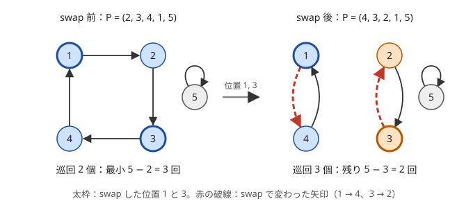

!!! abstract "要点"
    - **何ができるか**：順列 $P$ を $i \to P_i$ の矢印で描くと、いくつかの巡回に分かれる。任意の 2 要素の swap でソートする最小回数は $N - (\text{巡回の個数})$ になり、置換の $K$ 回の合成は各巡回の上を $K$ 歩進む操作になる。
    - **いつ使うか**：
        - 順列を任意の 2 要素の swap でソートする最小回数を問われる。
        - $i \to P_i$ をたどる、または置換を何回も繰り返す。
        - 元に戻るまでの回数を問われる。
        - 置換を $K \le 10^{18}$ 回繰り返した結果を求める。
    - **計算量**：巡回分解は $O(N)$。$K$ 回の合成も、各巡回の上で $K$ を巡回の長さで割った余りだけ進めれば $O(N)$ で済む。
    - **前提**：なし

<!-- textlint-disable -->
別名：巡回置換・サイクル分解・順列のサイクル・swap でソートする最小回数・置換の位数・cycle decomposition
<!-- textlint-enable -->

置換の巡回分解は、順列 $P$ を「$i$ から $P_i$ への矢印」のグラフと見て、互いに交わらない巡回（輪）に分けることである。どの頂点からも出る矢印と入る矢印が 1 本ずつなので、矢印をたどると必ず出発点に戻る。swap や繰り返しの操作は、巡回ごとに分けて考えられる。そのため問題が巡回の個数と長さだけの話になる。

このページでは添字を 0-indexed で書く。問題文の 1-indexed の $P$ は、$p_i = P_{i+1} - 1$ と直してから使う。

## 巡回分解の作り方（訪問済みの印を付けてたどる） {#decompose}

巡回分解は、まだ印のない頂点 $s$ から $s \to p_s \to p_{p_s} \to \cdots$ とたどり、通った頂点に印を付けて、$s$ に戻ったら 1 つの巡回とする手順で作る。$s$ を $0$ から $N - 1$ まで動かし、印の付いた頂点は飛ばす。

- **保つ性質**：印の付いた頂点は、すでにどれか 1 つの巡回に入っている。$p$ は順列なので、ある巡回の頂点から別の巡回へ矢印が出ることはなく、たどる途中で初めて印のある頂点に当たるのは $s$ に戻ったときだけである
- **計算量**：各頂点に印を付けるのは 1 回だけなので、全体で $O(N)$ である
- **持っておくと便利なもの**：各頂点の属する巡回の番号と、巡回の中での位置。これがあれば「$v$ から $k$ 歩先」が巡回の配列の添字の計算で求まる

```cpp
--8<-- "permutation-cycles/decompose.cpp:core"
```

完全なプログラム：[`decompose.cpp`](https://github.com/yuukougun/kyopro-atlas/blob/main/snippets/permutation-cycles/decompose.cpp)（GitHub）
{ .kp-code-src }

巡回の大きさだけが要るなら、[Union-Find](../ds/union-find.md) で $i$ と $p_i$ を併合しても同じ分け方が得られる。たどる順番（巡回の中の並び）は失われるので、$K$ 歩先を求めるときは、コードの `cycles` と `pos` のように巡回を配列で持つ。

??? question "確認問題：印を付けないとどうなるか"
    印を付けずに、すべての $s$ について「$s$ に戻るまでたどる」と書いた。$N = 2 \times 10^5$ でどうなるか。

    ??? success "答え"
        $s$ ごとに巡回の長さだけ歩くので、全体で各巡回の長さの 2 乗の和になる。全体が 1 つの巡回なら $N^2 = 4 \times 10^{10}$ 歩で間に合わない。印を付ければ、巡回ごとに 1 回だけたどるので $O(N)$ である。

## swap で巡回が割れる・つながる：最小回数は N − 巡回の個数 {#min-swaps}

順列 $p$ の 2 つの位置 $i, j$ の値を入れ替えると、矢印 $i \to p_i$・$j \to p_j$ が $i \to p_j$・$j \to p_i$ に付け替わる。巡回の個数は次のように必ず 1 だけ変わる。

- **$i$ と $j$ が同じ巡回にあるとき**：巡回は $i \to p_i \to \cdots \to j \to p_j \to \cdots \to i$ の形をしている。付け替えると $i \to p_j \to \cdots \to i$ と $j \to p_i \to \cdots \to j$ の 2 つに割れ、巡回は 1 つ増える
- **$i$ と $j$ が別の巡回にあるとき**：逆向きの操作になり、2 つの巡回が 1 つにつながって、巡回は 1 つ減る



図は 1-indexed で書いた例である。太枠の丸が swap した位置 1 と 3 で、赤の破線が swap で付け替わった矢印（$1 \to 4$、$3 \to 2$）である。swap の前は巡回が 2 個で、同じ巡回にある位置 1 と 3 を swap すると 3 個に増える。ソート済みの列（恒等置換）は、すべての頂点が[固定点](../guide/glossary.md#fixed-point)で、巡回がちょうど $N$ 個ある状態である。

最小回数が $N - c$（$c$ は最初の巡回の個数）になる理由は次の 2 つである。

- **これより少なくはできない**：1 回の swap で巡回は 1 つしか増えないので、$c$ 個から $N$ 個にするには $N - c$ 回以上かかる
- **この回数でできる**：ソートされていない間は長さ 2 以上の巡回がある。その中の 2 頂点を swap すれば巡回が 1 つ増えるので、$N - c$ 回で $N$ 個に届く。具体的には「位置 $i$ に値 $i$ を持ってくる swap」を繰り返せばよい

最小回数の手順は 1 通りではない。どの 1 回も「巡回を 1 つ増やす swap」、すなわち同じ巡回の中の 2 頂点の swap でなければならない。逆に、そうした swap ならどれを選んでも最小回数のまま進める。長さ $\ell$ の巡回からは $\binom{\ell}{2}$ 通りの組が選べるので、最初の 1 回として選べる swap は $\sum \binom{\ell}{2}$ 通りある（[例題](#abc436_e)）。

??? question "確認問題：3 要素の巡回"
    $P = (3, 1, 2)$ を任意の swap でソートする最小回数はいくつか。最初の 1 回として選べる swap は何通りあるか。

    ??? success "答え"
        矢印は $1 \to 3 \to 2 \to 1$ で、長さ 3 の巡回が 1 つだけある。最小回数は $3 - 1 = 2$ である。3 つの位置はすべて同じ巡回にあるので、どの 2 つを swap しても巡回が 2 つに割れ、最初の 1 回は $\binom{3}{2} = 3$ 通りすべてが選べる。

## 隣接 swap（転倒数）との違い {#vs-adjacent}

swap できるのが隣り合う 2 要素だけなら、ソートの最小回数は巡回では決まらず、[転倒数](../ds/inversion-number.md#adjacent-swaps)（$i < j$ かつ $P_i > P_j$ となる組の数）になる。隣接 swap 1 回で転倒数はちょうど 1 だけ変わり、ソートされていなければ隣り合う転倒した組を swap して 1 減らせるからである。隣接 swap は任意の swap の特別な場合なので、任意の swap の最小回数は転倒数以下になる。

| 列 | 巡回の個数 | 任意の swap | 隣接 swap（転倒数） |
| --- | --- | --- | --- |
| $(3, 2, 1)$ | 2 | 1 回 | 3 回 |
| $(2, 3, 4, 1)$ | 1 | 3 回 | 3 回 |
| $(4, 3, 2, 1)$ | 2 | 2 回 | 6 回 |

問題文が「任意の 2 要素」か「隣り合う 2 要素」かで答えがまったく変わるので、最初に読み分ける。$\lvert i - j \rvert \le D$ のように距離に制限のある swap は、どちらの式にもそのまま当てはまらない。

2 つの数には共通点もある。どちらの swap も 1 回ごとに置換の偶奇を変えるので、$N - c$ と転倒数は偶奇が一致する（[置換の偶奇](permutation-parity.md)）。表の 3 行とも、2 つの回数の偶奇がそろっている。

## K 回の合成と元に戻る回数（巡回の長さの lcm） {#power}

この節では[繰り返し二乗法](../math/mod-pow.md)と[中国剰余定理](../math/crt.md)を使う。

置換 $p$ を $K$ 回続けて使う写像を $p^K$ と書く。$p^K(i)$ は $i$ から矢印を $K$ 回たどった先で、$i$ の属する巡回の上を $K$ 歩進んだ頂点である。長さ $\ell$ の巡回では $\ell$ 歩で元に戻るので、$K$ 歩は $K \bmod \ell$ 歩と同じである。巡回分解した配列の上で位置を $(\mathrm{pos} + K) \bmod \ell$ にずらせば、$K \le 10^{18}$ でも全体を $O(N)$ で求められる。

```cpp
--8<-- "permutation-cycles/power.cpp:core"
```

完全なプログラム：[`power.cpp`](https://github.com/yuukougun/kyopro-atlas/blob/main/snippets/permutation-cycles/power.cpp)（GitHub）
{ .kp-code-src }

[ダブリング](../basics/doubling.md#permutation-power)でも $O(N \log K)$ で求まるが、置換なら巡回を使う方が速く、表も要らない。$p$ が置換でない一般の写像なら、巡回に入る前の部分があるのでダブリングか [Functional graph](../graph/functional-graph.md) の方法を使う。

**合成する回数そのものが大きくなる操作**。「すべての $i$ で $P_i$ を $P_{P_i}$ に同時に置き換える」操作は、$p$ を $p^2$ にする。$K$ 回行うと $p^{2^K}$ になるので、各巡回の上で $2^K \bmod \ell$ 歩進めばよい。この歩数は繰り返し二乗法により $O(\log K)$ で求まる（[練習](#practice)の ABC377 E）。

**元に戻るまでの回数**。$p^K$ が恒等置換になるのは、すべての巡回で $\ell \mid K$ のときである。したがって $K \ge 1$ で最小のもの（置換の位数）は、巡回の長さすべての $\operatorname{lcm}$ になる。長さ 2・3・4 の巡回からなる置換なら $\operatorname{lcm}(2, 3, 4) = 12$ 回で初めて元に戻る。

この lcm は、巡回の長さの和が $N$ でも非常に大きくなりうる。長さを異なる素数にすると、lcm はそれらの積になるからである。$N = 2 \times 10^5$ では数百桁に達するので、`long long` で順に lcm を取るとあふれる。「元に戻る回数を 998244353 で割った余り」を問われたら、各長さを素因数分解して素数ごとに最大の指数を取り、その積を mod で計算する。lcm を整数型で求めてから割ることはできない（あふれる）。

**巡回ごとの条件をそろえる**。「$X$ 回適用した後の状態」が巡回ごとに $X \bmod \ell$ で決まる問題では、巡回ごとに選びたい $X$ の条件を $X \equiv r \pmod{\ell}$ の形で集め、中国剰余定理でまとめる。法が互いに素とは限らないので、解の存在条件を確かめながら合わせる（[多数の式を順に合わせる](../math/crt.md#many-equations)）。

??? question "確認問題：元に戻る回数"
    $P = (2, 3, 1, 5, 4, 6)$（1-indexed）を何回続けて適用すると、初めて元に戻るか。

    ??? success "答え"
        矢印は $1 \to 2 \to 3 \to 1$、$4 \to 5 \to 4$、$6 \to 6$ で、巡回の長さは 3・2・1 である。$\operatorname{lcm}(3, 2, 1) = 6$ 回で初めて元に戻る。

## Functional graph との関係 {#functional-graph}

各頂点から出る矢印がちょうど 1 本のグラフを [Functional graph](../graph/functional-graph.md) と呼ぶ。置換は、入る矢印もちょうど 1 本という条件が加わった特別な場合である。そのため Functional graph に現れる「巡回に入る前の部分（尾）」がなく、すべての頂点が巡回の上にある。

- **置換なら**：尾を剥がす処理や閉路の検出は要らず、印を付けてたどるだけで巡回に分かれる
- **一般の写像なら**：行き先に同じ頂点が何度も現れると、たどる途中で出発点ではない頂点の印に当たる。そこまでの列は巡回ではないので、このページの書き方をそのまま使うと誤る。尾と巡回を分けて扱う
- **逆置換**：矢印の向きを逆にしたもの（$q_{p_i} = i$）で、巡回の分け方と長さは $p$ と同じである。巡回の個数だけを問う問題では、どちらの向きで作ってもよい

巡回分解は、数え上げの手法の入口でもある。置換の偶奇は $N - c$ の偶奇で決まる（[置換の偶奇](permutation-parity.md)）。ちょうど $k$ 個の巡回からなる置換の数は[第 1 種スターリング数](stirling-first.md#what)になる。巡回の長さの組（巡回型）は $N$ の分割に対応し、巡回型ごとに置換を数える問題は[整数の分割と分割数](partition-number.md)で扱う。

## 落とし穴 {#pitfalls}

**矢印の向きを取り違える**。「$B_i = A_{P_i}$ と並べ替える」操作では、新しい位置 $i$ の値は位置 $P_i$ から来るので、$K$ 回後の第 $i$ 項は $A_{p^K(i)}$ である。一方「位置 $i$ の値を位置 $P_i$ へ動かす」操作では $B_{P_i} = A_i$ で、逆向きに $K$ 歩たどった位置の値が来る。巡回の個数や長さは向きによらないが、$K$ 歩先の位置は変わる。小さい例で 1 回分を手で確かめてから、$+K$ か $-K$ かを決める。

**1-indexed のまま配列に入れる**。$P_i$ をそのまま添字にすると、$P_i = N$ で範囲外を読む。入力の直後に 1 を引いて 0-indexed にそろえる。

**同じ値を含む列に当てはめる**。$N - c$ は、目標の並びで各値の行き先が 1 つに決まる順列についての式である。同じ値があると、どの位置へ送るかの選び方で巡回の分け方が変わるので、この式をそのまま使えない。

**lcm を `long long` で取る**。元に戻る回数は巡回の長さの lcm で、数百桁になりうる。$K$ 回後の状態を求めるだけなら lcm は作らず、巡回ごとの $K \bmod \ell$ を使う。

**負の余り**。逆向きに $K$ 歩進むとき、C++ の `%` は負の数に対して負の余りを返す。`((pos - K % len) % len + len) % len` のように正の範囲に戻す。

## 上位の手法へのつながり {#next-steps}

このページの考え方は、次の手法の部品になる。

- **置換の偶奇**：swap の回数の偶奇は、$N$ − 巡回の個数の偶奇で決まる（[置換の偶奇](../comb/permutation-parity.md#compute)）。
- **巡回の個数ごとの数**：巡回がちょうど $k$ 個の置換の数は第 1 種スターリング数で、巡回の長さの組（巡回型）ごとの数にも式がある（[第 1 種スターリング数](../comb/stirling-first.md#what)、[巡回型ごとの数](../comb/partition-number.md#cycle-type)）。
- **$K$ 回の合成**：巡回ごとに $K$ を長さで割った余りだけ進めるか、ダブリングで求める（[置換の K 回合成](../basics/doubling.md#permutation-power)）。
- **出次数 1 のグラフ**：置換は、各成分が閉路だけの Functional graph である（[Functional graph](../graph/functional-graph.md#permutation)）。

## 例題 {#examples}

### ABC436 E. Minimum Swap {#abc436_e}

<div class="kp-problems" data-role="example" markdown>

- [ABC436 E. Minimum Swap](https://atcoder.jp/contests/abc436/tasks/abc436_e)（diff 958）：順列 P を 2 要素の swap を最小回数行ってソートするとき、最初の 1 回として選びうる swap の数を求める。

</div>

最小回数は $N - c$ で、最小回数の手順のどの 1 回も、巡回を 1 つ増やす swap でなければならない。巡回を 1 つ増やすのは同じ巡回の中の 2 頂点の swap だけで、そのどれを選んでも残りは最小回数でソートできる。したがって、巡回ごとに 2 頂点の選び方を数えて足せばよい。

??? note "解法の詳細"
    - $P$ を 0-indexed に直し、[巡回分解の作り方](#decompose)の手順で巡回の長さ $\ell_1, \dots, \ell_c$ を求める。Union-Find で $i$ と $p_i$ を併合し、連結成分の大きさを使ってもよい。
    - 答えは $\sum_k \ell_k (\ell_k - 1) / 2$ である。$N \le 3 \times 10^5$ では和が最大で約 $4.5 \times 10^{10}$ になり、`int` に収まらないので `long long` で足す。
    - 長さ 1 の巡回（固定点）は $0$ を足すだけなので、場合分けは要らない。全体で $O(N)$ である。

## 練習問題 {#practice}

<div class="kp-problems" data-role="practice" markdown>

- [ABC175 D. Moving Piece](https://atcoder.jp/contests/abc175/tasks/abc175_d)（diff 1491）：マス i のコマが P_i へ移る順列に従って、好きなマスに置いたコマを 1 回以上 K 回以下動かし、止まったマスの値の和を最大にする。
- [ABC377 E. Permute K times 2](https://atcoder.jp/contests/abc377/tasks/abc377_e)（diff 1685）：順列 P に対して、すべての i で P_i を P_(P_i) に同時に置き換える操作を K 回行った後の P を求める。

</div>

??? note "練習の方針"
    - **ABC175 D**：コマは出発したマスの巡回の上だけを回る。巡回ごとに 1 周の和 $S$ と長さ $\ell$ を求め、出発点ごとに考える。$S > 0$ なら、端数の長さ $r$ を $0$ から $\ell - 1$ まで（$r \le K$ の範囲で）すべて試す。それぞれ周回を $\lfloor (K - r)/\ell \rfloor$ 回足し、$r = 0$ で周回 0 回の場合は 1 回も動かないので除く。周回を最大にしてから端数を決めると、1 周減らして長い端数を取る場合を落とす。$S \le 0$ なら周回しても得をしないので、長さ 1 以上 $\min(K, \ell)$ 以下の連続した区間の和の最大を取る。長さ 1 の巡回（固定点）でも長さ 1 の区間を必ず候補に入れる
    - **ABC377 E**：1 回の操作で $p$ が $p^2$ になるので、$K$ 回後は各巡回の上を $2^K$ 歩進む。巡回の長さ $\ell$ ごとに $2^K \bmod \ell$ を繰り返し二乗法で求め、その歩数だけずらす。$2^K$ そのものは $K \le 10^{18}$ では作れない

## 力試し {#challenge}

<div class="kp-problems" data-role="challenge" markdown>

- [ABC371 G. Lexicographically Smallest Permutation](https://atcoder.jp/contests/abc371/tasks/abc371_g)（diff 2348）：列 A に置換 P を何回か適用してできる列のうち、辞書順最小のものを求める。

</div>

??? note "力試しの方針"
    - **ABC371 G**：適用回数を $X$ とすると、各巡回の上の値は $X \bmod \ell$ だけずれる。添字の小さい位置を含む巡回から順に、その位置に来る値を最小にする $X \bmod \ell$ を選ぶ。それまでに決めた条件 $X \equiv r \pmod{L}$ と両立するのは、ずらす量 $t$ が $t \equiv r \pmod{\gcd(L, \ell)}$ を満たすときだけである。その中から選び、中国剰余定理で条件を $\operatorname{lcm}(L, \ell)$ を法とする 1 つの式にまとめる。$L$ は数百桁になりうるので、多倍長整数で持つなどの工夫が要る

## 参考 {#references}

- [ikatakos「AtCoder Beginner Contest 436 E,F,G問題メモ」](https://ikatakos.com/pot/programming_algorithm/contest_history/atcoder/2025/1213_abc436)：例題の方針（同じ巡回の swap で巡回が増えること・巡回ごとに組を数えること・Union-Find での実装）。任意の swap によるソートが近年の ABC で頻出であること（解説の部分だけを参照）
- [drken「AtCoder ABC 175 D - Moving Piece (1Q, 水色, 400 点)」](https://drken1215.hatenablog.com/entry/2020/08/17/182700)：練習の方針（巡回ごとに 1 周の和の符号で場合分けすること）
- [Lanly「AtCoder Beginner Contest 377」](https://www.cnblogs.com/Lanly/p/18513188)：練習の方針（操作のたびに巡回の上の歩数が 2 倍になり、巡回の長さで割った余りだけ進めること）
- [ikatakos「AtCoder Beginner Contest 371 F,G問題メモ」](https://ikatakos.com/pot/programming_algorithm/contest_history/atcoder/2024/0914_abc371)：力試しの方針（巡回ごとの条件を合同式にして中国剰余定理でまとめること、lcm が数百桁になりうること）（解説の部分だけを参照）
