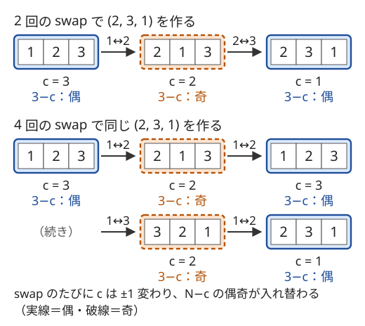

!!! abstract "要点"
    - **何ができるか**：同じ置換をどんな swap の列で作っても、swap の回数の偶奇は変わらない（置換の符号）。偶奇は巡回の個数 $c$ から $N - c$ の偶奇として求まり、ちょうど $K$ 回の swap や 3 要素の巡回だけで作れる列はこの偶奇で決まる。同じ値があれば偶奇を調整できる。
    - **いつ使うか**：
        - ちょうど $K$ 回（$10^{100}$ 回など）の swap の後にありうる列を問われる。
        - 3 つの要素を巡回させる操作しかできない。
        - 2 つの列でそれぞれ 1 回ずつの swap を同時に行う。
        - 同じ値があるかどうかで答えが変わる。
    - **計算量**：偶奇の判定は巡回分解で $O(N)$。値が $1$〜$N$ でない列は、位置の対応を作るソートで $O(N \log N)$。
    - **前提**：[置換の巡回分解](../comb/permutation-cycles.md)、[偶奇に着目する](../thinking/parity.md)

<!-- textlint-disable -->
別名：偶置換・奇置換・置換の符号・swap の回数の偶奇・3 要素の巡回・sign of a permutation
<!-- textlint-enable -->

置換の偶奇は、並べ替えを swap（2 か所の値の入れ替え）を繰り返して作ったときの、swap の回数の偶奇である。回数そのものは作り方で変わるが、偶奇は並べ替えだけで決まる。この不変量を使うと、「ちょうど $K$ 回」「3 つの巡回だけ」のように操作が縛られたときに作れる列が分かる。

## 置換の符号：swap の回数の偶奇は列によらない {#sign}

長さ $N$ の列の位置を $1$〜$N$ とし、$1$〜$N$ を並べ替えた列 $P = (P_1, \dots, P_N)$ を置換と呼ぶ（コードでは 0-indexed にする）。swap は、異なる 2 か所の値を入れ替える操作である。何もしない並び $(1, 2, \dots, N)$ を恒等置換と呼ぶ。

swap を何回でも行えるなら、どんな並びも作れる。ところが「ちょうど $10^{100}$ 回」のように回数が決まると、作れる並びはおよそ半分に減る。どちらの半分に入るかを決めるのが、次の性質である。

**置換の符号**：恒等置換から $k$ 回の swap で $P$ を作れたなら、$k \equiv N - c \pmod{2}$ である。ここで $c$ は、$i \to P_i$ の矢印でできる[巡回](../comb/permutation-cycles.md)の個数である。

$N - c$ は $P$ だけで決まるので、$P$ をどんな swap の列で作っても回数の偶奇は同じになる。$N - c$ が偶数の置換を偶置換、奇数の置換を奇置換と呼ぶ。符号は $\operatorname{sgn}(P) = (-1)^{N - c}$ と書くことが多い。

なぜ成り立つかは、swap 1 回で巡回の個数がどう変わるかを見れば分かる。同じ巡回の 2 か所を swap するとその巡回が 2 つに割れ、別々の巡回の 2 か所を swap すると 2 つが 1 つにつながる（[巡回分解の節](../comb/permutation-cycles.md#min-swaps)）。どちらの場合も $c$ はちょうど 1 だけ変わる。恒等置換は $c = N$ なので、$k$ 回の swap の後は $c \equiv N - k \pmod{2}$ になり、$k \equiv N - c$ が出る。

次の図は、$N = 3$ の置換 $(2, 3, 1)$ を 2 回の swap と 4 回の swap で作る様子である。矢印の上の数は入れ替える位置で、各段の下に巡回の個数 $c$ を書いた。どちらの列でも、swap のたびに $N - c$ の偶奇が入れ替わり、偶数で終わる。



列 $A$ を列 $B$ に並べ替える場合も同じである。値がすべて異なれば、「$A$ の位置 $i$ の値が $B$ の何番目にあるか」を $p_i$ とした置換 $p$ が決まり、必要な swap の回数の偶奇は $p$ の偶奇で決まる。$B$ から $A$ へ戻す向きでも、同じ swap を逆の順に行えばよいので偶奇は変わらない。

2 つの並べ替えを続けて行うと、swap の列をつなげることになり、回数が足される。だから、続けて行った並べ替えの符号は、それぞれの符号の積になる。偶置換を何回行っても偶置換のままである。

## 巡回の個数・転倒数から偶奇を求める {#compute}

置換の偶奇の求め方は 2 つある。

1. **巡回の個数から**：$i \to P_i$ をたどって巡回の個数 $c$ を数え、$N - c$ の偶奇を見る。訪問済みの印を付けて各位置を 1 回ずつたどるので $O(N)$ である。
2. **[転倒数](../ds/inversion-number.md)から**：$i < j$ かつ $P_i > P_j$ の組の個数の偶奇を見る。隣り合う 2 か所の swap で転倒数はちょうど 1 増減し（[転倒数の節](../ds/inversion-number.md#adjacent-swaps)）、転倒数が 0 になれば恒等置換である。だから $P$ は転倒数と同じ回数の隣接 swap で作れ、その偶奇が置換の偶奇になる。

たとえば $P = (3, 1, 2)$ は $1 \to 3 \to 2 \to 1$ の巡回 1 つなので $N - c = 2$ で偶置換である。転倒数も $(3, 1)$ と $(3, 2)$ の 2 で、偶奇は一致する。

偶奇だけが欲しいなら、BIT の要らない巡回の個数の方が速くて短い。転倒数の値そのものが要る問題（隣接 swap の回数を問うなど）では、転倒数の偶奇をそのまま使えばよい。

```cpp
--8<-- "permutation-parity/parity.cpp:core"
```

値が $1$〜$N$ の並べ替えでない列（値が大きい・飛び飛び）では、先に値を順位に置き換える。列 $A$ を列 $B$ に並べ替えるときは、両方を値でソートした添字の列を作り、$k$ 番目に小さい値の $A$ での位置から $B$ での位置への対応を $p$ にする。ソートがあるので $O(N \log N)$ になる。

## 3 要素の巡回は偶置換 {#three-cycle}

3 か所 $x, y, z$ の値を巡回させる操作（$x$ の値を $y$ へ、$y$ の値を $z$ へ、$z$ の値を $x$ へ動かす）は、swap 2 回でできる。値を $a, b, c$ とすると、$x$ と $y$ の swap で $(b, a, c)$ になり、続く $x$ と $z$ の swap で $(c, a, b)$ になる。2 回なので偶置換で、この操作を何回行っても置換の偶奇は変わらない。

逆に、$N \ge 3$ ならどの偶置換も 3 要素の巡回だけで作れる。偶置換は偶数回の swap で作れるので、swap を前から 2 つずつ組にし、各組を 3 要素の巡回に直せばよい。

- **2 つの swap が 1 か所だけ共有する**（$x$ と $y$、続いて $x$ と $z$）：上で見たとおり、ちょうど 1 回の 3 要素の巡回である。同じ組を 2 回 swap する場合は何もしないので、その 2 つは捨てればよい
- **2 つの swap が位置を共有しない**（$x$ と $y$、続いて $z$ と $w$）：間に $y$ と $z$ の swap を 2 回はさむ。2 回続けた swap は何もしないので結果は変わらず、「$x$ と $y$・$y$ と $z$」「$y$ と $z$・$z$ と $w$」の 2 組がどちらも 1 か所だけ共有する形になる

したがって、値がすべて異なる列 $A$ を 3 要素の巡回で $B$ に変えられるのは、$A$ から $B$ への置換が偶置換のときだけである。$N \le 2$ では 3 か所を選べず何も動かせないが、このとき偶置換は恒等置換だけなので、同じ条件で判定してよい。

実際の手順を作るときは、位置 $1$ から順に正しい値を置いていく。位置 $i$ に置くべき値が位置 $j\ (j > i)$ にあれば、$i$ でも $j$ でもないもう 1 か所 $k > i$ を選び、$j$ の値が $i$ へ動く向きに 3 か所を巡回させる。これを位置 $N - 2$ まで続けると残りは 2 か所だけで、偶置換ならその 2 か所もそろっている。操作は $N$ 回以内で済む。

**応用の型**：

- **隣り合う 3 か所だけを巡回させる**：$(x, y, z) \to (z, x, y)$ の操作は、1 回で値を 2 つ左へ運び、2 回で 1 つ左へ運ぶ。だから上と同じ手順で端から値をそろえられ、結論は任意の 3 か所のときと同じである
- **2 つの列で 1 回ずつ同時に swap する**：$A$ と $B$ で 1 回ずつ swap すると、$A$ を $B$ にそろえる置換は swap 2 回分変わるので偶奇は変わらない。同じ位置の組を両方で swap すると、組 $(A_i, B_i)$ の並ぶ順が変わるだけで、組の集まりは変わらない。そろえる置換は位置の付け替えを受けるだけで、偶奇は同じである（ABC296 F は[練習](#practice)にある）
- **空きマスを動かすスライドパズル**：空きマスも 1 つの値とみなすと、1 手は空きマスと隣の値の swap である。市松模様に塗ると空きマスの色は 1 手ごとに入れ替わるので、「全体の置換の偶奇」と「空きマスの今の位置と最初の位置のマンハッタン距離の偶奇」は一致し続ける。縦横とも 2 以上の盤では、この条件を満たす配置はすべて作れることが知られている

## 同じ値があれば偶奇を調整できる {#duplicates}

列に同じ値が 2 つあると、偶奇の制約は消える。同じ値の位置 $u, v$ を swap しても列は変わらないので、列を変えずに swap の回数だけを 1 回増やせるからである。

3 要素の巡回のように swap そのものはできない操作でも、番号を付けて考えれば同じことが言える。同じ値に $v_1, v_2$ と番号を付けて区別すると、すべての値が異なる列になる。目標の列 $B$ での番号の付け方は 2 通り以上あり、$v_1$ と $v_2$ の番号を入れ替えると置換の偶奇が変わる。偶置換になる付け方を選べば、前の節の結論から作れる。

したがって、3 要素の巡回で $A$ を $B$ に変えられるかは次のように判定できる。

1. $A$ と $B$ の値の多重集合が違えば作れない
2. 同じ値が 2 つ以上あれば作れる
3. 値がすべて異なれば、$A$ から $B$ への置換が偶置換のときだけ作れる

```cpp
--8<-- "permutation-parity/parity.cpp:judge"
```

偶奇を調整できるのは、同じ値の 2 つが同じ範囲の中で動けるときだけである。swap できる位置の組が決まっていて列がいくつかの部分に分かれる問題では、同じ値が別々の部分にあっても調整に使えない（[落とし穴](#pitfalls)）。

## ちょうど K 回の操作で作れるもの {#exactly-k}

回数がちょうど $K$ 回と決まっている問題では、「最小回数以下か」と「偶奇が合うか」の両方を確かめる。値がすべて異なり、任意の 2 か所を swap できるとき、置換 $P$ がちょうど $K$ 回で作れる条件は次のとおりである（$N \ge 2$）。

$$
N - c \le K \quad\text{かつ}\quad K \equiv N - c \pmod{2}
$$

左の条件は最小回数が $N - c$ であること（[巡回分解](../comb/permutation-cycles.md#min-swaps)）から、右の条件は符号から出る。十分であることは、最小回数で作った後に同じ swap を 2 回ずつ足して、回数を 2 ずつ増やせることから分かる。とくに $K \ge N - 1$ なら最小回数はいつも $K$ 以下なので、偶奇の合う $N!/2$ 通りがすべて作れる。

操作の種類が変わっても考え方は同じである。

- **隣接 swap だけ**：最小回数は転倒数になる。転倒数が $K$ 以下で、偶奇が $K$ と一致すれば作れる
- **swap できる位置の組が決まっている**：位置を頂点、組を辺としたグラフの[連結成分](../graph/connected-components.md)ごとに、その中の値は自由に並べ替えられる。成分の中の 2 か所の swap は、辺をたどる swap の組合せで作れるからである。値が成分の外へ出ることはない。$K$ が十分大きいとき（$10^{100}$ など）、作れる並べ替えは、成分ごとの並べ替えを合わせたもののうち、全体の偶奇が $K$ と一致するものである。$K$ が小さいときの最小回数は一般には求めにくい。また、組が 1 つもなければ操作そのものができない
- **同じ値がある**：同じ成分の中に同じ値が 2 つあれば、偶奇の制約は消える。その 2 つの swap は列を変えないので、1 回足せば列を変えずに偶奇だけを合わせられる

$K = 10^{100}$ のように十分大きいときは、最小回数の条件はいつも満たされ、偶奇だけが残る。数え上げの問題なら、まず偶奇を無視した並べ方の総数 $T$ を数え（成分ごとの[多項係数](../comb/multinomial-coefficient.md)の積）、偶奇で作れないものを除く。同じ成分に同じ値がある場合は $T$ のまま、どの成分の値もすべて異なる場合は $T / 2$ になる。後者では異なる並べ替えが異なる列を作り、大きさ 2 以上の成分があれば偶と奇がちょうど半分ずつになるからである。

## 落とし穴 {#pitfalls}

**操作が「何もしない」を含む**。同じ位置どうしの swap（$i = j$）や、操作しない回が許されるなら、回数を 1 だけ増やせるので偶奇の制約は消える。問題文で、選ぶ 2 か所が異なることと、回数がちょうど $K$ 回であることを確かめる。

**同じ値の位置を見ない**。同じ値があっても、偶奇の調整に使えるのは同じ範囲で動ける 2 つだけである。swap できる位置の組が決まっている問題では、連結成分ごとに同じ値があるかを調べる。列全体で重複を見ると、別々の成分にある同じ値を数えて、答えを 2 で割り忘れる。

**多重集合を確かめ忘れる**。偶奇の判定は、そもそも同じ値の集まりを並べ替える場合の話である。値の多重集合が違えば、偶奇によらず作れない。重複の判定より先に、ソートして比べる。

**$N$ が小さいときの扱い**。$N \le 2$ では 3 要素の巡回ができず、$N = 1$ では swap もできない。「ちょうど $K$ 回の swap」で $N = 1$ なら、$K \ge 1$ のとき操作そのものができない。境界を判定の前に分けるか、定義に従って小さい場合を全探索で確かめる。

## 使い分け {#comparison}

- 並べ替えの最小回数を問うなら、任意の swap は[巡回分解](../comb/permutation-cycles.md)、隣接 swap は[転倒数](../ds/inversion-number.md)で求める。偶奇はどちらの最小回数とも一致する
- 置換に限らず、操作で変わらない量から必要条件を見つける一般の考え方は[不変量](../thinking/invariant.md)にある
- ゲームで総手数の偶奇が決まっていて勝敗がそれで決まる形は[ゲームの基本](../comb/game-basics.md#move-parity)を見る

## 例題 {#examples}

### ABC470 F. Googol Swaps {#abc470_f}

<div class="kp-problems" data-role="example" markdown>

- [ABC470 F. Googol Swaps](https://atcoder.jp/contests/abc470/tasks/abc470_f)（diff 1604）：許された位置の組の swap をちょうど 10^100 回行ったあとにできる文字列の種類数を求める。

</div>

swap できる位置の組を辺とするグラフを考えると、連結成分の中の文字は自由に並べ替えられ、成分の外へは出ない。$10^{100}$ は偶数で十分大きいので、作れるのは全体として偶置換になる並べ替えだけである。並べ方の総数を成分ごとの多項係数の積で数え、[ちょうど K 回の節](#exactly-k)のとおり偶奇で作れないものを除く。

??? note "解法の詳細"
    - 位置を頂点、swap できる組を辺として、Union-Find などで連結成分に分ける。
    - 成分ごとに文字の個数を数え、その成分の並べ方を多項係数 $\dfrac{s!}{\prod_{\text{文字}} (\text{個数})!}$（$s$ は成分の大きさ）で求める。積を $T$ とする。
    - どこかの成分に同じ文字が 2 つ以上あれば、その 2 つの swap で偶奇を調整できるので答えは $T$ である。
    - どの成分の文字もすべて異なれば、異なる並べ替えは異なる文字列を作る。辺が 1 本以上あれば大きさ 2 以上の成分があり、偶置換と奇置換は同数なので、答えは $T / 2$ である。法が素数なら 2 の逆元を掛ける。
    - 作れることの裏付け：成分の中の任意の並べ替えは辺の swap の有限回の列で作れ、偶置換ならその回数も偶数である。同じ辺の swap を 2 回ずつ足せば、ちょうど $10^{100}$ 回にできる。
    - 計算量は、連結成分の計算と階乗の前計算を合わせて、ほぼ $O(N + M)$ である（$M$ は組の数）。

## 練習問題 {#practice}

<div class="kp-problems" data-role="practice" markdown>

- [ARC136 B. Triple Shift](https://atcoder.jp/contests/arc136/tasks/arc136_b)（diff 1358）：長さ N の列 A で隣り合う 3 要素を巡回させる操作を繰り返し、列 B に一致させられるかを判定する。
- [ABC296 F. Simultaneous Swap](https://atcoder.jp/contests/abc296/tasks/abc296_f)（diff 1811）：2 つの列 A, B に、A の 2 要素の swap と B の 2 要素の swap を同時に行う操作を繰り返して、A と B を一致させられるかを判定する。

</div>

??? note "練習の方針"
    - **ARC136 B**：値の多重集合が違えば No である。同じ値が 2 つ以上あれば Yes、値がすべて異なれば $A$ と $B$ の転倒数の偶奇が一致するときだけ Yes とする（3 要素の巡回は偶置換）。
    - **ABC296 F**：値の多重集合が違えば No である。同じ値が 2 つあれば、A の側でその 2 つを swap すると A は変わらず、B だけを好きに swap できるので Yes になる。値がすべて異なれば、1 回の操作で A を B にそろえる置換は swap 2 回分変わるので、偶奇は保たれる。A で $i$ と $j$、B で $j$ と $k$ を swap すると、両方で $j$ と $k$ を swap した（組の並ぶ順が変わるだけの）状態と比べて、A だけを 3 要素の巡回で動かしたことになる。だから偶置換なら Yes、奇置換なら No である。

## 確認問題 {#quiz}

??? question "確認問題：作れる並びの数"
    値がすべて異なる長さ $N\ (N \ge 3)$ の列に、3 要素の巡回を好きな回数行う。作れる並びは何通りか。値に同じものが 2 つあるときはどうか。

    ??? success "答え"
        値がすべて異なれば偶置換の個数の $N!/2$ 通りである。位置 1 と 2 の swap を後から行う対応で、偶置換と奇置換は 1 対 1 に対応するので、ちょうど半分ずつある。同じ値が 2 つあれば偶奇を調整できるので、同じ値を区別しない並べ方 $N!/2!$ 通りのすべてが作れる。

??? question "確認問題：ちょうど 5 回"
    $P = (2, 1, 4, 3, 6, 5)$ を、恒等置換から任意の 2 か所の swap をちょうど 5 回行って作れるか。ちょうど 4 回ならどうか。

    ??? success "答え"
        巡回は $1 \leftrightarrow 2$・$3 \leftrightarrow 4$・$5 \leftrightarrow 6$ の 3 つなので、最小回数は $6 - 3 = 3$ で奇数である。5 回は 3 以上の奇数なので作れる（最小の 3 回の後に同じ swap を 2 回行う）。4 回は偶奇が合わないので作れない。

??? question "確認問題：2 つだけの入れ替え"
    値がすべて異なる長さ 5 の列に、任意の 3 か所の巡回を何回か行って、2 つの値だけが入れ替わった列を作れるか。

    ??? success "答え"
        作れない。2 つの値だけの入れ替えは swap 1 回の奇置換で、3 要素の巡回は偶置換なので、何回行っても偶置換しか作れない。列に同じ値が 2 つあれば、その 2 つの番号の付け方を入れ替えて偶置換にできるので作れる。

??? question "確認問題：隣接 swap と任意の swap"
    $P = (3, 2, 1)$ を隣接 swap だけでソートする最小回数と、任意の swap でソートする最小回数を求め、偶奇が一致することを確かめよ。

    ??? success "答え"
        転倒数は $(3, 2)$・$(3, 1)$・$(2, 1)$ の 3 なので、隣接 swap では 3 回である。巡回は $1 \leftrightarrow 3$ と $2$ の 2 つなので、任意の swap では $3 - 2 = 1$ 回（位置 1 と 3 の swap）である。どちらも奇数で、偶奇は一致する。

## 参考 {#references}

- [procon-kirokuyou「ABC296 F - Simultaneous Swap (500)」](https://scrapbox.io/procon-kirokuyou/ABC296_F_-_Simultaneous_Swap_(500))：練習の方針（多重集合・置換の偶奇・重複による判定）
- [ikatakos「JPRSプログラミングコンテスト2026#2 （AtCoder Beginner Contest 470）E,F,G問題メモ」](https://ikatakos.com/pot/programming_algorithm/contest_history/atcoder/2026/0808_abc470)：例題の方針（連結成分ごとの多項係数と偶奇。解説の部分だけを参照）
- [箱星「競プロ er のための群論 (swap と順列と対称群)」](https://zenn.dev/koboshi/articles/e60e2737854c1e)：swap の回数の偶奇が一意に定まることの別の証明（差積の符号）と、隣り合う 3 要素の巡回で偶置換を作れること
- [syamashi「[ARC136] B - Triple Shift」](https://note.com/syamashi/n/nb491ffdf0ca3)：隣り合う 3 か所の巡回で、重複の有無と転倒数の偶奇で判定する型
- [Wikipedia「15 puzzle」](https://en.wikipedia.org/wiki/15_puzzle)：スライドパズルの偶奇の不変量と、縦横 2 以上の盤で条件を満たす配置がすべて作れること
- [ikatakos「AtCoder Regular Contest 136 B,C,D問題メモ」](https://ikatakos.com/pot/programming_algorithm/contest_history/atcoder/2022/0227_arc136)：練習 ARC136 B の多重集合・重複・転倒数の偶奇による判定（解説の部分だけを参照）
