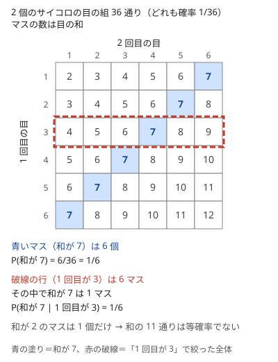

!!! abstract "要点"
    - **何ができるか**：起こりうる場合がどれも同じ確率なら、確率は「条件を満たす場合の数 / 全体の場合の数」で求まる。独立な事象は掛け、排反な事象は足し、「少なくとも 1 回」は余事象から求める。条件付き確率と全確率の公式（最初の一手で場合分けする）は、確率 DP・期待値 DP の式の根拠になる。
    - **いつ使うか**：
        - 確率を求めよ（絶対誤差・相対誤差 $10^{-6}$ まで許容）。
        - サイコロ・コイン・カードを使う確率。
        - 最初に〜し、その結果に応じて〜するときの確率。
    - **計算量**：場合の数の比なら、分子と分母を数える計算量。全確率の公式で $m$ 通りに場合分けするなら、$m$ × 1 つの場合の確率を求める時間。
    - **前提**：[和・積の法則と順列・組合せ](../comb/counting-basics.md)

<!-- textlint-disable -->
別名：確率・条件付き確率・全確率の公式・独立と排反・期待値の定義・conditional probability
<!-- textlint-enable -->

確率の基本は、確率を場合の数の比に直すことと、事象を「かつ」「または」「でない」「〜のとき」で組み立てるための 4 つの規則である。AtCoder の確率の問題の多くは、最初の一手で場合を分けて各場合の確率を掛けて足す形に帰着する。規則には使える条件があり、答えを小数で出すときは誤差と出力の桁数にも気を配る。

このページで使う記法：事象 $A$ の確率を $P(A)$、$B$ が起きたときの $A$ の条件付き確率を $P(A \mid B)$、確率変数 $X$ の期待値を $E[X]$ と書く。$A$ でない事象（余事象）を $\overline{A}$ と書く（[記法と用語の約束](../start/notation.md#probability)）。

## 同様に確からしいとき：場合の数の比 {#ratio}

起こりうる結果を、それ以上分けられない単位（根元事象）に分けたとき、どれも同じ確率で起きることを「同様に確からしい」と言う。全体が $n$ 通りで同様に確からしく、事象 $A$ に当たるものが $a$ 通りなら $P(A) = a / n$ である。確率の計算が[場合の数](../comb/counting-basics.md)の計算に変わるので、分子と分母を同じ数え方で数えればよい。



2 個のサイコロを振るとき、同様に確からしいのは 36 通りの目の組 $(i, j)$ である。目の和の 11 通り（2〜12）は同様に確からしくない。和が 7 になる組は 6 個あるが、和が 2 になる組は $(1, 1)$ の 1 個しかない。だから「和の値は 11 通りあるので、和が 7 となる確率は $1/11$」は誤りで、正しくは $6/36 = 1/6$ である。

同様に確からしい単位を選ぶときは、次の 2 つを守る。

- **区別できないものも区別して数える**：見た目が同じ 2 枚のコインでも 1 枚目と 2 枚目を区別すれば、(表, 表)・(表, 裏)・(裏, 表)・(裏, 裏) の 4 通りが同様に確からしい。「表 2 枚・表と裏・裏 2 枚」の 3 通りは同様に確からしくない
- **分子と分母で数え方をそろえる**：山から 2 枚を順に引くなら、全体も条件を満たす方も「順番を区別した並び」で数える。全体を順列で数え、条件を満たす方を組合せで数えると 2 倍ずれる。残り $R$ 枚から順に 2 枚引くと全体は $R(R - 1)$ 通りで、同じ数字のカードが $c$ 枚残っているとき、その数字を 2 枚続けて引くのは $c(c - 1)$ 通りである

??? question "確認問題：2 枚のコイン"
    2 枚のコインを投げて、表と裏が 1 枚ずつ出る確率はいくつか。

    ??? success "答え"
        $1/2$ である。2 枚を区別すると 4 通りが同様に確からしく、そのうち (表, 裏) と (裏, 表) の 2 通りが当たる。「表 2 枚・表と裏・裏 2 枚」の 3 通りで数えて $1/3$ とするのは誤りである。

## 独立・排反・余事象 {#independence}

複数の事象を組み合わせた確率は、次の 3 つの規則で求める。どれも使える条件があり、条件を確かめずに使うのが最も多い誤りである。

| 求めるもの | 規則 | 使える条件 |
| --- | --- | --- |
| $A$ または $B$ | $P(A) + P(B)$ | $A$ と $B$ が[排反](../guide/glossary.md#disjoint)（同時に起きない） |
| $A$ かつ $B$ | $P(A) \times P(B)$ | $A$ と $B$ が独立（一方が起きたかで他方の確率が変わらない） |
| $A$ でない | $1 - P(A)$ | いつでも使える |

**排反でないときの和**：$A$ と $B$ が同時に起きうるなら、$P(A) + P(B)$ は両方が起きる場合を 2 回数えている。$P(A \cup B) = P(A) + P(B) - P(A \cap B)$ と引き直す。3 つ以上なら[包除原理](../comb/inclusion-exclusion.md)になる。

**独立でないときの積**：カードを戻さずに引くと、1 枚目の結果で 2 枚目の確率が変わるので、単純には掛けられない。このときは次の節の条件付き確率で $P(A \cap B) = P(A) \, P(B \mid A)$ とする。

**「少なくとも 1 回」は余事象から**：確率 $p$ で起きることを独立に $n$ 回試すとき、少なくとも 1 回起きる確率は $1 - (1 - p)^n$ である。「1 回目に起きる・2 回目に起きる・…」を足すと、2 回以上起きる場合を重ねて数えてしまう。たとえばサイコロを 4 回振って 6 が少なくとも 1 回出る確率は $1 - (5/6)^4 = 671/1296 \approx 0.518$ で、$4 \times (1/6)$ ではない。数え上げで余事象を使う方法は[余事象](../thinking/complement.md)のページで扱う。

排反と独立は別の性質である。確率が正の 2 つの事象が排反なら、一方が起きると他方の確率は 0 になるので、独立ではない。「同時に起きない」は足すための条件、「影響し合わない」は掛けるための条件と覚える。

## 条件付き確率と全確率の公式 {#conditional}

条件付き確率 $P(A \mid B)$ は、$B$ が起きたと分かっているときに $A$ が起きる確率で、次のように定める（$P(B) > 0$ とする）。

$$
P(A \mid B) = \frac{P(A \cap B)}{P(B)}
$$

同様に確からしいときは、全体を $B$ に絞ってから数え直すのと同じである。2 個のサイコロで「1 回目が 3」と分かっているなら、全体はその行の 6 マスになる。そのうち和が 7 なのは $(3, 4)$ の 1 マスだけなので、$P(\text{和が } 7 \mid \text{1 回目が } 3) = 1/6$ である（先の図の破線の行）。

定義を掛け算の形に直すと、$P(A \cap B) = P(B) \, P(A \mid B)$ になる。これを順に起きる出来事に使えば、独立でなくても確率を掛けていける。52 枚のトランプから戻さずに 2 枚引いて、2 枚ともスペードである確率は $\frac{13}{52} \times \frac{12}{51} = \frac{1}{17}$ である。2 枚目の $12/51$ は「1 枚目がスペードだった」という条件の下での確率である。

**全確率の公式**は、起こりうる場合を排反な $B_1, \dots, B_m$（どれか 1 つが必ず起きる）に分けて、場合ごとの確率を足し合わせるものである。

$$
P(A) = \sum_{i=1}^{m} P(B_i) \, P(A \mid B_i)
$$

場合の分け方として最もよく使うのは「最初の一手の結果」である。最初の一手が決まれば残りの過程が単純になり、$P(A \mid B_i)$ が求めやすくなる。たとえば「1〜$N$ の目が等確率のサイコロを振り、得点が $K$ 未満の間はコインを投げて表なら得点を 2 倍、裏なら 0 にする。得点が $K$ 以上になる確率は」なら、最初の目 $v$ で場合を分ける（[例題](#abc126_c)）。$v$ から始めると、裏が 1 回でも出れば負けなので、届くまでに要る $t$ 回の表がすべて出る確率 $(1/2)^t$ が $P(A \mid B_v)$ である。

```cpp
--8<-- "probability-basics/first-move.cpp:core"
```

完全なプログラム：[`first-move.cpp`](https://github.com/yuukougun/kyopro-atlas/blob/main/snippets/probability-basics/first-move.cpp)（GitHub）
{ .kp-code-src }

場合の数は $N$ 通りで、各場合の $t$ は $O(\log K)$ 回の倍加で求まるので、全体で $O(N \log K)$ である。場合を分けたら、$\sum_i P(B_i) = 1$ が成り立つか（漏れや重なりがないか）を確かめるとよい。

??? question "確認問題：条件の付け方で変わる確率"
    2 個のサイコロを振る。「少なくとも一方の目が 3」と分かっているとき、和が 7 である確率はいくつか。「1 回目が 3」と分かっているときと同じか。

    ??? success "答え"
        $2/11$ で、$1/6$ とは違う。少なくとも一方が 3 になる組は、表の 3 の行と 3 の列を合わせた 11 マスである（$(3, 3)$ は 1 回だけ数える）。その中で和が 7 は $(3, 4)$ と $(4, 3)$ の 2 マスなので $2/11$ になる。何を条件にするかで、絞った後の全体が変わる。

## 期待値の定義 {#expectation}

確率変数 $X$ がとる値を $x_1, \dots, x_k$ とすると、期待値は値と確率の積の和である。

$$
E[X] = \sum_{i=1}^{k} x_i \, P(X = x_i)
$$

サイコロの目なら $E[X] = (1 + 2 + \dots + 6) / 6 = 3.5$ で、期待値は実際に出る値でなくてもよい。全体が $n$ 通りで同様に確からしいなら、期待値は「すべての場合の値の総和 / $n$」でもある。この見方は、総和を数え上げてから割る解き方につながる（[期待値の線形性](../comb/linearity-of-expectation.md#sum-vs-expectation)）。

全確率の公式と同じく、期待値も最初の一手で場合を分けられる。排反で、どれか 1 つが必ず起きる $B_1, \dots, B_m$ について $E[X] = \sum_i P(B_i) \, E[X \mid B_i]$ が成り立つ（全期待値の公式）。たとえば確率 $p$ で成功する試行を、成功するまで繰り返す回数を $X$ とする。1 回目が成功なら $X = 1$、失敗なら「1 回 + 最初からやり直し」なので、$E[X] = p \cdot 1 + (1 - p)(1 + E[X])$ から $E[X] = 1/p$ が出る（[幾何分布とコンプリートガチャ](../comb/coupon-collector.md)）。

定義のまま計算できるのは、$X$ のとる値が少ないときだけである。値が多い量は、部分の和に分けて[期待値の線形性](../comb/linearity-of-expectation.md#split)を使うか、状態ごとの期待値を DP で求める。

??? question "確認問題：2 回振った最大値の期待値"
    サイコロを 2 回振ったとき、大きい方の目の期待値を定義から求めよ。

    ??? success "答え"
        最大値が $k$ になるのは、2 つとも $k$ 以下の $k^2$ 通りから、2 つとも $k - 1$ 以下の $(k-1)^2$ 通りを除いた $2k - 1$ 通りである。よって $P(\max = k) = (2k - 1)/36$ で、期待値は $\sum_{k=1}^{6} k(2k - 1)/36 = 161/36 \approx 4.47$ になる。

## 浮動小数点の誤差と出力の桁数 {#precision}

確率や期待値を小数で答える問題では、「絶対誤差または相対誤差が $10^{-6}$ 以下なら正解」のような条件が付く。これは、出力 $y$ と正しい値 $a$ が $\lvert y - a \rvert \le 10^{-6}$ か $\lvert y - a \rvert \le 10^{-6} \lvert a \rvert$ のどちらかを満たせばよいという意味である。`double` の計算そのものの誤差（有効数字およそ 16 桁）はこれより十分小さいので、問題になるのは主に出力と整数の扱いである。

- **出力の桁数を指定する**：`cout` の既定は有効数字 6 桁なので、`12345.678901` は `12345.7` と出て誤差が 0.02 になる。`cout << fixed << setprecision(12)` か `printf("%.12f\n", x)` で小数点以下の桁を指定する（[入出力](../cpp/cpp-io.md)）
- **整数の割り算にしない**：`1 / n` は `int` どうしの割り算で、$n \ge 2$ なら結果は 0 である。`1.0 / n` と書くか、割る前に `double` に変換する
- **数えるのは整数、割るのは最後**：場合の数は `long long` で正確に数え、最後に 1 回だけ割る。`double` が整数を正確に表せるのは $2^{53} \approx 9 \times 10^{15}$ までである。場合の数がそれを超えるなら、割り算を何回かに分けて掛けていく
- **小数を `==` で比べない**：2 つの確率の大小や一致を判定したいときは、分数のまま分子と分母を掛けて整数で比べる（$a/b < c/d \iff ad < cb$、$b, d > 0$）
- **小さすぎる確率**：$(1/2)^{1100}$ のような値は `double` で表せず 0 になる。絶対誤差で判定される問題なら 0 として扱って困らないが、その値で割る式は立てない

答えを mod 998244353 で出力させる問題では、分数を逆元で表して途中の計算をすべて mod で行う（[確率・期待値を mod で答える](../comb/rational-mod.md)）。mod の値では大小を比べられないので、「確率が大きい方を選ぶ」判断が要るなら、比較は分数か `double` で行う。

## 落とし穴 {#pitfalls}

**条件付き確率の向きを取り違える**。$P(A \mid B)$ と $P(B \mid A)$ は一般に違う。たとえば $P(\text{和が } 12 \mid \text{1 回目が } 6) = 1/6$ だが、$P(\text{1 回目が } 6 \mid \text{和が } 12) = 1$ である。同じく $P(\text{和が } 7 \mid \text{少なくとも一方が } 3) = 2/11$ に対し、$P(\text{少なくとも一方が } 3 \mid \text{和が } 7) = 2/6 = 1/3$ である。分母に来るのは「分かっている方」の事象である。なお「1 回目が 3 のとき和が 7」と「和が 7 のとき 1 回目が 3」がどちらも $1/6$ になるのは、たまたま和が 7 のマスが各行に 1 個ずつあるからである。

**場合分けの漏れと重なり**。全確率の公式で $P(B_i)$ の和が 1 にならないなら、場合が漏れているか重なっている。最初の目が $K$ 以上ですぐに終わる場合のように、過程が始まる前に決着する場合を落としやすい。

**積の期待値を期待値の積にする**。$E[XY] = E[X] \, E[Y]$ は $X$ と $Y$ が独立なら成り立つが、一般には成り立たない。同じサイコロの目 $X$ について $E[X^2] = 91/6$ だが、$E[X]^2 = 49/4$ である（[線形性が使えない量](../comb/linearity-of-expectation.md#nonlinear)）。

## 上位の手法へのつながり {#next-steps}

全確率の公式を何段も重ねると DP になる。どちらの向きに使うかで 2 種類に分かれる。

- **後ろ向き（期待値 DP）**：状態 $s$ からの勝つ確率や残りの回数の期待値を $f(s)$ とし、最初の一手で分けて $f(s) = c(s) + \sum_t P(s \to t) \, f(t)$ とする。$c(s)$ は 1 手ごとに加わる量である。回数の期待値なら 1、確率なら 0 とし、終わりの状態の $f$ は直接決める。全確率の公式と全期待値の公式をそのまま漸化式にしたものである（[期待値 DP](../comb/expected-value-dp.md)）
- **前向き（確率 DP）**：時刻 $i$ で状態 $s$ にいる確率を持ち、遷移の確率を掛けて次の状態へ配る。排反な経路から同じ状態に来る確率は足す（[確率 DP](../comb/probability-dp.md)）
- **期待値の線形性**：個数や総和の期待値は、DP を使わずに各部分の確率を足すだけで求まることが多い。独立かどうかを問わずに使えるのが強みである（[期待値の線形性](../comb/linearity-of-expectation.md#indicator)）

## 例題 {#examples}

### ABC126 C. Dice and Coin {#abc126_c}

<div class="kp-problems" data-role="example" markdown>

- [ABC126 C. Dice and Coin](https://atcoder.jp/contests/abc126/tasks/abc126_c)（diff 638）：N 面のサイコロを振って出た目を得点とし、得点が K 未満の間コインを投げて表なら 2 倍、裏なら 0 にするとき、得点が K 以上になる確率を求める。

</div>

最初の目 $v$ で場合を分ける全確率の公式の典型である。$v$ が決まった後は、裏が 1 回でも出れば得点が 0 になって終わるので、勝つ道筋は「表が続けて必要な回数だけ出る」の 1 通りしかない。だから各場合の確率は $(1/2)^t$ の形で求まる。

??? note "解法の詳細"
    - 各 $v = 1, \dots, N$ について、$v$ を 2 倍し続けて $K$ 以上になるまでの回数 $t$ を数える。$v \ge K$ なら $t = 0$ で、確率は 1 である。
    - 答えは $\sum_v \frac{1}{N} \left(\frac{1}{2}\right)^t$ になる。$t$ は $O(\log K)$ なので全体で $O(N \log K)$ である。
    - コードは[条件付き確率と全確率の公式](#conditional)の節のものと同じで、出力の桁数を指定する（[浮動小数点の誤差と出力の桁数](#precision)）。

## 練習問題 {#practice}

<div class="kp-problems" data-role="practice" markdown>

- [ABC193 D. Poker](https://atcoder.jp/contests/abc193/tasks/abc193_d)（diff 866）：見えているカードと残りのカードの枚数から、2 人に伏せたカードが 1 枚ずつ配られたときに高橋君が勝つ確率を求める。
- [ABC028 D. 乱数生成](https://atcoder.jp/contests/abc028/tasks/abc028_d)（diff 920・参考値）：1〜N の整数を独立に一様に 3 回選んだとき、3 つの中央値が K になる確率を求める。

</div>

??? note "練習の方針"
    - **ABC193 D**：伏せた 2 枚の数字の組は 81 通りしかないので、組ごとに勝敗を決め、勝つ組の起こる場合の数を足して全体で割る。2 枚を順に引く並びで数え、同じ数字の 2 枚なら $c(c - 1)$、違う数字なら残り枚数の積にする。場合の数は `long long` で数えて最後に割る
    - **ABC028 D**：全体を順番を区別した $N^3$ 通りとする。中央値が $K$ になる並びを「3 つとも $K$」「$K$ が 2 つと $K$ 以外が 1 つ」「$K$ 未満・$K$・$K$ より大が 1 つずつ」に分けて $1 + 3(N-1) + 6(K-1)(N-K)$ 通りと数え、$N^3$ で割る。分子も順番を区別して数え、整数のまま割らないよう浮動小数点に直して割る

## 力試し {#challenge}

<div class="kp-problems" data-role="challenge" markdown>

- [ABC008 C. コイン](https://atcoder.jp/contests/abc008/tasks/abc008_3)（diff 1836・参考値）：数の書かれた N 枚のコインを一様にランダムな順に並べ、左から順に各コインについて右にある倍数のコインを裏返すとき、最後に表のコインの枚数の期待値を求める。

</div>

??? note "力試しの方針"
    - **ABC008 C**：コインごとに表になる確率を求めて足す（期待値の線形性）。値 $x$ のコインに効くのは $x$ の約数のコイン $p$ 枚だけで、その $p + 1$ 枚の並びは同様に確からしい。$x$ の左にある約数の枚数は $0, \dots, p$ を等確率でとるので、表の確率は「$0$〜$p$ の偶数の個数 $/ (p + 1)$」になる

## 参考 {#references}

- [drken「AtCoder ABC 126 C - Dice and Coin (3Q, 茶色, 300 点)」](https://drken1215.hatenablog.com/entry/2019/05/19/224500_2)：例題の方針（最初の目で場合分けし、表が続く確率を足す）
- [drken「AtCoder ABC 193 D - Poker (2Q, 緑色, 400 点)」](https://drken1215.hatenablog.com/entry/2021/03/02/190700)：練習の方針（順番を区別して数え、同じ数字のときは $c(c-1)$ にする）
- [fukuro-hoho「AtCoder / 乱数作成」](https://fukuro-hoho.hatenablog.com/entry/2020/11/18/163357)：練習 ABC028 D の場合分けの数え方
- [mmxsrup「ABC 028 D - 乱数生成」](https://mmxsrup.hatenablog.com/entry/2016/09/22/014911)：練習 ABC028 D の同じ数え方
- [kmjp「AtCoder ABC #008 : Python練習編」](https://kmjp.hatenablog.jp/entry/2014/05/10/0900)：力試し ABC008 C のコインごとの確率と線形性
- [tiramister「AtCoder Beginner Contest 008 C - コイン」](https://blog.tiramister.net/posts/abc008-c/)：力試し ABC008 C の同じ方針
