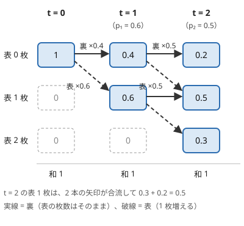

!!! abstract "要点"
    - **何ができるか**：$\mathrm{dp}[t][s]$ ＝「時刻 $t$ に状態 $s$ にいる確率」を、初期状態の確率 1 から前向きに配って求める。各時刻で確率の和が 1 に保たれることが検算になり、時刻が決まっている問題や、分布そのものが要る問題に向く。
    - **いつ使うか**：
        - K 回の操作の後に〜である確率。
        - どちらが先にゴールするかの確率。
        - 時刻 T に〜している確率。
        - N 回ランダムに上下左右へ動いた後の位置。
    - **計算量**：時刻の数 × 状態数 × 1 状態あたりの遷移数。同じ遷移を $K$ 回くり返すなら、状態数を $S$ として行列累乗で $O(S^3 \log K)$。
    - **前提**：[確率の基本](../comb/probability-basics.md)、[DP の基本](../dp/dp-basics.md)

<!-- textlint-disable -->
別名：前向きに確率を配る・到達確率・分布を求める DP・ランダムウォーク・random walk
<!-- textlint-enable -->

確率 DP は、ランダムな操作をくり返す過程を[状態](../guide/glossary.md#state)の列として表し、各状態にいる確率を表に持つ DP である。初期状態に確率 1 を置き、1 回の操作ごとに確率を遷移先へ分けて流す。数え上げの DP の「通り数」を「確率」に替え、足し算に遷移の確率の掛け算を加えたものと考えてよい。

## 状態に到達する確率を前から配る（和が 1 の検算） {#forward}

確率 DP の基本形は、時刻 $t$ ごとに「その時点でどの状態にいるか」の分布を持つことである。

$$
\mathrm{dp}[t][s] = P(\text{時刻 } t \text{ に状態 } s \text{ にいる})
$$

初期値は $\mathrm{dp}[0][s_0] = 1$（初期状態 $s_0$ にいる確率が 1）で、ほかは 0 である。状態 $s$ から $s'$ へ移る確率を $P(s \to s')$ とすると、[配る DP](../dp/dp-basics.md) の形で次のように更新する。

$$
\mathrm{dp}[t+1][s'] \mathrel{+}= \mathrm{dp}[t][s] \times P(s \to s')
$$

**なぜ正しいか**。時刻 $t+1$ に $s'$ にいるという事象を、時刻 $t$ にいた状態 $s$ で分ける。時刻 $t$ にいる状態はただ 1 つなので、分けた事象どうしは同時に起きない（[排反](../guide/glossary.md#disjoint)）。だから確率を足してよい。分けた 1 つ 1 つは「時刻 $t$ に $s$ にいて、かつ次に $s'$ へ移る」事象である。次の移り方が今の状態だけで決まるなら、その確率は $\mathrm{dp}[t][s] \times P(s \to s')$ と積になる。足すのは排反な場合、掛けるのは続けて起きる場合、と覚える。

次の図は、表の出る確率が $0.6$ と $0.5$ のコインを順に投げ、表の枚数の分布を配っていく様子である。各列の確率の和は、どの時刻でも 1 になっている。



**和が 1 の検算**。各状態から出る遷移の確率の和が 1 なら、配った後の和も変わらない。

$$
\begin{aligned}
\sum_{s'} \mathrm{dp}[t+1][s'] &= \sum_{s} \mathrm{dp}[t][s] \sum_{s'} P(s \to s') \\
&= \sum_{s} \mathrm{dp}[t][s]
\end{aligned}
$$

したがって、各時刻で表の和が 1 であることを確かめれば、遷移の書き漏れや確率の誤りがすぐ分かる。mod 998244353 の計算でも、和が 1 と合同かを見れば同じ検算ができる。途中で終わる過程を、終わった確率を表から捨てる形に書いたときは、和の減った分が「その時刻までに終わった確率」になる。

コードでは、次の時刻の表を別の配列 `nxt` に作り、配り終えてから入れ替える。$N$ 枚のコインなら状態は表の枚数 $0$〜$N$ で、全体は $O(N^2)$ である。

```cpp
--8<-- "probability-dp/coins.cpp:core"
```

検算の `assert` は時刻ごとに $O(N)$ かかるが、全体の計算量は変わらない。提出前に外してもよい。

??? question "確認問題：公平なコイン 3 枚"
    表の出る確率がどれも $1/2$ のコインを 3 枚投げる。$\mathrm{dp}[3][j]$（表がちょうど $j$ 枚の確率）を $j = 0, 1, 2, 3$ について求めよ。

    ??? success "答え"
        $1/8,\ 3/8,\ 3/8,\ 1/8$ である。時刻ごとに $(1)$、$(1/2, 1/2)$、$(1/4, 2/4, 1/4)$、$(1/8, 3/8, 3/8, 1/8)$ と配られ、どの時刻でも和は 1 になる。分子は二項係数 $\binom{3}{j}$ で、表の確率がすべて等しいときの分布は二項係数で直接書ける（[ランダムウォークと二項係数](#random-walk)）。

## 状態の設計：まとめる・上限で打ち切る・到達する値だけ持つ {#state-design}

確率 DP の状態は、「これから先の遷移の確率」と「最後に答えを取り出すこと」の両方が、その状態だけで決まるように選ぶ。状態をそのまま持つと多すぎるときは、次の 3 つで小さくする（一般の考え方は[状態の設計](../dp/dp-state-design.md)）。

**まとめる**。$N$ 枚のコインのどれが表だったかは $2^N$ 通りあるが、問われるのが表の枚数だけなら、どのコインが表だったかが違っても、表の枚数が同じであれば先の遷移と答えは変わらない。そこで「表の枚数」1 つにまとめ、状態を $N + 1$ 個にする。まとめてよいのは、まとめた場合どうしで先の遷移の確率が等しいときに限る。区別のない対象を入れ替えても問題が変わらないなら、「特別な 1 つ」と「その他」の 2 状態まで縮められる場合がある（[対称性で確率を求める](../comb/probability-symmetry.md)）。

**上限で打ち切る**。「出目の積が $D$ の倍数になる確率」では、積に含まれる 2・3・5 の指数を状態に持つ（1〜6 の目に現れる素因数はこの 3 つだけなので、$D$ にほかの素因数があれば答えは 0）。$D$ が $2^a$ を含むなら、2 の指数が $a$ を超えた先は区別しなくてよいので、指数を $\min(e, a)$ に打ち切る。「ゴールに着いた」も同じ考え方で、着いた後の位置を区別せず 1 つの状態にまとめる。

一度入ったら確率 1 で同じ状態にとどまる状態を、吸収状態と呼ぶ。ゴールを吸収状態にすると、「$K$ 回以内にゴールへ着く確率」は「$K$ 回後もゴールにいる確率」と等しくなる。だから時刻 $K$ の表を見るだけで答えが出る。次のコードは、1〜$M$ の目が等確率のサイコロで進み、$N$ を超えた分だけ戻るすごろくを扱う。$K$ 回以内にマス $N$ へ着く確率を求める。

```cpp
--8<-- "probability-dp/sugoroku.cpp:core"
```

吸収状態から確率を流し出さないことと、吸収状態の確率を次の時刻へ持ち越すこと（`nxt[n] += dp[n]`）の両方が要る。持ち越しを忘れると、和が 1 から減っていくので検算で気づける。

??? question "確認問題：吸収状態を作らないと"
    上のすごろくで、ゴールのマス $N$ からもサイコロを振って進み続ける（超えたら戻る）ように書いた。時刻 $K$ の $\mathrm{dp}[K][N]$ は何の確率になるか。

    ??? success "答え"
        「ちょうど $K$ 回振った時点でマス $N$ にいる確率」になる。一度ゴールに着いた後で離れた場合が数えられないので、「$K$ 回以内に着く確率」以下になり、一度着いてから離れる場合があれば小さくなる。ゴールを吸収状態にするか、ゴールに着いた確率をその時刻に答えへ足してから表から取り除く。

**到達する値だけ持つ**。サイコロの目を掛けていき、積がちょうど $N$ になる確率を求めるなら、途中の積は $N$ の約数で、しかも $2^a 3^b 5^c$ の形のものだけである。$N$ が $10^{18}$ でもこの形の数は少ないので、配列ではなく `map` に到達した値だけを持つか、[メモ化再帰](../dp/memoized-recursion.md)で求める。1 の目のように状態を変えない遷移（自己ループ）があるときは、式を移項して解く（[確率・期待値を mod で答える](../comb/rational-mod.md)の練習の ABC300 E）。

## 時刻ごとに配る {#by-time}

時刻が問題に現れるときは、時刻そのものを DP の添字にし、小さい時刻から順に配る。遷移が必ず未来の時刻へ向かうので、時刻の小さい順に処理すれば、配る前にその時刻の値が確定している。時刻ごとに遷移の確率が変わっても、そのまま扱える。

1 回の遷移で進む時間がばらばらなときは、「各時刻に何かが起きる確率」を持つ形が使える。たとえば、長さ $T_1, \dots, T_N$ の曲から一様にランダムに選んで続けて流すとき、時刻 $t$ にちょうど曲が切り替わる確率を $\mathrm{dp}[t]$ と置く。

$\mathrm{dp}[0] = 1$ から、各 $t$ で $\mathrm{dp}[t + T_i] \mathrel{+}= \mathrm{dp}[t] / N$ と配る。時刻 $X + 0.5$ に曲 1 が流れているのは、$X - T_1 < t \le X$ のある時刻 $t$ に曲が切り替わり、そこで曲 1 が選ばれた場合である。これらは開始時刻が違うので排反になり、確率は $\sum \mathrm{dp}[t] / N$ と足せる。時刻の上限を $X$ として、全体は $O(NX)$ である。

この形では $\sum_t \mathrm{dp}[t]$ は 1 にならない。1 回の再生の中で、曲は何度も切り替わるからである。和が 1 になるのは、同じ時刻の中で排反な場合を尽くしたときだけである。この例なら「時刻 $t + 0.5$ にどの曲が流れているか」の確率を曲について足すと 1 になるので、検算はそちらで行う。

時刻 $t$ の値を作るのに 1 つ前の時刻しか使わないなら、表を 2 本だけ持って使い回せる。遷移で進む時間がばらばらなら、届きうる範囲の時刻の表をすべて持つ。

## 期待値 DP との使い分け（前向きと後ろ向き） {#vs-expected-value-dp}

確率 DP は「初期状態から各状態に着く確率」を前向きに求める。[期待値 DP](../comb/expected-value-dp.md) は「各状態から終わるまでの量の期待値」を、終わりの状態から後ろ向きに求める。どちらで書けるかは、次の目安で決める。

| 問われ方 | 向き | 理由 |
| --- | --- | --- |
| $K$ 回後・時刻 $T$ の確率、分布そのもの | 前向き | 時刻が決まっていて、初期状態から流せば済む |
| 終わるまでの回数・費用の期待値 | 後ろ向き | 終わる時刻がばらばらでも、終わりの状態の値 0 から 1 本の式で埋まる |
| 途中で最適な行動を選ぶ | 後ろ向き | 行動の良し悪しは先の期待値で決まり、前向きには比べられない |
| どちらが先にゴールするかの確率 | どちらでもよい | 前向きならゴールに流れ込んだ確率を集め、後ろ向きなら「ここから勝つ確率」を求める |

2 人が交互にすごろくを進め、先にゴールした方が勝つ問題を考える。状態は（先手の位置, 後手の位置, 手番）である。後ろ向きなら $f(\text{状態}) = $「その状態から先手が勝つ確率」を、ゴールの状態（先手が着いたら 1、後手が着いたら 0）から埋める。前向きなら初期状態に 1 を置いて配り、先手がゴールに着いた遷移で流れた確率を答えに足す。位置は増える一方なので、どちらの向きでも計算順序は位置で決まる。

期待値は前向きにも求められる。期待値の線形性から、各状態での費用を「その状態に着く確率」で重み付けして足せばよい。

$$
E[\text{費用の合計}] = \sum_{t} \sum_{s} \mathrm{dp}[t][s] \times c(s)
$$

前向きに「ここまでの費用の期待値」だけを表に持つと、合流するときにどちらの値を使えばよいか決まらない。前向きに期待値を運ぶなら、確率と「確率 × 費用の和」の 2 つを組で持ち、両方を同じ確率で配る。

## ランダムウォークと二項係数 {#random-walk}

この節は[二項係数](../comb/binomial-coefficient.md)と[格子路の数え上げ](../comb/lattice-paths.md)の[移動を軸ごとの回数に分けて独立にする](../comb/lattice-paths.md#independent-axes)を前提にする。数直線上で 1 歩ごとに等確率で $+1$ か $-1$ へ動く過程（1 次元のランダムウォーク）は、DP をしなくても分布が式で書ける。

$N$ 歩のうち $+1$ が $k$ 回なら、位置は $k - (N - k) = 2k - N$ である。$+1$ と $-1$ の並べ方はどれも確率 $2^{-N}$ で、$+1$ が $k$ 回の並べ方は $\binom{N}{k}$ 通りある。

$$
\begin{aligned}
&P(N \text{ 歩後の位置が } x) \\
&= \binom{N}{(N + x)/2} \Big/ 2^N \\
&\quad (N + x \text{ が偶数で } \lvert x \rvert \le N)
\end{aligned}
$$

それ以外の $x$ では 0 である。DP なら位置 × 時刻で $O(N^2)$ かかるところが、[階乗の前計算](../comb/binomial-precompute.md)をしておけば 1 点あたり $O(1)$ になる。多数の $(N, x)$ を問われる問題や、位置の期待値・距離の期待値を二項係数の和で書く問題は、この形から始める。

**上下左右の 4 方向**は、軸を 45 度回して 2 本の 1 次元のウォークに分ける。$u = x + y$、$v = x - y$ と置くと、4 方向の移動はそれぞれ次のように $(u, v)$ を動かす。

| 移動 | $u$ の変化 | $v$ の変化 |
| --- | --- | --- |
| 右 $(+1, 0)$ | $+1$ | $+1$ |
| 左 $(-1, 0)$ | $-1$ | $-1$ |
| 上 $(0, +1)$ | $+1$ | $-1$ |
| 下 $(0, -1)$ | $-1$ | $+1$ |

$(u, v)$ の変化の 4 通りが確率 $1/4$ ずつ出るので、$u$ と $v$ はそれぞれ独立な 1 次元のウォークになる。したがって $P(N \text{ 歩後に } (X, Y)) = P_1(N, X + Y) \times P_1(N, X - Y)$ と、1 次元の確率の積で求まる（$P_1(N, x)$ は上の式）。もう 1 つの方法は、横に動く回数 $h$ で場合を分けることである。$\binom{N}{h} / 2^N$ と、横と縦それぞれの 1 次元の確率の積を、$h$ について足す。

**浮動小数点で計算するときの注意**。$N = 1000$ なら $4^N$ は約 $10^{602}$ で `double` の上限（約 $1.8 \times 10^{308}$）を超え、$\binom{1000}{500}$ も約 $2.7 \times 10^{299}$ と上限の近くにある。二項係数と $2^N$ を別々に作って最後に割ると、あふれて `inf` や `nan` になる。確率のまま Pascal の三角形を作る $q[n][k] = (q[n-1][k-1] + q[n-1][k]) / 2$ なら、値は常に 0〜1 に収まる。対数（`lgamma`）で計算して最後に指数に戻してもよい。

??? question "確認問題：4 歩で原点に戻る確率"
    1 次元のランダムウォークで、4 歩後の位置が原点である確率はいくらか。4 方向のウォークで、2 歩後の位置が原点である確率はいくらか。

    ??? success "答え"
        1 次元では $+1$ が 2 回なので $\binom{4}{2} / 2^4 = 6/16 = 3/8$。4 方向では $u, v$ がどちらも 2 歩後に 0 になる確率の積で、$(\binom{2}{1} / 4)^2 = 1/4$。直接数えても、2 歩目が 1 歩目の逆向きになる確率なので $1/4$ である。

## 同じ遷移を多数回行うときは行列累乗へ {#matrix-power}

この節は[行列累乗](../math/matrix-power.md)の [DP の遷移を行列にする](../math/matrix-power.md#dp-transition)を前提にする。確率 DP の 1 回の遷移は、分布を横ベクトル $v_t$ として $v_{t+1} = v_t A$（$A[s][s'] = P(s \to s')$）と書ける。各行の和は 1 で、これは[和が 1 の検算](#forward)を行列で言い直したものである。

遷移の確率が時刻によらず、回数 $K$ が $10^{18}$ のように大きく、状態数 $S$ が小さい（数十程度）なら、$v_K = v_0 A^K$ を繰り返し二乗法で求める。計算量は $O(S^3 \log K)$ である。遷移が周期的に変わるとき（1 日の時刻ごとに確率が違うなど）は、1 周期分の行列の積を 1 つの行列にまとめてから累乗する。

「何も起きない」遷移が無限に続きうるときは、行列にする前に状態を選び直す。力試しの ABC271 G のように、「何回目かの事象がどの時刻に起きるか」を問われるなら、状態は「直前の事象が起きた時刻」とする。そして、次の事象が起きる時刻への確率を 1 つの遷移にまとめる。何も起きない間は状態が変わらないので、$u$ 時の次の事象が $v$ 時に起きる確率は、途中で何も起きない確率と $v$ 時に起きる確率の積に、丸 1 周期何も起きない周回が $d = 0, 1, 2, \dots$ 回挟まる分の $\sum_{d \ge 0} q^d = 1 / (1 - q)$ を掛けたものになる（$q$ は 1 周期の間に何も起きない確率）。mod で計算するときは、$1 - q$ が mod で 0 にならないかを確かめる。

## 落とし穴 {#pitfalls}

**同じ配列の上で配る**。コインの DP を 1 本の配列で `dp[j + 1] += dp[j] * p` と $j$ の小さい順に書くと、表になった確率がすぐ後で再び配られ、同じコインを何度も投げたことになる。次の時刻の表を別に作るか、配る先が後で読まれない順（この例では $j$ の大きい順）に回す。この誤りは、1 回の操作が確率を $j$ と $j + 1$ に分けるだけなので和が 1 のまま変わらず、和の検算では気づけない。公平なコイン 2 枚で $1/4, 1/2, 1/4$ になるかのような小さい例を、手で確かめる。

**「何も起きない」遷移を書き忘れる**。確率 $1 - p$ で状態が変わらない操作は、自分自身への遷移として配る必要がある。書き忘れると、その分の確率が表から消える。遷移の確率を全部足して 1 になるかを、状態ごとに確かめる。

**「以内」と「ちょうど」を取り違える**。「$K$ 回以内にゴールへ着く」はゴールを吸収状態にして時刻 $K$ を見る。「$K$ 回目に初めて着く」は、時刻 $K$ にゴールへ流れ込んだ確率だけを数える。問いがどちらかを先に決める。

**浮動小数点の桁と大きさ**。出力の桁は `fixed` と `setprecision` で指定する（既定は有効数字 6 桁）。$2^N$ や二項係数を作ってから割るとあふれるので、確率のまま計算する（[ランダムウォークと二項係数](#random-walk)）。

**mod の確率の入れ方と比べ方**。「確率 $p\%$」は $p \times 100^{-1}$ として mod の値にし、「$1/M$」は $M$ の逆元を先に 1 回だけ求めて掛ける。mod の値は大小を比べられないので、最適な行動を選ぶ問題では比較を実数で行う（[確率・期待値を mod で答える](../comb/rational-mod.md)）。

!!! info "ACL では"
    `using mint = atcoder::modint998244353;` とすると、確率を mod の値のまま足し引き・掛けられる。`a / b` は内部で `b.inv()`（$O(\log \mathrm{mod})$）を呼ぶので、同じ数で何度も割るなら `mint inv_m = mint(m).inv();` を先に作って掛ける。`x.val()` で $0$ 以上 mod 未満の `int` を取り出す。

## 例題 {#examples}

### EDPC I. Coins {#dp_i}

<div class="kp-problems" data-role="example" markdown>

- [EDPC I. Coins](https://atcoder.jp/contests/dp/tasks/dp_i)（diff なし）：N 枚（N は奇数）のコインを投げ、i 枚目は確率 p_i で表が出るとき、表の枚数が裏の枚数より多くなる確率を求める。

</div>

どのコインが表かではなく表の枚数だけが答えに効くので、状態を「何枚目まで投げたか」と「表の枚数」にまとめる。$\mathrm{dp}[0][0] = 1$ から、表なら $j + 1$ へ確率 $p_i$、裏なら $j$ のまま確率 $1 - p_i$ で配る。

??? note "解法の詳細"
    - 状態：$\mathrm{dp}[i][j]$ ＝ 最初の $i$ 枚で表がちょうど $j$ 枚である確率。$\mathrm{dp}[0][0] = 1$。
    - 遷移：$\mathrm{dp}[i+1][j+1] \mathrel{+}= \mathrm{dp}[i][j] \cdot p_i$、$\mathrm{dp}[i+1][j] \mathrel{+}= \mathrm{dp}[i][j] \cdot (1 - p_i)$。
    - 答え：$N$ は奇数なので、$j > N/2$ の $\mathrm{dp}[N][j]$ を足す。全体は $O(N^2)$。
    - コードは[状態に到達する確率を前から配る](#forward)の節のものと同じ形である。出力は小数点以下 10 桁程度まで出す。

### ABC275 E. Sugoroku 4 {#abc275_e}

<div class="kp-problems" data-role="example" markdown>

- [ABC275 E. Sugoroku 4](https://atcoder.jp/contests/abc275/tasks/abc275_e)（diff 1264）：マス 0〜N のすごろくで、1〜M の目が等確率のサイコロを最大 K 回振り、N を超えた分は戻るとき、マス N に止まる確率を mod 998244353 で求める。

</div>

ゴールで止まる過程を、「ゴールでは確率 1 でとどまり、$K$ 回まで振り続ける」過程に言い換える。答えは「$K$ 回後のマスが $N$ である確率」になり、マスごとの確率を $K$ 回配るだけで求まる。

??? note "解法の詳細"
    - 状態：$\mathrm{dp}[t][x]$ ＝ $t$ 回振った後にマス $x$ にいる確率。$\mathrm{dp}[0][0] = 1$。
    - 遷移：$x < N$ なら各目 $a$ について、行き先 $y = x + a$（$y > N$ なら $y = 2N - y$）へ $\mathrm{dp}[t][x] / M$ を配る。$x = N$ は確率 1 で $N$ にとどまる。
    - 答え：$\mathrm{dp}[K][N]$。$1/M$ は逆元を先に 1 回求めて掛ける。全体は $O(NMK)$ で、上限でも約 $10^7$ 回の計算である。
    - コードは[状態の設計](#state-design)の節のものと同じである。

## 練習問題 {#practice}

<div class="kp-problems" data-role="practice" markdown>

- [ABC323 E. Playlist](https://atcoder.jp/contests/abc323/tasks/abc323_e)（diff 1279）：N 曲の中から一様に選んだ曲を続けて流し続けるとき、時刻 X+0.5 に曲 1 が流れている確率を mod 998244353 で求める。
- [ABC298 E. Unfair Sugoroku](https://atcoder.jp/contests/abc298/tasks/abc298_e)（diff 1300）：2 人がそれぞれのサイコロですごろくを交互に進めるとき、先手が先にゴールに着く確率を mod 998244353 で求める。
- [ABC382 E. Expansion Packs](https://atcoder.jp/contests/abc382/tasks/abc382_e)（diff 1671）：カードのパックを開け続けて、レアカードが X 枚集まるまでに開けるパックの数の期待値を求める。
- [TDPC D. サイコロ](https://atcoder.jp/contests/tdpc/tasks/tdpc_dice)（diff なし）：サイコロを N 回振ったときの出目の積が D の倍数になる確率を求める。
- [ABC011 D. 大ジャンプ](https://atcoder.jp/contests/abc011/tasks/abc011_4)（diff 1843・参考値）：1 回に上下左右のどれかへ距離 D だけ等確率で動くことを N 回繰り返したとき、点 (X, Y) にいる確率を求める。

</div>

??? note "練習の方針"
    - **ABC323 E**：$\mathrm{dp}[t]$ ＝ 時刻 $t$ にちょうど曲が切り替わる確率を、$\mathrm{dp}[0] = 1$ から $t + T_i$ へ $1/N$ ずつ配る。$X - T_1 < t \le X$ の $\mathrm{dp}[t] / N$ を足す（[時刻ごとに配る](#by-time)）
    - **ABC298 E**：（先手の位置, 後手の位置, 手番）を状態にする。ゴールを超えた位置はゴールにまとめる。前向きに配ってもよいし、「ここから先手が勝つ確率」を位置の大きい方から埋めてもよい
    - **ABC382 E**：1 パックのレアの枚数が $j$ 枚になる確率 $R_j$ を、カードを 1 枚ずつ足す確率 DP で求める。残りは「あと何枚要るか」ごとの期待値を後ろから埋める[期待値 DP](expected-value-dp.md) で、$j = 0$ の自己ループを移項する
    - **TDPC D**：$D$ を 2・3・5 で割り切れるだけ割り、1 にならなければ答えは 0。積の 2・3・5 の指数を、$D$ に要る数で打ち切って状態にする（[状態の設計](#state-design)）
    - **ABC011 D**：$X$・$Y$ が $D$ の倍数でなければ 0。$D$ で割ってから、横に動く回数で分けるか 45 度回して、1 次元のウォークの確率の積にする。確率のまま計算してあふれを避ける（[ランダムウォークと二項係数](#random-walk)）

## 力試し {#challenge}

<div class="kp-problems" data-role="challenge" markdown>

- [ABC271 G. Access Counter](https://atcoder.jp/contests/abc271/tasks/abc271_g)（diff 2323）：1 日の 24 個の時刻ごとに担当（高橋君か青木君）が決まり、毎日各時刻に担当が決まった確率でアクセスするとき、N 回目のアクセスが青木君である確率を求める。
- [ABC463 G. Random Walk Distance](https://atcoder.jp/contests/abc463/tasks/abc463_g)（diff 2452）：数直線上を 1 ずつ左右に等確率で N 回動いた後の位置と点 X との距離の期待値を、多数の (N, X) について求める。

</div>

??? note "力試しの方針"
    - **ABC271 G**：状態は「直前のアクセスの時刻」（24 通り）とし、次のアクセスの時刻の確率を $24 \times 24$ の行列にする。何日もアクセスがない場合は等比級数でまとめる。$N$ が大きいので、行列累乗で $N$ 回分を求める（[同じ遷移を多数回行うときは行列累乗へ](#matrix-power)）
    - **ABC463 G**：$N$ 歩後の位置の分布は二項係数で書けるので、距離の期待値は「二項係数の和」と「$k$ × 二項係数の和」の部分和で表せる。$(N, X)$ を先読みして並べ替え、部分和を少しずつ動かして求める（[ランダムウォークと二項係数](#random-walk)）

## 参考 {#references}

- [drken「Educational DP Contest の F ～ J 問題の解説と類題集」](https://qiita.com/drken/items/03c7db44ccd27820ea0d)：例題 EDPC I の状態・遷移・答えの取り出し方
- [kazun「AtCoder Beginner Contest 275 E問題 Sugoroku 4」](https://kazun-kyopro.hatenablog.com/entry/ABC/275/E)：例題 ABC275 E の、ゴールにとどまらせて「K 回後にゴールにいる確率」に言い換える方針
- [drken「AtCoder ABC 323 E - Playlist (1D, 水色, 450 点)」](https://drken1215.hatenablog.com/entry/2023/10/14/113816)：練習 ABC323 E の、曲が切り替わる時刻の確率を配る DP
- [プロひろ「ABC298 E問題（Unfair Sugoroku）を解く」](https://programming-hiroba.com/abc298-e/)：練習 ABC298 E の状態（2 人の位置と手番）と計算順序
- [ikatakos「ABC382」](https://ikatakos.com/pot/programming_algorithm/contest_history/atcoder/2024/1130_abc382#e_-_expansion_packs)：練習 ABC382 E の 1 パックの分布と後ろ向きの期待値（解法の部分だけを参照）
- [sigma425「Typical DP Contest (TDPC)」](https://sigma425.hatenablog.com/entry/2016/08/02/214547)：練習 TDPC D の状態（2・3・5 の個数）
- [wafuwafualgorithm「Typical DP Contest D - サイコロ」](https://scrapbox.io/wafuwafualgorithm/Typical%20DP%20Contest%20D%20-%20%E3%82%B5%E3%82%A4%E3%82%B3%E3%83%AD)：練習 TDPC D の、指数を打ち切ることと、ほかの素因数があれば 0 になること
- [drken「AtCoder ABC 011 D - 大ジャンプ (1D, 試験管青色)」](https://drken1215.hatenablog.com/entry/2020/11/14/084800)：練習 ABC011 D の、横に動く回数で分ける数え方と、double のあふれへの注意
- [kmjp「AtCoder ABC #271 (京セラプログラミングコンテスト2022) : G - Access Counter」](https://kmjp.hatenablog.jp/entry/2022/10/04/1000)：力試し ABC271 G の、24 時刻の遷移を行列にする方針
- [ikatakos「京セラプログラミングコンテスト2022（AtCoder Beginner Contest 271）G問題メモ」](https://ikatakos.com/pot/programming_algorithm/contest_history/atcoder/2022/1001_abc271)：力試し ABC271 G の、等比級数でまとめることと mod で $1 - q$ が 0 になりうること（解説の部分だけを参照）
- [kmjp「AtCoder ABC #463 : G - Random Walk Distance」](https://kmjp.hatenablog.jp/entry/2026/06/20/0900)：力試し ABC463 G の、二項係数の部分和とクエリの先読み
- [AtCoder Library「modint」（document_ja）](https://github.com/atcoder/ac-library/blob/master/document_ja/modint.md)：`inv` の計算量と制約
