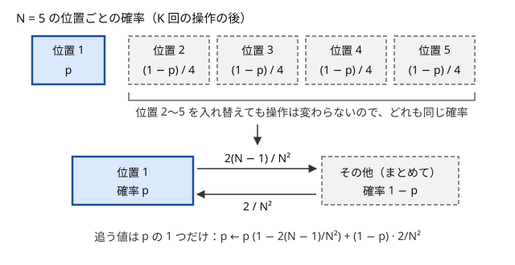

!!! abstract "要点"
    - **何ができるか**：入れ替えても問題が変わらない対象はどれも同じ確率を持つので、1 つの確率・期待値を求めて個数を掛けるだけで全体が求まる。残りから一様に選んでいく過程は一様ランダムな順列を先頭から見る過程と同じなので、状態を特別な 1 つとその他に縮めたり、ペアの大小を確率 1/2 としたりできる。
    - **いつ使うか**：
        - 一様ランダムにシャッフルする
        - ランダムに 2 つを選んで入れ替える操作を K 回行う
        - 残りから一様ランダムに 1 つずつ選ぶ
        - ランダムな順列での順位・転倒の期待値
    - **計算量**：状態を 2 つに縮めれば 1 回の遷移が $O(1)$ で、$N$ 個の状態を持つ確率 DP が要らなくなる（$K$ 回で $O(K)$、閉じた式なら $O(\log K)$）。順列への置き換えとペアの確率 $1/2$ は式を立てる道具で、計算量はその後の数え方で決まる
    - **前提**：[確率の基本](../comb/probability-basics.md)

<!-- textlint-disable -->
別名：どれも同じ確率・ランダムな順列に置き換える・2 状態に縮める
<!-- textlint-enable -->

対称性で確率を求めるとは、確率を計算する前に「どの対象を入れ替えても問題が変わらないか」を探し、入れ替えで移り合うものの確率をまとめて 1 つの値として扱うことである。$N$ 個の位置の確率を全部追う DP が、特別な 1 つとその他の 2 つを追うだけになったり、複雑な確率が $1/N$ や $1/2$ のように一目で決まったりする。

このページで使う記法：事象 $A$ の確率を $P(A)$、確率変数 $X$ の期待値を $E[X]$ と書く（[記法と用語の約束](../start/notation.md#probability)）。順列は $p = (p_1, \dots, p_N)$ で、1-indexed で書く。

## 入れ替えで移り合う事象は同じ確率 {#symmetry}

対称性の根拠は 1 つだけである。起こりうる結果の全体を $\Omega$ とし、どの結果も同じ確率で起こるとする。$\Omega$ から $\Omega$ への 1 対 1 の対応 $\sigma$ が事象 $A$ をちょうど事象 $B$ に移すなら、$A$ と $B$ は要素の数が等しいので $P(A) = P(B)$ である。結果ごとの確率が等しくなくても、$\sigma$ が各結果の確率を変えなければ同じことが言える。

例として、よく切った 52 枚のトランプの上から 10 枚目がスペードである確率を考える。並べ方は $52!$ 通りで、どれも同じ確率である。「1 枚目と 10 枚目を入れ替える」対応は並べ方の 1 対 1 の対応で、「10 枚目がスペード」を「1 枚目がスペード」に移す。よって 2 つの確率は等しく、1 枚目がスペードである確率 $13/52 = 1/4$ がそのまま答えになる。10 枚目より前に何が出たかを場合分けする必要はない。

使うときの手順は次のとおりである。

1. 入れ替えたい対象（位置・ラベル・値・文字の順序など）を決める
2. その入れ替えで、**初期状態**と**ランダムな操作の規則**の両方が変わらないことを確かめる。両方が変わらなければ、何回操作した後でも確率は入れ替えで保たれる
3. 入れ替えで移り合う事象をひとまとめにし、確率が等しいことと「全部足すと 1」から値を決める

手順 3 の典型は「$m$ 個の事象がどれも同じ確率で、どれか 1 つがちょうど起こるなら、どれも $1/m$」である。ランダムな順列で値 1 が位置 $i$ にある確率は、位置どうしの入れ替えで移り合う $N$ 個の事象の 1 つなので $1/N$ になる。

??? question "確認問題：上から 10 枚目と 11 枚目"
    よく切った 52 枚のトランプで、上から 10 枚目と 11 枚目がどちらもスペードである確率はいくらか。

    ??? success "答え"
        「1 枚目と 10 枚目、2 枚目と 11 枚目を入れ替える」対応で、上の 2 枚がどちらもスペードである確率と等しくなる。よって $\frac{13}{52} \cdot \frac{12}{51} = \frac{1}{17}$ である。

## 特別な 1 つとその他に縮める（2 状態） {#two-states}

ランダムな操作を $K$ 回行った後の確率を求めるとき、素直には「$\mathrm{dp}[k][j]$ ＝ $k$ 回の操作の後で状態 $j$ にいる確率」を[確率 DP](../comb/probability-dp.md) で前から配る。状態が $N$ 個あると 1 回の操作で $O(N)$ 以上かかり、$N$ と $K$ が大きいと間に合わない。ここで初期状態と操作の規則が「特別な 1 つ以外の入れ替え」で変わらなければ、特別でない $N - 1$ 個の状態はいつも同じ確率を持つ。すると追う値は「特別な状態にいる確率 $p$」の 1 つだけになる。

$N$ 個の位置の左端（位置 1）に黒玉があり、1〜$N$ から独立に一様に選んだ $a, b$ の位置の玉を入れ替える操作を $K$ 回行う場合で確かめる（[例題の ABC360 E](#abc360_e) の設定）。位置 $2, \dots, N$ をどう並べ替えても、初期状態（黒玉は位置 1）は変わらない。$(a, b)$ の選び方も一様なので、操作の規則も変わらない。よって $K$ 回後に黒玉が位置 $j$（$j \ne 1$）にいる確率は $j$ によらず、どれも $(1 - p)/(N - 1)$ になる。



2 つの状態の間の遷移確率は、元の操作から数える。

- **位置 1 から出ていく**：$a, b$ のちょうど一方が 1 のときで、$(1, j)$ と $(j, 1)$（$j \ne 1$）の $2(N - 1)$ 通り。確率は $2(N - 1)/N^2$
- **位置 $j \ne 1$ から位置 1 へ来る**：$(a, b)$ が $(1, j)$ か $(j, 1)$ のときで、確率は $2/N^2$

位置 1 以外にいる確率は合わせて $1 - p$ で、そのどこからでも位置 1 へ来る確率は $2/N^2$ なので、1 回の操作で $p$ は次のように変わる。

$$
p' = p \left(1 - \frac{2(N - 1)}{N^2}\right) + (1 - p) \cdot \frac{2}{N^2}
$$

答えの期待値は、位置 1 の分 $1 \cdot p$ と、位置 $2, \dots, N$ の分 $\sum_{j=2}^{N} j \cdot \frac{1 - p}{N - 1} = \frac{N + 2}{2}(1 - p)$ の和である。2 つ目は「位置 $2, \dots, N$ の平均 $\frac{N + 2}{2}$ に $1 - p$ を掛けたもの」と読める。

```cpp
--8<-- "probability-symmetry/two-states.cpp:core"
```

漸化式を整理すると $p' = (1 - 2/N)\,p + 2/N^2$ で、$p - 1/N$ が毎回 $1 - 2/N$ 倍になる。よって $p_K = \frac{1}{N} + \left(1 - \frac{1}{N}\right)\left(1 - \frac{2}{N}\right)^K$ と閉じた式になり、[繰り返し二乗法](../math/mod-pow.md)で $O(\log K)$ でも求まる。コード片は、$N, K \le 6$ のすべてで $N$ 個の位置の確率を全部持つ DP と閉じた式の両方に一致することを確かめている。

縮めた後の状態の数は、入れ替えで移り合う状態のまとまりの数である。特別な要素が 2 つあれば「特別な 1」「特別な 2」「その他」の 3 状態、2 種類のものの個数だけが効くなら個数を状態にする、というように一般化できる。状態がいくつか残っても遷移が毎回同じなら、[行列累乗](../math/matrix-power.md)で $K$ 回後を求められる。

## 残りから一様に選ぶ = ランダムな順列 {#random-permutation}

「残っているものから一様ランダムに 1 つ選ぶ」を繰り返す過程は、最初に一様ランダムな順列を 1 つ決めて、先頭から順に取る過程と同じ分布になる。$N$ 個から選ぶ順が特定の並び $(x_1, \dots, x_N)$ になる確率は $\frac{1}{N} \cdot \frac{1}{N - 1} \cdots \frac{1}{1} = \frac{1}{N!}$ で、どの並びでも等しいからである。途中で止まる過程でも、止まった後も最後まで選び続けたと考えれば同じことが言える。

順列に置き換えると、途中経過によらない確率が対称性ですぐに出る。

- 対象 $i$ が先頭から $k$ 個以内に選ばれる確率は $k/N$（$i$ の位置は $N$ 通りで等確率）
- 対象 $i$ が対象 $j$ より先に選ばれる確率は $1/2$（$i$ と $j$ を入れ替える対応）
- $m$ 個の対象のうち $i$ が最初に選ばれる確率は $1/m$（$m$ 個の相対順序 $m!$ 通りが等確率）
- 決まった $k$ 個の集合 $S$ が（順不同で）先に選ばれ、その直後に $i$ が選ばれる確率は $\frac{k!\,(N - 1 - k)!}{N!}$（先頭 $k$ 個に $S$ を並べる $k!$ 通り、次に $i$、残りを並べる $(N - 1 - k)!$ 通り）

最後の式は、[期待値の線形性](../comb/linearity-of-expectation.md#indicator)で「対象 $i$ が最後に選ばれる」寄与を数えるときに使う。合計がしきい値に届いたら止める過程なら、最後に選ばれる $i$ と、その前に選ばれた集合 $S$ を固定すると、止まる条件は $S$ の和だけで決まる（[力試しの ABC464 F](#challenge)）。

選ぶ側が途中で見た結果に応じて「次にどれを開けるか」を変える場合も、置き換えは使える。中身が一様ランダムに並んでいれば、まだ開けていない場所の中身は、まだ見ていない値の一様ランダムな並びのままである。見ていない値どうしを入れ替える対応が、それまでに見た結果を変えないからである。よって、どこを開けても出る値はまだ見ていない値から一様に決まり、「よく切った山を上から 1 枚ずつめくる」と考えてよい（[練習の ABC473 G](#practice)）。

??? question "確認問題：記録が更新される回数"
    一様ランダムな順列 $p$ を先頭から見て、それまでの最大値を更新する（$p_i$ が $p_1, \dots, p_i$ の最大）位置の個数の期待値はいくらか。

    ??? success "答え"
        $p_1, \dots, p_i$ の相対順序は $i!$ 通りが等確率なので、$p_i$ がその中の最大である確率は $1/i$ である。指示確率変数の和にすると、期待値は $1 + \frac{1}{2} + \cdots + \frac{1}{N}$ になる。

## ペアの大小は確率 1/2 {#pairs}

一様ランダムな順列 $p$ で、異なる位置 $i, j$ について $P(p_i > p_j) = 1/2$ である。位置 $i$ と $j$ の値を入れ替える対応は順列の 1 対 1 の対応で、$p_i > p_j$ の順列を $p_i < p_j$ の順列に移す。値が等しくなることはないので、2 つの確率は等しく、合わせて 1 になる。

この $1/2$ は、ペアごとの指示確率変数に分けた期待値の計算で使う。一様ランダムな順列の転倒数の期待値 $\frac{N(N - 1)}{4}$ や、区間だけをシャッフルした後の転倒数は[期待値の線形性のペアの節](../comb/linearity-of-expectation.md#pairs)にある。

対称性の対象は位置に限らない。英小文字の大小の順序を 26! 通りから一様に選び、その順序の辞書順で異なる文字列 $S, T$ を比べる場合を考える。どちらも他方の接頭辞でなければ、大小は最初に異なる文字 $c \ne d$ の順序だけで決まる。文字の順序で $c$ と $d$ を入れ替える対応が大小を逆にするので、$S$ が小さい確率は $1/2$ である。一方が他方の接頭辞なら、どの順序でも短い方が小さい。

これを相異なる $N$ 個の文字列 $S_1, \dots, S_N$ に当てはめる（等しい文字列があると順位が決まらないので、相異なるとする）。$S_i$ の順位（1 から数える）の期待値は、$S_i$ の接頭辞になっている文字列の数を $f$、$S_i$ を接頭辞に持つ文字列の数を $g$ として、次のようになる（[力試しの ABC268 G](#challenge)）。

$$
1 + f + \frac{N - 1 - f - g}{2}
$$

$f$ と $g$ は [Trie](../string/trie.md) で数える。$1/2$ になるのは大小を逆にする対応がある組だけで、接頭辞の関係にある組は対称でない。

??? question "確認問題：隣どうしの大小"
    一様ランダムな順列で $p_1 > p_2$ かつ $p_2 > p_3$ となる確率はいくらか。$P(p_1 > p_2) \cdot P(p_2 > p_3) = 1/4$ でよいか。

    ??? success "答え"
        よくない。$p_1, p_2, p_3$ の相対順序 6 通りが等確率で、条件を満たすのは $p_1 > p_2 > p_3$ の 1 通りだけなので $1/6$ である。2 つの事象は $p_2$ を共有していて独立でない。期待値を足すだけなら独立性は要らないが、積を取るときは要る。

## 対称でない要素（初期位置・特別な要素）に注意する {#asymmetric}

対称性は、入れ替えで初期状態と操作の規則の**両方**が変わらないときだけ使える。片方だけを見て「どれも同じ確率」とすると、誤った値が出る。よくある崩れ方を挙げる。

- **初期位置が特別**：2 状態の例では位置 1 だけが黒玉の初期位置なので、位置 1 を他と同じにまとめてはいけない。$K = 0$ で $p = 1$、ほかは 0 になることで確かめられる
- **操作が位置の並びに依存する**：選ぶのが「隣り合う 2 つ」なら、位置 2 と位置 5 を入れ替えると操作の規則が変わる。どの位置も対称でなくなり、2 状態には縮まない。位置ごとの[確率 DP](../comb/probability-dp.md) か行列累乗に戻る
- **選び方が一様でない**：重み付きで選ぶ、入れ替える 2 つを「異なる 2 つ」から選ぶ、などで遷移確率は変わる。$a = b$ を許すかどうかで分母が $N^2$ か $N(N - 1)/2$ かが変わり、2 状態に縮めた後の遷移確率も変わる
- **値が等しくなりうる**：$1$〜$M$ から独立に選んだ値 $a_i, a_j$ では、入れ替えで $P(a_i > a_j) = P(a_i < a_j)$ までは言えるが、等しい確率 $1/M$ が残る。$P(a_i > a_j) = (1 - 1/M)/2$ である
- **元に戻す選び方（復元抽出）**：同じものを何度でも選べるなら、選ぶ順は順列にならない。順列への置き換えは「残りから選ぶ」ときだけである

??? question "確認問題：異なる 2 つを選ぶとき"
    2 状態の例で、入れ替える 2 つの位置を「異なる 2 つの位置の組 $\binom{N}{2}$ 通り」から一様に選ぶ場合、位置 1 から出ていく確率と、位置 $j \ne 1$ から位置 1 へ来る確率はいくらか。

    ??? success "答え"
        位置 1 を含む組は $N - 1$ 通りなので、出ていく確率は $\frac{N - 1}{\binom{N}{2}} = \frac{2}{N}$ である。位置 $j$ から位置 1 へ来るのは組 $\{1, j\}$ の 1 通りで、確率は $\frac{2}{N(N - 1)}$ になる。位置 $2, \dots, N$ が対称なことは変わらないので、2 状態に縮める方法はそのまま使える。

## 落とし穴 {#pitfalls}

- **縮めた後で答えを戻し忘れる**：2 状態の $1 - p$ は「その他すべての合計」の確率で、1 つの位置の確率は $(1 - p)/(N - 1)$ である。期待値に戻すときは、その他の位置の値の平均を掛ける。これを忘れやすい
- **「その他の各位置から来る」と「その他全体から来る」を混同する**：遷移の式で $(1 - p)$ に掛けるのは、1 つの位置から位置 1 へ来る確率 $2/N^2$ である。$(N - 1)$ 倍すると二重に数える
- **$N = 1$ の割り算**：$(1 - p)/(N - 1)$ は $N = 1$ で 0 除算になる。コード片のように、その他の部分を平均で書けば割らずに済む

## 例題 {#examples}

### ABC360 E. Random Swaps of Balls {#abc360_e}

<div class="kp-problems" data-role="example" markdown>

- [ABC360 E. Random Swaps of Balls](https://atcoder.jp/contests/abc360/tasks/abc360_e)（diff 1249）：N 個の玉の左端に黒玉があり、一様に選んだ 2 つの位置を入れ替える操作を K 回行った後の、黒玉の位置の期待値を求める。

</div>

位置 $2, \dots, N$ は初期状態と操作のどちらでも区別されないので、どれも同じ確率を持つ。追うのは黒玉が位置 1 にいる確率 $p$ だけで、[2 状態に縮める節](#two-states)の漸化式を $K$ 回回せばよい。$N$ 個の位置の確率を全部持つ DP は 1 回の操作で $O(N)$ 以上かかるが、2 状態なら $O(1)$ である。

??? note "解法の詳細"
    $a, b$ は 1〜$N$ から独立に選ぶ（等しくてもよい）ので、1 回の操作で位置 1 から出ていく確率は $2(N - 1)/N^2$、位置 $j \ne 1$ から位置 1 へ来る確率は $2/N^2$ である。$p_0 = 1$ から $p_{k+1} = p_k (1 - 2(N - 1)/N^2) + (1 - p_k) \cdot 2/N^2$ で $p_K$ を求める。

    答えは $p_K + \frac{N + 2}{2}(1 - p_K)$ を mod 998244353 で出す。$N^2$ と 2 の逆元を 1 回求めておけば、全体で $O(K + \log p)$（$p$ は法）である。閉じた式 $p_K = \frac{1}{N} + (1 - \frac{1}{N})(1 - \frac{2}{N})^K$ を使えば $O(\log K)$ になる。

## 練習問題 {#practice}

<div class="kp-problems" data-role="practice" markdown>

- [ABC473 G. Wipeout](https://atcoder.jp/contests/abc473/tasks/abc473_g)（diff 1974）：1〜N が書かれた N 枚のカードが一様ランダムに伏せて並び、カードを 1 枚めくっては次に取り除く値なら取り除き、違えば戻す（見た値は覚えている）操作で 1 から順に取り除くとき、最適にめくってちょうど K 回ですべて取り除ける確率を求める。
- [ABC380 G. Another Shuffle Window](https://atcoder.jp/contests/abc380/tasks/abc380_g)（diff 1995）：順列から長さ K の区間を一様に選んでその中をシャッフルした後の、転倒数の期待値を求める。

</div>

??? note "方針"
    - **ABC473 G**：1〜$N$ のカードが一様ランダムに伏せて並び、値 1 から順に取り除いていく。どこをめくっても、出る値はまだ見ていない値から一様に決まるので、山を上から 1 枚ずつめくると考えてよい（[順列に置き換える節](#random-permutation)）。まだ見ていない値が $n$ 個のときにめくった 1 枚がちょうど次に要る値である確率は $1/n$ で、外れたカードは後で 1 回多くめくることになる。外れの回数の分布を $\prod_{n=1}^{N} \left(\frac{1}{n} + \frac{n - 1}{n} x\right)$ の係数として、多項式の積を分割統治と NTT で求める（[挿入 DP](../dp/insertion-dp.md) で数える見方もある）
    - **ABC380 G**：区間を固定すると、シャッフルで変わるのは区間の中のペアだけで、それぞれ確率 $1/2$ で転倒する（[ペアの節](#pairs)）。区間の中の転倒数を区間をずらしながら BIT で更新し、最後に $N - K + 1$ 通りの区間で平均する。式の組み立ては[期待値の線形性の練習](../comb/linearity-of-expectation.md#practice)にある

## 力試し {#challenge}

<div class="kp-problems" data-role="challenge" markdown>

- [ABC464 F. Random Vault Heist](https://atcoder.jp/contests/abc464/tasks/abc464_f)（diff 2225）：金額の書かれた N 個の金庫を残りから等確率で 1 つずつ開け、開けた金額の合計が X 以上になったら止めるとき、止めた時点の合計金額の期待値を求める。
- [ABC268 G. Random Student ID](https://atcoder.jp/contests/abc268/tasks/abc268_g)（diff 2311）：N 個の文字列について、英小文字の順序を一様ランダムに決めたときの辞書順での各文字列の順位の期待値を求める。

</div>

??? note "方針"
    - **ABC464 F**：開ける順を一様ランダムな順列に置き換える。最後に開ける金庫 $i$ と、その前に開ける集合 $S$（$\lvert S \rvert = k$）を固定すると、止まるのは $S$ の和が $[X - A_i, X)$ にあるときで、その並びになる確率は $\frac{k!\,(N - 1 - k)!}{N!}$ である。条件を満たす $S$ の個数と和を、$N \le 40$ を使って[半分全列挙](../basics/meet-in-the-middle.md)と尺取りで、大きさ $k$ ごとに数える
    - **ABC268 G**：接頭辞の関係にない 2 つの文字列の大小は確率 $1/2$ で、接頭辞の関係にあれば短い方が必ず前に来る。各文字列について、その接頭辞になっている文字列の数 $f$ と、それを接頭辞に持つ文字列の数 $g$ を Trie で数え、$1 + f + (N - 1 - f - g)/2$ を答える（[ペアの節](#pairs)）

## 使い分け {#comparison}

| 状況 | 使うもの |
| --- | --- |
| 状態のうち多くが入れ替えで区別されない | 2 状態（いくつかの状態）に縮めて追う |
| 位置ごとに遷移が違い、対称性がない | [確率 DP](../comb/probability-dp.md)（同じ遷移の繰り返しなら[行列累乗](../math/matrix-power.md)） |
| 「〜の個数」の期待値 | [期待値の線形性](../comb/linearity-of-expectation.md#indicator)で分け、各部分の確率を対称性で求める |
| 相対順序に制約がある並べ方の**数** | [順番を固定して数える](../comb/counting-fix-order.md)（$n!/k!$ は「相対順序が決まった 1 通りになる確率 $1/k!$」の数え上げ版） |
| 和や XOR を対称性で半分にする（確率ではない） | [対称性・鳩の巣原理・場合分け](../thinking/symmetry-pigeonhole-casework.md#symmetry) |

## 参考 {#references}

- [プログラミングのひろば「ABC360 E」](https://programming-hiroba.com/abc360-e/)：ABC360 E の位置 1 にいる確率の漸化式と、その他の位置の確率 $(1 - p)/(N - 1)$、答えの式。閉じた式は本文で導き、コード片で全状態の DP と照らした
- [kmjp「ABC473 G」](https://kmjp.hatenablog.jp/entry/2026/08/29/0900)：ABC473 G の、外れの回数を多項式の積の係数で求める方針
- [ikatakos の競プロ Wiki「ABC473」](https://ikatakos.com/pot/programming_algorithm/contest_history/atcoder/2026/0829_abc473)：ABC473 G でカードの配置とめくる順を 1 つの一様ランダムな順列にまとめる見方と、挿入 DP・分割統治の積（解法の節だけを読んだ）
- [ikatakos の競プロ Wiki「ABC464」](https://ikatakos.com/pot/programming_algorithm/contest_history/atcoder/2026/0627_abc464#f_-_random_vault_heist)：ABC464 F の順列への置き換え、最後に開ける金庫と前の集合を固定する確率、半分全列挙（解法の節だけを読んだ）
- [drken「ABC380 G - Another Shuffle Window」](https://drken1215.hatenablog.com/entry/2024/11/17/113336)：ABC380 G の制約。記事はペアごとの確率を BIT で足す、本文とは別の解き方である。本文の方針は[ペアの節](#pairs)の議論から導き、小さい N の全数で確かめた
- [kmjp「ABC268 G」](https://kmjp.hatenablog.jp/entry/2022/09/10/0900)：ABC268 G の接頭辞の関係による場合分けと順位の期待値の式
- [merom686「ABC268」](https://merom686.hatenablog.com/entry/2022/09/11/000905)：ABC268 G の接頭辞の関係にない組が半々になる見方
