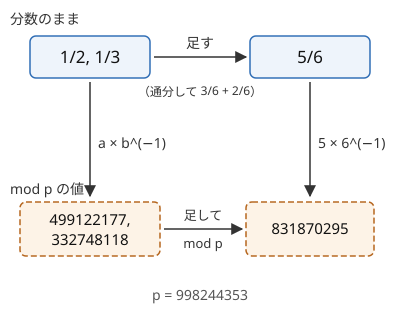

!!! abstract "要点"
    - **何ができるか**：確率・期待値の既約分数 $P/Q$ を $P \times Q^{-1} \bmod 998244353$ で答える。逆元の掛け算でも四則の関係は保たれるので、実数での計算の手順をそのまま mod で行ってよい。ただし mod の値どうしは大小を比べられない。
    - **いつ使うか**：
        - 期待値（確率）を mod 998244353 で出力せよ。
        - 求める値は有理数で表せ、既約分数 $P/Q$ について $R \times Q \equiv P$ となる $R$ を出力する。
        - 確率が $p\%$ で与えられる。
    - **計算量**：割り算は逆元を求めるので 1 回 $O(\log p)$、足し算・引き算・掛け算は $O(1)$。実数で計算するときと同じ回数の演算で済む。
    - **前提**：[逆元と mod での割り算](../math/mod-inverse.md)、[確率の基本](../comb/probability-basics.md)

<!-- textlint-disable -->
別名：有理数 mod・有理数の mod 表現・P × Q^(−1) mod p・確率 mod 998244353・分数を mod で表す
<!-- textlint-enable -->

確率・期待値を mod 998244353 で答える問題は、答えの分数 $P/Q$ を「$Q$ で割る代わりに $Q$ の[逆元](../math/mod-inverse.md)を掛けた値」として出力させる。分数のまま計算すると分母が桁あふれし、`double` では誤差が出るので、問題の側がこの形で答えを求める。考え方は 1 つだけで、実数の式の割り算をすべて逆元の掛け算に置き換え、途中から最後まで mod の値で計算する。

このページでは法を $p = 998244353$（素数）と書く。確率を表す文字とまぎれるときは、確率の方を $q$ や $r$ と書く。

## なぜ有理数を mod で表してよいか（逆元と四則の保存） {#why}

問題文の「既約分数 $P/Q$ について $R \times Q \equiv P \pmod{p}$ となる $0 \le R < p$ を出力せよ」は、$R = P \times Q^{-1} \bmod p$ を出力せよという意味である。$p$ は素数なので、$Q$ が $p$ の倍数でなければ $Q^{-1}$ がただ 1 つあり、$R$ もただ 1 つに決まる。問題文の「$Q$ は $p$ で割り切れないことが証明できる」は、この逆元があることの保証である。

小さな例で値を見ておく。

| 分数 | mod $p$ の値 | 確かめ方 |
| --- | --- | --- |
| $1/2$ | 499122177 | $2 \times 499122177 = 998244354 \equiv 1$ |
| $1/3$ | 332748118 | $3 \times 332748118 = 998244354 \equiv 1$ |
| $5/6$ | 831870295 | $499122177 + 332748118 = 831870295$ |
| $3/4$ | 249561089 | $4 \times 249561089 \equiv 3$ |

表の $5/6$ の行が要点である。$1/2 + 1/3 = 5/6$ を分数で計算してから mod の値にしても、$1/2$ と $1/3$ を先に mod の値にしてから足しても、同じ 831870295 になる。



一般に、分母が $p$ の倍数でない分数 $a/b$ を $f(a/b) = a \times b^{-1} \bmod p$ に移すと、次が成り立つ。

$$
f(x + y) = f(x) + f(y), \quad f(x - y) = f(x) - f(y), \quad f(xy) = f(x) f(y), \quad f(x / y) = f(x) / f(y)
$$

右辺の演算はどれも mod $p$ で行う。最後の割り算だけは $f(y) \not\equiv 0$ が要る。だから、四則演算だけでできた実数の計算の手順は、各値を $f$ で移した mod の世界でそのまま実行でき、最後に得られる値は $f(\text{答え})$ になる。これが「割り算を逆元の掛け算に置き換えるだけで、期待値 DP などをそのまま mod で計算してよい」理由である。

??? note "証明"
    $x = a/b$、$y = c/d$（$b$・$d$ は $p$ の倍数でない）とする。

    - **値が分数の書き方によらない**：$a/b = a'/b'$ なら整数として $ab' = a'b$ なので、$ab' \equiv a'b \pmod{p}$ である。両辺に $b^{-1} b'^{-1}$ を掛けると $a b^{-1} \equiv a' b'^{-1}$ になる。だから約分してもしなくても同じ値になり、途中で既約にする必要はない。
    - **足し算**：$x + y = (ad + bc)/(bd)$ である。$p$ は素数なので $bd$ も $p$ の倍数でない。$f(x + y) = (ad + bc)(bd)^{-1} = a b^{-1} + c d^{-1} = f(x) + f(y)$。引き算も同じである。
    - **掛け算**：$f(xy) = (ac)(bd)^{-1} = (a b^{-1})(c d^{-1}) = f(x) f(y)$。
    - **割り算**：$x / y = (ad)/(bc)$ なので、$c$ が $p$ の倍数でないこと、すなわち $f(y) \not\equiv 0$ が要る。そのとき $f(x/y) = (ad)(bc)^{-1} = f(x) f(y)^{-1}$。

## 途中の計算をすべて mod で行う {#all-mod}

答えを mod で出すときは、最後だけ mod の値に直すのではなく、入力を読んだ直後から mod の値で計算する。前の節のとおり、どの時点で mod の値に移しても結果は同じなので、最初から移しておけば分母が大きくなることも誤差が出ることもない。

手順は次のとおりである。

1. 実数（分数）で正しい式を立てる。期待値なら[期待値 DP](../comb/expected-value-dp.md)、確率なら[確率 DP](../comb/probability-dp.md) の漸化式を、まず割り算を含んだ形で書く
2. 入力の整数と確率を mod の値にする（確率 $a/b$ は $a \times b^{-1}$）
3. 式の割り算をすべて逆元の掛け算に置き換えて、同じ順で計算する。同じ数で何度も割るなら、逆元を 1 度だけ求めて掛ける
4. 出力は $0$ 以上 $p$ 未満の整数にする（ACL の [modint](../math/modint.md) なら `val()`）

例として「1〜6 の目が等確率のサイコロを、出た目の合計が $N$ 以上になるまで振る回数の期待値」を求める。$E[i]$ を合計が $i$ の状態から振る回数の期待値とすると、$i \ge N$ なら $E[i] = 0$、$i < N$ なら次の式になる。

$$
E[i] = 1 + \frac{1}{6} \sum_{d=1}^{6} E[i + d]
$$

この式の $1/6$ を $6^{-1}$ にした以外は、実数の DP と同じである。$N = 2$ なら答えは $E[0] = 1 + E[1]/6 = 7/6$ で、出力は $7 \times 6^{-1} \bmod p = 166374060$ になる。

```cpp
--8<-- "rational-mod/dice-sum.cpp:core"
```

modint を使えば、`/` と書くだけで逆元の掛け算になる。自分で `long long` で書くときは、掛けるたびに `% p` を取る。引き算の後は、負にならないよう $p$ を足す（[mod の計算の基本](../math/mod-arithmetic.md)）。

!!! info "ACL では"
    `using mint = atcoder::modint998244353;`。整数から `mint x = a;` で作り（負の数も正しく直る）、`x / y` は `x * y.inv()` と同じで、法が素数なので $O(\log p)$。`y` が 0 なら `assert` で止まる。`x.pow(k)` は $O(\log k)$、`x.val()` で $0$ 以上 $p$ 未満の整数を取り出す。大小比較の演算子はない。詳しくは [modint](../math/modint.md)。

## 確率 p% は p × 100^(−1) として入れる {#percent}

確率が「$P$ パーセント」で与えられたら、$P/100$ を mod の値 $P \times 100^{-1} \bmod p$ にして使う。$100^{-1} \bmod p = 828542813$ である。たとえば 30% は $30 \times 100^{-1} \equiv 898419918$ になり、余事象の 70% は $1 - (30\%)$ を mod で計算すれば得られる。

次のコードは「確率 $P\%$ で表が出るコインを、表が出るまで投げる回数の期待値」を求める。1 回投げて裏なら同じ状況に戻るので $E = 1 + (1 - r)E$（$r = P/100$）で、移項すると $E = 1/r$ になる。$P = 30$ なら答えは $10/3$ である。

```cpp
--8<-- "rational-mod/percent.cpp:core"
```

よくある誤りは次の 2 つである。

- **整数の割り算で 0 にする**：`P / 100` を整数で計算すると、$P < 100$ なら 0 になる。`mint(P) / 100` のように、先に mod の値にしてから割る
- **double で読んで掛ける**：`0.3` を mod の値にする方法はない。確率は必ず整数の分子と分母の組として持つ。小数点以下が決まった桁数で与えられるなら（例：`0.25`）、文字列で読んで $25/100$ の形にする

## mod の値では大小比較できない（最適戦略は実数で比べる） {#no-compare}

mod の値は、分数の大小を保たない。$1/2 < 1$ なのに、mod の値は $499122177 > 1$ である。四則演算は保たれるが、大小の関係は保たれない。だから、mod の値どうしで `max`・`min`・`<` を使った時点で、計算は意味を失う。ACL の modint にはそもそも `<` が定義されていない。

困るのは、「期待値が大きい方の行動を選ぶ」のように、計算の途中で比べる必要がある問題である（[最適戦略の期待値](../comb/optimal-strategy-expectation.md)）。このときは、同じ状態の値を 2 通りで持つ。

```text
各状態 s について（後ろから）:
    候補ごとに、実数の値 v_real と mod の値 v_mod を同じ式で計算する
    v_real が最大の候補を選ぶ            ← 比べるのは実数だけ
    best_real[s] = その候補の v_real
    best_mod[s]  = その候補の v_mod      ← mod は選ばれた方を写すだけ
答え = best_mod[初期状態]
```

この方法には注意が 2 つある。

- **ほとんど同じ値の比較**：2 つの候補が実数としてちょうど等しければ、どちらを選んでも分数は同じなので mod の値も同じである。危ないのは、真の値がわずかに違うのに `double` の誤差で逆に選ぶ場合で、mod の答えはまったく違う値になる。分子と分母が小さいなら、分数を整数の組（`long long` や `__int128`）で持って交差して掛けて比べる
- **0 かどうかの判定にも使えない**：mod の値が 0 でも、分数が 0 とは限らない（分子が $p$ の倍数のとき）。「到達できるか」を mod の確率が 0 かどうかで判定せず、別に `bool` の表を持つ

## 分母が 0 になる式変形に注意する {#zero-denominator}

前の節までの議論は、割る数の mod の値が 0 でないときだけ成り立つ。問題文が保証するのは「最終的な答えの分母 $Q$ が $p$ で割り切れない」ことだけで、自分が立てた式の途中の分母までは保証しない。

割る数が mod で 0 になるのは、次のような場合である。

- **実数でも 0 になる**：自己ループを移項した $E = (\cdots) / (1 - r)$ で、$r = 1$（確率 100% で同じ状態に戻る）になる入力がある。実数でも割れないので、その場合を先に分けて扱う。前の節のコインの例では $P = 0$ がこれにあたり、表が出ないので期待値は定義されない
- **実数では 0 でないが、$p$ の倍数になる**：$1/N$ の $N$ が $10^{18}$ まで動くなら、$N = 998244353$ で $N \equiv 0$ となる。制約が $2 \times 10^5$ 程度なら起きないが、$N$ が $p$ 以上になりうる問題では、割る数が $p$ の倍数になりうるかを確かめる
- **途中で作った式が $p$ の倍数になる**：$N(N+1)/2$ で割るなど、入力から作った数で割るときも同じである

起こりうると分かったら、式を変形して割り算を後ろに回すか、約分して割る数を小さくしてから mod に移す。ACL の modint は、法が素数で値が 0 の逆元を求めると `assert` で止まる（実行時エラー）。黙って誤った値を出すわけではないので、ジャッジの RE はこれを疑う手がかりになる。

??? question "確認問題：自己ループの移項"
    状態 $s$ から確率 $1/3$ で $s$ に戻り、確率 $2/3$ で終わる。終わるまでの回数の期待値を、移項した式で求めて mod の値にせよ。移項した式で分母が 0 になるのは、戻る確率がいくつのときか。

    ??? success "答え"
        $E = 1 + \frac{1}{3}E$ を移項して $\frac{2}{3}E = 1$、$E = 3/2$ である。mod の値は $3 \times 2^{-1} \bmod p = 499122178$。分母は $1 - (\text{戻る確率})$ なので、戻る確率が 1 のとき 0 になる。このとき実数でも期待値は無限大である。

## 検算：出力を分数に戻す（有理数復元） {#reconstruct}

mod の値の答えは、見ても正しいか分からない。入力例と合わないとき、自分の答えが「分数としていくつか」が分かれば、手計算や `double` の全探索と比べられる。分子と分母が小さい分数なら、mod の値から元の分数を探し出せる。

方法は、分母の候補 $q = 1, 2, 3, \dots$ を順に試すことである。$R \equiv a \times q^{-1}$ なら $a \equiv R \times q$ なので、$R \times q \bmod p$ が小さい値になる $q$ を探す。$p$ に近い値なら、負の分数 $-(p - a)/q$ とみる。

```cpp
--8<-- "rational-mod/reconstruct.cpp:core"
```

- **なぜ 1 つに決まるか**：$\lvert a \rvert \le B$・$1 \le q \le B$ の分数 $a/q$ と $a'/q'$ が同じ値 $R$ に移るとする。$aq' \equiv a'q \pmod{p}$ で、$\lvert aq' - a'q \rvert \le 2B^2 < p$ なので、整数として $aq' = a'q$、すなわち同じ分数である。$p = 998244353$ なら $B = 22341$ でこれが成り立つ
- **計算量**：$O(B)$ で、手元の検算には十分速い
- **限界**：分子か分母が $B$ を超える分数は見つからないか、別の小さい分数が見つかる。サイコロを 7 回振るような問題では分母が $6^7$ を超えるので、小さい入力で試す

`double` で同じ計算をした値と、復元した分数の値が近ければ、式は正しく、mod の扱いで誤ったのではないと分かる。逆に分数は合っているのに出力が違えば、`val()` の取り出し忘れや出力の形式を疑う。

## 落とし穴 {#pitfalls}

**最後にだけ mod を取る**。分数を `double` で計算してから mod の値にする方法はない。分子と分母を `long long` で持っても、掛けるたびに大きくなってすぐにあふれる。最初から mod の値で計算する（[途中の計算をすべて mod で行う](#all-mod)）。

**既約にしようとして gcd を取る**。mod の値は約分の有無で変わらないので、gcd は要らない。mod の値どうしの gcd には意味がない。

**`max` を mod の値で取る**。期待値 DP に選択があるとき、mod の値で `max` を取ると誤りになる。比べるのは実数の値である（[mod の値では大小比較できない](#no-compare)）。

**`val()` を取り出さずに出力する**。ACL の modint は `cout <<` に直接渡せない。`x.val()` で整数にしてから出力する。

**法の取り違え**。問題の法が $10^9 + 7$ なら `atcoder::modint1000000007` を使う。998244353 のままだと、すべての入力で答えが違う。

## 例題 {#examples}

### ABC323 E. Playlist {#abc323_e}

<div class="kp-problems" data-role="example" markdown>

- [ABC323 E. Playlist](https://atcoder.jp/contests/abc323/tasks/abc323_e)（diff 1279）：N 曲の中から一様に選んだ曲を続けて流し続けるとき、時刻 X+0.5 に曲 1 が流れている確率を mod 998244353 で求める。

</div>

時刻 $X + 0.5$ に曲 1 が流れているのは、時刻 $t$（$X - T_1 < t \le X$）にちょうど曲が切り替わり、そこで曲 1 が選ばれたときである。この「時刻 $t$ にちょうど曲が切り替わる確率」を前から求める。確率はすべて $1/N$ の積と和なので、$1/N$ を $N^{-1}$ にして mod の値のまま計算すればよい。比べる場面がないので、実数の DP をそのまま置き換えるだけで済む。

??? note "解法の詳細"
    - **状態**：$\mathrm{dp}[t]$ ＝ 時刻 $t$ にちょうど曲が切り替わる（新しい曲が始まる）確率。$\mathrm{dp}[0] = 1$。
    - **遷移**：時刻 $t$ に曲 $i$ が終わるのは、時刻 $t - T_i$ に切り替わって曲 $i$ が選ばれたときなので、$\mathrm{dp}[t] = \sum_{i : T_i \le t} \mathrm{dp}[t - T_i] \times N^{-1}$。$t$ の小さい順に計算する。
    - **答え**：$\max(0, X - T_1 + 1) \le t \le X$ の各 $t$ について $\mathrm{dp}[t] \times N^{-1}$ を足す。曲 1 が時刻 $t$ に始まると $[t, t + T_1)$ を占めるので、この範囲の 2 つの $t$ で同時に起きることはなく、確率を足してよい。
    - **計算量**：$O(NX)$。$N^{-1}$ は 1 度だけ求めて使い回す。

## 練習問題 {#practice}

<div class="kp-problems" data-role="practice" markdown>

- [ABC280 E. Critical Hit](https://atcoder.jp/contests/abc280/tasks/abc280_e)（diff 1251）：HP が N のモンスターに、確率 P% で 2、それ以外は 1 のダメージを与える攻撃を繰り返すとき、HP が 0 以下になるまでの攻撃回数の期待値を mod 998244353 で求める。
- [ABC300 E. Dice Product 3](https://atcoder.jp/contests/abc300/tasks/abc300_e)（diff 1354）：1〜6 の目のサイコロを振って出た目を掛けていくとき、積がちょうど N になる確率を求める（mod 998244353）。
- [ABC326 E. Revenge of "The Salary of AtCoder Inc."](https://atcoder.jp/contests/abc326/tasks/abc326_e)（diff 1363）：サイコロを振って給料が決まる過程で、支払われる給料の期待値を mod 998244353 で求める。

</div>

??? note "練習の方針"
    - **ABC280 E**：HP が $i$ の状態から倒すまでの攻撃回数の期待値を $E[i]$ とし、$E[i] = 1 + r E[i-2] + (1 - r) E[i-1]$（HP が 0 以下なら 0）を小さい $i$ から求める。$r$ は $P \times 100^{-1}$ として入れる（[確率 p% の入れ方](#percent)）
    - **ABC300 E**：値 $i$ から $N$ に着く確率を $\mathrm{dp}[i]$ とすると、1 の目では値が変わらないので自己ループになる。移項すると残り 5 つの目の値の和を 5 で割る式になり、$5^{-1}$ を掛ける。$N$ の約数だけをメモ化再帰で調べる
    - **ABC326 E**：今の値より大きい目が出たときだけ給料をもらって続く。目ごとの「そこから先にもらう給料の期待値」を大きい方から求め、大きい目の値の和を累積して $N^{-1}$ を掛ける

## 確認問題 {#quiz}

??? question "確認問題：1/2 を mod で表す"
    $1/2$ を mod 998244353 で表すといくつか。その値を 2 つ足すと 1 に戻ることを確かめよ。

    ??? success "答え"
        $2 \times 499122177 = 998244354 = p + 1 \equiv 1$ なので、$1/2$ は 499122177 である。$499122177 + 499122177 = 998244354 \equiv 1$ で、$1/2 + 1/2 = 1$ と合う。

??? question "確認問題：mod の DP で max を取る"
    「各手番で続けるかやめるかを選び、もらえる得点の期待値を最大にする」問題がある。期待値 DP を mod 998244353 の値で計算し、各状態で 2 つの選択肢の `max` を取って解いた。何が起きるか。

    ??? success "答え"
        mod の値は大小を保たないので、`max` が選ぶのは期待値の大きい方とは限らず、答えは誤りになる。期待値を `double` や分数でも並行して計算し、比べるのはそちらで行う。mod の値は、選ばれた方の値を写すだけにする。

## 使い分け {#comparison}

- 「絶対誤差または相対誤差が $10^{-6}$ 以下なら正解」と書かれていれば、`double` で計算して出力する（[確率の基本](../comb/probability-basics.md)）。mod で出力させる問題で `double` を使うのは、比較が要るときの補助だけである
- 逆元の求め方（フェルマーの小定理・拡張ユークリッドの互除法）と、割れない場合の分類は[逆元と mod での割り算](../math/mod-inverse.md)、ACL を使わず型を自作するときは [modint](../math/modint.md) を見る
- 漸化式の立て方そのものは、後ろから求めるなら[期待値 DP](../comb/expected-value-dp.md)、前から配るなら[確率 DP](../comb/probability-dp.md) にある

## 参考 {#references}

- [drken「AtCoder ABC 323 E - Playlist (1D, 水色, 450 点)」](https://drken1215.hatenablog.com/entry/2023/10/14/113816)：例題の状態（曲が切り替わる時刻の確率）と答えの範囲
- [drken「AtCoder ABC 280 E - Critical Hit (1D, 水色, 500 点)」](https://drken1215.hatenablog.com/entry/2022/12/07/113800)：練習の方針（P% を mod の値にして後ろから期待値を求める）
- [drken「AtCoder ABC 300 E - Dice Product 3 (1D, 水色, 500 点)」](https://drken1215.hatenablog.com/entry/2023/05/03/212600)：練習の方針（1 の目の自己ループの移項と約数のメモ化）
- [programming-hiroba「ABC326 E問題（Revenge of “The Salary of AtCoder Inc.”）を解く」](https://programming-hiroba.com/abc326-e/)：練習の方針（大きい目から期待値を累積する）
- [AtCoder Library「modint」（document_ja）](https://github.com/atcoder/ac-library/blob/master/document_ja/modint.md)：割り算と `inv` の計算量、`val()`、逆元がないときの扱い
