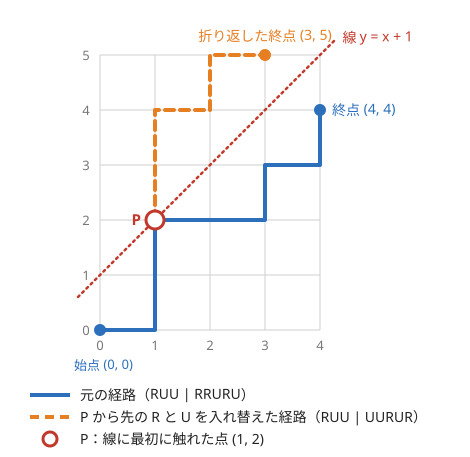

!!! abstract "要点"
    - **何ができるか**：境界の線を越える格子路を、最初に線に触れた点から先を折り返して「別の終点への経路」と 1 対 1 に対応させ、全体から引いて数える。右 $a$ 回・上 $b$ 回の経路で「上の回数 $\le$ 右の回数 $+ K$」を守るものは $\binom{a+b}{a} - \binom{a+b}{a+K+1}$ 通りある。$a = b = n$、$K = 0$ の場合がカタラン数 $\frac{1}{n+1}\binom{2n}{n}$（長さ $2n$ の正しい括弧列の個数）である。
    - **いつ使うか**：
        - どの接頭辞でも A の個数が B の個数（$+K$）以上。
        - 途中で負にならない ±1 の列の個数。
        - 正しい括弧列の個数。
        - 境界線を越えない経路の数。
    - **計算量**：階乗の表の前計算 $O(a + b)$ の後、答え 1 つが $O(1)$。上下の両端を越えない場合は、$n$ 歩・幅 $w$ に対して $O(n / w + 1)$ 項の和になる。
    - **前提**：[格子路の数え上げ](../comb/lattice-paths.md)

<!-- textlint-disable -->
別名：鏡像法・反射原理・カタラン数・ballot 数・Dyck path・正しい括弧列の個数・reflection principle・Catalan number
<!-- textlint-enable -->

鏡像法は、「途中で線を越えてはいけない」という条件のついた経路を、条件のない経路の数 2 つの差で数える方法である。格子の DP なら $O(ab)$ かかるが、鏡像法では二項係数 2 つで済み、$a, b \le 10^6$ でも前計算 $O(a + b)$ で答えが出る。対角線を越えない経路の数がカタラン数で、正しい括弧列・二分木など多くの対象の個数に等しい。

このページでは、右（R）に 1 進む移動と上（U）に 1 進む移動で $(0, 0)$ から $(a, b)$ へ行く経路を考える（[格子路の基本](../comb/lattice-paths.md#basic)）。$\binom{n}{k}$ は $k < 0$ や $k > n$ で 0 と約束する（[範囲の外の約束](../comb/binomial-coefficient.md#out-of-range)）。

## 折り返しの全単射（最初に触れた点から先を折り返す） {#reflection}

数える対象は、R を $a$ 個・U を $b$ 個並べた列のうち、どの接頭辞でも「U の個数 $\le$ R の個数 $+ K$」を満たすものである（$K \ge 0$）。経路で言えば、どの時点の点 $(x, y)$ も $y \le x + K$ を満たす。この条件を破る経路は、ちょうど線 $\ell : y = x + K + 1$ 上の点を踏む経路である。1 歩で $y - x$ は 1 しか変わらないので、$y - x$ が $K$ を超えるときは必ず $K + 1$ を通る。

**折り返し**。$\ell$ に触れる経路について、最初に触れた点を $P$ とする。$P$ までは元のまま、$P$ から先の R と U をすべて入れ替える。$P$ から先の部分は $\ell$ について線対称に移り、終点 $(a, b)$ は $\ell$ について対称な点 $(b - K - 1,\ a + K + 1)$ に移る。直線 $y = x + c$ についての対称移動は $(x, y) \mapsto (y - c,\ x + c)$ で、右への 1 歩が上への 1 歩に変わるからである。

次の図は $a = b = 4$、$K = 0$（線は $y = x + 1$）の例である。元の経路 RUU RRURU は、3 歩進んだ点 $P = (1, 2)$ で初めて線に触れる。$P$ から先の RRURU を UURUR に入れ替えると、終点は $(4, 4)$ から $(3, 5)$ に移る。



**なぜ 1 対 1 か**。逆向きの操作を考える。始点 $(0, 0)$ は $\ell$ の下にあり（$0 < 0 + K + 1$）、$b \le a + K$ なら、対称な終点 $(b - K - 1,\ a + K + 1)$ は $\ell$ より上にある（$y - x = a - b + 2K + 2 \ge K + 2$）。だから $(0, 0)$ から対称な終点への経路は、どれも必ず $\ell$ に触れる。最初に触れた点から先の R と U を入れ替えれば、$\ell$ に触れる $(0, 0) \to (a, b)$ の経路に戻る。

折り返しても $P$ までの部分は変わらないので、折り返した後の経路が最初に触れる点も $P$ のままである。このため、2 つの操作は互いに逆になり、次の 2 つの集合の間の[全単射](../guide/glossary.md#bijection)になる。

- $(0, 0)$ から $(a, b)$ への経路のうち、$\ell$ に触れるもの
- $(0, 0)$ から $(b - K - 1,\ a + K + 1)$ への経路（制約なし。すべて）

後者は R が $b - K - 1$ 個・U が $a + K + 1$ 個の列なので $\binom{a + b}{a + K + 1}$ 通りである。

**「最初に」が要る理由**。2 回目以降に触れた点で折り返しても、終点は同じ点に移る。しかし 1 本の経路が複数の点で触れると、どの点で折り返したかが逆の操作で分からない。最初の点に決めておくと、折り返す前と後で同じ点が選ばれ、元に戻せる。

??? question "確認問題：折り返した後も最初に触れる点が同じなのはなぜか"
    折り返した経路は、$P$ より前で $\ell$ に触れることはないか。

    ??? success "答え"
        ない。$P$ より前の部分は元の経路と同じで、元の経路は $P$ より前で $\ell$ に触れていない。$P$ から先の部分は変わるが、最初に触れる点は $P$ より前の部分と $P$ だけで決まるので、$P$ のままである。

## 越えない経路 = 全体 − 越える経路 {#complement-count}

条件を守る経路は、全体から $\ell$ に触れる経路を引けば求まる（[全体 − 補集合](../thinking/complement.md#whole-minus-complement)）。$b \le a + K$ なら、次の式になる。

$$
\#\{\text{守る経路}\} = \binom{a + b}{a} - \binom{a + b}{a + K + 1}
$$

$b > a + K$ なら、終点そのものが条件を破るので答えは 0 である（[折り返す線のずれ](#offset)）。

**小さい例で確かめる**。$a = b = 3$、$K = 0$ とすると、$\binom{6}{3} - \binom{6}{4} = 20 - 15 = 5$ である。R を `(`、U を `)` と読むと、守る経路は次の 5 つの正しい括弧列になる。

```text
((()))  (()())  (())()  ()(())  ()()()
```

引いた 15 通りは、終点 $(2, 4)$ への経路の数 $\binom{6}{2}$ である。

**±1 の列での言い方**。R を $+1$、U を $-1$ とし、高さ $K$ から歩き始めると、高さは $K + (\text{R の数}) - (\text{U の数})$ になる。条件は「高さが一度も負にならない」と同じである。$+1$ が $p$ 個・$-1$ が $q$ 個、出発の高さが $h \ge 0$ で、途中で負にならない列の数は、$q \le p + h$ なら次のとおりである。

$$
\binom{p + q}{q} - \binom{p + q}{q - h - 1}
$$

$h = 0$ の場合は $\binom{p + q}{q} - \binom{p + q}{q - 1}$ で、ballot 数とよばれる。高さで見たときに折り返す線は「高さ $-1$」で、終点の代わりに始点を折り返して「高さ $-h - 2$ から出発する経路」と数えても同じ値になる。

**処理の流れ**。

1. 問題の 2 種類の要素を R と U（または $+1$ と $-1$）に当て、条件を「どの接頭辞でも $U \le R + K$」の形に書く
2. 始点・終点が条件を満たすか確かめ、満たさなければ 0 を返す
3. 階乗の表を $a + b$ まで作り、2 つの二項係数の差を返す

```cpp
--8<-- "reflection-principle/below-line.cpp:core"
```

全体のプログラムは、小さい $a, b, K$ のすべてで格子の DP と答えを比べている。

**応用の型**。並べる要素が 2 種類で個数が決まっていて、条件が「どの接頭辞でも一方の個数が他方の個数 $+ K$ 以下」なら、この式 1 つで答えが出る（[ABC205 E](#abc205_e)）。先頭の一部がすでに決まっているときは、決まった部分を読んだ後の高さを $h$ として、残りに $\pm 1$ の式を使う。

## カタラン数と括弧列・二分木 {#catalan}

カタラン数 $C_n$ は、$a = b = n$、$K = 0$ の場合の値である。対角線 $y = x$ より上に出ない $(0, 0) \to (n, n)$ の経路の数で、長さ $2n$ の[正しい括弧列](../guide/glossary.md#balanced-parentheses)の個数に等しい。

$$
C_n = \binom{2n}{n} - \binom{2n}{n + 1} = \frac{1}{n + 1}\binom{2n}{n}
$$

2 つ目の等号は、$\binom{2n}{n + 1} = \binom{2n}{n} \cdot \frac{n}{n + 1}$ から出る。値は $C_0, C_1, \dots, C_6 = 1, 1, 2, 5, 14, 42, 132$ である。

**同じ個数になるもの**。次のものはどれも $C_n$ 個ある。数えたい対象がこの中のどれかに言い換えられたら、カタラン数を疑う（[括弧列と格子路の対応](../comb/counting-bijection.md#classic-bijections)）。

- 長さ $2n$ の正しい括弧列（括弧列の性質は[題材の性質](../patterns/bracket-sequence.md#properties)）
- $+1$ と $-1$ を $n$ 個ずつ並べ、累積和が途中で負にならない列（Dyck path）
- 内部の頂点が $n$ 個の二分木（どの頂点も子が 0 個か 2 個の木で、葉は $n + 1$ 個）
- 凸 $(n + 2)$ 角形を対角線で三角形に分ける方法

**漸化式**。正しい括弧列を「先頭の `(` と対応する `)` の位置」で分ける。対応する括弧の内側が長さ $2i$ の正しい括弧列、外側の後ろが長さ $2(n - 1 - i)$ の正しい括弧列になるので、$C_n = \sum_{i=0}^{n-1} C_i C_{n-1-i}$（$C_0 = 1$）が成り立つ。二分木も根の左右の部分木の大きさで分けると同じ漸化式になるので、個数が等しい。漸化式で計算すると $O(n^2)$ だが、閉じた式なら階乗の表から $O(1)$ である。

**mod での計算**。$\frac{1}{n + 1}\binom{2n}{n}$ は $n + 1$ の逆元を掛ける。法 $p$ が素数で $n + 1 < p$ なら逆元はある。差の形 $\binom{2n}{n} - \binom{2n}{n + 1}$ なら割り算が要らず、引き算の結果が負にならないよう modint で計算すればよい。

**応用の型**。「$2N$ 個のものを $N$ 組のペアに分け、各ペアの順序が括弧の開き・閉じに当たる」形では、ペアの並べ方がカタラン数になり、ペアへの値の割り当て（$N!$ など）と掛け合わせる。たとえば、一列に並んだ $2N$ 個の席に名前のある $N$ 組のペアを座らせ、どの 2 組の席の区間も交差しない（入れ子か離れている）ようにする方法の数を考える。区間の形（どの席が開きでどの席が閉じか）が $C_N$ 通り、どの区間にどのペアを置くかが $N!$ 通り、ペアの中の 2 人の順序が $2^N$ 通りで、合わせて $C_N \cdot N! \cdot 2^N$ 通りになる。括弧の種類が $k$ 種類なら、各ペアに種類を選ぶ $k^n$ を掛ける。

## 折り返す線のずれ（+1）と条件を満たせないときの 0 {#offset}

鏡像法の誤りの多くは、折り返す線を 1 ずらすことと、答えが 0 の場合を見落とすことである。

**折り返すのは「触れたら違反」の線**。条件が $y \le x + K$ なら、触れてよいのは $y = x + K$ の線で、触れたら違反なのは $y = x + K + 1$ の線である。折り返すのは後者である。$y = x + K$ で折り返すと、条件を守りつつ線に触れるだけの経路まで引いてしまう。$a = b = 1$、$K = 0$ なら、正しい答えは `()` の 1 通りで、$\binom{2}{1} - \binom{2}{2} = 1$ になる。$y = x$ で折り返すと終点は $(1, 1)$ のままで、$\binom{2}{1} - \binom{2}{1} = 0$ になってしまう。

**不等号の向きと等号**。条件の形ごとに $K$ を読み替える。

| 問題の条件（どの接頭辞でも） | 折り返す線 | 引く項 |
| --- | --- | --- |
| U の数 $\le$ R の数 $+ K$ | $y = x + K + 1$ | $\binom{a+b}{a+K+1}$ |
| U の数 $<$ R の数 $+ K$ | $y = x + K$ | $\binom{a+b}{a+K}$ |
| R の数 $\ge$ U の数 $- K$ | （1 行目と同じ） | $\binom{a+b}{a+K+1}$ |

「どの接頭辞でも」に空の接頭辞が含まれるかにも注意する。狭義の条件「空でないどの接頭辞でも R の数 $>$ U の数」は、1 文字目が R に決まり、残りの $a - 1$ 個と $b$ 個で「R の数 $\ge$ U の数」を守る問題になる。

**答えが 0 になる場合**。式を使えるのは、始点と終点がどちらも条件を満たすときだけである。

- 終点が条件を破る（$b > a + K$）：守る経路は 1 本もない。式に入れると、たとえば $a = 1$、$b = 3$、$K = 0$ で $\binom{4}{1} - \binom{4}{2} = -2$ になる。mod で計算すると、もっともらしい大きな数が出て誤りに気づかない
- 始点が条件を破る（$K < 0$）：空の接頭辞で条件を破っているので 0 である

コード片の `count_below` は、この 2 つを先に 0 で返している。

**表の大きさ**。二項係数の上の数は $a + b$ なので、階乗の表は $a + b$ まで作る（[表の大きさ](../comb/binomial-precompute.md#table-size)）。

## 括弧列を DP で数えるときとの使い分け {#vs-dp}

括弧列の個数を数える問題の多くは、開いている括弧の数を状態にした DP で解く（[括弧列の DP](../dp/dp-state-design.md#bracket-dp)）。DP は長さ $N$ に対して $O(N^2)$ で、鏡像法は前計算 $O(N)$ の後 $O(1)$ である。どちらを使うかは、次の条件がすべてそろうかで決める。

- 要素が 2 種類（$+1$ と $-1$）で、それぞれの個数が決まっている
- 境界が 1 本の直線で、条件が「どの接頭辞でも $+1$ の数と $-1$ の数の差が一定以上（以下）」の形である
- 途中の位置に個別の指定（ここは必ず `(`、など）がない

**DP が要る形**。次の形では、折り返した経路が元の問題の経路と対応しない。鏡像法はそのままでは使えない。

- 文字列の一部が `?` で、決まった文字が途中に散らばっている（[ABC312 D](../dp/dp-state-design.md#practice) の型）
- 1 歩で 2 以上動く（$+2$ と $-1$ など）。折り返すと歩みが $-2$ と $+1$ に変わり、元の問題の経路と対応しない。違反の向きに 2 以上動くなら、線を飛び越えて「最初に触れた点」もない
- 条件の係数が 1 対 1 でない（「A の数 $\ge$ 2 × B の数」など）。折り返すと歩みの種類が変わってしまう
- 各文字に重みがあり、重みの和や最大値を求める

先頭だけが決まっていて後ろが自由なら、先頭を読んだ後の高さ $h$ を求め、残りに[±1 の列の式](#complement-count)を使えばよい。

## 両端を越えない場合 {#two-sided}

この節は[包除原理](../comb/inclusion-exclusion.md)を使う。例の後半は[畳み込み](../math/convolution-ntt.md)も使う。

高さが下の線と上の線の両方を越えてはいけない場合も、折り返しを繰り返して数えられる。$\pm 1$ を $n$ 歩、高さ $s$ から $t$ へ進み、途中ずっと $0 \le \text{高さ} \le w$ を守る列を数える。触れたら違反の線は $-1$ と $w + 1$ で、間隔は $D = w + 2$ である。

**像の並び**。下の線 $-1$ で折り返すと点 $x$ は $-2 - x$ へ、上の線 $w + 1$ で折り返すと $2w + 2 - x$ へ移る。2 つを続けると $x \mapsto x + 2D$ の平行移動になる。だから終点 $t$ の像は、$t + 2jD$（偶数回折り返した点）と $-2 - t + 2jD$（奇数回折り返した点）の 2 列に並ぶ（$j$ は整数）。答えは、偶数回の像への経路の数を足し、奇数回の像への経路の数を引いたものである。

$$
\sum_{j \in \mathbb{Z}} \Bigl( N(t - s + 2jD) - N(-2 - t - s + 2jD) \Bigr)
$$

$N(d)$ は、制約のない $n$ 歩で高さが $d$ 変わる列の数で、$\lvert d \rvert \le n$ かつ $n + d$ が偶数なら $\binom{n}{(n + d)/2}$、それ以外は 0 である。0 でない項は $\lvert d \rvert \le n$ のものだけなので、項の数は $O(n / w + 1)$ である。

??? note "証明の筋"
    経路が線に触れた順を「下・上」の文字で書き、続けて同じ線に触れたものを 1 文字にまとめると、「下上下…」のように交互の語になる。交互の語 $\sigma$ を 1 つ決める。触れた順の語が $\sigma$ を部分列に含む経路の数は、終点を $\sigma$ の順に折り返した像への制約のない経路の数に等しい。最初に $\sigma_1$ の線に触れた点から先を折り返し、その後で $\sigma_2$ の線に初めて触れた点から先を折り返す操作を繰り返すと、1 対 1 に対応するからである。

    違反する経路の数を、空でない $\sigma$ について $(-1)^{|\sigma| + 1}$ を掛けて足す。触れた順の語が長さ $m \ge 1$ の経路は、その語の 1 文字目から始まる長さ $1, \dots, m$ の $\sigma$ と、もう一方の文字から始まる長さ $1, \dots, m - 1$ の $\sigma$ を含むので、数えられる回数は $\sum_{i=1}^{m} (-1)^{i+1} + \sum_{i=1}^{m-1} (-1)^{i+1} = 1$ である。だから違反する経路はちょうど 1 回ずつ引かれる。

```cpp
--8<-- "reflection-principle/two-sided.cpp:core"
```

全体のプログラムは、$w \le 6$、$n \le 30$ のすべての $(s, t)$ で高さの DP と比べている。$w$ が小さく $n$ が大きいと項が多くなる。そのときは、高さの DP（$O(nw)$）や[行列累乗](../math/matrix-power.md)と計算量を比べて選ぶ。

**歩みが 3 種類のとき**。$-1, 0, +1$ のように、歩みの集合が線について対称で 1 歩で線を飛び越えないなら、同じ折り返しが使える。ただし、像への経路の数は二項係数 1 つにならない。像の位置に符号つきの初期値を置いた長さ $2D$ の配列を作り、1 歩分の多項式の累乗を、周期 $2D$ で折り返しながら掛ける（[ABC309 Ex](#challenge)）。

## 落とし穴 {#pitfalls}

**折り返す線を 1 ずらす**。触れてよい線 $y = x + K$ で折り返すと、条件を守る経路まで引いてしまう。折り返すのは触れたら違反の $y = x + K + 1$ である。$a = b = 1$、$K = 0$ で答えが 1 になるかを確かめる（[線のずれ](#offset)）。

**終点が条件を破るのに式を使う**。$b > a + K$ では答えは 0 だが、式は負の数を出し、mod では大きな数に化ける。先に終点の判定をする。

**R と U の当て方を逆にする**。「白の数 $\le$ 黒の数 $+ K$」で白を R にすると、条件は R $\le$ U $+ K$ になり、引く項が $\binom{a + b}{b + K + 1}$ に変わる。どちらを U にしたかを書いてから式に入れる。$a, b, K$ が小さい場合を格子の DP で数えて比べると、取り違えにすぐ気づく。

**カタラン数の割り算を整数で行う**。$\binom{2n}{n} / (n + 1)$ を mod の値で `/` すると誤る。逆元を掛けるか、差の形 $\binom{2n}{n} - \binom{2n}{n + 1}$ を使う。

**DP で解く問題に式を当てはめる**。途中に決まった文字がある、1 歩で 2 以上動くなどの形では、折り返しが元の問題の経路に対応しない。[使い分けの条件](#vs-dp)を確かめる。

**mod の値で大小を比べる**。二項係数の差を mod で計算した値は、元の値の大小を表さない。答えが 0 になる条件も、mod の値を見ずに、式に入れる前の $a, b, K$ で判定する。

## 例題 {#examples}

### ABC205 E. White and Black Balls {#abc205_e}

<div class="kp-problems" data-role="example" markdown>

- [ABC205 E. White and Black Balls](https://atcoder.jp/contests/abc205/tasks/abc205_e)（diff 2025）：白玉 N 個と黒玉 M 個の並べ方のうち、どの接頭辞でも白の数が黒の数 + K 以下になるものの数を求める。

</div>

白を上（U）、黒を右（R）とすると、並べ方は $(0, 0)$ から $(M, N)$ への経路になる。条件は「どの接頭辞でも U の数 $\le$ R の数 $+ K$」で、[越えない経路の式](#complement-count)にそのまま当てはまる。$N, M \le 10^6$ なので格子の DP は間に合わない。

??? note "解法の詳細"
    - $N > M + K$ なら、最後まで並べた時点で条件を破るので答えは 0 である。
    - そうでなければ、答えは $\binom{N + M}{N} - \binom{N + M}{M + K + 1}$ である。引く項は、線 $y = x + K + 1$ について終点 $(M, N)$ を折り返した点 $(N - K - 1,\ M + K + 1)$ への経路の数である。
    - $\binom{N + M}{M + K + 1} = \binom{N + M}{N - K - 1}$ なので、$N - K - 1 < 0$ なら引く項は 0 で、どの並べ方も条件を満たす。
    - 階乗の表を $N + M$ まで作り $O(N + M)$。この問題の法は $10^9 + 7$ なので、コード片の `atcoder::modint998244353` を `atcoder::modint1000000007` に書き換える。

## 練習問題 {#practice}

<div class="kp-problems" data-role="practice" markdown>

- [ARC145 C. Split and Maximize](https://atcoder.jp/contests/arc145/tasks/arc145_c)（diff 1697）：1〜2N の順列を、順序を保ったまま長さ N の 2 つの列に分けたときの内積の最大値をその順列の得点とし、得点が全順列の中で最大になる順列の個数を求める。

</div>

??? note "練習の方針"
    - **ARC145 C**：最大は $2k - 1$ と $2k$ を組にするときである。各組の先に現れる方を開き括弧、後に現れる方を閉じ括弧と見ると、組の位置の並びが正しい括弧列になる。カタラン数 $C_N$ に組の割り当て $N!$ と組の中の順序 $2^N$ を掛ける

## 力試し {#challenge}

<div class="kp-problems" data-role="challenge" markdown>

- [ABC309 Ex. Simple Path Counting Problem](https://atcoder.jp/contests/abc309/tasks/abc309_h)（diff 3029）：N 行 M 列のグリッドで、1 行目にある K 個の駒それぞれを、1 行下の左下・真下・右下のマスへ外に出ずに動かして N 行目へ進めるとき、駒と N 行目の L 個の指定マスのすべての組についての経路の数の総和を求める。

</div>

??? note "力試しの方針"
    - **ABC309 Ex**：1 行で列が $-1, 0, +1$ のどれかだけ変わり、左右の端の外（列 0 と列 $M + 1$）に出てはいけない。[両端を越えない場合](#two-sided)の折り返しを使う。長さ $2(M + 1)$ の配列の各駒の列に $+1$、端で折り返した列に $-1$ を置き、$(x^{-1} + 1 + x)^{N-1}$ を周期 $2(M + 1)$ で折り返しながら掛ける。累乗は繰り返し二乗法で、掛け算は NTT による[畳み込み](../math/convolution-ntt.md)なので $O(M \log M \log N)$。最後に指定マスの列の係数を足す

## 確認問題 {#quiz}

??? question "確認問題：y ≤ x を守る経路"
    $(0, 0)$ から $(4, 3)$ への右・上の経路のうち、どの時点でも $y \le x$ を保つものの数を、鏡像法で求めよ。折り返す線と、折り返した終点も答えよ。

    ??? success "答え"
        折り返す線は $y = x + 1$ で、終点 $(4, 3)$ は $(3 - 1,\ 4 + 1) = (2, 5)$ に移る。答えは $\binom{7}{3} - \binom{7}{2} = 35 - 21 = 14$ である。

??? question "確認問題：終点が自由なとき"
    $+1$ と $-1$ を合わせて $n$ 個並べ、累積和が途中で一度も負にならない列の数を求めよ（$+1$ と $-1$ の個数は自由）。$n = 1, 2, 3, 4$ で書き出して確かめよ。

    ??? success "答え"
        $\binom{n}{\lfloor n/2 \rfloor}$ である。$-1$ の個数を $q$ とすると、$q \le n - q$ のとき $\binom{n}{q} - \binom{n}{q - 1}$ 通りある。$q = 0, 1, \dots, \lfloor n/2 \rfloor$ について足すと、隣どうしが打ち消し合って $\binom{n}{\lfloor n/2 \rfloor}$ だけが残る。$n = 1, 2, 3, 4$ では 1, 2, 3, 6 通りで、たとえば $n = 3$ は `+++`・`++-`・`+-+` の 3 通りである。

??? question "確認問題：狭義の条件"
    $+1$ を $p$ 個・$-1$ を $q$ 個並べ、空でないどの接頭辞でも和が正になる列の数を求めよ（$p > q$）。

    ??? success "答え"
        1 文字目は $+1$ に決まり、残りの $p - 1$ 個と $q$ 個を高さ 1 から並べて一度も 0 にならない、すなわち高さ 0 から並べて一度も負にならない列を数えればよい。$\binom{p + q - 1}{q} - \binom{p + q - 1}{q - 1} = \frac{p - q}{p + q}\binom{p + q}{q}$ 通りである。

## 使い分け {#comparison}

- 境界が直線でなく、長方形の禁止領域を避けるだけなら、境目を越える点で分類する（[禁止領域を避ける](../comb/lattice-paths.md#forbidden-region)）
- 途中に決まった文字や重みがある括弧列、1 歩で 2 以上動く列は、開いている数を状態にした DP で数える（[括弧列の DP](../dp/dp-state-design.md#bracket-dp)）
- 通れない点が散らばっているときは、最初に踏む障害物で分類する（[包除 DP](../comb/inclusion-exclusion-dp.md)）
- 互いに交わらない複数の経路の組を数えるときは、行列式で数える（[LGV 補題](../comb/lgv-lemma.md#why-signed)）。その証明も、交わった点から先を入れ替える全単射である

## 参考 {#references}

- [drken「AtCoder ABC 205 E - White and Black Balls (2D, 黄色, 500 点)」](https://drken1215.hatenablog.com/entry/2024/05/20/005905)：例題の方針（格子路への言い換え、答えの式、N > M + K で 0）
- [kmjp「AtCoder ABC #309 (デンソークリエイトプログラミングコンテスト2023) : Ex - Simple Path Counting Problem」](https://kmjp.hatenablog.jp/entry/2023/07/08/1030)：力試しの方針（端の外側に符号を反転した初期値を置く鏡像法と、周期で折り返す多項式の累乗）
- [kmjp「AtCoder ARC #145 : C - Split and Maximize」](https://kmjp.hatenablog.jp/entry/2023/09/21/1000)：練習 ARC145 C の最大の組み方と括弧列への対応
