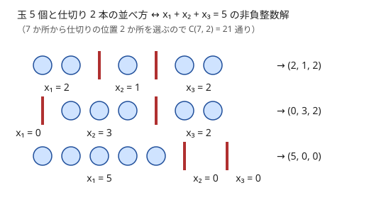

!!! abstract "要点"
    - **何ができるか**：$x_1 + \dots + x_k = n$ の非負整数解は $\binom{n+k-1}{k-1}$ 個、正の整数解は $\binom{n-1}{k-1}$ 個で、玉と仕切りの並べ方に 1 対 1 に対応する。広義単調な列や間隔を空けて選ぶ方法も、同じ形に直して数える。
    - **いつ使うか**：
        - 和が N になる非負（正）整数の組の個数
        - 広義単調増加な列の個数
        - N 個から隣り合わない（間隔 d 以上の）K 個を選ぶ方法の数
        - 区別のない玉を区別のある箱へ配る方法の数
    - **計算量**：階乗と逆階乗を $n + k$ まで前計算すれば 1 回 $O(1)$（法が素数のとき）。mod を取らないなら、掛けて割るのを交互に $O(\min(n, k))$ 回
    - **前提**：[二項係数の意味と性質](../comb/binomial-coefficient.md)

<!-- textlint-disable -->
別名：玉と仕切り・ₖHₙ・非負整数解の個数・隣り合わない選び方・stars and bars
<!-- textlint-enable -->

重複組合せは、区別のない $n$ 個の玉を区別のある $k$ 個の箱に配る方法の数で、${}_k\mathrm{H}_n = \binom{n+k-1}{n}$ と書かれる（$k$ 種類から重複を許して $n$ 個選ぶ数とも読める。H の引数の順は資料によって違うので、どちらが種類（箱）の数かを確かめる）。使うときに大事なのは公式そのものより、問題の対象を「和が決まった整数の組」に言い換える手順である。上限の付かない和・広義単調な列・間隔を空けた選び方は、どれも変数をずらすだけでこの形になる。

このページでは、和を $n$、変数（箱）の数を $k$ とする。二項係数は範囲外（$r < 0$ や $r > n$）を 0 とする。

## 玉と仕切りの対応（非負解と正の解） {#stars-bars}

数える対象は、$x_1 + x_2 + \dots + x_k = n$ を満たす非負整数の組 $(x_1, \dots, x_k)$ である。組の順番は区別する（$(2, 1, 2)$ と $(1, 2, 2)$ は別）。

$n$ 個の玉 ○ と $k - 1$ 本の仕切り | を 1 列に並べ、左から順に「1 本目の仕切りより前の玉の数」を $x_1$、「1 本目と 2 本目の間の玉の数」を $x_2$、…、「最後の仕切りより後ろの玉の数」を $x_k$ と読む。



この読み方は 1 対 1 である。並べ方から組がただ 1 つ決まり、逆に組 $(x_1, \dots, x_k)$ からは「○ を $x_1$ 個、|、○ を $x_2$ 個、|、…」と並べ方がただ 1 つ戻る。仕切りが隣り合う所や端にある所は、値が 0 の変数に当たる。並べ方は、$n + k - 1$ か所のうち仕切りを置く $k - 1$ か所を選べば決まるので

$$
\#\{\text{非負整数解}\} = \binom{n+k-1}{k-1} = \binom{n+k-1}{n}
$$

になる。$n = 5$、$k = 3$ なら $\binom{7}{2} = 21$ である。

**正の整数解**は 2 通りの見方ができる。1 つは $y_i = x_i - 1 \ge 0$ と置き直す方法で、$y_1 + \dots + y_k = n - k$ の非負整数解になるので $\binom{n-1}{k-1}$ 個である。もう 1 つは、玉 $n$ 個を先に並べ、玉と玉の間の $n - 1$ か所から仕切りを入れる $k - 1$ か所を選ぶ見方で、同じ式になる。仕切りが隣り合わず端にも来ないので、どの変数も 1 以上になる。

下限が変数ごとに違っても同じである。$x_i \ge l_i$ なら $x_i - l_i$ を新しい変数にして、和を $n - \sum l_i$ にすればよい（$\sum l_i > n$ なら 0 個）。

コードでは、二項係数の関数が範囲外を 0 として返すようにしておくと、$n < k$ の正の整数解などの境界を自然に 0 にできる。ただし $k = 0$ だけは式が $\binom{n-1}{-1} = 0$ となり、$n = 0$（空の組が 1 つある）を数え損なうので分けて書く。

```cpp
--8<-- "stars-and-bars/count.cpp:core"
```

??? question "確認問題：上限が 1 つ付いたら"
    $x + y + z = 10$ の正の整数解は何個か。さらに $x \le 3$ という条件が付くと何個か。

    ??? success "答え"
        正の整数解は $\binom{9}{2} = 36$ 個。$x \le 3$ を満たさない解、つまり $x \ge 4$ の解は、$x' = x - 3 \ge 1$ と置くと $x' + y + z = 7$ の正の整数解なので $\binom{6}{2} = 15$ 個ある。よって $36 - 15 = 21$ 個。$x = 1, 2, 3$ で場合分けして $8 + 7 + 6 = 21$ としても同じである。上限は「破る側」を数えて引くのが基本で、上限の付く変数が複数あれば[包除原理](../comb/inclusion-exclusion.md)になる。

## 「以下」は余りの変数を 1 つ足して等式にする {#at-most}

$x_1 + \dots + x_k \le n$ の非負整数解は、余り $x_{k+1} = n - (x_1 + \dots + x_k) \ge 0$ を足すと、$k + 1$ 変数の等式 $x_1 + \dots + x_{k+1} = n$ の非負整数解と 1 対 1 に対応する。よって

$$
\#\{x_1 + \dots + x_k \le n\} = \binom{n+k}{k}
$$

である。和の値 $m = 0, 1, \dots, n$ ごとに $\binom{m+k-1}{k-1}$ を足しても同じ値になり、これは二項係数の和の公式（ホッケースティック恒等式）の 1 つの証明になっている。

余りの変数の考え方は、「長さ $L$ の区間に、長さの決まった $k$ 個の物を重ならないように置く」ような問題でも使える。物の前後と間の隙間を変数にすると、隙間の和が $L$ から物の長さの合計を引いた値に等しくなる。

変数の個数 $k$ が決まっていない問題（「各項が $c$ 以上で和が $S$ の列の個数」のように長さを問わない）では、長さ $k$ ごとに重複組合せで数えて足す。長さ $k$ の項はそれぞれ $c$ 以上なので、$k \le S / c$ の範囲だけ足せばよい。

## 広義単調な列との対応 {#monotone}

この節では $n$ を値の上限、$k$ を列の長さとする（重複組合せに直すと、変数の数が $n$、和が $k$ になる）。

$1 \le a_1 \le a_2 \le \dots \le a_k \le n$ を満たす整数列の個数は $\binom{n+k-1}{k}$ である。2 通りの見方で重複組合せに直せる。

- **値ごとの個数に直す**：広義単調な列は、値 $v = 1, \dots, n$ をそれぞれ何個使ったか $c_v \ge 0$ で決まる（並べ方は昇順の 1 通りだけ）。$c_1 + \dots + c_n = k$ の非負整数解なので $\binom{k+n-1}{n-1} = \binom{n+k-1}{k}$ である
- **ずらして狭義単調にする**：$b_i = a_i + (i - 1)$ と置くと $1 \le b_1 < b_2 < \dots < b_k \le n + k - 1$ になり、逆に $a_i = b_i - (i - 1)$ で戻せる。狭義単調な列は値の集合で決まるので、$n + k - 1$ 個から $k$ 個を選ぶ $\binom{n+k-1}{k}$ になる

$n = 3$、$k = 2$ なら $(1,1)$・$(1,2)$・$(1,3)$・$(2,2)$・$(2,3)$・$(3,3)$ の 6 個で、$\binom{4}{2} = 6$ と合う。$k$ 重の for ループ `for a1 in 1..n, for a2 in a1..n, …` の最も内側が実行される回数も、この個数である。

広義単調な列の差分 $d_0 = a_1 - 1$、$d_i = a_{i+1} - a_i$、$d_k = n - a_k$ を変数にしても、$d_0 + \dots + d_k = n - 1$ の非負整数解として同じ値が出る。値の範囲が下限 $L$・上限 $R$ なら $n = R - L + 1$ に読み替える。

## 隣り合わない選び方・間隔 d 以上の選び方 {#gaps}

$1, \dots, N$ から $K$ 個を選び、選んだどの 2 つの差も $d$ 以上にする方法の数は

$$
\binom{N - (K-1)(d-1)}{K}
$$

である。選んだ値を小さい順に $b_1 < \dots < b_K$ とし、$c_i = b_i - (i-1)(d-1)$ と置くと、隣どうしの差が $d - 1$ ずつ詰まって $c_{i+1} - c_i = (b_{i+1} - b_i) - (d - 1) \ge 1$、すなわち $1 \le c_1 < \dots < c_K \le N - (K-1)(d-1)$ になる。逆に $c$ から $b$ へも戻せるので、狭義単調な列の個数＝二項係数になる。隣り合わない選び方は $d = 2$ の場合で $\binom{N-K+1}{K}$ である。

$N = 5$、$K = 2$ で隣り合わない選び方を確かめる。全部で $\binom{5}{2} = 10$ 通りのうち、隣り合う組 $\{1,2\}, \{2,3\}, \{3,4\}, \{4,5\}$ の 4 通りを除くと 6 通りで、$\binom{4}{2} = 6$ と合う。

隙間を変数にしても同じ式が出る。選んだ値の前・間・後ろの選ばない個数を $g_0, g_1, \dots, g_K$ とすると、$g_0 + \dots + g_K = N - K$、$g_0, g_K \ge 0$、間の $g_1, \dots, g_{K-1} \ge d - 1$ になる。間の変数から $d - 1$ を引けば非負整数解の数え上げである。

- **すべての $d$ について求める**：間隔 $d$ のとき選べる個数は $K \le (N - 1)/d + 1$ に限られる。各 $d$ で $K$ を 1 から上限まで動かして足すと、全体の項の数は $\sum_d (N/d + 1) = O(N \log N)$ で済む（[調和級数](../math/harmonic-sum.md)）
- **かたまりを間に入れる**：$N$ 個の玉のうち $K$ 個が青で、青を $i$ 個のかたまりに分けて赤の間に入れる並べ方は、青の分け方（正の整数解）$\binom{K-1}{i-1}$ と、赤 $N - K$ 個の間と両端の $N - K + 1$ か所から $i$ か所を選ぶ $\binom{N-K+1}{i}$ の積になる。後者は「赤の間に隣り合わないように置く」形である

??? question "確認問題：円の上で隣り合わない"
    $N$ 個の席が円形に並ぶ。隣り合わない $K$ 個の席を選ぶ方法の数は、1 列の $\binom{N-K+1}{K}$ と同じか。

    ??? success "答え"
        同じではない。円では席 $N$ と席 $1$ も隣り合うので、1 列で数えた中から「両端の席を両方選ぶ」ものを除く必要がある。席 $1$ を選ぶかで場合分けすると、選ばないなら席 $2, \dots, N$ の 1 列から $K$ 個で $\binom{N-K}{K}$、選ぶなら席 $2$ と席 $N$ が使えず、席 $3, \dots, N-1$ の 1 列から $K - 1$ 個で $\binom{N-K-1}{K-1}$ になる。端の扱いを変えたときは、小さい $N$ で全探索して式を確かめるとよい。

## 場合分けしてから配る・素因数ごとに配る {#applications}

この節は [二項係数の前計算](../comb/binomial-precompute.md)（法が素数のときの $\binom{n}{r}$）を前提にする。重複組合せがそのままの形で出ることは少なく、場合分けや分解の後の部品として出ることが多い。

**場合分けしてから配る**。「$n$ 人を $n$ 部屋に配った結果としてありうる人数の組」（人数と部屋の数がどちらも $n$）のように、配り方に「空き部屋はいくつまで」といった条件があるときは、条件を決める量（空き部屋の数 $m$）で場合分けする。$m$ を決めれば、空き部屋の選び方 $\binom{n}{m}$ と、残り $n - m$ 部屋へ各 1 人以上になるように $n$ 人を配る正の整数解 $\binom{n-1}{n-m-1} = \binom{n-1}{m}$ の積になる。場合分けの量を選ぶときは、「その量を決めると残りが制限のない（または各 1 以上の）配り方になるか」を見る。

**素因数ごとに配る**。積が $M$ になる長さ $N$ の正の整数列 $(a_1, \dots, a_N)$ を数えるときは、$M = \prod p^{e_p}$ と素因数分解する。$a_i$ の $p$ の指数を $x_i$ とすると、各素数 $p$ で $x_1 + \dots + x_N = e_p$ の非負整数解を 1 つずつ選ぶことと、列を 1 つ選ぶことが 1 対 1 に対応する（素因数分解の一意性）。素数ごとの選び方は独立なので

$$
\prod_{p \mid M} \binom{e_p + N - 1}{N - 1}
$$

になる。$e_p \le \log_2 M$ なので、階乗の表は $N + \log_2 M$ まであれば足りる（[素因数の指数ベクトル](../math/prime-exponent-vector.md)・[対応づけ](../comb/counting-bijection.md#decompose)）。

## 落とし穴 {#pitfalls}

**非負か正かの取り違え**。「1 本以上に切る」「各項が 3 以上」「空の箱を許す」のように、0 を許すかで式が変わる。下限を引いて非負整数解にそろえてから $\binom{n+k-1}{k-1}$ を使うと、取り違えにくい。式を書いたら $n$ と $k$ が小さい場合（$k = 1$ なら 1 通り、$n = 0$ の非負解なら 1 通り）を代入して確かめる。

**$k - 1$ と $n$ のどちらを下に書くか**。$\binom{n+k-1}{k-1} = \binom{n+k-1}{n}$ なのでどちらでもよいが、mod を取らず掛けて割る計算では、小さい方を下にしないと反復回数とオーバーフローの危険が増える。

**階乗の表の大きさ**。上側は $n + k - 1$ まで、「以下」なら $n + k$ まで要る。$n$ と $k$ がそれぞれ $2 \times 10^5$ なら表は $4 \times 10^5$ 程度にする。

**$k = 0$ の境界**。範囲外を 0 とする二項係数の関数だけに任せると、$k = 0$ では式が $\binom{n-1}{-1} = 0$ になり、$n = 0$ の空の組（1 通り）を落とす。$n = 0$・$k \ge 1$ は式のままで正しい。

**変数ごとの上限は単純な式にならない**。$0 \le x_i \le c$ のような上限は、上限を破る変数の集合で[包除原理](../comb/inclusion-exclusion.md#symmetric)を使うか、和を状態に持つ DP の遷移を[累積和](../dp/dp-prefix-sum.md)で速くする。上限が 1 なら単なる二項係数 $\binom{k}{n}$ である。

**mod を取らない正確な値**。$\binom{199}{11} \approx 3.7 \times 10^{17}$ のように答えが `long long` に収まる問題では、$r \leftarrow r \times (n - i) / (i + 1)$ を $i = 0, 1, \dots$ の順に行う。各段の値は $\binom{n}{i+1}$ そのものなので、割り算は割り切れる。ただし掛けた直後の値は答えより大きく（この例で約 $4 \times 10^{18}$）、少し大きい問題ではあふれる。

**箱を区別しないなら別の数**。重複組合せは箱（変数）を区別する。「グループに分ける」で箱の順番を区別しないなら、分割数など別の数になる（[写像 12 相](../comb/twelvefold-way.md)）。

## 上位の手法へのつながり {#next-steps}

このページの考え方は、次の手法の部品になる。

- **上限つきの配り方**：各変数に上限があるときは、上限を超える変数の組で包除するか、母関数の係数として求める（[包除原理](../comb/inclusion-exclusion.md#symmetric)、[母関数の考え方](../comb/generating-function-counting.md#formulas)）。
- **写像 12 相**：重複組合せは「玉を区別せず箱を区別する」マスに当たる（[写像 12 相](../comb/twelvefold-way.md#table)）。
- **対応づけ**：玉と仕切りのように、数えにくい対象を数えやすい列へ 1 対 1 に対応させる考え方は[対応づけ・数える対象の言い換え](../comb/counting-bijection.md#bijection)にある。
- **多項係数**：箱ごとの個数を決めた後の並べ方は多項係数で数える（[多項係数](../comb/multinomial-coefficient.md#meaning)）。

## 使い分け {#comparison}

- 玉も区別するなら（区別のある $n$ 個を $k$ 個の箱へ）、制限なしは $k^n$、各箱の個数を決めるなら[多項係数](../comb/multinomial-coefficient.md)である。玉と箱の区別と制限の全体の地図は[写像 12 相](../comb/twelvefold-way.md)にある
- 変数ごとに上限や「偶数だけ」のような制限があるときは、[包除原理](../comb/inclusion-exclusion.md)か[母関数](../comb/generating-function-counting.md#formulas)で考える。$\frac{1}{(1-x)^k}$ の $x^n$ の係数が $\binom{n+k-1}{k-1}$ であることが、母関数の側から見た重複組合せである
- 問題が「和の組」の形に見えないときは、[対応づけ](../comb/counting-bijection.md)で数える対象を言い換える

## 例題 {#examples}

### ABC185 C. Duodecim Ferra {#abc185_c}

<div class="kp-problems" data-role="example" markdown>

- [ABC185 C. Duodecim Ferra](https://atcoder.jp/contests/abc185/tasks/abc185_c)（diff 374）：長さ L の棒を、長さが正の整数の 12 本に切り分ける方法の数を求める。

</div>

12 本の長さを $x_1, \dots, x_{12} \ge 1$ とすると、$x_1 + \dots + x_{12} = L$ の正の整数解の数を求める問題である。答えは $\binom{L-1}{11}$ で、棒の $L - 1$ か所の切れ目から実際に切る 11 か所を選ぶ見方とも一致する。

??? note "解法の詳細"
    - 答えは mod を取らない正確な値で、$L \le 200$ なら最大の $\binom{199}{11}$ でも `long long` に収まる。
    - $r = 1$ から始め、$i = 0, 1, \dots, 10$ の順に $r \leftarrow r \times (L - 1 - i) / (i + 1)$ とする。各段の $r$ は $\binom{L-1}{i+1}$ なので割り算は割り切れる。$L \le 200$ なら、掛けた直後の値も $2^{63}$ 未満に収まる。
    - 階乗を先に全部掛けると $199!$ があふれるので、掛けて割るのを交互に行う。

## 練習問題 {#practice}

<div class="kp-problems" data-role="practice" markdown>

- [ABC178 D. Redistribution](https://atcoder.jp/contests/abc178/tasks/abc178_d)（diff 875）：各項が 3 以上の整数で、総和が S になる数列の個数を求める。
- [ABC132 D. Blue and Red Balls](https://atcoder.jp/contests/abc132/tasks/abc132_d)（diff 1167）：N 個の玉のうち K 個が青のとき、各 i について、連続する青玉をまとめて回収する操作がちょうど i 回で済む並べ方の数を求める。
- [ABC156 E. Roaming](https://atcoder.jp/contests/abc156/tasks/abc156_e)（diff 1514）：n 部屋に 1 人ずついる状態から、1 人が別の部屋へ移る移動をちょうど k 回行った後の、各部屋の人数の組としてありうるものの数を求める。
- [ABC110 D. Factorization](https://atcoder.jp/contests/abc110/tasks/abc110_d)（diff 1695）：積が M になる長さ N の正の整数列の個数を求める。
- [ABC021 D. 多重ループ](https://atcoder.jp/contests/abc021/tasks/abc021_d)（diff 1704）：1 ≤ a_1 ≤ a_2 ≤ … ≤ a_k ≤ n を満たす整数列の個数を求める。
- [典型90 015. Don't be too close（★6）](https://atcoder.jp/contests/typical90/tasks/typical90_o)（diff —）：1〜N からいくつかを選び、選んだどの 2 つの差も k 以上になる選び方の数を、k = 1, …, N のそれぞれについて求める。

</div>

??? note "練習の方針"
    - **ABC178 D**：長さ $m$ を決めると、各項から 2 を引いて和 $S - 2m$ の正の整数解になるので $\binom{S-2m-1}{m-1}$。$m$ を $1$ から $S/3$ まで足す。和を状態にした DP と累積和でも解ける
    - **ABC132 D**：青玉 $K$ 個を空でない $i$ 個のかたまりに分ける方法は、正の整数解の数え方で $\binom{K-1}{i-1}$。赤玉 $N-K$ 個の間と両端の $N-K+1$ か所から、かたまりを置く $i$ か所を選ぶ $\binom{N-K+1}{i}$ を掛ける
    - **ABC156 E**：ありうる組は「空き部屋が $\min(k, n-1)$ 個以下」の組と言い換えられる。空き部屋 1 つに少なくとも 1 回の移動が要り、余った移動は行って戻るなどで消費できるからである。ただし $n \ge 3$・$k \ge 2$ を仮定する（$k = 1$ なら全員が元の部屋にいる組を除く）。空き部屋の数 $m$ ごとに $\binom{n}{m} \binom{n-1}{m}$ を足す
    - **ABC110 D**：$M$ を素因数分解し、素数ごとに指数 $e$ を $N$ 個へ配る $\binom{e+N-1}{N-1}$ を掛ける
    - **ABC021 D**：広義単調な列の個数そのもので $\binom{n+k-1}{k}$
    - **典型90 015**：差が $k$ 以上で $a$ 個選ぶ方法は $\binom{N-(k-1)(a-1)}{a}$。$a$ は $N/k + 1$ 程度までしかないので、すべての $k$ で足しても調和級数で $O(N \log N)$

## 参考 {#references}

- [drken「AtCoder ABC 185 C - Duodecim Ferra (4Q, 灰色, 300 点)」](https://drken1215.hatenablog.com/entry/2020/12/14/015500)：例題の切れ目を選ぶ見方と、掛けて割るのを交互に行う計算
- [drken「AtCoder ABC 178 D - Redistribution (2Q, 緑色, 400 点)」](https://drken1215.hatenablog.com/entry/2020/10/11/211000)：練習の問い（解説は DP による。重複組合せの式は自分で確かめた）
- [drken「AtCoder ABC 132 D - Blue and Red Balls (1Q, 緑色, 400 点)」](https://drken1215.hatenablog.com/entry/2019/06/30/183400)：練習 ABC132 D の、青玉のかたまりの分け方と赤玉の間への置き方の積
- [kmjp「AtCoder ABC #156 : E - Roaming」](https://kmjp.hatenablog.jp/entry/2020/02/23/0900)：練習の方針（空き部屋の数で場合分けして配る）
- [drken「AtCoder ABC 110 D - Factorization (1D, 青色, 400 点)」](https://drken1215.hatenablog.com/entry/2018/09/23/224100)：素因数ごとに指数を配る見方と、表の大きさの見積もり
- [drken「「写像12相」を総整理！ 〜 数え上げ問題の学びの宝庫 〜」](https://qiita.com/drken/items/f2ea4b58b0d21621bd51)：玉と仕切りによる重複組合せの説明と、多重ループの問題の位置づけ
- [E869120「kyopro_educational_90 sol/015.cpp」](https://github.com/E869120/kyopro_educational_90/blob/main/sol/015.cpp)：間隔 $k$ 以上で選ぶ個数ごとの二項係数と、選ぶ個数の上限
