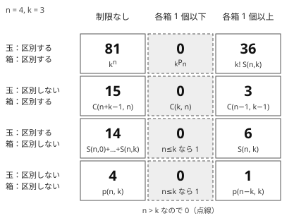

!!! abstract "要点"
    - **何のページか**：$n$ 個の玉を $k$ 個の箱に入れる方法を、玉・箱の区別の有無と各箱の個数の制限で 12 通りに分け、各マスの式と行き先のページを引く。箱を区別しないとき $k!$ で割れるのは、どの箱も空でない場合だけである。
    - **いつ使うか**：
        - 区別しない箱（グループ）に分ける方法の数。
        - 玉（人・数）を箱（グループ・色）に配る方法の数。
        - どの箱にも 1 個以上入れる・空の箱を許す。
    - **使い方**：問題文から「何が玉で何が箱か」「それぞれ区別するか」「各箱の個数の制限」の 3 つを[読み取り](#reading)、[12 マスの表](#table)で式と行き先のページを引く。迷ったら $n = 4$、$k = 3$ の値と小さい全探索を比べる。
    - **計算量**：1 つの値なら、全射のマスは包除で $O(k \log n)$、$S(n, k)$・$p(n, k)$ の表は $O(nk)$。二項係数のマスは階乗の前計算のあと $O(1)$。
    - **前提**：[重複組合せ](../comb/stars-and-bars.md)

<!-- textlint-disable -->
別名：玉と箱・玉と箱の数え上げ・区別する・しない・twelvefold way
<!-- textlint-enable -->

写像 12 相は、「$n$ 個の玉を $k$ 個の箱に入れる方法の数」を 12 のマスに整理した表である。玉を区別するか（2 通り）、箱を区別するか（2 通り）、各箱に入れる個数の制限（制限なし・1 個以下・1 個以上の 3 通り）を掛けて 12 通りになる。各マスの数の求め方は行き先のページに任せ、ここでは式の選び方と、マスどうしのつながりだけを書く。

## 12 マスの表と各マスの行き先 {#table}

玉を入れる方法は、各玉にどの箱へ入るかを対応させる写像とみなせる。「各箱 1 個以下」は違う玉が同じ箱に入らないので[単射](../guide/glossary.md#injection)、「各箱 1 個以上」はどの箱にも玉が届くので[全射](../guide/glossary.md#surjection)にあたる。「区別しない」は、入れ替えて同じになるものを 1 通りと数えることである。玉を区別しないなら各箱の個数だけが意味を持ち、箱を区別しないなら「どの玉どうしが同じ箱にいるか」だけが意味を持つ。

このページでは次の記法を使う（ほかの記号は[記法と用語の約束](../start/notation.md)にそろえる）。

- ${}_k P_n = k(k-1)\cdots(k-n+1)$（$n > k$ なら 0）、$\binom{a}{b}$ は範囲の外を 0 とする二項係数
- $S(n, j)$：第 2 種スターリング数。区別できる $n$ 個を、区別しない $j$ 個の空でない組に分ける方法の数
- $p(n, k)$：$n$ の分割（順序を区別しない正の整数の和）のうち、部分がどれも $k$ 以下のものの数。部分の個数が $k$ 個以下のものの数とも等しい（[整数の分割と分割数](../comb/partition-number.md#recurrence)と同じ定義）

次の図は 12 マスの式と、$n = 4$ 個の玉・$k = 3$ 個の箱での値である。どの値も、手元の全探索で数えた値と一致する。

1 個以下の列は $n > k$ だと鳩の巣原理でどれも 0 になる。$n = 2$、$k = 3$ なら、上の行から $6$・$3$・$1$・$1$ である。箱を区別しない 2 行が $n \le k$ で 1 になるのは、どの玉も別々の箱に 1 個ずつ入る入れ方が、箱の名前を消すとどれも同じに見えるからである。

行ごとに、式と行き先を表にする。$n = 4$、$k = 3$ の値も添える。

**玉も箱も区別する**（$n$ 人を番号の付いた $k$ 部屋へ）

| 制限 | 式 | 値 | 行き先 |
| --- | --- | --- | --- |
| 制限なし | $k^n$ | 81 | [写像 12 相の「玉も箱も区別する」マス](../comb/counting-basics.md#twelvefold-cells) |
| 1 個以下 | ${}_k P_n$ | 0 | [順列・組合せ](../comb/counting-basics.md#permutations) |
| 1 個以上 | $\sum_{i=0}^{k} (-1)^i \binom{k}{i} (k-i)^n = k! \, S(n, k)$ | 36 | [全射の数](../comb/inclusion-exclusion.md#surjection) |

**玉を区別せず、箱を区別する**（同じ品物 $n$ 個を $k$ 人へ。$x_1 + \dots + x_k = n$ の解）

| 制限 | 式 | 値 | 行き先 |
| --- | --- | --- | --- |
| 制限なし | $\binom{n+k-1}{n}$ | 15 | [玉と仕切りの対応](../comb/stars-and-bars.md#stars-bars) |
| 1 個以下 | $\binom{k}{n}$ | 0 | [二項係数の 3 つの意味](../comb/binomial-coefficient.md#meanings) |
| 1 個以上 | $\binom{n-1}{k-1}$ | 3 | [玉と仕切りの対応](../comb/stars-and-bars.md#stars-bars) |

**玉を区別し、箱を区別しない**（$n$ 人を名前のない $k$ 組へ）

| 制限 | 式 | 値 | 行き先 |
| --- | --- | --- | --- |
| 制限なし | $\sum_{j=0}^{k} S(n, j)$（$k \ge n$ ならベル数 $B_n$） | 14 | [ベル数と全列挙の個数](../comb/bell-number.md#size) |
| 1 個以下 | $n \le k$ なら 1、そうでなければ 0 | 0 | — |
| 1 個以上 | $S(n, k)$ | 6 | [S(n,k) の漸化式](../comb/bell-number.md#recurrence) |

**玉も箱も区別しない**（$n$ を $k$ 個以下の正の整数の和に分ける）

| 制限 | 式 | 値 | 行き先 |
| --- | --- | --- | --- |
| 制限なし | $p(n, k)$ | 4 | [分割数の漸化式](../comb/partition-number.md#recurrence) |
| 1 個以下 | $n \le k$ なら 1、そうでなければ 0 | 0 | — |
| 1 個以上 | $p(n - k, k)$ | 1 | [分割数の漸化式](../comb/partition-number.md#recurrence) |

$n = 4$、$k = 3$ の両方を区別しないマスを書き出すと、制限なしは $4$・$3+1$・$2+2$・$2+1+1$ の 4 通り、1 個以上はそのうち部分がちょうど 3 個の $2+1+1$ の 1 通りである。$1+1+1+1$ は箱が 4 個要るので入らない。

境界の値は式だけに任せず確かめる。$n = k = 0$ はどのマスも 1（何も入れない入れ方）だが、玉を区別しない行の式は $\binom{n+k-1}{n} = \binom{-1}{0}$、$\binom{n-1}{k-1} = \binom{-1}{-1}$ になり、範囲の外を 0 とする関数ではどちらも 0 を返す（[重複組合せの落とし穴](../comb/stars-and-bars.md#pitfalls)）。$n = 0$ は式に入れず、別に扱う。

12 マスは、表の外の条件が付くと使えなくなる。よく出る変形と行き先は次のとおりである。

- **箱ごとの個数が決まっている**（玉を区別する）：[多項係数](../comb/multinomial-coefficient.md#meaning)
- **箱ごとに上限がある**（$x_i \le c$）：[包除原理で破る箱の数ごとに足す](../comb/inclusion-exclusion.md#symmetric)か、[母関数](../comb/generating-function-counting.md#formulas)
- **箱を回転・反転で同一視する**（数珠）：[Burnside の補題](../comb/burnside-lemma.md)
- **組の大きさが決まっていて、組に名前がない**：[区別しない同じ大きさのグループを割る](../comb/multinomial-coefficient.md#same-size-groups)

## 箱を区別しないと k! で割れない理由（空の箱） {#why-not-divide}

箱を区別しないマスの値は、箱を区別したマスの値を $k!$ で割って得られるとは限らない。$n = 4$、$k = 3$ の制限なしでは $81 / 3! = 13.5$ で、整数にすらならない（正しくは 14）。

割り算が使えるのは、同じものがちょうど $k!$ 回ずつ数えられているときだけである。箱を区別しない 1 つの入れ方に箱の名前を付けると、何通りの「名前付きの入れ方」になるかを考える。

- **どの箱も空でなく、玉を区別する**：箱の中身は互いに違う玉の集合なので、名前の付け方 $k!$ 通りはすべて違う入れ方になる。$36 / 3! = 6 = S(4, 3)$ と合う
- **空の箱が $e$ 個ある**：空の箱どうしで名前を入れ替えても同じ入れ方なので、$k! / e!$ 通りにしかならない。$n = 4$、$k = 3$ では、空でない箱が 1 個のもの（$S(4,1) = 1$ 通り）が $3$ 回、2 個のもの（$S(4,2) = 7$ 通り）と 3 個のもの（$S(4,3) = 6$ 通り）が $6$ 回ずつ数えられ、$3 + 42 + 36 = 81$ になる

重複の回数がそろわないので、制限なしのマスは「空でない箱の個数 $j$」で場合を分けてから数える。$j$ を決めれば空の箱は無視でき、全射のマスの $S(n, j)$ を $j = 0, \dots, k$ について足せばよい。これが表の $\sum_j S(n, j)$ である。

玉を区別しないときは、空でなくても割れない。$n = 4$、$k = 3$ の 1 個以上で $\binom{3}{2} / 3! = 1/2$ になる。$2+1+1$ の入れ方は、個数 1 の箱 2 つの中身が同じ（玉 1 個）なので、名前を入れ替えても区別できないからである。$k!$ で割れる条件は「どの箱の中身も互いに違う」ことで、玉を区別して空の箱がないときに限って成り立つ。

玉の側も同じである。玉の区別を消すときに $n!$ で割れるのは、各箱 1 個以下のときだけである。${}_k P_n / n! = \binom{k}{n}$ は正しいが、$k^n / n!$ は重複組合せの数にならない。同じ箱に入った玉どうしの入れ替えは、入れ方を変えないからである。

重複の回数がばらばらなときの直し方は、場合分けのほかに 2 つある。

- 代表元を 1 つ決めて代表だけを数える（[重複の除き方](../comb/counting-dedup.md#representative)。グループ分けなら[未使用の最小番号から決める](../comb/counting-dedup.md#min-index)）
- 各入れ方を動かさない入れ替えの数で平均を取る（[Burnside の補題](../comb/burnside-lemma.md#why-not-divide)）

## 全射のマス：二項係数の系統と包除の系統の合流 {#surjection}

「各箱 1 個以上」の列は、ほかの列とのつなぎ目になる。箱を区別するとき、制限なしの入れ方は「どの $j$ 個の箱が空でないか」を選び、その $j$ 箱への全射を数えればよい。どの入れ方も空でない箱の集合がただ 1 つに決まるので、重複も漏れもない。

$$
k^n = \sum_{j=0}^{k} \binom{k}{j} \cdot j! \, S(n, j), \qquad \binom{n+k-1}{n} = \sum_{j=0}^{k} \binom{k}{j} \binom{n-1}{j-1}
$$

2 つ目は $n \ge 1$ で成り立つ（$n = 0$ では $\binom{-1}{j-1}$ が 0 になって崩れる）。$n = 4$、$k = 3$ で 1 つ目は $3 \cdot 1 + 3 \cdot 14 + 1 \cdot 36 = 81$、2 つ目は $3 \cdot 1 + 3 \cdot 3 + 1 \cdot 3 = 15$ である（$j = 0$ の項は 0）。

逆向きに、制限なしから全射を求めるのが包除原理である。「箱 $i$ が空」を破る条件とみて、少なくとも $i$ 個の箱が空の入れ方を引いたり足したりする。

$$
k! \, S(n, k) = \sum_{i=0}^{k} (-1)^i \binom{k}{i} (k-i)^n, \qquad \binom{n-1}{k-1} = \sum_{i=0}^{k} (-1)^i \binom{k}{i} \binom{n+k-i-1}{n}
$$

2 つ目も $n \ge 1$ で成り立ち、$n = 4$、$k = 3$ で $15 - 3 \cdot 5 + 3 \cdot 1 - 0 = 3$ と合う。このように全射のマスは、二項係数の系統（重複組合せ）からも包除の系統からも届く。どちらで求めるかは、数える対象で選ぶ。

| 数えるもの | 求め方 | 計算量 | 行き先 |
| --- | --- | --- | --- |
| 玉を区別しない全射 | 各箱から 1 個ずつ先に入れて、残り $n - k$ 個の制限なしに直す | 前計算のあと $O(1)$ | [玉と仕切りの対応](../comb/stars-and-bars.md#stars-bars) |
| 玉を区別する全射を 1 つ | 包除の式を直接計算する | $O(k \log n)$ | [全射の数](../comb/inclusion-exclusion.md#surjection) |
| $S(n, j)$ をいくつもの $n$・$j$ で | 最後の玉で場合を分けた漸化式で表を埋める | $O(nk)$ | [S(n,k) の漸化式](../comb/bell-number.md#recurrence) |
| 玉も箱も区別しない全射 | 各部分から 1 を引いて $p(n - k, k)$ に直す | $O(nk)$ | [分割数の漸化式](../comb/partition-number.md#recurrence) |

包除の式は $k!$ の逆元で割れば $S(n, k)$ になる。法が素数で $k$ より大きければ逆元がある。法が小さい・素数でないときは、割り算のない漸化式の表を使う。

## 問題文から区別の有無と制限を読み取る {#reading}

問題文に「玉」「箱」と書かれることは少ない。まず「何が何に割り当てられるか」を決め、割り当てる側を玉、割り当て先を箱とする。次の表は、よくある言い回しの読み方である。

| 問題文の言い回し | 玉 → 箱 | マス |
| --- | --- | --- |
| 長さ $N$ の列で各項が $1$〜$K$ | 位置 → 値（両方区別する） | 制限なし $K^N$ |
| $K$ 種類の値をすべて使う・各色を 1 回以上 | 位置 → 値 | 全射 |
| 項が互いに異なる列 | 位置 → 値 | 単射 ${}_K P_N$ |
| $x_1 + \dots + x_K = N$（非負・正） | 和の 1 単位 → 変数（玉は区別しない） | 制限なし・1 個以上 |
| 広義単調な列 $1 \le a_1 \le \dots \le a_N \le K$ | 位置 → 値（列は値ごとの個数で決まる） | 玉を区別しない・制限なし |
| $N$ 人をチーム・グループに分ける（名前なし） | 人 → グループ（箱は区別しない） | $S(N, K)$ かその和 |
| $N$ を正の整数の和で表す（順序は問わない） | 1 単位 → 部分（両方区別しない） | $p(N, K)$ 系 |

区別の有無は、次の問いで決める。

- **箱に名前があるか**：「部屋 1・部屋 2」「赤・青」「$i$ 番目の変数」のように番号や名前で呼べるなら区別する。「グループ」「山」「組」とだけ書かれ、入れ替えても同じとみなすなら区別しない
- **玉を入れ替えて違う答えになるか**：人・番号付きの品物は区別する。「同じ飴」「個数だけを問う」なら区別しない
- **0 を許すか**：「空の箱を許す」「0 個でもよい」は制限なし、「どの箱にも 1 個以上」「正の整数」は全射、「異なる」「高々 1 個」は単射である。「各項が 3 以上」のような下限は、先に引いて制限なしか全射にそろえる（[「以下」は余りの変数を 1 つ足す](../comb/stars-and-bars.md#at-most)も同じ考え方）

読み取りに自信がないときは、$n$・$k$ が小さい場合を全探索して表の値と比べる。$n = 4$、$k = 3$ の 12 個の値は[表の図](#table)にある。箱を区別しないマスを全探索するなら、玉を番号の順に見て「今ある組に入れるか新しい組を作るか」を選ぶと、同じ分け方を 1 回だけ作れる（[再帰による全列挙の組分け型](../basics/recursive-enumeration.md#partition)）。

## 確認問題 {#quiz}

??? question "確認問題：6 人を 3 部屋に"
    6 人を、名前のない 3 つの部屋に分ける。空の部屋を許す場合と許さない場合の数を答えよ。部屋に番号が付いていたら、それぞれどうなるか。

    ??? success "答え"
        人を区別し、部屋を区別しないマスである。許さないなら $S(6, 3) = 90$、許すなら $S(6, 1) + S(6, 2) + S(6, 3) = 1 + 31 + 90 = 122$ である。部屋に番号が付けば、許さない場合は全射で $3! \cdot 90 = 540$（包除で $729 - 3 \cdot 64 + 3 \cdot 1 = 540$）、許す場合は $3^6 = 729$ になる。$729 / 6$ は整数でなく、122 は割り算では出ない。

??? question "確認問題：p(n, k) の定義の違い"
    資料によって $p(n, k)$ を「部分がちょうど $k$ 個の分割の数」と定義することがある。$n = 6$、$k = 3$ で、このページの $p(6, 3)$ とちょうど 3 個の数を比べよ。

    ??? success "答え"
        このページの $p(6, 3)$ は部分が 3 以下（部分が 3 個以下と同じ）の分割の数で、$3+3$・$3+2+1$・$3+1+1+1$・$2+2+2$・$2+2+1+1$・$2+1+1+1+1$・$1+1+1+1+1+1$ の 7 通りである。部分がちょうど 3 個のものは $4+1+1$・$3+2+1$・$2+2+2$ の 3 通りで、$p(6 - 3, 3) = p(3, 3) = 3$ と合う。式を写すときは、資料がどちらの定義かを小さい値で確かめる。

## 参考 {#references}

- [drken「「写像12相」を総整理！ 〜 数え上げ問題の学びの宝庫 〜」](https://qiita.com/drken/items/f2ea4b58b0d21621bd51)：12 マスの構成と各マスの式、分割数を「$k$ 個以下の部分」で定める流儀
