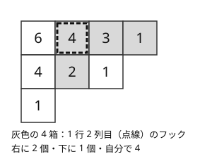

!!! abstract "要点"
    - **何ができるか**：1〜N を Young 図形に行・列とも増加するように書き込む方法（標準タブロー）の数を、フック長公式 $N! / \prod(\text{フック長})$ で求める。Robinson-Schensted 対応で、順列の LIS・LDS の長さの条件を図形の形の条件に言い換えられる。
    - **いつ使うか**：最長増加部分列と最長減少部分列の長さが指定された順列の個数
    - **計算量**：1 つの形の標準タブローの数は $O(N + \log p)$（$p$ は $N$ より大きい素数の法）。順列から図形を作る挿入は 1 要素あたり $O(\text{行数} \times \log N)$
    - **前提**：[整数の分割と分割数](../comb/partition-number.md)

<!-- textlint-disable -->
別名：ヤング図形・標準タブロー・フック長公式・Robinson-Schensted 対応・Young tableau・hook length formula
<!-- textlint-enable -->

Young 図形とフック長公式は、整数の分割を箱の並びで表した図形に 1〜N を書き込む方法を、掛け算と割り算だけで数える道具である。Robinson-Schensted 対応（RS 対応）と組むと、順列の最長増加部分列・最長減少部分列の長さを図形の 1 行目の長さと行数として読めるようになる。このサイトで確かめた範囲では、ABC での出題は difficulty 3000 前後の G 問題の 1 問だけである。ただし、知っていれば数え上げの見通しが一気に立つ種類の知識である。

## 何ができるか {#what}

$N$ の分割 $\lambda = (\lambda_1 \ge \lambda_2 \ge \dots \ge \lambda_k > 0)$ を、$i$ 行目に $\lambda_i$ 個の箱を左詰めで並べた図形で表したものを **Young 図形**という（[分割数のページ](../comb/partition-number.md#enumeration)の箱の図と同じもの）。1〜N を 1 つずつ箱に書き込み、どの行も左から右へ、どの列も上から下へ増加するようにしたものを**標準タブロー**（標準 Young 盤）という。形 $\lambda$ の標準タブローの数を $f^\lambda$ と書く。

このページの道具でできることは次の 3 つである。

- $f^\lambda$ を $N! / \prod(\text{各箱のフック長})$ で求める（[フック長公式](#hook-length)）。
- 1〜N の順列と「同じ形の標準タブローの組 $(P, Q)$」を 1 対 1 に対応させ、LIS の長さを $P$ の 1 行目の長さ、LDS の長さを $P$ の行数として読む（[RS 対応](#robinson-schensted)）。
- 形 $\lambda$ を作る順列はちょうど $(f^\lambda)^2$ 個あるので、LIS・LDS の条件を満たす順列の数を、形の和 $\sum (f^\lambda)^2$ に直す（[分割数との関係](#partitions)）。

サインは「LIS と LDS の長さを指定した順列の数」「行・列とも増加するように格子に数を書き込む方法の数」である。$2 \times n$ の長方形の標準タブローの数は[カタラン数](../comb/reflection-principle.md#catalan) $C_n$ になるので、括弧列の数え上げを 3 行以上に広げた形の問題もこの道具の範囲に入る。

## フック長公式 {#hook-length}

形 $\lambda$ の箱 $(i, j)$ の**フック長** $h(i, j)$ は、同じ行でその箱より右にある箱の数と、同じ列でその箱より下にある箱の数に、自分の 1 を足したものである。

$$
f^\lambda = \frac{N!}{\prod_{(i, j) \in \lambda} h(i, j)}
$$



形 $(4, 3, 1)$（$N = 8$）では、フック長の積が $6 \cdot 4 \cdot 3 \cdot 1 \cdot 4 \cdot 2 \cdot 1 \cdot 1 = 576$ なので、$f^\lambda = 40320 / 576 = 70$ になる。小さい例でも式を確かめる。形 $(2, 1)$ はフック長が $3, 1, 1$ なので $3! / 3 = 2$ 通り（1 行目が 1 2 か 1 3）である。$2 \times 3$ の長方形 $(3, 3)$ は $6! / (4 \cdot 3 \cdot 2 \cdot 3 \cdot 2 \cdot 1) = 5$ 通りで、カタラン数 $C_3 = 5$ と一致する。

この式の直感的な読み方は、「各箱に、その箱がフックの中で最小になる確率 $1 / h(i, j)$ を掛ける」というものである。1〜N を勝手に並べた $N!$ 通りのうち、各箱がそのフックの中で最小なら標準タブローになる。ただしこれらの事象は独立ではないので、この直感はそのままでは証明にならない。正しい証明（Greene-Nijenhuis-Wilf のフックウォークによる確率的な証明など）は[学ぶための資料](#resources)に任せる。

自作するときの要点は次のとおりである。

- 列の長さ $\lambda'_j$（転置した図形の行の長さ）を先に求めると、$h(i, j) = (\lambda_i - j) + (\lambda'_j - i) + 1$（行・列とも 1 から数える）により各箱を $O(1)$ で計算できる。全体は箱の数に比例して $O(N)$ である。
- 答えを素数 $p$ で割った余りで求めるときは、$p > N$ なら $N!$ も各フック長も $p$ の倍数を含まず、分母の積の逆元を 1 回取れば済む。$p \le N$ だと $N!$ が 0 になり、割り算が成り立たない。
- 余りを取らない正確な値が要るなら、割り切れることが保証されているので、素因数ごとに指数を数えて最後に掛けるとよい（$N!$ が `long long` に収まるのは $N \le 20$ まで）。

```cpp
--8<-- "young-tableaux/hook.cpp:core"
```

コード片（`snippets/young-tableaux/hook.cpp`）では、$N \le 7$ のすべての形で「最大の値 $N$ は角の箱に入るので、角を 1 つ外した形の数を足す」漸化式と一致することを確かめている。この漸化式は、形の数が少ないときにフック長公式の代わりに使えるうえ、形に追加の条件があるときにも DP として拡張できる。

## Robinson-Schensted 対応と LIS・LDS {#robinson-schensted}

RS 対応は、1〜N の順列 $\sigma$ を、同じ形の標準タブローの組 $(P, Q)$ に 1 対 1 で移す。$\sigma$ の値を先頭から 1 つずつ $P$ に**挿入**し、そのとき箱が増えた位置に、何番目の挿入かを $Q$ に書き込む。挿入の手順は次のとおりである。

```text
insert(x):
    r = 1 行目
    loop:
        行 r に x より大きい値がなければ、x を行 r の末尾に置いて終わる
        そうでなければ、x より大きい最小の値 y と x を入れ替える（y を追い出す）
        x = y、r = 次の行（なければ新しい行を作る）
```

1 行目だけを見ると、この手順は [LIS の二分探索版](../dp/lis.md#binary-search)の配列（長さ $\ell$ の増加部分列の末尾の最小値）の更新とまったく同じである。そのため $P$ の 1 行目の長さは LIS の長さに等しい。さらに $P$ の行数（1 列目の長さ）は最長減少部分列（LDS）の長さに等しい（Schensted の定理）。より一般に、1〜$k$ 行目の長さの和は「高々 $k$ 本の増加部分列の和集合の最大の大きさ」に等しい（Greene の定理）。

```cpp
--8<-- "young-tableaux/hook.cpp:rs"
```

コード片では、$N \le 7$ のすべての順列で、1 行目の長さが LIS、行数が LDS に一致すること、形 $\lambda$ を作る順列の数が $(f^\lambda)^2$ になることを確かめている。順列を逆順にすると $P$ が転置される（行と列が入れ替わる）ので、LIS と LDS の役割も入れ替わる。

数え上げで使うときは、順列の条件を「$(P, Q)$ の条件」に直し、$P$ と $Q$ のそれぞれを数えて掛ける。条件が形だけなら両方ともフック長公式で数えられ、$P$ だけに追加の条件が付くなら、$P$ の側を DP で数える（[例題](#abc378_g)がこの形）。

??? question "確認問題：長さ 9 の順列で、LIS の長さが 3 かつ LDS の長さが 3 のものはいくつあるか"
    $P$ の 1 行目の長さが 3、行数が 3 で、箱が 9 個なので、形は $3 \times 3$ の正方形に決まる。フック長は 1 行目から $5, 4, 3$・$4, 3, 2$・$3, 2, 1$ で、積は $8640$ だから $f^\lambda = 9! / 8640 = 42$ である。$P$ と $Q$ を独立に選べるので、答えは $42^2 = 1764$ 個になる。長さ 10 以上の順列では LIS か LDS のどちらかが 4 以上になる（箱が 10 個以上ある形は、1 行目が 4 以上か行数が 4 以上）。これは Erdős-Szekeres の定理の RS 対応による説明でもある。

## 分割数との関係 {#partitions}

$N$ 個の箱の Young 図形の形は、$N$ の分割と 1 対 1 に対応する。RS 対応により、1〜N の順列全体は形ごとに $(f^\lambda)^2$ 個ずつに分かれるので

$$
\sum_{\lambda \text{ は } N \text{ の分割}} \left(f^\lambda\right)^2 = N!
$$

が成り立つ。LIS・LDS の条件を満たす順列の数は、この和を条件を満たす形だけに制限したものになる。たとえば「LIS の長さが $k$ 以下の順列の数」は、1 行目の長さ $\lambda_1 \le k$ の形について $(f^\lambda)^2$ を足せばよい。

形を全部試すときの個数は分割数 $p(N)$ で、$p(30) = 5604$、$p(50) = 204226$ と少ない（[全列挙の個数の見積もり](../comb/partition-number.md#size)）。降順の列だけを作る[全列挙](../comb/partition-number.md#enumeration)で形を作り、各形でフック長公式を使えば、全体で $O(p(N) \cdot N)$ になる。

順列を逆順にすると RS 対応の $P$ が転置される（[RS 対応](#robinson-schensted)）ので、分割の転置（Young 図形を対角線で折り返すこと）は順列の逆順に対応する。「LIS が $a$ で LDS が $b$」の数と「LIS が $b$ で LDS が $a$」の数が等しいことは、これで説明できる。

## ライブラリでの使い方 {#library}

フック長公式や RS 対応そのものを扱う機能は ACL になく、Library Checker の問題もない。フック長公式の材料は二項係数の前計算（[階乗と逆元の表](../comb/binomial-precompute.md)）と同じで、10 行ほどで書ける。必要になったときにその場で書けば足りる。

部品を確かめるときは、次の Library Checker の問題が近い。

- Longest Increasing Subsequence：RS 対応の挿入の 1 行目（LIS の二分探索版）の確認
- Partition Function：$p(0), \dots, p(N)$ を求める問題で、形を全部試すときの個数の見積もりに使える

## 学ぶための資料 {#resources}

- Wikipedia（英語）の Hook length formula の記事：公式の述べ方、$(n, n)$ の形でカタラン数になること、フックウォークによる確率的な証明と全単射による証明の紹介がある
- Wikipedia（英語）の Robinson-Schensted correspondence の記事：挿入の手順、逆置換で $P$ と $Q$ が入れ替わること、逆順で $P$ が転置されること、LIS・LDS と Greene の定理がまとまっている
- Wikipedia（日本語）のヤング図形の記事：ヤング図形・ヤング盤（標準盤・半標準盤）の定義を日本語で確かめられる

## 例題 {#examples}

### ABC378 G. Everlasting LIDS {#abc378_g}

<div class="kp-problems" data-role="example" markdown>

- [ABC378 G. Everlasting LIDS](https://atcoder.jp/contests/abc378/tasks/abc378_g)（diff 3051）：長さ $AB - 1$ の順列のうち、LIS の長さが $A$、LDS の長さが $B$ であり、末尾に値を 1 つ付け加えて両方の長さを保てるものの数を、素数で割った余りとして求める。

</div>

方針：LIS が $A$、LDS が $B$ で箱が $AB - 1$ 個なので、RS 対応の形は $B$ 行 $A$ 列の長方形から右下の 1 箱を除いたものに決まる。$Q$ には条件がなく、フック長公式で数える。付け加えた値の挿入で長さが変わらないのは、追い出しの連鎖が右下の空いた箱で終わるときである。これは $P$ だけへの追加の条件になる。$P$ の側は形を状態にした DP で数え、$Q$ の数と掛ける。

??? note "解法の詳細"
    - 追い出しの経路は、行が 1 つ下がるごとに同じ列か左の列へ動く。最後に $B$ 行目の $A$ 列目（右下の空いた箱）に着くには、どの行でも $A$ 列目、つまり各行の末尾の値を追い出すしかない。そのため、$r$ 行目の末尾（$A$ 列目）が $r + 1$ 行目の $A - 1$ 列目より大きいこと（$r = 1, \dots, B - 1$。右上から左下への大小）が、標準タブローの条件に加わる。
    - 1 行目では、$P$ の 1 行目の $A - 1$ 列目と $A$ 列目の間の値（ある $n$ について $n + 0.5$ の形）がいつでも選べるので、付け加える値の側には条件が残らない。条件は $P$ だけのものになる。この条件の下での $P$ の数に $Q$ の数を掛けた値が答えと一致することは、$A, B \ge 2$、$AB \le 9$ の範囲で手元の全探索でも確かめた。
    - $P$ の数は、値 $1, 2, \dots, AB - 1$ の順に「どの行の末尾に置くか」を決める DP で数える。状態は各行の長さ（分割の形）で、置いた後もその行が上の行より長くならない遷移だけを許す。さらに、$r$ 行目の $A$ 列目に置くのは、$r + 1$ 行目にすでに $A - 1$ 個そろっているときだけにする。こうすると、$r + 1$ 行目の $A - 1$ 列目の値は先に置かれた小さい値になるので、追加の大小関係が形の状態だけで判定できる。
    - 状態の数は形の数で、$\binom{A + B}{B}$ 程度に収まる。制約では $AB$ が小さく、メモ化再帰で間に合う。
    - $Q$ の数は、右下の箱を除いた形のフック長の積で $(AB - 1)!$ を割って求める。法は $AB$ より大きい素数なので逆元で割れる。

## 参考 {#references}

- [Wikipedia「Hook length formula」](https://en.wikipedia.org/wiki/Hook_length_formula)：学ぶための資料。公式の形、カタラン数との関係、証明の種類の確認
- [Wikipedia「Robinson–Schensted correspondence」](https://en.wikipedia.org/wiki/Robinson%E2%80%93Schensted_correspondence)：学ぶための資料。挿入の手順、LIS が 1 行目・LDS が 1 列目の長さになること、逆順で転置されること、Greene の定理の確認
- [Wikipedia「ヤング図形」](https://ja.wikipedia.org/wiki/%E3%83%A4%E3%83%B3%E3%82%B0%E5%9B%B3%E5%BD%A2)：学ぶための資料。ヤング図形・標準盤の定義の確認
- [yosupo「Library Checker の問題（longest_increasing_subsequence・partition_function）」](https://github.com/yosupo06/library-checker-problems)：ライブラリでの使い方の節の、近い問題の確認
- [kmjp「AtCoder ABC #378 : G - Everlasting LIDS」](https://kmjp.hatenablog.jp/entry/2024/11/07/1000)：例題の方針（RS 対応で形を決め、追加の条件付きのタブローを形を状態にした DP で数える）
- [ikatakos「AtCoder Beginner Contest 378 F,G問題メモ」](https://ikatakos.com/pot/programming_algorithm/contest_history/atcoder/2024/1102_abc378)：例題の方針（$Q$ をフック長公式で数えること、追い出しの連鎖の大小関係）。解法の節だけを読んだ
