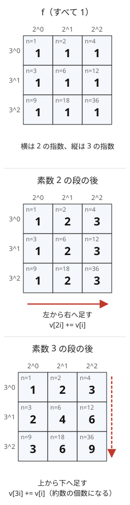

!!! abstract "要点"
    - **何ができるか**：すべての $d$ について「$d$ の倍数にわたる和」または「$d$ の約数にわたる和」を求め、逆変換で元に戻す。素数ごとに累積和を取るので $O(N \log \log N)$ で済む。GCD 畳み込みは倍数の版、LCM 畳み込みは約数の版の変換で求める。
    - **いつ使うか**：
        - 各値 $d$ について、$d$ の倍数（約数）である要素の個数・和を求める。
        - $\sum f(\gcd(A_i, A_j))$ や lcm の総和を求める。
        - 値の上限が $10^6$ 程度で、gcd・lcm ごとに集計する。
    - **計算量**：添字の上限を $N$ として、変換・逆変換・GCD 畳み込み・LCM 畳み込みはどれも $O(N \log \log N)$（篩で素数の表を作る分を含む）。
    - **前提**：[約数包除](../comb/divisor-inclusion-exclusion.md)、[エラトステネスの篩](../math/sieve-eratosthenes.md)

<!-- textlint-disable -->
別名：約数ゼータ変換・倍数ゼータ変換・約数メビウス変換・倍数メビウス変換・GCD 畳み込み・LCM 畳み込み・GCD convolution・LCM convolution
<!-- textlint-enable -->

約数・倍数のゼータ変換は、添字 $1, \dots, N$ の列 $f$ から、各 $n$ について約数（または倍数）にわたる和を一度に作る変換である。メビウス変換はその逆で、和から元の $f$ を取り出す。数を素因数の指数の組とみると、どちらも「素数ごとの軸に沿った累積和」と「その差分」になる。

このページでは添字を 1 から $N$ までとし、0 は使わない（記法は[記法と用語の約束](../start/notation.md)）。4 つの変換を次の名前で呼ぶ。

$$
\begin{aligned}
\text{約数ゼータ：}\ & F(n) = \sum_{d \mid n} f(d) \\
\text{倍数ゼータ：}\ & G(d) = \sum_{d \mid m,\ m \le N} f(m)
\end{aligned}
$$

それぞれの逆変換（$F$ や $G$ から $f$ を戻す）を約数メビウス変換・倍数メビウス変換と呼ぶ。

## 素数ごとの累積和で O(N log log N) {#per-prime}

倍数ゼータは、[倍数を回して集める](../math/harmonic-sum.md#collect-multiples)素朴な方法でも作れる。$d = 1, \dots, N$ のそれぞれについて $d, 2d, 3d, \dots$ を足すと、回数は $\sum_d N/d \approx N \ln N$ である。計算量は $O(N \log N)$ になる。$N = 10^6$ なら約 $1.4 \times 10^7$ 回で、これで間に合うことも多い。素数ごとの累積和にすると、たどる $d$ が素数だけになり $O(N \log \log N)$ に下がる。

**アイデア**：$n = 2^{a} 3^{b} 5^{c} \cdots$ を指数の組 $(a, b, c, \dots)$ とみる。$d \mid n$ は「どの素数についても $d$ の指数が $n$ の指数以下」と同じである（[素因数の指数のベクトル](../math/prime-exponent-vector.md)）。だから約数ゼータは、指数の組の上での多次元の累積和である。[2 次元累積和](../basics/prefix-sum-2d.md)を横に取ってから縦に取るのと同じく、素数（軸）を 1 つずつ処理すればよい。

次の図は、$2^a 3^b$（$a, b \le 2$）の 9 個の数で、$f$ がすべて 1 のときの約数ゼータである。素数 2 の段で横に、素数 3 の段で縦に累積すると、各マスは $n$ の約数の個数になる（$36$ の約数は 9 個）。



ほかの数も同じ形の格子に並ぶ。たとえば $5 \cdot 2^a 3^b$ は、この図を $5$ 倍した位置にある別の格子で、これらの格子は 5 の指数という 3 つ目の軸の方向（横・縦とは別の奥行き）に積み重なり、素数 5 の段ではその方向に累積する。

**処理の流れ**：素数 $p$ の段では、$p$ で割り切れない $m$ ごとの鎖 $m, mp, mp^2, \dots$（$N$ 以下）の上で累積和を取る。1 本ずつ鎖をたどる代わりに、次の 1 行をすべての $i$ について行えば同じことになる。

```text
for p in N 以下の素数:              # 素数の順はどうでもよい
    for i = 1, 2, ..., ⌊N/p⌋:         # 小さい順
        v[i*p] += v[i]
```

$i$ を小さい順に回すので、$v[ip]$ に足すときの $v[i]$ は、同じ段で $v[i/p]$ までの和をすでに受け取っている。こうして鎖の上で 1 つ手前までの累積和が順に伝わる。全素数の段を終えると、$v[n]$ には指数の組が全成分で $n$ 以下のもの、すなわち $n$ の約数 $d$ すべての $f(d)$ が 1 回ずつ足されている。

倍数ゼータは向きが逆で、指数の大きい方から累積する。式は `v[i] += v[i*p]` で、$i$ を大きい順に回す。$N$ を超える倍数はないので、鎖は $N$ で切れていると考えればよい。

```cpp
--8<-- "zeta-mobius-divisor/transforms.cpp:divisor"
```

```cpp
--8<-- "zeta-mobius-divisor/transforms.cpp:multiple"
```

**計算量**：素数 $p$ の段は $\lfloor N/p \rfloor$ 回なので、全体で $\sum_{p \le N} N/p = O(N \log \log N)$ である（素数の逆数和。[エラトステネスの篩](../math/sieve-eratosthenes.md#complexity)と同じ見積もり）。$N = 10^6$ では約 $2.9 \times 10^6$ 回で、素朴な方法の 5 分の 1 ほどになる（[調和級数との比較](../math/harmonic-sum.md#vs-sieve)）。素数の表は篩で作り、これも $O(N \log \log N)$ である。

**応用の型**：

- **$d$ の倍数である要素の個数**：値ごとの個数 $\mathrm{cnt}[v]$ の倍数ゼータ $C(d)$ が「$A$ のうち $d$ の倍数の個数」である。$C(d) \ge K$ なら、$d$ の倍数を $K$ 個選べるので gcd を $d$ の倍数にできる（サイン：「$K$ 個選んだときの gcd の最大」）
- **和の代わりに最大値**：累積で max を取っても、同じ手順で「約数（倍数）の中の最大」が求まる。max は引き算で戻せないので、逆変換はできない（[練習の ABC393 E](#practice)）
- **gcd の条件を倍数の条件に言い換える**：「gcd が $d$ の倍数」は「どちらも $d$ の倍数」と同じなので、個数が $C(d)$ の積や $\binom{C(d)}{2}$ で書ける。ここから gcd がちょうど $d$ の分を取り出すのが次の節の逆変換である

## 逆変換（メビウス変換）と回す向き {#inverse}

メビウス変換は、ゼータ変換の各段を逆順に取り消す操作である。1 本の鎖の上の累積和 $S_0, S_1, S_2, \dots$ は差分 $S_k - S_{k-1}$ で元に戻せるので、各段の `+=` を `-=` に変え、差分を取るときに相手がまだ累積和のまま残っている向きに回せばよい。

素数の段どうしは独立な軸なので、段の順は入れ替えてよい。向きを決めるのは段の中の $i$ の順で、次の表にまとめる。

| 変換 | 1 段の式 | $i$ の向き |
| --- | --- | --- |
| 約数ゼータ | $v[ip] \mathrel{+}= v[i]$ | 小さい順 |
| 約数メビウス | $v[ip] \mathrel{-}= v[i]$ | 大きい順 |
| 倍数ゼータ | $v[i] \mathrel{+}= v[ip]$ | 大きい順 |
| 倍数メビウス | $v[i] \mathrel{-}= v[ip]$ | 小さい順 |

覚え方は、「ゼータは読む側をすでに更新済みにする」「メビウスは読む側をまだ更新前に保つ」である。約数ゼータで読むのは $v[i]$ で、$i < ip$ なので小さい順に回せば $v[i]$ が先に更新される。約数メビウスでは $f(ip) = S(ip) - S(i)$ の $S(i)$ を累積和のまま使いたいので、大きい順に回して $v[i]$ を後で更新する。

メビウス変換は[メビウス関数](../comb/mobius-function.md) $\mu$ で書いた反転公式 $f(n) = \sum_{d \mid n} \mu(n/d) F(d)$ と同じものを計算している。$\mu$ を作らなくても、素数ごとの差分で同じ結果が $O(N \log \log N)$ で出る。

[約数包除](../comb/divisor-inclusion-exclusion.md)の「大きい $g$ から $f(g) = G(g) - f(2g) - f(3g) - \cdots$ と引く」計算は、倍数メビウス変換の素朴な形である。こちらは $O(N \log N)$ で、$N = 10^6$ 程度ならどちらでも間に合う。素数ごとの版の利点は速さより、ゼータと同じ形のループで書ける点にある。

!!! info "線形なので係数ごとに変換してよい"
    ゼータ変換とメビウス変換は、どちらも足し算と引き算だけでできている。だから値が $T$ の 1 次式 $c_i T + d_i$ のときは、係数の列 $c$ と定数の列 $d$ を別々に変換すればよい。[例題の ABC474 F](#abc474_f) はこの形である。

## GCD 畳み込み・LCM 畳み込み {#gcd-lcm-convolution}

GCD 畳み込みは、2 つの列 $a, b$（添字 $1, \dots, N$）から次の $h$ を作る演算である。

$$
h(k) = \sum_{\gcd(i, j) = k} a_i b_j
$$

$i, j$ を全部試すと $O(N^2)$ になる。鍵は「$k \mid \gcd(i, j)$」が「$k \mid i$ かつ $k \mid j$」と同じことである。gcd が $k$ の倍数になる組の和は 2 つの和の積に分かれる。

$$
\sum_{k \mid \gcd(i, j)} a_i b_j = \Bigl(\sum_{k \mid i} a_i\Bigr) \Bigl(\sum_{k \mid j} b_j\Bigr)
$$

左辺は $h$ の倍数ゼータで、右辺は $a$ と $b$ の倍数ゼータの各点の積である。よって次の 3 段で $h$ が求まり、全体で $O(N \log \log N)$ になる。

1. $a$ と $b$ をそれぞれ倍数ゼータ変換する
2. 添字ごとに掛ける
3. 積を倍数メビウス変換する

LCM 畳み込み $h(m) = \sum_{\operatorname{lcm}(i, j) = m} a_i b_j$ も同じ形である。「$\operatorname{lcm}(i, j) \mid m$」は「$i \mid m$ かつ $j \mid m$」と同じなので、約数ゼータ → 各点の積 → 約数メビウスで求まる。ただし求まるのは $m \le N$ の分だけである。$\operatorname{lcm}(i, j) = m$ なら $i, j \le m$ なので、$m \le N$ の値は正しく出る。$N$ を超える lcm の分は配列に現れない。

```cpp
--8<-- "zeta-mobius-divisor/transforms.cpp:convolution"
```

[畳み込み](../math/convolution-ntt.md)（FFT・NTT）が添字の和 $i + j$ を扱うのと同じく、変換して各点で掛けて戻す。添字の演算が gcd・lcm に変わり、変換が約数・倍数のゼータに変わったものである（XOR は[アダマール変換](../math/hadamard-transform.md#index-operations)、OR・AND は[部分集合のゼータ変換](../comb/zeta-mobius-subset.md)）。

**応用の型**：列 $A$ の値の上限を $M$ とし、値ごとの個数 $\mathrm{cnt}[v]$ を添字 $1, \dots, M$ の列とみる。

- **$\sum_{i, j} f(\gcd(A_i, A_j))$**：$\mathrm{cnt}$ と $\mathrm{cnt}$ の GCD 畳み込み $h(k)$ は、gcd が $k$ の順序対 $(i, j)$ の数である（$i = j$ を含む）。したがって答えは $\sum_k f(k)\, h(k)$ になる。$i < j$ だけなら $i = j$ の分を引いて 2 で割る
- **最後のメビウス変換を $f$ に移す**：$f$ の約数メビウス変換を $w$ とすると $f(g) = \sum_{d \mid g} w(d)$ である。$\mathrm{cnt}$ の倍数ゼータを $C(d)$ とすると、$\sum_{i, j} f(\gcd(A_i, A_j)) = \sum_d w(d)\, C(d)^2$ になる。$f(g) = g$ なら $w$ は[オイラーの φ 関数](../math/euler-phi.md)で、$\gcd$ の総和は $\sum_d \varphi(d)\, C(d)^2$ と書ける
- **lcm の総和**：$\operatorname{lcm}(x, y) = xy / \gcd(x, y)$ を使い、$c[v] = v \cdot \mathrm{cnt}[v]$ の GCD 畳み込みを $g$ で割って足す。LCM 畳み込みは $M$ を超える lcm を扱えないので、総和には GCD 畳み込みを使う（[力試しの AGC038 C](#challenge)）

## 部分集合のゼータ変換との対応（指数ベクトルの累積和） {#vs-subset}

[部分集合のゼータ変換](../comb/zeta-mobius-subset.md)は、bit ごとに 1 軸ずつ累積和を取る。約数ゼータは、素数ごとに 1 軸ずつ累積和を取る。どちらも「全成分で以下」という順序の上の多次元の累積和で、違いは軸の長さである。

| | 部分集合のゼータ | 約数のゼータ |
| --- | --- | --- |
| 1 つの添字 | bit の列（各成分 0 か 1） | 素因数の指数の組 |
| 軸 | bit（$n$ 本） | $N$ 以下の素数 |
| 軸の長さ | 2 | $\lfloor \log_p N \rfloor + 1$ |
| 計算量 | $O(n 2^n)$ | $O(N \log \log N)$ |

平方因子のない数（どの素数の指数も 0 か 1）だけを見れば、約数は素因数の集合の部分集合そのものである。たとえば $30 = 2 \cdot 3 \cdot 5$ の約数 8 個は、$\{2, 3, 5\}$ の部分集合 8 個と 1 対 1 に対応する。

$\{1, \dots, N\}$ は指数の組の「箱」にはならない（$2^{19} \le N$ でも $2^{19} \cdot 3$ は $N$ を超えうる）。それでも素数ごとの累積和が正しいのは、$n \le N$ の約数がすべて $N$ 以下だからである。各鎖 $m, mp, mp^2, \dots$ は途中で $N$ を超えたら以降がなく、累積和に要る項は欠けない。

1 つの数 $M$ の約数だけが関係する問題では、添字を $M$ の約数に絞ってよい。$M$ を素因数分解して約数を指数の組で番号付けし、同じ素数ごとの累積和を取る。約数の個数は $10^{18}$ 以下でも約 $10^5$ 個なので（[約数の個数の上限](../math/divisor-count-bound.md#table)）、$M$ が大きくても扱える。さらに「各素数の指数が $M$ と等しいか」だけが問題なら、指数を 0 か 1 に潰して部分集合のゼータ変換に帰着できる。lcm がちょうど $M$ になる選び方を数える問題はこの形である。

## 落とし穴 {#pitfalls}

**段の中の向きを逆にする**。約数ゼータで $i$ を大きい順に回すと、$v[ip]$ に足す $v[i]$ はまだ同じ段の累積を受け取っていない。各段で 1 つ手前の指数の分しか届かない（どの値が欠けるかは[確認問題](#quiz)で確かめられる）。表の向きを守り、小さい $N$ で愚直な $O(N^2)$ と比べて確かめる。

**素数を $\sqrt{N}$ までで止める**。篩で合成数を消すときは $\sqrt{N}$ までの素数で足りるが、ゼータ変換の段は $N$ 以下のすべての素数が要る。素数 $p > \sqrt{N}$ の段がないと、$v[p]$ に $f(1)$ が足されない。篩の内側のループを $p^2$ から始めるのはよいが、段を回す素数の一覧は $N$ まで作る。

**添字 0 を混ぜる**。0 はすべての数の倍数なので、倍数ゼータのループで $i = 0$ まで回すと $v[0] \mathrel{+}= v[0]$ が素数の数だけ繰り返される。値を 0-indexed の配列へ詰めたときに起きやすい。配列は大きさ $N + 1$ で取り、添字 $1, \dots, N$ だけを使う。

**max・min で累積したものを戻そうとする**。逆変換は引き算でできているので、和（と mod の和）にしか使えない。max で累積した結果から「ちょうど $d$」の値は戻らない。

**畳み込みの積があふれる**。GCD 畳み込みの各点の積は、個数の積なら要素の個数の 2 乗、値の和の積なら $(\sum A_i)^2$ ほどになる。答えを mod で求める問題では最初から [modint](../math/modint.md) で変換し、整数のまま求めるなら積の大きさを見積もってから `long long` か `__int128` を選ぶ。

**変換の長さを要素数で取る**。添字は値なので、配列の長さは値の上限 $M$ で決まる。要素が 10 個でも値が $10^6$ なら長さ $10^6 + 1$ の配列が要り、計算量も $O(M \log \log M)$ である。値が $10^9$ のように大きく配列に置けないなら、この方法が使えない。1 つの数の約数だけで済むなら[前の節](#vs-subset)のように約数に絞る。

## 例題 {#examples}

### ABC474 F. Increment All Divisors {#abc474_f}

<div class="kp-problems" data-role="example" markdown>

- [ABC474 F. Increment All Divisors](https://atcoder.jp/contests/abc474/tasks/abc474_f)（diff 1911）：長さ N の列 A に、i を選んで i の約数 j すべての A_j に 1 を足す操作を何回でも行えるとき、A をすべて等しくできるか判定し、できるなら最小の操作回数を求める。

</div>

操作 $i$ を行う回数を $x_i \ge 0$、最後にそろった値を $T$ とおく。位置 $j$ が増えるのは $j$ の倍数 $i$ を選んだときなので、$T - A_j = \sum_{j \mid i} x_i$ である。右辺は $x$ の倍数ゼータなので、$x$ は $T - A$ の倍数メビウス変換で一意に決まる。$x_i$ は $T$ の 1 次式になり、$x_i \ge 0$ がすべての $i$ で成り立つ $T$ の範囲を求めればよい。

??? note "解法の詳細"
    - 係数と定数を分けて変換する：すべて 1 の列 $c$ と、$-A$ の列 $d$ をそれぞれ倍数メビウス変換すると、$x_i = c_i T + d_i$ になる（[線形性](#inverse)）。
    - 範囲を求める：$c_i > 0$ なら $T \ge \lceil -d_i / c_i \rceil$、$c_i < 0$ なら $T \le \lfloor d_i / (-c_i) \rfloor$ である。$c_i = 0$ で $d_i < 0$ なら、$T$ によらず不可能である。負の数の割り算は 0 の方向に切り捨てられるので、floor と ceil を自分で書く。
    - 答え：1 はすべての $i$ の約数なので、操作の総数は $\sum_i x_i = T - A_1$ である。$T$ は小さいほどよく、範囲の下端が答えの $T$ になる。範囲が空なら $-1$ を出力する。$c_N = 1 > 0$ なので下端は必ずある。
    - 値の大きさ：$d_i$ は $A$ の要素に $\pm 1$ を掛けた和で、各要素は高々 1 回しか現れない。$N \le 2 \times 10^5$、$A_i \le 10^9$ なら $\lvert d_i \rvert \le 2 \times 10^{14}$ で、`long long` に収まる。
    - 計算量は $O(N \log \log N)$ である。大きい $i$ から $x_i = (T - A_i) - \sum_{k \ge 2} x_{ki}$ と決める素朴な形でも $O(N \log N)$ で間に合う。

    ```cpp
    --8<-- "zeta-mobius-divisor/increment-divisors.cpp:core"
    ```

## 練習問題 {#practice}

<div class="kp-problems" data-role="practice" markdown>

- [ABC393 E. GCD of Subset](https://atcoder.jp/contests/abc393/tasks/abc393_e)（diff 1253）：長さ N の列 A の各 i について、A_i を含む K 個の要素を選んだときの gcd の最大値を求める。
- [YAHOO-PROCON2018-FINAL A. Uncommon](https://atcoder.jp/contests/yahoo-procon2018-final/tasks/yahoo_procon2018_final_a)（diff —）：相異なる N 個の整数 a_1, …, a_N（値は 10^5 以下）と M が与えられ、i = 1, …, M のそれぞれについて i と互いに素な a_j の個数を求める。

</div>

??? note "練習の方針"
    - **ABC393 E**：値ごとの個数を倍数ゼータ変換して、$d$ の倍数の個数 $C(d)$ を求める。次に、$C(d) \ge K$ なら $d$、そうでなければ 0 とした列を、max で約数ゼータ変換する（約数の中の最大）。$A_i$ の位置の値が答えである。倍数を回す素朴な方法は [調和級数の例題](../math/harmonic-sum.md#abc393_e)にある。
    - **YAHOO-PROCON2018-FINAL A**：値ごとの個数を倍数ゼータ変換して、$d$ の倍数の個数 $C(d)$ を作る。メビウス関数 $\mu(d)$ と点ごとに掛けた $\mu(d) C(d)$ を約数ゼータ変換すると、$i$ の位置に $\sum_{d \mid i} \mu(d) C(d)$、つまり答えが並ぶ。全体 $O(A \log \log A)$ である。素因数ごとの包除（各 $i$ で高々 $2^6$ 通り）でも解ける

## 力試し {#challenge}

<div class="kp-problems" data-role="challenge" markdown>

- [ARC185 E. Adjacent GCD](https://atcoder.jp/contests/arc185/tasks/arc185_e)（diff 2185）：長さ N の列 A の各接頭辞について、空でない部分列すべての「隣り合う要素の gcd の和」の総和を 998244353 で割った余りで求める。
- [AGC038 C. LCMs](https://atcoder.jp/contests/agc038/tasks/agc038_c)（diff 2327）：長さ N の列 A について、全ペア i < j の lcm(A_i, A_j) の総和を求める。

</div>

??? note "力試しの方針"
    - **ARC185 E**：答えは $f(n+1) = 2 f(n) + \sum_{x < n} 2^x \gcd(A_x, A_n)$ と更新できる。$\gcd(a, b) = \sum_{d \mid \gcd(a, b)} \varphi(d)$（$\varphi$ は恒等関数の約数メビウス変換）と分け、$d$ ごとに「$d$ の倍数である過去の要素の $2^x$ の和」を持てば、$A_n$ の約数を回すだけで更新できる
    - **AGC038 C**：$c[v] = v \cdot \mathrm{cnt}[v]$ とし、$c$ と $c$ の GCD 畳み込み $h(g)$ を求める。$h(g)$ は gcd が $g$ の順序対の $A_i A_j$ の和なので、$\sum_g h(g)/g$ が順序対の lcm の総和である。$i = j$ の分 $\sum A_i$ を引いて 2 で割る。mod 998244353 で求めるので、$g$ の逆元を掛ける

## 確認問題 {#quiz}

??? question "確認問題：向きを逆にした約数ゼータ"
    $N = 8$ の約数ゼータで、素数 2 の段だけ $i$ を大きい順（$i = 4, 3, 2, 1$）に回した。素数 2 の段の後、$v[8]$ には何が入っているか。

    ??? success "答え"
        $i = 4$ のとき $v[8] \mathrel{+}= v[4]$ を行うが、この時点の $v[4]$ はまだ $f(4)$ のままである（$v[4] \mathrel{+}= v[2]$ は後の $i = 2$ で行う）。だから $v[8] = f(8) + f(4)$ で、$f(2)$ と $f(1)$ が足りない。小さい順なら $v[4]$ が先に $f(1) + f(2) + f(4)$ になり、$v[8]$ に 4 つすべてが届く。

??? question "確認問題：段を回す素数の範囲"
    $N = 10$ の約数ゼータで、素数の段を $\sqrt{10}$ 以下の 2 と 3 だけにした。正しく求まらない $n$ はどれか。

    ??? success "答え"
        素数 5 と 7 の段がないので、5 か 7 で割り切れる $n$、すなわち $5, 7, 10$ が誤る。たとえば $v[5]$ には $f(1)$ が足されず $f(5)$ のままで、$v[10]$ には $f(5)$ と $f(10)$ の 2 つ（2 の段で $f(5)$ が届く）しか入らない。$10$ の約数 $1, 2, 5, 10$ のうち $f(1)$ と $f(2)$ が欠ける。

??? question "確認問題：gcd の総和"
    値の上限が $10^6$ の列 $A$ について、$\sum_{i < j} \gcd(A_i, A_j)$ を求めたい。$d$ の倍数である要素の個数を $C(d)$ とするとき、答えを $C$ と φ 関数で書け。

    ??? success "答え"
        $\gcd(x, y) = \sum_{d \mid \gcd(x, y)} \varphi(d)$ で、「$d \mid \gcd$」は「どちらも $d$ の倍数」と同じである。$i < j$ で両方が $d$ の倍数になる組は $\binom{C(d)}{2}$ 個なので、答えは $\sum_d \varphi(d) \binom{C(d)}{2}$ である。$C$ は個数の倍数ゼータ変換、$\varphi$ は $n \mapsto n$ の約数メビウス変換で、どちらも $O(M \log \log M)$ で作れる。

## 使い分け {#comparison}

- 値が $10^6$ 程度までで、倍数の和を 1 回求めるだけなら、[倍数を回す素朴な方法](../math/harmonic-sum.md#collect-multiples)（$O(N \log N)$）で十分なことが多い。書き間違えにくい方を選んでよい
- 「gcd がちょうど $g$」を数えるだけなら、[約数包除](../comb/divisor-inclusion-exclusion.md)の大きい方から引く形が直接的である。これは倍数メビウス変換の素朴な形である
- $N$ が $10^{10}$ のように大きく配列に置けないときは、[メビウス関数](../comb/mobius-function.md)で式を変形し、[商の列挙](../math/floor-quotient-enum.md)で束ねる
- 添字が bit の集合で OR・AND を扱うなら[部分集合のゼータ変換](../comb/zeta-mobius-subset.md)、XOR なら[アダマール変換](../math/hadamard-transform.md)、和 $i + j$ なら[畳み込み](../math/convolution-ntt.md)を使う
- 約数・倍数の問題の全体の地図は[約数と倍数](../patterns/divisors-and-multiples.md#overview)にある

## 参考 {#references}

- [noshi91「高速ゼータ変換の約数版 O(N log(log(N)))」](https://noshi91.hatenablog.com/entry/2018/12/27/121649)：素数ごとに累積する形と、各段がエラトステネスの篩と同じ計算量になること
- [drken「AtCoder AGC 038 C - LCMs (3D, 黄色, 700 点)」](https://drken1215.hatenablog.com/entry/2020/11/06/031600)：GCD 畳み込みの手順（倍数ゼータ → 積 → 倍数メビウス）と、力試しの方針
- [WineChord「[atcoder] ABC474 F / JSC2026 Advance Final F Increment All Divisors」](https://github.com/WineChord/algo/blob/main/docs/daily/2026-09-14/atcoder-abc474-f.md)：例題の方針（操作回数を目標の値の 1 次式で表し、非負の条件から範囲を求める）。解法の部分だけを参照
- [noshi91「みんぷろ2018決勝-A Uncommon Θ(Alog(log(A)))」](https://noshi91.hatenablog.com/entry/2020/01/15/185642)：練習 YAHOO2018 決勝 A の倍数ゼータ・μ・約数ゼータの順の計算
- [drken「みんなのプロコン 2018 決勝 A - Uncommon (600 点)」](https://drken1215.hatenablog.com/entry/2018/07/12/213300)：練習 YAHOO2018 決勝 A の制約と素因数の包除による別解
- [kmjp「AtCoder ARC #185 : E - Adjacent GCD」](https://kmjp.hatenablog.jp/entry/2024/10/19/0900)：力試し ARC185 E の φ による分解と d ごとの 2^i の和
