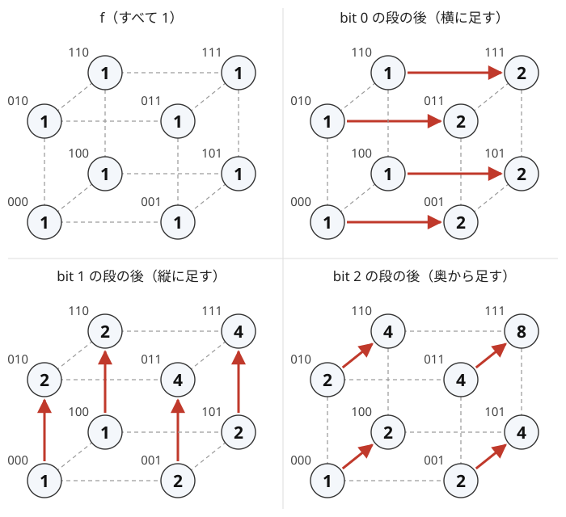

!!! abstract "要点"
    - **何ができるか**：すべての集合 $S$ について、部分集合にわたる和 $\sum_{T \subseteq S} f(T)$（または上位集合での和）を、bit ごとの累積和として $O(n 2^n)$ で求める（部分集合を列挙すると $O(3^n)$）。逆変換（メビウス変換）で元に戻せる。OR 畳み込み・AND 畳み込みは、変換 → 各点の積 → 逆変換で求める。
    - **いつ使うか**：
        - $N \le 20$ で、すべての部分集合（bit）ごとの和・最大を求める。
        - $A_i$ OR $A_j$ が $K$ の部分集合になる組を数える・最大を求める。
        - $x \subseteq S$ となる $x$ についての和を、すべての $S$ で求める。
    - **計算量**：$n$ を bit の数として、変換・逆変換は $O(n 2^n)$、OR 畳み込み・AND 畳み込みも $O(n 2^n)$。メモリは長さ $2^n$ の配列 1〜2 本。
    - **前提**：[bit 全探索と順列全探索](../basics/bit-full-search.md)、[2 次元累積和](../basics/prefix-sum-2d.md)。

<!-- textlint-disable -->
別名：高速ゼータ変換・高速メビウス変換・SOS DP・部分集合にわたる和・上位集合の和・OR 畳み込み・AND 畳み込み・zeta transform
<!-- textlint-enable -->

部分集合の高速ゼータ変換は、集合を添字にした長さ $2^n$ の列 $f$ から、各 $S$ について $S$ の部分集合にわたる和を一度に作る変換である。高速メビウス変換はその逆で、和から元の $f$ を取り出す。集合を $\{0, 1\}^n$ の点とみると、どちらも bit（軸）ごとの累積和とその差分になる。

このページでは、要素に $0$ から $n - 1$ の番号を付け、集合を「要素 $i$ を含むとき $2^i$ の位が 1」の整数で表す（[集合を整数で表す](../dp/bit-dp.md#subsets-as-integers)）。2 つの変換を次の名前で呼ぶ。

$$
\begin{aligned}
\text{部分集合ゼータ：}\ & \hat f(S) = \sum_{T \subseteq S} f(T) \\
\text{上位集合ゼータ：}\ & \check f(S) = \sum_{T \supseteq S} f(T)
\end{aligned}
$$

## n 次元の累積和として見る（bit ごとに 1 軸ずつ） {#multidimensional}

すべての $S$ について $\hat f(S)$ を素朴に求めると、$S$ ごとに部分集合 $T$ を[列挙する](../dp/subset-enumeration-dp.md#submask-loop)ことになる。各要素が「$T$ にある・$S$ にだけある・$S$ にない」の 3 通りなので、回数は全体で $3^n$ である。$n = 20$ なら約 $3.5 \times 10^9$ で間に合わない。

**アイデア**：集合 $S$ を、各成分が 0 か 1 の $n$ 次元の点 $(s_0, s_1, \dots, s_{n-1})$ とみる。$T \subseteq S$ は「どの成分でも $t_i \le s_i$」と同じである。だから $\hat f$ は、各軸の長さが 2 の $n$ 次元の箱の上の累積和である。累積和は[軸ごとに 1 回ずつ取れば](../basics/prefix-sum-2d.md#higher-dimensions)求まる。2 次元で横に累積してから縦に累積するのと同じである。

次の図は $n = 3$ で、$f$ がすべて 1 のときの変換である。立方体の頂点が 8 個の集合で、ラベルは 2 進表記（左が bit 2）である。bit 0 の段で横の辺に沿って、bit 1 の段で縦の辺に沿って、bit 2 の段で奥行きの辺に沿って足す。終わると各頂点は $2^{\lvert S \rvert}$（部分集合の個数）になる。



**処理の流れ**：軸の長さが 2 なので、1 つの軸の累積和は「bit $i$ が 1 の $S$ に、bit $i$ を 0 にした $S$ の値を足す」の 1 行で済む。

```text
for i = 0, 1, ..., n-1:                 # bit（軸）を外側に回す
    for S = 0, 1, ..., 2^n - 1:
        if S の bit i が 1:
            v[S] += v[S ^ (1 << i)]
```

**なぜ正しいか**：bit $0, \dots, i-1$ の段を終えた時点で、次が成り立つ。

> $v[S]$ は、bit $0, \dots, i-1$ では $S$ の部分集合で、bit $i$ 以上では $S$ と一致する $T$ についての $f(T)$ の和である。

始め（$i = 0$）は $T = S$ だけなので $v[S] = f(S)$ で成り立つ。bit $i$ の段では、bit $i$ が 1 の $S$ に $S \setminus \{i\}$ の値を足す。足す側の $T$ は bit $i$ が 0 のもの、元からある $T$ は bit $i$ が 1 のもので、重ならずに合わさる。こうして bit $i$ も「部分集合であればよい」に緩む。$n$ 段を終えると、すべての bit で緩んで $v[S] = \hat f(S)$ になる。各 $T \subseteq S$ はちょうど 1 回ずつ数えられる。

```cpp
--8<-- "zeta-mobius-subset/transforms.cpp:core"
```

完全なプログラム：[`transforms.cpp`](https://github.com/yuukougun/kyopro-atlas/blob/main/snippets/zeta-mobius-subset/transforms.cpp)（GitHub）
{ .kp-code-src }

**計算量**：$n$ 段それぞれで $2^n$ 個の $S$ を見るので $O(n 2^n)$ である。$n = 20$ で約 $2 \times 10^7$ 回で、加算だけなら十分に速い（[計算量の見積もり](../basics/complexity-estimation.md)）。配列は $2^{20} \approx 10^6$ 要素で、`long long` でも 8 MB に収まる。

**応用の型**：

- **部分集合に含まれる要素の数**：値が bit 列の $A_1, \dots, A_N$ について、値ごとの個数 $\mathrm{cnt}[x]$ を変換すると、$\widehat{\mathrm{cnt}}(S)$ は「$A_i \subseteq S$ となる $i$ の個数」である。$N$ が大きくても $O(N + n 2^n)$ で済む。
- **集合の中の辺の数**：グラフの各辺 $\{u, v\}$ について $f(\{u, v\}) \mathrel{+}= 1$ とし変換すると、$\hat f(S)$ は両端が $S$ に入る辺の数になる（[力試しの ABC213 G](#challenge)）。
- **和の代わりに max・min**：累積の演算を max にしても同じ手順で「部分集合の中の最大値」が求まる。max は 2 回数えても結果が変わらないが、和では各 $T$ がちょうど 1 回になることが効いている。

## ループの順（bit を外側） {#loop-order}

ゼータ変換の 2 重ループは、bit を外側、集合 $S$ を内側に回す。逆にすると同じ $T$ が何度も足される。

$n = 2$ で $S$ を外側、bit を内側にして確かめる。$S = 1$ で $v[1] = f(1) + f(0)$、$S = 2$ で $v[2] = f(2) + f(0)$ になる。$S = 3$ では、bit 0 で $v[3] \mathrel{+}= v[2]$、bit 1 で $v[3] \mathrel{+}= v[1]$ となる。結果は $f(3) + f(2) + f(1) + 2 f(0)$ で、$f(0)$ が 2 回入る。$v[1]$ と $v[2]$ がどちらもすでに $f(0)$ を含むからである。

bit を外側にすると、bit $i$ の段で足し込む $v[S \setminus \{i\}]$ は「bit $i$ より前の軸だけ累積した値」で、bit $i$ の方向には 1 回も累積していない。前の節の不変条件はこの順で初めて成り立つ。

一方で、**同じ段の中で $S$ を回す順はどうでもよい**。bit $i$ の段で書き換わるのは bit $i$ が 1 の $S$ だけで、読むのは bit $i$ が 0 の $S$ だけだからである。読む側は同じ段の中で書き換わらない。$S$ を降順に回しても、bit の段の順を $n-1, \dots, 0$ にしても結果は同じである。軸の長さが 3 以上ある[約数のゼータ変換](../comb/zeta-mobius-divisor.md#inverse)では段の中の向きが効くので、ここが違う。

## メビウス変換（引き算で同じ順に回す） {#inverse}

メビウス変換は $\hat f$ から $f$ を戻す変換である。ゼータ変換の 1 段は、bit $i$ だけが違う 2 つの集合の組 $(S \setminus \{i\}, S)$ ごとに、値の組 $(x, y)$ を $(x, x + y)$ に変える。これは $(x, y - x)$ で取り消せるので、各段の `+=` を `-=` に変えればよい。

```text
for i = 0, 1, ..., n-1:
    for S = 0, 1, ..., 2^n - 1:
        if S の bit i が 1:
            v[S] -= v[S ^ (1 << i)]
```

本来は段を逆の順に取り消すものだが、各段は別の軸に働くので互いに入れ替えてよい。だからゼータ変換と同じ順に回してよい。段の中の順も、前の節と同じ理由で自由である。

式で書くと、メビウス変換は次の形になる。

$$
f(S) = \sum_{T \subseteq S} (-1)^{\lvert S \rvert - \lvert T \rvert} \hat f(T)
$$

これは[包除原理](../comb/inclusion-exclusion.md#general)そのものである。各 $T$ について「$T$ の要素だけを使う数」$\hat f(T)$ が求めやすいとき、「$S$ の要素をすべて使う数」$f(S)$ を符号付きの和で取り出す。部分集合を列挙すれば $O(3^n)$ だが、メビウス変換なら全部の $S$ について $O(n 2^n)$ で求まる。

**応用の型**：

- **OR がちょうど $S$ になる部分列の数**：値が bit 列の $A_1, \dots, A_N$ から部分列を選ぶ。$\widehat{\mathrm{cnt}}(S)$ 個の要素は $S$ の部分集合なので、OR が $S$ の部分集合になる選び方は $2^{\widehat{\mathrm{cnt}}(S)}$ 通りである（空の選び方を含む）。これをメビウス変換すると、OR がちょうど $S$ になる選び方の数になる。lcm がちょうど $M$ になる部分列を数える問題は、$M$ の約数でない要素を除いてから各要素を「指数が $M$ と等しい素数の集合」に潰すとこの形になる（[約数のゼータ変換との対応](../comb/zeta-mobius-divisor.md#vs-subset)）。
- **mod で計算する**：引き算があるので、途中の値は負になりうる。mod で求めるときは [modint](../math/modint.md) を使うか、引いた後に $m$ を足して余りを取る。

## 上位集合の版 {#superset}

上位集合ゼータ $\check f(S) = \sum_{T \supseteq S} f(T)$ は、各軸の累積の向きを逆にしたものである。bit $i$ が 0 の $S$ に、bit $i$ を 1 にした $S$ の値を足す。逆変換も同じ形の引き算である。

```cpp
--8<-- "zeta-mobius-subset/transforms.cpp:superset"
```

完全なプログラム：[`transforms.cpp`](https://github.com/yuukougun/kyopro-atlas/blob/main/snippets/zeta-mobius-subset/transforms.cpp)（GitHub）
{ .kp-code-src }

補集合を取って $\overline{S}$ を添字にすると、上位集合の和は部分集合の和に変わる。だから「添字を `S ^ ((1 << n) - 1)` に付け替えて部分集合ゼータ変換し、また付け替える」でも同じ結果になる。専用の関数を書く方が付け替えの誤りが起きにくい。

上位集合の和が要るのは、「$S$ をすべて含む」を数えるときである。たとえば $\widecheck{\mathrm{cnt}}(S)$ は「$A_i \supseteq S$、すなわち $A_i$ が $S$ の bit をすべて持つ $i$ の個数」である。次の節の AND 畳み込みでは、「$A_i$ AND $A_j$ が $S$ を含む」と「$A_i$ と $A_j$ がどちらも $S$ を含む」が同じであることを使う。

## OR 畳み込み・AND 畳み込み {#or-and-convolution}

OR 畳み込みは、2 つの列 $f, g$（添字は $0, \dots, 2^n - 1$）から次の $h$ を作る演算である。

$$
h(U) = \sum_{A \cup B = U} f(A) \, g(B)
$$

$A, B$ を全部試すと $O(4^n)$ になる。鍵は「$A \cup B \subseteq S$」が「$A \subseteq S$ かつ $B \subseteq S$」と同じことである。和集合が $S$ の部分集合になる組の和は、2 つの和の積に分かれる。

$$
\begin{aligned}
\hat h(S) &= \sum_{A \cup B \subseteq S} f(A) \, g(B) \\
&= \Bigl(\sum_{A \subseteq S} f(A)\Bigr) \Bigl(\sum_{B \subseteq S} g(B)\Bigr) \\
&= \hat f(S) \, \hat g(S)
\end{aligned}
$$

よって次の 3 段で $h$ が求まり、全体で $O(n 2^n)$ になる。

1. $f$ と $g$ をそれぞれ部分集合ゼータ変換する
2. 添字ごとに掛ける
3. 積を部分集合メビウス変換する

AND 畳み込み $h(U) = \sum_{A \cap B = U} f(A) \, g(B)$ も同じ形である。「$A \cap B \supseteq S$」は「$A \supseteq S$ かつ $B \supseteq S$」と同じなので、上位集合ゼータ → 各点の積 → 上位集合メビウスで求まる。

```cpp
--8<-- "zeta-mobius-subset/transforms.cpp:convolution"
```

完全なプログラム：[`transforms.cpp`](https://github.com/yuukougun/kyopro-atlas/blob/main/snippets/zeta-mobius-subset/transforms.cpp)（GitHub）
{ .kp-code-src }

[畳み込み](../math/convolution-ntt.md)（FFT・NTT）が添字の和 $i + j$ を扱うのと同じく、変換して各点で掛けて戻す。添字の演算が OR・AND に変わり、変換が部分集合・上位集合のゼータ変換に変わったものである。Library Checker の「Bitwise And Convolution」で自作の実装を確かめられる。

**応用の型**：

- **$A_i$ OR $A_j$ が $K$ の部分集合になる組の数**：$A_i \mid A_j \subseteq K$ は「$A_i \subseteq K$ かつ $A_j \subseteq K$」なので、畳み込むまでもない。$c = \widehat{\mathrm{cnt}}(K)$ として、$i < j$ の組は $\binom{c}{2}$ 個である。
- **OR がちょうど $K$ になる組の数**：上の個数をメビウス変換する。$\binom{\widehat{\mathrm{cnt}}(S)}{2}$ を全部の $S$ で作って変換すれば、全部の $K$ の答えが $O(n 2^n)$ で出る。これは $\mathrm{cnt}$ と $\mathrm{cnt}$ の OR 畳み込みから $i = j$ の分を引いて 2 で割ったものと同じである。
- **$K$ 個の OR 畳み込み**：同じ列を $K$ 回 OR 畳み込みするなら、変換後の各点を $K$ 乗してから戻せばよい。変換は 1 回で済む。

## 和の代わりに上位 2 つを持つ {#top-two}

ゼータ変換の累積は、和の代わりに「上位 2 つ」でも行える。各 $S$ について、$S$ の部分集合の添字の中で $a$ の値が大きい 2 つを持つ。2 つの値の和の最大を求めるときに使う（[例題の ARC100 E](#arc100_c)）。

1 つだけ（max）なら前の節までと同じだが、和を作るには**異なる 2 つの添字**の値が要る。上位 2 つを組 $(\text{1 位}, \text{2 位})$ で持ち、bit $i$ の段では $v[S]$ と $v[S \setminus \{i\}]$ の 4 つの値から大きい 2 つを残す。初期値は $(a_S, -\infty)$ である。

同じ添字が 2 回入らないことが正しさの要である。bit $i$ の段で合わせる 2 つの組は、bit $i$ を含む $T$ の集まりと、含まない $T$ の集まりから来ている（[不変条件](#multidimensional)）。2 つは交わらないので、合わせた 4 つの値はどれも別の添字のものである。$S$ を外側に回すなど順を誤ると、同じ添字が両方に入り、1 つの値を 2 回足した答えになる。

```cpp
--8<-- "zeta-mobius-subset/or-plus-max.cpp:top2"
```

完全なプログラム：[`or-plus-max.cpp`](https://github.com/yuukougun/kyopro-atlas/blob/main/snippets/zeta-mobius-subset/or-plus-max.cpp)（GitHub）
{ .kp-code-src }

上位 2 つに限らず、「部分集合の中の上位 $k$ 個」も同じように持てる。1 段の合わせに $O(k)$ かかるので、全体は $O(k n 2^n)$ である。max と同じく引き算で戻せないので、メビウス変換はできない。

## XOR 畳み込みとの違い {#vs-xor}

添字の XOR で畳み込む $h(U) = \sum_{A \oplus B = U} f(A) \, g(B)$ は、ゼータ変換では求まらない。$A \oplus B \subseteq S$ は「$A \subseteq S$ かつ $B \subseteq S$」と同じではないからである（$A = B = \{0\}$ なら $A \oplus B = \emptyset$ で、どんな $S$ の部分集合にもなる）。XOR には[アダマール変換](../math/hadamard-transform.md#transform)を使う。

3 つの変換は、どれも bit $i$ だけが違う組 $(x, y)$（$x$ が bit $i$ が 0 の側）を 1 段ずつ書き換える。違いは 1 段の式である。

| 添字の演算 | 1 段の変換 | 1 段の逆変換 |
| --- | --- | --- |
| OR | $(x, y) \to (x, x + y)$ | $(x, y) \to (x, y - x)$ |
| AND | $(x, y) \to (x + y, y)$ | $(x, y) \to (x - y, y)$ |
| XOR | $(x, y) \to (x + y, x - y)$ | $(x, y) \to ((x + y)/2, (x - y)/2)$ |

XOR の逆変換は 2 で割るので、mod で求めるなら 2 の逆元を掛ける（$n$ 段の最後に $2^n$ の逆元をまとめて掛けてもよい）。ゼータ変換・メビウス変換は足し算と引き算だけなので、割り算は要らない。

**部分集合の畳み込み**（$A \cap B = \emptyset$ かつ $A \cup B = U$ の組だけを足す）も、OR 畳み込みとは別物である。OR 畳み込みでは $A$ と $B$ が交わる組も入る。まず、要素数 $a$ の集合だけを残した列 $f_a, g_a$ をそれぞれ変換する。次に、各点で $\sum_{a + b = k} \hat f_a \hat g_b$ を作って逆変換し、要素数が $k$ の $U$ の値だけを取る。全体で $O(n^2 2^n)$ である。$\mathrm{dp}[S] = \sum_{T \subseteq S} f(T) \, \mathrm{dp}[S \setminus T]$ の形の DP を $3^n$ より速くしたいときにも使う。ただし右辺に dp 自身が出るので、要素数の小さい層から順に求める。ABC では発展の帯で出る道具である（[部分集合を列挙する DP との使い分け](../dp/subset-enumeration-dp.md#vs-zeta)）。

## 落とし穴 {#pitfalls}

**ループの順を逆にする**。集合を外側、bit を内側にすると、同じ $T$ が何度も足される（[ループの順](#loop-order)）。和では答えが大きくなり、上位 2 つでは同じ添字を 2 回使う。小さい $n$ で $O(4^n)$ の愚直な計算と比べて確かめる。

**max・min で累積したものを戻そうとする**。メビウス変換は引き算でできているので、和（と mod の和）にしか使えない。「OR がちょうど $K$ の組の最大」は、「OR が $K$ の部分集合の組の最大」から取り出せない。

**「$\le K$」と「$\subseteq K$」を取り違える**。整数として $x \le K$ と、bit の集合として $x \subseteq K$ は違う（$2 \le 3$ かつ $2 \subseteq 3$ だが、$2 \le 4$ でも $2 \not\subseteq 4$）。$x \subseteq K$ なら $x \le K$ なので、「OR が $K$ 以下」は「OR が $K'$ の部分集合になる $K' \le K$ がある」と同じである。部分集合で求めてから $K$ について累積の max を取る（[例題の ARC100 E](#arc100_c)）。

**上位集合と部分集合を取り違える**。AND で条件が付くなら上位集合、OR なら部分集合である。「$A_i$ が $S$ の bit をすべて持つ」は $A_i \supseteq S$ で上位集合の和である。

**同じ要素どうしの組を数える**。$\widehat{\mathrm{cnt}}(S)^2$ や OR 畳み込みは、$i = j$ の組と、$(i, j)$ と $(j, i)$ の両方を含む。$i < j$ の組が欲しいなら、$\binom{c}{2}$ を使うか、$i = j$ の分を引いて 2 で割る。

**値があふれる**。部分集合の和は最大で $2^n$ 個の値の和で、畳み込みの各点の積はその 2 乗になる。$n = 20$ で値が $10^9$ なら、和だけで $10^{15}$ ほど、積は `long long` を超える。mod で求める問題では最初から modint で変換する。$2^{\widehat{\mathrm{cnt}}(S)}$ のような冪も mod で計算する。

**配列の長さを要素数で取る**。添字は値（bit 列）なので、配列の長さは $2^n$ で、$n$ は値の bit 数で決まる。値が $2^{20}$ 未満なら、10 個の要素しかなくても長さ $2^{20}$ の配列を取る。値が $2^{30}$ 程度まであり配列に置けないなら、この方法は使えない。

## 例題 {#examples}

### ARC100 E. Or Plus Max {#arc100_c}

<div class="kp-problems" data-role="example" markdown>

- [ARC100 E. Or Plus Max](https://atcoder.jp/contests/arc100/tasks/arc100_c)（diff 2111）：長さ 2^N の列 A について、各 K = 1, …, 2^N − 1 で、i < j かつ (i OR j) ≤ K を満たす A_i + A_j の最大値を求める。

</div>

$i \mid j \le K$ を直接扱う代わりに、$i \mid j \subseteq L$ を考える。$i \mid j \subseteq L$ は「$i \subseteq L$ かつ $j \subseteq L$」なので、$L$ の部分集合の添字から値の大きい 2 つを選べばよい。これは[上位 2 つを持つゼータ変換](#top-two)で全部の $L$ について $O(N 2^N)$ で求まる。$K$ の答えは、$L = 1, \dots, K$ についての最大である。

??? note "解法の詳細"
    - $L$ ごとに、$L$ の部分集合の添字の中で $A$ の値が大きい 2 つを、上位 2 つのゼータ変換で求める。$g(L)$ をその 2 つの和とする。
    - $i \mid j \le K$ を満たす組では、$L = i \mid j$ とおくと $L \le K$ で、$i, j \subseteq L$ である。だから組の和は $g(L)$ 以下である。逆に $g(L)$（$L \le K$）を作る 2 つの添字 $i, j$ は $i \mid j \subseteq L$ なので、$i \mid j \le L \le K$ を満たす。よって答えは $\max_{1 \le L \le K} g(L)$ で、$K$ を小さい順に回して累積の max を取ればよい。
    - $L = 0$ の部分集合は添字 0 だけなので、2 位が $-\infty$ のままになる。$K \ge 1$ の答えには $L \ge 1$ だけを使う。番兵の $-\infty$ どうしを足しても溢れない値（`LLONG_MIN / 4` など）にしておく。
    - 計算量は $O(N 2^N)$ で、$N = 18$ なら約 $4.7 \times 10^6$ 回である。

    ```cpp
    --8<-- "zeta-mobius-subset/or-plus-max.cpp:core"
    ```

    完全なプログラム：[`or-plus-max.cpp`](https://github.com/yuukougun/kyopro-atlas/blob/main/snippets/zeta-mobius-subset/or-plus-max.cpp)（GitHub）
    { .kp-code-src }

## 練習問題 {#practice}

<div class="kp-problems" data-role="practice" markdown>

- [ABC472 G. Cascading Grid](https://atcoder.jp/contests/abc472/tasks/abc472_g)（diff 2018）：+・-・# の盤面で、# でないマスと、そこから # を通らずに左右と下へ進んで届くマスを # に変える操作を何度でも行い、残った + の数から - の数を引いた値を最大化する。
- [ABC349 F. Subsequence LCM](https://atcoder.jp/contests/abc349/tasks/abc349_f)（diff 2169）：長さ N の正整数列と M が与えられ、空でない部分列のうち要素の lcm がちょうど M になるものの数を 998244353 で割った余りで求める。
- [ARC137 D. Prefix XORs](https://atcoder.jp/contests/arc137/tasks/arc137_d)（diff 2191）：長さ N の整数列について、すべての i で A_i を A_1 から A_i までの XOR に置き換える操作を k 回行った後の末尾の値を、k = 1, …, M のそれぞれについて求める。

</div>

??? note "練習の方針"
    - **ABC472 G**：各行を左右につながった成分に分け、行ごとに「どの成分を埋めたか」の bit を持つ DP にする。下の行で「少なくとも mask を埋めた」ときの最良値を、和の代わりに max を取る上位集合のゼータ変換で一括して求める。想定の解き方は燃やす埋める（最小カット）で、こちらは別解である
    - **ABC349 F**：$M$ の約数でない要素を捨て、残りを「指数が $M$ と等しい素因数の集合」の bit（$M \le 10^{16}$ なので高々 13 bit）に潰す。bit ごとの個数を部分集合ゼータ変換して $2^{g(S)}$ にし、メビウス変換で全 bit がちょうど立つ分を取り出す。$M = 1$ は別に扱う
    - **ARC137 D**：$A_{N-i}$ が $k$ 回後の末尾に効くかは二項係数 $\binom{i+k-1}{k-1}$ の偶奇で決まり、Lucas の定理から「$i$ と $k - 1$ が共通の bit を持たない」とき奇数である。$S$ を $\max(N, M)$ 以上の 2 の冪として $B[S-1-i] = A_{N-i}$ に置き、演算を XOR にした上位集合のゼータ変換をして $B[k-1]$ を答えにする。$O(S \log S)$ である

## 力試し {#challenge}

<div class="kp-problems" data-role="challenge" markdown>

- [ABC213 G. Connectivity 2](https://atcoder.jp/contests/abc213/tasks/abc213_g)（diff 2663）：N 頂点（N ≤ 17）のグラフで、辺の部分集合を残したとき頂点 1 と頂点 k が連結になる選び方の数を、各 k について求める。
- [ABC295 Ex. E or m](https://atcoder.jp/contests/abc295/tasks/abc295_h)（diff 2728）：H×W のマス目の各マスが 0・1・? のどれかで与えられる。? を 0 か 1 に決める方法のうち、全部 0 のマス目から「ある行の左から何マスかを 1 にする」「ある列の上から何マスかを 1 にする」操作で作れるマス目になるものの数を、998244353 で割った余りで求める。
- [ABC215 H. Cabbage Master](https://atcoder.jp/contests/abc215/tasks/abc215_h)（diff 3101）：キャベツの種類ごとの個数と、各会社の必要数と受け入れる種類の集合が与えられ、全社の要求を満たす配り方がなくなるように取り除く個数の最小値と、その個数での取り除き方の数を求める。

</div>

??? note "力試しの方針"
    - **ABC213 G**：頂点集合 $S$ ごとに、両端が $S$ に入る辺の数 $e(S)$ を、各辺の 2 頂点の集合に 1 を置いてゼータ変換して求める（$O(N 2^N)$）。続いて、$S$ の中の辺だけで $S$ 全体が連結になる辺の選び方の数 $c(S)$ を、「全体 $2^{e(S)}$ − 決めた 1 頂点を含む連結成分が $S$ より小さい分」として部分集合を列挙する DP で求める（$O(3^N)$。[連結なグラフの数え上げ](../comb/counting-labeled-graphs.md#component-of-1)）。答えは、頂点 1 と $k$ を含む $S$ について $c(S) \cdot 2^{e(V \setminus S)}$ を足したものである。ゼータ変換が受け持つのは $e(S)$ の前計算である。
    - **ABC295 Ex**：列ごとに「上から 1 が途切れずに続いているか」を bit の集合で持つ DP にする。1 行進むと、この集合は前の集合の部分集合にしかならない。1 マスずつ状態を更新する形にすれば $O(HW 2^W)$ で、変換を使わずに済む（[参考](#references)の kmjp の解説はこの形）。
    - **ABC215 H**：種類の集合 mask ごとに「mask の中だけで受け入れる会社の需要の和」と「mask の供給の和」を部分集合ゼータ変換で求め、Hall の条件を全 mask で調べる。取り除き方の数は、二項係数をメビウス変換で「ちょうど mask」に直し、不足の起きる mask の印を部分集合の方向へ広げて足す。

## 確認問題 {#quiz}

??? question "確認問題：n = 2 を手で計算する"
    $n = 2$ で $f = (f(0), f(1), f(2), f(3)) = (3, 1, 4, 1)$ とする。bit 0 の段の後と bit 1 の段の後の $v$ を求め、$\hat f(3) = f(0) + f(1) + f(2) + f(3)$ と一致することを確かめよ。

    ??? success "答え"
        bit 0 の段では、bit 0 が 1 の $S = 1, 3$ に $S = 0, 2$ の値を足すので $v = (3, 4, 4, 5)$ になる。bit 1 の段では $S = 2, 3$ に $S = 0, 1$ の値を足すので $v = (3, 4, 7, 9)$ になる。$\hat f(3) = 3 + 1 + 4 + 1 = 9$ で一致する。$\hat f(2) = f(0) + f(2) = 7$ も合っている。

??? question "確認問題：段の中の順"
    ゼータ変換の bit $i$ の段で、$S$ を $2^n - 1$ から $0$ へ降順に回した。結果は変わるか。

    ??? success "答え"
        変わらない。bit $i$ の段で書き換わるのは bit $i$ が 1 の $S$ で、読むのは bit $i$ が 0 の $S \setminus \{i\}$ である。読む値は同じ段の中で書き換わらないので、$S$ の順は結果に効かない。効くのは「bit を外側に回す」ことだけである。

??? question "確認問題：AND が 0 になる組"
    値が $2^{20}$ 未満の列 $A_1, \dots, A_N$ について、$A_i$ AND $A_j = 0$ となる組 $i < j$ の数を求めたい。$O(N + 20 \cdot 2^{20})$ でできる方法を答えよ。

    ??? success "答え"
        $A_i$ AND $A_j = 0$ は「$A_j$ が $A_i$ の補集合 $\overline{A_i}$ の部分集合」と同じである。値ごとの個数 $\mathrm{cnt}$ を部分集合ゼータ変換し、各 $i$ について $\widehat{\mathrm{cnt}}(\overline{A_i})$ を足す。これは順序対 $(i, j)$ の数で、$i = j$ の組（$A_i = 0$ のときだけ条件を満たす）を含む。$A_i = 0$ の個数を引いてから 2 で割ると答えになる。

??? question "確認問題：上位 2 つで順を誤る"
    上位 2 つを持つゼータ変換を、$S$ を外側・bit を内側にして書いた。$n = 2$、$a = (10, 0, 0, 0)$ のとき、$S = 3$ の上位 2 つは何になるか。

    ??? success "答え"
        $S = 1$ で $v[1] = (10, 0)$、$S = 2$ で $v[2] = (10, 0)$ になる。$S = 3$ では $v[3] = (0, -\infty)$ に $v[2]$ を合わせて $(10, 0)$、さらに $v[1] = (10, 0)$ を合わせて $(10, 10)$ になる。添字 0 の値 10 を 2 回使っているので、和は 20 になってしまう。正しくは $(10, 0)$ で、和は 10 である。

## 使い分け {#comparison}

- すべての $S$ について部分集合の和が要るなら高速ゼータ変換（$O(n 2^n)$）を使う。1 つの $S$ だけなら部分集合を列挙すれば $O(2^{\lvert S \rvert})$ で足りる。
- $\mathrm{dp}[S]$ の式の右辺に $\mathrm{dp}$ 自身が出てくる（グループに分け切る）なら、[部分集合を列挙する DP](../dp/subset-enumeration-dp.md)（$O(3^n)$）を使う。ゼータ変換で足りるかの目安は[そのページの使い分け](../dp/subset-enumeration-dp.md#vs-zeta)にある。
- 条件の数 $M$ が小さく、包除の和を 1 回だけ求めるなら、[包除原理](../comb/inclusion-exclusion.md#bit-enumeration)の bit 全探索（$O(2^M)$ 回の判定）で足りる。
- 添字の演算が XOR なら[アダマール変換](../math/hadamard-transform.md)、和 $i + j$ なら[畳み込み](../math/convolution-ntt.md)、gcd・lcm なら[約数・倍数のゼータ変換](../comb/zeta-mobius-divisor.md)を使う。

## 参考 {#references}

- [convexineq「ゼータ変換・メビウス変換を理解する」](https://qiita.com/convexineq/items/afc84dfb9ee4ec4a67d5)：部分集合と約数のゼータ・メビウス変換を、軸ごとの累積和として同じ形で見る見方
- [drken「AtCoder ARC 100 E - Or Plus Max (黄色, 700 点)」](https://drken1215.hatenablog.com/entry/2018/07/25/200000)：例題の方針（「$K$ 以下」を「部分集合」に言い換える・上位 2 つを持つゼータ変換・累積の max）
- [drken「AtCoder ABC 213 G - Connectivity 2 (4D, 橙色, 600 点)」](https://drken1215.hatenablog.com/entry/2021/08/12/132500)：力試しの方針（集合の中の辺の数をゼータ変換で求め、連結な選び方を部分集合の DP で数える）
- [kmjp「AtCoder ABC #295 : Ex - E or m」](https://kmjp.hatenablog.jp/entry/2023/03/26/0930)：力試しの ABC295 Ex の問いと、列の状態を bit で持つ DP の方針
- [merom686「ABC349」](https://merom686.hatenablog.com/entry/2024/04/14/011833)：OR がちょうど $S$ になる部分列の数を、ゼータ変換 → 2 の冪 → メビウス変換で数える型
- [Library Checker「Bitwise And Convolution」](https://judge.yosupo.jp/problem/bitwise_and_convolution)：AND 畳み込みの実装の確かめ方
- [kmjp「AtCoder ABC #472 (AtCoder Talent Quest 〜 今から28卒には脱出してもらいます〜予選) : G - Cascading Grid」](https://kmjp.hatenablog.jp/entry/2026/08/22/0930)：練習 ABC472 G の行ごとの bitDP と max の上位集合の変換
- [MoyouSayuki「[ABC349] AtCoder Beginner Contest 349 题解」](https://www.cnblogs.com/MoyouSayuki/p/18134468)：練習 ABC349 F の要素の捨て方と M = 1 の扱い
- [kmjp「AtCoder ARC #137 : D - Prefix XORs」](https://kmjp.hatenablog.jp/entry/2022/03/26/0930)：練習 ARC137 D の二項係数の偶奇と XOR の上位集合のゼータ変換
- [Atcoder-myReflection「ARC137 D. Prefix XORs」](https://scrapbox.io/Atcoder-myReflection/ARC137_D._Prefix_XORs)：練習 ARC137 D の変換が XOR の上位集合であること
- [kmjp「AtCoder ABC #215 : H - Cabbage Master」](https://kmjp.hatenablog.jp/entry/2021/08/22/0930)：力試し ABC215 Ex の需要・供給の部分集合和と Hall の定理
