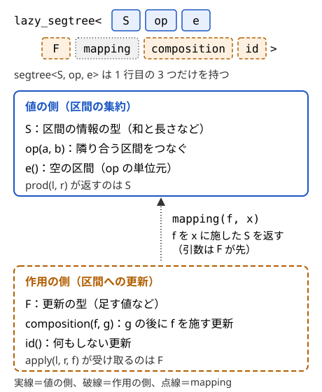

!!! abstract "要点"
    - **何ができるか**：AtCoder Library（ACL）を使う解説コードを共通の約束（0-indexed・半開区間）とともに読む。modint の `val()` と出力、segtree・lazy_segtree のテンプレート引数にラムダを渡す書き方を知る。
    - **いつ使うか**：解説コードに `#include <atcoder/all>`・`using mint = modint998244353;`・`x.val()`・`segtree<S, op, e>` が出てきて読みたいとき。ACL の呼び出しでコンパイルエラーや RE が出たとき。
    - **計算量**：`dsu` の操作はならし $O(\alpha(N))$。`fenwick_tree`・`segtree`・`lazy_segtree` は構築 $O(N)$・各操作 $O(\log N)$（渡した `op` などが $O(1)$ のとき）。modint の四則演算は $O(1)$ で、割り算だけ $O(\log m)$
    - **前提**：[関数テンプレートと constexpr](../cpp/cpp-templates-constexpr.md)、[ラムダ式と再帰ラムダ](../cpp/cpp-lambda.md)

<!-- textlint-disable -->
別名：AtCoder Library・ACL・atcoder/all・using namespace atcoder・val()・segtree<S, op, e>・lazy_segtree のテンプレート引数・テンプレート引数・ラムダをテンプレート引数に
<!-- textlint-enable -->

ACL は AtCoder が公開している C++ のライブラリで、AtCoder の提出環境には v1.6 が入っている。解説コードの多くはこれを使う。このページは、ACL の行を読むための共通の約束と、つまずきやすい書き方（modint の出力、segtree のテンプレート引数）に絞る。各部品が何をするかは、手法のページの「ACL では」の囲みに任せる。

このページのコードは `#include <bits/stdc++.h>`・`#include <atcoder/all>`・`using namespace std;`・`using namespace atcoder;` を前提にする。確かめた環境は ACL v1.6 と g++-13・g++-15（`-std=gnu++23`）である。

## include と共通の約束：0-indexed・半開区間・引数なしで作った物・assert {#conventions}

ACL の部品は、どれも次の約束に従う。解説コードの添字や区間は、この約束で読む。

- **include**：`#include <atcoder/all>` で全部を読み込むか、`#include <atcoder/segtree>` のように部品ごとに読み込む。名前は名前空間 `atcoder` の中にあるので、`using namespace atcoder;` と書くか、`atcoder::segtree` のように付ける
- **添字は 0-indexed**：問題文の 1-indexed の頂点 $u$ は `u - 1` にして渡す
- **区間は半開区間** $[l, r)$：`sum(l, r)` などの区間は $l$ 番目から $r - 1$ 番目までである。問題文の閉区間 $[L, R]$（1-indexed）は `(L - 1, R)` で渡す。`l == r` は空区間で、和なら 0、`prod` なら `e()` を返す
- **引数なしで作った物は、代入するまで使わない**：`scc_graph g;` はメンバ関数を呼ぶと動作が決まっていない。グローバル変数として宣言し、入力を読んでから `g = scc_graph(n);` と代入する使い方のためにある

```cpp
--8<-- "acl-reading/conventions.cpp:core"
```

完全なプログラム：[`conventions.cpp`](https://github.com/yuukougun/kyopro-atlas/blob/main/snippets/acl-reading/conventions.cpp)（GitHub）
{ .kp-code-src }

- **制約の違反は assert で止まる**：範囲外の添字や 0 での割り算は、ACL の中の `assert` で止まる。AtCoder は `NDEBUG` を定義しないので、結果は RE になる。手元で `fenwick_tree<long long> fw(3);` に `fw.sum(2, 4)` を呼ぶと、`Assertion '0 <= l && l <= r && r <= _n' failed.` と出て止まった。ACL のドキュメントは「制約外の入力を入れたときの挙動はすべて未定義」としている。止まってくれるのは親切にすぎず、`-DNDEBUG` を付けると同じコードが黙って誤った値を返した
- **マクロ名**：`ATCODER_` で始まる名前のマクロを自分で定義しない（ACL が使う）

??? question "確認問題：問題文で「$L$ 番目から $R$ 番目まで（両端を含む、1-indexed）の和」を `fenwick_tree` で求めるときの呼び出しは？"
    `fw.sum(L - 1, R)` である。1-indexed の $L$ は 0-indexed で $L - 1$、両端を含む $R$ は半開区間の終わりにすると 0-indexed の $R - 1$ に 1 を足した $R$ になる。

## コンストラクタは modint 以外 explicit：dsu d(n) と書く（dsu d = n はエラー） {#explicit}

ACL の部品のコンストラクタは、modint 以外すべて `explicit` が付いている。`explicit` なコンストラクタは `=` の右に引数だけを書く形では呼べないので、`dsu d = 5;` はコンパイルエラーになる。

```cpp
--8<-- "acl-reading/explicit-ng.cpp:core"
```

完全なプログラム：[`explicit-ng.cpp`](https://github.com/yuukougun/kyopro-atlas/blob/main/snippets/acl-reading/explicit-ng.cpp)（GitHub）
{ .kp-code-src }

丸括弧で作るか、型名を書いて作った物を入れる。`vector<dsu>` の要素の初期値も `dsu(4)` と型名を書く。modint だけは `explicit` がないので `mint x = 5;` と書ける。

```cpp
--8<-- "acl-reading/explicit-ok.cpp:core"
```

完全なプログラム：[`explicit-ok.cpp`](https://github.com/yuukougun/kyopro-atlas/blob/main/snippets/acl-reading/explicit-ok.cpp)（GitHub）。`mint` は ACL の `modint998244353`（[modint](../math/modint.md)）。
{ .kp-code-src }

- **版**：ACL のすべての版。g++-13・g++-15 のどちらでも、`dsu d = 5;` はエラー、`dsu d(5);` は通る
- **関連**：`explicit` の意味と、ほかの初期化の書き方は[初期化と CTAD](../cpp/cpp-initialization.md#explicit)にある

## 版：AtCoder は v1.6、v1.5 との違いは modint::val() の型など {#version}

AtCoder の提出環境（2025-10 の言語アップデート以降）の ACL は v1.6（2025-05 公開）である。v1.5 とのおもな違いは次のとおりで、手元で 2 つの版のソースを比べて確かめた。

- `modint::val()` の戻り値が `unsigned int` から `int` になった。互換性のない唯一の変更で、[modint の値と出力](#modint-val)で扱う
- `lazy_segtree` の `static_assert` のメッセージの誤記が直った（v1.5 は `mapping must work as F(F, S)` と誤って出す。正しくは `S(F, S)`）
- `lcp_array` に `assert` が足され、`dsu::leader` の `assert` の重複が減った。ほかに `convolution` の内部の修正と `expander.py` の改良がある。どれも使い方は変わらない

v1.5（2023-04）から、segtree・lazy_segtree は `S op(const S& a, const S& b)` のように `S(S, S)` として呼べる物を広く受け取るようになった。それより前の版は関数ポインタ `S (*)(S, S)` で受け取るので、型がちょうど `S(S, S)` の関数か、それに変換できるキャプチャのないラムダ（C++20）に限る（[関数の渡し方](#passing-functions)）。

- **手元を合わせる**：手元の ACL が v1.5 以前だと、`x.val() - 1` の結果や `max(x.val(), 0)` の可否が AtCoder と食い違う。手元も v1.6 にそろえる。古い版を入れているかは、`atcoder/modint.hpp` の `val()` の型で見分けられる
- **他のジャッジ**：AtCoder 以外に提出するときは、ACL の `expander.py` で 1 ファイルにまとめる（[バンドル](../cpp/cpp-macros-template-file.md#bundling)）

## 部品の呼び出し方の一覧（意味は各手法のページ） {#components}

よく出る部品の作り方と主なメソッドを並べる。何を計算するか、なぜ速いかは各手法のページにある。

```cpp
--8<-- "acl-reading/components.cpp:core"
```

完全なプログラム：[`components.cpp`](https://github.com/yuukougun/kyopro-atlas/blob/main/snippets/acl-reading/components.cpp)（GitHub）
{ .kp-code-src }

| 部品 | 作り方 | 読むときの注意 | 手法のページ |
| --- | --- | --- | --- |
| `dsu` | `dsu d(n);` | `leader` は代表の頂点で、番号の小さい方とは限らない | [Union-Find](../ds/union-find.md) |
| `fenwick_tree<T>` | `fenwick_tree<long long> fw(n);` | `add(p, x)` は一点加算、`sum(l, r)` は半開区間 | [BIT](../ds/fenwick-tree.md) |
| `scc_graph` | `scc_graph g(n);` | `scc()` の成分はトポロジカル順 | [強連結成分分解](../graph/scc.md) |
| `two_sat` | `two_sat ts(n);` | `add_clause(i, f, j, g)` は「$x_i = f$ または $x_j = g$」 | [2-SAT](../graph/two-sat.md#acl) |
| `mf_graph<Cap>` | `mf_graph<long long> g(n);` | `flow(s, t)` は流した量を返す。流した状態はグラフに残り、`edges()` で辺ごとの流量を読める | [最大流](../graph/max-flow.md#acl) |
| `mcf_graph<Cap, Cost>` | `mcf_graph<int, long long> g(n);` | `flow(s, t, 上限)` は `{流量, 費用}` の組 | [最小費用流](../graph/min-cost-flow.md#acl) |
| `convolution` | `convolution(a, b)` | 既定の法は 998244353。法なしの整数は `convolution_ll` | [畳み込みの使い方](../math/convolution-ntt.md#acl) |
| `suffix_array`・`lcp_array` | `suffix_array(s)`・`lcp_array(s, sa)` | sa は接尾辞を辞書順に並べた開始位置の列、lcp は隣どうしの最長共通接頭辞の長さ（長さ $N - 1$） | [Suffix Array](../string/suffix-array.md) |
| `z_algorithm` | `z_algorithm(s)` | `z[0]` は $\lvert S \rvert$ | [Z-algorithm](../string/z-algorithm.md) |
| `floor_sum` | `floor_sum(n, m, a, b)` | $\sum_{i=0}^{n-1} \lfloor (ai + b) / m \rfloor$ | [floor sum](../math/floor-sum.md) |
| `crt` | `crt(r, m)` | 解がなければ `{0, 0}` を返す | [中国剰余定理](../math/crt.md) |

`mcf_graph` の容量と費用の型は別々に決められるので、`<int, long long>` のように書かれることがある。

## dsu の groups()：戻り値の要素を範囲 for で直接回すのは C++23・GCC 15〜でだけ安全 {#dsu-groups}

`d.groups()` は連結成分ごとの頂点の列を `vector<vector<int>>` として返す。返り値は一時オブジェクトなので、範囲 for の範囲に `d.groups()[0]` と書くと、C++20 までの規則では範囲を決めた時点で一時オブジェクトが消え、消えた `vector` を読む。C++23 で規則が変わり（P2718）、一時オブジェクトはループの終わりまで生きるようになった。GCC が対応したのは GCC 15 からである。

```cpp
--8<-- "acl-reading/groups-ng.cpp:core"
```

完全なプログラム：[`groups-ng.cpp`](https://github.com/yuukougun/kyopro-atlas/blob/main/snippets/acl-reading/groups-ng.cpp)（GitHub）
{ .kp-code-src }

手元では、g++-15 の `-std=gnu++23` では `0 2` と正しく出た。g++-15 の `-std=gnu++20` と g++-13 の `-std=gnu++23` では Segmentation fault で止まり、AddressSanitizer では `heap-use-after-free` と出た。どちらも警告は出なかった。AtCoder の GCC 15.2（`-std=gnu++23`）では安全だが、手元が g++-13 だと手元でだけ落ちる。

どの版でも安全なのは、変数に受けてから回す書き方と、`d.groups()` そのものを回す書き方である。

```cpp
--8<-- "acl-reading/groups.cpp:core"
```

完全なプログラム：[`groups.cpp`](https://github.com/yuukougun/kyopro-atlas/blob/main/snippets/acl-reading/groups.cpp)（GitHub）
{ .kp-code-src }

- **版**：問題の書き方が安全になるのは C++23 かつ GCC 15 以降。g++-13 は `-std=gnu++23` でも危ない
- **関連**：範囲 for と一時オブジェクトの寿命は[参照と範囲 for](../cpp/cpp-range-for.md#temporary-range)にある。`groups()` は $O(N)$ かかるので、ループの中で何度も呼ばない

## modint の読み方：using mint = modint998244353; で法が自動で取られる {#modint}

`using mint = modint998244353;` は、998244353 で割った余りだけを持つ整数の型に `mint` という名前を付ける行である。`mint` どうしの `+`・`-`・`*`・`/` は、毎回自動で余りを取る。解説コードで `mint` が出てきたら、「この変数は答えを 998244353 で割った余りとして持っている」と読む。

```cpp
--8<-- "acl-reading/modint.cpp:core"
```

完全なプログラム：[`modint.cpp`](https://github.com/yuukougun/kyopro-atlas/blob/main/snippets/acl-reading/modint.cpp)（GitHub）。`mint` は ACL の `modint998244353`（[modint](../math/modint.md)）。
{ .kp-code-src }

- `vector<mint> dp(n + 1);` の要素は 0 で始まる
- `mint(-1)` は 998244352 に直されるので、引き算で負になる心配がない
- `/` は逆元を掛ける。割る数が法と互いに素のときだけ使える（法が 998244353 のような素数なら、法の倍数でなければよい）。そうでなければ `assert` で止まる
- `modint1000000007` は法が $10^9 + 7$ の型である。法を自分で決めるときは `static_modint<M>`（コンパイル時に決まる法）か `modint`（実行時に `modint::set_mod(m)` で決める法）を使う。使い分けと、割り算の条件は [modint](../math/modint.md) にある

## modint の値と出力：.val() を出す、v1.6 で val() は int、大小比較はない {#modint-val}

`mint` は `cout <<` でも `println` でも出力できない。どちらもコンパイルエラーになる。整数の値は `.val()` で取り出して出力する（[そのままでは出力できない型](../cpp/cpp-io.md#unprintable-types)）。

```cpp
--8<-- "acl-reading/modint-cout-ng.cpp:core"
```

完全なプログラム：[`modint-cout-ng.cpp`](https://github.com/yuukougun/kyopro-atlas/blob/main/snippets/acl-reading/modint-cout-ng.cpp)（GitHub）。`mint` は ACL の `modint998244353`（[modint](../math/modint.md)）。
{ .kp-code-src }

`.val()` の型は v1.6 で `int` である（v1.5 までは `unsigned int`）。そのため、版によって次の結果が変わる。手元の v1.5 と v1.6 で確かめた。

```cpp
--8<-- "acl-reading/modint-val.cpp:core"
```

完全なプログラム：[`modint-val.cpp`](https://github.com/yuukougun/kyopro-atlas/blob/main/snippets/acl-reading/modint-val.cpp)（GitHub）。`mint` は ACL の `modint998244353`（[modint](../math/modint.md)）。
{ .kp-code-src }

- **v1.5 の落とし穴**：`x.val() - 1` は `unsigned int` の引き算になり、$x = 0$ で 4294967295 になる。`max(x.val(), 0)` は `unsigned int` と `int` で型が合わずコンパイルエラーになる。古い解説コードに `(int)x.val()` や `(long long)x.val()` とあるのは、これを避けるためである
- **< がない**：mint は `==` と `!=` はあるが `<` がない。`sort` や `set<mint>`・`map<mint, …>` はコンパイルエラーになる

```cpp
--8<-- "acl-reading/modint-sort-ng.cpp:core"
```

完全なプログラム：[`modint-sort-ng.cpp`](https://github.com/yuukougun/kyopro-atlas/blob/main/snippets/acl-reading/modint-sort-ng.cpp)（GitHub）。`mint` は ACL の `modint998244353`（[modint](../math/modint.md)）。
{ .kp-code-src }

並べる必要があるなら、`val()` の値で比べる。`ranges::sort` の第 3 引数は、比べる値を要素から取り出す関数である（[射影](../cpp/cpp-algorithms.md#projection)）。ただし並ぶのは余りの大小で、元の整数の大小ではない（`mint(-1)` は最後に来る）。

```cpp
--8<-- "acl-reading/modint-sort-ok.cpp:core"
```

完全なプログラム：[`modint-sort-ok.cpp`](https://github.com/yuukougun/kyopro-atlas/blob/main/snippets/acl-reading/modint-sort-ok.cpp)（GitHub）。`mint` は ACL の `modint998244353`（[modint](../math/modint.md)）。
{ .kp-code-src }

??? question "確認問題：`mint` で持った答え $x$ について「$x$ が 0 なら -1 を出力」とするために `x.val() - 1` を使うコードは、どの版でも同じ結果になるか？"
    ならない。v1.6 では `val()` が `int` なので -1 になる。v1.5 以前では `unsigned int` なので 4294967295 になる。ただし `mint` が 0 でも、元の整数が 998244353 の倍数だった可能性があるので、「元の値が 0 か」の判定にはそもそも使えない（[modint](../math/modint.md)）。

## segtree のテンプレート引数の読み方：S は要素の型、op は結合的な演算、e は単位元 {#segtree-args}

この節からは[セグメント木](../ds/segment-tree.md)を前提にする。

`segtree<S, op, e>` の 3 つのテンプレート引数は次のとおりである。

- `S`：要素の型。区間の答えも同じ型で返る
- `op`：`S op(S a, S b)` の形の関数。隣り合う 2 つの区間の答えから、つないだ区間の答えを作る。[結合法則](../guide/glossary.md#associativity)（$\mathrm{op}(\mathrm{op}(a, b), c) = \mathrm{op}(a, \mathrm{op}(b, c))$）を満たす必要がある
- `e`：`S e()` の形の関数。空区間の答えで、どの `x` についても `op(e(), x) = op(x, e()) = x` となる値（[単位元](../guide/glossary.md#identity-element)）を返す

`e` は値ではなく、値を返す関数として渡す。`segtree<int, op, e> seg(a);` は「`int` の列 `a` の区間の `op` を取る木」と読む。

```cpp
--8<-- "acl-reading/segtree-args.cpp:core"

--8<-- "acl-reading/segtree-args.cpp:use"
```

完全なプログラム：[`segtree-args.cpp`](https://github.com/yuukougun/kyopro-atlas/blob/main/snippets/acl-reading/segtree-args.cpp)（GitHub）
{ .kp-code-src }

- **e の選び方**：区間 min なら `INT_MAX`（大きい方の端）、区間 max なら小さい方の端、区間和なら 0 である。`e()` は空区間の `prod(l, l)` の答えにもなり、`segtree<…> seg(n);` で作ったときの全要素の初期値にもなる
- **型の幅**：`S = int` の区間和は、要素が $10^9$ 程度でもすぐにあふれる。`long long` にする
- **関連**：どんな `S` と `op` を設計するか（和と長さ、最大値と個数など）は[セグメント木に何を載せるか](../ds/segment-tree-monoids.md#design-steps)にある

??? question "確認問題：区間 max の `segtree<int, op, e>` で、要素がすべて 0 以上なら `e()` は何を返せばよいか？"
    0 以下の値なら何でもよく、要素の範囲で最小の 0 や `INT_MIN` を返す。`op(e(), x) = max(e(), x) = x` がすべての要素 $x$ で成り立てばよい。1 以上の値を返すと、空区間や `seg(n)` で作った初期値が要素より大きくなり、答えが狂う。

## 関数の渡し方：関数の名前か、キャプチャのないラムダ（C++20） {#passing-functions}

`op` と `e` の渡し方は 2 通りある。ACL のドキュメントと多くの解説コードは、関数を定義してその名前を渡す（[segtree の読み方](#segtree-args)のコード）。

C++20 からは、キャプチャのない[ラムダ式](../cpp/cpp-lambda.md#template-argument)をテンプレート引数に直接書ける。ACL のどの版でも、`S(S, S)` の形のキャプチャのないラムダは渡せる。v1.5 からは `const S&` を受け取る形なども受け取る。次の 1 行は、名前を渡す形の区間 min と同じ意味である。

```cpp
--8<-- "acl-reading/segtree-lambda.cpp:core"
```

完全なプログラム：[`segtree-lambda.cpp`](https://github.com/yuukougun/kyopro-atlas/blob/main/snippets/acl-reading/segtree-lambda.cpp)（GitHub）
{ .kp-code-src }

ラムダに名前を付けてから渡してもよい。`constexpr` を付けておくと、コンパイル時に使う値だと分かりやすい。キャプチャのないラムダは付けなくても通る。通らないのはキャプチャのあるラムダで、[次の節](#capturing-lambda)のとおりである。

```cpp
--8<-- "acl-reading/segtree-lambda.cpp:named"
```

完全なプログラム：[`segtree-lambda.cpp`](https://github.com/yuukougun/kyopro-atlas/blob/main/snippets/acl-reading/segtree-lambda.cpp)（GitHub）
{ .kp-code-src }

- **版**：ラムダを直接書く形は C++20 から。`-std=gnu++17` では g++-13・g++-15 とも `lambda-expression in template-argument only available with '-std=c++20'` でエラーになる。AtCoder の `-std=gnu++23` では使える。ACL v1.4 以前は関数ポインタ `S (*)(S, S)` で受け取るので、`[](const int& x, const int& y) { … }` のように引数の型が違うラムダはエラーになる
- **読み方**：`segtree<int, [](int x, int y) { return min(x, y); }, [] { return INT_MAX; }>` は長いが、カンマで 3 つに分ければ `S`・`op`・`e` の順である。`[] { … }` は引数のないラムダ（`e`）である

## キャプチャのあるラムダは op・e に渡せない（max_right・min_left の判定関数には渡せる） {#capturing-lambda}

`op` と `e` はテンプレート引数なので、コンパイル時に中身が決まっている必要がある。外の変数をキャプチャするラムダは、実行時の値を抱えた物なので渡せない（理由は[ラムダ式の節](../cpp/cpp-lambda.md#template-argument)にもある）。

```cpp
--8<-- "acl-reading/capturing-ng.cpp:core"
```

完全なプログラム：[`capturing-ng.cpp`](https://github.com/yuukougun/kyopro-atlas/blob/main/snippets/acl-reading/capturing-ng.cpp)（GitHub）
{ .kp-code-src }

g++-13・g++-15 とも `error: '<lambda closure object>main()::<lambda(int, int)>{m}' is not a constant expression` と出る。キャプチャしたラムダを `auto op = …;` で変数に入れてから渡しても、`the value of 'op' is not usable in a constant expression` で止まる。

実行時に決まる値（入力で与えられる法 $m$ など）を `op` の中で使いたいときは、次のどちらかにする。

- その値をグローバル変数に置き、普通の関数（かキャプチャのないラムダ）からそれを読む。値を読んでから segtree を作る
- その値を `S` の中に持たせる

```cpp
--8<-- "acl-reading/capturing-ok.cpp:core"
```

完全なプログラム：[`capturing-ok.cpp`](https://github.com/yuukougun/kyopro-atlas/blob/main/snippets/acl-reading/capturing-ok.cpp)（GitHub）
{ .kp-code-src }

一方、`max_right(l, f)` と `min_left(r, f)` の判定関数 `f` は普通の関数の引数なので、キャプチャのあるラムダを渡せる。外の値 `k` を使う判定はこう書く。

```cpp
--8<-- "acl-reading/max-right.cpp:core"
```

完全なプログラム：[`max-right.cpp`](https://github.com/yuukougun/kyopro-atlas/blob/main/snippets/acl-reading/max-right.cpp)（GitHub）
{ .kp-code-src }

`f` には、`f(e())` が真で、区間を伸ばすと一度偽になったら真に戻らない（単調な）関数を渡す。使い方は[セグメント木上の二分探索](../ds/segment-tree-binary-search.md)にある。

??? question "確認問題：キャプチャのあるラムダを `op` に渡せないのはなぜか？"
    `op` はテンプレート引数で、どの関数を使うかはコンパイル時に型の一部として決まる。キャプチャのあるラムダは、実行時の値（キャプチャした変数）を中に持つ物なので、コンパイル時には中身が決まらない。`max_right` の `f` は実行時に受け取る普通の引数なので、この制限がない。

## lazy_segtree の 7 つの引数：composition(f, g) は g の後に f {#lazy-segtree-args}

この節からは[遅延セグメント木](../ds/lazy-segment-tree.md)を前提にする。

`lazy_segtree<S, op, e, F, mapping, composition, id>` の前の 3 つは segtree と同じ「値の側」で、後ろの 4 つは区間への更新を表す「作用の側」である。



- `F`：作用（区間の各要素に施す更新）の型
- `mapping(f, x)`：値 `x` に作用 `f` を施した値を返す。形は `S mapping(F f, S x)` で、引数は `F` が先である
- `composition(f, g)`：作用 `g` を施した後に作用 `f` を施すのと同じ作用（$f \circ g$）を返す。`g` はすでに溜まっている作用、`f` は新しく来た作用である
- `id()`：何もしない作用を返す。値の側の `e()` と取り違えない

区間加算・区間和では、和だけでは `mapping` が書けない（足す値に区間の長さを掛ける必要がある）ので、`S` に長さを持たせる。

```cpp
--8<-- "acl-reading/lazy-args.cpp:core"

--8<-- "acl-reading/lazy-args.cpp:use"
```

完全なプログラム：[`lazy-args.cpp`](https://github.com/yuukougun/kyopro-atlas/blob/main/snippets/acl-reading/lazy-args.cpp)（GitHub）
{ .kp-code-src }

- **葉の長さ**：`vector<S>(n, {0, 1})` から作る。`lazy_segtree<…> seg(n);` は全要素を `e()`（長さ 0）で作るので、区間加算をしても和が増えない
- **合成の向き**：加算のように順序を入れ替えても同じ作用では、`composition` の向きを間違えても答えは変わらない。代入やアフィン変換では答えが変わる。理由と例は[遅延セグメント木の ACL の約束](../ds/lazy-segment-tree.md#acl-conventions)にある
- **ラムダ**：7 つの関数引数もキャプチャのないラムダで渡せる（C++20）。ただし 7 つを 1 行に並べると読みにくいので、名前を付けた関数で書く解説が多い

??? question "確認問題：作用が「区間を値 $c$ で上書きする」のとき、`composition(f, g)` は何を返すべきか？（「上書きなし」は `id()` で表すとする）"
    `f` が `id()` なら `g` を、そうでなければ `f` を返す。`g` を施した後に `f` で上書きすれば、`g` の効果は消えて `f` だけが残るからである。向きを逆にして `g` を優先すると、新しい上書きが無視される。

## テンプレート引数の形が合わないときの static_assert（mapping must work as S(F, S) など） {#template-arg-errors}

ACL v1.6 の segtree・lazy_segtree は、渡された関数が期待どおりの形で呼べるかを `static_assert` で確かめる。合わないと、次のメッセージでコンパイルが止まる。

| メッセージ | 期待される形 |
| --- | --- |
| `op must work as S(S, S)` | `S op(S a, S b)` |
| `e must work as S()` | `S e()` |
| `mapping must work as S(F, S)` | `S mapping(F f, S x)` |
| `composition must work as F(F, F)` | `F composition(F f, F g)` |
| `id must work as F()` | `F id()` |

よくある原因は `mapping` の引数の順を逆にすることである。

```cpp
--8<-- "acl-reading/template-arg-ng.cpp:core"
```

完全なプログラム：[`template-arg-ng.cpp`](https://github.com/yuukougun/kyopro-atlas/blob/main/snippets/acl-reading/template-arg-ng.cpp)（GitHub）
{ .kp-code-src }

g++-13・g++-15 とも `error: static assertion failed: mapping must work as S(F, S)` と出る（エラーの場所は ACL の `lazysegtree.hpp` の中を指す）。

- **通ってしまう食い違い**：検査は「その形に変換して呼べるか」なので、型が暗黙に変換できれば通る。`S = int` に `long long op(long long, long long)` を渡しても止まらず、結果は `int` に切り詰められる。`S` と関数の型はそろえる
- **v1.5 の誤記**：v1.5 では `mapping must work as F(F, S)`・`compostiion must work as F(F, F)` と誤って出る。引数の正しい形は v1.6 のとおりである
- **エラーの読み方**：最初の `error:` の行と、`required from here` で自分のコードの行を探す（[C++ の逆引き](../cpp/cpp-reverse-index.md#compile-errors)）

## 参考 {#references}

- [AtCoder「AC Library のドキュメント（document_ja）」](https://github.com/atcoder/ac-library/tree/master/document_ja)：共通の約束（制約外の入力は未定義・デフォルトコンストラクタ・explicit）、各部品の宣言と計算量
- [AtCoder「ac-library Releases」](https://github.com/atcoder/ac-library/releases)：v1.5 で segtree・lazy_segtree が受け取る関数の形が広がったこと、v1.6 の `val()` の変更
- [cppreference「Range-based for loop」](https://en.cppreference.com/w/cpp/language/range-for)：範囲の式の一時オブジェクトがループの終わりまで生きる C++23 の規則（P2718）
- [cppreference「Template parameters」](https://en.cppreference.com/w/cpp/language/template_parameters)：`auto` のテンプレート引数（C++17）と、キャプチャのないラムダの型を渡せること
- [GCC「C++ Standards Support in GCC」](https://gcc.gnu.org/projects/cxx-status.html)：P2718 に対応した GCC の版
