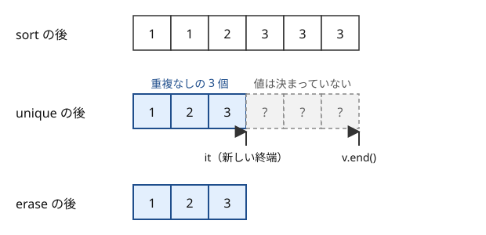

!!! abstract "要点"
    - **何ができるか**：sort・unique・lower_bound・accumulate などの定型と、射影も使える ranges 版（C++20）を使い分ける。accumulate の初期値の型や、unique だけでは要素が減らない点に気をつける。
    - **いつ使うか**：並べ替え・重複の削除・ソート済みの列での位置と個数・総和・累積和・順列の列挙を 1 行で書きたいとき。解説コードの `ranges::sort(v, {}, &P::x)` や `v.erase(unique(…), v.end())` を読みたいとき。
    - **計算量**：`sort` が $O(N \log N)$、`lower_bound`・`upper_bound` が $O(\log N)$（`set`・`map` ではメンバ関数を使ったときだけ）。`unique`・`accumulate`・`partial_sum`・`max_element`・`count` が $O(N)$。`next_permutation` は 1 回 $O(N)$ で、全順列を回せば 1 回あたりならし $O(1)$
    - **前提**：[コンテナ操作とイテレータ](../cpp/cpp-container-idioms.md)、[ラムダ式と再帰ラムダ](../cpp/cpp-lambda.md)

<!-- textlint-disable -->
別名：algorithm・sort・unique・std::lower_bound・std::upper_bound・accumulate・reduce・partial_sum・std::iota・std::next_permutation・max_element・max({a, b, c})・ranges::sort・射影・projection・ranges::unique・ranges::fold_left・ranges::contains
<!-- textlint-enable -->

アルゴリズム関数は、`<algorithm>` と `<numeric>` にある並べ替え・探索・集計の関数である。従来の版はイテレータの組 `v.begin(), v.end()` を受け取り、C++20 の ranges 版（`std::ranges::`）はコンテナをそのまま受け取る。このページの書き方は、`ranges::fold_left` などの C++23 の 3 つと `ranges::iota` を除き、`-std=gnu++20` から g++-13・g++-15 で使える。C++23 の 4 つも、AtCoder と同じ `-std=gnu++23` なら g++-13 から使える。

このページのコードは `#include <bits/stdc++.h>` と `using namespace std;` を前提にし、`std::ranges` を `ranges` と書く。

## sort と降順（greater・rbegin/rend） {#sort}

`sort(v.begin(), v.end())` は昇順に並べ替える。降順にするには、比較関数 `greater<>()` を渡すか、逆向きのイテレータ `rbegin`・`rend` で昇順に並べる。

```cpp
--8<-- "cpp-algorithms/sort.cpp:core"
```

入力 `3 1 4 1 5` なら、1 行目が `1 1 3 4 5`、2・3 行目が `5 4 3 1 1` と出る。

- **版**：`greater<>()`（型を省く書き方）は C++14 から。どれも g++-13・g++-15 で使える
- **落とし穴 1**：`sort` は安定でない。等しい要素の元の順を保ちたいなら `stable_sort` を使う（[ソートの使い方](../basics/sorting-techniques.md#ratio-and-ties)）
- **落とし穴 2**：自作の比較関数で `<=` を返すと、狭義の弱順序の要件を破る未定義動作になる。等しいときは `false` を返す（[ソートの使い方](../basics/sorting-techniques.md#strict-weak-ordering)、[比較関数と順序](../cpp/cpp-comparators.md)）

## 重複の削除：sort → unique → erase（unique は前に詰めて新しい終端を返すだけ） {#unique-erase}

`unique` は、隣り合って等しい要素を 1 つにまとめて前に詰め、詰め終わった位置（新しい終端）のイテレータを返す。要素を消すのはコンテナのメンバ関数の仕事なので、`unique` だけでは `v.size()` が変わらない。返ってきた位置から後ろを `erase` で消して、はじめて重複がなくなる。



`unique` が見るのは隣どうしだけなので、先に `sort` で等しい値を隣り合わせる。

```cpp
--8<-- "cpp-algorithms/unique-erase.cpp:core"
```

入力 `3 1 3 2 1 3` なら、`unique` の直後は大きさ 6・新しい終端の添字 3 で、`erase` の後に `1 2 3` が残る。これは[座標圧縮](../basics/coordinate-compression.md#three-steps)の 1 段目で、続けて `lower_bound` で値を添字に直す。

- **素朴に書くと**：`set<int> st(v.begin(), v.end()); v.assign(st.begin(), st.end());` と同じ結果になる。計算量はどちらも $O(N \log N)$ である。`vector` のまま行う方が定数倍は軽い
- **落とし穴 1**：`unique(v.begin(), v.end());` とだけ書くと、後ろに値の決まっていない要素が残ったままになる。戻り値は必ず `erase` に渡す
- **落とし穴 2**：`sort` を忘れると、離れた位置の重複が残る（`1 2 1` は `1 2 1` のまま）
- **落とし穴 3**：`unique` の名前から「重複のない要素を返す」と読み違えやすい。消すのは 2 個目以降で、1 個目は残る

## 二分探索：lower_bound・upper_bound の添字と個数、equal_range・binary_search（set・map はメンバ関数） {#lower-bound}

ソート済みの列で、`lower_bound(…, x)` は $x$ 以上の最初の位置、`upper_bound(…, x)` は $x$ より大きい最初の位置を返す。どちらもなければ `v.end()` を返す。`vector` ならイテレータから `v.begin()` を引くと添字になり、2 つの差が $x$ の個数になる。

```cpp
--8<-- "cpp-algorithms/lower-bound.cpp:core"
```

ソート後の列が `1 3 3 3 5 8` で $x = 3$ なら、`lo = 1`・`hi = 4` で個数は 3 である。$x = 4$ なら `lo = hi = 2` で個数は 0、$x = 9$ なら `lo = hi = 6`（`v.end()` の添字）になる。

- `equal_range` は `lower_bound` と `upper_bound` の組を一度に返す。`binary_search` は $x$ があるかだけを `bool` で返す
- 「$x$ 未満の個数」は `lo`、「$x$ 以下の個数」は `hi` である。閉区間 $[l, r]$ に入る個数は `upper_bound(r) - lower_bound(l)` で数える。考え方と応用は[二分探索](../basics/binary-search.md#lower-bound)にある

`set`・`map` では、メンバ関数の `st.lower_bound(x)` を使う。

```cpp
--8<-- "cpp-algorithms/lower-bound.cpp:set"
```

- **版**：C++98 から。構造化束縛で受ける書き方は C++17
- **落とし穴 1**：`set` に `std::lower_bound(st.begin(), st.end(), x)` や `ranges::lower_bound(st, x)` を使うと $O(N)$ かかる。`set` のイテレータは 1 つずつしか進めないからである。手元の g++-15（`-O2`）で、要素 $2 \times 10^4$ 個の `set` に $2 \times 10^4$ 回問い合わせた。どちらも約 2.3 秒かかり、メンバ関数は 1 ms だった（[メンバの lower_bound](../cpp/cpp-container-idioms.md#member-lower-bound)）
- **落とし穴 2**：ソートしていない列に使うと、結果に意味がない（エラーにもならない）
- **落とし穴 3**：`v.end()` が返ったときに `*it` を読むと範囲外を読む。`it == v.end()` を先に確かめる

## 総和：accumulate は初期値の型で足す（0LL・0.0）、reduce は初期値を省くと要素の型で足す {#accumulate}

`accumulate(first, last, init)` は、`init` と同じ型の変数に要素を順に足していく。要素の型ではなく初期値の型で計算するので、`0` を渡すと `int` で、`0LL` なら `long long` で、`0.0` なら `double` で足す。

```cpp
--8<-- "cpp-algorithms/accumulate.cpp:core"
```

`long long` の $10^9$ を 3 つ足すと、初期値 `0` では $-1294967296$ になる。足した結果を毎回 `int` の変数へ戻すとき、$2^{32}$ を法とした値に変わるからである。`double` の配列でも、`0` を渡すと 1 回ごとに小数が切り捨てられて 0 になる。どちらも `-Wall -Wextra` で警告は出なかった（g++-13・g++-15）。

- **素朴に書くと**：`long long s = 0; for (auto x : a) s += x;` と同じである。`accumulate(…, 0)` は `int s = 0;` と書いたのと同じ意味になる
- `reduce(first, last)` は、初期値を省くと要素の型の値 `T{}`（0）から足すので、`long long` の配列なら正しい。初期値を渡したときは `accumulate` と同じく初期値の型で足す。足す順序が決まっていないので、浮動小数点数では結果がわずかに変わりうる
- **版**：`accumulate` は C++98、`reduce` は C++17。どちらも `<numeric>` にある
- **落とし穴**：`int` の配列の和が $2^{31}$ を超えうるなら、`accumulate(a.begin(), a.end(), 0LL)` と初期値で型を上げる（[初期値と推論の型](../cpp/cpp-integer-overflow.md#inferred-int)）

## 累積和と差分：partial_sum・inclusive_scan・adjacent_difference {#partial-sum}

`partial_sum` と `inclusive_scan` は、先頭からの和を順に書き出す。`adjacent_difference` は逆に、隣どうしの差を書き出す。[累積和](../basics/prefix-sum.md#half-open)の配列 $S$（$S_0 = 0$、$S_{i+1} = S_i + a_i$）は、出力先を `s.begin() + 1` にずらして作る。

```cpp
--8<-- "cpp-algorithms/partial-sum.cpp:core"
```

入力 `3 1 4 1` なら、`s` は `0 3 4 8 9` になり、`adjacent_difference` で差を取ると `3 1 4 1` に戻る。半開区間 $[l, r)$ の和は `s[r] - s[l]` で求まる。

- **素朴に書くと**：`for (int i = 0; i < n; i++) s[i + 1] = s[i] + a[i];` と同じである
- **版**：`partial_sum`・`adjacent_difference` は C++98、`inclusive_scan` は C++17
- **落とし穴**：`partial_sum` は、途中の和を入力の要素の型で持つ。出力先が `long long` でも、`a` が `int` なら和は `int` で計算される。手元で $2 \times 10^9$ を 2 つ並べた `int` の配列に使うと、2 つ目の和が $-294967296$ になった（符号付き整数のあふれなので[未定義動作](../cpp/cpp-integer-overflow.md#signed-overflow-ub)である）。初期値 `0LL` を渡せる `inclusive_scan` を使うか、素朴なループで書く

```cpp
--8<-- "cpp-algorithms/partial-sum.cpp:ng"
```

## 連番：std::iota で埋める（views::iota・ranges::iota との違い） {#iota}

`iota(v.begin(), v.end(), k)` は、`v` を $k, k+1, k+2, \dots$ で埋める。よく使うのは、添字の配列を作って値の順に並べ替える書き方である。`a` を並べ替えずに、「小さい順に何番目の要素か」が分かる。

```cpp
--8<-- "cpp-algorithms/iota.cpp:core"
```

入力 `30 10 40 20` なら `1 3 0 2` と出る。等しい値があっても元の添字の順を保つよう、`stable_sort` を使っている。

名前の似た 3 つは役割が違う。

| 書き方 | 何をするか | 版 |
| --- | --- | --- |
| `iota(v.begin(), v.end(), 0)` | 配列を連番で埋める | C++11 |
| `ranges::iota(v, 0)` | 同じことをコンテナを渡して行う | C++23（GCC 13〜） |
| `views::iota(0, n)` | 配列を作らず連番を見せる view | C++20 |

- **版**：`ranges::iota` は `-std=gnu++20` では g++-13・g++-15 ともコンパイルエラーになり、`-std=gnu++23` なら通る
- **落とし穴**：`for` で回すだけなら配列は要らない。`views::iota` を使うか普通の for で書く（[views::iota](../cpp/cpp-views-basics.md#iota)）

## next_permutation で順列を列挙する（ソートした状態から始める） {#next-permutation}

`next_permutation(v.begin(), v.end())` は、`v` を辞書順で次の並びに書き換えて `true` を返す。最後の並び（降順）だったときは、最初の並び（昇順）に戻して `false` を返す。そのため、ソートしてから `do { … } while (next_permutation(…));` と回すと、すべての並びを 1 回ずつ見られる。

```cpp
--8<-- "cpp-algorithms/next-permutation.cpp:core"
```

入力 `3 1 2` なら `2 6` と出る。ソートせずに `3 1 2` から始めると、それより辞書順で後ろの `3 1 2` と `3 2 1` の 2 通りしか見ない。入力 `1 2 2` なら `3 3` で、等しい要素を入れ替えただけの並びは 1 回しか出てこない。

- **素朴に書くと**：使った要素の印を持ちながら再帰で並びを作るのと同じである（[再帰による全列挙](../basics/recursive-enumeration.md)）。$N \le 8$〜$10$ 程度で使う（[順列全探索](../basics/bit-full-search.md#permutations)）
- **版**：C++98 から。g++-13・g++-15 で使える
- **落とし穴 1**：`while (next_permutation(…)) { … }` と書くと、最初の並びを処理し忘れる。`do`〜`while` にする
- **落とし穴 2**：重複のある列では $N!$ 通りではなく、異なる並びの数だけ回る。「$N!$ 通りすべて」を数えたいなら、添字の列 `0, 1, …, N-1` の順列を回す

## 最大・最小・個数：max_element はイテレータを返す、max({a, b, c})・clamp、count は ptrdiff_t を返す {#max-element}

`max_element` と `min_element` は、値ではなく位置（イテレータ）を返す。値は `*it`、添字は `it - v.begin()` で取り出す。最大が複数あるときは最初の位置を返す。`max({a, b, c})` は 3 つ以上の値の最大を返し、`clamp(x, lo, hi)` は $x$ を閉区間 $[lo, hi]$ に収める。

```cpp
--8<-- "cpp-algorithms/max-element.cpp:core"
```

入力 `3 9 2 9 3` なら `9 1`（値と、最初の 9 の添字）、`7 5`、`2` と出る。

- **版**：`max({a, b, c})` は C++11、`clamp` は C++17。どちらも g++-13・g++-15 で使える
- **落とし穴 1**：空の配列なら `max_element` は `v.end()` を返し、`*it` は範囲外を読む。空かもしれないなら、呼ぶ前に確かめる
- **落とし穴 2**：`min(1, x)`（`x` が `long long`）は、2 つの引数の型が違うのでコンパイルエラーになる。`max({…})` の中も型をそろえる（[型の違う値を min・max に渡す](../cpp/cpp-integer-overflow.md#min-max-types)）

```cpp
--8<-- "cpp-algorithms/min-ng.cpp:core"
```

- **落とし穴 3**：`count` と `ranges::count` の戻り値は `ptrdiff_t`（64 bit の Linux では `long`）である。`int` の変数と `max` で比べると、同じ理由でコンパイルエラーになる。`(int)` で直すか、受ける変数を `long long` にする

```cpp
--8<-- "cpp-algorithms/count-ng.cpp:core"
```

## ranges 版：ranges::sort(v) のようにコンテナを直接渡す（C++20） {#ranges}

ranges 版のアルゴリズムは、`v.begin(), v.end()` の代わりにコンテナを 1 つ渡す。`ranges::sort(v)` は `sort(v.begin(), v.end())` と同じ意味である。begin と end を別のコンテナから取り違える誤りがなくなる。

```cpp
--8<-- "cpp-algorithms/ranges.cpp:core"
```

入力 `3 -1 4 1 4` なら、降順に並べた後で `-1 4 4`（最小・最大・最大）と `2 1`（先頭の 4 の個数と、負の数があるか）が出る。

- 比較関数は 2 つ目の引数に渡す（`greater{}`）。ranges 版は射影も受け取る（[射影](#projection)）
- `ranges::max(v)`・`ranges::minmax(v)` は値を返す。位置が欲しければ `ranges::max_element(v)` を使う
- **版**：C++20。g++-13・g++-15 とも `-std=gnu++20` から使える
- **落とし穴**：`ranges::max(v)` を空の `v` に使うのは未定義動作である。`max_element` と違って `end` で知らせる手段がない

## 射影：ranges::sort(ps, {}, &P::score) は score で比べて要素ごと並べ替える（C++20） {#projection}

射影は、比べる前に各要素へ適用する関数である。`ranges::sort(ps, {}, &P::score)` は、各要素から `score` を取り出して比べる。並べ替えるのは要素ごと（`name` も一緒）である。2 つ目の引数の `{}` は既定の比較 `ranges::less{}` で、3 つ目が射影である。

```cpp
--8<-- "cpp-algorithms/projection.cpp:struct"
```

```cpp
--8<-- "cpp-algorithms/projection.cpp:core"
```

入力が `alice 70`・`bob 90`・`carol 50` なら、`carol alice bob` の順に並び、最大は `bob` になる。`ranges::max(ps, {}, &P::score)` は score の値ではなく、score が最大の要素そのものを返す。

- **素朴に書くと**：`sort(ps.begin(), ps.end(), [](const P& x, const P& y) { return x.score < y.score; });` と同じである。比較を 2 引数のラムダ式で書く代わりに、「何で比べるか」だけを書ける
- 射影にはメンバへのポインタ（`&P::score`・`&pair<int, int>::second`）のほか、1 引数のラムダ式も渡せる
- **版**：C++20。g++-13・g++-15 で使える
- **落とし穴**：射影の前の `{}` を省いて `ranges::sort(ps, &P::score)` と書くと、`&P::score` を比較関数として渡したことになり、コンパイルエラーになる。比較と射影の順を守る

## ranges::unique は後ろの不要部分を返す（C++20） {#ranges-unique}

`ranges::unique(v)` は、従来の `unique` と同じく重複を前に詰めるが、返すのは新しい終端のイテレータではない。後ろの不要部分 `[新しい終端, v.end())` を表す `subrange` を返す。そのため、`erase` には戻り値の `.begin()` を渡す。

```cpp
--8<-- "cpp-algorithms/ranges-unique.cpp:core"
```

入力 `3 1 3 2 1 3` なら、`tail.size()` は消える要素の数 3 で、`1 2 3` が残る。

- **書き方**：1 行にまとめると `v.erase(ranges::unique(v).begin(), v.end());` になる
- **版**：C++20。g++-13・g++-15 で使える
- **落とし穴**：従来の `unique` の癖で `v.erase(ranges::unique(v), v.end())` と書くと、`subrange` はイテレータでないのでコンパイルエラーになる

## ranges::fold_left・contains・find_last（C++23・GCC 13〜）と、AtCoder にない ranges::starts_with {#fold-left}

C++23 で、`ranges::fold_left`（初期値から左に向かって畳み込む）、`ranges::contains`（値があるか）、`ranges::find_last`（最後に現れる位置）が入った。どれも GCC 13 から使える。

```cpp
--8<-- "cpp-algorithms/fold-left.cpp:core"
```

入力が $v = (3, 2 \times 10^9, 3, 2 \times 10^9, 1)$ と $x = 3$ なら、和 4000000007・あり（1）・最後の 3 の添字 2 が出る。`fold_left` も `accumulate` と同じく、初期値 `0LL` の型で計算する。

- `find_last` は最後の $x$ から末尾までの `subrange` を返す。見つからなければ空の `subrange`（`begin()` が `v.end()`）を返す
- **版**：C++23。g++-13・g++-15 とも `-std=gnu++23` なら使え、`-std=gnu++20` ではコンパイルエラーになる
- **使えないもの**：`ranges::starts_with`・`ranges::ends_with` は GCC 16 からで、g++-13・g++-15 と AtCoder の GCC 15.2 ではコンパイルエラーになる

```cpp
--8<-- "cpp-algorithms/starts-with-ng.cpp:core"
```

代わりに、長さを確かめてから `equal` で先頭を比べる。

```cpp
--8<-- "cpp-algorithms/starts-with-ok.cpp:core"
```

## 一時オブジェクトを渡すと戻り値が ranges::dangling になる（使うとコンパイルエラー） {#ranges-dangling}

ranges 版に関数の戻り値などの[一時オブジェクト](../guide/glossary.md#temporary-object)を渡すと、イテレータを返す関数の戻り値は `ranges::dangling` という型になる。一時オブジェクトは文が終わると消えるので、その中を指すイテレータを使わせないための安全装置である。`*` で読もうとした時点でコンパイルエラーになる。

```cpp
--8<-- "cpp-algorithms/dangling-ng.cpp:core"
```

g++-13・g++-15 のエラーは `no match for 'operator*' (operand type is 'std::ranges::borrowed_iterator_t<std::vector<int> >')` と出る（`borrowed_iterator_t` が、ここでは `dangling` を指す）。値を返す関数なら一時オブジェクトを渡してよい。イテレータが要るなら変数に入れてから渡す。

```cpp
--8<-- "cpp-algorithms/dangling-ok.cpp:core"
```

- **版**：C++20。g++-13・g++-15 のどちらでも、`*ranges::max_element(make())` はエラーになり、変数に入れてから渡す書き方は通った
- **比べると**：従来の版は `make().begin(), make().end()` のように書くと別々の一時オブジェクトを指すが、コンパイルは通る。ranges 版は誤りをコンパイル時に止める（寿命の誤りの全体は[未定義動作](../cpp/cpp-undefined-behavior.md)）

## 確認問題 {#quiz}

??? question "確認問題：`unique(v.begin(), v.end());` だけを書いた後、`v.size()` は変わるか？"
    変わらない。`unique` は重複を前に詰めて新しい終端を返すだけで、要素を消さない。消すのはコンテナのメンバ関数 `erase` の仕事なので、`v.erase(unique(v.begin(), v.end()), v.end());` と書く。

??? question "確認問題：初期値を `0` にした accumulate が誤るのはどんなときか？"
    和が `int` の範囲（約 $2.1 \times 10^9$）を超えるときと、`a` が `double` などの小数の配列のときである。計算は初期値 `0` の型 `int` で行われるので、前者は値が変わり、後者は毎回切り捨てられる。`0LL`・`0.0` を渡す。

??? question "確認問題：`ranges::sort(ps, {}, &P::score)` の `{}` は何か？"
    比較関数で、`{}` と書くと既定の `ranges::less{}`（昇順）になる。3 つ目の `&P::score` が射影なので、比較を省けない。降順なら `ranges::sort(ps, greater{}, &P::score)` と書く。

## 参考 {#references}

- [cpprefjp「unique」](https://cpprefjp.github.io/reference/algorithm/unique.html)：前に詰めて新しい終端を返し、後ろの要素の値は決まっていないこと
- [cpprefjp「accumulate」](https://cpprefjp.github.io/reference/numeric/accumulate.html)：初期値の型で計算すること
- [cpprefjp「reduce」](https://cpprefjp.github.io/reference/numeric/reduce.html)：初期値を省くと要素の型の `T{}` から集計すること
- [cppreference「std::partial_sum」](https://en.cppreference.com/w/cpp/algorithm/partial_sum)：途中の和を入力の要素の型で持つこと
- [cpprefjp「inclusive_scan」](https://cpprefjp.github.io/reference/numeric/inclusive_scan.html)：初期値を渡す形
- [cpprefjp「next_permutation」](https://cpprefjp.github.io/reference/algorithm/next_permutation.html)：最後の並びで最初に戻して `false` を返すこと
- [cpprefjp「ranges::unique」](https://cpprefjp.github.io/reference/algorithm/ranges_unique.html)：戻り値が後ろの部分の `subrange` であること
- [cpprefjp「ranges::fold_left」](https://cpprefjp.github.io/reference/algorithm/ranges_fold_left.html)：C++23 の畳み込み
- [cpprefjp「dangling」](https://cpprefjp.github.io/reference/ranges/dangling.html)：一時オブジェクトを渡したときの戻り値の型
- [GCC「libstdc++ Implementation Status」](https://gcc.gnu.org/onlinedocs/libstdc++/manual/status.html)：`fold_left` などの 4 つが GCC 13.1 で、`starts_with`・`ends_with` が GCC 16.1 で入ったこと
