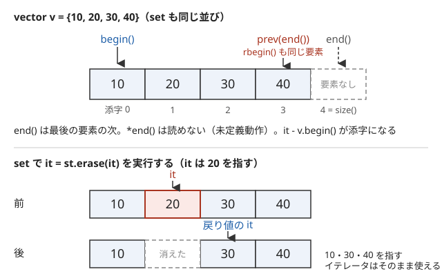

!!! abstract "要点"
    - **何ができるか**：set・map・multiset の定型の操作（erase_if・contains・1 個だけ消す）とイテレータを正しく書く。map の `[]` が要素を作る、set に `std::lower_bound` を使うと遅い、などの事故を防ぐ。
    - **いつ使うか**：解説コードに `erase_if`・`contains`・`ms.erase(ms.find(x))`・`*prev(st.end())`・`it = st.erase(it)` が出てきて読みたいとき。set・map を使った解法が TLE・RE・WA になり、書き方を疑うとき。
    - **計算量**：set・map の検索・挿入・削除と `lower_bound` は $O(\log N)$。自由関数の `erase(v, x)`・`erase_if` は全体を 1 回見るので $O(N)$（set・map のメンバの `erase` は $O(\log N)$）。set に `std::lower_bound`・`distance` を使うと $O(N)$
    - **前提**：なし

<!-- textlint-disable -->
別名：erase_if・contains・emplace_back・map の []・multiset の削除・ms.erase(ms.find(x))・イテレータ・iterator・std::prev・std::next・rbegin・it - v.begin()・イテレータの無効化・unordered_map のハッシュ・pb_ds・order_of_key・find_by_order
<!-- textlint-enable -->

コンテナ操作とイテレータは、set・map・vector を使う解法で毎回出てくる定型の書き方である。どのコンテナを選ぶか・各操作の計算量は [STL コンテナの使い分け](../ds/stl-containers.md)に任せ、ここでは書き方と、書き間違えたときに起きる事故を扱う。

このページのコードは `#include <bits/stdc++.h>` と `using namespace std;` を前提にする。書き方はすべて手元の g++-13・g++-15（`-std=gnu++23`）で確かめた。AtCoder の GCC 15.2（`-std=gnu++23`）でも使える。

## erase(v, x)・erase_if(v, pred)：消した個数を返す。erase_if は set・map にも使える（C++20） {#erase-if}

`erase(v, x)` は `v` から `x` に等しい要素をすべて消し、`erase_if(v, pred)` は `pred` が真になる要素をすべて消す。どちらも消した個数を返す。`erase(v, x)` は vector・deque・string・list で使う。`erase_if(v, pred)` はそれらに加えて set・multiset・map・unordered_map にも使える。set・map で値を消すなら、メンバの `st.erase(x)` を使う。map の `pred` は `(キー, 値)` の組を受け取る。

```cpp
--8<-- "cpp-container-idioms/erase-if.cpp:core"
```

入力 `3 1 4 1 5 3` なら、`v` から 3 が 2 個、`st` から 4 が 1 個、`cnt` から 1 回だけ現れた 4 と 5 の 2 個が消える。

- **素朴に書くと**：C++17 までは、vector から消すのに `remove` と `erase` を組み合わせた。`remove` は残す要素を前に詰めるだけで要素数を変えないので、後ろの余りを `erase` で切る

```cpp
--8<-- "cpp-container-idioms/erase-remove.cpp:core"
```

- **版**：C++20。g++-13・g++-15 で使える。`-std=gnu++17` では `'erase' was not declared in this scope` でコンパイルエラーになる
- **落とし穴**：メンバの `v.erase(x)` と自由関数の `erase(v, x)` は別物である。vector のメンバの `erase` はイテレータを受け取り、値は受け取らない。set のメンバの `st.erase(x)` は値を受け取る（[multiset から 1 個だけ消す](#multiset-erase-one)）。`erase_if` で set の要素を消すときは、ループで 1 個ずつ消す書き方（[erase は次のイテレータを返す](#erase-returns-next)）と同じ意味になる

## contains（C++20）と find・count {#contains}

`st.contains(x)` は `x` があるかどうかを `bool` で返す。set・multiset・map・unordered_map で使え、map ではキーを調べる。C++17 まではあるかどうかを `count(x)` か `find(x) != end()` で調べていた。

```cpp
--8<-- "cpp-container-idioms/contains.cpp:core"
```

- **使い分け**：あるかどうかだけなら `contains`。見つけた要素を使う（値を読む・そこから隣を見る・消す）なら `find` でイテレータを受け取る。`count` は個数が要るときに使う
- **版**：コンテナの `contains` は C++20、`string::contains` は C++23。どちらも g++-13・g++-15 で使える。`-std=gnu++20` では `string` の `contains` が `has no member named 'contains'` でコンパイルエラーになる
- **落とし穴**：multiset の `count(x)` は $O(\log N + \text{個数})$ かかる。同じ値が $10^5$ 個入った multiset で `count(x) > 0` を繰り返すと遅いので、あるかどうかは `contains` か `find` で調べる

## map の添字演算子はキーがなければ要素を作る（存在を調べるなら contains・find） {#map-subscript}

`mp[k]` は、キー `k` がなければ値を既定値（`int` なら 0）にした要素を作ってから、その値への参照を返す。数えるときの `cnt[x]++` はこの性質を使った書き方である。一方、調べるだけのつもりで `mp[k]` を書くと、要素が増える。

```cpp
--8<-- "cpp-container-idioms/map-subscript.cpp:core"
```

- **落とし穴 1**：`if (mp[k] > 0)` は、`k` がなければ `mp[k] = 0` を作る。結果は正しくても、`mp.size()` が変わり、`for (auto [key, val] : mp)` で値 0 の要素が出てくる。数を問い合わせるだけのクエリで要素が増え続け、メモリと時間を使うこともある
- **落とし穴 2**：範囲 for で map を回しながら、ほかのキーに `mp[k]` を書くと、回している途中で要素が足される。消すわけではないのでイテレータは壊れないが、足された要素を回るかどうかはキーの大小で決まり、意図しない結果になりやすい
- **落とし穴 3**：`const map<int, int>&` で受けた map に `[]` を使うとコンパイルエラーになる。メッセージは `passing 'const std::map<int, int>' as 'this' argument discards qualifiers` である。`[]` は要素を作るかもしれない操作なので、const の map では使えない。読むだけの関数では `find` か `at` を使う
- **`at`**：`mp.at(k)` は要素を作らず、`k` がなければ例外 `out_of_range` を投げる。競技プログラミングでは例外を受け止めないので、RE になる。あると分かっているときに使うか、先に `contains` で確かめる

??? question "確認問題：`if (cnt[x] > 0)` を何度も実行するとき、何が問題か"
    `x` がない回ごとに `cnt[x] = 0` の要素が作られる。答えは変わらないが、`cnt.size()` が問い合わせた種類の数だけ増える。`cnt.size()` を「現れた値の種類数」として使っていると WA になる。`cnt.contains(x)` か `cnt.find(x) != cnt.end()` で調べる。

## multiset から 1 個だけ消す：ms.erase(ms.find(x))（erase(x) は全部消す） {#multiset-erase-one}

multiset のメンバの `erase` は、値を渡すと**その値をすべて**消し、イテレータを渡すとその 1 個だけを消す。1 個だけ消すには、`find(x)` で 1 個のイテレータを得てから渡す。

```cpp
--8<-- "cpp-container-idioms/multiset-erase.cpp:core"
```

$\{1, 2, 2, 2, 3\}$ から 2 を消すとき、`ms.erase(2)` では 3 個とも消えて大きさが 2 になる。`ms2.erase(it)` では 1 個だけ消えて大きさが 4 になる。

- **落とし穴 1**：「最大値を取り除く」「値 $x$ のものを 1 つ取り除く」をスライド窓やクエリで書くとき、`ms.erase(x)` と書くと同じ値がまとめて消える。同じ値が入らないテストでは気づかないので、重複する値を入れて試す
- **落とし穴 2**：`x` がないと `find(x)` は `end()` を返し、`ms.erase(ms.end())` は[未定義動作](../cpp/cpp-undefined-behavior.md)になる。手元の g++-15 では `free(): invalid pointer` で異常終了した。`-D_GLIBCXX_ASSERTIONS` を付けると、`__position != end()` という検査で止まる。必ずあると言えないときは、`find` の結果が `end()` でないことを確かめてから消す
- **最大値・最小値を 1 個消す**：最小値は `ms.erase(ms.begin())`、最大値は `ms.erase(prev(ms.end()))` と書く（[イテレータの基本](#iterators)）。空の multiset に書くと未定義動作になる

## emplace_back と push_back {#emplace-back}

`v.emplace_back(args...)` は、引数をそのまま要素のコンストラクタに渡して、vector の末尾にその場で要素を作る。`v.push_back(x)` は、できあがった値 `x` を末尾に足す。pair や tuple の要素なら、`e.emplace_back(u, w)` と `e.push_back({u, w})` は同じ結果になる。

```cpp
--8<-- "cpp-container-idioms/emplace-back.cpp:core"
```

- **速さ**：`int` や pair のような小さな要素では、どちらで書いても速さはほとんど変わらない。読みやすいほうを使えばよい
- **落とし穴 1**：`emplace_back` は引数をコンストラクタに渡す。`vector<vector<int>>` に `vs.emplace_back(3)` と書くと、要素 1 個の `{3}` ではなく、大きさ 3 の `{0, 0, 0}` が足される。`push_back({3})` は `{3}` を足す。要素が vector のときは、意図した方を確かめる
- **落とし穴 2**：`e.emplace_back({1, 2})` はコンパイルエラーになる。メッセージは `no matching function for call to ... emplace_back(<brace-enclosed initializer list>)` である。`emplace_back` は引数の型を推論するが、`{1, 2}` だけからは型が決まらないからである。`{}` で書くなら `push_back({1, 2})` にする

## set・map の lower_bound はメンバ関数を使う（std::lower_bound は O(N)） {#member-lower-bound}

set・multiset・map で「$x$ 以上の最小の要素」を探すときは、メンバの `st.lower_bound(x)` を使う。木の上を根から下りるので $O(\log N)$ で済む。

```cpp
--8<-- "cpp-container-idioms/member-lower-bound.cpp:core"
```

自由関数の `lower_bound(st.begin(), st.end(), x)` と `ranges::lower_bound(st, x)` は、同じ要素を返すが $O(N)$ かかる。これらの関数は、真ん中の位置へ一気に飛べる配列のイテレータを想定して作られている。set のイテレータは 1 つずつしか進めないので、比較の回数は $O(\log N)$ でも、真ん中まで進むのに $O(N)$ かかる。手元の g++-13・g++-15（`-O2`）で、要素数 $2 \times 10^4$ の set に $2 \times 10^4$ 回問い合わせた。メンバは 1 ms 未満で、`std::lower_bound` と `ranges::lower_bound` はどちらも約 2.2 秒かかった。

- **落とし穴**：結果が同じなので、小さな入力のテストでは気づかない。set・map に対しては `upper_bound`・`find`・`count` もメンバを使う
- **境界**：$x$ 以上の要素がなければ `end()` が返る。`*it` を読む前に `it != st.end()` を確かめる

## イテレータの基本：begin は先頭、end は最後の要素の次（prev・next・rbegin） {#iterators}

[イテレータ](../guide/glossary.md#iterator)は、コンテナの中の 1 つの位置を指す物で、`*it` でその位置の要素を読む。`begin()` は先頭の要素を指し、`end()` は最後の要素の**次**（要素のない位置）を指す。コンテナ全体は半開区間 $[\texttt{begin}, \texttt{end})$ に当たり、空のコンテナでは `begin() == end()` になる。



最後の要素は `*prev(st.end())` か `*st.rbegin()` で読む。`prev(it)` は 1 つ前、`next(it)` は 1 つ後の位置を返し、`it` そのものは動かさない（動かすのは `--it`・`++it`）。set では、`lower_bound` の結果と組み合わせて「$x$ 以上の最小」と「$x$ 未満の最大」を両方得る書き方がよく出てくる。

```cpp
--8<-- "cpp-container-idioms/iterators.cpp:core"
```

入力 25 なら、25 以上の最小が 30、25 未満の最大が 20、その次が 40 と出る。入力 5 では `it == st.begin()` なので「未満の最大」はなく、入力 50 では `it == st.end()` なので「以上の最小」はない。

- **落とし穴 1**：`*st.end()` と、`begin()` での `prev(it)` は未定義動作である。`prev(it)` の前に `it != st.begin()`、`*it` と `next(it)` の前に `it != st.end()` を確かめる。空のコンテナでは、`*st.begin()` と `*prev(st.end())` のどちらも読めない
- **落とし穴 2**：`st.end() - 1` は set ではコンパイルエラーになる（vector では通る）。set・map のイテレータは 1 つずつしか動けないので、`prev`・`next` を使う
- **混同**：`rbegin()` は逆向きのイテレータで、`++` で前の要素へ進む。`*st.rbegin()` と `*prev(st.end())` は同じ要素を読むが、型が違うので `==` で比べられない

## it - v.begin() で添字（vector だけ）、distance は set では O(N) {#iterator-index}

vector・deque・string のイテレータは引き算ができ、`it - v.begin()` が添字になる。ソート済みの vector で `lower_bound(...) - v.begin()` と書くと、「$x$ 以上の最初の添字」が得られる。見つからなければ `v.size()` になる。

```cpp
--8<-- "cpp-container-idioms/iterator-index.cpp:core"
```

`upper_bound` との差は、$x$ に等しい要素の個数になる。`{10, 20, 20, 30}` で $x = 20$ なら、添字は 1、個数は 2 である。

- **落とし穴 1**：set のイテレータは引き算できず、`st.lower_bound(x) - st.begin()` は `no match for 'operator-'` でコンパイルエラーになる。`distance(st.begin(), it)` なら通るが、1 つずつ数えるので $O(N)$ かかる。クエリごとに書くと全体で $O(NQ)$ になって TLE する
- **set で「$x$ 未満の個数」が要るとき**：[座標圧縮](../basics/coordinate-compression.md)して BIT で数えるか、[set・multiset・map の応用](../ds/ordered-set.md)の方法を使う。GCC の拡張でよければ [pb_ds の tree](#pb-ds) で $O(\log N)$ になる
- **型**：`it - v.begin()` は `ptrdiff_t`（64 bit の Linux では `long`）を返す。値は `int` に収まる大きさである。ただし `max(i, it - v.begin())` のように `int` と一緒に `max`・`min` へ渡すと、型が合わずコンパイルエラーになる。`int` の変数に入れてから渡す

## erase は次のイテレータを返す（it = st.erase(it)） {#erase-returns-next}

イテレータで要素を消すと、そのイテレータは無効になる（指していた要素がもうない）。メンバの `erase(it)` は、消した要素の次を指すイテレータを返すので、回しながら消すときはそれを受け取る。

```cpp
--8<-- "cpp-container-idioms/erase-loop.cpp:core"
```

入力 `1 2 3 4 6` なら、偶数の 2・4・6 が消えて `1 3` が残る。消したときは戻り値で次へ進み、消さないときだけ `++it` で進める。条件で消すだけなら、[erase_if](#erase-if) の 1 行で書ける。

- **落とし穴**：`for (auto it = st.begin(); it != st.end(); ++it) if (...) st.erase(it);` は、消して無効になった `it` を `++it` で進める未定義動作である。手元の g++-13・g++-15 では、上と同じ入力で Segmentation fault になった。AddressSanitizer（`-fsanitize=address`）では見つからないことがある（set の `++` は計測されないライブラリの中で動くため）。`-D_GLIBCXX_DEBUG` を付けると `attempt to increment a singular iterator` で止まる
- **vector では**：vector の `v.erase(it)` も次のイテレータを返すが、後ろの要素を 1 つずつ前に詰めるので 1 回 $O(N)$ かかる。たくさん消すなら `erase_if` でまとめて消す

## イテレータと参照の無効化：vector の再確保はすべてを無効にし、set・map は消した要素だけ {#invalidation}

vector は要素を連続したメモリに置く。`push_back` で容量（`capacity()`）が足りなくなると、より大きなメモリを確保して要素を移し、古いメモリを解放する（再確保）。このとき、それまでのイテレータ・参照・ポインタはすべて解放されたメモリを指すことになり、使うと未定義動作になる。

```cpp
--8<-- "cpp-container-idioms/invalidation.cpp:bad"
```

このコードは g++-13・g++-15 とも `-Wall -Wextra` で警告が出ず、普通の実行では何事もなく終わった。AddressSanitizer を付けると `heap-use-after-free` で止まる。libstdc++ では容量が足りなくなるたびに倍増する。再確保は `push_back` の見た目からは分からず、前触れなく起きる。手元の g++-13・g++-15 で 20 回 `push_back` すると、容量は 1・2・4・8・16・32 と増えた。増えた回ごとに再確保が起きている。

- **起きやすい形 1**：`for (int x : a) a.push_back(...)` のように、範囲 for で回している vector に足す。範囲 for は内部でイテレータを使うので、再確保で壊れる。手元では、`{1, 2, 3}` の奇数ごとに 10 倍を足すコードが、手元の g++-15（`-O2`）では `1 2 3 10` と 30 を落とし、g++-13 では `1 2 3 10 50` と元にない値が出た。どちらも正しい `1 2 3 10 30` ではない。AddressSanitizer では `heap-use-after-free` で止まった。添字で回し、毎回 `a[i]` を読み直せば安全である

```cpp
--8<-- "cpp-container-idioms/capacity.cpp:loop"
```

- **起きやすい形 2**：`auto& row = g[u];` のように参照を取った後で `g.push_back(...)` する。木を作りながら頂点を足す処理などで起きる。参照を取るのは足し終えてからにするか、添字で持つ。足す数の上限が分かっているなら、先に `v.reserve(上限)` で容量を確保すれば、その数までは再確保が起きない
- **set・map**：挿入では何も無効にならず、消したときも消した要素を指すイテレータ・参照だけが無効になる。ほかの要素を指すイテレータは使い続けられる

```cpp
--8<-- "cpp-container-idioms/capacity.cpp:set"
```

- **unordered_map・unordered_set**：挿入で要素数が増えて作り直し（rehash）が起きると、イテレータはすべて無効になる。ただし要素への参照とポインタは無効にならない

??? question "確認問題：`int& r = v.back(); v.push_back(0); r++;` は安全か"
    安全とは言えない。`push_back` で容量が足りずに再確保されると、`r` は解放されたメモリを指し、`r++` は未定義動作になる。容量に余りがあれば再確保は起きない。しかし、余りの有無は `capacity()` を見ないと分からない。添字 `int i = v.size() - 1;` を覚えておき、`push_back` の後で `v[i]++` と書く。

## unordered_map：pair のキーにはハッシュがない、自作のハッシュ、衝突を狙った入力 {#unordered-map}

unordered_map はキーのハッシュ値で置き場所を決めるので、キーの型にハッシュ関数 `hash<キーの型>` が要る。`int`・`long long`・`string` にはあるが、`pair` と `tuple` にはない。`unordered_map<pair<int, int>, int>` は、g++-13・g++-15 とも `use of deleted function` でコンパイルエラーになる。g++-15 では、その前に `hash function must be copy constructible` が出る。エラーの中に `_Hash = std::hash<std::pair<int, int> >` と出ていれば、この原因である。

```cpp
--8<-- "cpp-container-idioms/unordered-pair-ng.cpp:core"
```

直し方は 3 つある。

- **map を使う**：`map<pair<int, int>, int>` は pair の大小で並べるので、そのまま使える。操作は $O(\log N)$ で、多くの問題はこれで間に合う
- **1 つの整数にまとめる**：$0 \le x, y < W$ なら `(long long)x * W + y` をキーにする。グリッドの座標などで使う
- **ハッシュを自作して渡す**：関数呼び出しの形でハッシュ値を返す構造体を作り、3 つ目の型引数に渡す

```cpp
--8<-- "cpp-container-idioms/unordered-hash.cpp:hash"
```

```cpp
--8<-- "cpp-container-idioms/unordered-hash.cpp:core"
```

- **衝突を狙った入力**：libstdc++ の `hash<int>` と `hash<long long>` は値をそのまま返す（手元で `hash<int>{}(12345)` は 12345 だった）。そのため、置き場所の数の倍数ばかりを入れる入力を作られると、すべてが同じ場所に集まって 1 回の操作が $O(N)$ になる。上の自作のハッシュは、実行ごとに変わる値を足してから値を混ぜる関数（splitmix64）を通し、狙いを外している。攻撃の仕組みと安全な設計は[ハッシュの衝突と安全な設計](../string/hash-safety.md)で扱う
- **使い分け**：AtCoder では、まず map・ソート・[座標圧縮](../basics/coordinate-compression.md)で書けないかを考える。unordered_map は定数倍が軽いが、反復の順序が決まらず、`lower_bound` も使えない

## pb_ds の順序付き集合：tree と order_of_key・find_by_order（GCC の拡張） {#pb-ds}

pb_ds（policy-based data structures）は GCC に付いてくるライブラリで、その `tree` は set に 2 つの操作を足した物として使える。`order_of_key(x)` は $x$ 未満の要素の個数を、`find_by_order(k)` は小さいほうから $k$ 番目（0 から数える）の要素のイテレータを返す。どちらも $O(\log N)$ である。

```cpp
--8<-- "cpp-container-idioms/pb-ds.cpp:include"
```

```cpp
--8<-- "cpp-container-idioms/pb-ds.cpp:type"
```

`tree` の型引数は 5 つある。順に、キー・値（`null_type` なら set）・比較関数・木の種類（`rb_tree_tag` は赤黒木）・ノードに持たせる情報（`tree_order_statistics_node_update` は部分木の大きさ）である。`tree` は set と同じく同じ値を 1 個しか持たないので、重複を許すには (値, 通し番号) の組にする。

```cpp
--8<-- "cpp-container-idioms/pb-ds.cpp:core"
```

入力 `5 1 3 3 9` に対して、3 未満は 1 個、0 から数えて 2 番目（中央値）は 3 と出る。通し番号は 0 以上なので、`order_of_key({x, -1})` は値が $x$ 未満の組だけを数える。

- **版**：C++ の規格にはない GCC の拡張である。g++-13・g++-15 で使え、AtCoder の GCC でも使える。Clang や MSVC では使えない
- **落とし穴**：重複を許すために比較関数を `less_equal<int>` にする書き方が出回っているが、比較関数の約束（[比較関数と順序](../cpp/cpp-comparators.md)）を破るので壊れる。手元で `{3, 3, 5}` を入れた木では、`erase(3)` で何も消えず、`find(5)` は `end()` を返し、`lower_bound(3)` は 5 を指した。(値, 通し番号) の組を使う
- **使い分け**：オフラインで値の範囲が分かっているなら、座標圧縮と BIT で同じことができる（[K 番目の値を求めるデータ構造](../ds/kth-element.md)）。値の範囲が大きく、クエリを先読みできないときは pb_ds が楽である。ACL には順序付き集合はない

## 確認問題 {#quiz}

??? question "確認問題：multiset `ms` から最大値を 1 個だけ取り除く書き方は？"
    `ms.erase(prev(ms.end()));` である。`prev(ms.end())` は最大値の 1 個を指すイテレータで、イテレータを渡した `erase` はその 1 個だけを消す。`ms.erase(*ms.rbegin())` と値で渡すと、最大値と等しい要素がすべて消える。空の multiset では `prev(ms.end())` が未定義動作なので、先に `!ms.empty()` を確かめる。

??? question "確認問題：set に対して `lower_bound(st.begin(), st.end(), x)` を $Q$ 回呼ぶと、全体の計算量は？"
    $O(NQ)$ である（$N$ は set の大きさ）。比較は $O(\log N)$ 回で済むが、set のイテレータは 1 つずつしか進めないので、真ん中の位置まで進むのに $O(N)$ かかる。メンバの `st.lower_bound(x)` なら全体で $O(Q \log N)$ になる。

## 参考 {#references}

- [cpprefjp「erase_if (std::vector)」](https://cpprefjp.github.io/reference/vector/vector/erase_if_free.html)：`erase`・`erase_if` が消した個数を返すこと
- [cpprefjp「erase_if (std::set)」](https://cpprefjp.github.io/reference/set/set/erase_if_free.html)・[cpprefjp「erase_if (std::map)」](https://cpprefjp.github.io/reference/map/map/erase_if_free.html)：set・map に対する `erase_if`
- [cpprefjp「std::set::contains」](https://cpprefjp.github.io/reference/set/set/contains.html)・[cpprefjp「std::basic_string::contains」](https://cpprefjp.github.io/reference/string/basic_string/contains.html)：`contains` の版
- [cpprefjp「std::map::operator[]」](https://cpprefjp.github.io/reference/map/map/op_at.html)：キーがないときに要素を作ること
- [cpprefjp「std::multiset::erase」](https://cpprefjp.github.io/reference/set/multiset/erase.html)：値を渡すとすべて消し、イテレータを渡すと 1 個消すこと。戻り値が次のイテレータであること
- [cpprefjp「std::vector::emplace_back」](https://cpprefjp.github.io/reference/vector/vector/emplace_back.html)：引数をコンストラクタに渡すこと
- [cppreference「Containers library」](https://en.cppreference.com/cpp/container)：イテレータの無効化の表（vector の再確保、set・map、unordered_map の rehash）
- [GCC「Policy-Based Data Structures」](https://gcc.gnu.org/onlinedocs/libstdc++/manual/policy_data_structures.html)：pb_ds の `tree` と `tree_order_statistics_node_update`
