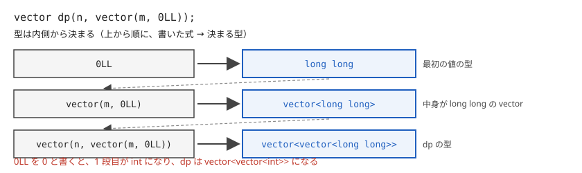

!!! abstract "要点"
    - **何ができるか**：vector・多次元 vector・array・構造体を、意図した大きさと初期値で作る。型引数を省いて中身から型を決める CTAD（C++17）と、括弧の種類で意味が変わる罠も分かる。
    - **いつ使うか**：DP の表やグリッドを入力の大きさで作るとき。解説コードの `vector dp(n, vector(m, 0LL))` や `Edge{.to = v}` を読むとき。テストケースごとに表を埋め直すとき。
    - **計算量**：大きさ $N$ の vector・array を作る・埋め直す時間は $O(N)$（多次元なら要素の総数に比例）。`memset`・`fill` の時間も、埋める要素の数に比例する
    - **前提**：[数の型とリテラル](../cpp/cpp-types-literals.md)

<!-- textlint-disable -->
別名：初期化・多次元 vector・多次元配列・vector の初期化・array<int, 26> cnt{}・値初期化・memset・fill・assign・指示付き初期化・集成体・explicit・クラステンプレートの実引数推論・class template argument deduction・vector dp(n, vector(m, 0LL))
<!-- textlint-enable -->

初期化は、変数を作るときに大きさと最初の値を決める書き方である。C++ では丸括弧 `()` と波括弧 `{}` で意味が変わり、書かなければ 0 になる場所とならない場所がある。どちらも間違えるとコンパイルは通ったまま答えが変わるので、形ごとに覚えておく。

このページのコードは `#include <bits/stdc++.h>` と `using namespace std;` を前提にする。版は手元の g++-13・g++-15（`-std=gnu++23`）で確かめた。AtCoder の GCC 15.2（`-std=gnu++23`）では、このページの書き方はすべて使える。

## vector の初期化：(n) は 0 が n 個、(n, x) は x が n 個、{n} は値 n が 1 個 {#vector-init}

`vector` の大きさと初期値は丸括弧で渡す。波括弧は「中に書いた値を並べた vector」を作る。`n` を波括弧に入れると、大きさ `n` ではなく、値 `n` が 1 個の vector になる。

```cpp
--8<-- "cpp-initialization/vector-init.cpp:core"
```

入力 `3` なら、大きさは順に 3・3・1・2 で、`c[0]` は 3 である。`c` に `n` 個の要素があるつもりで `c[i]` を読むと、範囲外の読み出し（[未定義動作](../cpp/cpp-undefined-behavior.md)）になる。

- **素朴に書くと**：`vector<int> a(n);` は、空の vector に `push_back(0)` を `n` 回するのと同じ中身になる。`vector<int> b(n, 7);` は 7 を `n` 回
- **版**：C++11 から。g++-13・g++-15 で同じ結果だった
- **落とし穴**：`vector<int> c{n};` はコンパイルも通り、警告も出ない。大きさを渡すときは丸括弧と決めておく。波括弧を使うのは `vector<int> v{1, 2, 3};` のように値を並べるときだけにする

## 多次元 vector：dp(n + 1, vector&lt;long long&gt;(m + 1, -1))、3 次元は入れ子を 1 段深くする {#multi-dim-vector}

2 次元の表は「vector の vector」で作る。外側の丸括弧に行の数と「1 行分の vector」を渡すと、その 1 行がコピーされて並ぶ。3 次元は、1 行分の vector の代わりに「2 次元の vector」を渡す。

```cpp
--8<-- "cpp-initialization/multi-dim.cpp:core"
```

括弧と次元の対応は、外側から順に 1 次元目・2 次元目・3 次元目である。`cnt(n, …(m, …(k, 0)))` で作った表は `cnt[i][j][t]`（$0 \le i < n$、$0 \le j < m$、$0 \le t < k$）と引く。

![3 次元 vector の入れ子。いちばん外の括弧の n が cnt[i] の個数、次の m が cnt[i][j] の個数、いちばん内側の k が cnt[i][j][t] の個数に対応する](../img/cpp-initialization/nested.svg)

- **使う場面**：[DP](../dp/dp-basics.md) の表は、状態の範囲が入力で決まるのでこの形で作る。メモ化再帰の「まだ計算していない」印に -1 を入れる、最小値の DP で大きな値（INF）を入れる、といった初期値を 1 行で書ける。[グリッド](../graph/grid-graph.md)の距離の表も同じ形で、`H` 行 `W` 列なら外側に `H` を渡す
- **版**：C++11 から。g++-13・g++-15 で使える
- **落とし穴 1**：外側と内側の大きさを逆に渡すと、`dp[i][j]` が範囲外になる。`dp[i][j]` の `i` の範囲を外側に書く、と決めておく
- **落とし穴 2**：内側の型を外側と合わせて書く必要がある。`vector<vector<long long>> dp(n, vector<int>(m));` はコンパイルエラーになる。型を書く手間は [CTAD](#ctad) で省ける

## array と {} による 0 初期化（array&lt;int, 26&gt; cnt{}・vector&lt;array&lt;int, 3&gt;&gt; v(n)） {#array-init}

`array<T, N>` は長さ `N` が固定の配列である。関数の中で `array<int, 26> cnt;` とだけ書くと中身は決まらないが、`{}` を付けると 26 個とも 0 になる。`vector<array<int, 3>> v(n);` の各要素も 0 で埋まる。

```cpp
--8<-- "cpp-initialization/array-init.cpp:core"
```

入力 `banana 3` なら `cnt['a' - 'a']` は 3、`cnt['z' - 'a']` は 0 である。`{}` は C 配列にも使えて、`int cnt[26]{};` も 26 個とも 0 になる。

波括弧に値を書くと、書いた分だけ先頭に入り、残りは 0 になる。全部を同じ値にする書き方ではない。

```cpp
--8<-- "cpp-initialization/array-init.cpp:partial"
```

- **使う場面**：内側の長さが小さな定数のとき（文字の種類 26、状態 2 や 3 の DP）。`vector<vector<long long>> dp(n, vector<long long>(2));` の代わりに `vector<array<long long, 2>> dp(n);` と書けて、要素は 1 つの続いた領域に並ぶ
- **版**：`array` は C++11 から。g++-13・g++-15 で使える
- **落とし穴**：`int a[5] = {-1};` は -1 が 1 個と 0 が 4 個になる。全部を -1 にするなら `fill` を使う（[埋め直し](#refill)）

## グローバル変数は 0 で初期化され、関数の中の変数・配列は初期化されない {#global-vs-local}

関数の外（グローバル）で宣言した変数と配列は、何も書かなくても 0 で始まる。関数の中で（`static` を付けずに）宣言した `int`・`long long`・C 配列・`array` は、初期化を書かないと値が決まらない。決まらない値を読むのは未定義動作である。`vector` は `(n)` だけで 0 が入るので、この問題は起きない。

次の関数は `s` と `cnt` を初期化せずに足し始めている。

```cpp
--8<-- "cpp-initialization/uninit-ng.cpp:core"
```

入力 `3` と `1 2 3` に対して、手元の g++-13 では 105842398323404453 のような値が出た。正しい答えは 6001 である。`-O2 -Wall -Wextra` では `s` について `'s' may be used uninitialized` と警告したが（`-O2` を付けないと `s` にも警告は出ない）、配列 `cnt` については何も言わなかった。

AtCoder の GCC には `-ftrivial-auto-var-init=zero`（初期化していない関数の中の変数を 0 で埋めるオプション）が付いている。同じコードを手元でこのオプションを付けて試すと 6001 が出た。そのため「AtCoder では AC、手元では答えが合わない」ということが起こる（[AtCoder の C++ 環境](../cpp/cpp-environment.md)）。規格の上では未定義動作のままなので、初期化を書いて防ぐ。

```cpp
--8<-- "cpp-initialization/uninit-ok.cpp:core"
```

- **版**：C++ のどの版でも同じ。g++-13・g++-15 で、どちらも `-O2` 付きで `s` だけを警告した
- **落とし穴**：配列の未初期化は警告に頼れない。関数の中の配列と `array` には `{}` を付ける習慣にする

## 構造体のメンバの既定値と指示付き初期化 Edge{.to = v, .cost = c}（C++20。メンバの宣言順に書く） {#designated-init}

構造体のメンバには `= 値` で既定値を書ける。初期化で値を渡さなかったメンバは既定値になる。

```cpp
--8<-- "cpp-initialization/designated-init.cpp:core"
```

値は宣言順に `{}` の中へ並べて渡す。C++20 の指示付き初期化を使うと、`.メンバ名 = 値` と名前を書いて渡せる。書かなかったメンバは既定値（既定値がなければ 0）になる。

```cpp
--8<-- "cpp-initialization/designated-init.cpp:use"
```

入力 `3 5` なら、`e1` と `e2` はどちらも `to = 3`・`cost = 5`、`e3` は `to = 3`・`cost = 1` である。

名前を書く場合も、並べる順はメンバの宣言順に合わせる。順を入れ替えるとコンパイルエラーになる。

```cpp
--8<-- "cpp-initialization/designated-order-ng.cpp:core"
```

エラーは `designator order for field 'Edge::to' does not match declaration order in 'Edge'` と出る（g++-13・g++-15）。

- **素朴に書くと**：`Edge e2; e2.to = v; e2.cost = c;` と 1 つずつ代入するのと同じ中身になる
- **版**：指示付き初期化は C++20。GCC は `-std=gnu++17` でも拡張として黙って通す。`-std=c++17 -Wpedantic` なら `C++ designated initializers only available with '-std=c++20' or '-std=gnu++20'` と警告する（g++-13・g++-15）
- **落とし穴**：使えるのは、コンストラクタを書いていない構造体（[集成体](../guide/glossary.md#aggregate)）だけである。コンストラクタを足すと集成体でなくなる。このとき指示付き初期化はエラー（`designated initializers cannot be used with a non-aggregate type`）になる。`{}` に値を並べる書き方は、コンストラクタの呼び出しになる（g++-13・g++-15 で確かめた）

## コンストラクタのない構造体（集成体）にも emplace_back(to, cost) が使える（C++20。C++17 ではエラー） {#aggregate-emplace}

C++20 から、コンストラクタを書いていない構造体も丸括弧で作れるようになった。`emplace_back` は渡された引数を丸括弧で要素の型に渡すので、隣接リストに辺を足すときにコンストラクタなしで `emplace_back(v, c)` と書ける。

```cpp
--8<-- "cpp-initialization/aggregate-emplace.cpp:core"
```

C++17 までは丸括弧で集成体を作れないので、`emplace_back(v, c)` はコンパイルエラーになる。`push_back({v, c})` なら C++17 でも通る。

```cpp
--8<-- "cpp-initialization/aggregate-emplace-17-ng.cpp:core"
```

- **版**：C++20。g++-13・g++-15 とも `-std=gnu++20` 以降で通る。`-std=gnu++17` では `new initializer expression list treated as compound expression` に続いて `no matching function for call to 'Edge::Edge(long long int)'` などのエラーになる。丸括弧の中の `1, 10LL` がカンマ演算子として 1 つの値 `10LL` に読まれるためである
- **落とし穴**：丸括弧の初期化は、波括弧と違って[縮小変換](../guide/glossary.md#narrowing-conversion)（`double` から `int` のように値が変わりうる変換）を止めない。次の `emplace_back(1.9, 2)` は `to` が 1 になり、`-Wall -Wextra` でも警告は出なかった（g++-13・g++-15）。同じ値を `Edge{1.9, 2}` と波括弧で書くとコンパイルエラーになる

```cpp
--8<-- "cpp-initialization/aggregate-emplace.cpp:narrow"
```

## explicit なコンストラクタは = で初期化できない（ACL の dsu d = 5 はエラーで、dsu d(5) と書く） {#explicit}

`explicit` が付いたコンストラクタは、`型 変数 = 値;` の形（コピー初期化）では呼ばれない。ACL の `dsu`・`fenwick_tree`・`segtree`・`lazy_segtree`・`scc_graph`・`mf_graph`・`mcf_graph`・`two_sat` の大きさを取るコンストラクタには `explicit` が付いている。そのため `dsu d = 5;` はコンパイルエラーになる。

```cpp
--8<-- "cpp-initialization/explicit-ng.cpp:core"
```

エラーは `conversion from 'int' to non-scalar type 'atcoder::dsu' requested` と出る（g++-13・g++-15）。丸括弧で作るか、右辺に型を書く。

```cpp
--8<-- "cpp-initialization/explicit-ok.cpp:core"
```

最後の形は、大きさが入力を読むまで分からないときに、グローバル変数や構造体のメンバとして先に宣言しておく書き方である。ACL の読み方は [ACL の読み方](../cpp/acl-reading.md)にある。

- **なぜ explicit か**：`explicit` がないと、`dsu` を受け取る関数に `5` を渡しただけで、大きさ 5 の `dsu` が黙って作られてしまう。数から別の物への変換を、書いた人が意図したときだけにするための印である
- **版**：`explicit` は C++98 から。ACL v1.6 の `third_party/ac-library` で確かめた
- **落とし穴**：`modint` のコンストラクタには `explicit` がなく、`mint x = 5;` は通る。ACL の型ごとに違うので、エラーが出たら丸括弧に直す

## 埋め直し：memset はバイト単位（0・-1・0x3f だけ）、fill・assign・ranges::fill、2 次元の C 配列の fill {#refill}

テストケースが複数ある問題では、表をケースごとに初期値へ戻す。`memset(配列, 値, バイト数)` は、領域の各バイトを同じ値にする。`int` は 4 バイトなので、思った値になるのは「4 バイトとも同じ」で表せる値だけである。

```cpp
--8<-- "cpp-initialization/refill.cpp:memset"
```

0 は全ビットが 0、-1 は全ビットが 1 なので、どの整数型でも 0 と -1 になる。`0x3f` は INF の代わりに使われる値で、`int` では $1061109567$（約 $1.06 \times 10^9$）になり、2 倍しても `int` の範囲に収まる。それ以外の値は思った値にならない。

```cpp
--8<-- "cpp-initialization/refill.cpp:memset-ng"
```

1 にしたいときや、INF に `1LL << 60` などを使うときは `fill` を使う。2 次元の C 配列は行ごとに `fill` する。要素は行の順に続いて並ぶので `&grid[0][0]` から全要素の数だけ埋める書き方もよく見かけるが、規格の上では行をまたぐポインタの演算になり、保証されない。vector の vector は各行が別の領域にあるので、行ごとに埋めるか、`assign` で作り直す。

```cpp
--8<-- "cpp-initialization/refill.cpp:fill"
```

- **使い分け**：大きさを変えずに値だけ戻すなら `ranges::fill`（C++20）か `fill`。大きさがケースごとに変わるなら `assign` で作り直す
- **版**：`memset`・`fill`・`assign` は C++98 から、`ranges::fill` は C++20。g++-13・g++-15 で同じ結果だった
- **落とし穴 1**：`memset(c, 1, sizeof c)` は、各要素が 1 ではなく $16843009$（$\mathtt{0x01010101}$）になる
- **落とし穴 2**：`memset` と `sizeof` は C 配列にだけ使う。vector に `sizeof v` を使うと、要素ではなく vector 自身の大きさ（手元では 24 バイト）になる
- **落とし穴 3**：テストケースごとに大きな表を全部埋め直すと、（ケース数）×（表の大きさ）の時間がかかる。そのケースで使う範囲 $[0, n)$ だけを埋め直す

## CTAD：vector dp(n, vector(m, 0LL)) で型を内側から決める（0 と書くと int になる）（C++17） {#ctad}

CTAD（クラステンプレートの実引数推論）は、`vector<long long>` の `<long long>` のような型引数を省き、括弧の中身から型を決める仕組みである。多次元の vector では、いちばん内側の初期値の型から順に外側の型が決まる。



```cpp
--8<-- "cpp-initialization/ctad.cpp:core"
```

`static_assert` は、コンパイルのときに型が一致するかを確かめている。どれも通る。

- **素朴に書くと**：`vector dp(n, vector(m, 0LL));` は `vector<vector<long long>> dp(n, vector<long long>(m, 0LL));` と同じである。3 次元でも型を 1 回も書かずに済む
- **版**：C++17。g++-13・g++-15 とも `-std=gnu++17` で同じ型になった
- **落とし穴**：初期値を `0` と書くと `int` の表になる。和が `int` の範囲を超える DP では[オーバーフロー](../cpp/cpp-integer-overflow.md)する。`long long` の表は `0LL`、INF なら `1LL << 60` のように、初期値の型で決める

## pair・tuple・array・priority_queue の CTAD：pair p{1, 2.5}・priority_queue pq(greater&lt;int&gt;{}, vector&lt;int&gt;{})（C++17） {#ctad-std-types}

CTAD は `vector` 以外の標準の型にも使える。

```cpp
--8<-- "cpp-initialization/ctad-std.cpp:core"
```

`priority_queue` は、比較の関数と中身のコンテナを渡すと型が決まる。`priority_queue<int, vector<int>, greater<int>>` と同じ、最小値を取り出す[優先度付きキュー](../ds/priority-queue.md)になる。比較の関数の書き方は [比較関数と順序](../cpp/cpp-comparators.md)にある。

- **版**：C++17。g++-13・g++-15 とも `-std=gnu++17` で同じ型になった
- **落とし穴**：要素の型は書いた値の型そのままである。`pair q{0, 0};` は `pair<int, int>` で、後から `long long` の値を入れると切り詰められる

```cpp
--8<-- "cpp-initialization/ctad-std.cpp:pair-int"
```

## CTAD の罠：vector w{v.begin(), v.end()} はイテレータ 2 個の vector になる（丸括弧なら要素の vector。警告も出ない）（C++17） {#ctad-pitfall}

CTAD でも、波括弧は「中の値を並べた vector」を作る。`vector w{v.begin(), v.end()};` は、`v` の要素のコピーではなく、イテレータ 2 個を並べた `vector<vector<int>::iterator>` になる。丸括弧なら、イテレータの組から要素をコピーした `vector<int>` になる。

```cpp
--8<-- "cpp-initialization/ctad-pitfall.cpp:core"
```

入力 `3` と `1 2 3` なら、大きさは順に 2・3・3 である。`v` が空でも `w` の大きさは 2 になる。

`vector c{v};` は逆の向きの例外で、`vector<vector<int>>`（`v` が 1 個）ではなく、`v` のコピーの `vector<int>` になる。vector 1 個を波括弧に入れたときは、コピーが優先されるからである。

- **版**：C++17。g++-13・g++-15 とも `-Wall -Wextra` で警告は出なかった
- **落とし穴**：`w` を使う行でようやく型の合わないエラーが出るか、`w.size()` だけを使えば黙って 2 になる。イテレータの組から作るときは丸括弧、型を書くなら `vector<int> w(v.begin(), v.end());` とする

## 使い分け {#comparison}

| 作りたいもの | 書き方 |
| --- | --- |
| 大きさが入力で決まる表 | `vector` の入れ子（CTAD で型を省いてよい） |
| 内側の長さが小さな定数 | `vector<array<T, K>>` |
| 長さが決まった数えるための配列 | `array<int, 26> cnt{};` |
| 大きさが上限で決まる大きな表 | グローバルの C 配列（0 で始まる） |

## 確認問題 {#quiz}

??? question "確認問題：`int n = 5; vector<int> a{n};` の `a.size()` は？"
    1 である。波括弧は中の値を並べるので、値 5 が 1 個の vector になる。大きさ 5 にするなら `vector<int> a(n);` と書く。

??? question "確認問題：`vector dp(n, vector(m, 0));` の要素の型は？"
    `int` である。いちばん内側の初期値 `0` が `int` なので、`dp` は `vector<vector<int>>` になる。`long long` にするなら `0LL` と書く。

??? question "確認問題：`vector<int> v{1, 2, 3}; vector w{v.begin(), v.end()};` の `w.size()` は？"
    2 である。`w` はイテレータ 2 個を並べた vector になる。要素をコピーするなら `vector w(v.begin(), v.end());` と丸括弧で書く。

??? question "確認問題：`long long sum;` から足すコードが AtCoder でだけ合うのはなぜか？"
    AtCoder の GCC には `-ftrivial-auto-var-init=zero` が付いている。これが初期化していない関数の中の変数を 0 にする。手元ではそのオプションがないので、値が決まらない。どちらでも正しく動くよう `long long sum = 0;` と書く。

## 参考 {#references}

- [cppreference「Class template argument deduction (CTAD)」](https://en.cppreference.com/cpp/language/class_template_argument_deduction)：CTAD の規則と、コピーが優先される場合
- [cppreference「Aggregate initialization」](https://en.cppreference.com/cpp/language/aggregate_initialization)：集成体の条件、指示付き初期化の順序、丸括弧の集成体初期化
- [cpprefjp「丸カッコの値リストからの集成体初期化を許可」](https://cpprefjp.github.io/lang/cpp20/allow_initializing_aggregates_from_a_parenthesized_list_of_values.html)：丸括弧の初期化では縮小変換が止まらないこと
- [cpprefjp「指示付き初期化」](https://cpprefjp.github.io/lang/cpp20/designated_initialization.html)：C++20 の指示付き初期化
- [cpprefjp「クラステンプレートのテンプレート引数推論」](https://cpprefjp.github.io/lang/cpp17/type_deduction_for_class_templates.html)：日本語で読める CTAD の説明
- [cppreference「explicit specifier」](https://en.cppreference.com/cpp/language/explicit)：explicit なコンストラクタとコピー初期化
- [cppreference「std::memset」](https://en.cppreference.com/cpp/string/byte/memset)：バイト単位で埋めること
- [cppreference「Zero-initialization」](https://en.cppreference.com/cpp/language/zero_initialization)：グローバル変数が 0 で初期化されること
- [AtCoder Library「DSU」](https://github.com/atcoder/ac-library/blob/master/document_ja/dsu.md)：`dsu` のコンストラクタ
