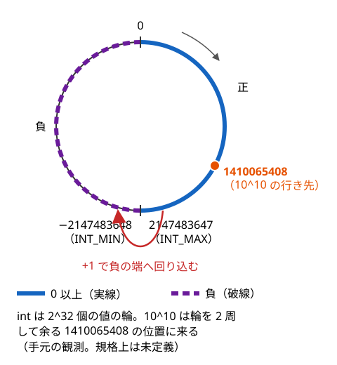

!!! abstract "要点"
    - **何ができるか**：`int` どうしの積・`1 << k`・`size()` の符号なしなど、型の幅を超えて値が壊れる書き方を見分けて直す。64 bit を超える中間値は GCC の拡張 `__int128` で持てるが、入出力などに制限がある。
    - **いつ使うか**：
        - $A_i \le 10^9$ を $N \le 2 \times 10^5$ 個足す、または 2 つ掛ける（`int` に収まらない）。
        - 小さい入力は合うのに大きい入力で WA になる、答えが負になる。
    - **計算量**：どれも 1 回 $O(1)$。`__int128` の割り算は関数の呼び出し（`__divti3` など）になり、手元の計測では `long long` の 1〜3 倍程度だった（割る数が 64 bit を超えると遅い）
    - **前提**：[数の型とリテラル](../cpp/cpp-types-literals.md)

<!-- textlint-disable -->
別名：オーバーフロー・integer overflow・あふれ・int の掛け算・1LL * a * b・1 << 40・符号なし整数・v.size() - 1・ssize・__int128・i128・128bit 整数・__builtin_mul_overflow
<!-- textlint-enable -->

整数の[オーバーフロー](../guide/glossary.md#overflow)は、計算の結果がその型で表せる範囲を超えることである。`int` は約 $\pm 2.1 \times 10^9$、`long long` は約 $\pm 9.2 \times 10^{18}$ までしか表せない（[整数の型と表せる範囲](../cpp/cpp-types-literals.md)）。あふれは「答えを入れる変数の型」ではなく「計算する式の型」で起きるので、変数を `long long` にしただけでは防げない。このページの例は、断りのないかぎり手元の g++-13 と g++-15（`-std=gnu++23 -O2 -Wall -Wextra`）で確かめた。

このページのコードは `#include <bits/stdc++.h>` と `using namespace std;` を前提にする。

## int どうしの積は int で計算される（1LL * a * b と書く） {#int-product}

`a * b` の型は `a` と `b` の型で決まり、代入先の型は関係しない。`a` と `b` が `int` なら、積は `int` で計算され、あふれた後の値が `long long` に入る。

```cpp
--8<-- "cpp-integer-overflow/int-product-ng.cpp:core"
```

完全なプログラム：[`int-product-ng.cpp`](https://github.com/yuukougun/kyopro-atlas/blob/main/snippets/cpp-integer-overflow/int-product-ng.cpp)（GitHub）
{ .kp-code-src }

$a = b = 10^5$ なら正しい積は $10^{10}$ だが、手元では `1410065408` と出た。`int` は $2^{32}$ 個の値が輪のように並んでいて、最大値を超えると負の端へ回り込む。$10^{10}$ は輪を 2 周して $10^{10} - 2 \times 2^{32} = 1410065408$ の位置に来た。ただし規格ではこの回り込みは決まっておらず、[未定義動作](#signed-overflow-ub)である。



直すには、掛ける前に片方を `long long` にする。

```cpp
--8<-- "cpp-integer-overflow/int-product.cpp:core"
```

完全なプログラム：[`int-product.cpp`](https://github.com/yuukougun/kyopro-atlas/blob/main/snippets/cpp-integer-overflow/int-product.cpp)（GitHub）
{ .kp-code-src }

- **なぜ通るか**：`*` は左から計算する。`1LL * a` で `long long` になり、続く `* b` も `long long` どうしの計算になる
- **落とし穴**：`a * b * 1LL` と `(long long)(a * b)` は誤りである。どちらも `a * b` を `int` で計算した後に広げている。`1LL` は先頭に置き、キャストは掛ける前の変数に付ける
- **落とし穴**：足し算も同じである。`int` の配列を `int` の変数に足し込むと、$10^9$ を 3 個足した時点であふれる。和を持つ変数を `long long` にする

## シフトの幅：int の 1 を 40 ずらすと警告が出て 0 になる、1LL をずらす {#shift-width}

`1` は `int`（32 bit）なので、`1 << 40` は型の幅以上のシフトになり、未定義動作である。定数なら `-Wall` で警告 `left shift count >= width of type [-Wshift-count-overflow]` が出て、手元では値が 0 になった。$2^{40}$ が欲しいなら `1LL << 40` と書く。

```cpp
--8<-- "cpp-integer-overflow/shift.cpp:core"
```

完全なプログラム：[`shift.cpp`](https://github.com/yuukougun/kyopro-atlas/blob/main/snippets/cpp-integer-overflow/shift.cpp)（GitHub）
{ .kp-code-src }

シフトの幅が変数だと警告は出ない。bit 全探索で `1 << k` と書くと、`k` が 32 以上の入力でだけ壊れる。

```cpp
--8<-- "cpp-integer-overflow/shift.cpp:runtime"
```

完全なプログラム：[`shift.cpp`](https://github.com/yuukougun/kyopro-atlas/blob/main/snippets/cpp-integer-overflow/shift.cpp)（GitHub）
{ .kp-code-src }

- **手元の値**：`k = 40` で 256 と出た。x86-64 の 32 bit のシフト命令が幅を 32 で割った余りしか見ないためで、0 になるとは限らない
- **版**：`1 << 31` は C++20 から `INT_MIN`（$-2^{31}$）と決まった（左シフトが $2^{32}$ を法とする計算になった）。C++14・C++17 では処理系定義で、GCC では同じ値になる。`1 << 32` 以上は、どの版でも未定義である
- **落とし穴**：`long long` の値を 64 以上シフトするのも未定義である。`1LL << 63` は C++20 では `LLONG_MIN`（負の数）になる（手元で確かめた）ので、符号なしの最上位 bit が欲しいなら `1ULL << 63` と書く

## 初期値と推論の型：accumulate(..., 0)・auto x = 0・views::iota(0, n) の i は int {#inferred-int}

型を書かずに済む書き方では、型は初期値やリテラルから決まる。`0` は `int` なので、次の 3 つはどれも `int` で計算する。

```cpp
--8<-- "cpp-integer-overflow/inferred.cpp:core"
```

完全なプログラム：[`inferred.cpp`](https://github.com/yuukougun/kyopro-atlas/blob/main/snippets/cpp-integer-overflow/inferred.cpp)（GitHub）
{ .kp-code-src }

- `auto x = 0;` の `x` は `int`。和や積を入れる変数を `auto` で作るなら `0LL` から始める
- `accumulate(first, last, init)` は、`init` の型の変数に足し込み、その型で返す（[accumulate](../cpp/cpp-algorithms.md)）。`v` が `vector<long long>` でも `init` が `0` なら、足すたびに `int` へ直される。手元では $10^9$ を 3 個足して `-1294967296` になり、警告は出なかった。`0LL` と書けば `3000000000` になる
- `views::iota(0, n)` の要素は始まりの `0` の型 `int` になる。`n` が `long long` でも同じで、`for (long long i : …)` と受けても直らない（[views::iota(0, n) は n が long long でも i が int になる](../cpp/cpp-views-basics.md#iota-int)）。`views::iota(0LL, n)` と書く

## size() は符号なし：空の v で v.size() - 1 が巨大になる、ssize(v) か (int)v.size() {#unsigned-size}

`v.size()` の型は `size_t`（64 bit の符号なし整数）である。[符号なし整数](../guide/glossary.md#unsigned-integer)の計算は $2^{64}$ を法として回り込むと決まっていて（未定義動作ではない）、負の値にはならない。

```cpp
--8<-- "cpp-integer-overflow/unsigned-size.cpp:core"
```

完全なプログラム：[`unsigned-size.cpp`](https://github.com/yuukougun/kyopro-atlas/blob/main/snippets/cpp-integer-overflow/unsigned-size.cpp)（GitHub）
{ .kp-code-src }

- `v.size() - 1`：`v` が空だと $2^{64} - 1 = 18446744073709551615$ になる。`for (int i = 0; i < v.size() - 1; i++)` は、空の `v` で範囲外を読み続ける
- `-1 < v.size()`：符号付きと符号なしを比べると、`-1` が `size_t` に直されて最大値になり、偽になる。`-Wall -Wextra` なら `comparison of integer expressions of different signedness` の警告が出る（`-Wsign-compare`）。上の `i < v.size() - 1` の比較にも同じ警告が出るが、`v.size() - 1` の引き算そのものには警告が出ず、`size_t i` で書くと何も出ない
- **直し方**：符号付きの大きさで計算する。`ssize(v)` は `ptrdiff_t`（64 bit の Linux では `long`）を返す。`(int)v.size()` でもよい

```cpp
--8<-- "cpp-integer-overflow/unsigned-loop.cpp:core"
```

完全なプログラム：[`unsigned-loop.cpp`](https://github.com/yuukougun/kyopro-atlas/blob/main/snippets/cpp-integer-overflow/unsigned-loop.cpp)（GitHub）
{ .kp-code-src }

- **版**：`ssize` は C++20。g++-13・g++-15 の `-std=gnu++23` で使える
- **落とし穴**：`for (size_t i = n - 1; i >= 0; i--)` は終わらない。符号なしの `i` は常に 0 以上で、0 の次は最大値に回り込む（`-Wextra` で `comparison of unsigned expression in '>= 0' is always true` と警告が出る）。逆順のループは `int` で回す
- **関連**：`views::iota(0, v.size())` がコンパイルエラーになるのも同じ符号の違いによる（[views::iota(0, v.size()) がコンパイルエラーになる理由と直し方](../cpp/cpp-views-basics.md#iota-size-mismatch)）

## 型の違う値を min・max に渡すとコンパイルエラー（1LL にそろえるか型を明示する） {#min-max-types}

`min` と `max` は 2 つの引数が同じ型であることを求める。`x` が `long long` のとき `min(1, x)` は `int` と `long long` の組になり、コンパイルエラーになる。

```cpp
--8<-- "cpp-integer-overflow/min-max-ng.cpp:core"
```

完全なプログラム：[`min-max-ng.cpp`](https://github.com/yuukougun/kyopro-atlas/blob/main/snippets/cpp-integer-overflow/min-max-ng.cpp)（GitHub）
{ .kp-code-src }

エラーは `no matching function for call to 'min(int, long long int&)'` と出る。定数の側を `1LL` にするか、`min<long long>(…)` と型を明示する。

```cpp
--8<-- "cpp-integer-overflow/min-max-ok.cpp:core"
```

完全なプログラム：[`min-max-ok.cpp`](https://github.com/yuukougun/kyopro-atlas/blob/main/snippets/cpp-integer-overflow/min-max-ok.cpp)（GitHub）
{ .kp-code-src }

- `max({0LL, x, 2 * x})` のような初期化子リストでも、要素の型がすべてそろっていないとコンパイルエラーになる（`max({0, x})` は誤り）
- **落とし穴**：`min<int>(…)` と明示すると、`long long` の値が `int` に直されて切り捨てられる（エラーにならない）。型を明示するなら広い方の型にする
- **関連**：`a = min(a, b)` を `chmin` で書く雛形でも、`a` と `b` の型をそろえる必要がある

## INF + INF・abs(INT_MIN)・INT_MIN / -1 {#edge-values}

型の端の値は、普通の計算からは出てこない落とし穴を持つ。

```cpp
--8<-- "cpp-integer-overflow/edge-values.cpp:core"
```

完全なプログラム：[`edge-values.cpp`](https://github.com/yuukougun/kyopro-atlas/blob/main/snippets/cpp-integer-overflow/edge-values.cpp)（GitHub）
{ .kp-code-src }

- **INF + INF**：INF を `INT_MAX` にすると、`dist[u] + w` のように INF に足した時点であふれ、負の値として最小値に選ばれてしまう。INF は 2 つ足しても収まる値にする（`1LL << 60` は 2 つ足して $2^{61}$ で収まる）。値の選び方は [INF の決め方](../cpp/cpp-types-literals.md)にある
- **abs(INT_MIN)**：$-2^{31}$ の絶対値 $2^{31}$ は `int` に収まらず、未定義動作である。手元では `-2147483648`（負のまま）が返った。入力に $-2^{31}$ が来うるなら、`abs((long long)a)` と広げてから取る
- **INT_MIN / -1**：商 $2^{31}$ が `int` に収まらず、未定義動作である。手元の x86-64 では、`a = INT_MIN`・`d = -1` を入力から読んで割ると、`Floating point exception` で異常終了した（割り算の命令が例外を出す）。`INT_MIN % -1` も同じく異常終了した
- **見分け方**：あふれは WA になるとは限らない。RE（異常終了）として現れることもある

## 符号付き整数のあふれは未定義動作：-O2 では正しく書いた比較の結果まで変わる {#signed-overflow-ub}

`int`・`long long` などの符号付き整数のあふれは、規格が結果を決めていない[未定義動作](../cpp/cpp-undefined-behavior.md)である。コンパイラは「あふれは起きない」と仮定して最適化してよい。そのため、あふれた式そのものだけでなく、その値を使う別の行の結果まで変わる。

```cpp
--8<-- "cpp-integer-overflow/ub-check.cpp:core"
```

完全なプログラム：[`ub-check.cpp`](https://github.com/yuukougun/kyopro-atlas/blob/main/snippets/cpp-integer-overflow/ub-check.cpp)（GitHub）
{ .kp-code-src }

$a = b = 10^5$ を入れると、`c` は `1410065408`、`p` は `10000000000` と、違う値が表示される。それなのに `-O2` では `c == p` が真と判定され、`same` と出た（g++-13・g++-15）。`-O0` では `differ` と出る。「`a * b` はあふれない」と仮定すれば `c` と `p` は常に等しいので、コンパイラが比較を省いたと考えられる。「`int` で計算した値と `long long` で計算した値を比べて、あふれを調べる」書き方は、このように消されうる。

- **警告**：`-Wall -Wextra` でも何も出なかった
- **見つけ方**：`-fsanitize=undefined` を付けて実行すると、あふれた行が行番号つきで報告された。メッセージは `runtime error: signed integer overflow: 100000 * 100000 cannot be represented in type 'int'` である。不具合を探すビルドの作り方は、[未定義動作](../cpp/cpp-undefined-behavior.md)のページで扱う
- **疑うとき**：`-O0` と `-O2` で答えが変わる、答えに関係のない行を足す・消すと答えが変わる、手元と AtCoder で結果が違う
- **符号なしは別**：`unsigned` や `size_t` の回り込みは規格で決まっていて、未定義動作ではない（[size() は符号なし](#unsigned-size)）。ただし値が壊れることに変わりはない

## __int128：10^18 程度どうしの積を正確に持つ（GCC の拡張） {#int128}

`__int128` は GCC の拡張の 128 bit 符号付き整数で、約 $\pm 1.7 \times 10^{38}$（$2^{127} - 1$ まで）を表せる。$10^{18}$ どうしの積 $10^{36}$ も収まるので、`long long` であふれる中間値を持つのに使う。解説コードでは `using i128 = __int128;` と別名を付けることが多い。

```cpp
--8<-- "cpp-integer-overflow/int128.cpp:core"
```

完全なプログラム：[`int128.cpp`](https://github.com/yuukougun/kyopro-atlas/blob/main/snippets/cpp-integer-overflow/int128.cpp)（GitHub）
{ .kp-code-src }

- **書き方**：積は `(__int128)a * b` のように片方を広げてから掛ける（[int どうしの積](#int-product)と同じ理由で、`(__int128)(a * b)` は誤り）。比べた後は `long long` に戻してよい
- **リテラルがない**：GCC は `__int128` の定数を書く方法を持たない。`__int128 x = 1000000000000000000000000000000;` と書くと `integer constant is too large for its type` の警告が出る。手元では値が `5076944270305263616` に化けた。$2^{100}$ は `(__int128)1 << 100`、$10^{30}$ は `(__int128)1'000'000'000'000'000 * 1'000'000'000'000'000` のように組み立てる
- **符号なし**：`unsigned __int128` もある
- **版**：GCC の拡張。g++-13・g++-15 と AtCoder（x86-64 の GCC）で使える
- **使いどころ**：積を比べたいだけなら、[積が上限を超えるかの判定](#overflow-check)の方法もある。$\bmod$ の積 $a \times b \bmod m$（$m \approx 10^{18}$）を求めるときにも使う

## __int128 の入出力：cin・cout では扱えない、format・println か自作の変換で出す {#int128-io}

`cout << x` と `cin >> x` は、`__int128` を受ける版がないのでコンパイルエラーになる。

```cpp
--8<-- "cpp-integer-overflow/int128-cout-ng.cpp:core"
```

完全なプログラム：[`int128-cout-ng.cpp`](https://github.com/yuukougun/kyopro-atlas/blob/main/snippets/cpp-integer-overflow/int128-cout-ng.cpp)（GitHub）
{ .kp-code-src }

エラーは `ambiguous overload for 'operator<<'` と出る（`cin >> x` は `no match for 'operator>>'`）。出力には `format` か `println` を使う。どちらも `__int128` を 10 進で出せた。

```cpp
--8<-- "cpp-integer-overflow/int128-format.cpp:core"
```

完全なプログラム：[`int128-format.cpp`](https://github.com/yuukougun/kyopro-atlas/blob/main/snippets/cpp-integer-overflow/int128-format.cpp)（GitHub）
{ .kp-code-src }

```cpp
--8<-- "cpp-integer-overflow/int128-println.cpp:core"
```

完全なプログラム：[`int128-println.cpp`](https://github.com/yuukougun/kyopro-atlas/blob/main/snippets/cpp-integer-overflow/int128-println.cpp)（GitHub）
{ .kp-code-src }

- **版**：`format` は C++20 で、g++-13・g++-15 で `__int128` を出せた。`println` は C++23 で GCC 14 から入り、g++-13 にはない。AtCoder の GCC 15.2 ではどちらも使える。`println` の使い方は [入出力](../cpp/cpp-io.md)にある

`format` が使えない環境で出すときや、自作のライブラリで持ち歩くときは、10 で割った余りを 1 桁ずつ取り出す関数を書く。負の数では余りが 0 以下になるので、符号を反転して桁にする（$-2^{127}$ を先に正へ直すとあふれるため）。

```cpp
--8<-- "cpp-integer-overflow/int128.cpp:print"
```

完全なプログラム：[`int128.cpp`](https://github.com/yuukougun/kyopro-atlas/blob/main/snippets/cpp-integer-overflow/int128.cpp)（GitHub）
{ .kp-code-src }

入力は `string` で読み、先頭から `x = x * 10 - 桁` で負の側に積み上げ、最後に符号を決める。正の側に積み上げると、$-2^{127}$ を読むときに途中の $2^{127}$ であふれる（`to_str` と同じ理由）。

```cpp
--8<-- "cpp-integer-overflow/int128.cpp:read"
```

完全なプログラム：[`int128.cpp`](https://github.com/yuukougun/kyopro-atlas/blob/main/snippets/cpp-integer-overflow/int128.cpp)（GitHub）
{ .kp-code-src }

- **落とし穴**：`printf("%lld", x)` も使えない。`-Wformat` の警告が出て、手元では $2^{100}$ が `0` と出た。`long long` に収まる値なら、`(long long)x` に戻してから出す

## -std=c++23 では __int128 が整数型と判定されず gcd・abs に渡せない {#int128-strict-mode}

GCC は、GNU 拡張を有効にする `-std=gnu++23` と、規格どおりの `-std=c++23` で `__int128` の扱いが違う。`-std=c++23` では `__int128` を「整数型」と認めず、`is_integral_v<__int128>` が `false` になる。整数型を要求する標準の関数に渡せなくなる。

```cpp
--8<-- "cpp-integer-overflow/int128-strict-ng.cpp:core"
```

完全なプログラム：[`int128-strict-ng.cpp`](https://github.com/yuukougun/kyopro-atlas/blob/main/snippets/cpp-integer-overflow/int128-strict-ng.cpp)（GitHub）
{ .kp-code-src }

- `-std=c++23` では、`gcd` と `abs` がコンパイルエラーになった（g++-13・g++-15）。同じコードは `-std=gnu++23` なら `2 6` と出る。メッセージは次のとおりである
    - `gcd`：`static assertion failed: std::gcd arguments must be integers`
    - `abs`：`call of overloaded 'abs(__int128&)' is ambiguous`
- `numeric_limits<__int128>::max()` は、どちらのモードでも $2^{127} - 1$ を返した

```cpp
--8<-- "cpp-integer-overflow/int128-limits.cpp:core"
```

完全なプログラム：[`int128-limits.cpp`](https://github.com/yuukougun/kyopro-atlas/blob/main/snippets/cpp-integer-overflow/int128-limits.cpp)（GitHub）
{ .kp-code-src }

- **AtCoder では**：`-std=gnu++23` なので渡せる。手元の設定やエディタの拡張（コード補完）が `-std=c++23` だと、手元だけでエラーになる。手元のオプションは [環境構築](../cpp/cpp-environment.md#gnu-mode)でそろえる

## 積が上限を超えるかの判定：割り算で比べる・__builtin_mul_overflow {#overflow-check}

「$a \times b \le L$ か」を、$a \times b$ が `long long` に収まらない場合も含めて判定する方法は 3 つある（$a, b \ge 1$ とする）。

```cpp
--8<-- "cpp-integer-overflow/overflow-check.cpp:core"
```

完全なプログラム：[`overflow-check.cpp`](https://github.com/yuukougun/kyopro-atlas/blob/main/snippets/cpp-integer-overflow/overflow-check.cpp)（GitHub）
{ .kp-code-src }

- **`__builtin_mul_overflow(a, b, &r)`**：無限の精度で掛けた積を `r` の型に直して入れ、値が変わった（あふれた）なら `true` を返す。GCC の拡張で、`int`・`long long`・`__int128` のどれでも使える
- **割り算**：$a \times b \le L \iff a \le \lfloor L / b \rfloor$（$a, b \ge 1$ の整数）。負の数や切り上げが混ざるときの式の作り方は [整数の割り算と切り上げ](../math/integer-division.md)にある
- **`__int128`**：$a, b \le 10^{18}$ なら積が収まるので、そのまま比べられる。$a, b$ が `__int128` 自身の範囲に近いときは使えない

`long double` で掛けて比べる方法は、境界で誤りうる。x86-64 の GCC の `long double` は仮数部が 64 bit で、整数を正確に表せるのは $2^{64}$（約 $1.8 \times 10^{19}$）までである。$10^{18}$ どうしの積のように大きな値は丸められ、1 だけ違う 2 つの積を区別できない。

```cpp
--8<-- "cpp-integer-overflow/long-double.cpp:core"
```

完全なプログラム：[`long-double.cpp`](https://github.com/yuukougun/kyopro-atlas/blob/main/snippets/cpp-integer-overflow/long-double.cpp)（GitHub）
{ .kp-code-src }

$10^{18} \times 10^{18}$ と $(10^{18} + 1)(10^{18} - 1) = 10^{36} - 1$ は、`long double` では等しいと判定され、`__int128` では正しく区別された。分数 $a/b$ と $c/d$ を $ad$ と $bc$ で比べるような場面では、`long double` ではなく `__int128` を使う。累乗があふれる前に止める書き方は [整数の K 乗根](../math/integer-root.md)にある。

## 確認問題 {#quiz}

??? question "確認問題：`a`・`b` が `int` で、`long long x = a * b;` と書いた。何が起きるか。どう直すか。"
    `a * b` は `int` どうしの積として計算され、`int` の範囲（約 $\pm 2.1 \times 10^9$）を外れるとあふれる（未定義動作）。その後で `long long` に広げても値は戻らない。`1LL * a * b` か `(long long)a * b` と書き、掛ける前に片方を `long long` にする。

??? question "確認問題：答えに関係のない行を消したら、答えが変わった。何を疑うか。"
    未定義動作、特に符号付き整数のあふれを疑う。コンパイラはあふれが起きないと仮定して最適化するので、あふれる式があると別の行の結果まで変わる。`-fsanitize=undefined` を付けて実行し、あふれた行を探す。

??? question "確認問題：$a, b \le 10^{18}$ のとき、$a \times b \le 10^{18}$ を正しく判定する方法を 2 つ挙げよ。"
    `(__int128)a * b <= 1000000000000000000` と `__int128` で掛けて比べる方法と、$a \le \lfloor 10^{18} / b \rfloor$ と割り算で比べる方法（$b \ge 1$ のとき）。ほかに `__builtin_mul_overflow` であふれを調べてから比べる方法もある。`long double` で掛けて比べる方法は、丸めで誤りうるので避ける。

??? question "確認問題：`vector<int> v` が空のとき、`for (int i = 0; i < v.size() - 1; i++)` はどうなるか。"
    `v.size()` は符号なしの `size_t` なので、`v.size() - 1` は 0 から 1 を引いて $2^{64} - 1$ に回り込む。ループは回り続け、範囲外を読む。`i + 1 < ssize(v)` か `i < (int)v.size() - 1` と、符号付きで比べる。

## 参考 {#references}

- [cppreference「Arithmetic operators」](https://en.cppreference.com/w/cpp/language/operator_arithmetic)：符号付き整数のあふれが未定義動作であること、シフトの幅の規則と C++20 での左シフトの変更
- [cpprefjp「ssize」](https://cpprefjp.github.io/reference/iterator/ssize.html)：`ssize` の戻り値の型と、C++20 で入ったこと
- [GCC「128-bit Integers」](https://gcc.gnu.org/onlinedocs/gcc/_005f_005fint128.html)：`__int128` が GCC の拡張であることと、定数を書く方法がないこと
- [GCC「Built-in Functions to Perform Arithmetic with Overflow Checking」](https://gcc.gnu.org/onlinedocs/gcc/Integer-Overflow-Builtins.html)：`__builtin_mul_overflow` の引数と戻り値
- [GCC「libstdc++ Implementation Status」](https://gcc.gnu.org/onlinedocs/libstdc++/manual/status.html)：`format`・`println` が入った GCC の版
