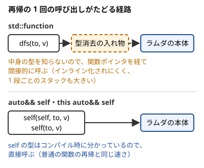

!!! abstract "要点"
    - **何ができるか**：その場で関数を作るラムダ式で、比較関数・判定関数・DFS を書く。外側の変数を参照（`[&]`）かコピー（`[=]`）で取り込めるので、配列を引数で渡さずに済む。再帰は `auto&& self` か deducing this で書くと、普通の関数と同じ速さになる。
    - **いつ使うか**：`sort` や `priority_queue` に独自の順序を渡したいとき。二分探索の判定や DFS を `main` の中で書き、入力の配列をそのまま使いたいとき。解説コードに `[&]`・`self(self, to)`・`this auto&& self` が出てきて読みたいとき。
    - **計算量**：ラムダを作るのは $O(1)$（`[=]` や初期化キャプチャはコピー・ムーブの分だけかかる）。呼び出しは普通の関数と同じ速さで、`std::function` を通すと間接呼び出しの定数倍がかかる
    - **前提**：[参照と範囲 for](../cpp/cpp-range-for.md)

<!-- textlint-disable -->
別名：ラムダ・lambda・無名関数・クロージャ・キャプチャ・[&]・[=]・ジェネリックラムダ・再帰ラムダ・std::function・auto&& self・this auto&& self・deducing this・不動点コンビネータ・FixPoint
<!-- textlint-enable -->

ラムダ式は、名前のない関数をその場で作る式である。`[&](int i, int j) { return a[i] < a[j]; }` のように、`[キャプチャ](引数) { 本体 }` の形で書く。作られる物（クロージャ）は、取り込んだ外側の変数を持つ小さなオブジェクトで、関数のように `f(x)` と呼べる。基本の形は C++11 からあり、AtCoder の GCC 15.2（`-std=gnu++23`）では、このページの書き方はすべて使える。手元の g++-13 で使えないのは [deducing this](#deducing-this) だけである。

このページのコードは `#include <bits/stdc++.h>` と `using namespace std;` を前提にする。

## キャプチャ：[&] は参照、[=] は作った時点のコピー、初期化キャプチャ [x = std::move(v)]、mutable。参照キャプチャしたラムダを変数の寿命より長く使わない {#capture}

キャプチャは、ラムダの本体から外側の変数を使う方法を決める。`[&]` は使う変数を参照で取り込み、呼んだ時点の値を読む。`[=]` は使う変数をラムダを作った時点でコピーし、後で外側の変数が変わっても中のコピーは変わらない。

```cpp
--8<-- "cpp-lambda/capture.cpp:core"
```

![外側の変数 k と 2 つのクロージャの図。[&] のクロージャは k への参照を持ち実線の矢印で k を指す。[=] のクロージャは作った時点の値 10 を箱の中に持ち、後で k が 20 になっても 10 のまま](../img/cpp-lambda/capture.svg)

`[&]` のラムダは `k` を指しているだけなので、`k = 20` の後に呼ぶと 21 を返す。`[=]` のラムダは作った時点の 10 を持っているので 11 を返す。DFS や判定の関数のように、作ったその場で使い切るラムダは `[&]` で書けばよい。配列を `[=]` で取り込むと、ラムダを作るたびに配列全体がコピーされる。

ほかに、次の書き方がある。

- `[a, &b]`：`a` はコピー、`b` は参照と、変数ごとに選ぶ
- `[w = std::move(v)]`（初期化キャプチャ。C++14）：新しい名前 `w` を作り、右辺の値で初期化して持つ。`std::move` を付けると、`v` の中身をコピーせずにラムダへ移せる
- `mutable`：`[=]` でコピーした値は、そのままでは本体の中で書き換えられない（コンパイルエラーになる）。`() mutable` を付けると書き換えられる。書き換わるのはラムダの中のコピーで、外側の変数は変わらない

```cpp
--8<-- "cpp-lambda/capture.cpp:init"
```

- **版**：`[&]`・`[=]`・`mutable` は C++11、初期化キャプチャは C++14。g++-13・g++-15 で使える
- **落とし穴**：参照キャプチャしたラムダを、取り込んだ変数より長く使うと[未定義動作](../cpp/cpp-undefined-behavior.md)になる。典型は、関数の引数や局所変数を `[&]` で取り込んだラムダを返す書き方である

```cpp
--8<-- "cpp-lambda/dangling.cpp:bad"
```

`make_adder_bad(5)` の結果に 1 を渡すと 6 を返すはずである。手元の g++-13・g++-15（`-O2`）では 1 が出た。警告は `-Wall -Wextra` で `'k' is used uninitialized` と出たが、原因が寿命だとは読み取りにくい。AddressSanitizer（`-fsanitize=address`）を付けると `stack-use-after-return` で止まった。ラムダを返す・保存して後で呼ぶときは、使う変数をコピーで取り込む。

```cpp
--8<-- "cpp-lambda/dangling.cpp:good"
```

## auto 引数のジェネリックラムダ、テンプレート構文 []<class T>(...)（C++20）、static ラムダ（C++23・GCC 13〜） {#generic-lambda}

引数の型を `auto` と書いたラムダをジェネリックラムダという。中身は関数テンプレートで、呼んだ引数の型ごとに別の関数が作られる。`sort` の比較関数を `[](const auto& x, const auto& y) { ... }` と書けば、要素の型を書き写さずに済む。

型に名前を付けたいときは、C++20 のテンプレート構文 `[]<class T>(const vector<T>& v) { ... }` を使う。`T` を本体の中で使える（総和の初期値 `T s{}` など）。テンプレートそのものの書き方は[テンプレートと constexpr](../cpp/cpp-templates-constexpr.md)で扱う。

`static` ラムダは、キャプチャを持たないことを示す印である。呼ぶときにクロージャへのポインタ（`this`）を渡さずに済む。競技プログラミングで速さに効く場面はまずないので、解説コードで見たら「キャプチャのないラムダ」と読めばよい。

```cpp
--8<-- "cpp-lambda/generic.cpp:core"
```

- **版**：`auto` 引数は C++14、テンプレート構文は C++20、`static` ラムダは C++23。`static` ラムダは g++-13・g++-15 の `-std=gnu++23` で通る。`-std=gnu++20` ではどちらも「‘static’ only valid in lambda with ‘-std=c++23’ or ‘-std=gnu++23’」という警告になる
- **落とし穴**：`static` ラムダはキャプチャを書くとコンパイルエラーになる。`[&]` が要るなら `static` を付けない

## その場で呼ぶラムダ：const int k = [&] { ... }(); で複雑な初期化をした値を const にする {#immediately-invoked}

ラムダを作った直後に `()` を付けると、その場で呼んで結果を受け取れる。ループや条件分岐で求める値を、一度で初期化して `const` にできる。素朴に書くと `int k = 0; while (...) k++;` となり、`k` を後で誤って書き換えても気づけない。

```cpp
--8<-- "cpp-lambda/iife.cpp:core"
```

- 引数のないラムダは `()` を省いて `[&] { ... }` と書ける。最後の `()` は呼び出しである。これを忘れると、右辺はラムダそのものになる。`int` へ変換できないので、コンパイルエラーになる
- 本体の `return` が 1 か所でも型の違う値を返すと推論できない。`[&]() -> long long { ... }()` のように戻り値の型を書く（[戻り値の型](#return-type)）

## 関数に渡す：sort の比較関数・二分探索の判定関数 {#pass-to-function}

ラムダのいちばん多い使い道は、`sort`・`priority_queue`・二分探索に「順序」や「判定」を渡すことである。`[&]` で外側の配列を読めるので、比べる値や判定に使う値を引数に並べなくてよい。

添字の列を、配列 `a` の値の小さい順に並べる例を示す。値が同じなら添字の小さい順にする。

```cpp
--8<-- "cpp-lambda/pass.cpp:sort"
```

比較関数は「`i` を `j` より前に置くなら真」を返す。`a[i] <= a[j]` のように等しいときに真を返すと、`sort` が前提とする順序の条件（[狭義の弱順序](../guide/glossary.md#strict-weak-ordering)）を破り、範囲外を読んで落ちることがある。比較関数の決まりと `greater<>` などの使い分けは[比較関数と順序](../cpp/cpp-comparators.md)で扱う。

[答えで二分探索](../basics/binary-search-answer.md)の判定も、ラムダにすると入力をそのまま読める。長さ `a[i]` の棒を長さ `x` に切って `k` 本以上取れるかを判定し、取れる最大の `x` を求める例である。

```cpp
--8<-- "cpp-lambda/pass.cpp:check"
```

- 判定のラムダが `bool` を返すことは、`return cnt >= k;` から推論される。`return` が複数あるなら、すべて同じ型にする
- **落とし穴**：比較関数を `[=]` で書くと、配列が大きいときにラムダを作るたびにコピーが走る。`sort` に渡したラムダは中でさらにコピーされることがあるので、配列は `[&]` で取り込む

## 型だけを書く：set<int, decltype(cmp)>・priority_queue<int, vector<int>, decltype(cmp)>（キャプチャのないラムダの既定構築。C++20。C++17 では pq(cmp) と渡す） {#decltype-type}

`set` や `priority_queue` は、比較関数をテンプレート引数（型）として受け取る。ラムダの型には名前がないので、`decltype(cmp)` で「`cmp` の型」を書く。

```cpp
--8<-- "cpp-lambda/decltype-type.cpp:core"
```

`set` は比較関数が真になる側を前に並べるので、`x > y` なら大きい順になる。`priority_queue` は逆で、比較関数が真になる側を後ろ（`top` から遠い側）に置くので、`x > y` なら `top` は最小になる。

この書き方が通るのは、C++20 から「キャプチャのないラムダは、引数なしで作れる（既定構築できる）」からである。`set` は型 `decltype(cmp)` から比較関数のオブジェクトを自分で作る。C++17 まではラムダを既定構築できず、上のコードは `-std=gnu++17` で g++-13・g++-15 ともコンパイルエラーになる（`use of deleted function`）。C++17 では、ラムダそのものをコンストラクタに渡す。

```cpp
--8<-- "cpp-lambda/decltype-cxx17.cpp:core"
```

- **版**：既定構築は C++20。g++-13・g++-15 の `-std=gnu++20` 以降で通る
- **落とし穴**：キャプチャのあるラムダは、C++20 でも既定構築できない。ダイクストラ法で距離の配列 `d` を読む比較関数のように `[&]` が要るときは、C++23 でも `pq(cmp)` と渡す。省くと `no matching function for call to ‘std::priority_queue<...>::priority_queue()’` というエラーになる

```cpp
--8<-- "cpp-lambda/decltype-capture.cpp:core"
```

## テンプレート引数に渡せるのはキャプチャのないラムダだけ（C++20。ACL の segtree） {#template-argument}

ACL の `segtree<S, op, e>` は、演算 `op` と単位元を返す `e` を、型ではなく値のテンプレート引数（非型テンプレート引数）として受け取る。ACL v1.6 の宣言は `template <class S, auto op, auto e> struct segtree` なので、関数の代わりにキャプチャのないラムダを渡せる。

```cpp
--8<-- "cpp-lambda/segtree.cpp:core"
```

テンプレート引数は、コンパイル時に値が決まっていなければならない。GCC では、キャプチャのないラムダは中身を持たない空のオブジェクトとして、コンパイル時に決まった値のように扱われ、テンプレート引数に渡せる（AtCoder の GCC 15.2 でも通る）。ただし規格では、2023 年の欠陥報告（CWG2542）でラムダの型をテンプレート引数の型に使えないと決めたので、Clang などほかのコンパイラでは通らないことがある。確実にするなら、普通の関数を書いて `segtree<int, op, e>` と渡す。キャプチャのあるラムダは、実行時に取り込んだ変数を持つので、GCC でも渡せない。

```cpp
--8<-- "cpp-lambda/segtree-capture-ng.cpp:core"
```

g++-15 では `the value of ‘op’ is not usable in a constant expression` というエラーになる。演算が実行時の値（上の `lower`）に依存するなら、その値を `S` の要素に入れるか、グローバル変数にする。ACL の segtree の引数の決め方は [ACL の読み方](../cpp/acl-reading.md)で扱う。

- **版**：GCC の拡張的な扱い（規格上は CWG2542 で不可）。g++-13・g++-15 の `-std=gnu++23` で、キャプチャのないラムダは通り、キャプチャのあるラムダはエラーになった。`-std=gnu++17` では、ACL の宣言の `auto op` にクラス型の値を渡せないのでエラーになる
- **混同**：`seg.max_right(l, f)` の `f` は普通の関数の引数なので、キャプチャのあるラムダを渡せる。テンプレート引数（`<...>` の中）に入るものだけが、キャプチャのないものに限られる

## ラムダがそのままでは再帰できない理由（use of ‘f’ before deduction of ‘auto’） {#recursive-lambda}

ラムダは、自分の名前で自分を呼べない。次のコードは g++-13・g++-15 ともコンパイルエラーになる。

```cpp
--8<-- "cpp-lambda/recursive-ng.cpp:core"
```

エラーは `use of ‘fact’ before deduction of ‘auto’` である。`auto fact = ...` の `fact` の型は、右辺のラムダ式を最後まで読んで初めて決まる。本体の中の `fact(n - 1)` は、型が決まる前の変数を使うことになる。`[&]` で取り込もうとしても、取り込む `fact` の型がまだないので同じである。

そこで、次の 4 つの書き方のどれかを使う。

| 書き方 | 呼び方 | 版 | 速さ |
| --- | --- | --- | --- |
| [`function<void(int)> dfs = [&](int v) { ... }`](#std-function) | `dfs(0)` | C++11 | 遅い |
| [`[&](auto&& self, int v) -> void`](#self-argument) | `dfs(dfs, 0)` | C++14 | 速い |
| [`[&](this auto&& self, int v) -> void`](#deducing-this) | `dfs(0)` | C++23・GCC 14 | 速い |
| [不動点コンビネータ](#fixpoint) | `dfs(0)` | C++14 | 速い |

AtCoder 向けには、`auto&& self` か deducing this を勧める。手元が g++-13 なら `auto&& self` にする。普通の関数（`main` の外に書き、配列をグローバル変数にする）も同じ速さである。

## std::function<void(int)> による再帰：読みやすいが、呼ぶたびに型消去を通る間接呼び出しになり遅い {#std-function}

`std::function<戻り値(引数)>` は、その形で呼べるものなら何でも入る入れ物である。変数の型を `function<void(int, int)>` と先に書くので、本体の中で `dfs` の名前を使える。頂点 0 を根とした木の各頂点の部分木の頂点数を求める例を示す。

```cpp
--8<-- "cpp-lambda/std-function.cpp:core"
```

読みやすいが、遅い。`std::function` は、関数とラムダを同じ型で持てるよう、中身の型を隠している（[型消去](../guide/glossary.md#type-erasure)）。呼ぶたびに、隠した中身を関数ポインタ経由で呼び出す。コンパイラは中身を見通せないので、インライン化などの最適化がかかりにくい。



- **版**：C++11。g++-13・g++-15 で使える
- **落とし穴**：遅さに加えて、1 段の再帰で使うスタックも大きい。測った数は[速さの比較](#speed)にまとめた。軽い処理を何百万回も再帰するなら、ほかの書き方にする

## 自分を引数で渡す再帰：self(self, to) と書き、dfs(dfs, 0) と呼ぶ {#self-argument}

ラムダが自分の名前を使えないなら、自分を引数で受け取ればよい。最初の引数 `self` に自分自身を受け取り、本体では `self(self, to, v)` と、次の呼び出しにも自分を渡す。外からは `dfs(dfs, 0, -1)` と呼ぶ。

```cpp
--8<-- "cpp-lambda/self-arg.cpp:core"
```

`self` の型は `auto&&` なので、このラムダはジェネリックラムダ（関数テンプレート）である。`dfs(dfs, 0, -1)` と呼ぶと、`self` の型が「`dfs` の型への参照」に決まる。型がコンパイル時に分かるので、`self(self, to, v)` は直接の呼び出しになり、普通の関数の再帰と同じ速さで動く。

- **版**：C++14。g++-13・g++-15 で使える。解説コードでよく見る形である
- **`auto&&` の理由**：`auto self`（値で受ける）でも動く。ただし、呼ぶたびにクロージャがコピーされる。`[&]` だけなら中身は参照なのでコピーは軽い。それでも、`auto&&` か `const auto&` で受けるのがよい
- **落とし穴**：`self(to, v)` と自分を渡し忘れると、引数の数が合わずコンパイルエラーになる。`-> void` を消してもコンパイルエラーになる（[戻り値の型](#return-type)）

## deducing this：this auto&& self で受け、dfs(0) と呼ぶ（C++23・GCC 14〜。g++-13 ではエラー） {#deducing-this}

C++23 の deducing this は、最初の引数に `this` を付けると、そこに「呼ばれたオブジェクト自身」が入る仕組みである。ラムダに使うと、`self` にラムダ自身が自動で入る。呼ぶときに自分を渡さなくてよいので、`dfs(0, -1)`・`self(to, v)` と普通の関数のように書ける。

```cpp
--8<-- "cpp-lambda/deducing-this.cpp:core"
```

速さは `auto&& self` と同じである（どちらも型がコンパイル時に決まる直接の呼び出し）。

- **版**：C++23。GCC 14 から使え、AtCoder の GCC 15.2 では通る。g++-13 では `-std=gnu++23` でも `expected identifier before ‘this’` というエラーになる。手元が g++-13 の人は、AtCoder の解説コードの `this auto&& self` を `auto&& self` に直し、呼び出しに自分を足して試す
- **落とし穴**：`this auto&& self` は引数の並びの先頭にしか書けない。`-> void` が要るのは `auto&& self` と同じである

## 不動点コンビネータ（雛形の FixPoint・MFP） {#fixpoint}

不動点コンビネータは、`auto&& self` のラムダを包む入れ物である。包んだラムダは、外でも中でも自分を渡さずに呼べる。deducing this がなかった C++14〜C++20 の頃、`dfs(dfs, 0)` の二度書きを避けたくて雛形に入れる人がいた。`FixPoint`・`MFP`（make fix point）・`y_combinator` などの名前で見かける。

```cpp
--8<-- "cpp-lambda/fixpoint.cpp:fixpoint"
```

`FixPoint` はラムダ `f` を継承した構造体である。`dfs(0, -1)` と呼ぶと、`operator()` が自分自身（`*this`）を先頭に足して `f(*this, 0, -1)` を呼ぶ。ラムダの中の `self(to, v)` も `FixPoint` の呼び出しなので、同じように自分が足される。

```cpp
--8<-- "cpp-lambda/fixpoint.cpp:core"
```

- **版**：C++14 で書ける（上の形は C++17 のクラステンプレートの実引数推論で `FixPoint(...)` と書いている）。g++-13・g++-15 で使える
- **読み方**：解説コードで `FixPoint`・`MFP` を見たら、「ラムダの最初の引数が自分自身で、呼ぶときは省いてよい」と読めばよい。deducing this の `this auto&& self` と同じ意味である

## 戻り値の型 -> void・-> int を書く場面（再帰より前に型の決まる return がないとき、三項演算子の中の再帰） {#return-type}

`auto&& self` や deducing this のラムダは、戻り値の型を本体の `return` から推論する。本体を上から読んで、再帰呼び出しより前に型の決まる `return` があれば推論できる。ない場合は、`self(...)` の戻り値の型が分からず、`use of ... before deduction of ‘auto’` のエラーになる。エラーになるのは、次の 2 つの場合である。

- **戻り値のない DFS**：`return` が 1 つもないまま `self(self, to, v)` を呼ぶ。`-> void` を消した DFS は g++-13・g++-15 ともエラーになった
- **三項演算子の中の再帰**：`return n == 0 ? 1LL : n * self(self, n - 1);` は、`return` の式全体の型を決めるのに `self` の戻り値の型が要る

```cpp
--8<-- "cpp-lambda/return-type-ng.cpp:core"
```

`if (n == 0) return 1LL;` を先に置けば、そこで `long long` に決まるので通る。迷ったら `-> void`・`-> long long` と書けば必ず通る。

```cpp
--8<-- "cpp-lambda/return-type.cpp:core"
```

- `std::function` は型を先に書くので、この問題は起きない
- **落とし穴**：`-> int` と書いて `long long` の値を返すと、黙って `int` に切り詰められる（[オーバーフロー](../cpp/cpp-integer-overflow.md)）。数え上げや距離の再帰は `-> long long` にする

## 速さの比較：std::function は fib(40) で約 5 倍、木の DFS で約 1.5 倍遅い。深い再帰はスタックに注意 {#speed}

手元の g++-15（`-O2`）で、再帰の書き方ごとに時間を測った。どれも 5〜7 回測った値の範囲である。

| 測ったもの | 普通の関数 | `std::function` | `auto&& self` | deducing this |
| --- | --- | --- | --- | --- |
| フィボナッチ数の素朴な再帰 fib(40) | 108〜163 ms | 528〜639 ms | 108〜165 ms | 106〜156 ms |
| 頂点数 $2 \times 10^6$ の完全二分木の DFS | — | 9〜11 ms | 5〜15 ms | 6〜8 ms |

- 1 回の処理が軽い再帰ほど、呼び出しの差がそのまま出る。fib(40) は中身が足し算だけの呼び出しを約 $3.3 \times 10^8$ 回行うので、`std::function` が約 5 倍遅かった
- 木の DFS では、`std::function` が約 1.5 倍遅かった（`auto&& self` の 15 ms は 1 回だけの外れ値）。親をランダムに選んだ木では、どの書き方も 200〜1400 ms とばらつき、差は測定のぶれに埋もれた。隣接リストをランダムな順に読むメモリの待ち時間が、呼び出しの差より大きいためと考えられる
- [不動点コンビネータ](#fixpoint)は、fib(40) では GCC が再帰の形ごと変えてしまい（手元で 1 ms 未満）、呼び出しの速さの比較にならなかった。木の DFS では `auto&& self` と同じ程度だった

深い再帰では、スタックの上限にも注意する。頂点が一直線に並んだ木（パス）を根から DFS し、スタックを 8 MiB（`ulimit -s 8192`。Linux の多くの環境の既定）にして、落ちる深さを調べた。

| 書き方 | 通った深さ | 落ちた深さ |
| --- | --- | --- |
| `std::function` | $8 \times 10^4$ | $9 \times 10^4$ |
| `auto&& self` | $2.2 \times 10^5$ | $2.4 \times 10^5$ |
| deducing this | $2.4 \times 10^5$ | $2.6 \times 10^5$ |

落ちる深さは関数の中身（局所変数の数）とコンパイラ・最適化によって変わる目安である。別の計測では `auto&& self` が $2.2 \times 10^5$ で落ちた。比べてほしいのは書き方どうしの比である。

`std::function` は 1 段で使うスタックが 2〜3 倍大きく、手元では $N = 10^5$ のパスで Segmentation fault になった。AtCoder はスタックの上限が大きいとされ、提出では通ることが多い。手元で試すときに落ちやすい。手元のスタックの広げ方と、再帰を使わない書き直しは [AtCoder の環境と手元の環境](../cpp/cpp-environment.md)で扱う。

- **使い分け**：AtCoder に出すなら deducing this か `auto&& self`。`std::function` は軽い再帰を大量に呼ぶ問題（fib のような全探索・メモ化再帰）で TLE の原因になりうる
- **木・グラフの再帰**：DFS の考え方は[深さ優先探索](../graph/dfs.md)、メモを取る再帰は[メモ化再帰](../dp/memoized-recursion.md)で扱う

## 確認問題 {#quiz}

??? question "確認問題：`int k = 10; auto f = [=] { return k + 1; }; k++;` の後、`f()` は何を返すか？"
    11 を返す。`[=]` は作った時点の `k`（10）をコピーして持つので、後で外側の `k` が 11 になっても中のコピーは 10 のままである。`[&]` なら 12 を返す。

??? question "確認問題：`dfs(dfs, 0)` と、自分自身を引数に渡すのはなぜか？"
    ラムダは自分の名前で自分を呼べないからである。`auto dfs = ...` の `dfs` の型は、ラムダ式を読み終えて初めて決まる。自分を引数 `self` で受け取れば、本体では型の決まった `self` を呼べる。deducing this（C++23）を使えば、この受け渡しをコンパイラが代わりに行う。

??? question "確認問題：`-> void` を消すとコンパイルできなくなるのはどんなときか？"
    再帰呼び出しより前に、戻り値の型を決める `return` がないときである。戻り値のない DFS はその典型で、`self(self, to)` の時点で `self` の戻り値の型が分からずエラーになる。`if (...) return 0;` のように型の決まる `return` が先にあれば、`->` がなくても通る。

??? question "確認問題：`[&]` で `d` を読む比較関数 `cmp` を作り、`priority_queue<int, vector<int>, decltype(cmp)> pq;` と書いた。C++23 なら通るか？"
    通らない。型だけを書いて済むのは、キャプチャのないラムダだけである（C++20 から既定構築できる）。キャプチャのあるラムダは既定構築できないので、`pq(cmp)` とラムダそのものを渡す。

## 参考 {#references}

- [cpprefjp「ラムダ式」](https://cpprefjp.github.io/lang/cpp11/lambda_expressions.html)：キャプチャの種類と `mutable` の意味
- [cpprefjp「ジェネリックラムダ」](https://cpprefjp.github.io/lang/cpp14/generic_lambdas.html)：`auto` 引数のラムダが関数テンプレートになること
- [cpprefjp「キャプチャ式での初期化」](https://cpprefjp.github.io/lang/cpp14/initialize_capture.html)：初期化キャプチャと `std::move` での移動
- [cpprefjp「ジェネリックラムダのテンプレート構文」](https://cpprefjp.github.io/lang/cpp20/familiar_template_syntax_for_generic_lambdas.html)：`[]<class T>(...)` の書き方
- [cpprefjp「状態を持たないラムダ式を、デフォルト構築可能、代入可能とする」](https://cpprefjp.github.io/lang/cpp20/default_constructible_and_assignable_stateless_lambdas.html)：`decltype(cmp)` だけで `set` を作れる理由
- [cpprefjp「非型テンプレートパラメータとしてクラス型を許可する」](https://cpprefjp.github.io/lang/cpp20/class_types_in_non-type_template_parameters.html)：C++20 でクラス型の値もテンプレート引数として使えるようになった変更
- [C++ 標準化委員会のコア言語の issue 2542（CWG2542）](https://cplusplus.github.io/CWG/issues/2542.html)：クロージャ型を構造的型としない欠陥報告。2023 年 6 月の会議で DR として採択された
- [cpprefjp「static operator()」](https://cpprefjp.github.io/lang/cpp23/static_operator.html)：`static` ラムダ
- [cpprefjp「自身のオブジェクトを明示的にパラメータとして指定する」](https://cpprefjp.github.io/lang/cpp23/deducing_this.html)：deducing this と再帰ラムダ
- [cppreference「std::function」](https://en.cppreference.com/w/cpp/utility/functional/function)：`std::function` が型を隠して呼び出す入れ物であること
- [GCC「C++ Standards Support in GCC」](https://gcc.gnu.org/projects/cxx-status.html)：deducing this（P0847）が GCC 14、`static operator()`（P1169）が GCC 13 から使えること
- [AtCoder Library「Segtree」](https://github.com/atcoder/ac-library/blob/master/document_ja/segtree.md)：`segtree<S, op, e>` のテンプレート引数
