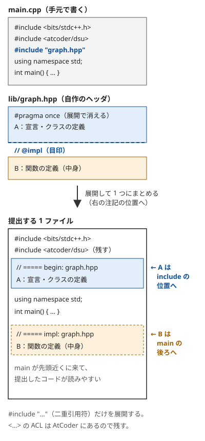

!!! abstract "要点"
    - **何ができるか**：解説コードの先頭に並ぶ `#include`・`using namespace std`・マクロ・`chmin`・`#pragma` を、素朴な書き方に戻して読める。名前の衝突・`#define int long long`・`#pragma` の置き場所などの事故を避けられる。自作のヘッダを使うコードを、提出前に 1 ファイルへ展開できる。
    - **いつ使うか**：解説コードの先頭に見慣れないマクロや `#pragma` が並んでいて、本体が読めないとき。自分の雛形やライブラリを作り、提出の手順を決めたいとき。
    - **計算量**：実行時の計算量は変わらない（マクロと `#include` はコンパイルの前の文字の置き換えで、`#pragma GCC optimize` は定数倍だけを変える）
    - **前提**：[関数テンプレートと constexpr](../cpp/cpp-templates-constexpr.md)

<!-- textlint-disable -->
別名：マクロ・macro・テンプレート（雛形）・rep マクロ・all マクロ・#define int long long・signed main()・chmin・chmax・#ifdef LOCAL・#pragma GCC optimize・bits/stdc++.h・using namespace std・import std;・名前の衝突・バンドル・ライブラリの展開・expander.py・提出用にコピー
<!-- textlint-enable -->

雛形（テンプレート）は、毎回の提出の先頭に貼る定型のコードである。C++ の `template`（[関数テンプレート](../cpp/cpp-templates-constexpr.md)）とは別の意味だが、競技プログラミングではどちらも「テンプレート」と呼ぶ。雛形の中身は `#include`・名前空間・マクロ・補助の関数・`#pragma` であり、どれも本体の手法とは関係がない。このページは、それぞれを「素朴に書くと何か」に戻して読めるようにし、実際に起きる事故を示す。例はどれも g++-13・g++-15（`-std=gnu++23 -O2 -Wall -Wextra`）で確かめた。

マクロ（`#define`）は、コンパイルの前に動くプリプロセッサが行う文字の置き換えである。型も変数の有効範囲も知らない。このページの落とし穴のほとんどは、この 1 点から起きる。

## `#include <bits/stdc++.h>` と using namespace std {#bits-stdcpp}

`#include <bits/stdc++.h>` は、GCC の標準ライブラリ（libstdc++）が持つ「標準ライブラリのヘッダをすべて読む」ヘッダである。`<vector>`・`<algorithm>`・`<queue>` などを 1 つずつ書く代わりになる。GCC の独自のもので規格にはなく、Clang（libc++）や MSVC にはない。AtCoder の GCC と手元の g++ では使える。

`using namespace std;` は、名前空間 `std` の名前を `std::` なしで書けるようにする宣言である。`std::vector<int>` を `vector<int>`、`std::views::iota` を `views::iota` と書ける。

- **素朴に書くと**：使うヘッダを 1 つずつ `#include` し、名前に `std::` を付ける
- **コンパイル時間**：すべてのヘッダを読むので、1 回のコンパイルが 1〜3 秒ほど長くなる。手元ではプリコンパイル済みヘッダで縮められる（[AtCoder と手元の環境](../cpp/cpp-environment.md)）
- **落とし穴**：`std` の名前がすべてグローバルから見えるので、自分の変数や関数の名前とぶつかりうる。次の節で扱う

## 名前の衝突：count・y1 をグローバル変数の名前にするとエラー、std:: を省かない流儀、using namespace atcoder {#namespaces}

`#include <bits/stdc++.h>` と `using namespace std;` のもとで、グローバル変数に `count` や `y1` という名前を付けると、コンパイルエラーになる。`count` はアルゴリズムの `std::count` と区別できず、`y1` は `<cmath>` が読み込む C の数学関数 `y1`（第 2 種ベッセル関数。POSIX の拡張）と同じ名前だからである。`count` は `std` の中にあるので名前が曖昧になり、`y1` はグローバルに宣言されているので同じ名前の宣言が重なる。そのため、エラーの種類が違う。

```cpp
--8<-- "cpp-macros-template-file/names-ng.cpp:core"
```

g++-13・g++-15 とも、`count` は `reference to 'count' is ambiguous`、`y1` は `'int y1' redeclared as different kind of entity` と出る。同じ理由で `next`・`prev`・`distance`・`data`・`size`・`j0`・`j1` などもグローバルの名前には向かない。

関数の中の変数なら衝突しない。内側の変数が外側の名前を隠すだけだからである。

```cpp
--8<-- "cpp-macros-template-file/names-ok.cpp:core"
```

- **避け方**：グローバルの変数と関数には、標準ライブラリにない名前（`cnt`・`ys` など）を付ける。変数は `main` の中に置く
- **std:: を省かない流儀**：`using namespace std;` を書かず、`std::vector`・`std::ranges::sort` と書く解説コードもある。衝突は起きないが長くなる。読むときは `std::` を外して読めばよい
- **ACL**：ACL の名前は名前空間 `atcoder` の中にある。`using namespace atcoder;` と書くと `atcoder::dsu` を `dsu` と書ける。書かないコードでは `atcoder::` が付く（[ACL の読み方](../cpp/acl-reading.md)）

??? question "確認問題：`int count;` を `main` の中に移すとエラーは消えるか？"
    消える。関数の中の変数は、外側（グローバル）にある `std::count` を隠すので、`count` はその変数を指すと決まる。グローバルに置くと、自分の `::count` と `using namespace std;` で見える `std::count` が同じ高さに並び、どちらか決まらない。

## import std;：#include の代わりに標準ライブラリを読む。INT_MAX・assert などのマクロは来ない、手元では std モジュールを先に作る（C++23・GCC 15〜） {#import-std}

`import std;` は、C++23 のモジュールの機能で、標準ライブラリ全体を読み込む。解説コードに出てきたら、`#include <bits/stdc++.h>` の代わりと読めば足りる。`using namespace std;` の役割は持たないので、`using namespace std;` がなければ `std::` を付けて書く。

違いは、モジュールがマクロを持ち込まないことである。`INT_MAX`・`assert`・`LLONG_MAX` などはマクロなので、`import std;` だけでは使えない。手元の g++-15 で `'INT_MAX' was not declared in this scope`・`'assert' was not declared in this scope` になった。`std::numeric_limits<int>::max()` はマクロではないので使える。マクロが要るなら、`#include <climits>`・`#include <cassert>` を `import std;` より前に書く。`<vector>`・`<cmath>` などを `import std;` の後に `#include` すると、手元の g++-15 ではエラーになる。GCC はこの順にまだ対応していないので、`#include` は前に書く。

手元の g++-15 では、先に `std` モジュールをコンパイルしておく必要がある。作業用のフォルダで次を 1 回実行すると `gcm.cache/std.gcm` ができ（手元で 3 秒ほど）、同じフォルダで `-fmodules` を付けたコンパイルが通る。作っていないと `failed to read compiled module` で止まる。

```bash
g++-15 -std=gnu++23 -O2 -fmodules -fsearch-include-path -c bits/std.cc
g++-15 -std=gnu++23 -O2 -fmodules main.cpp
```

- **版**：C++23。g++-15 で使え、g++-13 では使えない。AtCoder の GCC 15.2 は `-fmodules` 付きでコンパイルするが、AtCoder で `import std;` が通るかはこの教材では確かめていない（GCC のモジュールの対応はまだ部分的である）
- **使い分け**：学習者が自分で使う必要はない。提出は `#include <bits/stdc++.h>` のままでよい

## マクロは文字の置き換え：rep・all・vc/vvc と、引数の数で切り替える FOR {#macros}

解説コードの雛形でよく見るマクロと型の別名は、次のように置き換わる。

```cpp
--8<-- "cpp-macros-template-file/macros.cpp:core"
```

| 書き方 | 置き換わった後（素朴な書き方） |
| --- | --- |
| `rep(i, n)` | `for (int i = 0; i < (int)(n); i++)` |
| `sort(all(a))` | `sort((a).begin(), (a).end())` |
| `vc<int>`・`vvc<int>` | `vector<int>`・`vector<vector<int>>` |
| `FOR(n)`・`FOR(i, n)`・`FOR(i, a, b)` | `n` 回回す・`i` を $[0, n)$ で回す・`i` を $[a, b)$ で回す |

`vc`・`vvc` はマクロではなく `using` による型の別名（エイリアステンプレート）で、型として扱われる。`ll` の `using` と `#define` の違いは[型の別名](../cpp/cpp-types-literals.md#type-alias)で扱う。

`FOR` は引数の数で中身を切り替える。`PICK(__VA_ARGS__, FOR3, FOR2, FOR1, _)` は、渡された引数の後ろに候補を並べ、4 番目に来た名前を選ぶ。引数が 1 つなら 4 番目は `FOR1`、2 つなら `FOR2`、3 つなら `FOR3` になる。引数が増えるほど候補が右へずれる仕組みである。

- **素朴に書くと**：表の右の列のとおり。読むときは頭の中で置き換える
- **版**：どれも C++11 以前からある書き方で、g++-13・g++-15 で通る

マクロは文字を置き換えるだけなので、関数のつもりで書くと次の 2 つの事故が起きる。

```cpp
--8<-- "cpp-macros-template-file/macro-text.cpp:core"
```

- **落とし穴 1（括弧）**：`#define SQ(x) x * x` に `1 + 2` を渡すと `1 + 2 * 1 + 2` になり、9 ではなく 5 になる。マクロを書くなら、引数と全体を括弧で囲む。関数で書けるものは関数（テンプレート）にする
- **落とし穴 2（2 回評価）**：`all(make())` は `make().begin(), make().end()` に置き換わり、`make` が 2 回呼ばれる。2 つの別々の `vector` のイテレータを組にするので未定義動作になる。関数の戻り値は、先に変数へ入れてから `all` に渡す
- **落とし穴 3（型の固定）**：上の `rep` は `(int)(n)` で `n` を `int` にする。`n` が $2^{31}$ 以上の `long long` だと正しく回らない。雛形によっては `rep` を `long long` で回すものもあり、読むときは定義を確かめる

??? question "確認問題：`#define MAX(a, b) ((a) > (b) ? (a) : (b))` に `MAX(i++, 0)` を渡すと何が起きるか？"
    `((i++) > (0) ? (i++) : (0))` に置き換わり、`i` が正なら `i++` が 2 回実行される。括弧を付けても 2 回評価は防げない。`std::max(i++, 0)` なら 1 回だけ評価される。

## #define int long long と signed main()（printf・scanf の書式とも食い違う） {#define-int}

`#define int long long` は、コード中の `int` という語をすべて `long long` へ置き換えるマクロである。オーバーフローを気にせず書けるので、雛形に入れる人がいる。このとき `int main()` は `long long main()` になる。`main` の戻り値は `int` と決まっているので、コンパイルエラーになる。

```cpp
--8<-- "cpp-macros-template-file/define-int-ng.cpp:core"
```

g++-13・g++-15 とも `'::main' must return 'int'` と出る。`signed` は `int` と同じ型の別の書き方で、`int` という語を含まないので置き換えを受けない。そこで `signed main()` と書く。

```cpp
--8<-- "cpp-macros-template-file/define-int.cpp:core"
```

入力 `3000000000` に対して `9000000000000000000` と出る（`x` は `long long`）。

- **素朴に書くと**：`#define` を使わず、必要な変数だけ `long long` と書く（[オーバーフロー](../cpp/cpp-integer-overflow.md)）
- **落とし穴 1（書式）**：`printf("%d")`・`scanf("%d")` の書式は置き換わらない。`int` が `long long` になったのに書式が `%d` のままだと食い違う。`-Wall` で `format '%d' expects argument of type 'int', but argument 2 has type 'long long int'` の警告が出る。手元では `3000000000` を読んで `printf("%d")` で出すと `-1294967296` と出た（未定義動作なので、いつもこうなるとは限らない）。`%lld` に直すか、`cin`・`cout` を使う

```cpp
--8<-- "cpp-macros-template-file/define-int-printf.cpp:core"
```

- **落とし穴 2（ほかの場所の int）**：`vector<int>` も `vector<long long>` になるので、メモリが 2 倍になる。ACL など、`int` を受け取る前提の関数に渡す値の型も変わる。メモリの上限が厳しい問題では、`#define int long long` をやめるのが手早い

??? question "確認問題：`#define int long long` のとき、`main` をどう書くか。なぜか"
    `signed main()` と書く。`int main()` は置き換えで `long long main()` になり、`main` の戻り値は `int` でなければならないのでエラーになる。`signed` は `int` と同じ型で、`int` という語を含まないので置き換えを受けない。

## chmin・chmax：2 つの型を取る形と、return a < b && (a = b, true) のカンマ演算子 {#chmin}

`chmin(a, b)` は「`b` が `a` より小さければ `a` を `b` に書き換え、書き換えたかを返す」関数である。`chmax` はその逆である。最小値・最大値の更新と DP の遷移でよく使う。

```cpp
--8<-- "cpp-macros-template-file/chmin.cpp:core"
```

`chmax` の `return a < b && (a = b, true);` は次のように読む。

- `&&` は左が偽なら右を評価しない（短絡評価）。`a < b` が偽なら、書き換えずに `false` を返す
- `a < b` が真なら右の `(a = b, true)` を評価する。カンマ演算子は左から順に評価し、右の値を全体の値にする。`a = b` で書き換えてから、`true` を全体の値にする

`chmin` の `b < a ? (a = b, true) : false` は、同じことを三項演算子で書いたものである。戻り値を使うと、更新された回数を数えたり、更新されたときだけ別の処理（経路の復元など）をしたりできる。

```cpp
--8<-- "cpp-macros-template-file/chmin.cpp:use"
```

- **素朴に書くと**：`if (x < mn) { mn = x; updates++; }`。戻り値を使わないなら `mn = min(mn, x);` と同じである
- **2 つの型を取る理由**：型を 1 つにした `template <class T> bool chmin(T& a, const T& b)` を考える。`long long` の変数と `0`（`int`）を渡すと、`T` が `long long` と `int` の両方に推論されて決まらない。そのためコンパイルエラーになる（`deduced conflicting types for parameter 'const T'`）。`T` と `U` に分けると、`chmin(mn, 0)` のように型の違う値を渡せる

```cpp
--8<-- "cpp-macros-template-file/chmin-one-type-ng.cpp:core"
```

- **落とし穴**：`a` は参照で受けるので、書き換えたい変数そのものを渡す。`chmin(dp[i] + 1, x)` のように式を渡すとコンパイルエラーになる。比較の向き（`b < a`）は自分で書くと逆にしやすい。雛形の定義を一度確かめる

??? question "確認問題：`chmax(mx, x)` の `mx` が `int`、`x` が `long long` のとき、2 つの型を取る形で書いた `chmax` は安全か？"
    コンパイルは通るが安全ではない。`a = b` で `long long` の値を `int` の `mx` に入れるので、`x` が `int` の範囲を超えると値が変わる（警告も出ないことが多い）。2 つの型を取る形は、小さい型の値を大きい型の変数に渡すためのもので、更新される変数の型は十分に大きくしておく。

## #ifdef LOCAL・#ifndef ONLINE_JUDGE：手元だけのデバッグ出力を切り替える {#ifdef-local}

`#ifdef X` 〜 `#else` 〜 `#endif` は、マクロ `X` が定義されているかでコンパイルする部分を選ぶ。手元でだけ `-DLOCAL` を付けてコンパイルすれば、デバッグ出力を手元だけで有効にできる。提出のときにデバッグ出力を消し忘れても、提出したコードでは何もしない。

```cpp
--8<-- "cpp-macros-template-file/debug.cpp:core"
```

`#x` は引数の文字をそのまま文字列にするマクロの機能で、`debug(s)` は `cerr << "s" << " = " << (s) << endl` になる。`g++-15 -DLOCAL` でコンパイルすると標準エラー出力に `s = 1`・`s = 3` と出て、付けなければ何も出ない。

- **ONLINE_JUDGE**：AtCoder はコンパイルのときに `-DATCODER -DONLINE_JUDGE` を付ける（[AtCoder と手元の環境](../cpp/cpp-environment.md)）。`#ifndef ONLINE_JUDGE` と書けば、手元で何も付けなくてもデバッグ出力が有効になり、ジャッジでは消える。ただし、`ONLINE_JUDGE` を定義するかはジャッジごとに違う
- **落とし穴**：デバッグ用の部分に副作用（変数の書き換え・入力の読み込み）を入れない。手元と提出で動きが変わる。また、標準エラー出力でも大量に出すと遅くなるので、手元で時間を測るときは `-DLOCAL` を外す

## #pragma GCC optimize・target：AtCoder は -march=native なので target は要らない、g++-13 では #include より前に書くとエラー、Ofast は浮動小数点の約束を変える {#pragma}

`#pragma GCC optimize("O3,unroll-loops")` は、コンパイルのオプション（最適化の段階・ループの展開）をソースの中で指定する。`#pragma GCC target("avx2")` は、使ってよい CPU の命令を指定する。どちらも定数倍を変えるだけで、計算量は変わらない。

- **target は AtCoder では要らない**：AtCoder の GCC は `-march=native` 付きでコンパイルするので、ジャッジの CPU の命令（AVX2 など）はもともと使われる（[AtCoder と手元の環境](../cpp/cpp-environment.md)）
- **g++-13 では置き場所でエラー**：`#pragma GCC target` を `#include <bits/stdc++.h>` より前に書くと、g++-13 では `string` などを使うだけでコンパイルエラーになる。g++-15 では通った

```cpp
--8<-- "cpp-macros-template-file/pragma-before-include-ng.cpp:core"
```

エラーは `inlining failed in call to 'always_inline' '... allocator ...': target specific option mismatch` と出る。ヘッダの中の関数と自分の関数で、使ってよい命令の指定が食い違うためである。`#include` の後に書けば g++-13 でも通る（雛形によっては `<bits/allocator.h>` を先に読む対策をしている）。

```cpp
--8<-- "cpp-macros-template-file/pragma-after-include.cpp:core"
```

- **Ofast は浮動小数点の約束を変える**：`Ofast` は `O3` に、規格に厳密に従わない最適化（`-ffast-math` など）を加えたものである。`-ffast-math` は「NaN や無限大は現れない」「足し算の順序を入れ替えてよい」と仮定して速くする。そのため、NaN の判定が消えたり、誤差の出方が変わったりする。手元の g++-13・g++-15 では、`sqrt(-1)` の結果に `isnan` を使うと、`Ofast` を付けたときだけ「NaN ではない」と判定された

```cpp
--8<-- "cpp-macros-template-file/ofast.cpp:core"
```

- **使い分け**：浮動小数点を使うコード（幾何・確率）には `Ofast` を付けない。付けるなら `O3` までにする。速さが足りないときは、`#pragma` より先に計算量と入出力（[入出力](../cpp/cpp-io.md)）を見直す

??? question "確認問題：AtCoder に提出するコードで、`#pragma GCC target("avx2")` を消すと遅くなるか？"
    ほとんど変わらない。AtCoder の GCC は `-march=native` を付けてコンパイルするので、ジャッジの CPU の AVX2 などの命令は `#pragma` がなくても使われる。手元の g++ には `-march=native` を付けていないので、手元で測れば差の出ることがある。

## 自作のヘッダを #include "..." したコードは、提出前に 1 ファイルに展開する（バンドル） {#bundling}

自作のライブラリを `lib/graph.hpp` のようなヘッダに分け、`#include "graph.hpp"` で読むと、手元のコードは短くなる。しかしジャッジに出せるのは 1 ファイルだけで、ジャッジには自分のヘッダがない。そのまま提出すると `graph.hpp: No such file or directory` でコンパイルエラーになる。そこで提出の前に、`#include "..."` の行をヘッダの中身で置き換えた 1 ファイルを作る。これを展開（バンドル）という。

ACL は AtCoder のジャッジに入っているので、`#include <atcoder/dsu>` は展開しなくてよい。ほかのジャッジ（ACL のないところ）に出すときは ACL も展開が要る。



展開するときにすることは次の 3 つである。

1. `#include "..."` の行を、そのファイルの中身で置き換える。中の `#include "..."` も同じように置き換える（再帰）
2. 同じファイルは 1 回だけ展開する。`#pragma once` とインクルードガード（`#ifndef X` / `#define X` / `#endif` の組）は、1 ファイルになった後は要らないので取り除く
3. `#include <...>`（山括弧）は標準ライブラリか ACL なので残す

展開した後のコードは、手元でもう一度コンパイルしてから提出する。

- **落とし穴**：ヘッダの中に `using namespace std;` やマクロを書くと、展開した後のファイル全体に効く。名前の衝突（[名前の衝突](#namespaces)）が自分のライブラリと本体の間でも起きるので、ライブラリの中では `std::` を付けて書くほうが安全である。ライブラリの作り方は[ライブラリの設計](../guide/library-design.md)で扱う

## 展開の道具：cph の「提出用にコピー」（#include "..." だけを展開）・ACL の expander.py（atcoder/ だけを展開し、v1.6 の --origname で元の行番号を出せる）・oj-bundle {#bundling-tools}

展開は手でもできるが、道具に任せる。展開する範囲が道具ごとに違う。

| 道具 | 展開するもの | 残すもの |
| --- | --- | --- |
| cph の改造版（公式の cph にはない機能）の「提出用にコピー」 | `#include "..."` | `#include <...>`（ACL を含む） |
| ACL の `expander.py` | `<atcoder/...>`・`"atcoder/..."` | それ以外（自作のヘッダを含む） |
| `oj-bundle`（online-judge-verify-helper） | `#include "..."`（`-I` で探す場所を指定） | `#include <...>` |

- **cph の「提出用にコピー」**：公式の cph（Competitive Programming Helper）にはなく、この教材の作者が改造した版にだけある機能である。`#include "..."` だけを展開し、`// @impl` で分ける仕組みの例として読めばよい。コマンドパレットの `cph.copyForSubmit` か、判定パネルのボタンで呼ぶ。保存していない編集中の内容も使い、結果をクリップボードに入れる。ヘッダはソースのフォルダ、次に設定 `cph.bundle.includePaths` から探す。展開した部分の前後に `// ===== begin: ...` などの印を入れる。見つからない include は残して警告する。`#ifdef LOCAL` の中で include したファイルは、条件の外に出ないようにその場に展開する
- **ACL の expander.py**：`python3 expander.py --lib <ACL の場所> main.cpp` で `combined.cpp` を出す（`-c` で標準出力）。ACL のファイルからはインクルードガードと `//` のコメント行を除く。自作のヘッダの `#include "..."` は展開しない。自作のヘッダと ACL の両方を展開するなら、道具を組み合わせる。v1.6 で加わった `--origname main.cpp` を付けると、展開した部分の直後に `#line 3 "main.cpp"` のような行が入る。コンパイルエラーの行番号が元のファイルの行で出る（手元の v1.6 で確かめた。v1.5 にはない）
- **oj-bundle**：ライブラリを自動で検証する道具 verification-helper に含まれる（`oj-bundle` だけでも使える）。`#pragma once` かインクルードガードで、同じファイルを 1 回だけ展開する。`#ifdef LOCAL` などの条件の中の `#include "..."` はエラーになる（cph の改造版はその場に展開する）

## // @impl で main の後ろに回せるもの・回せないもの（auto を返す関数・定数式で使う constexpr 関数・クラスの定義は前に置く） {#impl-marker}

ライブラリをそのまま展開すると、提出したコードの先頭に数百行のライブラリが並び、`main` が末尾に来る。cph の「提出用にコピー」は、ヘッダの中の目印 `// @impl` の行で中身を 2 つに分ける。目印より上は include の位置に、下は `main` の後ろにまとめて出す（目印の文字は設定 `cph.bundle.implMarker` で変えられる）。上には宣言を、下には定義を置けば、`main` が先頭近くに来る。

```cpp
--8<-- "cpp-macros-template-file/impl-ok.cpp:core"
```

```cpp
--8<-- "cpp-macros-template-file/impl-ok.cpp:impl"
```

C++ では、使う場所より前に宣言があれば、定義は後ろにあってよい。ただし、型や値をコンパイルのときに知る必要があるものは、使う場所より前に定義がなければならない。

| main の後ろ（目印より下）に置いたもの | 結果（g++-13・g++-15） |
| --- | --- |
| 普通の関数の定義 | 通る |
| 関数テンプレートの定義 | 通る |
| クラスのメンバ関数の、クラスの外での定義 | 通る |
| 戻り値が `auto` の関数の定義 | エラー |
| 定数式の中で使う `constexpr` 関数の定義 | エラー |

戻り値が `auto` の関数は、定義を見るまで戻り値の型が決まらない。宣言だけでは呼べない。

```cpp
--8<-- "cpp-macros-template-file/impl-auto-ng.cpp:core"
```

エラーは `use of 'auto twice(int)' before deduction of 'auto'` と出る。`constexpr` 関数を配列の長さなどの定数式で使うときも、コンパイルのときに中身を計算するので、使う場所より前に定義が要る。

```cpp
--8<-- "cpp-macros-template-file/impl-constexpr-ng.cpp:core"
```

エラーは `'constexpr int twice(int)' used before its definition` と出る。

- **避け方**：戻り値の型を書く（`auto` を使わない）か、その関数を目印より上に置く。クラスの定義・定数・インライン変数も、使う場所より前に定義が要るので目印より上に置く。クラスはメンバ関数の宣言だけをクラスの中に書き、定義をクラスの外（目印より下）に書く
- **落とし穴**：目印を `#if` の中に置くと、分けた部分が条件の外に出てしまう。cph は目印が `#if` の中にあれば分けずに警告する

## 確認問題 {#quiz}

??? question "確認問題：`rep(i, n)` が `for (int i = 0; i < (int)(n); i++)` のとき、`rep(i, v.size() - 1)` は `v` が空なら何回回るか？"
    0 回である。`v.size() - 1` は `size_t`（符号なし）の計算で巨大な値になる。しかし `(int)(n)` で `int` に変えると $-1$ になり（手元の g++-15 で確かめた）、`0 < -1` が偽なので 1 回も回らない。マクロの中のキャストが偶然に事故を防いでいる。素朴に `for (int i = 0; i < v.size() - 1; i++)` と書くと、比べるときに `i` が符号なしへ変わり、ほぼ無限に回って範囲外を読む（[オーバーフロー](../cpp/cpp-integer-overflow.md#unsigned-size)）。

??? question "確認問題：自作のヘッダ `lib/mint.hpp` と ACL の `<atcoder/segtree>` を使うコードを、ACL のないジャッジに出したい。何をするか？"
    両方を展開する。cph の「提出用にコピー」は `#include "..."` だけを展開し、`<atcoder/...>` を残す。そこで ACL の `expander.py` でも展開する。または ACL を `#include "atcoder/segtree"` と二重引用符で書き、cph の探す場所に ACL のフォルダを足す。AtCoder に出すなら ACL はジャッジにあるので、自作のヘッダだけを展開すればよい。

## 参考 {#references}

- [traP「競プロ用マクロ」](https://trap.jp/post/1224/)：引数の数でマクロを切り替える技法
- [traP「【非公式】[C++] AtCoder ジャッジアップデート (2024–2025) について」](https://trap.jp/post/2589/)：`import std;` の GCC での対応状況と、`#include` と併用するときの順序
- [maspy「library」の my_template.hpp](https://github.com/maspypy/library/blob/main/my_template.hpp)：雛形のマクロ・型の別名・2 つの型を取る `chmin`・`#pragma` の例
- [NyaanNyaan「library」の template](https://github.com/NyaanNyaan/library/tree/master/template)：`long long` で回す `rep` など、雛形の例
- [ei1333「library」の template.hpp](https://github.com/ei1333/library/blob/master/template/template.hpp)：雛形の例
- [online-judge-tools「verification-helper」](https://github.com/online-judge-tools/verification-helper)：`oj-bundle` の展開と、1 回だけ展開する条件（`#pragma once`・インクルードガード）
- [atcoder「ac-library」の document_ja](https://github.com/atcoder/ac-library/tree/master/document_ja)：ACL の名前空間 `atcoder` と `expander.py` の使い方
- [GCC「Optimize Options」](https://gcc.gnu.org/onlinedocs/gcc/Optimize-Options.html)：`-Ofast` と `-ffast-math` が仮定すること
- [GCC「Function Specific Option Pragmas」](https://gcc.gnu.org/onlinedocs/gcc/Function-Specific-Option-Pragmas.html)：`#pragma GCC optimize`・`target` の意味
- [cpprefjp「モジュール」](https://cpprefjp.github.io/lang/cpp20/modules.html)：モジュールがマクロを持ち込まないこと
