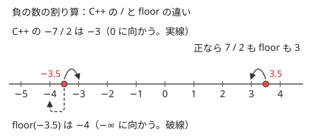
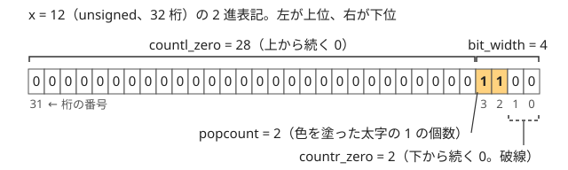

!!! abstract "要点"
    - **何ができるか**：gcd・割り算・sqrt などの数の関数、popcount・bitset などのビットの関数、乱数と時間計測を、型と境界の決まりに沿って正しく使う。整数の割り算が 0 に向かって切り捨てることや、sqrt の誤差に気をつける。
    - **いつ使うか**：解説コードに `gcd`・`popcount`・`__lg`・`bitset`・`mt19937_64` が出てきたとき。負の数を割る、大きな整数の平方根を取る、2 のべき乗に切り上げるとき。
    - **計算量**：`gcd`・`lcm` は $O(\log \min(a, b))$。`<bit>` の関数と組み込み関数は $O(1)$。`bitset<N>` のシフト・論理演算・`count` は $O(N / 64)$
    - **前提**：[数の型とリテラル](../cpp/cpp-types-literals.md)

<!-- textlint-disable -->
別名：gcd・lcm・midpoint・clamp・割り算の切り捨ての向き・pow・sqrt・sqrtl・numbers::pi・std::popcount・countr_zero・bit_width・__builtin_popcount・__builtin_ctz・__lg・std::bitset・_Find_first・mt19937_64・uniform_int_distribution・shuffle・chrono・乱数・時間計測
<!-- textlint-enable -->

数・ビット・乱数の関数は、標準ライブラリ（`<numeric>`・`<cmath>`・`<bit>`・`<bitset>`・`<random>`・`<chrono>`）と GCC の組み込み関数のうち、解説コードによく出るものである。どれも 1 行で書けるが、引数の型（符号付きか、何桁か）と境界（0・負の数・大きな数）で結果が変わる。このページの書き方は、AtCoder の GCC 15.2（`-std=gnu++23`）と手元の g++-13・g++-15（`-std=gnu++23`）ですべて使える。

このページのコードは `#include <bits/stdc++.h>` と `using namespace std;` を前提にする。節の題名に版の注記がないものは C++11 以前からある。

## gcd・lcm：型を混ぜられる、負の数は絶対値で計算、lcm は戻り値の型であふれる（C++17。__gcd は GCC の古い関数） {#gcd-lcm}

`gcd(a, b)` は最大公約数、`lcm(a, b)` は最小公倍数を返す（`<numeric>`）。引数の型は違ってよく、結果は 2 つの型の共通の型（`int` と `long long` なら `long long`）になる。負の数は絶対値で計算するので、`gcd(-12, 18)` は 6 である。`gcd(0, b)` は $\lvert b \rvert$ を返し、`lcm(0, b)` は 0 を返す。

```cpp
--8<-- "cpp-math-functions/gcd-lcm.cpp:core"
```

- **素朴に書くと**：0 以上の引数では、ユークリッドの互除法 `b == 0 ? a : gcd(b, a % b)` と同じである。負の数ではこの再帰は負の値を返しうる（落とし穴 3 の `__gcd` も同じ理由）（理論は [GCD・LCM とユークリッドの互除法](../math/gcd-lcm.md)）
- **版**：C++17。`-std=gnu++14` ではコンパイルエラーになる。g++-13・g++-15 とも `-std=gnu++17` から使える
- **落とし穴 1**：`lcm` の戻り値の型は引数の共通の型である。`lcm(100003, 100019)` は `int` 同士なので `int` で返り、本当の値 $10002200057$ は `int` で表せない。結果がその型で表せないときは[未定義動作](../cpp/cpp-undefined-behavior.md)で、手元では g++-13・g++-15 とも `1412265465` と出た（`-D_GLIBCXX_ASSERTIONS` を付けると検査で止まる）。どちらかを `long long` にする
- **落とし穴 2**：自分で書くときは `a / gcd(a, b) * b` の順にする。`a * b / gcd(a, b)` は、割る前の $a \times b$ があふれる。`std::lcm` は中で先に割っている。多数の数の lcm は、途中で $10^{18}$ を超えうる。上限を超えるかを掛ける前に割り算で判定する書き方は [整数の割り算と余り](../math/integer-division.md) で、あふれの全般は [整数のオーバーフローと __int128](../cpp/cpp-integer-overflow.md) で扱う
- **落とし穴 3**：古い解説コードの `__gcd(a, b)` は GCC の内部の関数である。2 つの引数が同じ型でないと通らず（`__gcd(12, 18LL)` はコンパイルエラー）、負の数では負の値を返すことがある（手元で `__gcd(12, -18)` は $-6$）。いまは `gcd` を使う

## midpoint（C++20）・clamp（C++17） {#midpoint-clamp}

`midpoint(a, b)` は $a$ と $b$ の中点を、`a + b` をあふれさせずに求める（`<numeric>`）。和が奇数のときは第 1 引数の側に丸める。`clamp(x, lo, hi)` は $x$ を閉区間 $[lo, hi]$ に収めた値で、`min(max(x, lo), hi)` と同じである（`<algorithm>`）。

```cpp
--8<-- "cpp-math-functions/midpoint-clamp.cpp:core"
```

入力 `1 4 15` なら `2 3 10` と出る。`midpoint(2147483647, 2147483645)` も `2147483646` になり、`(a + b) / 2` のようにあふれない。

- **版**：`midpoint` は C++20、`clamp` は C++17。g++-13・g++-15 とも、`midpoint` は `-std=gnu++20` から使える
- **落とし穴 1**：`midpoint` は「0 に向かう」丸めでも「小さい側」への丸めでもない。`midpoint(-3, 0)` が $-2$ で、`midpoint(0, -3)` だと $-1$ になる。二分探索の `mid` に使うと、`midpoint(ok, ng)` は `ok` の側に寄る。$\lvert ok - ng \rvert \ge 2$ の間だけ回すなら、`mid` が両端と異なるので、どちらの丸めでも止まる（[二分探索](../basics/binary-search.md)）
- **落とし穴 2**：`clamp` は 3 つの引数を同じ型で受けるので、`long long` の `x` に `clamp(x, 0, n)` と書くとコンパイルエラーになる。`0LL` と書いてそろえる。$lo > hi$ のときの動作は決まっていない（[未定義動作](../cpp/cpp-undefined-behavior.md)）

```cpp
--8<-- "cpp-math-functions/clamp-ng.cpp:core"
```

## 整数の / と % は 0 に向かって切り捨てる（-7 / 2 は -3、-7 % 2 は -1。負の数の床関数・切り上げの書き方は integer-division のページ） {#integer-division}

C++ の整数の `a / b` は、実数の商を 0 に向かって切り捨てる。正の数では床関数 $\lfloor a / b \rfloor$ と同じだが、負の数では 1 ずれる。`a % b` は `a - (a / b) * b` と決まっていて、符号は `a` と同じになる。



| 式 | C++ の結果 | 数学の $\lfloor a / b \rfloor$ と $a - b \lfloor a / b \rfloor$ |
| --- | --- | --- |
| `7 / 2`・`7 % 2` | 3・1 | 3・1 |
| `-7 / 2`・`-7 % 2` | −3・−1 | −4・1 |
| `7 / -2`・`7 % -2` | −3・1 | −4・−1 |

```cpp
--8<-- "cpp-math-functions/division.cpp:core"
```

- **素朴に書くと**：`floor(-7 / 2.0)` は $-4$ になるが、double を経るので $10^{18}$ 付近では誤差が出る。整数のまま床関数・切り上げ・非負の余りを求める関数は [整数の割り算と余り](../math/integer-division.md) で扱う
- **落とし穴 1**：`x % 2 == 1` は負の奇数で偽になる（`-7 % 2` は $-1$）。奇数の判定は `x % 2 != 0` か `x & 1` で書く
- **落とし穴 2**：負になりうる値の mod を取るとき、`a % m` は負のまま残る。配列の添字や modint の引数として使う前に、0 以上 $m$ 未満へ直す
- **落とし穴 3**：正の数の切り上げ `(a + b - 1) / b` は、$a$ が負だと正しくない。$b = 2$ のとき、$a = -7$ では $-3$ で合うが、$a = -8$ でも $-3$ と出る（正しくは $-4$）

## pow・sqrt は double で計算する：整数のべき乗に pow を使わない、大きな long long の sqrt は誤差が出る（整数の平方根は標準になく、補正の仕方は integer-root のページ） {#pow-sqrt}

`pow` と `sqrt` は、引数を double に変えて計算し、double を返す（`<cmath>`）。double の仮数部は 53 bit なので、$2^{53} \approx 9 \times 10^{15}$ を超えると表せない整数が出てくる（[浮動小数点数の型](../cpp/cpp-types-literals.md#floating-point)）。

```cpp
--8<-- "cpp-math-functions/pow-sqrt.cpp:core"
```

$3^{35} = 50031545098999707$ は奇数で、double では表せない。`pow(3, 35)` は近くの偶数 `50031545098999704` になる。$10^{18} - 1$ も double では $10^{18}$ に丸まるので、`sqrt` は 1 大きい $10^9$ を返す。

- **整数のべき乗**：ループで掛けるか、[繰り返し二乗法](../math/mod-pow.md)を使う。mod を取るなら modint の `pow` を使う
- **整数の平方根**：C++ に整数の平方根の関数はない。`(long long)sqrt(x)` を求めた後、$r^2 > x$ なら減らし、$(r+1)^2 \le x$ なら増やして直す（[整数の平方根・K 乗根と累乗数](../math/integer-root.md)）
- **sqrtl**：long double（[x86-64 の GCC では仮数部 64 bit](../cpp/cpp-types-literals.md#floating-point)）で計算するので、上の $10^{18} - 1$ は正しく出る。AtCoder・手元の x86-64 の GCC では、$2^{64}$ 未満の整数で `(unsigned long long)sqrtl(x)` が正しい床になる。ただし long double が double と同じ処理系（MSVC など）では `sqrt` と同じく誤るので、どの環境でも正しくするには補正を書く
- **落とし穴**：`(int)pow(x, 2)` のように double の結果を整数に変えると、小数部が切り捨てられる。計算結果が真の値よりわずかに小さいと、1 小さい整数になる。規格は `pow` の誤差を決めていないので、小さな値で合っても整数の計算に double を混ぜない

## 円周率：numbers::pi（C++20）・M_PI・acos(-1) {#pi}

円周率は、どの書き方でも double の範囲で同じ値になる。手元の g++-13・g++-15 で、3 つの double は等しかった。

```cpp
--8<-- "cpp-math-functions/pi.cpp:core"
```

- **numbers::pi**：C++20 の `<numbers>` にある定数である。`numbers::pi_v<long double>` で long double の精度の値になる
- **M_PI**：POSIX の `<math.h>` のマクロで、C++ の規格にはない。GCC では `-std=c++23`（GNU 拡張なし）でも使えた
- **acos(-1)**：昔からの書き方で、関数呼び出しになる。long double の精度が要るなら `acosl(-1)` にする
- **版**：`numbers::pi` は C++20。`-std=gnu++17` ではコンパイルエラーになる

## `<bit>` の関数：popcount・countr_zero・countl_zero・bit_width・bit_ceil・bit_floor・has_single_bit（C++20） {#bit-functions}

`<bit>` の関数は、2 進表記の 1 の個数や、端から続く 0 の個数を数える。$x = 12$（2 進で $1100$）を `unsigned`（32 桁）で数えると、次の図のようになる。



```cpp
--8<-- "cpp-math-functions/bit-functions.cpp:core"
```

| 関数 | 意味 | $x = 12$ | $x = 0$ |
| --- | --- | --- | --- |
| `popcount(x)` | 1 の個数 | 2 | 0 |
| `countr_zero(x)` | 下から続く 0 の個数 | 2 | 32 |
| `countl_zero(x)` | 上から続く 0 の個数 | 28 | 32 |
| `bit_width(x)` | 桁数（$\lfloor \log_2 x \rfloor + 1$） | 4 | 0 |
| `bit_ceil(x)`・`bit_floor(x)` | $x$ 以上の最小・以下の最大の 2 のべき乗 | 16・8 | 1・0 |

- **よく使う形**：`bit_width(x) - 1` は最上位の 1 の位置（$x > 0$）で、`__lg(x)` と同じである。`bit_ceil(n)` はセグメント木の葉の数に、`has_single_bit(x)` は 2 のべき乗の判定に使う
- **版**：C++20。`-std=gnu++17` ではコンパイルエラーになる。g++-13・g++-15 とも `-std=gnu++20` から使える
- **落とし穴**：`bit_ceil(x)` は、結果がその型で表せないと未定義動作である。`unsigned` で $x > 2^{31}$ を渡してはいけない（手元で $2^{32} - 1$ を渡すと 1 が返った）。大きくなりうるなら `unsigned long long` で受ける

## std::popcount などは符号なし整数しか受けない（popcount(int) はエラー、負の int を unsigned long long にすると上位が 1 で埋まる）（C++20） {#bit-unsigned-only}

`<bit>` の関数は、`unsigned`・`unsigned long long` などの符号なし整数しか受けない。`int` や `long long` を渡すとコンパイルエラーになる。g++-15 のエラーは `no matching function for call to 'popcount(int&)'` である。

```cpp
--8<-- "cpp-math-functions/popcount-int-ng.cpp:core"
```

キャストして渡すときは、どの幅の符号なし整数にするかで、負の数の結果が変わる。$-1$ は `unsigned` では 32 個、`unsigned long long` では 64 個の 1 になる。

```cpp
--8<-- "cpp-math-functions/popcount-unsigned.cpp:core"
```

- **素朴に書くと**：組み込み関数 `__builtin_popcount(s)` は `int` をそのまま受ける（[組み込み関数](#builtins)）
- **落とし穴**：負の数になりうる値を数えるときは、何桁として数えたいかを決めてからキャストする。bit 全探索の集合は 0 以上なので、`unsigned` にしてよい

## 組み込み関数：__builtin_popcount・__builtin_popcountll・__builtin_ctz・__builtin_clzll・__lg（ctz・clz・__lg に 0 を渡すと未定義。std:: の関数は 0 でも値が決まっている）（GCC の拡張） {#builtins}

`__builtin_` で始まる関数は GCC の拡張で、C++20 より前の解説コードによく出る。末尾の `ll` は `unsigned long long` を受ける版で、ないものは `unsigned int` を受ける。

| 組み込み関数 | `<bit>` の関数 | 0 を渡したとき |
| --- | --- | --- |
| `__builtin_popcount(x)`・`__builtin_popcountll(x)` | `popcount` | 0 |
| `__builtin_ctz(x)`・`__builtin_ctzll(x)` | `countr_zero` | 未定義 |
| `__builtin_clz(x)`・`__builtin_clzll(x)` | `countl_zero` | 未定義 |
| `__lg(x)`（$\lfloor \log_2 x \rfloor$） | `bit_width(x) - 1` | 未定義 |

```cpp
--8<-- "cpp-math-functions/builtins.cpp:core"
```

- **落とし穴 1**：`long long` に `ll` のない `__builtin_popcount` を使うと、`unsigned int` に変わって上位 32 桁が消える。$2^{40} + 1$ で 2 ではなく 1 を返し、`-Wall -Wextra` でも警告は出なかった（[bit 演算](../basics/bit-operations.md#popcount)）
- **落とし穴 2**：`ctz`・`clz`・`__lg` に 0 を渡したときの結果は決まっていない。手元でたまたま 32 が出ても、ほかの環境で同じになるとは限らない。0 になりうるなら前もって場合分けするか、0 でも値が決まっている `<bit>` の関数を使う
- **使い分け**：C++20 が使える AtCoder では `<bit>` の関数を使えばよい。`__lg` は `int` と `long long` のどちらも受けて短いので、解説コードでは今もよく見る

## ビットの小技：x & -x（最下位の 1）・x & (x - 1)・部分集合を大きい順に回す for（考え方は bit 演算のページ） {#bit-tricks}

解説コードによく出る 3 つの短い書き方である。なぜその値になるかは [bit 演算](../basics/bit-operations.md#popcount) と [部分集合の部分集合の列挙](../basics/bit-operations.md#submask) で扱う。

```cpp
--8<-- "cpp-math-functions/bit-tricks.cpp:core"
```

- `x & -x`：最下位の 1 だけを残した値。BIT の添字の移動 `i += i & -i` に出る。`x` が 0 でない `unsigned` なら `1u << countr_zero(x)`（`unsigned long long` なら `1ULL << countr_zero(x)`）とも書ける
- `x & (x - 1)`：最下位の 1 を消した値。`(x & (x - 1)) == 0` は「$x$ が 0 か 2 のべき乗」の判定になる
- `s = (s - 1) & m`：$m$ の部分集合を大きい順に回す。$m = 5$（$101$）なら 5, 4, 1, 0 と進む
- **落とし穴**：`for (int s = m; s > 0; s = (s - 1) & m)` のように `s > 0` を条件にすると、空集合 0 を処理しない。条件を外すと、`(0 - 1) & m` が $m$ に戻って回り続ける。0 を処理してから `break` する形（上のコード）にする

## bitset：大きさはコンパイル時の定数、count・シフト・dp |= dp << w、_Find_first・_Find_next（後の 2 つは GCC の拡張） {#bitset}

`bitset<N>` は $N$ 個の 0/1 を 64 個ずつ 1 語にまとめて持つ。シフト・AND・OR・`count` は 64 個ずつまとめて処理するので、$O(N / 64)$ で終わる。部分和の DP で「作れる和の集合」を丸ごと 1 つの bitset に持つと、1 個ずつ更新する場合の約 1/64 の時間になる（[bitset による高速化](../misc/bitset-speedup.md)）。

```cpp
--8<-- "cpp-math-functions/bitset.cpp:core"
```

$w = \{3, 5\}$ なら、作れる和は 0・3・5・8 の 4 個である。`dp << x` は「すでに作れる和すべてに $x$ を足したもの」で、OR を取ると「$x$ を使う・使わない」を同時に反映する。上にはみ出した桁は捨てられる。

- **大きさ**：$N$ はコンパイル時の定数でなければならない。`bitset<n + 1> dp;`（`n` は入力）は `the value of 'n' is not usable in a constant expression` でコンパイルエラーになる。制約の最大値から `const int` の定数を決める

```cpp
--8<-- "cpp-math-functions/bitset-ng.cpp:core"
```

- **_Find_first・_Find_next**：GCC の拡張である。`b._Find_first()` は最初の 1 の位置、`b._Find_next(i)` は $i$ より後ろの最初の 1 の位置を返す。1 がなければ $N$ を返すので、ループは `s < N` で止める
- **落とし穴 1**：`b[i]` は範囲を調べない。範囲外を読むと未定義動作になる。`b.test(i)` は範囲外で例外を投げる
- **落とし穴 2**：`bitset<N>` を関数の中に置くと、$N / 8$ バイトがスタックに乗る。$N = 10^8$ なら約 12 MB なので、大きいものはグローバル変数にする

## 乱数：mt19937_64 rng(random_device{}())・uniform_int_distribution（両端を含む）・shuffle（rand() は使わない。種を固定すると再現できる） {#random}

乱数は、乱数を作るエンジン（`mt19937_64`）と、値を範囲に割り振る分布（`uniform_int_distribution`）を組み合わせて使う（`<random>`）。乱択アルゴリズムやハッシュの基数を決めるときに使う（[乱択アルゴリズム](../misc/randomized.md)）。

```cpp
--8<-- "cpp-math-functions/random.cpp:core"
```

- **mt19937_64**：64 bit の値を返すメルセンヌ・ツイスタである。`rng()` を直接呼ぶと、0 以上 $2^{64}$ 未満の値が出る。32 bit で足りるなら `mt19937`
- **random_device{}()**：実行ごとに違う種を作る。`chrono::steady_clock::now().time_since_epoch().count()` を種にする解説コードもある
- **uniform_int_distribution<long long>(l, r)**：閉区間 $[l, r]$ の整数を一様に返す。半開区間ではない。`l > r` は未定義動作である
- **shuffle(v.begin(), v.end(), rng)**：配列を一様にかき混ぜる。C++17 で消えた `random_shuffle` は、GCC では残っているが非推奨の警告が出る
- **落とし穴 1**：`rand()` は使わない。最大値 `RAND_MAX` は処理系ごとに違い（規格は 32767 以上とだけ決めていて、手元の GCC では $2^{31} - 1$）、`rand() % n` は偏る
- **落とし穴 2**：種を定数にすると、毎回同じ列になる。失敗を再現するには便利だが、その種と相性の悪い入力では何度提出しても同じように失敗する。デバッグ中だけ種を固定し、提出では `random_device` を使う。同じ列になるのはエンジンの値で、`uniform_int_distribution`・`shuffle` を通した値は、標準ライブラリが違うと同じ種でも変わりうる

## 時間計測：chrono::steady_clock::now() {#chrono}

`chrono::steady_clock::now()` は、戻らない時計の現在の時刻を返す（`<chrono>`）。2 つの時刻の差を `duration_cast` で単位に直すと、経過時間になる。手元での速さの比較や、制限時間の手前まで試行を繰り返す乱択・焼きなましに使う。

```cpp
--8<-- "cpp-math-functions/chrono.cpp:core"
```

- **steady_clock を選ぶ理由**：`system_clock` は時刻合わせで戻ることがあり、経過時間に向かない
- **落とし穴**：経過時間を毎回測ると、それ自体に時間がかかる。軽い試行なら 100 回に 1 回だけ測るなど、間を空ける
- **関連**：乱数で作った小さな入力を使って解答を確かめる手順は [ストレステストと実験](../guide/stress-testing.md) で扱う

## 確認問題 {#quiz}

??? question "確認問題：`-7 / 2` と `floor(-7 / 2.0)` の値は？"
    `-7 / 2` は $-3$、`floor(-7 / 2.0)` は $-4$ である。C++ の整数の割り算は 0 に向かって切り捨て、`floor` は負の無限大に向かって切り捨てる。正の数では両者は一致する。

??? question "確認問題：`int s = 5;` のとき `popcount(s)` がコンパイルエラーになるのはなぜか？"
    `std::popcount` は符号なし整数しか受けないからである。`popcount((unsigned)s)` とするか、`__builtin_popcount(s)` を使う。

??? question "確認問題：`int a = 100003, b = 100019;` のとき `long long l = lcm(a, b);` は正しいか？"
    正しくない。`lcm` は引数の共通の型 `int` で計算して返す。そのため `long long` に代入する前の時点であふれている。`lcm((long long)a, b)` と書く。

??? question "確認問題：`bit_width(x) - 1` は何を表すか？"
    $x > 0$ のとき、最上位の 1 の位置 $\lfloor \log_2 x \rfloor$ を表す（`__lg(x)` と同じ）。$x = 0$ では `bit_width(0u)` が 0 なので $-1$ になる。`__lg(0)` と違って未定義動作ではない。

## 参考 {#references}

- [cpprefjp「gcd」](https://cpprefjp.github.io/reference/numeric/gcd.html)・[cpprefjp「lcm」](https://cpprefjp.github.io/reference/numeric/lcm.html)：型の決まり方と負の数の扱い
- [cppreference「std::lcm」](https://en.cppreference.com/cpp/numeric/lcm)：結果が表せないときの扱い
- [cppreference「std::midpoint」](https://en.cppreference.com/cpp/numeric/midpoint)：整数の和が奇数のとき第 1 引数の側に丸めること
- [cpprefjp「clamp」](https://cpprefjp.github.io/reference/algorithm/clamp.html)：引数の型と $lo > hi$ の扱い
- [cpprefjp「`<numbers>`」](https://cpprefjp.github.io/reference/numbers.html)：`numbers::pi` などの数学定数
- [cpprefjp「`<bit>`」](https://cpprefjp.github.io/reference/bit.html)：`<bit>` の関数の一覧
- [cppreference「std::bit_ceil」](https://en.cppreference.com/cpp/numeric/bit_ceil)：結果が表せないと未定義動作であること
- [GCC「Bit Operation Builtins」](https://gcc.gnu.org/onlinedocs/gcc/Bit-Operation-Builtins.html)：組み込み関数の引数の型と、0 を渡したときの扱い
- [cpprefjp「bitset」](https://cpprefjp.github.io/reference/bitset/bitset.html)：`bitset` の操作の一覧
- [cppreference「RAND_MAX」](https://en.cppreference.com/cpp/numeric/random/RAND_MAX)：値は処理系が決め、32767 以上であること
- [cppreference「std::uniform_int_distribution」](https://en.cppreference.com/cpp/numeric/random/uniform_int_distribution)：閉区間 $[a, b]$ の整数を返すこと
- [cpprefjp「steady_clock」](https://cpprefjp.github.io/reference/chrono/steady_clock.html)：時刻が戻らない時計であること
