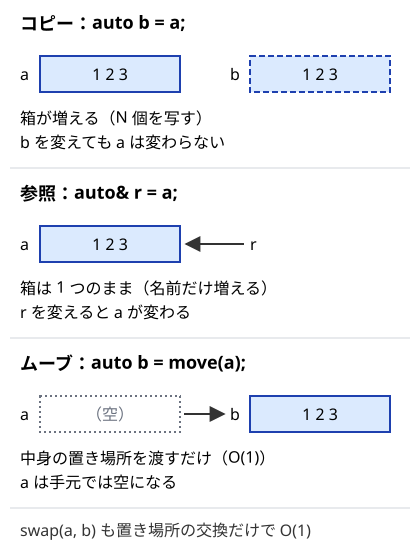

!!! abstract "要点"
    - **何ができるか**：値をコピーで受けるか参照で受けるかを選び、範囲 for と関数の引数で無駄なコピーと書き換え漏れを防ぐ。値渡しの再帰が遅い理由と、swap が O(1) の理由も分かる。
    - **いつ使うか**：`for (auto x : a) x *= 2;` で配列が変わらない、再帰に `vector` を渡したら TLE・MLE になった、DP の配列を毎回丸ごとコピーしているとき。解説コードの `const auto&`・`auto&&` を読みたいとき。
    - **計算量**：コピーは要素数に比例する（`vector` なら $O(N)$）。参照で受ける・ムーブ・`swap` は $O(1)$
    - **前提**：なし

<!-- textlint-disable -->
別名：参照・参照渡し・const 参照・値渡し・コピー・ムーブ・std::move・std::swap・範囲 for・range-based for・auto&&・const auto&・for (auto& x : v)・vector<bool>
<!-- textlint-enable -->

参照は、すでにある変数に別の名前を付ける仕組みである。C++ では、変数の受け渡しは何も書かなければコピーになり、`&` を付けると参照になる。範囲 for の受け方と関数の引数の書き方は、どちらもこの選択であり、速さ（コピーするか）と正しさ（元を書き換えるか）の両方を決める。

このページのコードは `#include <bits/stdc++.h>` と `using namespace std;` を前提にする。参照は C++98 から、範囲 for とムーブは C++11 からあり、AtCoder の GCC 15.2（`-std=gnu++23`）でも手元の g++-13 でも使える。版が新しいものは、各節の「版」に書く。

## 参照 T& と const 参照 const T&：別名を付けてコピーしない {#reference-basics}

`T& r = x;` と書くと、`r` は `x` の別名になる。新しい箱（メモリ）は作られず、`r` を書き換えると `x` が変わる。`T y = x;` は新しい箱を作って中身を写すコピーで、`y` を変えても `x` は変わらない。`const T& c = x;` は「読むだけの別名」で、コピーをせず、`c` から書き換えるとコンパイルエラーになる。



コピーは `vector` や `string` なら要素数に比例する時間とメモリを使い、参照は大きさによらず $O(1)$ である。

```cpp
--8<-- "cpp-range-for/references.cpp:core"
```

- **素朴に書くと**：毎回 `g[0]` と書いて `g[0].push_back(100);` とするのと同じ意味である。長い式（`g[par[v]]` など）に短い名前を付けるときに使う
- **版**：C++98 から。g++-13・g++-15 で使える
- **落とし穴**：`auto row = g[0];` と `&` を書き忘れると、`row` はコピーになる。`row.push_back(…)` は `g[0]` に入らず、エラーや警告は出ない。書き換えたいのに結果が反映されないときは、まず `&` を確かめる

## 関数の引数：値渡しは呼ぶたびにコピー（再帰では O(N) × 呼び出し回数）、大きなものは const& で渡す {#pass-by-reference}

関数の引数を `vector<int> a` と書くと、呼ぶたびに `a` 全体がコピーされる（値渡し）。再帰で深さ $N$ まで呼ぶと、コピーだけで $O(N^2)$ の時間がかかり、各段のコピーが同時に生きているのでメモリも $O(N^2)$ になる。`const vector<int>& a` と書けばコピーは起きない。

```cpp
--8<-- "cpp-range-for/pass-by-reference.cpp:core"
```

手元の g++-15（`-O2`）で長さ $10^4$ の配列を渡して深さ $10^4$ の再帰をすると、値渡しは 172 ms・最大メモリ 395 MB、`const&` は 1 ms 未満・4 MB 未満だった。長さ・深さとも $2 \times 10^5$ なら値渡しは確実に TLE か MLE になる。

| 引数の書き方 | コピー | 呼び出し元を書き換え | 使いどころ |
| --- | --- | --- | --- |
| `vector<int> a` | する | できない | 関数の中で壊してよい作業用のコピーがほしいとき |
| `const vector<int>& a` | しない | できない | 読むだけ（グラフ・入力の配列） |
| `vector<int>& a` | しない | できる | 結果を書き込む（訪問済みの印・距離の配列） |

- **版**：C++98 から。g++-13・g++-15 で使える
- **落とし穴**：`int`・`long long`・`pair<int, int>` のような小さな値は、値渡しで構わない（コピーの手間は参照と変わらない）。気にするのは `vector`・`string`・`set` などの、中身の数だけ大きくなるものである
- **関連**：ラムダ式の DFS では、`[&]` で受ければ外の `vector` はコピーされない。`[=]` は作った時点で丸ごとコピーする（[ラムダ式と再帰ラムダ](../cpp/cpp-lambda.md)）

## ムーブと swap：swap(dp, ndp) は中身を入れ替えるだけで O(1)、dp = ndp は長さに比例するコピー {#move-swap}

`vector` は、本体の小さな箱（中身の置き場所・長さ・確保した大きさ）と、別の場所にある中身からできている。`swap(dp, ndp)` は本体どうしの置き場所の情報を交換するだけで、中身には触れないので $O(1)$ である。`dp = ndp;` は中身を 1 つずつ写すので、長さに比例する時間がかかる（下のコードでは長さ $W + 1$ なので $O(W)$）。

DP を 2 本の配列で回すとき（[0-1 ナップサック](../dp/knapsack-01.md)の配列を使い回す形など）に、この差が効く。

```cpp
--8<-- "cpp-range-for/move-swap.cpp:core"
```

手元の g++-15（`-O2`）で長さ $10^7$ の `vector<long long>` を 100 回入れ替えると、`swap` は合わせて 1 µs 未満、`dp = ndp` は 572 ms だった。`swap` の後の `ndp` には前の段の値が残っているが、次の段で全部の添字に書き込むので問題ない。

`move(a)` は「`a` の中身を持っていってよい」という印で、`vector<int> b = move(a);` は中身の置き場所を `b` に渡すだけで $O(1)$ である。

```cpp
--8<-- "cpp-range-for/move-swap.cpp:move"
```

- **版**：`swap` の $O(1)$ は C++98 から、`move` は C++11 から。g++-13・g++-15 で使える
- **落とし穴 1**：`ndp` を毎段 `vector<long long> ndp(w + 1);` と作り直すと、確保と 0 埋めで $O(W)$ かかる。計算量の式は変わらない。ただし `swap` で使い回すと定数倍は軽い。逆に、`ndp` に前の段の値が残ることを忘れて「書かなかった所は 0」と思い込むと誤る
- **落とし穴 2**：手元では `move` した後の `a` は空になったが、中身を当てにして読まない。代入し直してから使う

## auto&&：何でも受けられる参照 {#forwarding-reference}

`auto&& x = 式;` は、式が名前のある変数（左辺値）なら普通の参照 `T&` になり、関数の戻り値のような[一時オブジェクト](../guide/glossary.md#temporary-object)（右辺値）なら `T&&` になる。どちらでもコピーは起きない。一時オブジェクトを受けたときは、その寿命が `x` の寿命まで延びるので、後で使っても安全である。

```cpp
--8<-- "cpp-range-for/forwarding-reference.cpp:core"
```

競プロのコードで `auto&&` が出てくるのは、主に次の 3 か所である。

- 範囲 for の `for (auto&& x : v)`：何を回しても通る受け方（[範囲 for の 4 通りの受け方](#range-for-forms)）
- 再帰ラムダの `auto&& self`：自分自身を参照で受ける（[ラムダ式と再帰ラムダ](../cpp/cpp-lambda.md)）
- views を受ける関数の引数 `auto&& r`：`const auto&` では回せない view があるため（[views の基本](../cpp/cpp-views-basics.md#filter-transform)）

どれも、受けたものをコピーせずに、そのまま使うための書き方である。

- **版**：C++11 から。g++-13・g++-15 で使える
- **落とし穴**：寿命が延びるのは、一時オブジェクトそのものを受けたときだけである。`auto&& e = make(n)[0];` のように一時オブジェクトの中身を受けると、文の終わりで `vector` が消えて `e` は消えた場所を指す

## 範囲 for の 4 通りの受け方：コピーが起きるか・元を書き換えられるか {#range-for-forms}

範囲 for `for (宣言 : 範囲)` は、範囲の要素を先頭から 1 つずつ宣言の変数で受けて本体を実行する。受け方は次の 4 通りで、「コピーが起きるか」と「元を書き換えられるか」の 2 つで選ぶ。

| 書き方 | コピー | 元を書き換え | 使いどころ |
| --- | --- | --- | --- |
| `for (auto x : v)` | する | できない | `int` などの小さな値を読む |
| `for (auto& x : v)` | しない | できる | 要素を書き換える・入力を読み込む |
| `for (const auto& x : v)` | しない | できない | `string`・`vector` などの大きな要素を読むだけ |
| `for (auto&& x : v)` | しない | できる（元が書き換えられる範囲なら） | 何でも受ける（`vector<bool>`・views も） |

```cpp
--8<-- "cpp-range-for/range-for-forms.cpp:core"
```

入力 `3` と `1 2 3` に対して、`a` は `2 3 4` になる。`x *= 2` はコピーの `x` を変えるだけで、`a` には届かない。

- **素朴に書くと**：`for (auto& x : a) x += 1;` は `for (int i = 0; i < (int)a.size(); i++) a[i] += 1;` と同じ意味である。`for (auto x : a)` は、ループの最初に `auto x = a[i];` とコピーするのと同じである
- **版**：C++11 から。g++-13・g++-15 で使える
- **落とし穴**：`vector<string>` や `vector<vector<int>>` を `for (auto s : strs)` で回すと、要素を 1 つ取り出すたびにコピーする。合計の長さに比例する時間が毎回かかるので、読むだけなら `const auto&` にする
- **関連**：`pair` や `tuple` の要素は `for (const auto& [u, w] : g[v])` と分けて受けられる（[構造化束縛](../cpp/cpp-structured-bindings.md)）

## bool の vector の要素はプロキシ：auto& で回すとエラー、auto で受けても元が書き換わる {#vector-bool}

`vector<bool>` は、メモリを節約するために要素を 1 bit ずつ詰めて持つ特別な `vector` である。1 bit には参照を作れないので、`vb[i]` は `bool&` ではなく、「`vb` の $i$ 番目の bit を指す代わりの小さな物」（[プロキシ](../guide/glossary.md#proxy)。型は `vector<bool>::reference`）を返す。

このため、ほかの `vector` と違う動きが 2 つある。

- `for (auto& b : vb)` はコンパイルエラーになる。取り出すたびに作られる一時的なプロキシを、`auto&` では受けられないからである。g++-15 のエラーは `cannot bind non-const lvalue reference of type 'std::_Bit_reference&' to an rvalue …` と出る。`auto&&` なら通り、書き換えも元に届く
- `auto y = vb[0];` の `y` はコピーではなくプロキシなので、`y = false;` で `vb[0]` が書き換わる。`bool y = vb[0];` と型を書けばコピーになる

```cpp
--8<-- "cpp-range-for/vector-bool.cpp:core"
```

- **版**：C++98 からこの仕様である。g++-13・g++-15 で同じ動きだった
- **落とし穴**：訪問済みの印など `vector<bool>` をよく使う場面では、`auto` で受けた変数が元を指していることに気づきにくい。プロキシを避けたいなら `vector<char>` か `vector<int>` を使う（メモリは 8 倍・32 倍になるが、普通の参照が使える）

## 範囲 for の初期化式 for (int i = 0; auto x : v)（C++20。i の更新は自分で書く） {#range-for-init}

C++20 から、範囲 for の前に変数の宣言を 1 つ書ける。添字も使いたいとき、その変数をループの外で宣言せずに済む。

```cpp
--8<-- "cpp-range-for/range-for-init.cpp:core"
```

入力 `5 6 7` なら `0:5 1:6 2:7` と出る。宣言できるだけで、普通の for の `i++` に当たる部分はないので、本体の中で `i++` と書く。

- **版**：C++20。g++-13・g++-15 とも `-std=gnu++20` 以降で使える。`-std=gnu++17` では、どちらも「C++20 の機能」という警告を出してコンパイルする
- **落とし穴**：本体の途中に `continue` があると、その下の `i++` が飛ばされて添字がずれる。添字が主役なら普通の for で書く。添字と要素の組を回す `views::enumerate`（C++23）もある（[C++23 の views](../cpp/cpp-views-cpp23.md)）

## ループの中で同じ vector に追加しない（再確保で壊れる） {#modify-in-loop}

`vector` は、確保した場所が埋まると、より大きな場所を確保し直して中身を移す（再確保）。範囲 for は、ループの最初に `v.begin()` と `v.end()` を覚えて、その位置を進めながら回る。ループの中で `v.push_back(…)` して再確保が起きると、覚えた位置は解放された古い場所を指したままになる。これは[未定義動作](../cpp/cpp-undefined-behavior.md)である。再確保が起きなくても、`push_back` で覚えた `v.end()` は無効になるので、先に `reserve` しておいても未定義動作のままである。

```cpp
--8<-- "cpp-range-for/modify-in-loop.cpp:bad"
```

`v = {2, 3, 4, 8}` で上の行を動かすと、手元の g++-13・g++-15 とも `-Wall -Wextra` で警告は出なかった。AddressSanitizer（`-fsanitize=address`）を付けると `heap-use-after-free` で止まった。付けずに `-O2` で動かすと、長さは実行のたびに 5〜8 と変わった（本来は偶数 3 個を足して 7 になる）。たまたま正しい 7 が出ることもあり、黙って誤った答えを出す。

回す前の長さを覚えて、添字で回せば安全である。`v[i]` は毎回 `v` から引き直すので、再確保の後も正しい場所を読む。

```cpp
--8<-- "cpp-range-for/modify-in-loop.cpp:core"
```

- **版**：どの版でも未定義動作である
- **落とし穴**：`auto& row = g[0];` と参照を取った後に `g.push_back(…)` しても、同じ理由で `row` が壊れる。再確保の後は、参照とイテレータを使わない。BFS のキューを `vector` で書くときは、範囲 for ではなく添字で回す

## 範囲に一時オブジェクトの中身を渡すとき（C++23・GCC 15〜でだけ安全な形） {#temporary-range}

範囲 for は、内部で `auto&& range = 範囲の式;` と受けてから回す。範囲の式が値で返す関数の戻り値そのもの（`for (int x : make(n))`）なら、[auto&&](#forwarding-reference) の規則で寿命が延びるので、どの版でも安全である。

一方、`for (int v : d.groups()[0])` は、`groups()` が返した一時的な `vector<vector<int>>` の `[0]` を受ける。C++20 までの規則では、`range` が受けるのは `[0]` が返した要素への参照だけである。外側の `vector` は寿命が延びず、ループの前に消える。C++23 の規則（P2718）は、範囲の式の中の一時オブジェクトをループの終わりまで生かすように変わった。GCC では 15 から入った。

ACL の `dsu` で 3 頂点をつないだ例を手元で動かすと、次のとおりだった（どれも `-Wall -Wextra` で警告なし）。

| コンパイラと版 | AddressSanitizer あり | なし（`-O2`） |
| --- | --- | --- |
| g++-13・`-std=gnu++23` | `heap-use-after-free` | 落ちた |
| g++-15・`-std=gnu++20` | `heap-use-after-free` | 落ちた |
| g++-15・`-std=gnu++23`（AtCoder と同じ） | 正しく `0 2 3` | 正しく `0 2 3` |

g++-15 でも `-fno-range-for-ext-temps` を付けると古い規則に戻り、`heap-use-after-free` になった。いったん変数に受けてから回せば、どの版でも安全である。

```cpp
--8<-- "cpp-range-for/temporary-range.cpp:core"
```

- **版**：延長の規則は C++23 で、GCC 15 から。AtCoder の GCC 15.2（`-std=gnu++23`）では安全だが、手元の g++-13 では壊れる
- **落とし穴**：AtCoder（GCC 15・C++23）で通ったコードが、手元の g++-13 や C++20 の環境で落ちる。警告は出ない。版に頼らず、変数で受けてから回す書き方にそろえる

## 確認問題 {#quiz}

??? question "確認問題：`for (auto x : v) x *= 2;` で `v` は変わるか？"
    変わらない。`x` は要素のコピーで、コピーを 2 倍にしているだけである。`v` を変えるには `for (auto& x : v) x *= 2;` と参照で受ける。

??? question "確認問題：再帰関数の引数を `vector<int> v` から `const vector<int>& v` にすると何が変わるか？"
    呼ぶたびの `v` のコピーがなくなる。深さ $N$ の再帰でコピーにかかっていた $O(N^2)$ の時間とメモリが消え、1 回の呼び出しは $O(1)$ で済む。代わりに、関数の中で `v` を書き換えられなくなる。

??? question "確認問題：`vector<bool>` を `for (auto& b : vb)` で回せないのはなぜか？"
    `vector<bool>` の要素は 1 bit ずつ詰めてあり、`bool&` を作れない。取り出すたびに作られる一時的なプロキシを返すので、`auto&`（左辺値への参照）では受けられない。`auto&&` なら一時オブジェクトも受けられるので通る。

??? question "確認問題：`for (int v : d.groups()[0])` が手元の g++-13 で壊れて AtCoder では動くのはなぜか？"
    `groups()` が返した一時的な `vector` が、C++20 までの規則ではループの前に消えるからである。C++23 の規則（P2718）で寿命がループの終わりまで延び、GCC 15 から実装された。AtCoder の GCC 15.2 の C++23 モードでは延び、g++-13 では延びない。

## 参考 {#references}

- [cppreference「Range-based for loop」](https://en.cppreference.com/w/cpp/language/range-for)：範囲 for が `auto&& range = …` に展開されることと、初期化式・一時オブジェクトの寿命の規則
- [cppreference「Reference declaration」](https://en.cppreference.com/w/cpp/language/reference)：左辺値の参照と `auto&&` の型の決まり方
- [cppreference「std::vector&lt;bool&gt;」](https://en.cppreference.com/w/cpp/container/vector_bool)：要素がプロキシ（`reference`）で返ること
- [cpprefjp「範囲for文」](https://cpprefjp.github.io/lang/cpp11/range_based_for.html)：日本語で読める範囲 for の説明
- [cpprefjp「初期化式をともなう範囲for文」](https://cpprefjp.github.io/lang/cpp20/range-based_for_statements_with_initializer.html)：C++20 の初期化式
- [cpprefjp「範囲for文が範囲初期化子内で生じた一時オブジェクトを延命することを規定」](https://cpprefjp.github.io/lang/cpp23/lifetime_extension_in_range_based_for_loop.html)：C++23 の P2718
- [cpprefjp「右辺値参照・ムーブセマンティクス」](https://cpprefjp.github.io/lang/cpp11/rvalue_ref_and_move_semantics.html)：`move` が中身を移すこと
- [cpprefjp「vector::swap」](https://cpprefjp.github.io/reference/vector/vector/swap.html)：`swap` が定数時間であること
- [GCC「GCC 15 Release Series Changes, New Features, and Fixes」](https://gcc.gnu.org/gcc-15/changes.html)：P2718 が GCC 15 で実装されたこと
