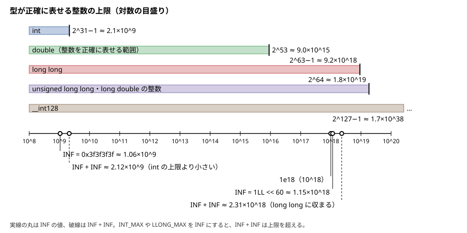

!!! abstract "要点"
    - **何ができるか**：整数・浮動小数点数の型とリテラル、INF の値を、値が収まり意図どおりの型になるように選ぶ。`auto x = 0` が `int`、`1e18` が `double` になるような、型のずれによる誤りを防ぐ。
    - **いつ使うか**：値が $2^{31}$（約 $2.1 \times 10^9$）を超えうるとき。最短路や DP の初期値に INF を置くとき。`auto`・`1e18`・`v.size()` を書いたとき。小数の入力や答えがあるとき。
    - **計算量**：実行時の計算量には関わらない（型の選び方の話）
    - **前提**：なし

<!-- textlint-disable -->
別名：整数の型・long long・LL・ULL・桁区切り・2 進リテラル・0uz・auto の推論・using ll = long long・static_cast・INF・numeric_limits・LLONG_MAX・INT_MAX・0x3f3f3f3f・1LL << 60・double・long double・1e18・浮動小数点数の型
<!-- textlint-enable -->

数の型とリテラルは、C++ で値を持つときの土台である。型を誤ると、コンパイルは通っても値があふれたり丸められたりして WA になる。このページは、AtCoder と同じ GCC 15.2 の g++-15（`-std=gnu++23`）と g++-13 で確かめた、型の選び方と型のずれの典型を並べる。あふれたときに何が起きるかと防ぎ方の一覧は[整数のオーバーフローと __int128](../cpp/cpp-integer-overflow.md)に任せる。

このページのコードは `#include <bits/stdc++.h>` と `using namespace std;` を前提にする。型の大きさは、AtCoder と手元の 64 bit の Linux（x86-64）でのものである。

## 整数の型と表せる範囲（int・long long・unsigned・size_t・int64_t） {#integer-types}

競技プログラミングで使う整数の型は、ほぼ `int`（32 bit）と `long long`（64 bit）の 2 つである。目安は、値と途中の計算結果がすべて `int` の上限（約 $2.1 \times 10^9$）以内なら `int`、そうでなければ `long long` である。入力が $10^9$ 以下でも、2 つ足すだけで上限を超えうるので、和や積は初めから `long long` で持つ。



図のとおり、型ごとの上限は桁で大きく違う。各型の最大値は `numeric_limits<T>::max()` で得られる。

```cpp
--8<-- "cpp-types-literals/int-types.cpp:core"
```

| 型 | 大きさ | 範囲 | 使う場面 |
| --- | --- | --- | --- |
| `int` | 32 bit | 約 $\pm 2.1 \times 10^9$ | 添字・個数・$10^9$ 以下の値 |
| `long long` | 64 bit | 約 $\pm 9.2 \times 10^{18}$ | 和・積・$10^{18}$ 程度の値 |
| `unsigned`・`unsigned long long` | 32・64 bit | $0$ 〜 約 $4.3 \times 10^9$・$1.8 \times 10^{19}$ | bit 演算・ハッシュ |
| `size_t` | 64 bit | $0$ 〜 約 $1.8 \times 10^{19}$ | `size()` の戻り値 |

64 bit を超える値は、GCC の拡張の `__int128` で持てる（[整数のオーバーフローと __int128](../cpp/cpp-integer-overflow.md#int128)）。

符号なしの型（`unsigned`・`size_t`）は、0 から 1 を引くと最大値に回り込む。bit 演算やハッシュのように回り込みを使う場面のほかは、符号付きの型で計算する。

`size_t` と `int64_t` は型の別名（ほかの型に付けた名前）で、64 bit の Linux では `size_t` が `unsigned long`、`int64_t` が `long` である。`long` と `long long` はどちらも 64 bit だが、C++ では別の型として扱われる。そのため、`int64_t` と `long long` を `max` に渡すとコンパイルエラーになる（`max` は 2 つの引数が同じ型であることを求める）。

```cpp
--8<-- "cpp-types-literals/int64-max-ng.cpp:core"
```

- **版**：`int64_t` は C++11 から。g++-13・g++-15 のどちらでも上の `static_assert` が通る。`max(a, b)` は `no matching function for call to 'max(int64_t&, long long int&)'` で止まった
- **落とし穴**：`int64_t` と `long long` を混ぜない。教材のコードは `long long` にそろえる。ライブラリが `int64_t` を使うなら、`max<long long>(a, b)` のように型を明示する

## リテラルの書き方：1LL・ULL、桁区切り 1'000'000'007、2 進 0b1010、size_t の 0uz（C++23） {#literals}

数をそのまま書いたもの（リテラル）にも型がある。接尾辞のない 10 進の整数は `int` で、`int` に収まらなければ `long`、`long long` の順に広がる。16 進・8 進・2 進のリテラルは、`int` に収まらないとき、先に `unsigned int` を試す（`0x80000000` は `unsigned int`）。`3000000000` は自動で `long` になるので、それ自体はあふれない。問題になるのは、小さな数どうしの計算が `int` のまま行われるときである。`1 << 40` は `int` のシフトで、`1LL << 40` と書いて初めて `long long` で計算される。

```cpp
--8<-- "cpp-types-literals/literals.cpp:core"
```

- `LL`・`ULL`：`long long`・`unsigned long long` にする。小文字の `ll` も同じだが、`l` は `1` と見分けにくい
- `'`（桁区切り）：`1'000'000'007`・`998'244'353` のように、値を変えずに読みやすくする（C++14）
- `0b`（2 進）：`0b1010` は 10（C++14）。ビットの並びを見せたいときに使う。`0x`（16 進）は昔からある
- `uz`：`0uz` は `size_t` の 0（C++23）。`views::iota(0uz, v.size())` のように、`size()` と型をそろえるときに使う（[views の基本](../cpp/cpp-views-basics.md#iota-size-mismatch)）
- 指数表記：`1e9` は値が整数でも `double` である。整数として使うなら `1'000'000'000` と書くか、`long long` の変数に入れる
- **版**：`0uz` は C++23 で、g++-13・g++-15 とも `-std=gnu++23` で使える。`-std=gnu++20` では警告になる（views の基本の版の注記と同じ）。ほかは C++14 までに入っている
- **落とし穴**：`const int MOD = 1e9 + 7;` は `double` の `1000000007.0` を `int` に変換しており、たまたま正確である。`1e9 + 7` は `double` が正確に表せる範囲（$2^{53}$ まで）なので問題は出ないが、`1'000'000'007` と書けば型を考えずに済む

## auto が推論する型：0 は int、0LL は long long、v.size() は size_t、1e18 は double {#auto-deduction}

`auto` は初期値の型をそのまま変数の型にする。変数に入れる値がどれだけ大きくなるかは見ない。そのため、`auto sum = 0;` と書いて大きな値を足していくと、`sum` は `int` のままあふれる。

```cpp
--8<-- "cpp-types-literals/auto-deduction.cpp:core"
```

| 書き方 | 推論される型 | 起きうること |
| --- | --- | --- |
| `auto a = 0;` | `int` | 和を足していくとあふれる |
| `auto b = 0LL;` | `long long` | （意図どおり） |
| `auto n = v.size();` | `size_t` | `n - 1` が空のとき巨大な数になる |
| `auto INF = 1e18;` | `double` | `INF + 1` が丸められる（[1e18 は double](#double-1e18)） |

同じ規則は、初期値から型を決める所すべてに効く。`accumulate(a.begin(), a.end(), 0)` の和は初期値 `0` の型の `int` で計算され、`views::iota(0, n)` の要素は `int` になる（[views の基本](../cpp/cpp-views-basics.md#iota-int)）。初期値を `0LL` にすれば `long long` になる。

- **版**：`auto` による変数の推論は C++11 から。g++-13・g++-15 で、上の `static_assert` がすべて通る
- **落とし穴**：`auto` を使うと、型を書かない分だけ誤りが見えにくい。和・積・INF のように大きくなる変数は、`long long sum = 0;` と型を書くか、初期値に `LL` を付ける

## 型の別名：using ll = long long と #define ll long long（ll(x) と書けるか） {#type-alias}

解説コードでよく見る `ll` は `long long` の別名である。書き方は `using ll = long long;` と `#define ll long long` の 2 通りある。`using` は型に名前を付け、`#define` はコンパイルの前に文字を置き換える。

違いが出るのは `ll(x)`（関数形式のキャスト）である。`#define` では `long long(x)` に置き換わる。関数形式のキャストは 1 語の型名にしか使えないので、コンパイルエラーになる。

```cpp
--8<-- "cpp-types-literals/define-ll-ng.cpp:core"
```

g++-15 のエラーは `expected primary-expression before 'long'` である。`using` なら `ll` は 1 語の型名なので通る。

```cpp
--8<-- "cpp-types-literals/using-ll.cpp:core"
```

- **版**：`using` による別名は C++11 から。g++-13・g++-15 のどちらでも、`#define` ではエラーになり、`using` なら通る
- **落とし穴**：`#define int long long` はすべての `int` を置き換える書き方で、`main` の戻り値の型まで変わる（`signed main()` と書く理由）。詳しくは[マクロと雛形](../cpp/cpp-macros-template-file.md)に任せる
- 教材のコード片は別名を使わず `long long` と書く。解説コードの `ll` は `long long` と読み替えればよい

## キャスト：static_cast と C 形式のキャスト {#cast}

キャストは値を別の型に変える書き方である。`static_cast<long long>(x)`・`(long long)x`・`(long long)(x)`（`using` の別名なら `ll(x)`）は、数の型の変換ではどれも同じ意味になる。`static_cast` は長いが、ポインタなど危ない変換を誤って書くとエラーにしてくれる。解説コードでは短い `(long long)x` が多い。

大事なのは、どこで型を変えるかである。キャストは `*` より先に効くので、`(long long)a * b` は「`a` を `long long` にしてから掛ける」になり、積が正しく求まる。`(long long)(a * b)` は `int` のまま掛けてから広げるので、あふれた後では遅い（[整数のオーバーフローと __int128](../cpp/cpp-integer-overflow.md#int-product)）。

```cpp
--8<-- "cpp-types-literals/cast.cpp:core"
```

入力 `100000 100000` に対して、3 つの書き方とも `10000000000`（$10^{10}$）を出す。

- **小数から整数へ**：`(int)2.9` は 2、`(int)-2.9` は -2 で、0 に向かって切り捨てる（床関数ではない）。四捨五入は `llround(x)`、床は `floor(x)` を使う（[数・ビット・乱数の関数](../cpp/cpp-math-functions.md)）。変換先の型に収まらない値を変換するのは[未定義動作](../cpp/cpp-undefined-behavior.md)である
- **版**：どの書き方も C++ の最初からある。g++-13・g++-15 で、上の出力は同じだった
- **落とし穴**：`(long long)(a * b)` のように、計算の結果だけを広げても直らない。広げるのは計算に入る前の値である

## INF の決め方と、INF + INF があふれるか {#inf}

INF は、最短路の「まだ到達していない」や、最小値を求める DP の初期値に置く大きな値である。INF に辺の重みや別の INF を足すことがあるので、選ぶ基準は 2 つある。1 つは、本物の答えより確実に大きいこと。もう 1 つは、INF に辺の重みや別の INF を足しても型の上限を超えないことで、目安は INF + INF である。

[ダイクストラ法](../graph/dijkstra.md)の更新 `if (dist[u] + w < dist[v])` を、`dist[u]` が INF のまま行う実装は珍しくない。INF に型の最大値を使うと、ここで足し算があふれる。符号付き整数のあふれは未定義動作で、多くは負の数に回り込んで比較が真になり、最適化によっては別の壊れ方もする（[未定義動作とダングリング](../cpp/cpp-undefined-behavior.md#what-is-ub)、[INF + INF のあふれ](../cpp/cpp-integer-overflow.md#edge-values)）。

| 書き方 | 値 | INF + INF | 備考 |
| --- | --- | --- | --- |
| `INT_MAX`（`numeric_limits<int>::max()`） | 約 $2.1 \times 10^9$ | あふれる | 足さない用途だけ |
| `0x3f3f3f3f` | $1061109567$ | `int` に収まる | `memset` で配列を埋められる |
| `1LL << 60` | 約 $1.15 \times 10^{18}$ | `long long` に収まる | 7 倍まで収まる |
| `LLONG_MAX`（`numeric_limits<long long>::max()`） | 約 $9.2 \times 10^{18}$ | あふれる | 足さない用途だけ |
| `1e18` | $10^{18}$（`double`） | `long long` にすれば収まる（$2 \times 10^{18}$） | `long long INF = 1e18;` と型を書けば正確 |

```cpp
--8<-- "cpp-types-literals/inf.cpp:core"
```

`0x3f3f3f3f` は各バイトが同じ `0x3f` である。そのため、`memset(d, 0x3f, sizeof d)` で `int` の配列全体を INF で埋められる（`memset` はバイト単位で埋めるので、普通の値では使えない。[初期化と CTAD](../cpp/cpp-initialization.md#refill)）。

`vector` なら `vector<long long> dist(n, INF)` で埋めればよいので、こだわる必要はない。

`INT_MAX + 1` のように、定数どうしのあふれはコンパイラが警告する。g++-13・g++-15 とも `-Wall` なしでも `integer overflow in expression of type 'int'` と出た。ただし、実行中に値が決まる `dist[u] + w` のあふれは警告されない。

```cpp
--8<-- "cpp-types-literals/inf-overflow-warn.cpp:core"
```

有名なライブラリの雛形は、どれも 2 倍しても型に収まる値を選んでいる（2026-10 に GitHub で確かめた）。

| 雛形 | `int` の INF | `long long` の INF |
| --- | --- | --- |
| maspy（`infty<T>`） | $1{,}010{,}000{,}000$ | $2{,}020{,}000{,}000{,}000{,}000{,}000$ |
| Nyaan（`inf`・`infLL`） | $1001001001$ | $4004004004004004004$ |
| ei1333（`inf`・`infll`） | $2^{30} - 1$ | $2^{62} - 1$ |

- **版**：`numeric_limits` は C++ の最初からあり、`constexpr` で使えるのは C++11 から。上のコード片は g++-13・g++-15 で通る
- **落とし穴**：最大値を求める DP の初期値は `-INF` にする。`-INF` から値を引く遷移があるなら、`-INF - INF` が下限を超えないかも同じように確かめる。答えが INF のままなら「到達できない」として、`-1` などに直して出力する

??? question "確認問題：`const int INF = INT_MAX;` で、`dist[u]` が INF のまま `dist[u] + w < dist[v]` を調べるとどうなるか？"
    `dist[u] + w` が `int` の上限を超え、符号付き整数のあふれ（未定義動作）になる。手元で多いのは負の数に回り込む結果で、そうなると `dist[v]` より小さいと判定され、到達していない頂点から誤った距離が伝わる。INF を `0x3f3f3f3f` か、`long long` の `1LL << 60` にすれば、足してもあふれない。

## 浮動小数点数の型：double が整数を正確に表せるのは 2^53 まで、x86-64 の long double は仮数部 64bit {#floating-point}

`double` は 64 bit の浮動小数点数で、有効数字を持つ部分（仮数部）が 53 bit ある。そのため、整数を正確に表せるのは $2^{53} \approx 9.0 \times 10^{15}$ までである。それを超えると、隣り合う整数を区別できなくなる。x86-64 の GCC の `long double` は 80 bit の拡張精度で、仮数部が 64 bit ある。$2^{64} \approx 1.8 \times 10^{19}$ まで正確なので、`long long` の値はすべて正確に持てる。

```cpp
--8<-- "cpp-types-literals/double-precision.cpp:core"
```

$2^{53} + 1$ を `double` にすると、+1 が消えて $2^{53}$ になる。`long double` なら残る。

| 型 | 仮数部 | 整数が正確な範囲 | 10 進の有効数字の目安 |
| --- | --- | --- | --- |
| `double` | 53 bit | $2^{53} \approx 9.0 \times 10^{15}$ まで | 約 15〜16 桁 |
| `long double`（x86-64 の GCC） | 64 bit | $2^{64} \approx 1.8 \times 10^{19}$ まで | 約 18〜19 桁 |
| `float128_t`（[下の節](#float128)） | 113 bit | $2^{113}$ まで | 約 33〜34 桁 |

- **使い分け**：答えが小数なら `double` を基本にする。`long double` は精度が 3 桁ほど増えるが遅い。`long long` の値どうしの比較を浮動小数点数で行うのは避け、整数のまま計算する
- **版**：`long double` の大きさは環境で違う（Visual C++ では `double` と同じ 64 bit）。AtCoder と手元の g++ は x86-64 なので 64 bit の仮数部を持つ
- **落とし穴**：`sqrt`・`pow` は `double` で計算するので、大きな整数に使うと誤差が出る（[数・ビット・乱数の関数](../cpp/cpp-math-functions.md#pow-sqrt)）。小数の出力は、`cout` の既定では有効数字 6 桁になる（[入出力と定数倍](../cpp/cpp-io.md#float-output)）

## 1e18 は double：long long に直す位置で値が変わる、auto INF = 1e18 も double {#double-1e18}

`1e18` は指数表記のリテラルなので、型は `double` である。$10^{18}$ そのものは `double` で正確に表せるが、$2^{53}$ を大きく超えているので、+1 のような小さな差は表せない。そのため、どこで整数に変えるかで結果が変わる。

```cpp
--8<-- "cpp-types-literals/double-1e18.cpp:core"
```

| 書き方 | 計算される型 | 結果 |
| --- | --- | --- |
| `(long long)1e18 + 1` | 先に `long long` にして足す | $1000000000000000001$ |
| `(long long)(1e18 + 1)` | `double` で足してから変換 | $1000000000000000000$（+1 が消える） |
| `long long INF = 1e18;` | 変数に入れた時点で `long long` | 以後の計算は正確 |
| `auto INF = 1e18;` | `double` のまま | `INF + 1 == INF` が真 |

- **版**：g++-13・g++-15 で、上の出力は同じだった
- **落とし穴**：`auto INF = 1e18;` は、`long long` の距離と比べたり足したりするたびに `double` で計算される。値が $2^{53}$ を超える範囲では、距離そのものが丸められる。INF は `long long INF = 1e18;` か `1LL << 60` のように、型を `long long` にして置く

??? question "確認問題：`auto INF = 1e18;` の型は何か？ `INF + 1` は正確か？"
    型は `double` である。$10^{18}$ は `double` で正確に表せるが、隣の表せる数との間隔は 128 あるので、`INF + 1` は丸められて `INF` に戻る（`INF + 1 == INF` が真）。`long long INF = 1e18;` と書けば `long long` になり、`INF + 1` は正確である。

## 浮動小数点数を == で比べない（誤差を許すか、整数で計算する） {#float-compare}

浮動小数点数は、多くの小数を 2 進で正確に表せない。`0.1` と `0.2` は近い値に丸めて持つので、`0.1 + 0.2` は `0.30000000000000004` になり、`0.3` と `==` で比べると偽になる。

```cpp
--8<-- "cpp-types-literals/float-compare.cpp:core"
```

対処は 2 つある。

- **誤差を許す**：`abs(x - y) < EPS` なら等しいとみなす。`EPS` は値の大きさに合わせて決める（値が $10^9$ なら `double` の誤差は $10^{-7}$ 程度ある）。決め方は[誤差の扱いと整数での処理](../geometry/geometry-precision.md#eps)に任せる
- **整数で計算する**：入力が小数点以下 2 桁までなら、100 倍して整数で持つ。比べたい式を両辺に掛けて割り算をなくす（$a / b < c / d$ を $a d < c b$ にする）。誤差の心配がなくなるので、できるならこちらを選ぶ

- **落とし穴**：小数の入力を `double` で読んでから `(long long)(x * 100)` で整数にすると、切り捨てで 1 小さくなることがある。`0.29 * 100` は `28.999…` になり、28 になる（g++-13・g++-15 で確かめた）。文字列で読んで小数点を除くか、`llround(x * 100)` で四捨五入する（手順は[誤差の扱いと整数での処理](../geometry/geometry-precision.md#scale-to-integer)）

```cpp
--8<-- "cpp-types-literals/scale-round.cpp:core"
```

## float128_t（stdfloat ヘッダ。C++23・GCC 13〜。解説コードではまれ） {#float128}

`float128_t` は `<stdfloat>` にある 128 bit の浮動小数点数で、仮数部が 113 bit（10 進で約 34 桁）ある。リテラルは `1.0f128` のように接尾辞 `f128` を付ける。`long double` でも精度が足りない計算のための型だが、ソフトウェアで計算するので遅く、解説コードで見ることはまれである。

```cpp
--8<-- "cpp-types-literals/float128.cpp:core"
```

- **版**：C++23。AtCoder と同じ GCC 15.2 の g++-15 と g++-13 のどちらでも、`-std=gnu++23` で使える。`-std=gnu++20` では `'float128_t' was not declared` でエラーになる
- **落とし穴**：`cout << x` は g++-13・g++-15 とも `ambiguous overload for 'operator<<'` でコンパイルエラーになった。`format("{:.30f}", x)` か、`double` に変換して出力する

## 確認問題 {#quiz}

??? question "確認問題：`int a = 100000, b = 100000;` のとき、`long long p = a * b;` は正しいか？"
    正しくない。右辺の `a * b` は `int` どうしの積で、`int` のまま計算される。$10^{10}$ は上限を超えるのであふれる（未定義動作）。あふれた後で `long long` に入れても直らない。`(long long)a * b` か `1LL * a * b` と書き、掛ける前に広げる（[整数のオーバーフローと __int128](../cpp/cpp-integer-overflow.md#int-product)）。

??? question "確認問題：`#define ll long long` の環境で、`ll(x)` の代わりに型を変えるにはどう書くか？"
    `(ll)x` か `static_cast<ll>(x)` と書く。`(long long)x` に置き換わるので通る。`ll(x)` は `long long(x)` になり、2 語の型名に関数形式のキャストは使えないのでエラーになる。`using ll = long long;` に変えれば `ll(x)` も通る。

## 参考 {#references}

- [cppreference「Integer literal」](https://en.cppreference.com/w/cpp/language/integer_literal)：接尾辞のないリテラルの型の決まり方、桁区切り、`uz` の接尾辞
- [cppreference「std::numeric_limits」](https://en.cppreference.com/w/cpp/types/numeric_limits)：`max()` と `digits`（仮数部のビット数）
- [cpprefjp「<stdfloat>」](https://cpprefjp.github.io/reference/stdfloat.html)：`float128_t` が C++23 で入ったこと
- [GCC「GCC 13 Release Series: Changes」](https://gcc.gnu.org/gcc-13/changes.html)：`<stdfloat>` の `float128_t` などの型が GCC 13 で入ったこと
- [maspy「library/my_template.hpp」](https://github.com/maspypy/library/blob/main/my_template.hpp)：雛形の INF（`infty<T>`）の値
- [NyaanNyaan「library/template/util.hpp」](https://github.com/NyaanNyaan/library/blob/master/template/util.hpp)：雛形の INF（`inf`・`infLL`）の値
- [ei1333「library/template/template.hpp」](https://github.com/ei1333/library/blob/master/template/template.hpp)：雛形の INF（`inf`・`infll`）の値
