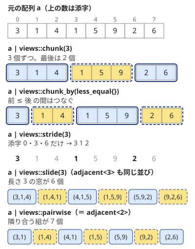

!!! abstract "要点"
    - **何ができるか**：C++23 の views（enumerate・zip・pairwise・chunk_by など）で、添字付き・隣どうし・k 個ずつ・同じ値の塊ごとのループを短く書き、`ranges::to` で結果をコンテナにする。要素は参照を含む組で、受けた変数への代入が元を変える。
    - **いつ使うか**：解説コードに `| views::enumerate`・`views::zip`・`| ranges::to<vector>()` などが出てきて読みたいとき。添字と値を同時に回す・隣どうしを比べる・同じ文字の連続をまとめるループを短く書きたいとき。
    - **計算量**：view を作るのは $O(1)$。回すと元の要素を定数回ずつ見る（`slide(k)`・`adjacent<k>` の窓を全部読むと $O(Nk)$、`cartesian_product` は長さの積）。`ranges::to` は要素数に比例する
    - **前提**：[views の基本](../cpp/cpp-views-basics.md)、[構造化束縛と pair・tuple・optional](../cpp/cpp-structured-bindings.md)

<!-- textlint-disable -->
別名：views::enumerate・views::zip・views::zip_transform・views::pairwise・views::adjacent・views::chunk・views::slide・views::chunk_by・views::stride・views::cartesian_product・views::repeat・views::join_with・ranges::to・to<vector>・from_range・append_range
<!-- textlint-enable -->

C++23 の views は、[views の基本](../cpp/cpp-views-basics.md)の部品（`iota`・`filter`・`transform` など）に、添字付け・組み合わせ・区切りの部品を足したものである。どれも AtCoder の GCC 15.2（`-std=gnu++23`）で使え、views は手元の g++-13（`-std=gnu++23`）でも使える。コンテナに戻す `ranges::to` は GCC 14 から、`from_range` などのコンテナ側の関数は GCC 15 からで、g++-13 にはない。

このページのコードは `#include <bits/stdc++.h>` と `using namespace std;` を前提にする。`std::views` は `views`、`std::ranges` は `ranges` と書く。添字は 0-indexed である。次の図は、同じ配列 $a = (3, 1, 4, 1, 5, 9, 2, 6)$ に区切りの views をかけた結果を並べたものである。



`chunk` と `chunk_by` は配列を重ならない塊に分ける。`slide` と `pairwise` は 1 つずつずらした重なる窓を作る。`stride` は塊を作らず、要素を飛ばして拾う。

## views::enumerate：（添字, 要素への参照）の組を作る、添字は ptrdiff_t（C++23・GCC 13〜） {#enumerate}

`v | views::enumerate` は、各要素に添字を付けた組（添字, 要素への参照）を順に作る view である。添字と値を同時に使うループを、添字の変数なしで書ける。[構造化束縛](../cpp/cpp-structured-bindings.md#enumerate-reference)で `[i, x]` と受けるのが普通の使い方である。

```cpp
--8<-- "cpp-views-cpp23/enumerate.cpp:core"
```

完全なプログラム：[`enumerate.cpp`](https://github.com/yuukougun/kyopro-atlas/blob/main/snippets/cpp-views-cpp23/enumerate.cpp)（GitHub）
{ .kp-code-src }

- **素朴に書くと**：`for (int i = 0; i < (int)a.size(); i++) { int& x = a[i]; … }` と同じである
- **添字の型**：`ptrdiff_t`（64 bit の Linux では `long`）である。`int` の変数と混ぜたときの問題は [enumerate の添字を int にしたいとき](#int-index)
- **版**：C++23。g++-13・g++-15 で使える

解説コードでよく見る形に、ACL の強連結成分分解の結果を回すものがある。`g.scc()` は強連結成分をトポロジカル順に並べた `vector<vector<int>>` を返すので、`enumerate` の添字がそのまま成分の番号になる。

```cpp
--8<-- "cpp-views-cpp23/enumerate-scc.cpp:core"
```

完全なプログラム：[`enumerate-scc.cpp`](https://github.com/yuukougun/kyopro-atlas/blob/main/snippets/cpp-views-cpp23/enumerate-scc.cpp)（GitHub）
{ .kp-code-src }

この 1 行は「何を回すか（`g.scc()` の各成分）」「何を受け取るか（添字と成分の組）」「どう受け取るか（`const auto&`）」に分けて読む。`g.scc()` は一時オブジェクトだが、右辺値をパイプに流すと view の中に移されるので、ループの間は生きている（[view の寿命](../cpp/cpp-views-basics.md#lifetime)）。強連結成分そのものは[強連結成分分解](../graph/scc.md)で扱う。

- **落とし穴**：`const auto&` と書いても `component` は書き換えられる参照である（[要素は参照を含む組](#reference-tuples)）

## views::zip・zip_transform：同じ位置の要素の組、短いほうに合わせる（C++23・GCC 13〜） {#zip}

`views::zip(a, b)` は、`a` と `b` の同じ位置の要素の組（`a[i]` と `b[i]` の参照の組）を順に作る view である。長さが違えば、短いほうの長さで終わる。`views::zip_transform(f, a, b)` は、組を作る代わりに `f(a[i], b[i])` の値を並べる。

```cpp
--8<-- "cpp-views-cpp23/zip.cpp:core"
```

完全なプログラム：[`zip.cpp`](https://github.com/yuukougun/kyopro-atlas/blob/main/snippets/cpp-views-cpp23/zip.cpp)（GitHub）
{ .kp-code-src }

入力が `a = (1, 2, 3, 4)`、`b = (5, 1)` なら、組は 2 個だけで、積の和は $1 \cdot 5 + 2 \cdot 1 = 7$ になる。

- **素朴に書くと**：`for (int i = 0; i < min(n, m); i++) dot += a[i] * b[i];` と同じである
- **版**：C++23。g++-13・g++-15 で使える。要素の型は、2 つの範囲の zip で g++-13 が `pair<int&, int&>`、g++-15 が `tuple<int&, int&>` だった（エラーの文面に出る）。構造化束縛で受ける限り違いはない
- **落とし穴**：長さが違うときは、警告やエラーなしに長いほうの残りが黙って捨てられる。長さがそろっている前提なら、先に `assert(a.size() == b.size())` を置く

## pairwise・adjacent・pairwise_transform：隣り合う組と差分（C++23・GCC 13〜） {#adjacent}

`a | views::pairwise` は隣り合う 2 個の組 $(a_i, a_{i+1})$ を順に作る。`a | views::adjacent<k>` は連続する $k$ 個の組を作り、`pairwise` は `adjacent<2>` と同じである。`a | views::pairwise_transform(f)` は、組の代わりに $f(a_i, a_{i+1})$ を並べる。差分の列は `f` を `q - p` にすれば作れる。

```cpp
--8<-- "cpp-views-cpp23/adjacent.cpp:core"
```

完全なプログラム：[`adjacent.cpp`](https://github.com/yuukougun/kyopro-atlas/blob/main/snippets/cpp-views-cpp23/adjacent.cpp)（GitHub）
{ .kp-code-src }

入力 `3 1 4 1 5 9 2 6` は単調増加ではない。山は $(1, 4, 1)$ と $(5, 9, 2)$ の 2 個で、差分は `-2 3 -3 4 4 -7 4` の 7 個になる。

- **素朴に書くと**：`for (int i = 0; i + 1 < n; i++)` の中で `a[i]` と `a[i + 1]` を使うのと同じである。`pairwise` なら境界を自分で書かずに済む。境界を `i < a.size() - 1` と書くと、長さ 0 のとき符号なしの引き算で巨大な値になり範囲外を読む（[整数のあふれ](../cpp/cpp-integer-overflow.md#unsigned-size)）が、`pairwise` なら組が 0 個になるだけである
- **版**：C++23。g++-13・g++-15 で使える。`k` はコンパイル時の定数で、`adjacent<k>` の `k` に変数は使えない（変数の長さの窓は [slide](#chunk-slide-stride)）
- **落とし穴**：長さ $N$ の列の組は $N - k + 1$ 個で、$N < k$ なら 0 個である。差分の列は元より 1 個短い。[累積和](../basics/prefix-sum.md)と添字を対応させるときは、1 つのずれに気をつける

## chunk・slide・stride：k 個ずつの塊・長さ k の窓・k 個おき（C++23・GCC 13〜） {#chunk-slide-stride}

3 つとも整数 $k$ を受け取る（$k$ は実行時の変数でよい）。

- `a | views::chunk(k)`：先頭から $k$ 個ずつの重ならない塊。最後の塊は $k$ 個未満のことがある
- `a | views::slide(k)`：長さ $k$ の窓を 1 つずつずらしたもの。窓は $N - k + 1$ 個で、$N < k$ なら 0 個
- `a | views::stride(k)`：添字 $0, k, 2k, \dots$ の要素だけ

```cpp
--8<-- "cpp-views-cpp23/chunk-slide-stride.cpp:core"
```

完全なプログラム：[`chunk-slide-stride.cpp`](https://github.com/yuukougun/kyopro-atlas/blob/main/snippets/cpp-views-cpp23/chunk-slide-stride.cpp)（GitHub）
{ .kp-code-src }

入力 `3 1 4 1 5 9 2 6`・$k = 3$ では、塊の和が `8 15 8`、窓の和が `8 6 10 15 16 17`、3 個おきが `3 1 2` になる。`ranges::fold_left`（C++23）は初期値と演算を渡して畳み込む関数で、[アルゴリズムの定型](../cpp/cpp-algorithms.md)で扱う。

- **素朴に書くと**：`chunk` は、`for (int l = 0; l < n; l += k)` の各回で $[l, \min(l + k, n))$ を見るのと同じである。`stride` は `for (int i = 0; i < n; i += k)` と同じである
- **版**：C++23。g++-13・g++-15 で使える。GCC 13 の更新の一覧には `chunk` と `slide` が載っている。`stride` は載っていないが、手元の g++-13 で使えた
- **落とし穴**：`slide(k)` の各窓は元の配列を見るだけで、窓の和を覚えない。上の例のように窓ごとに `fold_left` で足すと $O(Nk)$ かかる。$N = 2 \times 10^5$・$k = 10^5$ なら約 $10^{10}$ 回で間に合わないので、[累積和](../basics/prefix-sum.md)や[尺取り法](../basics/two-pointers.md)で $O(N)$ にする

## chunk_by：隣どうしで条件が成り立つ間をまとめる（C++23・GCC 13〜） {#chunk-by}

`a | views::chunk_by(pred)` は、隣り合う 2 個 $(a_i, a_{i+1})$ で `pred(a_i, a_{i+1})` が偽になる所で区切り、残りをつないだ塊の列を作る view である。`pred` に `equal_to{}` を渡すと、同じ値が続く塊ごとに分かれる。これが[ランレングス圧縮](../basics/run-length-encoding.md)である。

```cpp
--8<-- "cpp-views-cpp23/chunk-by.cpp:core"
```

完全なプログラム：[`chunk-by.cpp`](https://github.com/yuukougun/kyopro-atlas/blob/main/snippets/cpp-views-cpp23/chunk-by.cpp)（GitHub）
{ .kp-code-src }

入力 `aaabccdd` に対して `a 3`・`b 1`・`c 2`・`d 2` と出る。手で書くと、塊の終わりを見つけて最後の塊を足し忘れない処理が要る（[塊への分け方](../basics/run-length-encoding.md#split)）。`chunk_by` ならその境界を自分で書かずに済む。

`pred` を `less_equal{}` にすると、広義単調増加の区間ごとに分かれる。最長の単調な区間の長さは次のように求まる。

```cpp
--8<-- "cpp-views-cpp23/chunk-by-inc.cpp:core"
```

完全なプログラム：[`chunk-by-inc.cpp`](https://github.com/yuukougun/kyopro-atlas/blob/main/snippets/cpp-views-cpp23/chunk-by-inc.cpp)（GitHub）
{ .kp-code-src }

- **素朴に書くと**：`for (int l = 0; l < n; )` で、`r = l + 1` から `pred(a[r - 1], a[r])` が真の間 `r` を進め、$[l, r)$ を 1 つの塊として `l = r` とするのと同じである
- **版**：C++23。g++-13・g++-15 で使える
- **落とし穴 1**：比べるのは隣どうしだけで、塊の先頭とは比べない。`chunk_by([](int p, int q) { return q - p <= 1; })` は「塊の中の最大と最小の差が 1 以下」ではなく、「隣どうしの差が 1 以下」の塊を作る
- **落とし穴 2**：`ranges::distance(r)` は `ptrdiff_t` を返す。`int` の変数と `max` で比べるとコンパイルエラーになるので、受ける変数を `ptrdiff_t` にするか `(int)` で変換する

## cartesian_product：二重ループ・グリッドの全マスを 1 つのループにする（C++23・GCC 13〜） {#cartesian-product}

`views::cartesian_product(r1, r2)` は、`r1` と `r2` の要素のすべての組（直積）を、`r1` を外側・`r2` を内側にした二重ループの順に作る view である。$H \times W$ の[グリッド](../graph/grid-graph.md)の全マスを 1 つのループで回せる。

```cpp
--8<-- "cpp-views-cpp23/cartesian-product.cpp:core"
```

完全なプログラム：[`cartesian-product.cpp`](https://github.com/yuukougun/kyopro-atlas/blob/main/snippets/cpp-views-cpp23/cartesian-product.cpp)（GitHub）
{ .kp-code-src }

- **素朴に書くと**：`for (int i = 0; i < h; i++) for (int j = 0; j < w; j++)` と同じ順である。3 つ以上の範囲も渡せる
- **版**：C++23。g++-13・g++-15 で使える。`views::iota(0, h)` の要素が `int` なので、`i`・`j` も `int` である
- **落とし穴（速さ）**：普通の二重ループより遅いことがある。手元で、長さ $n = 2 \times 10^4$ の配列 `a` の添字の全組（$4 \times 10^8$ 組）を `views::cartesian_product(views::iota(0, n), views::iota(0, n))` で回した。`a[i] ^ a[j]` の和を `-O2` で求めると、普通の二重 for は 40〜50 ms だった。`cartesian_product` では g++-13 で約 160 ms、g++-15 で約 610 ms だった。普通の for は内側のループがまとめて計算される（ベクトル化）のに対し、`cartesian_product` ではそれが効かないためと考えられる。$10^8$ 回を超える重いループは普通の for で書く。グリッドの $2000 \times 2000$ 程度なら差は気にならない

## repeat・join_with・as_const（C++23・GCC 13〜） {#repeat-join-with}

3 つとも小さな部品である。

- `views::repeat(x, k)`：`x` を $k$ 回並べた範囲。`views::repeat(x)` は終わりのない範囲になる
- `rs | views::join_with(sep)`：範囲の範囲 `rs` を、間に区切り `sep` を挟んで 1 列にする。`views::join`（[split と join](../cpp/cpp-views-basics.md#split-join)）に区切りを足したもので、末尾には区切りが付かない
- `r | views::as_const`：要素を `const` 参照で見せる。書き換えるとコンパイルエラーになる

```cpp
--8<-- "cpp-views-cpp23/repeat-join-with.cpp:core"
```

完全なプログラム：[`repeat-join-with.cpp`](https://github.com/yuukougun/kyopro-atlas/blob/main/snippets/cpp-views-cpp23/repeat-join-with.cpp)（GitHub）
{ .kp-code-src }

入力 `10 -2 3` なら、2 行目は `10 -2 3` と、末尾に空白なしで出る。

- **素朴に書くと**：`join_with(' ')` は、`i > 0` のときだけ空白を出してから `a[i]` を出すループと同じである（出力の書き方は[入出力](../cpp/cpp-io.md)）
- **版**：C++23。g++-13・g++-15 で使える。GCC 13 の更新の一覧には `repeat` と `as_const` が載っている。`join_with` は載っていないが、手元の g++-13 で使えた
- **落とし穴**：上の書き方は数ごとに `to_string` で文字列を作り、1 文字ずつ出すので、$10^6$ 個の数を出すような場面では遅くなりうる。普段の出力はループで書けば十分である

## 要素は参照を含む組：構造化束縛でも元の要素を指す（C++23・GCC 13〜） {#reference-tuples}

`enumerate`・`zip`・`pairwise`・`adjacent`・`cartesian_product`（範囲が配列のとき）の要素は、回すたびにその場で作られる組である。組の中身は元の要素への参照（`tuple<ptrdiff_t, int&>` など）である。このため、範囲 for の受け方は [普通の vector を回すとき](../cpp/cpp-range-for.md#range-for-forms)と意味が変わる。

```cpp
--8<-- "cpp-views-cpp23/reference-tuples.cpp:core"
```

完全なプログラム：[`reference-tuples.cpp`](https://github.com/yuukougun/kyopro-atlas/blob/main/snippets/cpp-views-cpp23/reference-tuples.cpp)（GitHub）
{ .kp-code-src }

- **`auto [i, x]` でも元が変わる**：`auto` でコピーされるのは組だけで、組の中の参照 `int&` は元の要素を指したままである。`x *= 2` で `v` が書き換わる。`zip` で受けた `b` への代入も `w` を変える
- **`const auto&` でも防げない**：`const` が付くのは組のほうで、組が持つ参照の先ではない。`x` の型は `int&` のままで、代入がコンパイルを通る（`static_assert` で確かめた）
- **`auto&` はコンパイルエラー**：その場で作られる組（一時オブジェクト）を、`const` のない参照では受けられない

```cpp
--8<-- "cpp-views-cpp23/reference-tuples-ng.cpp:core"
```

完全なプログラム：[`reference-tuples-ng.cpp`](https://github.com/yuukougun/kyopro-atlas/blob/main/snippets/cpp-views-cpp23/reference-tuples-ng.cpp)（GitHub）
{ .kp-code-src }

g++-13・g++-15 とも、エラーは `cannot bind non-const lvalue reference of type 'std::tuple<long int, int&>&' to an rvalue of type 'std::tuple<long int, int&>'` と出る。受け方は `auto`・`const auto&`・`auto&&` のどれでもよく、元が書き換わるかはどれも同じである。

読むだけで書き換えたくないときは、`views::as_const` を先に挟む。`x` が `const int&` になり、誤った代入はコンパイルエラーで止まる。

```cpp
--8<-- "cpp-views-cpp23/as-const.cpp:core"
```

完全なプログラム：[`as-const.cpp`](https://github.com/yuukougun/kyopro-atlas/blob/main/snippets/cpp-views-cpp23/as-const.cpp)（GitHub）
{ .kp-code-src }

- **版**：C++23。g++-13・g++-15 で同じ型だった
- **落とし穴**：「`auto` で受けたからコピーで安全」と考えて、ループの中で `x` を作業用の変数として書き換えると、元の配列が壊れる。作業用にするなら `int y = x;` と別の変数に写す

## enumerate の添字を int にしたいとき：zip と iota で作る（C++23・GCC 13〜） {#int-index}

`views::enumerate` の添字は `ptrdiff_t`（64 bit の Linux では `long`）である。`std::max` は 2 つの引数が同じ型であることを求めるので、`int` の変数と比べるとコンパイルエラーになる。

```cpp
--8<-- "cpp-views-cpp23/int-index-ng.cpp:core"
```

完全なプログラム：[`int-index-ng.cpp`](https://github.com/yuukougun/kyopro-atlas/blob/main/snippets/cpp-views-cpp23/int-index-ng.cpp)（GitHub）
{ .kp-code-src }

エラーは `no matching function for call to 'max(int&, std::tuple_element<0, std::tuple<long int, int&> >::type&)'` と出る。添字を `int` にしたいなら、`views::iota(0)` と `zip` する。`views::iota(0)` の要素は始まりの `0` の型 `int` になる（[要素の型は始まりで決まる](../cpp/cpp-views-basics.md#iota-int)）。`zip` は短いほうに合わせるので、終わりのない `iota(0)` でも `v` の長さで止まる。

```cpp
--8<-- "cpp-views-cpp23/int-index.cpp:core"
```

完全なプログラム：[`int-index.cpp`](https://github.com/yuukougun/kyopro-atlas/blob/main/snippets/cpp-views-cpp23/int-index.cpp)（GitHub）
{ .kp-code-src }

- **ほかの直し方**：`max<long long>(best, i)` と型を明示する、`best` を `ptrdiff_t` にする、`(int)i` と変換する、のどれでも通る
- **版**：C++23。g++-13・g++-15 で、`zip(iota(0), v)` の `i` が `int` になることを確かめた
- **落とし穴 1**：`best` を `long long` にしても通らない。`ptrdiff_t` は 64 bit の Linux では `long` で、`long long` とは別の型だからである
- **落とし穴 2**：`for (auto [i, x] : …)` の `i` を `int` で受けることはできない（構造化束縛は型を書けない）。型を変えたいなら、上のように作る側で決める

## ranges::to でコンテナに変換する（入れ子も。C++23・GCC 14〜） {#ranges-to}

`r | ranges::to<C>()` は、範囲 `r` の要素を並べたコンテナ `C` を作る。view は値を覚えないので、何度も使う結果や並べ替えたい結果は `ranges::to` で `vector` などにする。`ranges::to<vector>()` のように要素の型を省くと、`r` の要素の型から推論される。入れ子の範囲は `ranges::to<vector<vector<int>>>()` と型を全部書くと、内側も変換される（`ranges::to<vector>()` だと内側は view のまま入る）。

```cpp
--8<-- "cpp-views-cpp23/ranges-to.cpp:core"
```

完全なプログラム：[`ranges-to.cpp`](https://github.com/yuukougun/kyopro-atlas/blob/main/snippets/cpp-views-cpp23/ranges-to.cpp)（GitHub）
{ .kp-code-src }

1 つ目は、（値, 添字）の組を値の順に並べる定型である。入力 `3 1 4 1` に対して、並べた後の添字は `1 3 0 2` になる。`zip` の要素（`tuple<int&, int>`）は `pair<int, int>` に変換されて入る。

- **素朴に書くと**：空の `vector` を作り、範囲 for で `push_back` するのと同じである
- **版**：C++23。GCC 14 から使え、AtCoder の GCC 15.2 と手元の g++-15 では使える。g++-13 では `'to' is not a member of 'std::ranges'` のコンパイルエラーになる。g++-13 での代わりは [from_range と GCC 13 での代わり](#from-range)
- **落とし穴**：`ranges::to` は要素をすべてコピーするので、要素数に比例する時間とメモリを使う。1 回回すだけなら、`to` せずに view のまま回す

## from_range・insert_range・append_range（C++23・GCC 15〜）と GCC 13 での代わり {#from-range}

GCC 15 から、コンテナの側にも範囲を受け取る関数がある。

- `vector<int> r(from_range, rng);`：範囲 `rng` から作るコンストラクタ（`from_range` は目印の値）
- `st.insert_range(rng);`：`set` などに範囲の要素をすべて入れる
- `v.append_range(rng);`：`vector` の末尾に範囲の要素を足す

```cpp
--8<-- "cpp-views-cpp23/from-range.cpp:core"
```

完全なプログラム：[`from-range.cpp`](https://github.com/yuukougun/kyopro-atlas/blob/main/snippets/cpp-views-cpp23/from-range.cpp)（GitHub）
{ .kp-code-src }

- **版**：C++23。GCC 15 から使え、AtCoder の GCC 15.2 では使える。g++-13 では `from_range` が宣言されていないというエラーになる。GCC 15 の更新の一覧には `from_range` のコンストラクタと `insert_range` などが載っている
- **使い分け**：新しく作るなら `ranges::to`、既にあるコンテナに足すなら `insert_range`・`append_range` と使い分ける

g++-13 で手元を動かすときは、イテレータの組を取る昔からのコンストラクタを使う。ただし、このコンストラクタは `begin` と `end` が同じ型であることを求める。`views::zip(a, views::iota(0))` のように終わりのない範囲を含む view は、終わりを別の型（[番兵](../guide/glossary.md#sentinel)）で表すので、そのままではコンパイルエラーになる。

```cpp
--8<-- "cpp-views-cpp23/common-ng.cpp:core"
```

完全なプログラム：[`common-ng.cpp`](https://github.com/yuukougun/kyopro-atlas/blob/main/snippets/cpp-views-cpp23/common-ng.cpp)（GitHub）
{ .kp-code-src }

`| views::common` を挟むと `begin` と `end` の型がそろい、g++-13 でも通る（[common](../cpp/cpp-views-basics.md#common)）。

```cpp
--8<-- "cpp-views-cpp23/common-ok.cpp:core"
```

完全なプログラム：[`common-ok.cpp`](https://github.com/yuukougun/kyopro-atlas/blob/main/snippets/cpp-views-cpp23/common-ok.cpp)（GitHub）
{ .kp-code-src }

- **版**：C++20 の `views::common` なので、g++-13・g++-15 のどちらでも通る。`enumerate`・`chunk_by` を `vector` にかけた view は、手元では `common` なしでも `begin` と `end` が同じ型だった
- **落とし穴**：要素の型を省いて `vector w{r.begin(), r.end()}` と波かっこで書くと、型の推論で「イテレータ 2 個の `vector`」になる（[初期化の書き方](../cpp/cpp-initialization.md)）。手元の g++-13・g++-15 で、大きさが 2 だった。イテレータの組から作るときは丸かっこで書く

## views::concat（C++26）は AtCoder では使えない {#concat}

`views::concat(a, b)` は、`a` と `b` をつないだ 1 つの範囲として見る view で、C++26 の機能である。g++-15 にはあるが `-std=gnu++26` が要り、AtCoder の `-std=gnu++23` では使えない。

```cpp
--8<-- "cpp-views-cpp23/concat-ng.cpp:core"
```

完全なプログラム：[`concat-ng.cpp`](https://github.com/yuukougun/kyopro-atlas/blob/main/snippets/cpp-views-cpp23/concat-ng.cpp)（GitHub）
{ .kp-code-src }

g++-13・g++-15 とも `-std=gnu++23` で `'concat' is not a member of 'std::views'` のコンパイルエラーになる。C++23 で 2 つの範囲を続けて回すなら、ループを 2 つ書くか、範囲を並べた配列を `views::join` で平らにする。

```cpp
--8<-- "cpp-views-cpp23/concat-alt.cpp:core"
```

完全なプログラム：[`concat-alt.cpp`](https://github.com/yuukougun/kyopro-atlas/blob/main/snippets/cpp-views-cpp23/concat-alt.cpp)（GitHub）
{ .kp-code-src }

- **版**：C++26（GCC 15 の C++26 の実験的な機能）。AtCoder では使えない
- **落とし穴**：手元で `-std=gnu++26` を付けて試すと通ってしまう。手元のコンパイルの設定は AtCoder と同じ `-std=gnu++23` にそろえる（[AtCoder と手元の環境](../cpp/cpp-environment.md#options)）

## 確認問題 {#quiz}

??? question "確認問題：`for (auto [i, x] : v | views::enumerate) x = 0;` で `v` は変わるか？"
    変わる。`v` はすべて 0 になる。`auto` でコピーされるのは（添字, 要素への参照）の組だけで、`x` は元の要素への参照 `int&` のままだからである。`const auto&` で受けても同じで、防ぐには `v | views::as_const | views::enumerate` とする。

??? question "確認問題：`views::slide(3)` と `views::chunk(3)` を長さ 8 の配列にかけると、それぞれ何個の範囲ができるか？"
    `slide(3)` は 1 つずつずらした長さ 3 の窓なので $8 - 3 + 1 = 6$ 個、`chunk(3)` は重ならない 3 個ずつの塊なので $\lceil 8 / 3 \rceil = 3$ 個（最後は 2 個）である。

??? question "確認問題：文字列 aabbbaa に `views::chunk_by(equal_to{})` をかけると、塊はいくつか？"
    3 個（`aa`・`bbb`・`aa`）である。比べるのは隣どうしだけなので、離れた所にある同じ文字はまとめられない。文字ごとの個数を数えるなら、`map` や配列で数える。

??? question "確認問題：g++-13 で `views::zip(a, views::iota(0)) | ranges::to<vector>()` が通らない。どう書き直すか？"
    `ranges::to` は GCC 14 からなので、g++-13 にはない。`auto z = views::zip(a, views::iota(0)) | views::common;` として `begin` と `end` の型をそろえ、`vector<pair<int, int>> p(z.begin(), z.end());` と書く。AtCoder の GCC 15.2 では元の書き方で通る。

## 参考 {#references}

- [GCC「GCC 13 Release Series: Changes」](https://gcc.gnu.org/gcc-13/changes.html)：GCC 13 で入った C++23 の views（enumerate・zip・chunk・slide・chunk_by・cartesian_product・repeat・as_const・adjacent・pairwise など）
- [GCC「GCC 14 Release Series: Changes」](https://gcc.gnu.org/gcc-14/changes.html)：`ranges::to` が GCC 14 で入ったこと
- [GCC「GCC 15 Release Series Changes, New Features, and Fixes」](https://gcc.gnu.org/gcc-15/changes.html)：`from_range` のコンストラクタと `insert_range` など、C++26 の `views::concat`
- [cpprefjp「C++23」](https://cpprefjp.github.io/lang/cpp23.html)：C++23 で入った views と `ranges::to` の日本語の一覧
- [cppreference「std::ranges::views::enumerate, std::ranges::enumerate_view」](https://en.cppreference.com/cpp/ranges/enumerate_view)：添字の型と要素の組の型
- [cppreference「std::ranges::views::chunk_by, std::ranges::chunk_by_view」](https://en.cppreference.com/cpp/ranges/chunk_by_view)：隣どうしの判定で区切ること
- [cppreference「std::ranges::to」](https://en.cppreference.com/cpp/ranges/to)：要素の型の推論と入れ子の変換
