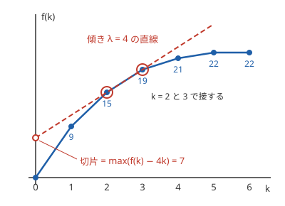

!!! abstract "要点"
    - **何ができるか**：「ちょうど K 個選ぶ」制約のついた最適化で答えが K について凸なら、1 個あたりの罰金 $\lambda$ を足して制約を外した問題を解き、選ばれる個数が K になる $\lambda$ を二分探索する。
    - **いつ使うか**：
        - ちょうど K 個選ぶ・K 個の区間に分ける（$N, K \le 2 \times 10^5$）
        - 隣り合わない k 個を選ぶ和の最大を、すべての k について答える
        - K 個選ぶときの答え $f(K)$ が K について凸（1 個増やすときの得が、個数が増えるほど減る）
    - **計算量**：罰金つきの問題を 1 回 $O(T)$ で解けるとき $O(T \log M)$（$M$ は $\lambda$ を探す範囲の幅）。隣り合わない k 個の選択を取り消し付きの貪欲で解くなら、すべての k について $O(N \log N)$
    - **前提**：[DP の基本](../dp/dp-basics.md)、[二分探索](../basics/binary-search.md)

<!-- textlint-disable -->
別名：Aliens trick・WQS 二分・Lagrangian Relaxation・Lagrange 緩和・取り消し付きの貪欲
<!-- textlint-enable -->

Alien DP は、DP の状態から「ここまでに選んだ個数」の次元を外す方法である。個数を状態に持つと状態数が $K$ 倍になり、$N, K$ が $10^5$ を超えると間に合わない。1 個選ぶごとに罰金 $\lambda$ を払う問題に置き換えると個数を数えなくてよくなり、その問題を $\lambda$ を変えながら $O(\log M)$ 回解けば元の答えが分かる。

これまでの ABC の例は、difficulty 2500 を超える G・Ex である。名前は IOI 2016 の問題 Aliens に由来する。

## 罰金 λ で個数の制約を外す（凸性が要る理由） {#penalty}

最大化で説明する（最小化は符号を変えれば同じである）。ちょうど $k$ 個選ぶときの最適値を $f(k)$ とし、1 個増やすときの得 $f(k+1) - f(k)$ が $k$ について広義単調減少（$-f$ が[凸関数](../guide/glossary.md#convex-function)）だとする。1 個選ぶごとに $\lambda$ を引いた、個数の制約のない問題の最適値は

$$
g(\lambda) = \max_k \bigl(f(k) - \lambda k\bigr)
$$

である。$g(\lambda)$ は個数を数えずに求められる。たとえば DP なら、遷移で 1 個選ぶたびに値から $\lambda$ を引くだけで、個数の次元が要らない。

$K$ が $g(\lambda)$ の最大を与える個数の 1 つなら、$f(K) = g(\lambda) + \lambda K$ で元の答えが戻る。図で言えば、$g(\lambda)$ は点 $(k, f(k))$ の上から傾き $\lambda$ の直線を下ろして初めて触れたときの切片で、触れた点が最適な個数である。



図の例では $\lambda = 4$ のとき $f(k) - 4k$ は $k = 2, 3$ でともに最大の 7 になり、$f(2) = 7 + 4 \cdot 2 = 15$、$f(3) = 7 + 4 \cdot 3 = 19$ が戻る。

凸性が要るのは、どの $K$ にも「$K$ で接する傾き」があることを保証するためである。$K$ が最適になるには、少なくとも両隣の $K - 1$・$K + 1$ より悪くないこと

$$
f(K+1) - f(K) \le \lambda \le f(K) - f(K-1)
$$

が要る。得が単調に減るなら、この範囲は空でなく、条件も十分になる（両隣に勝てば遠くの個数にも勝つ）。凸でないと、どの $\lambda$ でも最適にならない $K$ が出る。$f = (0, 1, 5)$ なら、$K = 1$ には $\lambda \ge 4$ かつ $\lambda \le 1$ が要り、そのような $\lambda$ はない。凸性は問題ごとに示す必要があり、よく使う根拠は次の 2 つである。

- 個数を 1 増やした解を、交換・入れ替えで作れる（隣り合わない要素の選択など。[取り消し付きの貪欲](#undoable-greedy)の差分がその形）
- 区間に分けるコストが Monge である（[Monge な区間分割](#with-monge)）

## λ の二分探索と、同じ値が並ぶときの扱い {#binary-search-lambda}

罰金 $\lambda$ を大きくするほど、最適な個数は少なくなる（広義単調減少）。そこで「罰金つきの問題を解いて、選ばれた個数を見る」判定で $\lambda$ を[二分探索](../basics/binary-search.md)する。$f$ が整数の値なら得 $f(k+1) - f(k)$ も整数なので、$\lambda$ は整数だけを探せば足りる。

落とし穴は、最適な個数が 1 つに決まらない $\lambda$ があることである。図の $\lambda = 4$ では $k = 2$ と $k = 3$ が同点になる。$f$ が一直線に並ぶ部分の内側の $K$ は、ちょうどその傾きでしか最適にならない。しかもそのときは両端の個数と同点である。罰金つきの問題がたまたま返す個数は $K$ とは限らず、「個数がちょうど $K$ になる $\lambda$」を探すと見つからないことがある。

これを避ける決まりは次のとおりである。

1. 罰金つきの問題で同点のときは、**個数の少ない方**を選ぶと決めて、その個数 $\mathrm{cnt}(\lambda)$ を返す（値と個数の組を「値が大きい、同じなら個数が少ない」順に比べる）
2. $\mathrm{cnt}(\lambda) \le K$ となる最小の整数 $\lambda$ を二分探索で求める
3. 答えは $g(\lambda) + \lambda K$（返ってきた個数ではなく $K$ を掛ける）

2 の $\lambda$ で $K$ が最適な個数の 1 つになる理由は次のとおりである。$\lambda - 1$ では個数が $K$ を超えるので $f(K+1) - f(K) \ge \lambda$、$\lambda$ では $K$ 以下なので $f(K+1) - f(K) \le \lambda$ である。よって $f(K+1) - f(K) = \lambda \le f(K) - f(K-1)$ で、$K$ は $\lambda$ で最適になる。3 で返った個数ではなく $K$ を掛けてよいのは、同点の個数のどれから計算しても $g(\lambda)$ が同じだからである。

二分探索を使わない方法もある。どの $\lambda$ でも $g(\lambda) + \lambda K \ge f(K)$ で、凸なら等号になる $\lambda$ がある。$h(\lambda) = g(\lambda) + \lambda K$ は直線の最大なので凸関数で、その最小値が $f(K)$ になる。$h$ を整数の[三分探索](../basics/ternary-search.md)で最小にすれば、個数も同点の決まりも要らない。罰金つきの問題が値しか返せないとき（[Monge な区間分割](#with-monge)など）はこちらが楽である。

隣り合わない要素をちょうど $K$ 個選ぶ和の最大での、罰金つきの DP と二分探索は次のとおりである（完全なプログラムは [`snippets/alien-dp/nonadjacent.cpp`](https://github.com/yuukougun/kyopro-atlas/blob/main/snippets/alien-dp/nonadjacent.cpp)）。値と「個数に $-1$ を掛けたもの」の組を `max` で比べると、同点で個数の少ない方が残る。

```cpp
--8<-- "alien-dp/nonadjacent.cpp:penalized"
```

```cpp
--8<-- "alien-dp/nonadjacent.cpp:alien"
```

完全なプログラム：[`nonadjacent.cpp`](https://github.com/yuukougun/kyopro-atlas/blob/main/snippets/alien-dp/nonadjacent.cpp)（GitHub）
{ .kp-code-src }

$\lambda$ を探す範囲は、どの得 $f(k+1) - f(k)$ よりも小さい値から大きい値までにする。罰金つきの値は $\lambda$ に個数が掛かって大きくなるので、範囲を広く取りすぎると `long long` を超える。値の上限から得の範囲を見積もり、足りなければ `__int128` を使う。

## 取り消し付きの貪欲で解ける場合（優先度付きキュー） {#undoable-greedy}

列 $A$ から隣り合わない $k$ 個を選ぶ和の最大 $f(k)$ は、すべての $k$ についてまとめて $O(N \log N)$ で求められる。Alien DP は 1 つの $K$ ごとに $O(T \log M)$ かかるので、すべての $k$ が要る問題ではこちらを使う。

[優先度付きキュー](../ds/priority-queue.md)に値を入れ、[連結リスト](../ds/linked-list.md)で左右の隣を持つ。両端には選ばれない番兵（とても小さい値）を置く。

1. 値が最大の要素 $i$ を取り出し、その値を答えに足す（これで $f(k+1) = f(k) + A_i$）
2. 左隣 $l$ と右隣 $r$ を消し、$i$ の値を $A_l + A_r - A_i$ に書き換えてキューに戻す。連結リストでは $l$ の左と $r$ の右を $i$ の隣にする
3. キューから出した要素が消えたものか、値が古いものなら読み飛ばす

2 で戻す要素は「$i$ を選ぶのをやめて、代わりに両隣を選ぶ」ことの得である。後でこれを取り出すと、選ぶ個数が 1 つ増えて $i$ の選択が取り消される。書き換えた要素はもとの列の区間を表す。取り出すことは、区間の中の選ぶ・選ばないを交互にすべて反転させる操作に当たる。

$A = (1, 9, 1, 1, 9)$ で動かす。まず 2 番目の 9 を取って $f(1) = 9$ とし、その位置を $1 + 1 - 9 = -7$ に書き換える。続いて 5 番目の 9 を取って $f(2) = 18$ とする（右隣は番兵なので、書き換えた値はとても小さい）。最後に $-7$ を取ると $f(3) = 11$ で、これは 2 番目をやめて 1・3・5 番目を選んだ和 $1 + 1 + 9$ に等しい。

取り出す値は $f(k+1) - f(k)$ そのもので、取り出すたびに大きくならない（広義単調減少）。これが $f$ の凸性（得が単調に減ること）に当たる。正しさの詳しい証明は資料に任せる。

```cpp
--8<-- "alien-dp/nonadjacent.cpp:greedy"
```

完全なプログラム：[`nonadjacent.cpp`](https://github.com/yuukougun/kyopro-atlas/blob/main/snippets/alien-dp/nonadjacent.cpp)（GitHub）
{ .kp-code-src }

前から見て選んだものを後で入れ替える貪欲の基本は、[優先度付きキューを使う貪欲](../basics/greedy-priority-queue.md#regret)にある。差分の形がこれほど単純でない問題では、Alien DP や関数の形を直接持つ [Slope Trick](../dp/slope-trick.md#breakpoints) を考える。

## Monge な区間分割と組み合わせる {#with-monge}

この節は [Monge 性による DP の高速化](../dp/monge.md)を前提にする。

列をちょうど $K$ 個の区間に分け、区間のコスト $\mathrm{cost}(j, i)$（半開区間 $[j, i)$ のコスト）の和を最小にする問題は、[数列を区間に分ける DP](../dp/dp-sequence-partition.md) で $\mathrm{dp}[i][k] = \min_j (\mathrm{dp}[j][k-1] + \mathrm{cost}(j, i))$ になり、素朴には $O(KN^2)$ かかる。

$\mathrm{cost}$ が Monge（$a < b < c < d$ で $\mathrm{cost}(a, c) + \mathrm{cost}(b, d) \le \mathrm{cost}(a, d) + \mathrm{cost}(b, c)$）なら、分割の個数 $K$ についての最適値 $f(K)$ は凸になる。区間 1 個ごとに罰金 $\lambda$ を足すと、個数の次元が消えて

$$
\mathrm{dp}[i] = \min_{j < i} \bigl(\mathrm{dp}[j] + \mathrm{cost}(j, i) + \lambda\bigr)
$$

の 1 次元の DP になる。$\mathrm{cost}$ に定数を足しても Monge のままなので、この DP は Monge 性を使って速く解ける。$\mathrm{dp}[j]$ が行列の中に入るオンラインの形なので、monotone minima を 1 回呼ぶだけでは済まない。[LARSCH](../dp/monge.md#smawk-larsch) を使うと $O(N)$、分割統治で左半分を確定させてから右半分へ monotone minima で配ると $O(N \log^2 N)$ になる。$\mathrm{cost}$ が $(S_i - S_j)^2$ のような積の項を 1 つ持つ形なら、[Convex Hull Trick](../dp/cht.md#lines) でもよい。

これに $\lambda$ の探索の $O(\log M)$ が掛かり、全体は $O(N \log M)$ から $O(N \log^2 N \log M)$ になる。同点の個数を正しく扱うのが面倒なら、[λ の二分探索の節](#binary-search-lambda)の終わりの三分探索で $h(\lambda)$ を最小にする。

## 自作するときの要点と確かめ方 {#library}

ACL に Alien DP はない。罰金つきの問題の解き方が問題ごとに違うので、ライブラリにするなら「$\lambda$ を受け取って（値, 個数）を返す関数」を引数に取る、二分探索の部分だけを持つ。

- 最大化では罰金を引き、最小化では足す。どちらでも $\lambda$ を大きくすると個数は減る。符号を取り違えると二分探索の向きが逆になるので、最小化は値に $-1$ を掛けて最大化に直し、1 つの関数で扱う
- 同点の決まり（個数の少ない方）を、罰金つきの問題の中で必ず守る。DP の各状態で（値, 個数）の組を比べる
- $K$ が取りうる個数の範囲を超えていないかを先に確かめる。範囲外の $K$ では二分探索がでたらめな値を返す
- $\lambda$ の範囲とオーバーフローを見積もる（[λ の二分探索の節](#binary-search-lambda)）

Library Checker には、Alien DP そのものを確かめる問題はない（2026-10-22 に問題の一覧で確かめた）。自作したら、個数を状態に持つ素朴な DP と小さい乱数の入力で比べる。同点がよく起きるように、値の範囲を狭くし、同じ値や負の値を混ぜるとよい。[`snippets/alien-dp/nonadjacent.cpp`](https://github.com/yuukougun/kyopro-atlas/blob/main/snippets/alien-dp/nonadjacent.cpp) の `main` はこの比べ方をしている。

## 学ぶための資料 {#resources}

- noshi91 氏の Kyopro Encyclopedia of Algorithms の「Monge グラフ上の d-辺最短路長を計算するアルゴリズム」は、Monge なときに個数についての凸性が成り立つ証明と、罰金を足した問題の最大が元の答えに一致する理由を、式で丁寧に書いている
- Swiss Olympiad in Informatics の「Alien Optimization」（英語）は、凸な折れ線に傾き $\lambda$ の直線を当てる見方で、罰金と最適な個数の関係を図で説明している
- かんプリン氏の「競技プログラミング　典型問題メモ」の AlienDP の項に、この手法で解く問題の一覧がある

## 例題 {#examples}

### ABC218 H. Red and Blue Lamps {#abc218_h}

<div class="kp-problems" data-role="example" markdown>

- [ABC218 H. Red and Blue Lamps](https://atcoder.jp/contests/abc218/tasks/abc218_h)（diff 2805）：N 個のランプからちょうど R 個を赤、残りを青にし、隣り合う赤と青の組ごとに得点が入るときの得点の最大を求める。

</div>

方針：赤の個数 $R$ を罰金に置き換える。赤 1 個ごとに $\lambda$ を引いた得点の最大を、直前のランプの色を状態に持つ DP で $O(N)$ で求め、[同点の決まり](#binary-search-lambda)に従って $\lambda$ を二分探索する。

??? note "解法の詳細"
    - 赤と青を入れ替えても得点は変わらないので、$R \le N - R$ としてよい。このとき赤どうしを隣り合わせない置き方の中に最適解がある
    - 赤どうしが隣り合わないなら、赤のランプ $i$ は両側の組の得点をどちらも得る。ランプ $i$ の左右の組の得点の和を $B_i$ とする（端のランプは外側の組を 0 とみる）。得点は、選んだ赤の $B_i$ の和になる
    - よって問題は「隣り合わない $R$ 個を選ぶ $B_i$ の和の最大」になり、[λ の二分探索の節](#binary-search-lambda)のコード片がそのまま使える。全体は $O(N \log M)$
    - 同じ形なので、[取り消し付きの貪欲](#undoable-greedy)でも $O(N \log N)$ で解ける

## 練習問題 {#practice}

<div class="kp-problems" data-role="practice" markdown>

- [ABC464 G. Celester 2](https://atcoder.jp/contests/abc464/tasks/abc464_g)（diff 2592）：文字列に対する操作の回数の上限 k ごとに、作れる隣り合う「RS」の並びの個数の最大を求める。
- [ABC355 G. Baseball](https://atcoder.jp/contests/abc355/tasks/abc355_g)（diff 2991）：1 から N の位置から K 個を選び、重みに比例する確率で決まる位置と、選んだ中で最も近い位置との距離の期待値を最小にする。

</div>

??? note "練習の方針"
    - ABC464 G：位置 $i, i+1$ を「RS」にするのに要る操作の回数を $C_i$ とすると、隣り合う 2 つの位置は同時に「RS」にできない。「隣り合わない $x$ 個を選ぶ $C_i$ の和の最小」をすべての $x$ で求める。各 $k$ の答えは、その最小が $k$ 以下になる最大の $x$ である。すべての $x$ が要るので、Alien DP ではなく[取り消し付きの貪欲](#undoable-greedy)（最小化の向き）を使う
    - ABC355 G：選んだ位置で列を区切り、隣り合う 2 つの選んだ位置の間の点のコストを区間のコストとする。両端に番兵を置き、端の区間は片側の距離だけを数える。中点で左右に分けて累積和で $O(1)$ で求められ、このコストは Monge になる。選ぶ個数を罰金に置き換え、罰金つきの 1 次元の DP を Monge 性で速く解き、$\lambda$ を探す（[Monge な区間分割](#with-monge)）

## 参考 {#references}

- [noshi91「Monge グラフ上の d-辺最短路長を計算するアルゴリズム」](https://noshi91.github.io/algorithm-encyclopedia/d-edge-shortest-path-monge)：Monge なときの凸性、罰金を足した問題の最大が答えに一致する理由、三分探索の方法、$\lambda$ の範囲（CC BY 4.0。文章は使っていない）
- [Daniel Rutschmann「Alien Optimization」](https://soi.ch/wiki/alien-optimization/)：罰金と接する直線の見方、同点のときに端点の間を補間する考え方（その節は書きかけ）
- [かんプリン「競技プログラミング　典型問題メモ」](https://kanpurin.hatenablog.com/entry/2020/04/07/182948)：Alien DP で解く問題の一覧（例題 ABC218 H を含む）
- [yosupo06「library-checker-problems」](https://github.com/yosupo06/library-checker-problems)：Alien DP そのものの問題がないことの確認
- [kmjp「AtCoder ABC #218 : H - Red and Blue Lamps」](https://kmjp.hatenablog.jp/entry/2021/09/12/0930)：例題 ABC218 H の、赤を隣り合わせない形への言い換えと貪欲による別解
- [ikatakos「第七回日本最強プログラマー学生選手権～Advance～ -予選- （AtCoder Beginner Contest 464）F,G問題メモ」](https://ikatakos.com/pot/programming_algorithm/contest_history/atcoder/2026/0627_abc464)：練習 ABC464 G の、隣り合わない選択への言い換えと取り消し付きの貪欲（解法の節だけを読んだ）
- [kmjp「AtCoder ABC #355 (東京海上日動プログラミングコンテスト2024) : G - Baseball」](https://kmjp.hatenablog.jp/entry/2024/06/05/0900)：練習 ABC355 G の、区間のコストと monotone minima・Alien DP の組み合わせ
