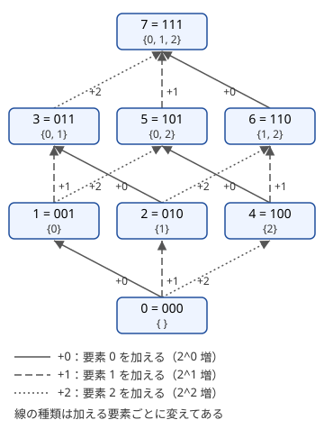

!!! abstract "要点"
    - **何ができるか**：順番を決める探索 $N!$ 通りを、「使ったものの集合」と「最後に使ったもの」の組 $2^N \cdot N$ 個の状態にまとめて解く。集合を整数で表し、整数の昇順に回せば、部分集合の値が先に決まる。
    - **いつ使うか**：
        - $N \le 16$〜$20$
        - すべての地点を 1 回ずつ回って戻る最短の経路
        - 順番を決める・使ったものの集合が将来に効く
        - 特別な地点が $K \le 17$ 個（ほかの地点はグラフで結ばれている）
    - **計算量**：集合だけを状態にすると $O(2^N N)$、集合と最後に使ったものを状態にすると $O(2^N N^2)$。メモリは $O(2^N N)$
    - **前提**：[DP の状態の設計](../dp/dp-state-design.md)、[bit 全探索と順列全探索](../basics/bit-full-search.md)

<!-- textlint-disable -->
別名：ビット DP・集合 DP・Bitmask DP・巡回セールスマン問題・TSP・Traveling Salesman Problem・ハミルトン路
<!-- textlint-enable -->

bitDP は、$N$ 個のものの部分集合を $0$ 以上 $2^N$ 未満の整数で表し、その整数を DP の添字にする手法である。$N!$ 通りの順番を調べる代わりに、将来に効く情報だけを集合として持つので、$N \le 20$ 程度まで扱える。

## 必要になる場面 {#motivation}

$N$ 個の都市をすべて 1 回ずつ回る最短の順番を求めるとき、素朴には [順列全探索](../basics/bit-full-search.md) で $N!$ 通りを試す。$N = 10$ なら $10! \approx 3.6 \times 10^6$ で間に合うが、$N = 17$ では $17! \approx 3.6 \times 10^{14}$ で間に合わない。

無駄は、途中まで同じ都市を回った順列を別々に調べていることにある。たとえば都市 $0$ から出て $\{0, 1, 2, 3\}$ を回り終え、いま都市 $3$ にいるとする。ここまでの回り方は $0 \to 1 \to 2 \to 3$ と $0 \to 2 \to 1 \to 3$ の 2 通りある。しかし、この先にかかるコストは「まだ回っていない都市」と「いまいる都市 $3$」だけで決まり、どちらの順で来たかによらない。だから 2 通りのうち安い方だけを残せばよい。

この「途中までの順列を、訪れた集合と最後の都市で合流させる」のが bitDP の考え方である。調べる順列は $N!$ 通りあるが、合流させた後の状態は $2^N \cdot N$ 個しかない。$N = 17$ なら $2^{17} \cdot 17 \approx 2.2 \times 10^6$ である。

??? question "確認問題：順列全探索と bitDP の境目は？"
    $N = 8$ なら $8! = 40320$、$2^8 \cdot 8^2 = 16384$ でどちらも十分に速い。$N = 12$ なら $12! \approx 4.8 \times 10^8$ で順列全探索は厳しく、$2^{12} \cdot 12^2 \approx 5.9 \times 10^5$ の bitDP なら余裕がある。目安として $N \le 10$ 程度なら順列全探索でもよく、それより大きく $20$ 程度までなら bitDP を考える。

## 集合を整数で表す・昇順に回してよい理由 {#subsets-as-integers}

要素に $0$ から $N - 1$ の番号を付け、集合 $S$ を「要素 $i$ を含むとき $2^i$ の位が 1」の整数で表す。$N = 3$ なら $\{0, 2\}$ は $2^0 + 2^2 = 5$（2 進で `101`）、空集合は $0$、全体は $2^N - 1 = 7$ である。集合の操作には、どれも [bit 演算](../basics/bit-operations.md) が 1 回あればよい。

| 集合の操作 | 整数での書き方 |
| --- | --- |
| $i \in S$ か | `(S >> i) & 1` |
| $S \cup \{i\}$ | `S | (1 << i)` |
| $S \setminus \{i\}$（$i \in S$ のとき） | `S ^ (1 << i)` |
| 要素の個数 $\lvert S \rvert$ | `__builtin_popcount(S)` |
| 全体の集合 | `(1 << N) - 1` |

bitDP の遷移は、ほとんどが「集合 $S$ から、それより大きい集合 $T \supsetneq S$ へ」向かう。このとき **$S \subsetneq T$ なら整数として $S < T$** が成り立つ。$T$ の整数は $S$ の整数に、$T \setminus S$ の各要素 $i$ の $2^i$ を足したものだからである。$T \setminus S$ は空でないので、足す量は正である。



この図のとおり、要素を加える矢印はすべて整数の大きい方へ向く。だから $S = 0, 1, 2, \dots, 2^N - 1$ の順に回せば、$\mathrm{dp}[S]$ を使う時点で、$S$ へ入ってくるすべての遷移（$S$ の部分集合からの遷移）は計算し終わっている。要素の個数の順に並べ替える必要はない。

逆に、集合が小さくなる向きの遷移（たとえば「残っているものの集合」を状態にして、使うたびに減らす）なら、整数の降順に回す。どちらの向きかは「遷移の先が、整数として大きいか小さいか」で決める（[計算順序](../dp/dp-order.md)）。

## 集合だけを状態にする（マッチングの数） {#set-only}

集合の中身だけで、次に何をするかが決まる場合は、「最後に使ったもの」を持たずに集合だけを状態にできる。代表は、男性 $N$ 人と女性 $N$ 人を、組んでよいペアだけで $N$ 組にする方法の数である（[例題：EDPC O](#dp_o)）。

男性を番号の順に $0, 1, \dots, N - 1$ と決めていくことにする。すると「女性の集合 $S$ を使い終えた」時点で、組み終えた男性は $0$ から $\lvert S \rvert - 1$ だと分かる。次に組む男性も $\lvert S \rvert$ と決まるので、男性の番号を状態に持たなくてよい。

- **状態**：$\mathrm{dp}[S]$ ＝ 男性 $0, \dots, \lvert S \rvert - 1$ を、女性の集合 $S$ とちょうどペアにする方法の数
- **遷移**（貰う形）：男性 $i = \lvert S \rvert - 1$ の相手を、$S$ の中で組んでよい女性 $j$ から選ぶ。$\mathrm{dp}[S] = \sum_{j} \mathrm{dp}[S \setminus \{j\}]$。$S$ の中で最後に組んだのは男性 $\lvert S \rvert - 1$ なので、その相手 $j$ を外した $S \setminus \{j\}$ から貰う
- **計算順序**：$S \setminus \{j\} < S$ なので、$S$ の昇順
- **初期値と答え**：$\mathrm{dp}[\emptyset] = 1$（誰も組まない方法が 1 通り）、答えは $\mathrm{dp}[2^N - 1]$

```cpp
--8<-- "bit-dp/matching.cpp:core"
```

完全なプログラム：[`matching.cpp`](https://github.com/yuukougun/kyopro-atlas/blob/main/snippets/bit-dp/matching.cpp)（GitHub）
{ .kp-code-src }

状態は $2^N$ 個、各状態の遷移は $N$ 通りなので $O(2^N N)$ である。男性の番号まで状態に持つと $\mathrm{dp}[i][S]$ になるが、$i = \lvert S \rvert$ でない組は使われないので、持つだけ無駄になる。

集合だけを状態にする別の形に、「集合の和を取る」遷移がある。品物 $k$ が集合 $c_k$ を覆い、費用 $a_k$ で買えるとする。$\mathrm{dp}[S]$ ＝ 覆った集合が $S$ になる最小費用として、$\mathrm{dp}[S \cup c_k] \gets \min(\mathrm{dp}[S \cup c_k], \mathrm{dp}[S] + a_k)$ と配る。$S \cup c_k \ge S$ なので、これも昇順でよい（$S \cup c_k = S$ のときは値が良くならないだけである）。

## 集合と最後に使ったもの（巡回セールスマン・ハミルトン路） {#tsp}

並べる順番で隣どうしのコストがかかる場合は、集合だけでは足りない。次に $u$ を足すコストが、直前に何を置いたかで変わるからである。そこで「最後に使ったもの」も状態に加える。代表は、頂点 $0$ から出てすべての頂点をちょうど 1 回ずつ訪れ、頂点 $0$ に戻る最小コストを求める巡回セールスマン問題である（[例題：ABC180 E](#abc180_e)）。頂点 $v$ から $u$ へのコストを $c(v, u)$ と書く（向きで違ってよい）。

- **状態**：$\mathrm{dp}[S][v]$ ＝ 頂点 $0$ から出て、集合 $S$ の頂点をちょうど 1 回ずつ訪れ、いま $v \in S$ にいるときの最小コスト
- **遷移**（配る形）：$u \notin S$ について、$\mathrm{dp}[S \cup \{u\}][u] \gets \min(\mathrm{dp}[S \cup \{u\}][u],\ \mathrm{dp}[S][v] + c(v, u))$
- **計算順序**：$S \cup \{u\} > S$ なので、$S$ の昇順（$v$ と $u$ の順は自由）
- **初期値**：$\mathrm{dp}[\{0\}][0] = 0$、ほかは $+\infty$。始点も訪れた頂点として集合に入れる
- **答え**：全体を $V = 2^N - 1$ として、$\min_v \left( \mathrm{dp}[V][v] + c(v, 0) \right)$。最後に始点へ戻る分を足す

$N = 3$ で一度動かす。$c(0, 1) = 1$、$c(1, 2) = 2$、$c(2, 0) = 3$、$c(0, 2) = 4$、$c(2, 1) = 5$、$c(1, 0) = 6$ とする。

| $S$（2 進） | $v$ | $\mathrm{dp}[S][v]$ | どこから来たか |
| --- | --- | --- | --- |
| `001` | 0 | 0 | 初期値 |
| `011` | 1 | 1 | $0 \to 1$ |
| `101` | 2 | 4 | $0 \to 2$ |
| `111` | 2 | 3 | $\mathrm{dp}[011][1] + c(1, 2) = 1 + 2$ |
| `111` | 1 | 9 | $\mathrm{dp}[101][2] + c(2, 1) = 4 + 5$ |

答えは $\min(3 + c(2, 0),\ 9 + c(1, 0)) = \min(6, 15) = 6$ で、$0 \to 1 \to 2 \to 0$ が最短である。

```cpp
--8<-- "bit-dp/tsp.cpp:core"
```

完全なプログラム：[`tsp.cpp`](https://github.com/yuukougun/kyopro-atlas/blob/main/snippets/bit-dp/tsp.cpp)（GitHub）
{ .kp-code-src }

**その状態で足りる理由**：$(S, v)$ から先の最適な回り方は、残りの頂点の集合 $V \setminus S$ と、いまいる $v$ だけで決まる。ここまでの順番は、残りの回り方の選択肢とコストのどちらも変えない。だから同じ $(S, v)$ に来る経路のうち最小のものだけを残してよい。

**最後を持たないと困る理由**：$\mathrm{dp}[S]$ だけにすると、次の頂点 $u$ へのコスト $c(v, u)$ の $v$ が分からない。$S$ が同じでも最後の頂点によって次のコストが変わるので、$\mathrm{dp}[S]$ に 1 つの値をまとめられない。

始点に戻らない「ハミルトン路」（どこから始めてどこで終わってもよい）なら、初期値をすべての $v$ について $\mathrm{dp}[\{v\}][v] = 0$ にし、答えは $\min_v \mathrm{dp}[V][v]$ にする。戻る分は足さない。

## 計算量とメモリの見積もり {#complexity}

計算量は「状態数 × 1 状態あたりの遷移数」である。

| 形 | 状態数 | 遷移数 | 計算量 | $N = 17$ | $N = 20$ |
| --- | --- | --- | --- | --- | --- |
| 集合だけ | $2^N$ | $N$ | $O(2^N N)$ | $2.2 \times 10^6$ | $2.1 \times 10^7$ |
| 集合と最後 | $2^N N$ | $N$ | $O(2^N N^2)$ | $3.8 \times 10^7$ | $4.2 \times 10^8$ |

集合と最後を持つ形は、$N = 17$ 前後までなら余裕がある。$N = 20$ では $4.2 \times 10^8$ 回になり、到達できない状態（値が $+\infty$）を飛ばすなど、内側のループを軽く保つ必要がある。問題の制約が $N \le 16$〜$18$ 程度なのは、この形を想定していることが多い。

メモリは $\mathrm{dp}$ の要素数で決まる。$2^{20} \cdot 20 \approx 2.1 \times 10^7$ 個は、`long long` で約 168 MB、`int` で約 84 MB になる。値の範囲が `int` に収まるなら `int` にする。また `vector<vector<long long>>` は内側の `vector` ごとに管理の領域を持つ。$2^N$ 本を作るより、$\mathrm{dp}[v][S]$ の向きにして $N$ 本にするか、1 次元の配列で $S \cdot N + v$ と引く方が軽い。本文のコード片は読みやすさを優先して $\mathrm{dp}[S][v]$ の形にしてある。$N = 20$ でメモリが厳しいときは、この形を直す。

## ほかの探索と組み合わせる（BFS・ワーシャルフロイド法で距離を前計算してから） {#with-shortest-paths}

この節は青の内容である。前提として [幅優先探索](../graph/bfs.md) と [ワーシャルフロイド法](../graph/warshall-floyd.md) を使う。

グラフやグリッドに頂点がたくさんあり、そのうち「必ず訪れる特別な点」が $K \le 17$ 個程度だけ、という問題がある。全頂点 $\times 2^K$ の状態で探索すると重いので、次の 2 段に分ける。

1. 特別な点（必要なら始点・終点も）どうしの最短距離の表 $d$ を作る。辺の重みがなければ、特別な点それぞれから BFS を 1 回ずつ行い $O(K(N + M))$。重みが非負なら、特別な点それぞれから [ダイクストラ法](../graph/dijkstra.md) で $O(K(N + M) \log N)$。頂点が少ないか、負の辺がある（負閉路はない）なら、ワーシャルフロイド法で全点対を $O(N^3)$ で求める
2. 特別な点だけを頂点とし、$c(u, v) = d(u, v)$ とした完全グラフで、[集合と最後の bitDP](#tsp) を解く。$O(2^K K^2)$

この形の問題は「すべてを 1 回以上訪れる」と書かれることが多い。表の上で「各点をちょうど 1 回ずつ」訪れる順番を最小化してよい理由は、次の 2 方向で示せる。

- **DP の値は最適値より小さくならない**：DP の値はどれも、特別な点の間を最短路でつないだ、実際に歩けるウォークのコストである。そのウォークは特別な点をすべて通る。途中の最短路が別の特別な点を余分に通っても、「1 回以上」の問題では許される
- **DP の値は最適値以下になる**：最適なウォークで特別な点を初めて訪れる順を取る。その順で隣り合う 2 点の間を最短路に置き換えても、コストは増えない。置き換えたウォークは表の上の 1 つの順番そのものなので、DP はそれ以下の値を見つける

到達できない組（距離が $+\infty$）は遷移で飛ばす。始点に戻るか、決まった終点で終わるか、どこで終わってもよいかで、答えの取り方が変わる（[落とし穴](#pitfalls)）。

## ゲームの状態を集合で持つ {#games}

2 人が交互に手を打ち、使ったものは二度と使えないゲームでは、「使ったものの集合」（と、必要なら直前の手）が局面になる。各局面が勝ちか負けかを決める考え方は [ゲームの基本](../comb/game-basics.md#win-lose) に任せ、ここでは bitDP として回すときの注意を書く。

- **状態**：$\mathrm{win}[S][x]$ ＝ 使ったものの集合が $S$、直前の手が $x$ の局面で、手番の人が勝てるか
- **遷移**：打てる手 $y$ のうち、打った後の局面 $\mathrm{win}[S \cup \{y\}][y]$ が負けになるものが 1 つでもあれば勝ち。打てる手がなければ負け
- **計算順序**：$\mathrm{win}[S][\cdot]$ は大きい集合 $S \cup \{y\}$ の値で決まる。だから $S$ の **降順** に回す
- **初期値と答え**：全体の集合など、打てる手がない局面は負けで、ここから値が決まっていく。最初の局面には直前の手がないので、$x$ に「何でもよい」を表す番兵を 1 つ足すか、最初の 1 手だけ別に調べる。最初の手 $y$ のうち $\mathrm{win}[\{y\}][y]$ が負けのものがあれば、先手の勝ちである

「残っているものの集合」を状態にすれば、遷移の先は小さい集合になり、昇順で回せる。どちらで持っても同じ計算である。迷ったら、遷移の先が整数として大きいか小さいかを確かめる。

しりとりのように直前の手で次に打てる手が決まるなら、直前の手を状態に持つ（集合と最後の形）。カードを 2 枚ずつ取り除くゲームのように、残りの集合だけで打てる手が決まるなら、集合だけを状態にする（ゲームの基本のページの例題がこの形である）。

## 素数の使用状況を集合で持つ {#primes}

この節は黄の内容である。前提として [素因数分解](../math/prime-factorization.md) と [0-1 ナップサック](../dp/knapsack-01.md) の「1 つずつ選ぶか決める」DP を使う。

集合にするのは「使ったもの」だけではない。「どの数とも互いに素になるように選ぶ」のような条件では、選んだ数の素因数の集合を状態にできる。2 つの数が互いに素であることは、共通の素因数がないこと、すなわち素因数の集合が交わらないことと同じだからである。

素因数の種類が多いと集合が大きくなりすぎる。素数を少数に絞れるのは、たとえば選ぶ数が $A$ 以上 $A + W$ 以下の範囲から来る場合である。2 つの数 $x < y$ の公約数は $y - x \le W$ を割り切るので、共通の素因数になりうるのは $W$ 以下の素数だけである。$W = 72$ なら、$72$ 以下の素数は $20$ 個しかない。

- **状態**：$\mathrm{dp}[P]$ ＝ ここまでの数から選んだ数の、$W$ 以下の素因数の集合が $P$ になる選び方の数
- **遷移**：数 $a$ の $W$ 以下の素因数の集合を $m_a$ として、$P \cap m_a = \emptyset$（`(P & m) == 0`）なら $\mathrm{dp}[P \cup m_a] \mathrel{+}= \mathrm{dp}[P]$
- **計算順序**：数を 1 つずつ処理し、同じ数を 2 回選ばないように、配列を使い回すなら $P$ の降順に回す（$P \cup m_a \ge P$ なので、昇順だと更新した値をすぐ使ってしまう）
- **初期値と答え**：$\mathrm{dp}[\emptyset] = 1$、答えは $\sum_P \mathrm{dp}[P]$。この和は「何も選ばない」1 通りを含むので、空の選び方を数えない問題では 1 を引く

計算量は数の個数 $\times 2^{20}$ で、幅 $72$ なら $73 \cdot 2^{20} \approx 7.7 \times 10^7$ である。

## 落とし穴 {#pitfalls}

- **`&` と `==` の優先順位**：C++ では `==` の方が `&` より先に結合する。`S & m == 0` は `S & (m == 0)` と読まれ、意図と違う値になる。`(S & m) == 0` と括弧を付ける。ビットの判定は `((S >> i) & 1)` のように、いつも括弧で囲む習慣にするとよい（`-Wall` を付けると多くの場合に警告が出る）
- **`1 << N` の範囲**：`1` は `int` なので、C++20 以降では `1 << 31` は負の値になり、`(1 << 31) - 1` はあふれ、`1 << 32` 以上は未定義動作になる。bitDP の $N$ は 20 程度なので普通は問題ない。要素が 31 個以上なら `1LL << N` と書き、集合も `long long` で持つ
- **状態数の見積もり**：$N = 25$ なら $2^{25} \approx 3.4 \times 10^7$ 個の状態になる。配列が確保できるかを先に見積もる
- **始点を集合に入れるか**：巡回セールスマンの書き方は次の 2 通りある。2 つを混ぜると、戻る分を 2 回数えたり、途中で始点に寄る経路を許したりするので、どちらか一方に決める
    - 始点を訪れた扱いにする：$\mathrm{dp}[\{0\}][0] = 0$ で始め、答えで $c(v, 0)$ を足す
    - 始点を「最後に戻る点」とする：$\mathrm{dp}[\emptyset][0] = 0$ で始め、答えは $\mathrm{dp}[V][0]$
- **最後に戻る分**：始点に戻る問題では、$\mathrm{dp}[V][v] + c(v, 0)$ の最小を取る。戻らない問題で足すと答えが大きくなる。$N = 1$ なら答えは $\mathrm{dp}[V][0] + c(0, 0) = 0$ になることも確かめる
- **ちょうど 1 回か、1 回以上か**：コストが三角不等式を満たさないまま「1 回以上」の問題を「ちょうど 1 回ずつ」の bitDP で解くと、別の点を経由した方が安い場合を見落とす。先に最短距離の表を作る（[ほかの探索と組み合わせる](#with-shortest-paths)）
- **$+\infty$ の足し算**：到達できない状態に $c(v, u)$ を足すとあふれることがある。$+\infty$ を $2^{60}$ 程度にして、値が $+\infty$ の状態は飛ばす

## 例題 {#examples}

### EDPC O. Matching {#dp_o}

<div class="kp-problems" data-role="example" markdown>

- [EDPC O. Matching](https://atcoder.jp/contests/dp/tasks/dp_o)（diff —）：N 人の男性と N 人の女性の相性が分かっているとき、相性の良い組だけで N 組のペアを作る方法の数を求める。

</div>

$N \le 21$ である。男性を番号の順に組ませると、使った女性の集合 $S$ の大きさから次に組む男性が決まる。[集合だけを状態にする](#set-only) 形で、$\mathrm{dp}[S]$ を女性の集合だけで持つ。

??? note "解法の詳細"
    $\mathrm{dp}[S]$ ＝ 男性 $0, \dots, \lvert S \rvert - 1$ を女性の集合 $S$ と組ませる方法の数（$10^9 + 7$ で割った余り）。$\mathrm{dp}[\emptyset] = 1$ とし、$S$ を昇順に回す。$i = \lvert S \rvert - 1$ と組める $j \in S$ ごとに $\mathrm{dp}[S \setminus \{j\}]$ を足す。答えは $\mathrm{dp}[2^N - 1]$ である。$2^{21} \cdot 21 \approx 4.4 \times 10^7$ 回の遷移で間に合う。男性の番号 $i$ を状態に持って $\mathrm{dp}[i][S]$ とすると、メモリが $21$ 倍になるうえ、ほとんどの組は使われない。

### ABC180 E. Traveling Salesman among Aerial Cities {#abc180_e}

<div class="kp-problems" data-role="example" markdown>

- [ABC180 E. Traveling Salesman among Aerial Cities](https://atcoder.jp/contests/abc180/tasks/abc180_e)（diff 1256）：3 次元空間の N 都市を、決まった式の移動コストで、都市 1 から全都市を回って都市 1 に戻る最小のコストを求める。

</div>

$N \le 17$ で、[集合と最後に使ったもの](#tsp) の形そのものである。移動コストを全組について計算して表にし、都市 1（0-indexed で頂点 $0$）を始点とする巡回セールスマンを解く。

??? note "解法の詳細"
    都市 $u$ から $v$ へのコストを $c(u, v)$ として表にする（向きで違う）。$\mathrm{dp}[\{0\}][0] = 0$ から始め、$S$ の昇順に $\mathrm{dp}[S \cup \{u\}][u]$ へ配る。答えは $\min_v (\mathrm{dp}[V][v] + c(v, 0))$ である。$2^{17} \cdot 17^2 \approx 3.8 \times 10^7$ 回で間に合う。

    問題は「全都市を 1 回以上」回る形だが、この移動コストは三角不等式を満たす（各項がそれぞれ満たす）。だから、途中で同じ都市を再び通っても安くならず、「ちょうど 1 回ずつ」の bitDP で答えが変わらない。三角不等式を満たさないコストなら、先に [ワーシャルフロイド法](../graph/warshall-floyd.md) で最短距離の表にする。

## 練習問題 {#practice}

<div class="kp-problems" data-role="practice" markdown>

- [ABC142 E. Get Everything](https://atcoder.jp/contests/abc142/tasks/abc142_e)（diff 1397）：それぞれいくつかの宝箱を開けられる鍵を買って、全部の宝箱を開けるときの費用の最小を求める。
- [ABC278 F. Shiritori](https://atcoder.jp/contests/abc278/tasks/abc278_f)（diff 1452）：単語を 1 回ずつしか使えないしりとりで、続けられなくなった人が負けるとき、両者が最適に行動したときの勝者を求める。
- [ABC274 E. Booster](https://atcoder.jp/contests/abc274/tasks/abc274_e)（diff 1520）：平面上の町と宝箱のうち、宝箱を拾うたびに速さが 2 倍になるとき、全部の町を回って原点に戻る時間の最小を求める。
- [ABC190 E. Magical Ornament](https://atcoder.jp/contests/abc190/tasks/abc190_e)（diff 1645）：隣り合ってよい石の組がグラフで与えられたとき、指定された K 種類の石をすべて含む石の列の長さの最小を求める。
- [ABC301 E. Pac-Takahashi](https://atcoder.jp/contests/abc301/tasks/abc301_e)（diff 1673）：グリッド上でお菓子を拾いながら T 手以内にスタートからゴールへ行くときの、拾えるお菓子の個数の最大を求める。
- [ABC338 F. Negative Traveling Salesman](https://atcoder.jp/contests/abc338/tasks/abc338_f)（diff 1835）：負の重みの辺がある（負閉路のない）有向グラフで、すべての頂点を 1 回以上通るウォークの重みの最小を求める。

</div>

??? note "方針（ABC142 E）"
    宝箱は $N \le 12$ 個である。$\mathrm{dp}[S]$ ＝ 開けた箱の集合が $S$ になる最小費用とし、鍵ごとに開けられる箱の集合 $c_k$ を整数にしておく。$\mathrm{dp}[S \cup c_k]$ へ配る「集合の和を取る」形（[集合だけを状態にする](#set-only)）で、鍵の数 $M$ に対して $O(2^N M)$ である。全部が開かなければ到達できない。

??? note "方針（ABC278 F）"
    使った単語の集合と、直前の単語（次の単語の先頭の文字が決まる）を状態にした勝ち負けの DP である（[ゲームの状態を集合で持つ](#games)）。使った集合で持つなら降順、残りの集合で持つなら昇順に回す。

??? note "方針（ABC274 E）"
    原点・町・宝箱をまとめて点とし、訪れた点の集合と最後の点を状態にする。そこまでに拾った宝箱の数は、集合のうち宝箱の部分の要素の個数で分かるので、別に持たなくてよい。移動時間はその数で決まる $2$ のべき乗で割る。答えは、町をすべて含む集合で原点に戻った値の最小である（宝箱は拾わなくてもよい）。

??? note "方針（ABC190 E）"
    特別な石 $K \le 17$ 個それぞれから BFS をして、特別な石どうしの距離の表を作る（[ほかの探索と組み合わせる](#with-shortest-paths)）。その表の上で、始点を自由に選び、始点に戻らない形の bitDP を解く。距離は辺の数なので、石の個数にするには $1$ を足す。どこかへ届かなければ不可能である。

??? note "方針（ABC301 E）"
    スタート・ゴール・お菓子のマス（$18$ 個以下）だけを点とし、各点から BFS をして距離の表を作る。スタートを始点とする集合と最後の bitDP で、$\mathrm{dp}[S][\text{ゴール}] \le T$ となる $S$ のうち、お菓子の個数が最大のものを答える。

??? note "方針（ABC338 F）"
    負の辺があるが負閉路はないので、[ワーシャルフロイド法](../graph/warshall-floyd.md) で全点対の最短距離を求める。その表の上で、どの頂点から始めてもよい形（すべての $v$ で $\mathrm{dp}[\{v\}][v] = 0$）の bitDP を解き、全体の集合の最小を答える。表が三角不等式を満たすので「1 回以上」を「ちょうど 1 回」と考えてよい。

## 力試し {#challenge}

<div class="kp-problems" data-role="challenge" markdown>

- [ABC195 F. Coprime Present](https://atcoder.jp/contests/abc195/tasks/abc195_f)（diff 2068）：A 以上 B 以下（B − A ≤ 72）の整数から、どの 2 つも互いに素になるように選ぶ方法の数を求める。
- [ABC343 G. Compress Strings](https://atcoder.jp/contests/abc343/tasks/abc343_g)（diff 2114）：N 個（≤ 20）の文字列をすべて連続部分文字列として含む文字列の長さの最小を求める。

</div>

??? note "方針（ABC195 F）"
    [素数の使用状況を集合で持つ](#primes) の形そのものである。$72$ 以下の素数 $20$ 個について、各数がどれで割り切れるかを集合にし、数を 1 つずつ処理する。

??? note "方針（ABC343 G）"
    ほかの文字列に部分文字列として含まれる文字列を先に除く。残りの全組について、文字列 $x$ の後ろに $y$ をつなぐときに重ねられる長さを求め（[Z-algorithm](../string/z-algorithm.md) などで）、増える長さをコストにした「集合と最後」の bitDP を解く。始点は自由で、戻らない形である。ただし初期値は $0$ ではなく、始めの文字列の長さ（$\mathrm{dp}[\{i\}][i] = \lvert s_i \rvert$）にする。


## 確認問題 {#quiz}

??? question "確認問題：要素の個数の順に回す必要はあるか"
    巡回セールスマンで、集合を整数の昇順ではなく要素の個数の順に回す必要はない。遷移の先 $S \cup \{u\}$ は整数として $S$ より大きいので、昇順に回せば、使う値はすでに確定している。要素の個数の順に回しても正しいが、並べ替えの手間が増えるだけである。

??? question "確認問題：$N = 20$ の巡回セールスマンのメモリは？"
    $\mathrm{dp}[S][v]$ を `long long` で持つと、$2^{20} \cdot 20 \approx 2.1 \times 10^7$ 個で、1 個 8 バイトなので約 168 MB である。値が `int` に収まるなら半分で済む。

??? question "確認問題：ハミルトン路の初期値と答えは？"
    始点に戻らず、どの頂点から始めてもよいハミルトン路の最小コストを求めるなら、すべての $v$ について $\mathrm{dp}[\{v\}][v] = 0$ とし、答えは $\min_v \mathrm{dp}[V][v]$ にする。戻る分 $c(v, 0)$ は足さない。

## 使い分け {#comparison}

- **[bit 全探索](../basics/bit-full-search.md)**：部分集合を 1 つずつ列挙して調べるだけで、集合どうしの間で値を受け渡さない。順番が効くなら bitDP にする
- **[$O(3^N)$ の部分集合 DP](../dp/subset-enumeration-dp.md)**：集合を 1 つずつ増やすのではなく、いくつかのグループに分ける（部分集合とその残りに分ける）とき
- **[高速ゼータ変換](../comb/zeta-mobius-subset.md)**：すべての $S$ について「$S$ の部分集合の値の和」を求めるだけなら、$O(2^N N)$ の決まった変換で済む
- **[状態を頂点にする](../graph/extended-dijkstra.md)**：集合と現在地を頂点にして最短路を求める見方もできる。辺の重みが一様なら BFS、遷移が集合を大きくする向きだけなら bitDP の方が速く書ける

## 参考 {#references}

- [Series_205「Educational DP Contest (EDPC) K ~ O 問題 解説」](https://qiita.com/Series_205/items/618b6ad1a22e7401a606)：例題 EDPC O の状態と、男性の番号を集合の大きさで決める点
- [drken「AtCoder ABC 180 E - Traveling Salesman among Aerial Cities (1Q, 水色, 500 点)」](https://drken1215.hatenablog.com/entry/2020/10/21/172509)：例題 ABC180 E の状態・初期値・答えと、三角不等式を満たすので「1 回以上」をちょうど 1 回と考えてよい点
- [kmjp「AtCoder ABC #180 : E - Traveling Salesman among Aerial Cities」](https://kmjp.hatenablog.jp/entry/2020/10/17/0900)：例題 ABC180 E の方針の確かめ
- [drken「AtCoder ABC 142 E - Get Everything (1Q, 水色, 500 点)」](https://drken1215.hatenablog.com/entry/2019/09/29/103500)：ABC142 E の集合の和を取る遷移
- [プロひろ「ABC278 F問題（Shiritori）を解く」](https://programming-hiroba.com/abc278-f/)：ABC278 F の状態の持ち方と勝ち負けの決め方
- [Kazun「AtCoder Beginner Contest 274 E問題 Booster」](https://kazun-kyopro.hatenablog.com/entry/ABC/274/E)：ABC274 E の状態と、拾った数を集合から読む点
- [ikatakos「AtCoder Beginner Contest 190（解いた記録）」](https://ikatakos.com/pot/programming_algorithm/contest_history/atcoder/2021/0130_abc190)：ABC190 E の BFS で距離を求めてからの bitDP（解法の部分だけを読んだ）
- [drken「AtCoder ABC 301 E - Pac-Takahashi (1D, 青色, 475 点)」](https://drken1215.hatenablog.com/entry/2023/05/14/165900)：ABC301 E の特別な点への縮め方と答えの取り方
- [programming-hiroba「ABC338 F問題（Negative Traveling Salesman）を解く」](https://programming-hiroba.com/abc338-f/)：ABC338 F のワーシャルフロイド法の後の bitDP
- [Lanly「AtCoder Beginner Contest 338」](https://www.cnblogs.com/Lanly/p/17992290)：ABC338 F の別の解き方の確かめ
- [kmjp「AtCoder ABC #195 (パナソニックプログラミングコンテスト) : F - Coprime Present」](https://kmjp.hatenablog.jp/entry/2021/03/14/0900)：ABC195 F で素数が 20 個で足りる理由と状態
- [kmjp「AtCoder ABC #343 : G - Compress Strings」](https://kmjp.hatenablog.jp/entry/2024/03/02/0930)：ABC343 G の前処理（含まれる文字列の除去・重なり）と状態
