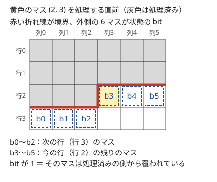
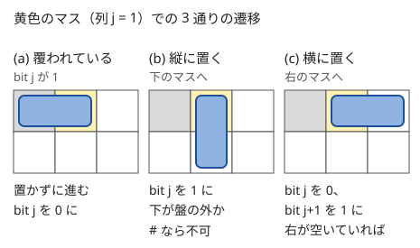

!!! abstract "要点"
    - **何ができるか**：幅の小さいグリッドを 1 マスずつ進め、まだ処理していない部分に影響する境界の情報だけを bit で持って、敷き詰め方や塗り方を数える。取り得る状態だけに圧縮すると、状態はさらに減る。
    - **いつ使うか**：
        - グリッドの短い辺が 6〜14 以下である。
        - タイル・ドミノの敷き詰め方の数を問われる。
        - 隣り合わないように置く・隣と異なる色で塗る方法の数を問われる。
        - 黒マスが連結になる塗り方を問われる。
    - **計算量**：短い辺を $W$ として、1 マスずつ進めると $O(HW \cdot 2^W)$。取り得る状態だけに圧縮すれば、$O(HW \cdot (\text{状態数}) \cdot (\text{1 マスの選択肢の数}))$。
    - **前提**：[bitDP](../dp/bit-dp.md)

<!-- textlint-disable -->
別名：Broken Profile DP・插頭 DP・フロンティア法・連結性 DP・スライド bitDP・敷き詰めの DP
<!-- textlint-enable -->

プロファイル DP は、グリッドを決まった順に埋めていくとき、埋め終えた部分と残りの部分の境界（プロファイル）に並ぶマスの情報だけを[状態](../guide/glossary.md#state)にする DP である。境界の長さは短い辺の長さ程度なので、境界の情報を [bitDP](../dp/bit-dp.md) と同じく整数で表せば、状態は $2^W$ 個ほどに収まる。

このページでは、マスを行 $i$・列 $j$ の $(i, j)$ で表す（0-indexed）。行は上から、列は左から数え、横幅 $W$ が短い辺になるように向きをそろえる（必要なら縦横を入れ替える）。

## 必要になる場面 {#motivation}

$H \times W$ の盤を $1 \times 2$ のドミノで敷き詰める方法の数を考える。素朴に左上から 1 つずつ置き方を試すと、敷き詰め方の数そのものに比例する時間がかかり、$8 \times 8$ でも 1200 万通りを超える。

無駄は、途中までの置き方が違っても、この先の置き方が同じになる場合を別々に調べていることにある。左上から行ごとにマスを埋めていくとき、この先に影響するのは「まだ処理していないマスのうち、どれがすでに覆われているか」だけである。すでに覆われたマスは、埋め終えた部分との境界のすぐ外側にしかない。だから境界の外側の $W$ マスの覆われ方（$2^W$ 通り）ごとに数をまとめれば、途中の置き方を合流させられる。

## 1 行ずつ進める（行の配置パターンを状態に） {#row-by-row}

最も素直な形は、1 行ずつ下へ進み、直前の行の配置パターン（$W$ bit）を状態にするものである。互いに隣接（8 近傍）しないようにキングを置く数なら、次のように書ける。

- 状態：$\mathrm{dp}[i][a]$ ＝ 行 $0$ から行 $i-1$ までに置き終え、行 $i-1$ の配置が $a$（置いた列の bit が 1）である置き方の数
- 遷移：行 $i$ の配置 $b$ が、行の中で隣り合わず、置けないマスを含まず、$a$ と縦・斜めで隣接しなければ、$\mathrm{dp}[i+1][b] \mathrel{+}= \mathrm{dp}[i][a]$
- 初期値と答え：$\mathrm{dp}[0][0] = 1$（行 $-1$ には何も置いていないとみなす）、答えは $\sum_a \mathrm{dp}[H][a]$

隣接の判定は bit 演算でまとめて書ける。$b$ の中で隣り合わないのは `(b & (b << 1)) == 0`、$a$ と縦・斜めで隣接しないのは `(a & b) == 0`、`(a & (b << 1)) == 0`、`((a << 1) & b) == 0` がすべて成り立つことである。

この状態で足りるのは、行 $i$ の置き方を決めるのに、行 $i-1$ より上の配置は関係しないからである。キングの利きは隣の行までしか届かない。

弱点は遷移の数である。行の配置が $P$ 通りあると、1 行あたり $P^2$ 組を調べる。行の中で隣り合わない配置の数は $W = 10$ で $144$ 通り、$W = 24$ で $121393$ 通りある。$W = 10$ なら 1 行に約 $2 \times 10^4$ 組で十分速いが、$W = 24$ では約 $1.5 \times 10^{10}$ 組で間に合わない。

行のパターンを状態ではなく遷移として使う問題もある。[例題の ABC113 D](#abc113_d) では、状態は今いる縦線の位置で、1 段ごとの横線の引き方（パターン）を [bit 全探索](../basics/bit-full-search.md)で列挙して遷移に使う。

**応用の型**：幅が 8〜10 程度で、行の配置どうしの相性だけが条件になる問題（「隣の行と同じ列に置かない」「1 段ごとの横線の引き方」）。パターンの数が少なければ、相性のよい組を先に列挙しておく。

## 1 マスずつ進める（境界の折れ線を状態に） {#cell-by-cell}

行をまとめて決める代わりに、マスを $(0, 0), (0, 1), \dots, (0, W-1), (1, 0), \dots$ の順に 1 つずつ決める。遷移は 1 マスぶんの選択だけになり、$P^2$ の組を調べなくて済む。このとき、処理済みのマスと未処理のマスの境界は、次の図の赤い線のように 1 か所で段になった折れ線になる。



ドミノの敷き詰めで、この境界を状態にする。

- 状態：マス $(i, j)$ を処理する直前の $\mathrm{dp}[S]$ ＝ 処理済みのマスをすべて覆った置き方のうち、境界の外側のマスの覆われ方が $S$ であるものの数。$S$ の bit $k$ は、$k < j$ ならマス $(i+1, k)$、$k \ge j$ ならマス $(i, k)$ がすでに覆われているかを表す
- 初期値と答え：最初は何も置いていないので $\mathrm{dp}[0] = 1$。全マスを処理した後、盤の外（行 $H$）にはみ出したドミノはあってはならないので、答えは $\mathrm{dp}[0]$

マス $(i, j)$ を処理すると、bit $j$ の意味が「マス $(i, j)$」から「マス $(i+1, j)$」に変わる。遷移は次の図の 3 通りである。



1. bit $j$ が 1（上から縦に、または左から横に置いたドミノで覆われている）：何も置かず、bit $j$ を 0 にする
2. bit $j$ が 0 で縦に置く：下のマス $(i+1, j)$ が盤の中にあり置けるなら、bit $j$ を 1 にする
3. bit $j$ が 0 で横に置く：右のマス $(i, j+1)$ が盤の中にあり、置けて、bit $j+1$ が 0 なら、bit $j+1$ を 1 にする（bit $j$ は 0 になる）

```cpp
--8<-- "broken-profile-dp/domino.cpp:core"
```

行が変わるときに特別な処理は要らない。行 $i$ の最後のマスを処理し終えると、すべての bit が行 $i+1$ のマスを表すようになり、そのまま次の行の最初のマスの状態になる。

**なぜ正しいか**：マス $(i, j)$ を処理するときに置くドミノは、$(i, j)$ と、その下か右のマスを覆う。下のマス $(i+1, j)$ も右のマス $(i, j+1)$ も、処理した後の境界の外側のマスである。よって、未処理のマスのうちすでに覆われているものは、いつも境界の外側の $W$ マスの中にある。この先の置き方は「未処理のマスのどれが覆われているか」だけで決まるので、$S$ が同じ置き方は合流させてよい。

**計算量**：マスが $HW$ 個、状態が $2^W$ 個、遷移が各 $O(1)$ なので $O(HW \cdot 2^W)$ である。表は直前のマスの分だけ持てばよく、メモリは $O(2^W)$ で済む。$W = 16$ でも $2^{16} = 65536$ 個である。

境界のどちら側の情報を持つかは問題で変わる。ドミノでは境界の外側（覆われた未処理のマス）を持ったが、隣と異なる色で塗る問題では、境界のすぐ内側の処理済みのマス（$k < j$ ならマス $(i, k)$、$k \ge j$ ならマス $(i-1, k)$）の色を持つ。どちらの場合も、決めるべきことは「この先の選択に影響するのは境界のどのマスか」である。

**応用の型**：

- 隣と異なる色で塗る：境界の内側 $W$ マスの色を持つ。新しいマスは、上（bit $j$）と左（bit $j-1$）の色と違えばよい
- キングを置く（8 近傍）：新しいマス $(i, j)$ は左上のマス $(i-1, j-1)$ とも隣接するが、このマスは境界の内側の $W$ マスに入っていない。直前に処理した $W+1$ マスを持つ
- 置けないマスがある：遷移で、置き先が置けるかを調べるだけでよい（ドミノのコードの `'#'` の判定）

## 取り得る状態だけを列挙して番号を付ける（圧縮） {#compress}

境界の情報を素朴に整数にすると、隣接の条件で決して現れない値まで状態に数えてしまう。実際に取り得る状態だけを列挙して $0, 1, 2, \dots$ と番号を振れば、表が小さくなり、回すループも減る。

3 色で隣と異なる色に塗る問題を例にする。境界の内側の $W$ マスの色を素朴に持つと $3^W$ 通りで、$W = 14$ なら約 $4.8 \times 10^6$ 個ある。しかし境界のうち、行 $i$ の部分（列 $0$ から $j-1$）と行 $i-1$ の部分（列 $j$ から $W-1$）は、それぞれの中で隣り合うマスの色が違う。段の両側のマス $(i, j-1)$ と $(i-1, j)$ だけは斜めの関係なので、同じ色でもよい。よって $1 \le j \le W-1$ のとき、状態は

$$
3 \cdot 2^{j-1} \times 3 \cdot 2^{W-j-1} = 9 \cdot 2^{W-2}
$$

通り以下で、$W = 14$ なら $36864$ 通りである。素朴に持つ場合の約 $1/130$ になる。ただし 1 行目の処理中は、まだ塗っていないマスを含む状態が加わる。その数は多くても $3 \cdot 2^{W-2}$ 通りなので、1 つの列の位置での状態は $12 \cdot 2^{W-2}$ 通り以下（$W = 14$ で $49152$ 通り）である。キングの問題でも、直前の $W+1$ マスの bit で $2^{W+1}$ 通りのうち、$W = 24$ で実際に現れるのは $167761$ 通りだけである（$2^{25} \approx 3.4 \times 10^7$ に対して約 $1/200$。手元の列挙で数えた値）。

圧縮のしかたは 2 通りある。

- **連想配列で持つ**：`map<状態, 数>` を 1 マスごとに作り直す。状態の列挙を考えなくてよく、書くのが速い。`map` は 1 回の操作に $O(\log(\text{状態数}))$ かかる
- **先に列挙して番号を付ける**：全部が未定の状態から、遷移でたどり着ける状態を列ごとに集め、整数の昇順に並べて番号を付ける。遷移の表 $\mathrm{nxt}[j][\text{番号}][\text{選択}]$ も先に作っておけば、DP は配列の添字だけで回せる

後者の書き方を示す。状態は境界の内側 $W$ マスの色を 2 bit ずつ並べた整数で、0 は「まだ塗っていない」（1 行目の処理中だけ現れる）を表す。

```cpp
--8<-- "broken-profile-dp/coloring.cpp:enumerate"
```

列挙した状態の番号で DP を回す。盤の横幅が長ければ、先に縦横を入れ替えて短い辺を横にする。

```cpp
--8<-- "broken-profile-dp/coloring.cpp:dp"
```

**計算量**：状態数を $T$、1 マスの選択肢の数を $c$ として、DP は $O(HW \cdot T \cdot c)$ である。列挙は列ごとに 1 回なので $O(W \cdot T \cdot c \log T)$ で、合わせて $O(HW \cdot T \cdot c + W \cdot T \cdot c \log T)$ になる。3 色の例で $HW \le 200$ なら、DP は $200 \times 49152 \times 3 \approx 2.9 \times 10^7$ 以下で済む。

**応用の型**：隣接の条件が強く、bit の並びのほとんどが現れない問題。状態数を手で数えられなくても、小さい $W$ で列挙して個数の増え方を確かめれば、間に合うかを見積もれる。

## 長さが巨大なら行列累乗と組み合わせる {#with-matrix-power}

この節は[行列累乗](../math/matrix-power.md)を前提にする。また、この節に限り、例の問題（ABC204 F）の記号に合わせて短い辺を $H$、長い辺を $W$ とする。幅 $H$ が小さく、長さ $W$ が $10^{12}$ のように巨大で、どの列も同じ条件（置けないマスがない）なら、1 列ぶんの遷移はどの列でも同じ行列になる。そこで、状態を「列の境界の外側の覆われ方」（$H$ bit）にして、1 列ぶんの遷移行列 $A$ を作り、$A^W$ を求める。

1 列ぶんの遷移行列は、1 列の中を 1 マスずつ処理する DFS で作れる。始めの状態ごとに、その列のマスを上から順に埋め、列の最後まで来たら、次の列へのはみ出しの集合への遷移に 1 を足す。手順と状態数の見積もりは[行列累乗のプロファイル DP の節](../math/matrix-power.md#profile-dp)にある。

1 マスずつ進める形も、そのまま行列にできる。1 マスの遷移を行列 $M_0, \dots, M_{H-1}$ にし、その積を 1 列ぶんの行列にする。ただし行列の大きさは状態数 $T$ の 2 乗で、累乗の積 1 回は $O(T^3)$ なので、$T$ が $2^6 = 64$ 程度までが目安である。状態を圧縮して $T$ を減らしておくと、累乗が速くなる。

## 連結性を持つ（フロンティア法） {#connectivity}

この節は発展で、[Union-Find](../ds/union-find.md) の考え方を前提にする。「黒マスがすべて連結」「左上と右下が黒マスでつながる」のような条件は、境界の色だけでは判定できない。境界の上の 2 つの黒マスが、処理済みの部分を通ってつながっているかが、この先の判定に影響するからである。

そこで、境界の各マスに「白」か「何番目の連結成分か」のラベルを持たせる。

- **正規化**：ラベルの付け方だけが違う状態は同じものとして扱う。左から見て初めて現れた成分から順に $1, 2, 3, \dots$ と振り直す（例：$(2, 0, 2, 1) \to (1, 0, 1, 2)$）
- **遷移**：新しいマスを黒にすると、上と左の黒マスの成分とつながる。2 つの成分がつながれば、ラベルを 1 つにまとめてから正規化する
- **成分が境界から消えるとき**：あるマスが境界から外れたとき、同じ成分のマスがほかに境界になければ、その成分はもう誰ともつながれない。「すべて連結」なら、それがほかの成分の残らない最後の 1 つでない限り、その状態は捨てる。最後の 1 つが消えたときは「閉じた」印を持つ状態に移し、以降のマスは白だけを許す。印がないと、境界がすべて白の「まだ黒を置いていない」状態と区別できず、2 つ目の成分を作る塗り方まで数えてしまう

状態数は、境界の分け方の数（ベル数）よりずっと少ない。境界の上で $a < b < c < d$ の順に並ぶマスについて、$a$ と $c$、$b$ と $d$ がそれぞれつながっているとする。2 本の道は処理済みの部分の中を通るので、平面の上で交わり、4 マスは同じ成分になる。よって、交差する分け方は現れない。

## 落とし穴 {#pitfalls}

- **bit の意味の取り違え**：1 マスずつ進める形では、bit $k$ が表すマスが $k < j$ と $k \ge j$ で違う行にある。横に置くときに調べる bit $j+1$ はまだ今の行のマスで、縦に置いたときに立てる bit $j$ は次の行のマスである。図を描いて、どの bit がどのマスかをコメントに書いてから実装する
- **境界の外の情報が要る**：キングの問題（8 近傍）では、左上のマス $(i-1, j-1)$ が境界の内側の $W$ マスに入らない。新しいマスの選択に影響するマスをすべて書き出し、状態に入っているかを確かめる
- **短い辺を横にしていない**：状態は $2^{\text{横幅}}$ 個になる。$H \times W \le 200$ のように積だけが制限されているなら、縦横を入れ替えて短い辺を横にする（短い辺は $14$ 以下になる）
- **表を全マス分持つ**：$\mathrm{dp}[i][j][S]$ を全部持つと、$HW \cdot 2^W$ 個でメモリが足りなくなりやすい。直前のマスの分と次の分の 2 本だけを持ち、次の分は毎回 0 で埋めてから足す
- **答えの取り出し方**：ドミノのように盤の外へはみ出してはいけないなら、答えは最後の状態 0 だけである。色を塗る問題なら、最後の状態をすべて足す
- **1 行ずつのまま幅を広げる**：行の配置が $P$ 通りなら 1 行に $P^2$ 組を調べる。$H \cdot P^2$ が $10^8$ を超えそうなら、1 マスずつ進める形に直す

## 例題 {#examples}

### ABC113 D. Number of Amidakuji {#abc113_d}

<div class="kp-problems" data-role="example" markdown>

- [ABC113 D. Number of Amidakuji](https://atcoder.jp/contests/abc113/tasks/abc113_d)（diff 1597）：高さ H・縦線 W 本のあみだくじで、横線どうしが端点を共有しないように横線を引き、1 番左の縦線から下りると K 番目に着くものの数を求める。

</div>

縦線は $W \le 8$ 本と少ないので、1 段ごとの横線の引き方を $W - 1$ か所の隙間の bit で表し、すべて列挙できる。端点を共有しない条件は「隣り合う 2 か所に同時に引かない」で、`(b & (b << 1)) == 0` で判定できる。状態は今いる縦線の位置だけでよく、1 段ずつ下へ進む。

??? note "解法の詳細"
    - 状態：$\mathrm{dp}[i][j]$ ＝ 上から $i$ 段の横線を決めたとき、左端から下りて縦線 $j$（0-indexed）にいる引き方の数。$\mathrm{dp}[0][0] = 1$。
    - 遷移：条件を満たす引き方 $b$（$0 \le b < 2^{W-1}$）ごとに、bit $j$ が 1 なら右へ、bit $j-1$ が 1 なら左へ、どちらでもなければそのまま下りる。移った先を $j'$ として $\mathrm{dp}[i+1][j'] \mathrel{+}= \mathrm{dp}[i][j]$。
    - 答え：$\mathrm{dp}[H][K-1]$（$K$ は 1-indexed）。
    - 計算量：引き方は $2^{W-1} \le 128$ 通り（条件を満たすのは $W = 8$ で 34 通り）なので、$O(H \cdot W \cdot 2^W)$ で十分に速い。

### ABC379 G. Count Grid 3-coloring {#abc379_g}

<div class="kp-problems" data-role="example" markdown>

- [ABC379 G. Count Grid 3-coloring](https://atcoder.jp/contests/abc379/tasks/abc379_g)（diff 2304）：1・2・3 と '?' からなるグリッドの '?' を 1〜3 で埋め、隣り合うマスの数がすべて異なるようにする方法の数を求める（H×W ≤ 200）。

</div>

$H \times W \le 200$ なので、縦横を入れ替えて短い辺を横にすれば $W \le 14$ になる。1 マスずつ進めて境界の内側 $W$ マスの色を持つと、素朴には $3^{14} \approx 4.8 \times 10^6$ 通りで、全マスで回すと間に合わない。隣り合うマスの色が違う状態だけに圧縮すれば、全部塗った状態は $9 \cdot 2^{12} = 36864$ 通り以下、1 行目の塗りかけの状態を含めても $12 \cdot 2^{12} = 49152$ 通り以下になる。

??? note "解法の詳細"
    - 向き：$W > H$ なら縦横を入れ替える。
    - 状態：マス $(i, j)$ を塗る直前の境界の内側の色の並び。$k < j$ はマス $(i, k)$、$k \ge j$ はマス $(i-1, k)$ の色で、まだ塗っていないマスは 0 にする。初期値は全部 0 の状態に 1。
    - 遷移：色 $c$ が、固定された数と合い、上（位置 $j$）と左（位置 $j-1$）の色と違えば、位置 $j$ を $c$ に書き換えた状態へ足す。
    - 圧縮：たどり着ける状態を列ごとに列挙して番号を付け、遷移の表を先に作る（[圧縮の節](#compress)のコード）。`map` で持っても間に合う。
    - 答え：全マスを塗った後の状態をすべて足し、問題の法で割った余りを出す。計算量は $O(HW \cdot 12 \cdot 2^{W-2} \cdot 3)$ で、$200 \times 49152 \times 3 \approx 2.9 \times 10^7$ 以下である。

## 練習問題 {#practice}

<div class="kp-problems" data-role="practice" markdown>

- [典型90 023. Avoid War（★7）](https://atcoder.jp/contests/typical90/tasks/typical90_w)（diff —）：H×W の盤の空いたマスに、互いに隣接（8 近傍）しないようにキングを置く方法の数を求める。
- [ABC204 F. Hanjo 2](https://atcoder.jp/contests/abc204/tasks/abc204_f)（diff 2044）：H×W（H ≤ 6、W ≤ 10^12）の部屋に 1×1 と 1×2 の畳を敷き詰める方法の数を求める。

</div>

??? note "練習の方針"
    - **典型90 023**：1 行ずつ進めると幅が大きいときに間に合わない。1 マスずつ進め、直前に処理した $W + 1$ マスに置いたかどうかを状態にする。新しいマスは、左・左上・上・右上の 4 マスに置いていなければ置ける。取り得る状態だけを列ごとに列挙して番号を付け、遷移の表を先に作る（幅 24 でも 17 万通りほど）。
    - **ABC204 F**：列のはみ出しの集合（$2^H \le 64$ 通り）を状態にした 1 列ぶんの遷移行列を DFS で作り、$W$ 乗する。答えは集合 0 から集合 0 への成分である（[行列累乗と組み合わせる](#with-matrix-power)）。

## 力試し {#challenge}

<div class="kp-problems" data-role="challenge" markdown>

- [TDPC S. マス目](https://atcoder.jp/contests/tdpc/tasks/tdpc_grid)（diff —）：H×W（H ≤ 6）のグリッドを白黒に塗り、左上と右下が黒マスだけを通ってつながるようにする方法の数を求める。
- [ABC296 Ex. Unite](https://atcoder.jp/contests/abc296/tasks/abc296_h)（diff 2822）：白黒のグリッドで、白マスをいくつか黒に塗って黒マス全体を連結にするときの、塗るマスの数の最小を求める。

</div>

??? note "力試しの方針"
    - **TDPC S**：短い辺（6 以下）に沿った境界の各マスに、白か連結成分のラベルを持たせ、正規化した状態で数える。左上のマスを含む成分を区別しておき、それが境界から消えたら捨てる。最後に右下のマスがその成分に入っているものを数える（[連結性を持つ](#connectivity)）。1 行ずつより 1 マスずつの方が遷移を書きやすい。
    - **ABC296 Ex**：幅の小さい向きで、境界の各マスの連結成分のラベルを状態にし、黒に塗った数の最小を値に持つ。もとから黒のマスは白にできない。成分が境界から消えるのは、それがほかに黒マスの残らない最後の成分のときだけ許す。

## 確認問題 {#quiz}

??? question "確認問題：ドミノの状態で足りる理由"
    ドミノの敷き詰めで 1 マスずつ進めるとき、境界の外側の $W$ マスの覆われ方だけを持てば足りるのはなぜか。

    ??? success "答え"
        マス $(i, j)$ を処理するときに置くドミノは、$(i, j)$ とその下か右のマスを覆う。下のマスも右のマスも、処理後の境界の外側の $W$ マスに入る。よって、未処理なのにすでに覆われているマスは、いつも境界の外側にある。この先の置き方は未処理のマスの覆われ方だけで決まるので、それが同じなら合流させてよい。

??? question "確認問題：キングの状態が W + 1 マスになる理由"
    互いに隣接（8 近傍）しないようにキングを置く数を 1 マスずつ数えるとき、境界の内側の $W$ マスではなく、直前に処理した $W + 1$ マスを持つのはなぜか。

    ??? success "答え"
        マス $(i, j)$ に置けるかは、左 $(i, j-1)$・左上 $(i-1, j-1)$・上 $(i-1, j)$・右上 $(i-1, j+1)$ の 4 マスで決まる。境界の内側の $W$ マスは、行 $i$ の列 $0$ から $j-1$ と、行 $i-1$ の列 $j$ から $W-1$ なので、左上のマス $(i-1, j-1)$ が入っていない。直前に処理した $W + 1$ マスなら、この 4 マスがすべて入る。

??? question "確認問題：1 行ずつと 1 マスずつの比較"
    $10 \times 10$ の盤のドミノの敷き詰めで、1 行ずつ「次の行へのはみ出し」を状態にし、行の遷移を状態の組 $2^{10} \times 2^{10}$ 通りで調べる場合と、1 マスずつ進める場合で、調べる回数はそれぞれおよそいくつか。

    ??? success "答え"
        1 行ずつでは $10 \times 2^{10} \times 2^{10} \approx 1.0 \times 10^7$、1 マスずつでは $100 \times 2^{10} \times 3 \approx 3.1 \times 10^5$ ほどである（1 マスの遷移は高々 3 通り）。1 行ずつでも行の中を DFS で埋めて実際に作れる組だけを調べれば減るが、1 マスずつ進める形は遷移を書くのが易しく、無駄な組を調べない。

## 使い分け {#comparison}

- **[bitDP](../dp/bit-dp.md)**：集合の要素に位置の並びがなく、どの要素どうしも関係しうるなら、集合全体を状態にする。グリッドで、関係するのが近くのマスだけなら、境界だけを持つプロファイル DP で状態を減らせる
- **[グリッドの DP](../dp/dp-grid.md)**：経路の数や最小のコストのように、マスごとの値が上と左の値だけで決まるなら、境界の情報は要らない
- **[二部マッチング](../graph/bipartite-matching.md)**：ドミノで敷き詰められるか（数ではなく可否）や、置ける最大の個数なら、盤が大きくてもマスを市松模様に塗り分けた二部グラフのマッチングで解ける。プロファイル DP は数え上げや、幅が小さいときに使う
- **[行列累乗](../math/matrix-power.md)**：同じ列の遷移を巨大な回数くり返すなら、プロファイル DP の遷移を行列にして累乗する

## 参考 {#references}

- [drken「AtCoder ABC 113 D - Number of Amidakuji (1Q, 水色, 400 点)」](https://drken1215.hatenablog.com/entry/2019/04/23/183916)：例題 ABC113 D の状態と、横線の引き方の bit 全探索による列挙
- [kmjp「AtCoder ABC #379 (トヨタ自動車プログラミングコンテスト2024#11) : G - Count Grid 3-coloring」](https://kmjp.hatenablog.jp/entry/2024/11/11/0930)：例題 ABC379 G の縦横の入れ替えと、各列の最後に塗った色を状態にして連想配列で数える方法
- [E869120「kyopro_educational_90」](https://github.com/E869120/kyopro_educational_90)：練習の典型90 023 の方針（解答コード sol/023-02.cpp の 1 行ずつの DP と、sol/023-04a.cpp の取り得る状態の列挙と遷移の表）
- [kmjp「AtCoder ABC #204 : F - Hanjo 2」](https://kmjp.hatenablog.jp/entry/2021/06/06/1000)：練習の ABC204 F の方針（はみ出しの集合の遷移行列の累乗）
- [sigma425「Typical DP Contest (TDPC)」](https://sigma425.hatenablog.com/entry/2016/08/02/214547)：力試しの TDPC S の方針（連結状態を持ち、1 マスずつ進めると遷移が易しくなる点）
- [kmjp「AtCoder ABC #296 : Ex - Unite」](https://kmjp.hatenablog.jp/entry/2023/04/01/0930)：力試しの ABC296 Ex の方針（幅の小さい向きに 1 行ずつ進め、連結な列の集合を状態にする）
