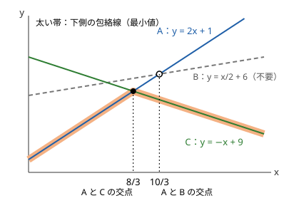

!!! abstract "要点"
    - **何ができるか**：$\mathrm{dp}[i] = \min_j (\mathrm{dp}[j] + a_j x_i + b_j)$ のように遷移が一次関数の最小になる DP を、直線の集まりの下側の包絡線だけを持って $O(N^2)$ から速くする。傾きもクエリも単調なら deque、そうでなければ二分探索か Li Chao Tree を使う。
    - **いつ使うか**：
        - 遷移のコストが $i$ と $j$ の積の項を 1 つだけ含む（$(h_i - h_j)^2$ など）
        - 直線を追加しながら、任意の $x$ での最小値・最大値を答える
    - **計算量**：傾きもクエリも単調なら全体 $O(N)$（ならし）。傾きが単調でクエリだけ単調でないなら 1 回 $O(\log N)$。Li Chao Tree は直線の追加と取得が $O(\log X)$、線分の追加が $O(\log^2 X)$（$X$ は $x$ の候補の数）
    - **前提**：[DP の基本](../dp/dp-basics.md)

<!-- textlint-disable -->
別名：CHT・傾き最適化・斜率优化・李超线段树・直線の最小値
<!-- textlint-enable -->

Convex Hull Trick（CHT）は、直線 $y = a_j x + b_j$ の集まりについて、与えられた $x$ での最小値を速く答える方法である。DP の遷移を「遷移元 $j$ ごとの直線を $x = x_i$ で評価した最小」に書き直せれば、$O(N^2)$ の DP がほぼ線形になる。Li Chao Tree は、直線の傾きにもクエリの順にも条件を付けずに同じことをするセグメント木である。

この教材で集めた問題では、ABC で CHT が想定解のものは 2 問（ABC289 G・ABC228 H。[練習問題](#practice)）しかなく、多くない。黄を目指す段階では「遷移の式を直線に直す」ことと「ライブラリを 1 つ持つ」ことができれば足りる。証明と実装の細部は[学ぶための資料](#resources)に任せる。

## 遷移を直線の最小値に変形する {#lines}

CHT が効くのは、遷移のコストを展開したとき、$i$ だけの項・$j$ だけの項と、$i$ と $j$ の積の項 1 つに分かれる場合である。

例として、足場 $j$ から $i$ へ跳ぶコストが $(h_i - h_j)^2 + C$ の DP を考える（[例題の EDPC Z](#dp_z) と同じ形）。$\mathrm{dp}[i]$ を足場 $i$ に着くまでのコストの和の最小とすると、

$$
\mathrm{dp}[i] = \min_{j < i} \left( \mathrm{dp}[j] + (h_i - h_j)^2 \right) + C
$$

である。$(h_i - h_j)^2 = h_i^2 - 2 h_i h_j + h_j^2$ と展開し、$j$ によらない $h_i^2 + C$ を外に出すと

$$
\mathrm{dp}[i] = \min_{j < i} \left( \underbrace{(-2 h_j)}_{a_j} \cdot h_i + \underbrace{\mathrm{dp}[j] + h_j^2}_{b_j} \right) + h_i^2 + C
$$

になる。遷移元 $j$ は傾き $a_j = -2h_j$、切片 $b_j = \mathrm{dp}[j] + h_j^2$ の直線で、$\mathrm{dp}[i]$ はその直線たちの $x = h_i$ での最小値で決まる。$\mathrm{dp}[i]$ が決まったら、直線 $(a_i, b_i)$ を追加する。

- 直線の傾きと切片には $j$ の値だけ、クエリの $x$ には $i$ の値だけが入るように分ける。積の項が $h_i h_j$ のように 1 つだけなら必ずこの形にできる。
- 積の項が 2 つ以上ある（$x_i y_j + z_i w_j$ など）と、そのままでは 1 本の直線にならず、CHT は使えない（$z_i$ が $x_i$ に比例するなど、1 つの積にまとめられる場合を除く）。
- 遷移元の候補が $j < i$ のすべてではなく、範囲 $[l_i, i)$ に限られると、古い直線を消す操作が要る。ここで扱う deque の CHT も Li Chao Tree も直線を消せないので、別の工夫（分割統治など）が要る。

最大値の DP でも同じである。直線を上側の包絡線で持つか、$a_j, b_j$ の符号を反転して最小値に直す（[落とし穴](#pitfalls)）。

## 下側の包絡線と不要な直線（傾きもクエリも単調なら deque） {#lower-envelope}

直線の集まりの最小値を $x$ の関数として描くと、上に凸な折れ線になる。これを**下側の包絡線**と呼ぶ。どの $x$ でも最小にならない直線は捨ててよく、残った直線を傾きの大きい順に並べると、最小を取る直線は $x$ が増えるにつれて後ろへ移る。



不要な直線は、隣り合う 3 本で判定できる。傾きが $a_f > a_g > a_h$ の 3 本 $f, g, h$ について、真ん中の $g$ が不要なのは、$f$ と $h$ の交点が $f$ と $g$ の交点より左（同じ位置を含む）にあるときである。図では $f = A$、$g = B$、$h = C$ で、$A$ と $C$ の交点 $8/3$ が $A$ と $B$ の交点 $10/3$ より左にあるので、$B$ が最小になる区間は残らない。交点の $x$ は割り算で求まるが、分母は正なので、掛け算の形

$$
(b_h - b_f)(a_f - a_g) \le (b_g - b_f)(a_f - a_h)
$$

で比べる。

傾きが単調に減る順に直線が追加され、クエリの $x$ も単調に増えるなら、deque 1 本で済む。

- 追加：末尾の 2 本と新しい直線で判定し、末尾が不要な間は末尾を捨ててから、新しい直線を末尾に積む。
- クエリ：先頭の 2 本を比べ、2 本目の方が小さい（等しいを含む）間は先頭を捨ててから、先頭の値を答える。$x$ は後で小さくならないので、捨てた直線が再び最小になることはない。

各直線は 1 回積まれて高々 1 回捨てられるので、全体はならし $O(N)$ である（[ならし計算量](../guide/glossary.md#amortized-complexity)）。末尾の不要なものを捨ててから積む形は[単調スタック](../ds/monotonic-stack.md)と同じで、捨てる基準が値の大小ではなく交点の位置になっている。

```cpp
--8<-- "cht/monotone.cpp:core"
```

直線 $y = ax + b$ を点 $(a, b)$ とみると、下側の包絡線に残る直線は点の集まりの下側凸包の頂点に当たる。この対応は[凸包と CHT の双対](../geometry/convex-hull.md#cht-duality)で扱う。

## クエリが単調でないとき（二分探索） {#non-monotone-queries}

傾きが単調に追加されるが、クエリの $x$ がばらばらに来るときは、先頭を捨てられない。そのときは包絡線を配列で持ち、最小を取る直線を二分探索で探す。

包絡線の直線を傾きの大きい順に $f_0, f_1, \dots, f_{k-1}$ とすると、決まった $x$ での値 $f_0(x), f_1(x), \dots$ は減ってから増える。よって「$f_t(x) \le f_{t+1}(x)$」は $t$ について単調（偽が続いた後に真が続く）で、これが初めて真になる $t$ が答えの直線である。[二分探索](../basics/binary-search.md#meguru)で 1 回 $O(\log N)$ になる。

- 直線をすべて先に知っていて、クエリより前に追加し終わるなら、直線を傾きでソートしてから包絡線を作ればよい（[オフライン](../guide/glossary.md#offline)）。クエリもソートできるなら、ソートした後は deque と同じく線形で済む。
- 傾きの順が単調でない追加とクエリが混ざるなら、包絡線を順序付き集合で持つ方法（動的 CHT）か Li Chao Tree を使う。実装が軽いのは Li Chao Tree である。

## Li Chao Tree（区間の真ん中で勝つ直線を残す） {#li-chao-tree}

Li Chao Tree は、問い合わせうる $x$ の候補 $X$ 個を並べた列の上の[セグメント木](../ds/segment-tree.md)で、各ノードに直線を高々 1 本置く。追加の順にもクエリの順にも条件がない。

直線 $f$ をノード（受け持つ $x$ の範囲が $[l, r)$、真ん中が $m$）に追加する手順は次のとおりである。

1. ノードに直線がなければ $f$ を置いて終わる
2. 置いてある直線 $g$ と $f$ を真ん中 $m$ で比べ、小さい方をノードに残す。負けた方を $f'$ とする
3. $f'$ を左端 $l$ でも比べる。$l$ で $f'$ が勝つなら左の子へ、そうでなければ右の子へ $f'$ を追加する（葉なら捨てる）

2 本の直線は高々 1 回しか交わらない。$m$ で負けた $f'$ が勝てるのは交点の片側だけなので、$f'$ が最小になりうる $x$ は左右の片方の子の範囲にしかない。追加は根から葉への 1 本の道をたどるだけで $O(\log X)$ である。

クエリ $x$ では、$x$ を含むノードを根から葉までたどり、置かれた直線の値の最小を取る。どの直線も、捨てられた範囲では別の直線に負けているので、$x$ での最小はこの道の上にある。これも $O(\log X)$ である。

- 線分（$x \in [l, r)$ の範囲だけにある直線）を追加するときは、$[l, r)$ をセグメント木と同じく $O(\log X)$ 個のノードに分け、各ノードで上の手順を行う。1 回 $O(\log^2 X)$ になる。
- $x$ の候補を先に集めて座標圧縮すれば配列で書ける（下の実装）。先に分からないなら、整数の範囲全体（$[-10^9, 10^9]$ など）を受け持つ木を、ノードを使うときだけ作る形にする。ノードは追加 1 回につき $O(\log(\text{範囲}))$ 個しか増えない。

## ライブラリでの検証 {#library}

ACL には CHT も Li Chao Tree もないので、使うなら自作する。自作するときの要点は次のとおりである。

- 最小用に 1 つ作り、最大は符号の反転で使う。値の範囲を確かめ、交点の比較は `__int128` の掛け算で行う。
- Li Chao Tree のノードには「直線がない」印を持つ。$+\infty$ の切片で代用すると、$ax$ を足したときに `long long` を超えることがある。
- 座標圧縮版は、クエリの $x$ が候補の列にあることが前提である。候補にない $x$ を聞くなら、範囲全体の版にする。

座標圧縮版の Li Chao Tree の中心は次のとおりである（完全なプログラムは `snippets/cht/li-chao.cpp` で、乱数で愚直な方法と比べている）。

```cpp
--8<-- "cht/li-chao.cpp:core"
```

Library Checker の対応は次のとおりである。どちらも $N, Q \le 2 \times 10^5$、$\lvert a \rvert, \lvert x \rvert \le 10^9$、$\lvert b \rvert \le 10^{18}$ で、$ax + b$ は $2 \times 10^{18}$ 以下なので `long long` に収まる。

- Line Add Get Min：直線の追加と $x$ での最小値。傾きの順が単調でないので、deque の CHT では通らず、Li Chao Tree か動的 CHT の確認になる。クエリを先に読めば座標圧縮版が使える。
- Segment Add Get Min：線分の追加と $x$ での最小値（線分がなければ `INFINITY` と出力）。線分版の Li Chao Tree の確認になる。

単調な deque の CHT は、この 2 問では確かめられない。[例題の EDPC Z](#dp_z) で確かめるか、`snippets/cht/monotone.cpp` のように愚直な $O(N^2)$ の DP と乱数で比べる。

## 落とし穴 {#pitfalls}

- **交点を割り算で求める**：浮動小数点の誤差で不要な直線の判定を誤る。整数の割り算は切り捨ての向きで誤る。掛け算の形で比べるが、切片の差（$10^{18}$ 程度）と傾きの差（$10^9$ 程度）の積は `long long` を超えるので `__int128` にする。
- **最小と最大の取り違え**：最大を求めるのに最小用の CHT をそのまま使うと、まったく違う値になる。直線 $(a, b)$ を $(-a, -b)$ で追加し、答えの符号を戻す。$(-a, -b)$ で追加すると傾きの順が逆になるので、最小用の deque（傾きが減る順）に入れるには、元の直線を傾きが増える順に追加する。
- **同じ傾きの直線**：不要の判定式は、傾きが狭義に減ること（交点の分母が正）を前提にしている。同じ傾きの直線が来ると交点がなく、判定が正しくなくなる（片方の辺だけが 0 になる）。追加の前に、末尾と傾きが同じなら切片の小さい方だけを残す。
- **単調でないのに deque を使う**：クエリの $x$ が減ることがあると、先頭を捨てたせいで答えを誤る。$x$ の順が単調かを問題の条件から確かめ、そうでなければ二分探索か Li Chao Tree にする。
- **直線を追加する前にクエリする**：EDPC Z の形では、$\mathrm{dp}[0]$ の直線を先に入れてから $i = 1$ のクエリを行う。空の deque に問い合わせないようにする。

## 学ぶための資料 {#resources}

- 不要な直線の判定と、単調な場合の deque・一般の場合の二分探索の流れは、satanic0258 氏の記事と ageprocpp 氏の記事が日本語で詳しい。
- Li Chao Tree の追加の手順と、線分の場合に $O(\log^2 X)$ になる理由は、smijake3 氏の Li Chao Tree のメモが短くまとまっている。
- 英語では cp-algorithms の「Convex hull trick and Li Chao tree」がある。

## 例題 {#examples}

### EDPC Z. Frog 3 {#dp_z}

<div class="kp-problems" data-role="example" markdown>

- [EDPC Z. Frog 3](https://atcoder.jp/contests/dp/tasks/dp_z)（diff なし）：足場を前から順に跳んで進み、i から j へ跳ぶと (h_j − h_i)^2 + C のコストがかかるとき、最後の足場までのコストの和の最小を求める。

</div>

方針：[遷移を直線の最小値に変形する](#lines)の式そのものである。遷移元 $j$ を直線 $y = -2h_j x + \mathrm{dp}[j] + h_j^2$ とし、$x = h_i$ での最小に $h_i^2 + C$ を足す。

??? note "解法の詳細"
    - 高さ $h$ は狭義に増えるので、追加する直線の傾き $-2h_j$ は単調に減り、クエリの $x = h_i$ は単調に増える。deque の CHT がそのまま使え、全体はならし $O(N)$ である。
    - 0-indexed で $\mathrm{dp}[0] = 0$ とし、まず直線 $(-2h_0, h_0^2)$ を追加する。$i = 1, 2, \dots$ の順に、クエリで $\mathrm{dp}[i]$ を求めてから直線 $(-2h_i, \mathrm{dp}[i] + h_i^2)$ を追加する。答えは $\mathrm{dp}[N-1]$。
    - コード片 `snippets/cht/monotone.cpp` の `solve` がこの流れで、愚直な $O(N^2)$ と乱数で比べている。

## 練習問題 {#practice}

<div class="kp-problems" data-role="practice" markdown>

- [ABC289 G. Shopping in AtCoder store](https://atcoder.jp/contests/abc289/tasks/abc289_g)（diff 2109）：客ごとの購買意欲と商品ごとの価値から、価格に応じて買う客が決まるとき、商品ごとに売上（価格×買う人数）の最大を求める。
- [ABC228 H. Histogram](https://atcoder.jp/contests/abc228/tasks/abc228_h)（diff 2729）：数列の値を 1 増やすたびに要素ごとの費用がかかるとき、増やした費用と「値の種類数 × X」の和の最小を求める。

</div>

??? note "練習の方針"
    - ABC289 G：客を購買意欲でソートすると、価格をある客の購買意欲に合わせたとき買う人数 $k$ が決まる。売上は $k$ を傾きとする商品の価値の一次関数になるので、直線の最大を商品ごとに問う。傾きは単調に並べられ、クエリは二分探索か、商品を価値でソートしてから単調に処理する。
    - ABC228 H：値でソートすると、まとめて同じ値にそろえる要素はソート後の連続する区間になる。費用の累積和を使うと、区間 $(i, j]$ をそろえる遷移が「$i$ ごとの直線を $x = A_j$ で評価した最小」になる。傾きは累積和の符号を反転したもので単調に、クエリはソート順で単調に並ぶ。

### Library Checker

- [Line Add Get Min](https://judge.yosupo.jp/problem/line_add_get_min)：直線の追加と最小値
- [Segment Add Get Min](https://judge.yosupo.jp/problem/segment_add_get_min)：線分の追加と最小値

## 確認問題 {#quiz}

??? question "確認問題：遷移のコストが $(i - j)^2 + A_j$ の DP（$\mathrm{dp}[i] = \min_{j<i} (\mathrm{dp}[j] + (i - j)^2 + A_j)$）を直線の形に直すと？"
    展開すると $(i - j)^2 = i^2 - 2ij + j^2$ なので、$\mathrm{dp}[i] = \min_{j<i} \left( -2j \cdot i + \mathrm{dp}[j] + j^2 + A_j \right) + i^2$ になる。傾き $-2j$、切片 $\mathrm{dp}[j] + j^2 + A_j$ の直線を $x = i$ で評価する。傾きは単調に減り、クエリは単調に増えるので deque で $O(N)$ になる。

??? question "確認問題：Li Chao Tree の追加で、真ん中で負けた直線を左右の両方の子へ送らなくてよいのはなぜか？"
    2 本の直線は高々 1 回しか交わらないからである。真ん中で負けた直線が勝つ範囲は交点の片側だけで、それは左端でも勝つなら左の子の範囲、そうでなければ右の子の範囲に収まる。送る先が 1 つなので、追加は根から葉への 1 本の道で済み $O(\log X)$ になる。

## 使い分け {#comparison}

- 遷移のコストが $j$ だけの値の和で、範囲の最小を取るだけなら、[セグメント木・スライド最小値による DP の高速化](../dp/dp-segment-tree.md)で足りる。$a_j x_i$ のような積の項が残ると範囲の最小では取れず、CHT になる。
- コストが一次関数の形にならなくても、Monge 性（最適な遷移元の位置が単調）があれば [Monge 性による DP の高速化](../dp/monge.md#monotone-minima)の方法が使える。
- 遷移の個数に制約がある（ちょうど $K$ 回）DP は、[Alien DP](../dp/alien-dp.md#penalty) で制約を外してから CHT と組むことがある。
- 全体の選び方は [DP の高速化の選び方](../dp/dp-speedup-overview.md#shape-to-tool)にまとめる。

## 参考 {#references}

- [satanic0258「Convex-Hull Trick」](https://satanic0258.hatenablog.com/entry/2016/08/16/181331)：学ぶための資料。不要な直線の判定を掛け算で行うこと、単調な場合の deque と一般の場合の計算量
<!-- textlint-disable -->
- [ageprocpp「Convex Hull Trickを知っていますか？僕は知っています。」](https://qiita.com/ageprocpp/items/3533b8f5678f9d4a5515)：学ぶための資料。単調なときに vector・deque で済むこと
<!-- textlint-enable -->
- [smijake3「Li Chao Treeのメモ」](https://smijake3.hatenablog.com/entry/2018/06/16/144548)：学ぶための資料。Li Chao Tree の追加の手順と、直線 $O(\log N)$・線分 $O(\log^2 N)$ の計算量
- [cp-algorithms「Convex hull trick and Li Chao tree」](https://cp-algorithms.com/geometry/convex_hull_trick.html)：学ぶための資料（英語。文章・図は使っていない）
- [yosupo06「library-checker-problems/data_structure」](https://github.com/yosupo06/library-checker-problems/tree/master/data_structure)：検証に使う問題（line_add_get_min・segment_add_get_min）の内容と制約
- [Series_205「Educational DP Contest (EDPC) X ~ Z 問題 解説」](https://qiita.com/Series_205/items/05bd22a4e78527cb29dc)：例題 EDPC Z の遷移の変形と、傾き・クエリの単調性
- [kiwamachan「[EDPC-Z問題 Frog 3] Educational DP Contest を Pythonで解く」](https://zenn.dev/kiwamachan/articles/34949d6ab8d049)：例題 EDPC Z の deque による CHT とならし $O(N)$
- [kmjp「AtCoder ABC #289 (Ｓｋｙ株式会社プログラミングコンテスト2023) : G - Shopping in AtCoder store」](https://kmjp.hatenablog.jp/entry/2023/02/11/0900)：練習 ABC289 G の直線とクエリの置き方
- [kmjp「AtCoder ABC #228 (トヨタシステムズプログラミングコンテスト2021) : H - Histogram」](https://kmjp.hatenablog.jp/entry/2021/11/22/0930)：練習 ABC228 H の DP の遷移と CHT の使いどころ
