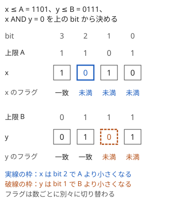
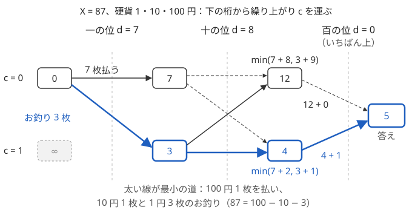

!!! abstract "要点"
    - **何ができるか**：桁 DP を、2 つ以上の数を同時に決める・下の桁からの繰り上がりを状態にする・種類の少ない状態を map や bit で持つ、などに広げる。上限と下限の両方があるときはフラグを 2 つ持つ。
    - **いつ使うか**：
        - 2 つ以上の数を同時に決める（$a + b = a \oplus b$・3 つの数の XOR）。
        - 支払いとお釣りの枚数の最小。
        - 使った数字の種類数・指定の数字を全部含む数。
        - $L \le x \le y \le R$ の組を数える（上限と下限の両方）。
    - **計算量**：桁数を $L$、状態数を $S$、1 桁で置く数字の組を $D$ 通りとして $O(L S D)$。数を $k$ 個並べると、フラグだけで状態が $2^k$ 倍になり、$D$ は $10^k$（2 進なら $2^k$）になる。
    - **前提**：[桁 DP](../dp/digit-dp.md)

<!-- textlint-disable -->
別名：繰り上がりの DP・上限と下限の桁 DP・複数の数の桁 DP
<!-- textlint-enable -->

桁 DP の応用は、「$N$ と一致しているかのフラグ」と「条件の判定に要る情報」という[桁 DP](../dp/digit-dp.md)の骨組みを保ったまま、状態の持ち方を広げる手法の集まりである。数が 2 つ以上ならフラグを並べ、下限があれば向きの違うフラグを足し、繰り上がりがあれば下の桁から決める。どれも「この先の選び方が状態だけで決まるか」で状態を選ぶ点は、基本の桁 DP と変わらない。

## 複数の数を同時に決める（フラグを並べる） {#multiple-numbers}

$0 \le x \le A$、$0 \le y \le B$ で $x \text{ AND } y = 0$ となる組 $(x, y)$ を数えたいとする。$x$ と $y$ を別々に数えても、「同じ bit に 1 が重ならない」という条件は 2 つの数の bit の組で決まるので、掛け算では求まらない。そこで、2 つの数の bit を上から 1 桁ずつ同時に決める。

$x$ が $A$ を超えないかは $x$ の bit と $A$ の bit だけで決まり、$y$ の側とは関係しない。だから、フラグは数ごとに 1 つずつ持ち、別々に更新すればよい。次の図では、$x$ は bit 2 で、$y$ は bit 1 で上限より小さくなり、そこから先はそれぞれ自由に選べる。



2 進で上の bit から決める DP は次のとおりである。

- 状態：$\mathrm{dp}[t_x][t_y]$ ＝ 上の bit から決めた途中の組のうち、$x$ のフラグが $t_x$、$y$ のフラグが $t_y$ のものの個数（1 が一致、0 が未満）
- 遷移：$x$ の bit $b_x$ は、$t_x = 1$ なら $A$ の bit 以下、$t_x = 0$ なら 0・1 のどちらでもよい。$b_y$ も同様に決める。$b_x = b_y = 1$ の組は条件に反するので捨てる。$A$ のその bit を $a_k$ として、次のフラグは $t_x' = t_x \land (b_x = a_k)$ と、数ごとに別々に決める。$t_y'$ も $B$ の bit で同様に決める（コードの `ntx = tx && bx == la`）
- 初期値：$\mathrm{dp}[1][1] = 1$（何も決めていない組は、どちらも上限と一致していると見なす）
- 答え：4 つの状態すべての和

```cpp
--8<-- "digit-dp-advanced/two-numbers.cpp:core"
```

完全なプログラム：[`two-numbers.cpp`](https://github.com/yuukougun/kyopro-atlas/blob/main/snippets/digit-dp-advanced/two-numbers.cpp)（GitHub）
{ .kp-code-src }

**なぜこの状態で足りるか**：残りの bit で $x$ に置けるものは $t_x$ だけで決まり、$y$ に置けるものは $t_y$ だけで決まる。条件の $x \text{ AND } y = 0$ は bit ごとに確かめ終わっているので、この先に影響しない。だから途中の組は $(t_x, t_y)$ の 4 通りに分けて数えれば足りる。

**数を増やすと**：数が $k$ 個なら、フラグの組は $2^k$ 通り、1 桁で置く数字の組は 10 進で $10^k$ 通り（2 進で $2^k$ 通り）になる。条件の情報も数ごとに持つなら掛け算で増える。各数を $m_i$ で割った余りも持つなら、状態は桁ごとに $2^k \prod m_i$ 個である。$k = 3$ 程度までが目安で、状態数と遷移数の積を先に見積もる。

**条件が数どうしの関係のとき**：「$x \le y$」「$x + y \le L$」のように 2 つの数の関係が条件なら、上限のフラグとは別に、その関係を表すフラグを足す。$x \le y$ なら「ここまで $x$ と $y$ が一致しているか」である（[上限と下限の両方](#lower-and-upper)）。$x + y$ のように数を足す条件は、繰り上がりが下の桁から来るので、[繰り上がりを状態にする](#carry)形で書く。ただし $a + b = a \oplus b$ のように繰り上がりが起きない条件なら、和の bit が各数の bit の和と一致するので、和の上限を 1 つのフラグで扱える（[桁 DP の 2 進の節](../dp/digit-dp.md#binary)）。

## 上限と下限の両方（2 つのフラグ） {#lower-and-upper}

数が 1 つなら、$L \le x \le R$ の個数を $f(R) - f(L - 1)$（$f(N)$ は $N$ 以下の個数）で求められ、下限のフラグは要らない。下限をフラグで持つと楽になるのは次のときである。

- 数が $k$ 個あり、それぞれに下限がある。包除原理で引き算に直すと、上限の組を変えた DP を $2^k$ 回呼ぶことになる。フラグで持てば 1 回の DP で済む（状態が $2^k$ 倍になるので計算量は同程度だが、上限を変えて呼び直す必要がない）
- $L$ が巨大な文字列で、$L - 1$ の繰り下がりを書きたくない

下限のフラグは、上限のフラグの向きを逆にしたものである。$L$ のその桁の数字を $c$ とする。

| 今の下限フラグ | 置ける数字 $x$ | 次の下限フラグ |
| --- | --- | --- |
| 一致 | $x = c$ | 一致 |
| 一致 | $c < x \le 9$ | 超過（以後は自由） |
| 一致 | $x < c$ | 置けない（$L$ を下回る） |
| 超過 | $0 \le x \le 9$ | 超過 |

1 つの数に上限と下限の両方を課すなら、上限のフラグと下限のフラグを並べて 4 通りの状態にする。ほかの条件から従う不等式にはフラグは要らない。たとえば $L \le x \le y \le R$ では、$x$ の下限と $y$ の上限、それに「$x$ と $y$ が一致しているか」のフラグの 3 つで足りる。$x \le R$ は $x \le y \le R$ から、$L \le y$ は $L \le x \le y$ から従う。

次のコードは、$L \le x \le y \le R$ で $x \text{ AND } y = 0$ の組を数える。3 つのフラグの 8 状態を持ち、各 bit で $(b_x, b_y)$ の 4 通りを試す。

```cpp
--8<-- "digit-dp-advanced/lower-upper.cpp:core"
```

完全なプログラム：[`lower-upper.cpp`](https://github.com/yuukougun/kyopro-atlas/blob/main/snippets/digit-dp-advanced/lower-upper.cpp)（GitHub）
{ .kp-code-src }

$x$ と $y$ の一致のフラグは、上限のフラグと同じ形で動く。一致している間は $b_x \le b_y$ しか置けず、$b_x < b_y$ を置いた時点で「$x < y$ が確定」になる。一致のまま最後まで進んだ組は $x = y$ である。

??? question "確認問題：f の差で書くとどうなるか"
    $x, y$ の両方を閉区間 $[L, R]$ から選ぶ（$x \le y$ の条件はない）組で、条件を満たすものを数えたい。$g(P, Q)$ を「$0 \le x \le P$、$0 \le y \le Q$ で条件を満たす組の数」とすると、答えはどう書けるか。$x \le y$ の条件も加わると何が困るか。

    ??? success "答え"
        包除原理で $g(R, R) - g(L - 1, R) - g(R, L - 1) + g(L - 1, L - 1)$ と書ける。$g$ を 4 回呼べばよい。$x \le y$ が加わっても、$g$ の定義に $x \le y$ を入れれば同じ式が成り立つ。ただし $g$ の中で $x$ と $y$ の一致のフラグが要ることは変わらず、数が $k$ 個なら $2^k$ 回の呼び出しと $L - 1$ の計算が要る。下限のフラグを持てば、どちらも要らず 1 回の DP で済む。

## 下の桁からの繰り上がりを状態にする {#carry}

足し算や支払いのように、ある桁の結果が下の桁からの繰り上がりで変わる問題では、上の桁から決めると「下からいくつ繰り上がってくるか」がまだ分からない。そこで下の桁から決め、繰り上がりを状態に持つ。上の桁へ渡すものは繰り上がりだけなので、この状態で足りる。

例として、各額面が次の額面を割り切る硬貨（1 円・10 円・100 円など）で $X$ 円を払い、お釣りも受け取るとき、やり取りする硬貨の枚数の最小を求める。額面を $a_0 = 1 < a_1 < \dots < a_{n-1}$ とし、$r_i = a_{i+1} / a_i$ とする。$X$ を大きい額面から割っていくと、$X = \sum_i d_i a_i$（$i < n - 1$ では $0 \le d_i < r_i$）と一意に書ける。これは $X$ を「桁 $i$ の重みが $a_i$ の混合進数」で書いたものである。

各桁でできることは 2 つある。繰り上がり $c$ を受け取った桁 $i$ で払うべき枚数を $v = d_i + c$ とする。

- **ちょうど払う**：額面 $a_i$ の硬貨を $v$ 枚払う。上の桁への繰り上がりは 0
- **上の硬貨で払ってお釣りをもらう**：上の桁で 1 枚多く払うことにし、額面 $a_i$ の硬貨を $r_i - v$ 枚お釣りでもらう。上の桁への繰り上がりは 1

この 2 択を下の桁から順に選ぶ DP は次のとおりである。

- 状態：$\mathrm{dp}[i][c]$ ＝ 額面 $a_0, \dots, a_{i-1}$ のやり取りを決め、桁 $i$ へ繰り上がり $c$（0 か 1）を渡すときの、それまでの枚数の最小
- 遷移：$v = d_i + c$ とする。ちょうど払うなら、$\mathrm{dp}[i][c] + v$ で $\mathrm{dp}[i+1][0]$ を更新する。お釣りなら、$\mathrm{dp}[i][c] + (r_i - v)$ で $\mathrm{dp}[i+1][1]$ を更新する。どちらも最小を取る
- 計算順序：$i$ の小さい順（下の桁から）。繰り上がりは下から上へしか流れない
- 初期値：$\mathrm{dp}[0][0] = 0$、$\mathrm{dp}[0][1] = \infty$
- 答え：いちばん上の額面には繰り上げる先がないので、$\min_c (\mathrm{dp}[n-1][c] + d_{n-1} + c)$

$X = 87$、硬貨 1・10・100 円で動かすと次の図になる。一の位で「7 枚払う」より「お釣り 3 枚」が、十の位でも「お釣り 1 枚」が得になり、答えは $100 - 10 - 3$ の 5 枚である。



```cpp
--8<-- "digit-dp-advanced/carry.cpp:core"
```

完全なプログラム：[`carry.cpp`](https://github.com/yuukougun/kyopro-atlas/blob/main/snippets/digit-dp-advanced/carry.cpp)（GitHub）
{ .kp-code-src }

**なぜ繰り上がりは 0 か 1 で足りるか**：同じ額面の硬貨を払いつつお釣りでももらうのは無駄である。そこで額面 $a_i$ の正味の枚数を整数 $n_i$（払えば正、もらえば負）で表すと、$\sum n_i a_i = X$ で $\sum |n_i|$ の最小を求める問題になる。最適解では $i < n - 1$ のすべてで $|n_i| < r_i$ である。$|n_i| \ge r_i$ なら、$a_i$ の $r_i$ 枚を $a_{i+1}$ の 1 枚に置き換えて、枚数を $r_i - 1$ 以上減らせるからである。

??? note "証明：下の桁の合計は 2 通りしかない"
    最適解で $|n_j| \le r_j - 1$（$j \le i$）なので、下の桁の合計 $s_i = \sum_{j \le i} n_j a_j$ は次を満たす。

    $$
    |s_i| \le \sum_{j \le i} (r_j - 1) a_j = \sum_{j \le i} (a_{j+1} - a_j) = a_{i+1} - a_0 < a_{i+1}
    $$

    一方、上の額面はどれも $a_{i+1}$ の倍数なので、$s_i \equiv X \pmod{a_{i+1}}$ である。$X \bmod a_{i+1} = m$ とすると、$(-a_{i+1}, a_{i+1})$ の中でこの合同式を満たすのは $s_i = m$ と $s_i = m - a_{i+1}$ の 2 つだけである。前者は上の桁が残りをちょうど払う場合、後者は上の桁で $a_{i+1}$ を 1 枚余分に払う場合で、それぞれ繰り上がり 0 と 1 にあたる。だから状態は 2 通りで足り、DP の 2 択はこの 2 つの場合を尽くしている。

**上から決めたいとき**：上の桁から「下から繰り上がりが来ると仮定するか」を状態にしても書けるが、仮定と下の桁の選び方を突き合わせる手間が増える。繰り上がりの問題は下の桁から決めるのが素直である。

**2 つの数の和の条件**：「$a + b = N$ で、$a$ と $b$ の桁和の和を最大にする」のように、足した結果に条件があるときも同じ形になる。下の桁から $a, b$ の数字の組を決め、$a_i + b_i + c$ の一の位が $N$ のその桁と一致するものだけを残し、十の位を次の繰り上がりにする。各数に上限があれば、[フラグを並べる](#multiple-numbers)のと組み合わせる。

ただし、下の桁から決めるときの上限のフラグは、上から決めるときと向きが違う。「ここまでの下の桁だけを比べて上限より大きいか」を持ち、上の桁で上限の数字と異なる数字を置いたら上書きする（上の桁ほど大小を強く決めるので）。上限と同じ数字を置いたときはフラグをそのまま残す。たとえば上限 25 で、一の位に 7 を置くと $7 > 5$ なので「大きい」になる。次に十の位に 1 を置くと $1 < 2$ なので「小さい」に上書きされ、17 は 25 以下である。十の位に 2 を置けば「大きい」のまま残り、27 は 25 を超える。

## 状態の種類が少ないことを使う（桁の積を map で・数字の集合を bit で） {#sparse-states}

状態の値の範囲が広くても、実際に現れる値が少なければ、現れたものだけを `map` に持てばよい。考え方は[到達する状態だけを持つ](../dp/memoized-recursion.md#dp-map-sparse)と同じで、使う前に現れる値の個数を見積もる。

**桁の積**：$N$ 以下の正の整数のうち、各桁の積が $K$ 以下のものを数える。積は $K$ までの値を取りうるので、$K$ が大きいと値ごとの配列は持てない。しかし 1〜9 の積は $2^a 3^b 5^c 7^d$ の形に限られ、18 桁ぶん掛けても現れる値は 36100 通りしかない（手元で数えた値）。0 を含む数の積は 0 である。状態を「ここまでの積」にして `map` で持てば、桁ごとの状態は数万個で済む。

- **$K$ を超えた積を捨てない**：あとで 0 を掛ければ積は 0 になり、条件を満たす。超えた積は捨てずに $K + 1$ の 1 つにまとめる。これで状態は $K$ 以下の $2^a 3^b 5^c 7^d$ の個数と 0・$K + 1$ に収まる
- **先頭の 0 を区別する**：先頭の 0 を数字として掛けると、桁数の少ない数の積がすべて 0 になる。「まだ数が始まっていない」状態を別に持つ（[leading zero](../dp/digit-dp.md#leading-zero)）

```cpp
--8<-- "digit-dp-advanced/digit-product.cpp:core"
```

完全なプログラム：[`digit-product.cpp`](https://github.com/yuukougun/kyopro-atlas/blob/main/snippets/digit-dp-advanced/digit-product.cpp)（GitHub）
{ .kp-code-src }

このコードでは、一致の道は 1 本だけなので、その積を変数 `tight` に 1 つ持つ。未満が確定した数だけを `map` に持ち、桁ごとに新しい `map` を作って書き込む。

**数字の集合**：「使った数字の種類がちょうど $K$」「指定の数字をすべて含む」のような条件は、使った数字の集合を bit で持つ。10 進なら $2^{10} = 1024$ 通りで、桁数 $L$ が $10^4$ でも状態数は $2 \times 1024 \times L \approx 2 \times 10^7$ である（遷移はその 10 倍）。16 進では $2^{16}$ 通りになり、桁数が多いと持てない。

そのときは対称性で状態を縮める。未満が確定した後は、残りの桁に 0〜F のどれでも置けるので、「どの数字を使ったか」の違いはこの先の数え方に影響せず、「何種類使ったか」だけが効く。$k$ 種類使った状態から次の桁を置くと、使った数字を置く $k$ 通りは $k$ 種類のまま、まだ使っていない数字を置く $16 - k$ 通りは $k + 1$ 種類になる。集合が要るのは一致の道の上だけで、その道は 1 本なので集合も 1 つしかない。

??? question "確認問題：積が K を超えた状態を捨ててよいか"
    桁の積が $K$ 以下の数を数える DP で、積が $K$ を超えた状態を捨てると、何を数え落とすか。積の「和」が $K$ 以下の条件ならどうか。

    ??? success "答え"
        積が $K$ を超えた後に 0 を置いた数を数え落とす。たとえば $K = 10$ で 590 は、5 と 9 の積 45 が $K$ を超えるが、0 を掛けて積は 0 になり条件を満たす。和なら値は減らないので、$K$ を超えた状態は二度と条件を満たさず、捨ててよい。捨ててよいかは「この先の遷移で条件を満たす側に戻れるか」で決まる。

## 個数と総和を同時に持つ（総和 += 個数×桁の値） {#count-and-sum}

条件を満たす数の個数ではなく総和を問われたら、状態ごとに「個数」と「数の総和」の 2 つを持つ。上の桁から数字 $x$ を置くと、途中の数 $v$ は $10v + x$ になる。同じ状態にある数をまとめて足すと、次のようになる。

$$
\sum (10 v + x) = 10 \sum v + x \cdot (\text{個数})
$$

だから総和の表は、個数の表と同じ遷移の上で「$10 \times$ 総和 $+ x \times$ 個数」を配ればよい。個数の表がないと $x \cdot (\text{個数})$ の項が計算できないので、2 つは必ず組で持つ。

```cpp
--8<-- "digit-dp-advanced/count-sum.cpp:core"
```

完全なプログラム：[`count-sum.cpp`](https://github.com/yuukougun/kyopro-atlas/blob/main/snippets/digit-dp-advanced/count-sum.cpp)（GitHub）。`mint` は ACL の `modint998244353`（[modint](../math/modint.md)）。
{ .kp-code-src }

- **下の桁から決めるとき**：$p$ 桁目（一の位を 0 桁目とする）に $x$ を置くと、各数に $x \cdot 10^p$ が加わる。総和の遷移は「総和 $+ x \cdot 10^p \times$ 個数」になる。$10^p$ は前計算しておく
- **0 を数えてもよい**：0 は総和に 0 しか足さないので、個数のときと違い、最後に引かなくてよい（ほかの統計量では確かめる）
- **2 乗の和**：$\sum v^2$ を求めるなら、$(10v + x)^2 = 100 v^2 + 20 x v + x^2$ なので、個数・総和・2 乗の和の 3 つを組で持つ。$k$ 乗の和なら、二項定理で 0〜$k$ 乗の和を組で持つ
- **mod を取る**：個数と総和は同じ法で取る。総和の更新式に個数を掛けるので、個数だけを mod なしで持つと掛け算であふれる

桁和や数字の総和（数そのものではなく、使った数字の和の総和）も同じ考え方である。数字 $x$ を置くと各数の桁和に $x$ が加わるので、桁和の総和は「総和 $+ x \times$ 個数」で更新する。

??? question "確認問題：個数を持たずに総和だけを持つと"
    総和の表だけを持ち、遷移で「$10 \times$ 総和 $+ x$」としたら、何が求まるか。

    ??? success "答え"
        状態に何個の数が入っていても $x$ を 1 回しか足さないので、総和にならない。状態に $c$ 個の数が入っているなら、各数に $x$ を足すので $x$ は $c$ 回足す必要がある。個数が 1 のとき（一致の道）だけ正しく、未満の状態ではずれる。

## 落とし穴 {#pitfalls}

**フラグを 1 つにまとめてしまう**。2 つの数の上限を「どちらも一致」「どちらかが未満」のようにまとめると、片方だけが未満になった後の上限が分からなくなる。フラグは数ごとに持ち、更新も `ntx = tx && bx == la` のように数ごとに行う。

**下限のフラグの向きを取り違える**。下限に一致している間は、$L$ の桁より大きい数字を置くと「超過」になり、小さい数字は置けない。上限のフラグの表をそのまま写すと、$L$ を下回る数を数える。小さい $L, R$ で全探索の結果と比べて確かめる。

**繰り上がりを上の桁から決めようとする**。上の桁から決めると、下から来る繰り上がりが分からない。繰り上がりは下の桁から決めて状態に持つ。最上位の桁から出る繰り上がりも忘れない（$a + b$ の桁数が増える、支払いで最上位の額面を余分に払う）。

**`map` を回しながら同じ `map` に書き込む**。桁ごとの表を 1 つの `map` で書き換えると、同じ桁で追加した状態をまた遷移させてしまう。桁ごとに新しい `map` を作り、書き終えたら入れ替える。

**捨ててはいけない状態を捨てる**。積は 0 を掛けると小さくなるので、$K$ を超えた積も捨てずにまとめて持つ。捨ててよいのは、この先どう置いても条件を満たさない状態だけである。

**状態数を見積もらずに組を持つ**。数を 3 つ並べて各数の余りも持つと、状態は $2^3 \prod m_i$ になり、遷移は 1 桁で $8$ 通り（10 進なら $1000$ 通り）になる。状態数と遷移数の積に桁数を掛けて、先に計算量を確かめる。

## 例題 {#examples}

### ABC231 E. Minimal payments {#abc231_e}

<div class="kp-problems" data-role="example" markdown>

- [ABC231 E. Minimal payments](https://atcoder.jp/contests/abc231/tasks/abc231_e)（diff 1740）：各額面が次の額面を割り切る硬貨で X 円を払い、お釣りを受け取るときの、やり取りする硬貨の枚数の最小を求める。

</div>

[繰り上がりの節](#carry)の DP がそのまま解法になる。$X$ を大きい額面から割って各額面の桁 $d_i$ に直し、下の桁から「ちょうど払う」か「上の硬貨で払ってお釣りをもらう」かを選ぶ。上の桁へ渡すのは繰り上がりの有無だけである。

??? note "解法の詳細"
    - 状態：$\mathrm{dp}[i][c]$ ＝ 額面 $a_0, \dots, a_{i-1}$ の枚数を決め、桁 $i$ へ繰り上がり $c \in \{0, 1\}$ を渡すときの枚数の最小。
    - 遷移：$v = d_i + c$、$r_i = a_{i+1} / a_i$ とする。繰り上がり 0 の状態には $v$ を、繰り上がり 1 の状態には $r_i - v$ を足して移る。
    - 答え：$\min_c (\mathrm{dp}[n-1][c] + d_{n-1} + c)$。最上位の額面には上がないので、払うしかない。
    - 1 桁の局所的な比較（$v$ と $r_i - v$ の小さい方）だけで決める貪欲は誤る。お釣りを選ぶと上の桁の $v$ が 1 増え、上の桁の選択が変わるからである（[確認問題](#quiz)）。
    - 計算量：額面の数を $n$ として $O(n)$。値は $10^{18}$ 程度まで扱うので `long long` で持つ。

### ABC208 E. Digit Products {#abc208_e}

<div class="kp-problems" data-role="example" markdown>

- [ABC208 E. Digit Products](https://atcoder.jp/contests/abc208/tasks/abc208_e)（diff 2024）：N 以下（N ≤ 10^18）の正の整数のうち、各桁の積が K 以下のものの個数を求める。

</div>

$K$ が大きいので、積の値ごとの配列は持てない。しかし現れる積は $2^a 3^b 5^c 7^d$ の形と 0 に限られ、数万通りしかない。[状態の種類が少ない節](#sparse-states)のとおり、積を鍵にした `map` で桁 DP をする。先頭の 0 を数字として掛けないよう、数が始まったかを区別する。

??? note "解法の詳細"
    - 状態：一致の道の積（1 つ）、まだ始まっていない数の個数（0 か 1）、未満が確定した数の「積 → 個数」の `map`。
    - 遷移：未満の数には 0〜9 を置き、積に掛ける。まだ始まっていない数に 1〜9 を置くと、積がその数字の未満の数になる。一致の道からは $N$ の桁より小さい数字で未満へ移る（最上位で 0 を置いたら、まだ始まっていない数になる）。
    - $K$ を超えた積は $K + 1$ にまとめる。0 を掛ければ 0 に戻るので捨てない。
    - 答え：`map` の積が $K$ 以下の個数の和と、$N$ 自身の積が $K$ 以下なら 1。
    - 計算量：桁が 19、状態が数万、遷移が 10 なので、`map` の操作は約 $7 \times 10^6$ 回で済む。

## 練習問題 {#practice}

<div class="kp-problems" data-role="practice" markdown>

- [ABC317 F. Nim](https://atcoder.jp/contests/abc317/tasks/abc317_f)（diff 2072）：N 以下の正の整数の組 (X1, X2, X3) のうち、X1 xor X2 xor X3 = 0 で、各 Xi が A_i の倍数になるものの個数を求める。
- [ABC235 F. Variety of Digits](https://atcoder.jp/contests/abc235/tasks/abc235_f)（diff 2129）：N 以下（N < 10^10000）の正の整数のうち、指定された数字をすべて含むものの総和を求める。
- [ABC194 F. Digits Paradise in Hexadecimal](https://atcoder.jp/contests/abc194/tasks/abc194_f)（diff 2197）：16 進数で N 以下の正の整数のうち、異なる数字がちょうど K 種類のものの個数を求める。

</div>

??? note "練習の方針"
    - **ABC317 F**：2 進で上の bit から 3 つの数を同時に決める。各数の上限のフラグと、各数を $A_i$ で割った余りを並べて持つ。XOR が 0 なので、各 bit の 3 つの bit は 1 の個数が偶数の 4 通りだけを置く。正の整数なので、各数が 0 でないこと（1 を置いたか）も状態に持つか、0 を含む組を後で引く。
    - **ABC235 F**：使った数字の集合（$2^{10}$）と上限のフラグを状態にし、個数と総和を組で持つ。先頭の 0 を使った数字に入れないよう、数が始まったかを区別する。答えは、指定の数字をすべて含む集合の状態の総和の和。
    - **ABC194 F**：一致の道の上では使った数字の集合を 1 つ持ち、未満が確定した後は種類数 $k$ だけを持つ。$k$ 通りの数字は $k$ のまま、$16 - k$ 通りは $k + 1$ へ移る。桁数の少ない数は、先頭の数字が 1〜F の 15 通りで始まる。

## 力試し {#challenge}

<div class="kp-problems" data-role="challenge" markdown>

- [ABC138 F. Coincidence](https://atcoder.jp/contests/abc138/tasks/abc138_f)（diff 2431）：L ≤ x ≤ y ≤ R で、y mod x = y xor x を満たす整数の組 (x, y) の個数を求める。

</div>

??? note "力試しの方針"
    - **ABC138 F**：まず条件を bit の言葉に直す。$x \le y$ で最上位 bit が違うと、$y \oplus x$ は $y$ の最上位 bit を持つので $x$ より大きく、$x$ 未満の $y \bmod x$ と等しくなれない。最上位 bit が同じなら $y < 2x$ なので $y \bmod x = y - x$ である。さらに $y - x = y \oplus x$ は、引き算で繰り下がりが起きないことと同じである。つまり $x$ の 1 の bit が $y$ でも 1 である。上の bit から $(x, y)$ の bit を $(0, 0)$・$(0, 1)$・$(1, 1)$ から選び、$x$ の下限のフラグ・$y$ の上限のフラグ・最上位 bit を置いたかのフラグを持つ。最上位 bit を置く前は $(0, 0)$ か $(1, 1)$ だけを置く。

## 確認問題 {#quiz}

??? question "確認問題：1 桁ずつの貪欲でよいか"
    1 円・10 円・100 円で 95 円を払う。一の位を見ると「5 枚払う」と「お釣り 5 枚」が同じ枚数である。どちらを選ぶべきかは一の位だけで決まるか。最小の枚数はいくつか。

    ??? success "答え"
        決まらない。一の位でお釣りを選ぶと十の位は $9 + 1 = 10$ 枚ぶんになり、十の位は「お釣り 0 枚で 100 円を 1 枚払う」にできる。合わせて $5 + 0 + 1 = 6$ 枚である。一の位で 5 枚払うと、十の位は 9 枚払うかお釣り 1 枚かで、良くても $5 + 1 + 1 = 7$ 枚になる。下の桁の選択が上の桁の $v$ を変えるので、桁ごとの貪欲ではなく繰り上がりを状態にした DP で比べる。

??? question "確認問題：2 つの数の状態数"
    10 進で $0 \le x \le A$、$0 \le y \le B$（どちらも $10^{18}$ 以下）について、$x + y$ を $m$ で割った余りが 0 になる組を数える。上の桁から決める DP の状態数と、1 桁あたりの遷移の数はいくつか。

    ??? success "答え"
        状態は 2 つのフラグと $x + y$ の余りで $2 \times 2 \times m = 4m$ 個である。1 桁で置く数字の組は $10 \times 10 = 100$ 通りなので、1 桁で $400m$ 回の遷移になる。余りは和の余りで足りるので、$x$ と $y$ の余りを別々に持つ必要はない（$m^2$ にしない）。桁は 19 なので、全体で $O(19 \times 400 m)$ である。

## 使い分け {#comparison}

- 数が 1 つで上限だけなら、[桁 DP](../dp/digit-dp.md)の基本形で足りる。下限は $f(R) - f(L - 1)$ にする
- 数を足す条件でも、繰り上がりが起きない（$a + b = a \oplus b$）なら、bit ごとの組の数え上げで済む（[繰り上がりがない言い換え](../basics/bitwise-independence.md#addition)）
- 使った数字の集合を持つ DP は、集合を bit で表す点で [bitDP](../dp/bit-dp.md) と同じである。集合の大きさが 16 を超えるなら、対称性で種類数に縮められないかを考える
- 「文字列 $T$ を含まない数」のように、パターンとの照合を状態にするなら、[照合オートマトン上の DP](../string/string-automaton-dp.md) の状態を桁 DP のフラグと組にする
- 余りを状態にする DP の基本は[余りを状態に持つ DP](../dp/dp-mod-state.md)、現れる状態だけを `map` に持つ考え方は[メモ化再帰](../dp/memoized-recursion.md#dp-map-sparse)を見る

## 参考 {#references}

- [drken「桁 DP の思想 〜 K 以下の整数を走査するとはどういうことか 〜」](https://drken1215.hatenablog.com/entry/2019/02/04/013700)：フラグで上限を管理する考え方の土台
- [かんプリン「競技プログラミング　典型問題メモ」](https://kanpurin.hatenablog.com/entry/2020/04/07/182948)：桁 DP の応用の型（複数の数・繰り上がり）と問題の分類
- [ikunTLE「AT_abc231_e 题解」](https://www.luogu.com.cn/article/ptoqryzp)：例題 ABC231 E の「ちょうど払う」と「1 枚多く払ってお釣りをもらう」の 2 択
- [kyo-pro「ABC231E - Minimal payments」](https://kyo-pro.hatenablog.com/entry/ABC231E)：例題 ABC231 E の混合進数への変換と、繰り上がりの有無の 2 状態の DP
- [Kiri8128「桁 DP の定型化」](https://qiita.com/Kiri8128/items/a0786a690232623bd0f6)：例題 ABC208 E の積を状態にして辞書で持つ方針、練習 ABC235 F の数字の集合の状態
- [一ノ瀬朱紅「桁DPとleading zero」](https://zenn.dev/ichinoseac/articles/199cf94ed49926)：桁の積の DP での先頭の 0 の扱いと、K を超えた積をまとめる考え方
- [Sonnety「【ABC317】summary and solutions」](https://www.cnblogs.com/sonnety-v0cali0d-kksk/p/ABC317_sonnety-summary.html)：練習 ABC317 F の 3 つの数のフラグと余りの状態、XOR が 0 の bit の組
- [geam1113「ABC235F Variety of Digits」](https://geam1113.hatenablog.com/entry/2022/01/22/174557)：練習 ABC235 F の個数と総和の 2 つの表と、先頭の 0 の扱い
- [kmjp「AtCoder ABC #194 : F - Digits Paradise in Hexadecimal」](https://kmjp.hatenablog.jp/entry/2021/03/06/0900)：練習 ABC194 F の、未満になった後は種類数だけを持つ方針
- [kmjp「AtCoder ABC #138 : F - Coincidence」](https://kmjp.hatenablog.jp/entry/2019/08/20/0930)：力試し ABC138 F の条件の言い換えと 3 つのフラグ
