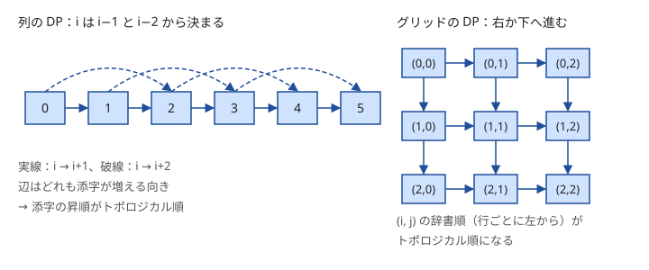

!!! abstract "要点"
    - **何ができるか**：閉路のない有向グラフで、最長路や経路の数を、トポロジカル順に値を決める DP で $O(N + M)$ で求める。どの DP も、状態を頂点・遷移を辺とする DAG の上の計算と見られる。
    - **いつ使うか**：
        - 番号の小さい頂点から大きい頂点へだけ辺がある（$u < v$）。
        - 値が増える向きにしか移動できない。
        - 有向グラフの最長の経路の長さ・経路の本数・最短路の本数を問われる。
        - 依存関係に従って順に決める（閉路があれば $-1$）。
    - **計算量**：$O(N + M)$（トポロジカル順を作る処理と DP は、どちらも各頂点・各辺を 1 回ずつ見る）
    - **前提**：[DP の基本](../dp/dp-basics.md)、[トポロジカルソート](../graph/topological-sort.md)

<!-- textlint-disable -->
別名：DAG DP・DP on DAG・DAG の最長路・経路の数え上げ・トポロジカル順の DP
<!-- textlint-enable -->

DAG 上の DP は、閉路のない有向グラフ（[DAG](../guide/glossary.md#dag)）で、辺の向きに沿って各頂点の値を決めていく DP である。一般のグラフでは難しい最長路も、DAG なら各辺を 1 回ずつ見るだけで求まる。逆に、どの DP も[状態](../guide/glossary.md#state)を頂点・遷移を辺とみれば DAG の上の計算なので、この見方は DP 全体の土台になる。

## DP は DAG 上の最短路・最長路・数え上げ {#dp-as-dag}

DP の状態を頂点、遷移「状態 $u$ の値から状態 $v$ の値を作る」を辺 $u \to v$ とみると、DP の表は 1 つの有向グラフになる。表を埋められる DP では、どの値も自分自身に戻って依存しないので、このグラフに閉路はない。



DP の種類は、DAG の上で何を求めるかに対応する。違うのは辺で値をまとめる演算と、始点の初期値だけである。

| DP の種類 | DAG の上で求めるもの | まとめる演算 | 始点の初期値（ほかの頂点） |
| --- | --- | --- | --- |
| 最大化・最小化 | 最長路・最短路 | $\max$・$\min$ | $0$（$-\infty$・$+\infty$） |
| 数え上げ | 経路の本数 | $+$ | $1$（$0$） |
| 可否判定 | 到達できるか | OR | true（false） |

最長路なら、辺 $u \to v$ の重みを $w(u, v)$ として次の式になる。

$$
\mathrm{len}[v] = \max_{u \to v} \bigl(\mathrm{len}[u] + w(u, v)\bigr)
$$

**なぜ DAG なら正しいか**。頂点を[トポロジカル順](../graph/topological-sort.md)（すべての辺が前から後ろへ向く並び）に処理すると、$v$ を処理する時点で、$v$ に入る辺の始点 $u$ はすべて処理済みである。だから $\mathrm{len}[v]$ を求めるときに要る値はすべて確定している。さらに、$u$ で終わる最長路に $v$ が含まれることはない（含まれれば $v \to \dots \to u \to v$ が閉路になる）。したがって「$u$ で終わる最長路に辺 $u \to v$ をつなぐ」は、同じ頂点を 2 回通らない正しい経路になる。

一般のグラフで最長路が難しいのは、この 2 つ目が崩れるからである。$u$ までの最長路がすでに $v$ を通っていると、つないだものは同じ頂点を 2 回通り、単純な経路の答えにならない。

**計算量**。各頂点を 1 回処理し、各辺を 1 回使うので $O(N + M)$ である。DP の言葉では、状態数が頂点数に、各状態の遷移の数の和が辺数にあたるので、計算量は「状態数 ＋ 遷移の総数」になる。

??? question "確認問題：グリッドの経路の数"
    $H \times W$ のグリッドを左上から右か下へだけ進んで右下へ行く経路の数を DP で求める。DAG の見方では、頂点・辺・始点の初期値・まとめる演算は何か。

    ??? success "答え"
        頂点はマス $(i, j)$、辺は $(i, j) \to (i, j + 1)$ と $(i, j) \to (i + 1, j)$ である。経路の数え上げなので演算は $+$、始点の左上を 1、ほかを 0 にする。辺は行か列の番号が増える向きだけなので、行ごとに左から見る順がトポロジカル順になる。答えは $\binom{H + W - 2}{H - 1}$ と一致する。

## 順序の作り方（Kahn 法・DFS の帰りがけ順の逆・メモ化再帰・問題の性質から） {#ordering}

DAG 上の DP で考えるのは、どの順に頂点を処理するかだけである。順序の作り方は 4 通りある。

- **Kahn 法**：入次数 0 の頂点をキューに入れ、取り出すたびに出る辺を消す。取り出した順がトポロジカル順である。最後まで取り出せない頂点が残れば閉路があるので、閉路の判定も兼ねる
- **DFS の帰りがけ順の逆**：深さ優先探索で、頂点から出る辺をすべて調べ終えた順に並べ、それを逆にする
- **メモ化再帰**：$v$ の値を求める関数の中で、依存する頂点の値を再帰で求める。依存先が先に計算されるので、順序を自分で作らなくてよい（[メモ化再帰](../dp/memoized-recursion.md)）
- **問題の性質から**：辺が $u < v$ の向きだけなら番号順、値が増える向きだけなら値の昇順、BFS の距離が増える辺だけなら距離の順が、そのままトポロジカル順になる

次のコードは Kahn 法で順序を作り、その順に配る DP で「最長路の辺数」と「頂点 0 から $N - 1$ への経路の数」を求める。0-indexed で書いている。最長路はどこから始めてもよいので全頂点を 0 で始め、経路の数は始点だけを 1 で始める。

```cpp
--8<-- "dp-dag/longest-and-count.cpp:core"
```

メモ化再帰は、貰う形で書くのが自然である。たとえば「$\mathrm{dp}[v]$ ＝ $v$ から始まる最長路の長さ」とおけば、$\mathrm{dp}[v] = \max_{v \to w} (\mathrm{dp}[w] + 1)$ を出る辺だけで書ける。配る for 文と再帰のどちらで書くかで、自然な状態の向き（$v$ で終わるか、$v$ から始まるか）が変わる。

??? question "確認問題：番号順に回すと"
    3 頂点で辺が $3 \to 1$ と $1 \to 2$ のグラフで、頂点を番号順 $1, 2, 3$ に処理して、辺の数で数えた最長路を配る DP で求めた。何が起きるか。

    ??? success "答え"
        頂点 1 を処理する時点で、頂点 3 からの値がまだ配られていない。$\mathrm{len}[1] = 0$ のまま頂点 2 へ配るので $\mathrm{len}[2] = 1$ になり、本当の最長路 $3 \to 1 \to 2$ の長さ 2 が出ない。辺が $u < v$ の向きだけと保証されていないなら、トポロジカル順を作ってから回す。

## DAG だと気づく・作る（値の順・距離の層・同じ値の頂点をまとめる） {#find-dag}

この節は[幅優先探索](../graph/bfs.md)と[強連結成分分解](../graph/scc.md)を前提にする。問題文に「DAG」と書かれていなくても、移動に向きの制約があれば DAG になっていることが多い。

- **値が増える向きにしか進めない**：「隣のマスへ、書かれた値が大きくなるときだけ進める」なら、値が厳密に増える辺しかないので閉路はない。頂点を値の昇順に並べればトポロジカル順になる。同じ値の頂点の間に辺はないので、同じ値どうしの順は自由である
- **時刻や手数を状態に足す**：状態を（何手目か, 位置）にすれば、遷移は手数が 1 増える向きだけなので必ず DAG になる。グラフの上を行き来できる問題でも、「ちょうど $K$ 手」なら手数の順に回せる
- **距離の層**：BFS の距離 $\mathrm{dist}$ について、$\mathrm{dist}[v] = \mathrm{dist}[u] + 1$ を満たす辺 $u \to v$ だけを残すと DAG になる（[最短路の本数](#count-shortest-paths)で使う）
- **同じ値の頂点をまとめる**：「値が減らないように進める」だと、同じ値の隣り合う頂点の間を行き来できて閉路ができる。同じ値の辺が両向きに通れるとき（無向グラフ・グリッド）は、同じ値で隣り合う頂点を Union-Find で 1 つの頂点にまとめると、残る辺は値が厳密に増えるものだけになり、DAG に戻る。向きのある辺で同じ値の辺が片向きのこともあるなら、Union-Find でまとめると行き来できない頂点まで 1 つにしてしまう。このときは強連結成分分解でまとめる（同じ値の片向きの辺は残るが、DAG にはなる）

まとめた頂点の中は自由に行き来できるので、まとめた頂点の値は「中のどの頂点から入り、どの頂点から出ても同じ」として扱う。たとえば通った値の種類数を数えるなら、まとめた頂点 1 つで値 1 種類と数える。

## 最短路の本数（距離が確定した順に配る） {#count-shortest-paths}

最短路の本数は、距離の小さい順に配る DAG 上の DP で数える。始点 $s$ からの距離を $\mathrm{dist}$ とし、$\mathrm{dist}[v] = \mathrm{dist}[u] + w(u, v)$ を満たす辺だけを残す。すると $s$ から $v$ への最短路は、残した辺だけでたどる $s$ から $v$ への経路と 1 対 1 に対応する。辺の重みが正なら、残した辺はどれも距離が増える向きなので閉路はなく、距離の小さい順がトポロジカル順になる（詳しくは[最短路の本数の DP](../graph/shortest-path-dag.md#count-paths)）。

辺の重みがすべて 1 のときは、BFS と同時に数えられる。$\mathrm{cnt}[s] = 1$ とする。頂点 $u$ をキューから取り出したら、出る辺 $u \to v$ のうち $\mathrm{dist}[v] = \mathrm{dist}[u] + 1$ を満たすものに $\mathrm{cnt}[v] \mathrel{+}= \mathrm{cnt}[u]$ と配る。BFS は距離 $d$ の頂点をすべて取り出してから距離 $d + 1$ の頂点を取り出すので、$v$ を取り出す時点で $\mathrm{cnt}[v]$ は確定している。

```text
dist[s] = 0, cnt[s] = 1、ほかは dist = 未訪問, cnt = 0
キューから u を取り出すたびに、辺 u → v ごとに：
    v が未訪問なら   dist[v] = dist[u] + 1、cnt[v] = cnt[u]、v をキューへ
    dist[v] == dist[u] + 1 なら   cnt[v] += cnt[u]
```

重みが正のときは[ダイクストラ法](../graph/dijkstra.md)で同じことをする。$u$ の距離が確定して取り出したとき、$\mathrm{dist}[u] + w < \mathrm{dist}[v]$ なら $\mathrm{dist}[v]$ を更新し、$\mathrm{cnt}[v] = \mathrm{cnt}[u]$ と置き直す。等しければ $\mathrm{cnt}[v] \mathrel{+}= \mathrm{cnt}[u]$ とする。置き直すのは、それまで数えた経路が最短でなかったと分かったからである。優先度付きキューには距離が更新される前の古い要素が残るので、取り出した距離が $\mathrm{dist}[u]$ より大きい要素は飛ばす。距離だけを求めるなら飛ばさなくても答えは変わらないが、本数を数えるときに飛ばさないと、同じ $u$ から 2 回配って本数が増えてしまう。

重み 0 の辺があると、この方法は崩れる。同じ距離の頂点の間に辺が残るので、閉路ができて本数が無限になることがあり、閉路がなくても「距離の小さい順」だけでは同じ距離の頂点どうしの順が決まらない。残した辺でトポロジカルソートをし直すか、0 の閉路を縮約して扱う（[最短路 DAG の作り方](../graph/shortest-path-dag.md#build)）。

??? question "確認問題：無向グラフでも DAG になるか"
    無向グラフで BFS をし、$\mathrm{dist}[v] = \mathrm{dist}[u] + 1$ を満たす向き $u \to v$ の辺だけを残した。このグラフに閉路がない理由を説明せよ。

    ??? success "答え"
        残した辺はどれも距離がちょうど 1 増える向きである。閉路を一周すると距離は元に戻るはずだが、増える一方なので戻れない。無向の辺 $\{u, v\}$ も、$\lvert \mathrm{dist}[u] - \mathrm{dist}[v] \rvert = 1$ なら片方の向きだけが残り、距離が等しければどちらの向きも残らない。

## 閉路があるとき（SCC で縮約する・最短路に切り替える） {#with-cycles}

閉路があるとトポロジカル順はなく、そのままでは DP にならない。何を求めるかで扱いが 3 つに分かれる。

- **閉路があれば答えが「不可能」**：「この試合はあの試合の後」のような依存関係は、閉路があれば順に決められない。Kahn 法で取り出せない頂点が残ったら $-1$ を出し、残らなければ DP で答える
- **閉路の中を何度回っても得が変わらない**：到達できるか、通った頂点の種類数、各頂点で 1 回だけ拾える価値などは、互いに行き来できる頂点の集まりを 1 頂点に縮めても答えが変わらない（この項目は[強連結成分分解](../graph/scc.md)を前提にする）。強連結成分分解で縮約すると DAG になるので、成分ごとの値（頂点数や価値の和）を持たせて DAG 上の DP をする（[縮約した DAG の上で DP する](../graph/scc.md#dp-on-dag)）
- **最短路**：重みが 0 以上なら、閉路を回っても短くならないので最短路は単純な経路から選べる。DP ではなく[ダイクストラ法](../graph/dijkstra.md)や BFS で求める。負の重みがあれば[ベルマンフォード法](../graph/bellman-ford.md)を使う

最長路だけは逃げ道が少ない。正の重みの閉路に届くなら、いくらでも長くできるので答えは無限大である。同じ頂点を 2 回通らない最長路は一般のグラフでは効率よく解けないとされており、頂点数が 20 程度までなら訪れた集合を状態にした [bitDP](../dp/bit-dp.md) で解く。

各頂点から辺がちょうど 1 本出るグラフは、閉路を先に見つけて処理すれば、残りの木の部分が DAG になる（[Functional graph](../graph/functional-graph.md)）。

## 上位の手法とのつながり {#connections}

DAG 上の DP は、ほかの手法の判定や下ごしらえとしてよく現れる。

- **計算順序**：区間の長さ順・集合の昇順・木の帰りがけ順など、DP の表の回し方はどれも依存グラフのトポロジカル順の特別な場合である（[計算順序](../dp/dp-order.md)）
- **比の最大化**：DAG の経路で「価値の和 ÷ コストの和」を最大にするなら、答え $x$ を決めて辺の重みを「価値 $- x \times$ コスト」に変え、最長路が 0 以上かを DAG 上の DP で判定する（[平均・中央値の最大化](../basics/fractional-binary-search.md#dp-check)）
- **到達可能性の大量のクエリ**：各頂点から到達できる頂点の集合を、逆トポロジカル順に bitset の OR で求める（[bitset による高速化](../misc/bitset-speedup.md)）
- **縮約した DAG での最適化**：SCC で縮約した DAG の上で、最小パス被覆やフローを考える問題もある（[最小パス被覆と Hall の定理](../graph/dilworth-path-cover.md)）

## 落とし穴 {#pitfalls}

**番号順に回してしまう**。辺が $u < v$ の向きだけと書かれていなければ、番号順はトポロジカル順ではない。入力の辺の向きを確かめ、保証がなければ Kahn 法で順序を作る。

**始点を決めた最長路で、到達できない頂点を 0 にする**。始点 $s$ からの最長路を求めるとき、全頂点を 0 で始めると、$s$ から到達できない頂点を始点とする経路まで数えてしまう。$s$ 以外は $-\infty$（または「未到達」の印）で始め、未到達の頂点からは配らない。どこから始めてもよい最長路なら、全頂点を 0 で始めてよい。

**メモ化再帰の深さと閉路**。パス状の DAG では再帰が $N$ 段になり、手元の既定のスタックでは落ちることがある。手元では `ulimit -s unlimited` で広げて試し、深さが $10^6$ を超えるときや提出先の上限が分からないときは Kahn 法で for 文に直す（[再帰の深さとスタック](../cpp/cpp-environment.md#stack-depth)）。また、閉路があるグラフでメモ化再帰をすると、計算中の頂点に戻って止まらない。「計算中」の印を別に持ち、そこへ戻ったら閉路と判定する。

**経路の数のあふれ**。経路の数は辺の数に対して指数的に増える。問題の指定する mod で割りながら足す。

**閉路がないことを確かめずに DP をする**。問題文で DAG が保証されていなければ、Kahn 法で取り出した頂点の数が $N$ に満たないかを必ず確かめる。閉路があるのに DP をすると、閉路上の頂点が一度も処理されず、答えが静かに間違う。

## 例題 {#examples}

### EDPC G. Longest Path {#dp_g}

<div class="kp-problems" data-role="example" markdown>

- [EDPC G. Longest Path](https://atcoder.jp/contests/dp/tasks/dp_g)（diff —）：閉路のない有向グラフで、最長の有向路の長さを求める。

</div>

DAG の最長路そのものである。頂点の番号順はトポロジカル順とは限らないので、Kahn 法で順序を作って配るか、メモ化再帰で依存先から求める。各頂点と各辺を 1 回ずつ見るので $O(N + M)$ で解ける。

??? note "解法の詳細"
    - Kahn 法で書くなら、$\mathrm{len}[v]$ ＝「$v$ で終わる有向路の辺数の最大」とし、全頂点を 0 で始める。取り出した順に、辺 $u \to v$ ごとに $\mathrm{len}[v] = \max(\mathrm{len}[v], \mathrm{len}[u] + 1)$ と配る。答えは $\mathrm{len}$ の最大値である。コードは[順序の作り方](#ordering)の節のものから経路の数を除いた形になる。
    - メモ化再帰で書くなら、$\mathrm{dp}[v]$ ＝「$v$ から始まる有向路の辺数の最大」とし、$\mathrm{dp}[v] = \max_{v \to w} (\mathrm{dp}[w] + 1)$（出る辺がなければ 0）を再帰で求める。全頂点について呼び、最大値を答える。
    - 長さは辺の数で数える。頂点の数で数えると 1 ずれる。

## 練習問題 {#practice}

<div class="kp-problems" data-role="practice" markdown>

- [ABC211 D. Number of Shortest paths](https://atcoder.jp/contests/abc211/tasks/abc211_d)（diff 755）：無向グラフで、頂点 1 から頂点 N への最短路の本数を求める（mod 10^9+7）。
- [ABC139 E. League](https://atcoder.jp/contests/abc139/tasks/abc139_e)（diff 1528）：総当たり戦で各選手が試合をする相手の順番が決まっているとき、全試合を終える最少の日数を求める（不可能なら −1）。
- [ABC335 E. Non-Decreasing Colorful Path](https://atcoder.jp/contests/abc335/tasks/abc335_e)（diff 1540）：頂点に整数が書かれたグラフで、書かれた値が減らないように頂点 1 から N へ進むパスのうち、通った値の種類数の最大を求める。

</div>

??? note "練習の方針"
    - **ABC211 D**：BFS で距離を求めながら、距離が 1 増える辺に沿って本数を配る（[最短路の本数](#count-shortest-paths)）。距離の小さい順に取り出すので、取り出した時点で本数は確定している
    - **ABC139 E**：試合（2 人の組）を頂点にし、各選手の対戦順で続く 2 試合の間に「前の試合 → 後の試合」の辺を張る。頂点は $N(N-1)/2$ 個、辺は各選手 $N - 2$ 本である。閉路があれば日程は組めないので $-1$、なければ頂点の数で数えた最長路が最少の日数になる
    - **ABC335 E**：辺を値の小さい側から大きい側へ向け、値が等しい辺は両向きにする。同じ値で隣り合う頂点を 1 つにまとめると DAG になるので、トポロジカル順に「その頂点で終わるパスの種類数の最大」を配る。値が増える辺では 1 足し、頂点 1 から到達できない頂点からは配らない

## 使い分け {#comparison}

- 依存グラフに閉路がなく、各頂点の値が入る辺の始点だけで決まるなら DAG 上の DP を使う
- 閉路があっても、重みが 0 以上の最短路ならダイクストラ法、重みがすべて 1 なら BFS を使う
- 閉路の中を自由に回れて、回っても得が変わらないなら、強連結成分分解で縮約してから DAG 上の DP にする
- 順序が問題の性質から分かる（番号順・値の順・距離の順）なら、Kahn 法を書かずにその順で回す

## 参考 {#references}

- [drken「Educational DP Contest の F ～ J 問題の解説と類題集」](https://qiita.com/drken/items/03c7db44ccd27820ea0d)：例題の 2 つの書き方（メモ化再帰と Kahn 法）と、for 文では更新の順序を考える必要があること
- [drken「AtCoder ABC 211 D - Number of Shortest paths (2Q, 茶色, 400 点)」](https://drken1215.hatenablog.com/entry/2023/06/10/150200)：BFS と同時に最短路の本数を数える更新（初めて届いたら置き直し、距離が 1 大きければ足す）
- [mhiro216「DAG(有向非循環グラフ)に対する最長経路問題（AtCoder Beginner Contest 139より）」](https://qiita.com/mhiro216/items/9b185e066bfd6eae7db8)：練習の ABC139 E を試合を頂点とする DAG の最長路にする方針と閉路の判定
- [kmjp「AtCoder ABC #139 : E - League」](https://kmjp.hatenablog.jp/entry/2019/09/01/1000)：ABC139 E の別解（前日に変わった選手だけを調べる貪欲）
- [torus711「AtCoder Beginner Contest 335, E : Non-Decreasing Colorful Path」](https://torus711.hatenablog.com/entry/2024/01/07/215719)：練習の ABC335 E の、同じ値の頂点を強連結成分にまとめて DAG 上で DP する方針
