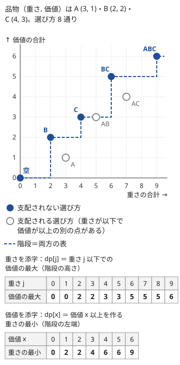

!!! abstract "要点"
    - **何ができるか**：DP の表が大きすぎるとき、添字の範囲を上限で打ち切るか、ほかの添字から決まる量・[支配](../guide/glossary.md#dominance)される量を添字から外して値の側に回し、状態を減らす。どれを添字に残すかは、範囲が小さい量で決める。
    - **いつ使うか**：
        - 重さの上限 $W \le 10^9$ で、価値の総和が $10^5$ 程度。
        - ペナルティが $2^{C-1}$ のように指数的に増える。
        - $\mathrm{dp}[i][a][b]$ の表が大きすぎ、同じ $(i, a)$ なら $b$ が大きい（小さい）ほど常に良い。
    - **計算量**：削った後の状態数 × 遷移数。たとえば価値を添字にしたナップサックは、価値の総和を $V$ として $O(NV)$ になる。
    - **前提**：[DP の状態の設計](../dp/dp-state-design.md)、[ナップサック DP](../dp/knapsack-01.md)

<!-- textlint-disable -->
別名：状態の削減・次元の削減・状態の圧縮・値と添字の入れ替え・キーと値を入れ替える・添字と値を逆に・上限で打ち切る
<!-- textlint-enable -->

DP の状態の削減は、正しい[状態](../guide/glossary.md#state)を立てたのに表が大きすぎて時間やメモリが足りないとき、答えを変えずに表を小さくする方法である。状態を設計し直すのではなく、すでにある表の添字を見直す。削り方は次の 3 つに分けられる。

- **添字の範囲を打ち切る**：答えに効く範囲を見積もり、それより先を捨てるかまとめる
- **ほかの添字から決まる量を外す**：残りの添字から一意に決まる量は、添字に持たなくてよい
- **支配される量を値に回す**：同じ添字なら値が良い方が常に良い量は、添字ではなく値（最小・最大）として持つ

段（品物の番号・時刻）の次元を 2 本や 1 本の配列で使い回してメモリを減らす方法は、[ナップサック DP の配列の使い回し](../dp/knapsack-01.md#dp-rolling-array)にある。このページでは時間も減る削り方を扱う。

## 上限で打ち切る（log 回で十分な量・目標以上をまとめる） {#cap}

添字の範囲は、問題の制約の上限そのままではなく、「答えに効く範囲」で決めればよい。打ち切り方は 2 通りある。

**目標以上をまとめる**。「$X$ 個以上にする」「体力を 0 以下にする」のように目標を超えた量の区別が要らないなら、添字を $\min(X, j + a)$ に丸めて範囲を $X + 1$ 個にする。理由と遷移の書き方は[ナップサック DP の上限で打ち切る型](../dp/knapsack-01.md#variants)と[状態の設計の典型の要約](../dp/dp-state-design.md#typical-summaries)にある。

**明らかな解より悪くなる範囲を捨てる**。この節の主役はこちらである。ペナルティが $2^{C-1}$ のように指数的に増える問題では、$C$ を大きくした解は、ペナルティだけで「何もしない解」より悪くなる。だから $C$ の上限は $N$ ではなく、何もしない解の値の $\log$ 程度で済む。

例として、[練習](#practice)の ABC315 F と同じ形の問題を考える。平面上の点 $0, 1, \dots, N-1$ を順に回り、途中の点を飛ばしてよく、飛ばした数 $C \ge 1$ に $2^{C-1}$ のペナルティがかかる。移動距離とペナルティの和を最小にしたい。座標は $0$ 以上 $10^4$ 以下、$N \le 10^4$ とする。

- 素朴な状態：$\mathrm{dp}[i][c]$ ＝ 点 $i$ を通った時点で、それまでに $c$ 個飛ばしたときの距離の最小。$c$ は $N$ まで、直前に通った点も $N$ 通りあるので $O(N^3)$ かかる
- 上限の見積もり：1 回の移動は $\sqrt{2} \times 10^4$ 以下で、$1.5 \times 10^4$ 未満である。だから 1 つも飛ばさない経路の値は $1.5 \times 10^8$ 未満で、$2^{28} \approx 2.7 \times 10^8$ より小さい。$C \ge 29$ ならペナルティだけで $2^{28}$ 以上になり、飛ばさない経路より必ず悪い
- 削った状態：$c \le 28$ だけを持つ。$c$ が 28 以下なので、直前に通った点も $i - 29$ 以降に限られる。全体で $O(N \cdot 29^2)$、約 $8.4 \times 10^6$ 回になる

```cpp
--8<-- "dp-dimension-reduction/skip-penalty.cpp:core"
```

完全なプログラム：[`skip-penalty.cpp`](https://github.com/yuukougun/kyopro-atlas/blob/main/snippets/dp-dimension-reduction/skip-penalty.cpp)（GitHub）
{ .kp-code-src }

同じ考え方で、「最大のものの半分より大きいものを全部取り除く」のような半分にする操作は、値の上限を $A$ として $\log_2 A$ 回程度（$A = 10^9$ なら約 30 回）しか起きない。回数を添字にしても 30 程度で済む（[力試し](#challenge)の ABC203 F）。

上限は「何もしない解」「貪欲に作った解」など、すぐに作れる解の値から見積もる。見積もりが甘いと、最適解が範囲の外に出て WA になる。少し余裕を持たせた上限にしても計算量はほとんど変わらないので、見積もりに自信がなければ境界ぎりぎりにしない。上のコードは式で求めた 28 をそのまま使ったが、30 にしてもよい。

## 値と添字の入れ替え（同じ添字なら値が良い方が常に良いとき） {#dp-swap-key-value}

表の添字に 2 つの量 $a, b$ を持つと大きすぎるとき、片方の $b$ を添字から外し、「$a$ を固定したときの $b$ の最良」を値として持つ。これが値と添字の入れ替えである。可否の表 $\mathrm{ok}[i][a][b]$ を、$\mathrm{dp}[i][a] = \min \{ b \mid \mathrm{ok}[i][a][b] \}$ に縮めると考えるとよい。

入れ替えてよいのは、**同じ $(i, a)$ なら $b$ が小さいほど常に良い**ときである。このとき「$b$ が小さい状態は、大きい状態を支配する」と言う。より正確には、次の 2 つが成り立てばよい。

- $(i, a, b')$ から続けられる選び方は、$b \le b'$ の $(i, a, b)$ からも続けられる
- その続きの結果（最後の答え）は、$(i, a, b)$ から続けた方が悪くならない

この 2 つが成り立てば、$b$ が最小でない状態は最適解の途中に現れなくても答えが変わらない。だから $b$ の最小だけを覚えれば足りる。

**0-1 ナップサックで見る**。品物の選び方を（重さの合計, 価値の合計）の点で表す。重さが以下で価値が以上の別の点がある点は、支配されていて答えに効かない。次の図では、支配されない点を結んだ階段が、重さを添字にした表と、価値を添字にした表の両方を表している。



- 重さを添字：$\mathrm{dp}[j]$ ＝ 重さの合計 $j$ 以下での価値の最大。表の長さは $W + 1$
- 価値を添字：$\mathrm{dp}[x]$ ＝ 価値の合計を $x$ にする重さの最小。表の長さは価値の総和 $V$ に 1 を足したもの

どちらの表も階段の形を持つので、答えはどちらからでも取り出せる。$W \le 10^9$ で $V \le 10^5$ なら、価値を添字にするしかない。

価値を添字にした表の初期値は $\mathrm{dp}[0] = 0$、ほかは $\infty$ である。遷移は重さの表と同じ形で、$\max$ が $\min$ に、価値の加算が重さの加算に入れ替わる。答えは表の最後の値ではなく、$\mathrm{dp}[x] \le W$ となる最大の $x$ である。次のコードは「価値をちょうど $x$ にする」で表を作る。すべての $x$ を調べるので、図の「$x$ 以上」の表と同じ答えになる。

```cpp
--8<-- "dp-dimension-reduction/value-knapsack.cpp:core"
```

完全なプログラム：[`value-knapsack.cpp`](https://github.com/yuukougun/kyopro-atlas/blob/main/snippets/dp-dimension-reduction/value-knapsack.cpp)（GitHub）
{ .kp-code-src }

**ナップサック以外でも同じ形になる**。2 種類の資源を使う問題では、片方の残り（使った量）を添字にし、もう片方の残りの最大（使った量の最小）を値にする。2 種類の道具の個数を決める問題なら、片方の個数を添字にし、もう片方の個数の最小を値にする（[例題](#abc325_f)の ABC325 F）。[最長増加部分列（LIS）](../dp/lis.md#binary-search)の「長さごとの末尾の最小値」も、末尾の値を添字から値に回した入れ替えの例である。

## どれを添字に残すか（範囲が小さい量を選ぶ） {#which-to-index}

状態に $k$ 個の量が入っているとき、削れるかを次の順に調べる。

1. **ほかの添字から決まる量を外す**：残りの添字と問題の入力から一意に決まる量は、添字に持たなくてよい。値に持つ必要もない
2. **支配のある量を 1 つ値に回す**：残った量のうち、同じほかの添字なら一方の向きが常に良い量があれば、それを値にする
3. **残す添字は範囲が小さい量にする**：値に回せる候補が複数あるなら、範囲が最も大きい量を値に回し、範囲が小さい量を添字に残す

**決まる量を外す例**。円環の上で左右の手を動かし、指示された手を指示された位置へ順に動かす問題では、素朴な状態は（指示の番号, 左手の位置, 右手の位置）で $Q N^2$ 個ある。ところが $t$ 番目の指示の直後、指示された手の位置は指示どおりに決まっている。だから状態は（指示の番号, もう一方の手の位置）の $QN$ 個で足りる（[練習](#practice)の ABC376 F）。目的の値（費用）が個数などのほかの添字から計算できるなら、費用も添字に持たない。ABC325 F の費用は、2 種類の個数から計算できる。

**範囲で選ぶ例**。料理を選ぶ問題で、（見た品数, 選んだ品数, 甘さの合計, しょっぱさの合計）の可否を持つとする。$N \le 80$ で合計の上限が $10^4$ なら、状態は $80 \times 80 \times 10^4 \times 10^4$ 個で大きすぎる。

| 量 | 範囲 | 扱い |
| --- | --- | --- |
| 見た品数 $i$ | $N + 1$ | 段（使い回せる） |
| 選んだ品数 $j$ | $N + 1$ | 添字に残す |
| 甘さの合計 | $10^4$ | 添字に残す |
| しょっぱさの合計 | $10^4$ | 値（最小）に回す |

選んだ品数は答えそのものだが、範囲が小さいので添字に残してよい。「答えを値にする」と決めつけず、範囲の小さい量を添字にするのがこの節の要点である。甘さとしょっぱさは対称なので、どちらを値にしてもよい。計算量は $O(N^2 \cdot 10^4)$ になる（[練習](#practice)の ABC364 E）。

値に回す量を選ぶときは、支配の向きが 1 つに決まるかを必ず確かめる。体力と魔力のように「どちらも残りが多いほど良い」量は、片方を添字、もう片方の残りの最大を値にできる（[練習](#practice)の ABC410 E）。一方、「重さの合計をちょうど $W$ にする」のように値の正確な大きさが条件に効く量は、最小だけを持つと情報が落ちる。

## 落とし穴 {#pitfalls}

**支配が成り立たない量を値に回す**。「重さの合計がちょうど $W$ で価値の最大」は、価値を添字にして重さの最小を持つ表では解けない。重さが最小の選び方の重さが $W$ と違っても、より重い選び方でちょうど $W$ にできる場合があるからである。条件が「以下」「以上」なら支配が成り立ち、「ちょうど」や余りの条件なら成り立たないことが多い。

**入れ替えた後の答えの取り出し**。価値を添字にした表の答えは $\mathrm{dp}[V]$ ではなく、$\mathrm{dp}[x] \le W$ となる最大の $x$ である。2 つの量を入れ替えた表では、添字をすべて走査して条件を満たすものを探すのが基本になる。

**$\infty$ の足し算のあふれ**。最小を値にする表は、届かない状態を $\infty$ にする。$\infty$ に重さを足してもあふれない大きさ（`LLONG_MAX / 2` など）にするか、$\infty$ の状態から遷移しない。`int` の表で `INT_MAX` を使うと、足し算があふれ（符号付き整数のあふれは未定義動作で、多くの環境では負の値になり）最小として選ばれる。

**打ち切りの遷移を忘れる**。目標以上をまとめる表で、遷移先を $\min(X, j + a)$ にせず範囲外を捨てると、目標を超えた選び方が漏れる。

**上限の見積もりが甘い**。上限で打ち切るとき、すぐに作れる解の値を小さく見積もると、最適解の添字が範囲の外に出る。最悪の入力での値を式で求めてから上限を決める。

**復元が要るのに表を捨てる**。段を 2 本の配列で使い回すと、どの選択をしたかを後からたどれない。選び方の出力が要るなら、段ごとの表を残すか遷移元を記録する（[復元](../dp/dp-reconstruction.md#trace-back)）。

**最後の 1 品を数え忘れる**。合計が上限を「超えた時点でやめる」問題では、上限以内で選べた品数に、超えるきっかけの 1 品を足したものが答えになる（ただし全部を選べたときは足さない）。入れ替えとは別の、問題の言い換えの部分で間違えやすい（ABC364 E）。

## 例題 {#examples}

### EDPC E. Knapsack 2 {#dp_e}

<div class="kp-problems" data-role="example" markdown>

- [EDPC E. Knapsack 2](https://atcoder.jp/contests/dp/tasks/dp_e)（diff なし）：重さの上限 W が 10^9 と大きく価値の総和が 10^5 程度の品物で、重さの合計が W 以下での価値の和の最大を求める。

</div>

$W \le 10^9$ なので、重さを添字にした表は作れない。品物は $N \le 100$ 個、価値は 1 つ $10^3$ 以下なので、価値の総和は $10^5$ 以下である。価値を添字にし、その価値を作る重さの最小を値にする。

??? note "解法の詳細"
    - 状態：$\mathrm{dp}[x]$ ＝ ここまでの品物から、価値の和をちょうど $x$ にする重さの最小。$\mathrm{dp}[0] = 0$、ほかは $\infty$。
    - 遷移：品物 $(w, v)$ ごとに、$x$ を大きい方から回して $\mathrm{dp}[x] = \min(\mathrm{dp}[x], \mathrm{dp}[x - v] + w)$。
    - 答え：$\mathrm{dp}[x] \le W$ となる最大の $x$。
    - 計算量は $O(NV)$ で、$V = 10^5$ なら $10^7$ 回程度。コードは[値と添字の入れ替え](#dp-swap-key-value)の節のものと同じである。

### ABC325 F. Sensor Optimization Dilemma {#abc325_f}

<div class="kp-problems" data-role="example" markdown>

- [ABC325 F. Sensor Optimization Dilemma](https://atcoder.jp/contests/abc325/tasks/abc325_f)（diff 1769）：長さ D_i の区間たちを、監視できる長さ・費用・使える個数の上限が決まった 2 種類のセンサーで覆うときの、費用の最小を求める。

</div>

素朴には（区間の番号, センサー 1 の個数, センサー 2 の個数）を状態にしたくなるが、区間は最大 100 個、個数の上限は最大 1000 なので、状態だけで $100 \times 1000^2$ 個ある。費用は 2 種類の個数から計算できるので添字にも値にも持たなくてよい。センサー 1 の個数が同じなら、センサー 2 は少ないほど費用が小さく、個数の上限も守りやすい。だから支配が成り立つ。センサー 1 の個数を添字、センサー 2 の個数の最小を値にする。

??? note "解法の詳細"
    - 状態：$\mathrm{dp}[i][j]$ ＝ 区間 $i$ 個を、センサー 1 をちょうど $j$ 個使って覆うときの、センサー 2 の個数の最小。$\mathrm{dp}[0][0] = 0$。
    - 遷移：区間 $i$ でセンサー 1 を $a$ 個使うと、残りの長さ $\max(0, D_i - a L_1)$ を覆うセンサー 2 は $\lceil \max(0, D_i - a L_1) / L_2 \rceil$ 個要る。$\mathrm{dp}[i+1][j+a]$ をこの個数を足した値で更新する。残りが 0 になったら $a$ をそれ以上増やさない。
    - 答え：$\mathrm{dp}[N][j] \le K_2$ を満たす $j$ について $C_1 j + C_2 \, \mathrm{dp}[N][j]$ の最小。どの $j$ も満たさなければ覆えない。
    - 計算量は $O(N K_1^2)$ で、$10^8$ 回程度に収まる。

    ```cpp
    --8<-- "dp-dimension-reduction/sensor.cpp:core"
    ```

    完全なプログラム：[`sensor.cpp`](https://github.com/yuukougun/kyopro-atlas/blob/main/snippets/dp-dimension-reduction/sensor.cpp)（GitHub）
    { .kp-code-src }

## 練習問題 {#practice}

<div class="kp-problems" data-role="practice" markdown>

- [ABC410 E. Battles in a Row](https://atcoder.jp/contests/abc410/tasks/abc410_e)（diff 1077）：体力 H・魔力 M で敵を順に倒し、敵ごとに体力か魔力の決まった量を使うとき、倒せる敵の数の最大を求める。
- [ABC364 E. Maximum Glutton](https://atcoder.jp/contests/abc364/tasks/abc364_e)（diff 1496）：甘さとしょっぱさが決まった料理を並べて順に食べ、甘さの合計が X を、しょっぱさの合計が Y を超えた時点でやめるとき、食べられる品数の最大を求める。
- [ABC315 F. Shortcuts](https://atcoder.jp/contests/abc315/tasks/abc315_f)（diff 1674）：チェックポイントを順に回り、いくつか飛ばすと 2^(C−1) のペナルティがかかるとき、移動距離とペナルティの和の最小を求める。
- [ABC376 F. Hands on Ring (Hard)](https://atcoder.jp/contests/abc376/tasks/abc376_f)（diff 2089）：円環上に置いた左右の手を、指示された手を指示された位置へ順に動かすときの、移動の総数の最小を求める。

</div>

??? note "練習の方針"
    - **ABC410 E**：（倒した数, 使った体力, 使った魔力）の可否は大きすぎる。使った魔力は少ないほど良いので、$\mathrm{dp}[i][h]$ ＝ $i$ 体倒して体力を $h$ 使ったときの魔力の使用量の最小にする。$\min_h \mathrm{dp}[i][h] \le M$ である最大の $i$ が答え
    - **ABC364 E**：選ぶ料理の集合を決めれば順番は自由に並べられる。$\mathrm{dp}[j][s]$ ＝ $j$ 品選んで甘さの合計が $s$（$X$ 以下）のときの、しょっぱさの合計の最小とする。値が $Y$ 以下の最大の $j$ を求め、超えるきっかけの 1 品を足し、$N$ で頭打ちにする
    - **ABC315 F**：飛ばさない経路の値からペナルティの上限を見積もると、飛ばす数は 30 程度までで足りる。$\mathrm{dp}[i][c]$ ＝ 点 $i$ を通った時点で $c$ 個飛ばしたときの距離の最小とする。直前に通った点は、飛ばす数の上限の範囲だけ試す
    - **ABC376 F**：指示の直後は指示された手の位置が決まるので、状態はもう一方の手の位置だけでよい。指示ごとに、指示された手を時計回り・反時計回りのどちらで動かすかの 2 通りを試し、途中にもう一方の手があれば押し出す。段は 2 本の配列で使い回す

## 力試し {#challenge}

<div class="kp-problems" data-role="challenge" markdown>

- [ABC203 F. Weed](https://atcoder.jp/contests/abc203/tasks/abc203_f)（diff 2252）：高橋君が「最も高い草の半分より高い草を全部抜く」操作を繰り返す前に、青木君が K 本まで草を抜いておくとき、高橋君の操作回数と青木君が抜く本数の組の最小を求める。

</div>

??? note "力試しの方針"
    - **ABC203 F**：高橋君の 1 回の操作で残る草の最大の高さはおよそ半分以下になるので、操作は 30 回程度しか起きない。草を高さの順に並べ、$\mathrm{dp}[i][t]$ ＝ 低い方から $i$ 本を処理して高橋君の操作を $t$ 回使ったときの、青木君が抜く本数の最小にする。高橋君の 1 回の操作で抜ける範囲は二分探索で求める。$\mathrm{dp}[N][t] \le K$ となる最小の $t$ と、そのときの値が答え

## 確認問題 {#quiz}

??? question "確認問題：打ち切りの上限"
    [上限で打ち切る](#cap)の節の例で、座標の上限が $10^4$ から $10^6$ に増えたら、飛ばす数の上限はいくつにすればよいか。$N \le 10^4$ のままとする。

    ??? success "答え"
        1 回の移動は $\sqrt{2} \times 10^6$ 以下で $1.5 \times 10^6$ 未満なので、飛ばさない経路の値は $1.5 \times 10^{10}$ 未満である。$2^{34} \approx 1.7 \times 10^{10}$ なので、$C \ge 35$ ならペナルティだけで飛ばさない経路より悪い。$C \le 34$ を添字にすれば足りる。座標が 100 倍（$2^{6.6}$ 倍ほど）になっても、上限は 28 から 34 へ 6 増えるだけである。

??? question "確認問題：入れ替えられない条件"
    品物の重さと価値が与えられ、「重さの合計をちょうど $W$ にしたときの価値の最大」を求める。$W \le 10^9$、価値の総和は $10^5$ 以下である。価値を添字にして重さの最小を持つ表で解けるか。

    ??? success "答え"
        解けない。表から分かるのは各価値を作る重さの最小だけで、重さがちょうど $W$ になる選び方があるかは分からない。たとえば価値 $x$ を重さ 3 でも 5 でも作れるとき、表には 3 しか残らず、$W = 5$ の選び方を見落とす。「ちょうど」の条件では、値に回した量に支配が成り立たない。

## 使い分け {#comparison}

- 状態を立てる段階で迷っているなら、先に[DP の状態の設計](../dp/dp-state-design.md)で将来に効く要約を決める。このページはその後で表を小さくする手順である
- 品物が 40 個程度で重さと価値の両方が大きいなら、DP ではなく[半分全列挙](../basics/meet-in-the-middle.md#vs-knapsack)を使う
- 到達する状態がまばらで、範囲は広いが実際に現れる値が少ないなら、配列ではなく map で[到達する状態だけを持つ](../dp/memoized-recursion.md#dp-map-sparse)
- 和の余りだけが条件に効くなら、和を打ち切るのではなく余りを状態にする（[余り・個数を状態に持つ DP](../dp/dp-mod-state.md)）
- 段の次元を外して前の段の配列をほとんどそのまま使い回し、変わる場所だけを更新するのは[インライン DP](../dp/inline-dp.md)である

## 参考 {#references}

- [kyopro_friends「EDPC解説 A～E」](https://kyopro-friends.hatenablog.com/entry/2019/01/12/230931)：例題 EDPC E の状態と答えの取り出し方
- [drken「動的計画法超入門！ Educational DP Contest の A ～ E 問題の解説と類題集」](https://qiita.com/drken/items/dc53c683d6de8aeacf5a)：価値を添字にするナップサック（EDPC E）
- [drken「AtCoder ABC 325 F - Sensor Optimization Dilemma (2D, 青色, 500 点)」](https://drken1215.hatenablog.com/entry/2023/10/22/195958)：例題 ABC325 F の状態の削り方と、DP の値で状態を表す手法が青の典型であること
- [drken「AtCoder ABC 315 F - Shortcuts (1D, 青色, 500 点)」](https://drken1215.hatenablog.com/entry/2023/10/24/040204)：飛ばす数の上限の見積もり
- [tototti「AtCoder ABC410 振り返り(緑コーダーがPythonでABCDE問題)」](https://qiita.com/tototti/items/16834d8a18e17b2366b0)：練習 ABC410 E の状態と答えの取り出し方
- [プロひろ「ABC364 E問題（Maximum Glutton）を解く」](https://programming-hiroba.com/abc364-e/)：練習 ABC364 E のキーと値の入れ替えと、最後に 1 品を足すこと
- [torus711「AtCoder Beginner Contest 376, F : Hands on Ring (Hard)」](https://torus711.hatenablog.com/entry/2024/10/24/195522)：練習 ABC376 F の状態の削減と計算量
- [hamayan「Weed [AtCoder Beginner Contest 203（Sponsored by Panasonic） F]」](https://blog.hamayanhamayan.com/entry/2021/05/30/230136)：力試し ABC203 F の操作回数の上限と DP の状態
