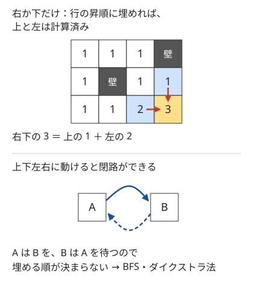
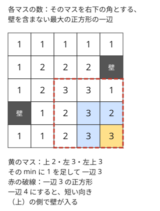

!!! abstract "要点"
    - **何ができるか**：右か下にしか動けないグリッドで、経路の数や経路上の値の最大を、マスを行の昇順・列の昇順に埋める DP で求める。上下左右に動けるなら閉路ができるので、BFS やダイクストラ法を使う。
    - **いつ使うか**：
        - 右か下にしか動けない。
        - 経路の数・経路上で集める値の最大を問われる。
        - 条件を満たす正方形の数・最大の正方形を問われる。
        - $H, W \le 3000$ 程度。
    - **計算量**：基本は $O(HW)$。各マスに状態を $S$ 通り足すと $O(HWS)$（遷移が定数個のとき）。
    - **前提**：[DP の基本](../dp/dp-basics.md)

<!-- textlint-disable -->
別名：グリッド DP・Grid DP・格子路の DP・最大正方形
<!-- textlint-enable -->

グリッド上の DP は、マス $(i, j)$ ごとに「そこまでの経路の数」や「そこまでに集めた値の最大」を表に書き込み、左上から右下へ埋めていく方法である。右か下にしか動けなければ、どのマスへの移動も上か左のマスから来るので、行の昇順に埋めるだけで遷移元がそろう。基本形は短いが、行で拾った個数を状態に足す・何マスでも進める移動を累積和でまとめる・正方形を右下の角で数えるなど、応用の型が多い。

## 計算順序と初期化（1 行目・1 列目・壁） {#order-and-init}

グリッド上の DP の基本形は、右か下にだけ進んで左上から右下へ行く経路を数える問題である。マスは 0-indexed で $(i, j)$（$0 \le i < H$、$0 \le j < W$）と書き、問題文の $(1, 1)$ を $(0, 0)$ に対応させる。

- **状態**：$\mathrm{dp}[i][j]$ ＝ 左上 $(0, 0)$ からマス $(i, j)$ へ行く経路の数
- **遷移**：$(i, j)$ へは上 $(i-1, j)$ か左 $(i, j-1)$ から来るので、$\mathrm{dp}[i][j] = \mathrm{dp}[i-1][j] + \mathrm{dp}[i][j-1]$。盤面の外は 0 とみなす
- **初期値**：$\mathrm{dp}[0][0] = 1$（何もしない経路が 1 本）。壁のマスは常に 0
- **答え**：$\mathrm{dp}[H-1][W-1]$



計算順序は「行の昇順に、行の中は列の昇順に」でよい。$(i, j)$ の遷移元は $(i-1, j)$ と $(i, j-1)$ で、前者は前の行、後者は同じ行の左なので、どちらも先に埋まっている。マスを頂点、移動を辺としたグラフは、辺が必ず行か列の番号を増やす向きなので閉路がない。行の昇順はこのグラフのトポロジカル順の 1 つである（[DAG 上の DP](../dp/dp-dag.md#dp-as-dag)）。列の昇順に外側のループを回しても、$i + j$ の昇順（斜めの帯ごと）に埋めてもよい。

上下左右に動けると、隣り合う 2 マスの間を行き来できるので閉路ができる。$\mathrm{dp}[A]$ を求めるのに $\mathrm{dp}[B]$ が要り、$\mathrm{dp}[B]$ を求めるのに $\mathrm{dp}[A]$ が要るので、埋める順が決まらない。最小の移動回数なら[幅優先探索](../graph/bfs.md)、マスごとに費用があるなら[ダイクストラ法](../graph/dijkstra.md)に切り替える（[グリッドグラフ](../graph/grid-graph.md)）。左にも動けるが上には戻れない、のように一方の軸だけが単調なら、行ごとに区切って行の中を別に処理すれば DP の形を保てる。

初期化で間違えやすいのは 1 行目と 1 列目である。1 行目には上が、1 列目には左がないので、添字が負にならないよう場合分けするか、表を $(H+1) \times (W+1)$ にして 0 行目と 0 列目を[番兵](../guide/glossary.md#sentinel)（数え上げなら 0、最大化なら $-\infty$）にする。番兵を置くときも、出発点の $\mathrm{dp}[1][1]$ だけは上と左の和にせず、別に置く（数え上げなら 1）。次のコードは場合分けで書いた経路の数え上げである。

```cpp
--8<-- "dp-grid/grid-paths.cpp:core"
```

- **壁は「到達できない」にする**：数え上げなら 0、最大化なら $-\infty$ にして、壁から遷移しないようにする。壁の値を書かずに `continue` するだけでも、表を 0 で初期化していれば同じである。最大化で表を 0 で初期化すると、壁の向こうから「0 で来られる」ことになり誤る
- **出発点が壁のとき**：$\mathrm{dp}[0][0] = 1$ を先に置いてから壁の判定をすると、壁の上に経路が 1 本残る。壁の判定を先にする
- **最大化への読み替え**：経路上の値の和の最大なら、足し算を $\max$ に、遷移に「そのマスの値を足す」を加え、到達できない状態を $-\infty$ にする。演算の入れ替え方は [DP の基本](../dp/dp-basics.md#three-kinds)と同じである
- **壁がなければ式で求まる**：壁のない $H \times W$ のグリッドの経路の数は、右へ $W-1$ 回・下へ $H-1$ 回の並べ方なので $\binom{H+W-2}{H-1}$ である（[格子路の数え上げ](../comb/lattice-paths.md#basic)）。マスの数 $HW$ が $10^8$ を超えるほど大きく表が作れないときは、壁が少なければ[包除 DP](../comb/inclusion-exclusion-dp.md#first-obstacle) で「最初に通る壁」で分けて数える

??? question "確認問題：二項係数と DP"
    壁のない $3 \times 3$ のグリッドで、左上から右下へ右か下にだけ進む経路の数を、DP の表と二項係数の 2 通りで求めよ。

    ??? success "答え"
        表は 1 行目が $1, 1, 1$、2 行目が $1, 2, 3$、3 行目が $1, 3, 6$ になり、答えは 6 である。二項係数では、右 2 回・下 2 回の計 4 手の並べ方なので $\binom{4}{2} = 6$ で一致する。表の各値も $\binom{i+j}{i}$ になっている（パスカルの三角形を斜めに見たもの）。

## 状態を足す（今の行で拾った個数・作れる差の集合） {#extra-state}

マスの位置だけでは先の選び方が決まらないとき、そのマスに着いた時点の情報を[状態](../guide/glossary.md#state)に足す。足すのは「この先の選び方と得点に効く情報」だけで、何を持てば合流できるかの考え方は [DP の状態の設計](../dp/dp-state-design.md#why-summary-works)と同じである。グリッドでよく足すものは次の 3 つである。

**今の行で拾った個数**。「各行で 3 個までしか拾えない」なら、位置だけでは今の行であと何個拾えるかが分からない。$\mathrm{dp}[i][j][k]$ ＝「$(i, j)$ にいて、$i$ 行目で $k$ 個拾った（$0 \le k \le 3$）ときの価値の和の最大」とする。

- 左 $(i, j-1)$ から来るときは同じ行なので $k$ を引き継ぎ、拾えば $k$ が 1 増える
- 上 $(i-1, j)$ から来るときは行が変わるので、個数は 0 に戻る。上の 4 つの状態（$k = 0$〜$3$）の最大を取り、拾わなければ $k = 0$、拾えば $k = 1$ に入れる

状態は $4HW$ 個で遷移は定数個なので $O(HW)$ である。ただし $H = W = 3000$ で `long long` の表を $3000 \times 3000 \times 4$ 個持つと約 288 MB になる。遷移は 1 つ上の行しか見ないので、表を 2 行分だけ持って使い回せば $O(W)$ に減る。

**作れる値の集合**。「各マスで 2 つの数のどちらを赤にするか選び、赤の和と青の和の差の絶対値を最小にする」では、途中で差が小さい方がよいとは限らない。後で大きな差のマスを通るなら、途中で逆向きの差をためておいた方が得だからである。このときは最適値を 1 つ持つのをやめ、$\mathrm{dp}[i][j]$ ＝「$(i, j)$ までに作れる差の値の集合」を持つ。差の範囲が狭い（各マスの差が 80 以下で経路が約 160 マスなら、差は $\pm 12800$ 程度）ので、集合は bool の配列か `bitset` で表せる。遷移は「上と左の集合の和集合を取り、そのマスの差 $d$ を足したものと引いたものの和集合」で、`bitset` ならシフトと OR で書ける（[bitset による高速化](../misc/bitset-speedup.md#subset-sum-shift)）。

**途中の最良のマス**。「マスにとどまって稼ぐか、費用を払って進むか」のように、稼ぐ場所の選び方が先の行動に効く問題では、通ってきたマスのうち最も稼ぎのよいマスを状態に足す。値には（行動回数, 所持金）の組を持ち、行動回数が少ない方を優先して比べる。お金が足りなくなったときだけ最良のマスで稼ぐことにすると、所持金は常に最良のマスの稼ぎ $P$ 未満に保たれる。すると所持金の差も $P$ 未満なので、最良のマスで 1 回稼げば埋まり、行動回数が少ない方が後で逆転されない。状態は $O(N^4)$ になるので、$N \le 80$ のような小さい盤面で使う（[練習問題](#practice)の ABC344 F）。

??? question "確認問題：最大だけを持てない理由"
    赤と青の差の問題で、$\mathrm{dp}[i][j]$ に「$(i, j)$ までの差の絶対値の最小」だけを持つと何が起きるか。

    ??? success "答え"
        後のマスで差が大きく動くと、途中の最小が最終的な最小につながらない。たとえば途中で差が $0$ と $+5$ の 2 通り作れて、残りのマスで必ず $-5$ されるなら、$+5$ を残した方が最後に 0 になる。最小だけを持つと $+5$ を捨ててしまい、最後の差は 5 になる。先の選び方が「差の値」に依存するので、値そのものを状態にする必要がある。

## 方向ごとの累積和で遷移をまとめる {#directional-prefix}

1 回の移動で何マスでも進めると、$(i, j)$ への遷移元は 1 マスではなく、左・上・左上へ一直線に並ぶマスの列になる。「右・下・右下のどれかへ、壁の手前まで何マスでも進める」とき、素直に遷移元を全部足すと 1 マスあたり $O(H + W)$ かかり、全体で $O(HW(H + W))$ になる。$H = W = 2000$ では約 $1.6 \times 10^{10}$ で間に合わない。

遷移元が「同じ向きに連続するマス」なので、向きごとの累積和を持てば 1 回の足し算で済む。

- $\mathrm{row}[i][j]$ ＝ $(i, j)$ から左へ、壁の手前まで続くマスの $\mathrm{dp}$ の和（$(i, j)$ 自身を含む）
- $\mathrm{col}[i][j]$ ＝ 上へ、$\mathrm{diag}[i][j]$ ＝ 左上へ、同じように続くマスの $\mathrm{dp}$ の和
- $\mathrm{dp}[i][j] = \mathrm{row}[i][j-1] + \mathrm{col}[i-1][j] + \mathrm{diag}[i-1][j-1]$
- $\mathrm{dp}[i][j]$ が決まったら $\mathrm{row}[i][j] = \mathrm{row}[i][j-1] + \mathrm{dp}[i][j]$ のように 3 つを延ばす。壁のマスでは 3 つとも 0 にして和を途切れさせる

壁で 0 に戻すのは、壁を飛び越えて進めないからである。壁の右のマスから見た $\mathrm{row}$ には、壁より左のマスが入ってはいけない。計算量は $O(HW)$ に下がる。

```cpp
--8<-- "dp-grid/queen-paths.cpp:core"
```

この考え方は、遷移元が区間になる DP を累積和で速くする方法の、グリッド版である（[累積和・いもす法による DP の高速化](../dp/dp-prefix-sum.md)）。向きを状態に足して「直前の向きのまま 1 マス延ばす」か「止まって向きを変える」かで遷移を書いても、同じ $O(HW)$ になる。

## 最大の正方形（左・上・左上の min + 1） {#largest-square}

「壁（穴）を含まない正方形の個数」や「最大の正方形」は、正方形を右下の角で分類して数える。$\mathrm{sq}[i][j]$ ＝「マス $(i, j)$ を右下の角とする、壁を含まない最大の正方形の一辺」とすると、壁でないマスでは次が成り立つ。

$$
\mathrm{sq}[i][j] = \min(\mathrm{sq}[i-1][j],\ \mathrm{sq}[i][j-1],\ \mathrm{sq}[i-1][j-1]) + 1
$$

壁のマスでは 0 で、盤面の外も 0 とする。



式が正しい理由は、一辺 $s$ の正方形を 3 つの一辺 $s-1$ の正方形で覆えることにある。$(i, j)$ を右下とする一辺 $s$ の正方形は、$(i-1, j)$・$(i, j-1)$・$(i-1, j-1)$ をそれぞれ右下とする一辺 $s-1$ の正方形と、マス $(i, j)$ 自身の和集合に一致する。

- 3 つの値がどれも $s-1$ 以上なら、3 つの正方形に壁がなく、$(i, j)$ も壁でないので、一辺 $s$ の正方形に壁はない。だから $\mathrm{sq}[i][j] \ge \min + 1$
- 一辺 $s$ の正方形に壁がなければ、その部分である 3 つの正方形にも壁はないので、3 つの値はどれも $s - 1$ 以上である。だから $\mathrm{sq}[i][j] \le \min + 1$

個数を数えるときは、$(i, j)$ を右下とする正方形のうち一辺 $1, 2, \dots, \mathrm{sq}[i][j]$ のものがすべて条件を満たすことを使う。小さい正方形は大きい正方形に含まれるからである。答えは $\sum_{i, j} \mathrm{sq}[i][j]$ で、$O(HW)$ で求まる。

```cpp
--8<-- "dp-grid/largest-square.cpp:core"
```

- **個数のあふれ**：壁のない $3000 \times 3000$ の盤面では、個数は約 $9 \times 10^9$ で `int` に収まらない。和は `long long` で取る
- **長方形には使えない**：正方形は「一辺」の 1 つの数で形が決まるので 3 方向の min で済む。長方形の最大面積は、各列の連続する空きマスの高さを求め、行ごとにヒストグラムの最大長方形を[単調スタック](../ds/monotonic-stack.md)で解く
- **別の解き方**：[2 次元累積和](../basics/prefix-sum-2d.md#with-binary-search)で正方形の中の壁の数を $O(1)$ で数え、各マスから辺の長さを二分探索しても $O(HW \log \min(H, W))$ で解ける

## 向きを反転してもう一度 {#flip-direction}

グリッドの DP は左上から右下への一方向しか見ないが、問題によっては別の向きの組合せも調べる必要がある。そのときは盤面を反転して同じ DP をもう一度行い、結果をまとめる。

**2 点の組の最小**。「2 マス $(a, b) \ne (c, d)$ を選び、$A_{a,b} + A_{c,d} + C(\lvert a - c \rvert + \lvert b - d \rvert)$ を最小にする」なら、2 点の位置関係で場合分けする。$(a, b)$ が $(c, d)$ の左上（$a \le c$ かつ $b \le d$）にあれば、絶対値が外れて次のように分かれる。

$$
(A_{a,b} - C(a + b)) + (A_{c,d} + C(c + d))
$$

$(c, d)$ を固定すると、左上側のマスでの $A_{a,b} - C(a + b)$ の最小値が要る。これは「左上の長方形の中の最小」なので、$m[i][j] = \min(A_{i,j} - C(i + j),\ m[i-1][j],\ m[i][j-1])$ というグリッドの DP で全マス分が $O(HW)$ で求まる。$(c, d)$ の候補は $\min(m[c-1][d], m[c][d-1]) + A_{c,d} + C(c + d)$ で、自分自身を除くために $m[c][d]$ ではなく上と左の値を使う。

残る位置関係は「右上と左下」だけである。左右を反転した盤面で同じ計算をすれば、この場合も「左上と右下」になる。上下の反転は左右の反転と同じ組を数え直すだけなので要らない。2 回の結果の小さい方が答えである。値は $C(i + j)$ が $10^9 \times 2000$ 程度になりうるので `long long` で持つ。

**終点からの DP と組み合わせる**。始点から $(i, j)$ までの DP $f$ と、$(i, j)$ から終点までの DP $g$（右下から左上へ埋める）を両方作る。すると「マス $(i, j)$ を通る経路の数」は $f[i][j] \cdot g[i][j]$、「マス $(i, j)$ を通る経路の和の最大」は $f[i][j] + g[i][j] - (\text{そのマスの値})$ で求まる。マスを 1 つ壁にしたときの経路の数（全体 $- f[i][j] \cdot g[i][j]$）など、マスごとに答えを出す問題で使う。2 人が交互に駒を進めるゲームも、勝敗が先の局面から決まるので右下から埋める（[ミニマックス](../comb/minimax.md#states)）。

??? question "確認問題：自分自身を選ばない"
    2 点の組の最小で、候補を $m[c][d] + A_{c,d} + C(c + d)$ と書くと何が起きるか。

    ??? success "答え"
        $m[c][d]$ には $(c, d)$ 自身の $A_{c,d} - C(c + d)$ が含まれるので、同じマスを 2 回選ぶ組 $2A_{c,d}$ が候補に入る。$C \ge 1$ なので正しい組の値はどれも $2A_{\min}$ より大きく、$A$ が最小のマスで同じマスを 2 回選ぶ $2A_{\min}$ が必ず答えになってしまう。上と左の $m$ を使うか、候補を計算してから $m[c][d]$ を更新すれば避けられる。

## 経路上の上位 K 個（K 番目を固定して状態に） {#top-k-on-path}

この節は[状態を足す](#extra-state)を前提にする。「右か下に進む経路で、通ったマスの値の大きい方から $K$ 個の和を最小にする」は、そのままでは DP にならない。途中までの経路のどの値が最後に上位 $K$ 個に残るかが、後で通るマスの値によって変わるからである。

そこで、上位 $K$ 個のうち最小の値（$K$ 番目の値）を $X$ と決め打つ。$X$ の候補は盤面に現れる値の $HW$ 通りで、全部を試す。$X$ を決めると、各マスの扱いが値だけで決まる。

- 値が $X$ より大きいマスは必ず上位 $K$ 個に入るので、必ず数えて和に足す
- 値が $X$ より小さいマスは数えない
- 値がちょうど $X$ のマスは、数えるか数えないかを選べる（同じ値が複数あるとき一部だけ入れるため）

$\mathrm{dp}[i][j][k]$ ＝「$(i, j)$ まで進み、数えたマスが $k$ 個のときの、数えた値の和の最小」とし、答えの候補は $\mathrm{dp}[H-1][W-1][K]$ である。$k$ が $K$ を超えた状態は捨てる。

決め打った $X$ が本当の $K$ 番目と違っても、答えが小さく出すぎることはない。$\mathrm{dp}[H-1][W-1][K]$ が有限なら、ある経路で「$X$ より大きい値をすべて含み、$X$ 以上だけからなる $K$ 個」を選んだことになる。この $K$ 個はその経路の上位 $K$ 個そのものなので、和はその経路の正しい値である。最適な経路の本当の $K$ 番目を $X$ にしたときに最適値が出るので、全候補の最小が答えになる。

計算量は、候補 $HW$ 通り × 状態 $HWK$ 個で $O(H^2 W^2 K)$ である。$H, W \le 30$ で $K$ が経路の長さ（$H + W - 1$）以下なら、およそ $5 \times 10^7$ で間に合う。

??? note "別解：個数を状態から外す"
    各マスの値 $a$ を $\max(a - X, 0)$ に置き換えて最小の経路の和を求め、それに $KX$ を足した値の、すべての $X$ についての最小が答えになる。個数の状態が要らないので $O(H^2 W^2)$ で済む。

    理由は次の不等式である。どの経路と $X$ についても、上位 $K$ 個を $T$ とすると

    $$
    \sum_{a \in T} a = KX + \sum_{a \in T} (a - X) \le KX + \sum_{a \in T} \max(a - X, 0) \le KX + \sum_{\text{経路上のすべて}} \max(a - X, 0)
    $$

    が成り立つ。$X$ をその経路の $K$ 番目の値にすると、$T$ の値はどれも $X$ 以上、$T$ の外はどれも $X$ 以下なので、2 つの不等号はどちらも等号になる。だから右辺の最小は、上位 $K$ 個の和の最小に一致する。

## 落とし穴 {#pitfalls}

**1 行目・1 列目で範囲外を読む**。`dp[i-1][j]` を $i = 0$ で読むと配列の外に出る。場合分けを書くか、表を 1 行 1 列広げて 0 行目と 0 列目を番兵にする。広げたときは、問題のマス $(i, j)$ が表の $(i+1, j+1)$ にずれることをコメントに書いておく。

**最大化で到達できない状態を 0 のままにする**。値が負になりうる問題で表を 0 で初期化すると、壁や盤面の外から「和 0 で来られる」ことになる。到達できない状態は $-\infty$ にし、$-\infty$ からは遷移しない。$-\infty$ に値を足すとあふれるので、`-1e18` のような値を使い、足す前に判定する（[DP の基本の落とし穴](../dp/dp-basics.md#pitfalls)）。

**上下左右に動けるのに DP にする**。迷路の最短路のように戻る移動があると、行の昇順に埋めても後から短い経路が見つかる。最短路は BFS かダイクストラ法で求める。DP になるのは、移動の向きで決まる順序に閉路がないときだけである。

**表が大きすぎる**。$H, W \le 3000$ で状態を 4 個足し、`long long` で持つと約 288 MB になる。メモリの制限（多くは 1024 MiB）を超えそうなら、1 つ上の行しか見ないときは 2 行分に減らす。マスの数 $HW$ が $10^8$ を超えるほど大きい盤面では表そのものが作れないので、意味のあるマス（コインや壁）だけを並べて扱う。右か下にしか動けないなら、通るマスは行も列も単調に増えるので、点を（行, 列）の順に並べて列の値が減らない部分列を選ぶ問題になる（[最長増加部分列](../dp/lis.md)）。

**数え上げで mod を取り忘れる**。上と左の和は 1 回ごとに $10^9+7$ 程度で割る。$3$ 方向の累積和を足すときも、足した後に割る。

## 例題 {#examples}

### EDPC H. Grid 1 {#dp_h}

<div class="kp-problems" data-role="example" markdown>

- [EDPC H. Grid 1](https://atcoder.jp/contests/dp/tasks/dp_h)（diff なし）：壁のあるグリッドを右か下にだけ進んで、左上から右下へ行く経路の数を求める。

</div>

グリッドの経路の数え上げそのものである。$\mathrm{dp}[i][j]$ を左上から $(i, j)$ への経路の数とし、行の昇順に上と左から足す。壁は 0 のままにする。$H, W \le 1000$ なので $O(HW)$ で間に合う。

??? note "解法の詳細"
    - 初期値は $\mathrm{dp}[0][0] = 1$。壁のマスは 0 にして、そこからは遷移しない。
    - 遷移は $\mathrm{dp}[i][j] = \mathrm{dp}[i-1][j] + \mathrm{dp}[i][j-1]$（範囲外は 0）を $10^9+7$ で割った余り。配る形で $(i+1, j)$ と $(i, j+1)$ へ足しても同じである。
    - 答えは $\mathrm{dp}[H-1][W-1]$。コードは[計算順序と初期化](#order-and-init)の節のものがそのまま使える。

### ABC311 E. Defect-free Squares {#abc311_e}

<div class="kp-problems" data-role="example" markdown>

- [ABC311 E. Defect-free Squares](https://atcoder.jp/contests/abc311/tasks/abc311_e)（diff 1293）：穴のあるマスが N 個あるグリッドで、穴を含まない正方形の個数を求める。

</div>

正方形を右下の角で分類する。各マスを右下とする、穴を含まない最大の正方形の一辺を、上・左・左上の最小に 1 を足して求める。そのマスを右下とする条件を満たす正方形は一辺 1 からその値までのすべてなので、全マスの値の和が答えである。

??? note "解法の詳細"
    - 穴の位置を $H \times W$ の bool の表に写す。$H, W \le 3000$ なので表は約 $9 \times 10^6$ マスで持てる。
    - 表を $(H+1) \times (W+1)$ にして 0 行目と 0 列目を 0 にし、穴でないマスで $\mathrm{sq}[i+1][j+1] = \min(\mathrm{sq}[i][j+1], \mathrm{sq}[i+1][j], \mathrm{sq}[i][j]) + 1$ とする。
    - 答えは全マスの $\mathrm{sq}$ の和で、最大で約 $9 \times 10^9$ になるので `long long` で数える。全体で $O(HW)$。コードは[最大の正方形](#largest-square)の節のものと同じ形である。
    - 2 次元累積和と二分探索でも解ける（[2 次元累積和](../basics/prefix-sum-2d.md#with-binary-search)）。

## 練習問題 {#practice}

<div class="kp-problems" data-role="practice" markdown>

- [ABC183 E. Queen on Grid](https://atcoder.jp/contests/abc183/tasks/abc183_e)（diff 1288）：壁のあるグリッドで、右・下・右下のどれかへ壁の手前まで何マスでも進めるとき、左上から右下へ行く方法の数を求める。
- [ABC210 D. National Railway](https://atcoder.jp/contests/abc210/tasks/abc210_d)（diff 1507）：グリッドの 2 マスに駅を建て、2 つの建設費と駅間のマンハッタン距離×C の和を最小にする。
- [ABC175 E. Picking Goods](https://atcoder.jp/contests/abc175/tasks/abc175_e)（diff 1554）：グリッドを右か下に進んでアイテムを拾うとき、各行で 3 個まで拾える条件での価値の和の最大を求める。
- [ABC369 F. Gather Coins](https://atcoder.jp/contests/abc369/tasks/abc369_f)（diff 1618）：グリッドを右か下にだけ進んでコインを集めるとき、集める枚数の最大と、そのときの経路を求める。
- [ABC147 E. Balanced Path](https://atcoder.jp/contests/abc147/tasks/abc147_e)（diff 1713）：各マスに 2 つの数が書かれたグリッドを右か下に進み、各マスでどちらを赤にするか選ぶとき、赤の和と青の和の差の絶対値の最小を求める。
- [ABC344 F. Earn to Advance](https://atcoder.jp/contests/abc344/tasks/abc344_f)（diff 1922）：マスにとどまってお金を稼ぐか、費用を払って右か下へ進むかを繰り返して右下へ着くときの、行動回数の最小を求める。

</div>

??? note "練習の方針"
    - **ABC183 E**：遷移元が左・上・左上へ一直線に並ぶので、向きごとの累積和を持ち、壁で 0 に戻す（[方向ごとの累積和](#directional-prefix)）。素直に足すと $O(HW(H + W))$ で間に合わない
    - **ABC210 D**：左上と右下の組なら絶対値が外れ、$A - C(i + j)$ の左上側の最小を DP で伝えられる。左右を反転してもう一度行い、小さい方を答える。同じマスを 2 回選ばないよう、候補には上と左の値を使う（[向きを反転してもう一度](#flip-direction)）
    - **ABC175 E**：今の行で拾った個数 $0$〜$3$ を状態に足す。上から来るときは個数を 0 に戻す。$R, C \le 3000$ で、`long long` の表は約 288 MB になる。メモリの制限を見て、厳しければ 2 行分に減らす（[状態を足す](#extra-state)）
    - **ABC369 F**：$H, W \le 2 \times 10^5$ で表が作れない。コインを（行, 列）の順に並べると、集められるコインの列は列の値が減らない部分列になる。最長増加部分列を求めるときに直前のコインを記録し、経路を復元する（[DP の復元](../dp/dp-reconstruction.md#trace-back)）
    - **ABC147 E**：途中の差の最小だけでは足りない。各マスで作れる差の集合を持つ。差は $\pm 12800$ 程度に収まり、`bitset` のシフトと OR で遷移できる
    - **ABC344 F**：通ってきたマスのうち最も稼ぎのよいマスを状態に足し、値に（行動回数の最小, そのときの所持金の最大）を持つ。不足分は最良のマスで稼いでおいたことにして、切り上げの割り算で回数を数える。状態は $O(N^4)$ で $N \le 80$ なら間に合う

## 力試し {#challenge}

<div class="kp-problems" data-role="challenge" markdown>

- [ABC227 F. Treasure Hunting](https://atcoder.jp/contests/abc227/tasks/abc227_f)（diff 2323）：グリッドを右か下に進む経路で、通ったマスの値の大きい方から K 個の和の最小を求める。

</div>

??? note "力試しの方針"
    - **ABC227 F**：$K$ 番目の値 $X$ を盤面の値から全探索で決め、$X$ より大きいマスは必ず数え、$X$ と等しいマスは数えるかを選び、数えた個数を状態に持つ DP をする（[経路上の上位 K 個](#top-k-on-path)）。$H, W \le 30$ なので $O(H^2 W^2 K)$ で間に合う。値を $\max(a - X, 0)$ に置き換える別解なら個数の状態も要らない

## 確認問題 {#quiz}

??? question "確認問題：左にも動けるとき"
    「右・左・下に動けるが、同じマスは 2 度通らない」グリッドで、経路上の値の和の最大を求めたい。行の昇順に埋める DP はそのまま使えるか。

    ??? success "答え"
        そのままでは使えない。同じ行の中で左右に行き来できるので、行の中の順序に閉路がある。ただし下にしか行の番号が進まないので、行ごとに区切れる。上の行から $(i, j)$ に降りたあと、同じ行で左へ進む場合と右へ進む場合を分け、行の中を左から右へ 1 回、右から左へ 1 回埋めると、同じマスを 2 度通らない経路だけを数えられる。行の中で向きを変えると通ったマスに戻ってしまうからである。

??? question "確認問題：計算順序の入れ替え"
    基本形の経路の数え上げで、外側のループを列、内側のループを行にしても正しいか。$i + j$ の大きい順にしたらどうか。

    ??? success "答え"
        外側を列にしても正しい。$(i, j)$ の遷移元 $(i, j-1)$ は前の列、$(i-1, j)$ は同じ列の上にあり、どちらも先に埋まる。$i + j$ の大きい順は誤りで、遷移元はどちらも $i + j$ が 1 小さいので、まだ埋まっていない。大きい順に埋めるなら、遷移を「右と下から来る」に変えて、右下から左上への DP にする。

## 使い分け {#comparison}

- 上下左右に動けて最小の移動回数を問われるなら[幅優先探索](../graph/bfs.md)、マスや移動に費用があるなら[ダイクストラ法](../graph/dijkstra.md)を使う
- 壁がなく経路の数だけを問われるなら、DP ではなく二項係数で求まる（[格子路の数え上げ](../comb/lattice-paths.md)）。盤面が大きく壁が少ないなら[包除 DP](../comb/inclusion-exclusion-dp.md#first-obstacle) を使う
- 長方形の中の和や個数を何度も問われるだけなら、経路の DP ではなく[2 次元累積和](../basics/prefix-sum-2d.md)で足りる
- グリッドの問題の全体の見取り図は[グリッド](../patterns/grid.md#overview)のページにある

## 参考 {#references}

- [drken「Educational DP Contest の F ～ J 問題の解説と類題集」](https://qiita.com/drken/items/03c7db44ccd27820ea0d)：例題 EDPC H の状態・初期化・計算量
- [drken「AtCoder ABC 311 E - Defect-free Squares (1Q, 水色, 475 点)」](https://drken1215.hatenablog.com/entry/2023/07/24/231100)：最大の正方形の DP と番兵、個数の数え方、2 次元累積和による別解
- [drken「AtCoder ABC 183 E - Queen on Grid (1Q, 水色, 500 点)」](https://drken1215.hatenablog.com/entry/2020/11/16/204900)：方向ごとの累積和と、向きを状態に持つ別解
- [drken「AtCoder ABC 175 E - Picking Goods (1Q, 水色, 500 点)」](https://drken1215.hatenablog.com/entry/2020/08/17/163200)：今の行で拾った個数を状態に足す遷移
- [drken「AtCoder ABC 210 D - National Railway (1D, 水色, 400 点)」](https://drken1215.hatenablog.com/entry/2000/04/01/033000)：左上側の最小の DP と盤面の反転、同じマスを選ばない処理
- [torus711「AtCoder Beginner Contest 369, F : Gather Coins」](https://torus711.hatenablog.com/entry/2024/09/01/181216)：大きな盤面を点の列の最長増加部分列に直す方針と復元
- [ikatakos「AtCoder Beginner Contest 147 C～F問題メモ」](https://ikatakos.com/pot/programming_algorithm/contest_history/atcoder/2019/1208_abc147)：作れる差の集合を bitset で持つ方針（解説の部分だけを参照）
- [ikatakos「トヨタ自動車プログラミングコンテスト2024#3（AtCoder Beginner Contest 344）F,G 問題メモ」](https://ikatakos.com/pot/programming_algorithm/contest_history/atcoder/2024/0309_abc344)：最良のマスを状態にする方針と、組の比べ方の正しさ（解説の部分だけを参照）
- [ikatakos「キーエンスプログラミングコンテスト2021-Nov. (AtCoder Beginner Contest 227) E,F,G,H問題メモ」](https://ikatakos.com/pot/programming_algorithm/contest_history/atcoder/2021/1113_abc227)：K 番目の値の決め打ちと、個数を外す別解（解説の部分だけを参照）
