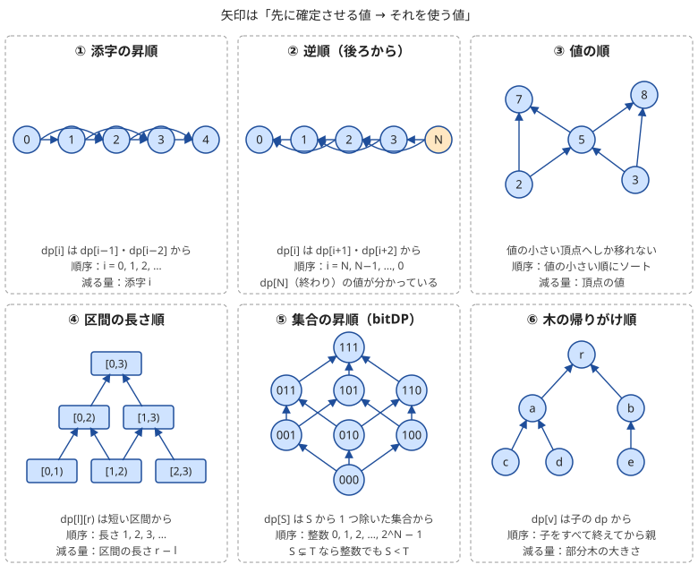

!!! abstract "要点"
    - **何ができるか**：$\mathrm{dp}[x]$ を計算する時点で、依存する値がすべて確定している順に状態を回す。添字の昇順に限らず、後ろから・値の順・区間の長さ順・集合の包含順などを、遷移の依存の向きから選ぶ。
    - **いつ使うか**：
        - 値の小さい（大きい）方へしか移れない。
        - ゴールに着いたら終わり・残り回数が 0 になったら終わり（終わりの値が分かっている）。
        - $\mathrm{dp}[i]$ が $\mathrm{dp}[j]$（$j > i$）から決まる（$i$ 番目以降で最適に行動したときの値）。
    - **計算量**：状態数 × 1 状態あたりの遷移数。順序そのものに追加の費用はかからない。値の順に回すときは、ソートの $O(N \log N)$ が加わる。
    - **前提**：[DP の基本](../dp/dp-basics.md)

<!-- textlint-disable -->
別名：計算順序・ループの順番・後ろから DP・逆順 DP
<!-- textlint-enable -->

DP の計算順序は、漸化式の右辺に出てくる値を、左辺より先に確定させるための並べ方である。漸化式が正しくても、順序を誤ると未確定の値（初期値のままの値）を読んで答えが狂う。順序は「添字の小さい順」と決め打ちせず、遷移がどちらを向いているかを見て決める。

## 依存グラフと計算順序の原則（閉路があれば DP にならない） {#dependency}

計算順序は、[状態](../guide/glossary.md#state)を頂点、「$y$ の値を使って $x$ を計算する」を辺 $y \to x$ にした[依存グラフ](../guide/glossary.md#dependency-graph)で考える。正しい順序とは、すべての辺 $y \to x$ について $y$ を $x$ より先に計算する並べ方である。グラフの言葉では、依存グラフのトポロジカル順のことである（[DAG 上の DP](../dp/dp-dag.md)）。

この順で計算すれば、帰納法で正しさが言える。初期値の状態（依存する辺のない状態）は値が決まっている。ほかの状態 $x$ を計算するときは、依存先がすべて先に計算済みで、帰納法の仮定により正しい値を持つ。だから漸化式から $x$ も正しく求まる。

実際に順序を探すときは、トポロジカルソートを書くより、**遷移のたびに必ず減る（増える）量**を見つける方が速い。添字・残り回数・区間の長さ・集合の大きさ・頂点の値・部分木の大きさなどである。依存の辺の向きにその量が必ず減るなら、その量の小さい順に計算すればよい。同じ量の状態どうしには辺がないので、その間の順は自由である。

依存グラフに閉路があると、どの順でも閉路のどこかで未確定の値を読む。このときは普通の DP にならず、次のどれかに切り替える。

- 辺の重みが非負の最短路：値の小さい順に確定させる[ダイクストラ法](../graph/dijkstra.md)を使う
- 期待値が自分自身に依存する（自己ループ）：式を移項して自分を消す（[期待値 DP](../comb/expected-value-dp.md#self-loop)）
- 自分以外の状態へ戻る閉路のある期待値：連立方程式を解く（[期待値の方程式を解く](../comb/expectation-linear-equations.md)）
- 同じ局面に戻れるゲーム：終局から確定させる[後退解析](../comb/game-retrograde-analysis.md)にする

順序を自分で決めたくないときは、[メモ化再帰](../dp/memoized-recursion.md)で書く。再帰は必要な依存先を先に呼ぶので、依存グラフのトポロジカル順を自動でたどる。閉路があると止まらないことは、for 文で書くときと同じである。

配る DP と貰う DP のどちらで書いても、守る順序は同じである。貰う形では「読む値が確定しているか」、配る形では「配り元の値が確定しているか」を見る。配る形の注意は[落とし穴](#pitfalls)で扱う。

## 典型の順序（添字・逆順・値の順・区間の長さ順・集合の昇順・木の帰りがけ順） {#typical-orders}

よく使う計算順序は、遷移で減る量によって次の 6 つに分かれる。どれも「依存グラフの辺に沿って、ある量が必ず減る」という同じ形をしている。



| 順序 | 依存の形 | 減る量 | 主な手法 |
| --- | --- | --- | --- |
| 添字の昇順 | $\mathrm{dp}[i] \leftarrow \mathrm{dp}[j]$（$j < i$） | 添字 | 列・グリッドの DP |
| 逆順 | $\mathrm{dp}[i] \leftarrow \mathrm{dp}[j]$（$j > i$） | 残りの長さ | 期待値・ゲーム・復元 |
| 値の順 | 値の小さい状態から大きい状態へ | 頂点の値 | 増加列・重みの減る移動 |
| 区間の長さ順 | $\mathrm{dp}[l][r] \leftarrow$ 真に短い区間 | $r - l$ | [区間 DP](../dp/interval-dp.md) |
| 集合の昇順 | $\mathrm{dp}[S] \leftarrow \mathrm{dp}[S']$（$S' \subsetneq S$） | 要素の数 | [bitDP](../dp/bit-dp.md) |
| 木の帰りがけ順 | $\mathrm{dp}[v] \leftarrow$ 子の $\mathrm{dp}$ | 部分木の大きさ | [木 DP](../dp/tree-dp.md) |

**値の順**：頂点や要素を値でソートし、その順に計算する。「重みの小さい隣の頂点にしか移れない」「値が増えるように進む経路の数」のように、移動の向きを値の大小が決める問題に使う。値の等しい状態どうしに辺がないこと（移れるのは真に小さい値だけ）を必ず確かめる。等しい値へも移れるなら、同じ値の状態の間に閉路ができうるので、値の順だけでは決まらない。

**区間の長さ順**：$\mathrm{dp}[l][r]$ を半開区間 $[l, r)$ の答えとする。これが $[l+1, r)$・$[l, r-1)$・分割した $[l, m)$ と $[m, r)$ のような真に短い区間から決まるなら、長さ $r - l$ の小さい順に回す。外側のループを長さ、内側を左端 $l$ にすればよい。外側で $l$ を大きい方から回し、内側で $r$ を小さい方から回す 2 重ループでも、依存先がすべて先に来るので正しい。

**集合の昇順**：集合を整数（ビット列）で表すと、$S' \subsetneq S$ なら整数としても $S' < S$ である。$S$ は $S'$ に 1 のビットを足したものなので、値は真に増える。だから、要素を 1 つ除いた集合から決まる bitDP は、整数の $0$ から $2^N - 1$ への素朴な for 文で正しい順になる（[bitDP](../dp/bit-dp.md#subsets-as-integers)）。

**木の帰りがけ順**：根付き木で $\mathrm{dp}[v]$ が子の値から決まるなら、子をすべて終えてから親を計算する。再帰の DFS で、子を呼び終えた後に親を計算するのが基本である。パス状の木では再帰が深くなるので、BFS で頂点を根から近い順に並べ、その逆順に回してもよい。逆順にすると、どの頂点も子より後に来る。

??? question "確認問題：区間 DP を左端の昇順に回す"
    $\mathrm{dp}[l][r]$ が $\mathrm{dp}[l+1][r]$ と $\mathrm{dp}[l][r-1]$ から決まる区間 DP を、外側を $l = 0, 1, \dots$、内側を $r = l+1, l+2, \dots$ の 2 重ループで書いた。何が起きるか。

    ??? success "答え"
        $\mathrm{dp}[l][r]$ を計算するとき、$\mathrm{dp}[l+1][r]$ はまだ計算されていない（$l+1$ の行は後で回る）。初期値のまま読むので答えが狂う。外側を長さの昇順にするか、外側の $l$ を $N-1$ から $0$ への降順にすれば、$\mathrm{dp}[l+1][\cdot]$ も $\mathrm{dp}[l][r-1]$ も先に確定する。

## 後ろから解くサイン（終わりの値が分かっている・辞書順最小の復元） {#backward}

計算の向きは、状態の値をどう定義したかで決まる。「$i$ までで」の値なら前から、「$i$ から先で」の値なら後ろから計算する。後ろから解くのは、「$i$ から先」で定義した方が漸化式を立てやすい問題である。次のサインがあれば、まず後ろからの定義を考える。

- **終わりの値が分かっている**：ゴールでは残りの費用が 0、残り回数が 0 なら今の値で確定、終局では勝ち負けが規則で決まる。前からの定義だと、終わる時点がばらばらで答えを集めにくい
- **「$i$ 番目以降で最適に行動したとき」と言い換えられる**：選択が未来の結果を見て決まる問題（振り直す・止める・ゲームの手）では、未来の値が先に要る
- **辞書順最小の復元**：後ろから「ここからゴールに行けるか（最短で何手か）」を求めておくと、前から貪欲に小さい選択を取りながら、行き詰まらないことを確かめられる（[辞書順最小の復元](../dp/dp-reconstruction.md)、[辞書順最小の貪欲法](../basics/lexicographic-greedy.md#feasibility)）
- **移動の向きが一方向で、出発点が自由**：「番号の小さい町から大きい町へしか行けない」かつ出発点を選べるなら、「$u$ から先で得られる最大」を後ろから求める。各出発点の答えが一度にそろう

次のコードは、番号の小さい町から大きい町へだけ道がある国で、ある町で買って先の町で売るときの利益の最大を、後ろから求める例である（[ABC188 E](#abc188_e) の型）。$\mathrm{best}[u]$ ＝ $u$ 自身を含め $u$ から行ける町の売値の最大、と定義する。道の行き先 $v$ は $v > u$ なので、$u$ を大きい方から回すと $\mathrm{best}[v]$ は先に確定している。

```cpp
--8<-- "dp-order/backward.cpp:core"
```

$u$ で買って $u$ で売ることはできないので、利益は「$u$ 以外の行き先の $\mathrm{best}$ の最大」から計算し、その後で $\mathrm{best}[u]$ に $u$ 自身の売値を含める。この順を逆にすると、同じ町で売買した 0 円の利益が混ざる。計算量は $O(N + M)$ である。

後ろからが唯一の解き方とは限らない。この例は「$v$ に来られる町の買値の最小」を前から求めても解ける。大事なのは、選んだ定義と回す向きをそろえることである。

## 期待値 DP・ゲーム DP の計算順序（確率・期待値・ゲームの章へ） {#expectation-and-games}

期待値 DP とゲームの DP は、どちらも後ろから計算するのが基本である。理由は同じで、値を「この状態から先」で定義すると、終わりの状態の値が分かっているからである。

- **期待値**：$E[s]$ ＝ 状態 $s$ から終わるまでにかかる量の期待値とすると、終状態では $E = 0$ である。$E[s]$ は 1 手先の状態の値の確率で重みを付けた和から決まるので、1 手ごとに減る量（残りの HP・残り回数など）の小さい順に埋める（[期待値 DP の計算順序](../comb/expected-value-dp.md#order)）
- **ゲーム**：局面 $s$ の勝ち負けは、行き先の局面の勝ち負けから決まる。終局の勝ち負けは規則で決まるので、終局からの手数の短い順に埋める（[必勝・必敗の定義](../comb/game-basics.md#win-lose)）
- **確率**：「$s$ に着く確率」は始状態で 1 と分かっているので、こちらは前から配る（[確率 DP](../comb/probability-dp.md#forward)）

確率 DP と期待値 DP で向きが逆になるのは、値の定義が「ここまで」と「ここから先」で逆だからである。順序の決め方は前節までと同じで、終わりの値が分かっている側から、依存の辺に沿って計算する。

1 手で同じ状態に留まる（自己ループ）場合は、依存グラフに長さ 1 の閉路ができる。移項して閉路を消してから、同じ順序で埋める（[自己ループの移項](../comb/expected-value-dp.md#self-loop)）。手の進み方が複雑で、減る量を見つけにくいときは、メモ化再帰で書くと順序を考えずに済む。

## 落とし穴：2 重ループの内外の順・逆順の境界・配る形で未確定の値を配る {#pitfalls}

**2 重ループの内外の順を取り違える**。2 次元の DP では、外側と内側のどちらのループを先に回すかで、読める値が変わる。グリッドを右か下にだけ進む DP なら、行の昇順・列の昇順のどちらを外にしても正しい。しかし区間 DP の $\mathrm{dp}[l][r] \leftarrow \mathrm{dp}[l+1][r]$ のように、片方の添字が増える向きに依存するなら、その添字は降順に回す必要がある（[区間の長さ順](#typical-orders)の確認問題）。書く前に、漸化式の右辺の添字を左辺と比べ、各添字が増えるか減るかを書き出すとよい。

**1 次元に潰した表を回す向き**。表を 1 次元に使い回すと、ループの向きで意味が変わる。0-1 ナップサックで $\mathrm{dp}[w] \leftarrow \mathrm{dp}[w - w_i] + v_i$ を $w$ の昇順に回すと、同じ品物の更新後の値をもう一度読み、品物を何度も選んだことになる。1 回だけ選ぶなら $w$ を降順に回す（[0-1 ナップサック](../dp/knapsack-01.md)）。何回でも選べるなら昇順でよく、向きの違いがそのまま問題の違いになる。

**逆順の境界**。後ろから回すときは、次の 3 つでバグが出やすい。

- 初期値を置く $\mathrm{dp}[N]$（終わりの状態）の分まで、表の大きさを $N + 1$ にする
- $\mathrm{dp}[i + k]$ を読むとき、$i + k > N$ の範囲外を読まない。範囲外を「到達できない」値にした番兵の分まで表を大きく取るか、`min(i + k, n)` のように条件を足す
- `for (size_t i = n - 1; i >= 0; i--)` は、符号なしの `i` が $0$ の次に巨大な値になり止まらない。$n = 0$ でも `n - 1` が巨大になる。逆順のループの添字は `int` にする

**配る形で未確定の値を配る**。配る DP では、$\mathrm{dp}[u]$ を配る時点で、$u$ へ配られるべき値がすべて届いている必要がある。添字の昇順に回して前へだけ配るなら問題ないが、次の 2 つでは崩れる。

- 頂点番号がトポロジカル順でない DAG を番号順に回す。番号の大きい頂点から小さい頂点への辺があると、配り元がまだ途中の値のまま配ってしまう。トポロジカルソートで順序を作るか、メモ化再帰にする
- 値の順で回すとき、等しい値の状態どうしにも遷移がある。同じ値の中の順序が決まらず、後から届く値を取りこぼす

貰う形で書くと、「読む値はもう計算したか」をその場で確かめやすい。順序に自信がないときは、貰う形で漸化式を書いてから順序を決め、必要なら配る形に直すとよい。

??? question "確認問題：集合を整数の昇順に回してよい理由"
    bitDP で、$\mathrm{dp}[S]$ を $\mathrm{dp}[S \setminus \{x\}]$（$x \in S$）から計算する。$S$ を $0, 1, 2, \dots, 2^N - 1$ の順に回してよいのはなぜか。配る形で $\mathrm{dp}[S]$ から $\mathrm{dp}[S \cup \{x\}]$（$x \notin S$）へ配るときはどうか。

    ??? success "答え"
        $S \setminus \{x\}$ は $S$ から 1 のビットを 1 つ消した数なので、整数として $S$ より $2^x$ だけ小さい。だから整数の昇順なら依存先が先に確定している。配る形でも、$S \cup \{x\}$ は $S$ より $2^x$ 大きいので、$S$ を配る時点で $S$ へ配る集合（$S$ より小さい整数）はすべて処理済みである。どちらの形でも整数の昇順で正しい。

## 使い分け {#comparison}

- **for 文（ボトムアップ）**：減る量が分かり、状態が配列に収まるとき。速く、再帰の深さを気にしなくてよく、累積和などの高速化も載せやすい
- **[メモ化再帰](../dp/memoized-recursion.md)**：順序が分かりにくいとき、出てくる状態がまばらなとき。再帰の深さが $10^5$ 段を超えると、スタックの不足で落ちることがある
- **[トポロジカルソート](../graph/topological-sort.md)で順序を作る**：一般の DAG で、減る量が問題の性質から見つからないとき
- **閉路がある**：DP ではなく最短路・方程式・後退解析を考える（[原則の節](#dependency)）

## 例題 {#examples}

### ABC188 E. Peddler {#abc188_e}

<div class="kp-problems" data-role="example" markdown>

- [ABC188 E. Peddler](https://atcoder.jp/contests/abc188/tasks/abc188_e)（diff 1170）：番号の小さい町から大きい町へだけ道がある国で、ある町で金を買い、そこから行ける別の町で売るときの利益の最大を求める。

</div>

道は番号の小さい町から大きい町へだけ向くので、依存グラフは町の番号の順に並んだ DAG である。$\mathrm{best}[u]$ ＝ $u$ 自身を含め $u$ から行ける町の売値の最大、と後ろからの値で定義する。すると $\mathrm{best}[u]$ は行き先 $v > u$ の $\mathrm{best}[v]$ から決まる。番号の大きい町から順に計算すれば、依存先はすでに確定している。

??? note "解法の詳細"
    - 状態：$\mathrm{best}[u]$ ＝ $u$ 自身を含め、$u$ から 0 本以上の道でたどれる町の売値の最大
    - 遷移：$u$ で買って売るときの最高値は $\max_{u \to v} \mathrm{best}[v]$（行き先のない町では売れない）。利益の候補はそこから $u$ の買値を引いた値で、その後で $\mathrm{best}[u]$ をこの最高値と $u$ の売値の大きい方にする
    - 順序：$u = N, N-1, \dots, 1$。道の行き先は番号が大きいので、先に確定している
    - 初期値と答え：$\mathrm{best}$ の初期値は $-\infty$。答えは利益の候補の最大である。どの売り方でも損をする場合は答えが負になるので、答えの初期値も $-\infty$ にする
    - 計算量：各町と各道を 1 回ずつ見るので $O(N + M)$ である
    - コード：[後ろから解くサイン](#backward)の節のものと同じ形である
    - 前から解く方法：$\mathrm{low}[v]$ ＝ $v$ に来られる町（$v$ を除く）の買値の最小を番号の小さい順に求め、売値 − $\mathrm{low}[v]$ の最大を取っても解ける

### ABC197 E. Traveler {#abc197_e}

<div class="kp-problems" data-role="example" markdown>

- [ABC197 E. Traveler](https://atcoder.jp/contests/abc197/tasks/abc197_e)（diff 1379）：数直線上の色付きのボールを、色の番号の小さい順に全部回収して原点に戻るときの、移動距離の最小を求める。

</div>

回収の順が色の番号で決まっているので、色の番号が計算順序になる。色 $k$ のボールを全部回収するには、その色の最も左の位置 $L_k$ と最も右の位置 $R_k$ の両方を通る必要があり、回収し終えたときはどちらかの端にいる。途中のボールは端から端へ動く間に拾える。だから「色 $k$ まで回収し終え、$L_k$ か $R_k$ にいるときの最短距離」の 2 通りを状態にすれば、色の小さい順に DP できる。

??? note "解法の詳細"
    - 状態：$\mathrm{dp}[k][0]$・$\mathrm{dp}[k][1]$ ＝ 色 $k$ までを回収し終え、$L_k$・$R_k$ にいるときの移動距離の最小。ボールのない色は飛ばす
    - 遷移：直前の位置を $p$ とする。$L_k$ で終えるなら $p \to R_k \to L_k$ と動き、$\lvert p - R_k \rvert + (R_k - L_k)$ を足す。$R_k$ で終えるなら $p \to L_k \to R_k$ と動き、$\lvert p - L_k \rvert + (R_k - L_k)$ を足す。$p$ は前の色の 2 つの状態の両方を試す
    - 状態がこれで足りる理由：色 $k$ を回収した後の動きは、そのときの位置だけで決まり、それまでの経路によらない。位置は 2 つの端のどちらかに限られる
    - 順序：色の番号の昇順。$\mathrm{dp}[k]$ はボールのある直前の色の値だけから決まる
    - 初期値と答え：最初は位置 $0$・距離 $0$。最後の色の 2 状態から原点までの距離 $\lvert p \rvert$ を足した小さい方が答え。距離は $2 \times 10^9 \times N$ ほどになりうるので `long long` で持つ
    - 計算量：色ごとの $L_k$・$R_k$ を求めるのが $O(N)$、DP は色ごとに $O(1)$ なので全体で $O(N)$

    ```cpp
    --8<-- "dp-order/traveler.cpp:core"
    ```

## 練習問題 {#practice}

<div class="kp-problems" data-role="practice" markdown>

- [ABC266 E. Throwing the Die](https://atcoder.jp/contests/abc266/tasks/abc266_e)（diff 1227）：最大 N 回まで振り直せるサイコロで、最後に出た目を得点にするとき、得点の期待値の最大を求める。
- [ABC146 F. Sugoroku](https://atcoder.jp/contests/abc146/tasks/abc146_f)（diff 1545）：1〜M マス進めるすごろくで、止まってはいけないマスを避けて最短手数でゴールする出目の列のうち、辞書順最小のものを求める。
- [ABC341 F. Breakdown](https://atcoder.jp/contests/abc341/tasks/abc341_f)（diff 1604）：グラフの頂点に置いた駒を 1 つ取り除き、重みの和が元の頂点より小さい隣接頂点の集合に 1 つずつ置く操作の、最大の回数を求める。

</div>

??? note "練習の方針"
    - **ABC266 E**：最大 $k$ 回振れるときの得点の期待値 $E_k$ を、$k$ の小さい順に求める。1 回しか振れないなら $E_1 = 7/2$ である。$E_k$ は、1 回目の各目 $a$ について「止める（得点 $a$）」と「振り直す（期待値 $E_{k-1}$）」の大きい方を取り、6 通りで平均したもの。答えは $E_N$
    - **ABC146 F**：ゴールから逆にたどり、今いるマスから $M$ マス以内の手前にある止まれるマスのうち、最も手前のものへ戻る。最も手前に戻ると、手数は最短のまま、後ろの出目ほど大きく、前の出目ほど小さくなる。戻れるマスがなければ到達できない。戻った出目を逆順に出力する
    - **ABC341 F**：新しく置かれる駒は、元の頂点より重みの小さい頂点にしか行かない。頂点 $u$ の駒 1 個が生む操作回数を $f(u)$ とすると、$f(u) = 1 +$（隣の頂点から重みの和が $W_u$ 未満になるように選んだときの $f$ の和の最大）で、これはナップサックで求まる。重みの小さい頂点から順に $f$ を計算し、答えは各頂点の駒の数 × $f$ の和

## 参考 {#references}

- [ikatakos「AtCoder Beginner Contest 188 C,E,F問題メモ」](https://ikatakos.com/pot/programming_algorithm/contest_history/atcoder/2021/0110_abc188)：例題 ABC188 E の後ろからの DP と、自分の町で売らないための更新の順（解説の部分だけを参照）
- [ikatakos「AtCoder Beginner Contest 197（Sponsored by Panasonic）D,E,F問題メモ」](https://ikatakos.com/pot/programming_algorithm/contest_history/atcoder/2021/0327_abc197)：例題 ABC197 E の、各色の両端を状態にする DP（解説の部分だけを参照）
- [kazun「AtCoder Beginner Contest 266 E問題 Throwing the Die」](https://kazun-kyopro.hatenablog.com/entry/ABC/266/E)：練習 ABC266 E の、残り回数の少ない方からの期待値の DP
- [ikatakos「AtCoder Beginner Contest 146 D～F問題メモ」](https://ikatakos.com/pot/programming_algorithm/contest_history/atcoder/2019/1124_abc146)：練習 ABC146 F の、ゴールから最も手前のマスへ戻る貪欲とその正しさ（解説の部分だけを参照）
- [torus711「AtCoder Beginner Contest 341, F : Breakdown」](https://torus711.hatenablog.com/entry/2024/02/18/234324)：練習 ABC341 F の、重みの順に頂点ごとのナップサックを解く方法
