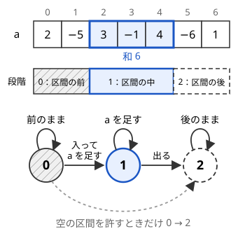

!!! abstract "要点"
    - **何ができるか**：区間を 1 つ選ぶ・何文字目まで集めたか、のように各位置でいまどの段階にいるかを状態に持つ。区間の両端を全探索する代わりに段階の切り替えを遷移にして、$O(N^2)$ を $O(N)$ にする。
    - **いつ使うか**：
        - 区間を 1 つ選んで、その中だけ操作する（1 回だけ変更できる）。
        - 部分列として 'ABC' などが何個含まれるか（'?' を埋めた全通りの和）。
        - 連続する部分列の和の最大。
        - 区間 $[l, r)$ の両端を全探索すると $O(N^2)$ になり、各位置の扱いが「区間の前・中・後」で変わる。
    - **計算量**：段階の数を $P$ として $O(NP^2)$。手前の段階の最大（数え上げなら和）を持てば $O(NP)$ になる。区間を 1 つ選ぶなら $P = 3$ で $O(N)$、長さ $M$ の文字列を集めるなら $O(NM)$。
    - **前提**：[DP の状態の設計](../dp/dp-state-design.md)

<!-- textlint-disable -->
別名：耳 DP・段階を状態に持つ DP・最大部分配列和・Kadane・Kadane's algorithm
<!-- textlint-enable -->

フェーズを状態に持つ DP は、列を左から見ながら「いま区間の前にいるか・中にいるか・後にいるか」のような段階を[状態](../guide/glossary.md#state)として持つ DP である。区間を 1 つ選ぶことは、各位置に段階を付けて $0 \to 1 \to 2$ と増えていき、段階 1 の位置が 1 つ以上ある列を作ることと 1 対 1 で対応する。だから区間の両端を決める代わりに、段階を 1 つ進めるかどうかを各位置で選べばよい。

## 最大部分配列和（Kadane）：区間を 1 つ選ぶ最も簡単な例 {#kadane}

長さ $N$ の整数の列 $a_0, \dots, a_{N-1}$ から空でない区間 $[l, r)$ を 1 つ選び、和を最大にする問題を考える。両端を全探索すると区間は $N(N+1)/2$ 個あり、$N = 2 \times 10^5$ では間に合わない。

各位置に段階を付けて考える。区間より左の位置は段階 0（区間の前）、区間の中は段階 1、右は段階 2（区間の後）とする。次の図は $a = (2, -5, 3, -1, 4, -6, 1)$ で区間 $[2, 5)$ を選んだときの段階の帯と、段階の間の遷移である。



段階の列は左から右へ広義単調に増え、1 の並びが空でない。逆にそのような段階の列を 1 つ決めると、1 の並びが区間を 1 つ決める。区間と段階の列は 1 対 1 に対応するので、区間の最適化は「段階の列の最適化」に置き換わる。段階の列は各位置で「同じ段階に留まるか、次へ進むか」を選んで作れるので、DP で扱える。

- **状態**：$\mathrm{dp}[i][p]$ ＝ 先頭 $i$ 個の段階を決め、位置 $i-1$ が段階 $p$ にあるときの、段階 1 の位置の値の和の最大
- **遷移**：位置 $i$ の段階は直前の段階と同じか 1 つ先である
    - $\mathrm{dp}[i+1][0] = \mathrm{dp}[i][0]$
    - $\mathrm{dp}[i+1][1] = \max(\mathrm{dp}[i][0], \mathrm{dp}[i][1]) + a_i$
    - $\mathrm{dp}[i+1][2] = \max(\mathrm{dp}[i][1], \mathrm{dp}[i][2])$
- **初期値と答え**：$\mathrm{dp}[0][0] = 0$、ほかは $-\infty$（来られない）。答えは $\max(\mathrm{dp}[N][1], \mathrm{dp}[N][2])$ で、段階 0 のまま終わった列は区間を選んでいないので含めない

その状態で足りる理由は、位置 $i$ から先で和に足せる値が「直前の段階」だけで決まるからである。区間の左端がどこだったかは、段階 1 の中にいるという事実以外は先の選び方に影響しない。$\mathrm{dp}[i]$ は $\mathrm{dp}[i-1]$ だけから決まるので、変数 3 つで書ける。

```cpp
--8<-- "dp-phase/kadane.cpp:core"
```

$f_0$ は常に 0 なので、$f_1$ の式は $\max(0, f_1) + a_i$ になり、$f_2$ は「これまでの $f_1$ の最大」になる。これが Kadane のアルゴリズムとして知られる形「位置 $i$ で終わる区間の和の最大と、そのこれまでの最大を持つ」と同じものである。Kadane の形は段階 3 つの DP を手で潰したものなので、区間の中と外の扱いが変わる問題でも、潰す前の段階の DP から考えれば同じように作れる。

空の区間（和 0）を許す問題なら、段階 0 から段階 2 へ直接進む遷移を足す。答えは $\max(\mathrm{dp}[N][0], \mathrm{dp}[N][1], \mathrm{dp}[N][2])$ でもよい。Kadane の形では $\max(\text{答え}, 0)$ にあたる。

## 段階の数え方（区間の外側にも段階がある） {#counting-phases}

段階を設計するときは、選んだ形を「位置ごとの記号の列」に書き、その列が満たす形を左から並べる。区間を 1 つ選ぶなら列の形は「0 が並び、1 が並び、2 が並ぶ」で、段階は 3 つになる。区間の外側は前と後で扱いが同じでも、別の段階にする。前と後を 1 つにまとめると、外から中へ何度でも戻れてしまい、区間を 2 つ以上選んだ列も数えてしまう。

形を並べれば、段階の数は機械的に決まる。

| 選ぶもの | 位置ごとの形 | 段階の数 |
| --- | --- | --- |
| 区間 1 つ | 外・中・外 | 3 |
| 重ならない区間 $K$ 個 | 外・中・外・中・…・外 | $2K + 1$ |
| 位置 $M$ 個（$i_1 < \dots < i_M$） | 選んだ個数 $0, 1, \dots, M$ | $M + 1$ |
| 区間 1 つと、その中の位置の集合 | 外・中・外（中で選ぶかを別に決める） | 3 |

遷移は「段階 $q$ から段階 $p$（$q \le p$）へ進み、位置 $i$ で段階 $p$ の値を足す」と一般に書ける。

$$
\mathrm{dp}[i+1][p] = \max_{q \le p,\ q \to p \text{ が許される}} \mathrm{dp}[i][q] + \mathrm{val}(p, a_i)
$$

段階 $q$ から $p$ へ直接進むことは、間の段階 $q+1, \dots, p-1$ をどれも長さ 0 で飛ばすことにあたる。だから長さ 0 を許すかは段階ごとに決まり、間の段階がどれも長さ 0 でよいときだけ $q \to p$ を許す。間の段階がどれも長さ 0 を許さないなら、$q \in \{p-1, p\}$ だけから来られる。最初の段階の長さ 0 は初期値（位置 0 で段階 0 から次へ進めること）で、最後の段階の長さ 0 は答えに含める段階で表す。たとえば[最大部分配列和](#kadane)では段階 0・2 は長さ 0 でよいが、段階 1 は長さ 0 を許さないので 0 から 2 へは進めない。$\max_{q \le p}$ は段階の小さい順に累積の最大を取れば、位置 1 つあたり $O(P)$ で済み、全体は $O(NP)$ である。数え上げなら $\max$ を和に、$+$ を積に置き換える。

段階の数が問題の本体になる例が、数直線を歩いて耳に石を入れていく問題（[練習問題](#practice)の YAHOO-PROCON2019-QUAL D. Ears）である。歩く経路の左端・始点・終点・右端で数直線を 5 つに分けると、各区間を通る回数は外側から「0 回・正の偶数回・奇数回・正の偶数回・0 回」になる。5 つの部分の長さは 0 でもよく、どの段階でも位置ごとのコストは、段階の種類（0 回・正の偶数回・奇数回）と $A_i$ だけで決まる。境界の 4 つの点を全探索すると $O(L^4)$ だが、段階 5 つの DP なら $O(L)$ である。

**応用の型**。サインは「区間を 1 つ（K 個）選ぶ」「どこかで 1 回だけ切り替える」「外側と内側でコストが違う」。段階を列の形から数え、長さ 0 を許すかを問題文で確かめる。

## 何文字目まで集めたか（部分列として現れる回数を数える） {#matched-prefix}

文字列 $S$ から文字を選び、元の順に並べると文字列 $T$（長さ $M$）になる選び方の数を数える問題では、「$T$ の何文字目まで集めたか」を段階にする。選んだ $M$ 個の位置で $S$ を区切ると、各位置は「まだ 0 文字」「1 文字集めた」…「$M$ 文字集めた」の段階に分かれる。区間を 1 つ選ぶ問題と同じく、段階は左から右へ増えるだけである。

- **状態**：$\mathrm{dp}[i][j]$ ＝ $S$ の先頭 $i$ 文字から選び、$T$ の先頭 $j$ 文字と一致させた選び方の数
- **遷移**：$S[i]$ を選ばなければ $\mathrm{dp}[i+1][j] \mathrel{+}= \mathrm{dp}[i][j]$。$S[i] = T[j]$ なら選んで $\mathrm{dp}[i+1][j+1] \mathrel{+}= \mathrm{dp}[i][j]$
- **初期値と答え**：$\mathrm{dp}[0][0] = 1$（何も選ばない 1 通り）、答えは $\mathrm{dp}[\lvert S \rvert][M]$
- **計算量**：状態 $(\lvert S \rvert + 1)(M + 1)$ 個、遷移は 2 通りなので $O(\lvert S \rvert M)$

数えているのは位置の組であって、できる文字列の種類ではない。同じ $T$ を作る選び方は位置が違えば別に数える。この DP が重複なく数えられるのは、選び方ごとに段階の列がただ 1 つに決まるからである。表を 1 本の配列にするときは $j$ の大きい方から回す。小さい方から回すと、同じ文字 $S[i]$ で $j \to j+1 \to j+2$ と 2 段進み、1 文字を $T$ の 2 文字に使ってしまう（$T$ に同じ文字が続くときに起きる）。

```cpp
--8<-- "dp-phase/matched-prefix.cpp:core"
```

**'?' を埋めた全通りの和**。$S$ に '?' があり、埋め方すべてについての個数の総和を求めるときも、状態は同じでよい。$\mathrm{dp}[i][j]$ を「先頭 $i$ 文字の埋め方すべてについての、$T$ の先頭 $j$ 文字と一致する選び方の数の和」とする。'?' の位置では、選ばない遷移は埋め方が $k$ 通り（文字の種類の数）あるので $k$ 倍し、選ぶ遷移は '?' を $T[j]$ にする 1 通りだけなので 1 倍にする。

**応用の型**。サインは「部分列として 'atcoder' がいくつ含まれるか」「'?' を埋めた全通りの、'ABC' の個数の和」。段階の数は $T$ の長さ + 1 である。部分文字列（連続）として含むかを問うなら、一致が途中で崩れたときに戻る先が要るので[照合オートマトン上の DP](../string/string-automaton-dp.md) にする。できる文字列の種類を数えるなら[部分列 DP](../dp/subsequence-dp.md#positions-or-strings) にする。

## 区間の反転・変更を段階の切り替えで表す {#flip-interval}

「区間を 1 つ選んで符号を反転してよい」「1 か所だけ値を変えてよい」のように、操作を 1 回だけ行える問題では、操作の範囲を段階 1 にする。区間の前・中・後で位置の値の数え方が変わるだけで、DP の形は[最大部分配列和](#kadane)と同じである。

区間を 1 つ選んで符号を反転し（反転しなくてもよい）、全体の和を最大にする場合、段階ごとの値は次のとおりである。

| 段階 | 位置 $i$ で足す値 | 来られる段階 |
| --- | --- | --- |
| 0：区間の前 | $a_i$ | 0 |
| 1：反転する区間の中 | $-a_i$ | 0・1 |
| 2：区間の後 | $a_i$ | 0・1・2 |

反転しない選択は空の区間にあたるので、段階 0 から 2 へ直接進んでよく、答えは 3 つの段階の最大である。

```cpp
--8<-- "dp-phase/flip.cpp:core"
```

**1 か所だけ変更できる**。区間の代わりに 1 つの位置だけを変えられるなら、段階は「まだ変えていない」「変えた」の 2 つで足りる（変えた位置は、段階が切り替わる位置である）。最長増加部分列で 1 か所だけ好きな値に変えてよい問題は、この形に [LIS](../dp/lis.md#variants) の求め方を組み合わせる。

**反転を $K$ 回まで行える**。区間の反転を何回も重ねると、各位置の向きは「その位置より左にある切り替え点の個数の偶奇」で決まる。反転 $K$ 回は切り替え点 $2K$ 個以下に言い換えられ、段階を「置いた切り替え点の個数」にすれば、位置ごとの向きは段階の偶奇で決まる。状態は $N \times (2K + 1)$ 個で $O(NK)$ である。切り替え点への言い換えは[いもす法の区間反転](../basics/imos.md#range-flip)にある。

**応用の型**。サインは「区間を 1 つ選んで、その中だけ操作する」「1 回だけ変更できる」「区間の反転を K 回まで」。操作の前後を別の段階にし、反転しない・変えない選択が許されるかで、段階を飛ばす遷移を入れるかを決める。

## 落とし穴 {#pitfalls}

**区間の前と後を同じ段階にする**。前と後で位置の扱いが同じだからといって段階を 1 つにまとめると、段階 1 から外へ出た後にまた段階 1 へ入れてしまい、区間を 2 つ以上選んだ場合も数える。最大化なら答えが大きすぎ、数え上げなら多すぎる。「一度出たら戻れない」ことを表すために、外側でも前と後を分ける。

**同じ位置で段階をいくつ進めてよいかを決めていない**。段階の長さ 0 を許すかどうかで、遷移の元が変わる。空でない区間を選ぶ問題で段階 0 から 2 へ直接進めると、区間を選ばない場合が混ざる。逆に Ears のように長さ 0 の部分を許す問題で隣の段階からしか来られないと、最適な経路を落とす。数え上げでは、数える対象 1 つに段階の列がちょうど 1 つ対応するかを確かめる。1 つの対象を 2 通りの段階の列で表せると、二重に数える。

**1 本の配列で段階を小さい方から更新する**。部分列を数える DP を 1 本の配列で書き、$j$ を小さい方から回すと、同じ位置で段階が 2 つ以上進む。$S = $ "a"、$T = $ "aa" で答えが 0 ではなく 1 になる。$j$ の大きい方から回すか、次の段の配列を別に作る。

**来られない段階の初期値**。最大化では段階 1・2 の初期値を 0 にすると、区間を選ばない状態から「区間を選び終えた」ことになり、すべて負の列で答えが 0 になる。来られない状態は $-\infty$ にし、$-\infty$ に値を足しても[オーバーフロー](../guide/glossary.md#overflow)しないよう `LLONG_MIN / 4` などにする。

**答えに含める段階**。最後の位置で段階 1 のまま終わる（区間が右端まで続く）場合を答えに入れ忘れやすい。答えは「条件を満たして終われる段階」すべての最大（和）にする。

## 例題 {#examples}

### 典型90 008. AtCounter（★4） {#typical90_h}

<div class="kp-problems" data-role="example" markdown>

- [典型90 008. AtCounter（★4）](https://atcoder.jp/contests/typical90/tasks/typical90_h)（diff —）：文字列から部分列として 'atcoder' を取り出す方法の数を求める。

</div>

選んだ文字を元の順に並べて 'atcoder' になる選び方を数えるので、[何文字目まで集めたか](#matched-prefix)を段階にする。段階は 0〜7 の 8 つで、$S$ の各文字で「選ばない」か「次に集めるべき文字と同じなら選んで段階を 1 つ進める」かを決める。

??? note "解法の詳細"
    - 状態：$\mathrm{dp}[i][j]$ ＝ $S$ の先頭 $i$ 文字から選び、'atcoder' の先頭 $j$ 文字を集めた選び方の数（$10^9 + 7$ で割った余り）。
    - 遷移：$\mathrm{dp}[i+1][j] \mathrel{+}= \mathrm{dp}[i][j]$。$S[i]$ が 'atcoder' の $j$ 文字目（0-indexed）と同じなら $\mathrm{dp}[i+1][j+1] \mathrel{+}= \mathrm{dp}[i][j]$。
    - 初期値は $\mathrm{dp}[0][0] = 1$ で、答えが $\mathrm{dp}[N][7]$ である。
    - 状態は $8(N+1)$ 個なので $O(N)$。1 本の配列にするなら $j$ の大きい方から回す（[何文字目まで集めたか](#matched-prefix)のコード）。

### ABC159 F. Knapsack for All Segments {#abc159_f}

<div class="kp-problems" data-role="example" markdown>

- [ABC159 F. Knapsack for All Segments](https://atcoder.jp/contests/abc159/tasks/abc159_f)（diff 1876）：数列のすべての区間 [L, R] について、その中で和がちょうど S になる部分列の個数を求め、その総和を出す。

</div>

区間ごとに部分和の個数を数えると、区間が $O(N^2)$ 個あるので部分和の DP を $O(N^2)$ 回することになる。数える対象を「区間と、その中から選んだ和 $S$ の選び方の組」と見直す。区間を 1 つ選ぶ段階（前・中・後）に「段階 1 の位置で選ぶかどうか」を重ねた DP で、組を直接数えられる。

??? note "解法の詳細"
    - 状態：$\mathrm{dp}[i][p][j]$ ＝ 先頭 $i$ 個を見て、位置 $i-1$ が段階 $p$（0：区間の前、1：区間の中、2：区間の後）にあり、選んだ値の和が $j$ の組の数。$j > S$ は捨てる。
    - 遷移：位置 $i$ を段階 0 にするなら段階 0 からだけ来られる。段階 1 にするなら段階 0・1 から来られ、$a_i$ を選ぶ（和 $j + a_i$）か選ばない（和 $j$）。段階 2 にするなら段階 1・2 から来られ、選ばない。区間は空でないので 0 から 2 へは直接進めない。
    - 初期値は $\mathrm{dp}[0][0][0] = 1$ で、答えが $\mathrm{dp}[N][1][S] + \mathrm{dp}[N][2][S]$（998244353 で割った余り）である。
    - 状態は $3(N+1)(S+1)$ 個、遷移は定数個なので $O(NS)$。
    - 組と段階の列は 1 対 1 に対応する。区間が段階 1 の並びを決め、選び方が段階 1 の中の印を決めるからである。

    ```cpp
    --8<-- "dp-phase/all-segments.cpp:core"
    ```

    別の数え方として、選んだ値の最も左の添字を $l$、最も右を $r$（0-indexed）とすると、それを含む区間は $(l + 1)(N - r)$ 個ある。段階を「最初の値を選ぶ前・選んだ後・最後の値を選んだ後」にし、段階を進めるときに $(l+1)$ や $(N-r)$ を掛けても同じ答えになる。この形では、1 つしか選ばないとき同じ位置で段階が 0 から 2 まで進むことに注意する。

## 練習問題 {#practice}

<div class="kp-problems" data-role="practice" markdown>

- [ABC466 E. Range Flip](https://atcoder.jp/contests/abc466/tasks/abc466_e)（diff 1027）：表と裏に数が書かれたカードの列で、区間の裏返しを K 回以下行った後の、上を向いた数の和の最大値を求める。
- [ABC104 D. We Love ABC](https://atcoder.jp/contests/abc104/tasks/abc104_d)（diff 1739）：A・B・C・? からなる文字列の ? を埋めた全通りについて、部分列として現れる 'ABC' の個数の総和を求める。
- [YAHOO-PROCON2019-QUAL D. Ears](https://atcoder.jp/contests/yahoo-procon2019-qual/tasks/yahoo_procon2019_qual_d)（diff 1998）：数直線上を歩く経路を自由に選ぶとき、各区間を通った回数を目標の個数 A_i に合わせるための追加・削除の回数の最小を求める。

</div>

??? note "練習の方針"
    - **ABC466 E**：裏返しを切り替え点に言い換え、段階を「置いた切り替え点の個数」（0〜$2K$）にする。各カードで段階を据え置くか 1 つ進めるかを選び、段階の偶奇で表と裏のどちらの数を足すかが決まる。$O(NK)$（[区間の反転・変更を段階の切り替えで表す](#flip-interval)）
    - **ABC104 D**：段階を「'ABC' の何文字目まで集めたか」（0〜3）にする。値には '?' を埋めた全通りの和を持つ。'?' の位置では、段階を進めない遷移を 3 倍し、進める遷移は 1 倍にする（[何文字目まで集めたか](#matched-prefix)）
    - **YAHOO-PROCON2019-QUAL D（Ears）**：経路の左端・始点・終点・右端で数直線を 5 つに分け、各部分で通る回数の性質（0 回・正の偶数回・奇数回）を考える。各部分の長さは 0 でもよい。各部分で区間 $i$ のコストが $A_i$ と通る回数の性質からどう決まるかを考えれば、段階 5 つの DP になる（[段階の数え方](#counting-phases)）

## 確認問題 {#quiz}

??? question "確認問題：区間を 1 つ反転する問題の段階の数"
    「区間を 1 か所だけ選んで反転してよい」問題を段階で表すと、何段階になるか。区間の外側を 1 つの段階にまとめてはいけないのはなぜか。

    ??? success "答え"
        区間の前・反転する区間の中・区間の後の 3 段階である。外側を 1 つにまとめると、中から外へ出た後にまた中へ戻る遷移が許されてしまい、区間を 2 つ以上反転する場合まで含まれる。段階を前と後に分け、段階が増える向きにしか進めないようにすることで、区間が 1 つに限られる。

??? question "確認問題：区間を 2 つ選ぶ"
    重ならない空でない区間を 2 つ選び、選んだ位置の値の和を最大にする。段階はいくつで、段階 3 の位置 $i$ ではどの段階から来られるか。

    ??? success "答え"
        外・中・外・中・外の 5 段階（0〜4）である。段階 3 は 2 つ目の区間の中なので、段階 2（間の外側）か段階 3 から来られる。2 つの区間が隣り合ってもよい（間の長さ 0 を許す）なら、段階 1 からも来られる。どちらにするかは問題文の「重ならない」が隣接を許すかで決める。

??? question "確認問題：空の区間を許す"
    最大部分配列和で空の区間（和 0）も選んでよいとき、[最大部分配列和](#kadane)の DP のどこを変えればよいか。

    ??? success "答え"
        段階 0 から段階 2 へ直接進む遷移を足し、$\mathrm{dp}[i+1][2] = \max(\mathrm{dp}[i][0], \mathrm{dp}[i][1], \mathrm{dp}[i][2])$ にする。答えは段階 0・1・2 の最大でよい。すべての値が負なら答えは 0 になる。

## 使い分け {#comparison}

- 区間を 1 つ（または決まった個数）選ぶなら段階の DP にする。区間の個数が自由で区間ごとにコストがかかるなら、最後の切れ目を状態に持つ[区間分割 DP](../dp/dp-sequence-partition.md)を使う
- 区間の内側を割って調べる（括弧の対応・両端から取る）なら[区間 DP](../dp/interval-dp.md) にする
- 部分列として $T$ が何回現れるか（位置の組の数）は段階の DP、できる文字列の種類の数は[部分列 DP](../dp/subsequence-dp.md#positions-or-strings)、部分文字列として含むかは[照合オートマトン上の DP](../string/string-automaton-dp.md) にする
- 区間への操作が何回も重なり、各位置で何回操作されたかだけが効くなら、[差分列](../basics/difference-sequence.md)で操作を切り替え点に直すと、段階の数が切り替え点の個数になる

## 参考 {#references}

- [Wikipedia「Maximum subarray problem」](https://en.wikipedia.org/wiki/Maximum_subarray_problem)：Kadane のアルゴリズムの形と、空の区間を許す場合の扱い
- [drken「競プロ典型 90 問 008 - AtCounter（2Q, ★4）」](https://drken1215.hatenablog.com/entry/2022/04/01/121700)：例題 典型90 008 の状態と遷移
- [drken「AtCoder ABC 159 F - Knapsack for All Segments (青色, 600 点)」](https://drken1215.hatenablog.com/entry/2020/03/22/224200)：例題 ABC159 F の段階 3 つの DP と、左端・右端の個数を掛ける数え方
- [comet725「ABC466Eを解いた【分割統治法+DP】」](https://qiita.com/comet725/items/d9928d9fdb242140f987)：練習の方針（切り替え点の個数を状態にし、偶奇で表裏を決める）
- [drken「AtCoder ABC 104 D - We Love ABC (1Q, 青色, 400 点)」](https://drken1215.hatenablog.com/entry/2018/08/05/224100_1)：練習の方針（'ABC' の照合の段階と '?' の扱い）
- [drken「みんなのプロコン 2019 D - Ears (青色, 600 点)」](https://drken1215.hatenablog.com/entry/2019/02/10/014800)：練習の方針（5 つの段階と各段階のコスト）
