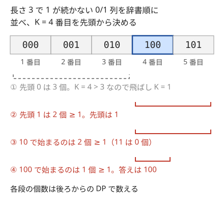

!!! abstract "要点"
    - **何ができるか**：DP で最適値を求めた後、完成した表を終端から逆にたどり、その値を与えた遷移を 1 つずつ選んで選び方そのものを作る。辞書順最小は後ろからの DP と前からの貪欲で、辞書順 K 番目は後ろからの DP で個数を数えて先頭から決める。
    - **いつ使うか**：
        - 選び方（経路・操作列）を 1 つ出力せよ。
        - 条件を満たすものが複数あれば辞書順最小のものを出力せよ。
        - 辞書順で K 番目のものを出力せよ（K は $10^{18}$ 程度）。
    - **計算量**：表を作る DP の計算量に、復元の $O(\text{段数} \times \text{1 段の遷移数})$ を足したもの。表をすべて残すので、メモリは状態数に比例する。
    - **前提**：[DP の基本](../dp/dp-basics.md)

<!-- textlint-disable -->
別名：DP 復元・選び方の出力・DP テーブルからの復元・辞書順最小の復元
<!-- textlint-enable -->

DP の復元は、DP の表が「最適値」しか持っていなくても、その値がどの遷移から来たかを表の値から逆算して、最適な選び方を 1 つ組み立てる方法である。表の値は「その状態から先（または手前）で達成できる最適値」なので、最適な遷移の候補はいつも表の値の一致で見分けられる。難しいのは、向き（前からの表を後ろからたどる）と、辞書順のような追加の条件がついたときの表の作り方である。

## 表を残して終端から逆にたどる・遷移元を記録しておく {#trace-back}

$N$ 個の品物のそれぞれで、H を選ぶと $a_i$、T を選ぶと $b_i$ を取り、和をちょうど $S$ にする選び方を 1 つ出力する問題で考える。可否だけなら、[状態](../guide/glossary.md#state)を「何個目まで決めたか」と「そこまでの和」にした DP で分かる。

$$
\mathrm{dp}[i][j] = \text{最初の } i \text{ 個の選び方で和を } j \text{ にできるか}
$$

$\mathrm{dp}[0][0] = \text{true}$ から始め、$\mathrm{dp}[i+1][j]$ は $\mathrm{dp}[i][j - a_i]$ か $\mathrm{dp}[i][j - b_i]$ が true なら true にする。答えは $\mathrm{dp}[N][S]$ である。選び方を出力するには、次の手順で終端 $(N, S)$ から逆にたどる。

```text
j = S
for i = N-1, N-2, ..., 0:
    j ≥ a_i かつ dp[i][j - a_i] が true なら、i 番目は H。j -= a_i
    そうでなければ i 番目は T。j -= b_i（dp[i+1][j] が true なので必ず成り立つ）
決めた文字の列を反転して出力する
```

この手順が正しいのは、次の不変条件を保つからである。

- **不変条件**：ループの各回の始めに、$\mathrm{dp}[i+1][j]$ が true である
- 最初は $\mathrm{dp}[N][S]$ が true なので成り立つ。$\mathrm{dp}[i+1][j]$ が true なら、定義から $\mathrm{dp}[i][j - a_i]$ と $\mathrm{dp}[i][j - b_i]$ のどちらかが true で、その遷移を選べば次の回でも成り立つ
- 最後に $i = 0$ まで戻ると $\mathrm{dp}[0][j]$ が true、すなわち $j = 0$ になる。選んだ値の和はちょうど $S$ である

![dp[i][j] の表で、(3, 11) から H（5）で (2, 6)、T（4）で (1, 2)、T（2）で (0, 0) へ戻る経路を強調している。(3, 11) からは T（6）で (2, 5) へ戻ることもできる](../img/dp-reconstruction/trace-back.svg)

図は $(a_i, b_i) = (1, 2), (3, 4), (5, 6)$、$S = 11$ の表である。$(3, 11)$ から、H を先に試して $\mathrm{dp}[2][6]$ が true なので H、次に $\mathrm{dp}[1][3]$ は false なので T、その次も T と決まる。決まった順は後ろからなので、反転した TTH が答えになる。

```cpp
--8<-- "dp-reconstruction/trace-back.cpp:core"
```

最適値の DP でも考え方は同じである。最小コストの DP なら、今の状態の値と「遷移元の値 ＋ 遷移のコスト」が等しい遷移を選ぶ。表の値はその式の最小値として決めたので、等しくなる遷移は少なくとも 1 つある。

遷移元を値から逆算する代わりに、表を作るときに「どの遷移で今の値になったか」を別の配列 $\mathrm{par}$ に記録しておく方法もある。2 つは次のように使い分ける。

| 方法 | 向いている場面 |
| --- | --- |
| 表の値から逆算する | 遷移の候補が少なく、1 段ぶんを復元のときに計算し直しても安い（ナップサック・LCS・グリッド） |
| 遷移元を記録する | 遷移の候補が多い（区間の最小値から貰う DP など）、表を値として持たない（LIS の二分探索の配列）、浮動小数点で等号の判定が怪しい |

どちらでも、終端から 1 段ずつ戻るので、復元の手間は段数 × 1 段の遷移数で、表を作る手間を超えない。DP を DAG の上の最短路とみると、これは[幅優先探索](../graph/bfs.md#path-restoration)やダイクストラ法で最短路を復元するのと同じことをしている。

??? question "確認問題：LCS を左上からたどる"
    [最長共通部分列](../dp/lcs.md)の表 $\mathrm{dp}[i][j]$（$S$ の先頭 $i$ 文字と $T$ の先頭 $j$ 文字の LCS の長さ）を作った。この表を左上 $(0, 0)$ から右下へたどって LCS を 1 つ作ろうとするとうまくいかない。なぜか。

    ??? success "答え"
        $\mathrm{dp}[i][j]$ は「手前の部分でどれだけ長くできたか」であり、そこから先で最適を保てるかは表に書かれていない。左上から進むと、その先で LCS の長さが最大にならない向きへ進んでも気づけない。終端の $\mathrm{dp}[\lvert S \rvert][\lvert T \rvert]$ は全体の最適値なので、そこから「今の値を与えた遷移」を選んで戻れば、各段で最適を保ったまま $(0, 0)$ に着く。左上から進みたいなら、後ろからの表（$S[i, \lvert S \rvert)$ と $T[j, \lvert T \rvert)$ の LCS）を作る。

## 最適な遷移が複数あるときの選び方 {#ties}

[前の節](#trace-back)の例（各品物で H なら $a_i$、T なら $b_i$ を取り、和をちょうど $S$ にする）で考える。最適値を与える遷移は 1 つとは限らない。図の $(3, 11)$ では、H（5）で $(2, 6)$ へも、T（6）で $(2, 5)$ へも戻れる。どれを選んでも不変条件は保たれるので、「どれか 1 つを出力せよ」なら好きな方でよい。ただし、次の 3 点は決めておく。

- **試す順を固定する**：逆算するときは候補を決まった順に試し、最初に条件を満たしたものを選ぶ。遷移元を記録するときは、更新の条件を `<`（最初に見つけたものを残す）にするか `<=`（最後に見つけたものを残す）にするかで残る遷移が変わる。どちらでも正しいが、意図した方にそろえる
- **到達できない状態を候補から外す**：最小値の DP で到達できない状態を $\mathrm{INF}$ にしていると、遷移元が $\mathrm{INF}$ でも「$\mathrm{INF}$ ＋ コスト」が今の値と一致してしまうことがある。起きるのは、$\mathrm{INF}$ が値の範囲に比べて小さいときや、足し算を $\mathrm{INF}$ で頭打ちにして今の状態も $\mathrm{INF}$ のときである。$\mathrm{INF}$ どうしの足し算があふれたときも起きる。いずれも存在しない遷移を選んでしまう。逆算では「遷移元が到達できる」ことを必ず先に確かめる
- **辞書順などの条件がつくなら、終端からのたどり方では決めない**：終端から戻ると、選び方の最後の要素から先に決まる。後ろの要素から貪欲に選んでも、先頭の要素が最小になるとは限らない。図の例では、H を先に試しても TTH になり、辞書順最小の HTT（$1 + 4 + 6 = 11$）にはならない。辞書順が条件のときは[次の節](#lexicographic-min)の方法を使う

## 辞書順最小の復元（後ろからの DP と前からの貪欲） {#lexicographic-min}

[表を残して逆にたどる](#trace-back)の節の例（各品物で H なら $a_i$、T なら $b_i$ を取り、和をちょうど $S$ にする。H を T より小さい文字とみる）で考える。辞書順で最小の選び方は、先頭から 1 つずつ「小さい候補を置いても、残りで条件を満たせるか」を判定して決める（[辞書順の貪欲](../basics/lexicographic-greedy.md#feasibility)）。その判定に要るのは「$i$ 番目以降で何ができるか」なので、DP の表を後ろから作る。

$$
\mathrm{ok}[i][j] = i \text{ 番目以降（} i, \dots, N-1 \text{）の選び方で和を } j \text{ にできるか}
$$

$\mathrm{ok}[N][0] = \text{true}$ から $i$ の大きい順に埋める。表ができたら、先頭から次のように決める。

```text
j = S（残りで作る和）
for i = 0, 1, ..., N-1:
    j ≥ a_i かつ ok[i+1][j - a_i] が true なら H（小さい方）。j -= a_i
    そうでなければ T。j -= b_i
```

先頭から決めるので、反転は要らない。

**なぜ辞書順最小になるか**。不変条件は「ここまで決めた接頭辞を、残りで完成させられる」である（$\mathrm{ok}[i][j]$ が true）。各位置で、小さい H を置いて完成させられるなら、H で始まる完成形が少なくとも 1 つある。辞書順は先頭の違いで決まるので、T を置いた完成形はどれもそれより大きい。だから H を置いてよい。H では完成させられないなら、不変条件から T では完成させられる。こうして各位置で、完成させられる範囲での最小の文字が決まる。

```cpp
--8<-- "dp-reconstruction/lex-min.cpp:core"
```

前からの表 $\mathrm{dp}$ は「手前で何ができたか」を持つので、そのまま後ろから使うと、後ろの要素の辞書順しか制御できない。辞書順最小の復元では、決める向き（前から）と表の向き（後ろから）を逆にするのがポイントである。前からの DP しか思いつかないときは、列を反転した問題で DP をすれば、それが元の問題の後ろからの DP になる。

最短手数のように「最適値を保ったまま辞書順最小」を求めるときも同じで、表の値を「$i$ 以降で達成できる最適値」にし、先頭から「この候補を選んでも、残りで最適値が達成できるか」（表の値が 1 だけ減る遷移か）で判定する。[ABC146 F](#abc146_f) がこの型である。

??? question "確認問題：前からの表で辞書順最小を作れるか"
    前からの表 $\mathrm{dp}[i][j]$（最初の $i$ 個で和 $j$ にできるか）だけを持っているとき、辞書順最小の選び方を作るにはどう比べればよいか。

    ??? success "答え"
        前からの表は「最初の $i$ 個で和 $j$ にできるか」なので、先頭の文字を決める段階で「残りで完成させられるか」は分からない。終端から戻ると最後の文字から決まるので、使えるのは「辞書順を後ろから比べる」（反転した列の辞書順最小）場合だけである。先頭からの辞書順最小が欲しければ、品物の順を反転して DP を作り直す（それが後ろからの表になる）。

## 辞書順 K 番目を数え上げで決める（個数が K を超えたら打ち切る） {#dp-kth-lexicographic}

辞書順で $K$ 番目のものも、先頭から 1 文字ずつ決める。各位置で候補を小さい順に見て、「その候補を置いたときに完成させられる個数」と $K$ を比べる（手順と正しさは[辞書順の貪欲の K 番目](../basics/lexicographic-greedy.md#kth)）。

- $K \le \text{個数}$ なら、その候補に決めて次の位置へ進む
- $K > \text{個数}$ なら、$K$ から個数を引き、次の候補を見る

個数が二項係数のような式で出るなら式を使う（[二項係数の K 番目](../comb/binomial-coefficient.md#kth)）。式がないときに、後ろからの DP で「残りの完成のさせ方の数」を数えるのがこの節の方法である。辞書順最小の判定「完成させられるか」を、「何通りで完成させられるか」に強めたものと言える。

長さ $N$ の 0/1 列で 1 が 2 つ続かないもののうち、辞書順で $K$ 番目を求める例で考える。後ろからの数え上げの DP を次のように定める。

$$
\mathrm{cnt}[i][p] = i \text{ 文字目まで決め、直前の文字が } p \text{ のときの、残り } N - i \text{ 文字の埋め方の数}
$$

$\mathrm{cnt}[N][p] = 1$ で、$\mathrm{cnt}[i][0] = \mathrm{cnt}[i+1][0] + \mathrm{cnt}[i+1][1]$、$\mathrm{cnt}[i][1] = \mathrm{cnt}[i+1][0]$（1 の後は 0 だけ）である。位置 $i$ に 0 を置いたときの個数は $\mathrm{cnt}[i+1][0]$、1 を置いたときは $\mathrm{cnt}[i+1][1]$ である。



図は $N = 3$、$K = 4$ の場合である。先頭を 0 にすると $\mathrm{cnt}[1][0] = 3$ 個しかなく $4 > 3$ なので、先頭は 1 で $K = 1$ になる。2 文字目は 0 しか置けず、個数は $2 \ge 1$。3 文字目も 0 で $1 \ge 1$ なので、答えは 100 である。

**個数は $K$ で頭打ちにする**。この例の個数はフィボナッチ数で増え、$N = 100$ なら約 $9.3 \times 10^{20}$ になって `long long` に収まらない。比べたいのは「$K$ 以上か」だけなので、DP の足し算のたびに $\min(K, \cdot)$ を取る。$K$ 以上の値はどれも「$K$ 以上」として同じ結果を返すので、比較の結果は変わらない。足す前の 2 つの値はどちらも $K$ 以下である。その和は $2K \le 2 \times 10^{18}$ で `long long` に収まる。

```cpp
--8<-- "dp-reconstruction/kth.cpp:core"
```

- **足し算の回数が多いとき**：1 つの状態に $c$ 個の遷移から足すなら、途中の和は $cK$ まで増える。足すたびに $\min(K, \cdot)$ を取れば、どの時点でも $2K$ 以下に収まる
- **全体が $K$ 個に満たないとき**：先頭の個数（この例では $\mathrm{cnt}[0][0]$）が $K$ 未満なら、$K$ 番目は存在しない。決め始める前に確かめる
- **長さが決まっていないとき**：「ここで終わる」も 1 つの候補になる。接頭辞は延ばしたものより辞書順で前なので、各位置で最初にこれを見る。「ここで終わる」が条件を満たすなら、$K = 1$ ならここで終えて答えとし、そうでなければ $K$ から 1 を引いてから文字の候補を小さい順に見る。数え上げの DP でも、終わってよい状態にはこの 1 通りを足しておく

??? question "確認問題：mod を取った個数"
    数え上げの DP を $998244353$ を法として計算し、その値と $K$ を比べて $K$ 番目を決めた。何がまずいか。

    ??? success "答え"
        mod を取った値は大小の順を保たない。本当は $10^{20}$ 個あっても、余りが小さければ「$K$ 個に満たない」と判定してしまう。比べるのは $K$ 以上かどうかだけなので、mod の代わりに $\min(K, \cdot)$ で頭打ちにする。

## 落とし穴 {#pitfalls}

**使い回した表では辿れない**。ナップサックや部分和の DP は、1 次元の配列を使い回すと（[0-1 ナップサック](../dp/knapsack-01.md)）メモリが減るが、前の段の値が上書きされて復元に使えなくなる。復元が要るなら、$(N + 1) \times (S + 1)$ の表をすべて残す。可否の表なら `vector<char>` か `bitset` にすると、$N = 100$、$S = 10^5$ でも約 10 MB で収まる。最適値の DP（値が `long long` など）で値の表をすべて残せないときは、値は 1 次元の配列で使い回し、各状態で「どの遷移を使ったか」だけを残す（遷移が 2 つなら 1 状態 1 bit）。

**辿った順の逆転を忘れる**。終端から戻ると、選び方は後ろから決まる。文字列や列に `push_back` していったなら、最後に `reverse` する。逆に、辞書順最小の復元（前から決める）で反転すると誤りになる。どちらの向きで決めたかをコメントに書いておく。

**数え上げの溢れ**。辞書順 K 番目の個数は、指数的に増えることが多い。頭打ちにしないと `long long` があふれ、負の値と比べて誤った文字を選ぶ。頭打ちの値は $K$ でよく、足し算のたびに取る。掛け算が入るなら、掛ける前に $\lceil K / b \rceil$ と比べるか `__int128` を使う（[整数のオーバーフロー](../cpp/cpp-integer-overflow.md)）。

**不可能な場合を確かめずにたどる**。終端が到達できない（$\mathrm{dp}[N][S]$ が false、最適値が $\mathrm{INF}$）のにたどり始めると、どの遷移も条件を満たさず、配列の範囲外を読む。「なければ $-1$」「No」を先に出力して終える。

**最適値と復元で計算を変える**。逆算の等号の判定は、表を作ったときと同じ式・同じ型で行う。表は `min(K, …)` で頭打ちにしたり mod を取ったりしたのに、復元で生の値と比べると一致しない。

## 使い分け {#comparison}

- 選び方を 1 つだけ出すなら、終端から逆にたどる。辞書順の条件がつくなら、後ろからの DP と前からの貪欲にする
- 「残りで完成させられるか」が DP なしで分かるとき（文字の残りの個数や、次の出現位置だけで分かるとき）は、DP を作らずに[辞書順の貪欲](../basics/lexicographic-greedy.md#feasibility)で決める
- 個数が二項係数で出るなら[二項係数の K 番目](../comb/binomial-coefficient.md#kth)、部分列の個数なら[部分列 DP](../dp/subsequence-dp.md#kth-subsequence) の数え方を使う
- グラフの最短路の経路は、遷移元（直前の頂点）を記録して復元する（[幅優先探索](../graph/bfs.md#path-restoration)）。後ろからの最短距離を求めておけば、辞書順最小の経路も同じ考え方で作れる

## 例題 {#examples}

### ABC271 D. Flip and Adjust {#abc271_d}

<div class="kp-problems" data-role="example" markdown>

- [ABC271 D. Flip and Adjust](https://atcoder.jp/contests/abc271/tasks/abc271_d)（diff 886）：N 枚のカードの表か裏を選んで書かれた数の和をちょうど S にできるかを判定し、できるなら表裏の選び方を 1 つ出力する。

</div>

[表を残して逆にたどる](#trace-back)の節の例そのものである。前からの可否 DP で $\mathrm{dp}[N][S]$ を判定し、true なら $(N, S)$ から逆にたどって H と T を決め、反転して出力する。

??? note "解法の詳細"
    - 状態：$\mathrm{dp}[i][j]$ ＝ 最初の $i$ 枚で H か T かを決めて和を $j$ にできるか。$\mathrm{dp}[0][0] = \text{true}$
    - 遷移：$\mathrm{dp}[i][j]$ が true なら、$\mathrm{dp}[i+1][j + a_i]$ と $\mathrm{dp}[i+1][j + b_i]$ を true にする（$S$ を超えるものは捨てる）
    - 復元：$j = S$ から、$i = N - 1, \dots, 0$ の順に、$j \ge a_i$ かつ $\mathrm{dp}[i][j - a_i]$ が true なら H、そうでなければ T を選んで $j$ を減らす。最後に反転する
    - 計算量は表を作るのも含めて $O(NS)$。コードは[その節のもの](#trace-back)と同じ形である

### 典型90 056. Lucky Bag（★5） {#typical90_bd}

<div class="kp-problems" data-role="example" markdown>

- [典型90 056. Lucky Bag（★5）](https://atcoder.jp/contests/typical90/tasks/typical90_bd)（diff なし）：N 日間、毎日 A_i か B_i のどちらかを買って合計をちょうど S にする選び方を 1 つ出力する。

</div>

構造は [ABC271 D](#abc271_d) と同じで、日ごとに 2 択を選んで和をちょうど $S$ にする。ここでは、表の値から逆算する代わりに[遷移元を記録する方法](#trace-back)で書く例として見る。可否の DP を前から作るときに、各状態へ初めて true を書いた遷移（A と B のどちら）を $\mathrm{par}$ に残す。復元では終端 $(N, S)$ から $\mathrm{par}$ を引き、$N$ 日目から 1 日目の順に決める。

??? note "解法の詳細"
    - 状態：$\mathrm{dp}[i][j]$ ＝ $i$ 日目までで合計 $j$ 円にできるか。$\mathrm{par}[i][j]$ ＝ そこへ来た遷移（A と B のどちら）。2 つの表はすべて残す
    - 遷移：$\mathrm{dp}[i][j]$ が true で、$\mathrm{dp}[i+1][j + A_{i+1}]$ がまだ false なら true にし、$\mathrm{par}$ に A を書く。B も同じ
    - 復元：$j = S$ から、$i = N, \dots, 1$ の順に $\mathrm{par}[i][j]$ を読み、A なら $j$ から $A_i$ を、B なら $B_i$ を引く。最後に反転する
    - 表の値から逆算しても解ける（[ABC271 D](#abc271_d) の書き方）。遷移が 2 択なら逆算で十分で、記録する方法は遷移の候補が多いときに効く
    - 計算量は $O(NS)$

### ABC146 F. Sugoroku {#abc146_f}

<div class="kp-problems" data-role="example" markdown>

- [ABC146 F. Sugoroku](https://atcoder.jp/contests/abc146/tasks/abc146_f)（diff 1545）：1〜M マス進めるすごろくで、止まってはいけないマスを避けて最短手数でゴールする出目の列のうち、辞書順最小のものを求める。

</div>

最短手数を保ったまま辞書順最小の出目の列を求めるので、[辞書順最小の復元](#lexicographic-min)の型である。表を後ろから作り、$\mathrm{dist}[x]$ ＝ マス $x$ からゴールまでの最小手数とする。スタートから前へ、「出目 $d$ で止まるマスの $\mathrm{dist}$ が今より 1 小さい」最小の $d$ を選んでいけば、手数を最短に保ったまま、先頭の出目から順に最小になる。

??? note "解法の詳細"
    - 後ろからの DP：$\mathrm{dist}[N] = 0$、止まってはいけないマスは $\infty$、それ以外は $\mathrm{dist}[x] = 1 + \min_{1 \le d \le M} \mathrm{dist}[x + d]$。そのまま計算すると $O(NM)$ かかる
    - 速くする：止まれるマスどうしでは、$x < y$ なら $\mathrm{dist}[x] \ge \mathrm{dist}[y]$ である（$x$ からの経路で、初めて $y$ 以上に止まるマスへは $y$ からも 1 手で行ける）。そのため、ゴールから「$M$ マス以内の手前で、止まれる最も手前のマス」へ戻ることを繰り返すと、各手数の境目のマスが決まる。区間の最小値を[スライド最小値](../ds/monotonic-stack.md)で取ってもよい
    - 前から：今のマス $x$ で、$\mathrm{dist}[x + d] = \mathrm{dist}[x] - 1$ となる最小の $d$ を選ぶ。小さい $d$ から順に見て、見たマスは次の手で見る範囲より手前なので、全体で $O(N)$ で済む
    - ゴールから戻る方法で決まるマスの列は、前からの貪欲で選ぶマスの列と一致する。どちらで書いても、出目の列は前から出力する（戻る方法なら最後に反転する）
    - スタートの $\mathrm{dist}$ が $\infty$ なら $-1$ を出力する

## 練習問題 {#practice}

<div class="kp-problems" data-role="practice" markdown>

- [ABC202 D. aab aba baa](https://atcoder.jp/contests/abc202/tasks/abc202_d)（diff 966）：a が A 個・b が B 個の文字列のうち、辞書順で K 番目のものを求める。
- [EDPC F. LCS](https://atcoder.jp/contests/dp/tasks/dp_f)（diff なし）：2 つの文字列の最長共通部分列を 1 つ出力する。
- [ABC369 F. Gather Coins](https://atcoder.jp/contests/abc369/tasks/abc369_f)（diff 1618）：グリッドを右か下にだけ進んでコインを集めるとき、集める枚数の最大と、そのときの経路を求める。

</div>

??? note "練習の方針"
    - **ABC202 D**：先頭を a にしたときの残りの並べ方は $\binom{A+B-1}{A-1}$ 通りで、これと $K$ を比べて 1 文字ずつ決める。個数を DP で数えても同じで、$\mathrm{cnt}[a][b]$ ＝ a が $a$ 個・b が $b$ 個の並べ方の数を表にする
    - **EDPC F**：LCS の長さの表を作り、右下から「文字が一致して斜めから来たか」「上か左から同じ値で来たか」を見て戻る。一致で斜めに戻ったときだけ文字を足し、最後に反転する
    - **ABC369 F**：コインを (行, 列) の順に並べると、集められるコインの列は列の番号が広義単調増加の部分列になる。最長のものを二分探索の LIS で求め、各コインの直前のコインを記録しておいて、ゴールから戻って経路を作る。コインの間は下と右の移動を差の分だけ並べる

## 力試し {#challenge}

<div class="kp-problems" data-role="challenge" markdown>

- [ARC081 E. Don't Be a Subsequence](https://atcoder.jp/contests/arc081/tasks/arc081_c)（diff 2072）：文字列 A の部分列として現れない最短の文字列のうち、辞書順最小のものを求める。

</div>

??? note "力試しの方針"
    - **ARC081 E**：$\mathrm{dp}[i]$ ＝ $A[i, \lvert A \rvert)$ の部分列でない最短の文字列の長さ、を後ろから求める。文字 $c$ の位置 $i$ 以降の最初の出現を $\mathrm{nxt}[i][c]$ とすると、$c$ が現れなければ長さ 1、現れれば $\mathrm{dp}[\mathrm{nxt}[i][c] + 1] + 1$ の最小が $\mathrm{dp}[i]$ である。復元は位置 0 から、最小を与える文字のうち最小の $c$ を選んで $\mathrm{nxt}[i][c] + 1$ へ進む（[部分列 DP](../dp/subsequence-dp.md#shortest-non-subsequence)）

## 参考 {#references}

- [プロひろ「ABC271 D問題（Flip and Adjust）を解く」](https://programming-hiroba.com/abc271-d/)：例題の可否 DP と、後ろから選んで反転する復元
- [E869120「競プロ典型 90 問 056 解説」](https://github.com/E869120/kyopro_educational_90/blob/main/editorial/056.jpg)：例題の「逆順に決めていく」復元と表の図
- [ikatakos「AtCoder Beginner Contest 146 D～F問題メモ」](https://ikatakos.com/pot/programming_algorithm/contest_history/atcoder/2019/1124_abc146)：例題 ABC146 F のゴールから戻る方法と辞書順の比較（解説の部分だけを参照）
- [drken「Educational DP Contest の F ～ J 問題の解説と類題集」](https://qiita.com/drken/items/03c7db44ccd27820ea0d)：LCS の表を終端からたどる復元
- [ikatakos「エイシングプログラミングコンテスト2021（AtCoder Beginner Contest 202）D,E,F問題メモ」](https://ikatakos.com/pot/programming_algorithm/contest_history/atcoder/2021/0522_abc202)：練習の方針（先頭を a にした個数と K の比較。解説の部分だけを参照）
- [torus711「AtCoder Beginner Contest 369, F : Gather Coins」](https://torus711.hatenablog.com/entry/2024/09/01/181216)：練習の方針（LIS への帰着と直前のコインの記録）
- [drken「AtCoder ARC 081 E - Don't Be a Subsequence (黄色, 600 点)」](https://drken1215.hatenablog.com/entry/2018/09/22/201000)：力試しの方針（後ろからの DP と前からの復元）
