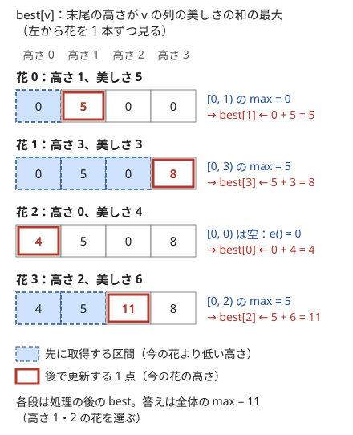

!!! abstract "要点"
    - **何ができるか**：遷移元が添字や値の範囲の最小・最大・和になる DP を、dp の値をセグメント木に載せて遷移 1 回 $O(\log N)$ にする。遷移元の窓が単調に動くだけなら、スライド最小値でならし $O(1)$ にできる。
    - **いつ使うか**：
        - 隣り合う要素の差が $D$ 以下になるように選ぶ部分列の最長。
        - $\mathrm{dp}[i] = \max_{j < i,\ l \le a_j \le r} \mathrm{dp}[j] + c$ のように、遷移元が添字や値の範囲の最小・最大。
        - 遷移のコストに $\lvert x_i - x_j \rvert$ を含む（$x_j < x_i$ と $x_j > x_i$ で分けられる）。
        - $\mathrm{dp}[i] = \min_{i - K \le j < i} \mathrm{dp}[j] + c$（窓が単調に動く）。
    - **計算量**：セグメント木なら遷移 1 回 $O(\log N)$ で全体 $O(N \log N)$。窓が単調に動くならスライド最小値で全体 $O(N)$（1 回はならし $O(1)$）
    - **前提**：[累積和・いもす法による DP の高速化](../dp/dp-prefix-sum.md)、[値を添字にする BIT・セグメント木](../ds/segment-tree-on-values.md)

<!-- textlint-disable -->
別名：セグ木 DP・BIT で DP を速くする・値を添字にした DP・deque DP・単調スタック DP
<!-- textlint-enable -->

セグメント木・スライド最小値による DP の高速化は、貰う形の遷移の右辺が「ある範囲の $\mathrm{dp}$ の最大値（最小値・和）」になっているとき、その範囲の集約をデータ構造に任せて遷移を速くする方法である。範囲が任意ならセグメント木、範囲が一方向にだけ動くならスライド最小値を使う。どちらを使うかは、式を書いて右辺の範囲の形を見て決める。

## dp の値を位置や値を添字にしたセグメント木に載せる（座標圧縮） {#values-on-segment-tree}

遷移元が範囲の最大になる DP は、素朴に書くと遷移 1 回で範囲の全部を見るので、全体 $O(N^2)$ になる。$N = 2 \times 10^5$ なら $4 \times 10^{10}$ 回ほどで間に合わない。和なら[累積和](../dp/dp-prefix-sum.md)で $O(1)$ にできるが、最大値には引き算がないので、途中から始まる範囲を累積から作れない。そこで $\mathrm{dp}$ の配列を区間最大の[セグメント木](../ds/segment-tree.md)に載せ、範囲の最大を $O(\log N)$ で取る。

何を添字にするかで 2 通りに分かれる。

- **位置を添字にする**：遷移元が「添字 $j$ の範囲」なら、$\mathrm{dp}[j]$ をそのまま位置 $j$ に置く。$\mathrm{dp}[i]$ が決まるたびに位置 $i$ へ書き込み、次からの遷移で範囲の最大を取る
- **値を添字にする**：遷移元が「値 $a_j$ の範囲」なら、$a_j$ を[座標圧縮](../basics/coordinate-compression.md)した番号を添字にし、その位置に $\mathrm{dp}[j]$ を置く。添字の条件 $j < i$ は、左から順に処理して $i$ より左の値だけを木に入れておくことで満たす

値を添字にする例として、高さが相異なる花の列から、高さが左から増加するように選ぶときの美しさの和の最大を考える（[EDPC Q](#dp_q) の形）。状態を次のように置く。

> $\mathrm{best}[v]$ ＝「ここまでに見た花から作れる、最後の花の高さが $v$ の列の美しさの和の最大」

花 $i$（高さ $h_i$、美しさ $a_i$）を見たら、$\mathrm{best}$ の区間 $[0, h_i)$ の最大を取り、$a_i$ を足した値を $\mathrm{best}[h_i]$ に書く。次の図は、高さ $(1, 3, 0, 2)$・美しさ $(5, 3, 4, 6)$ の 4 本でこれを行った様子である。



花 2 は高さ 0 なので、取得する区間 $[0, 0)$ は空である。空の区間の最大はセグメント木の[単位元](../guide/glossary.md#identity-element) $e$ を返すので、$e$ を「何も選ばない列の和」の 0 にしておけば、花 2 から始まる列の値 4 がそのまま書かれる。最後に全体の最大 11（高さ 1 と 2 の花）が答えである。

**1 本の配列を上書きしてよい理由**：本来の状態は「何本目の花まで見たか」も含む $\mathrm{best}[i][v]$ である。花 $i$ を選ばなければ $\mathrm{best}[i][v] = \mathrm{best}[i - 1][v]$ の写しで、値が変わるのは添字 $h_i$ の 1 か所だけである。よって配列を使い回し、変わる 1 点だけを更新すればよい。これは[インライン DP](../dp/inline-dp.md) と同じ考え方である。

処理の流れは次のとおりである。

```text
seg ← 区間 max のセグメント木（全要素を e で初期化。e は遷移できない値 −∞ か、問題の下限）
初期状態を書き込む
for i = 0, 1, …, N−1（遷移の依存の向きに並べた順）:
    [l, r) ← i の遷移元の範囲（位置か、圧縮した値の番号）
    v ← seg.prod(l, r)。v が −∞ なら更新しない（次の i へ）
    cur ← v + c_i
    seg の位置 p_i を max(seg.get(p_i), cur) に更新   # 取得を全部終えてから更新する
答え ← seg.all_prod()、または特定の位置の値
```

取得の後に更新するのは、同じ $i$ の値を遷移元に使わないためである。更新を先にすると、範囲が $p_i$ を含むときに花 $i$ を 2 回使う列を数えてしまう。

**計算量**：遷移 1 回で取得と更新が $O(\log N)$ ずつなので、全体 $O(N \log N)$ である。値を添字にするときは、座標圧縮のソートの $O(N \log N)$ が加わる。値の上限を $V$ として、$V$ が $10^6$ ほどなら、圧縮せずに値をそのまま添字にしてよい（葉の数は $O(V)$）。

!!! info "ACL では"
    `segtree<S, op, e> seg(n);` で全要素が `e()` になる。`seg.prod(l, r)` で $[l, r)$ の集約、`seg.set(p, x)` で一点の代入をそれぞれ $O(\log N)$、`seg.get(p)`・`seg.all_prod()` を $O(1)$ で行う。max なら `op` を `max`、`e()` を値の下限（届かない状態の $-\infty$）にする。遷移が和なら `fenwick_tree<T> fw(n);` の `fw.add(p, x)` と `fw.sum(l, r)` でもよく、どちらも $O(\log N)$ である。

**応用の型**：値の範囲が「差が $D$ 以下」なら、区間 $[a_i - D, a_i + D]$ を圧縮後の半開区間に直して最大を取る（[練習の ABC339 E](#practice)。添字の直し方は[値を添字にする BIT・セグメント木](../ds/segment-tree-on-values.md#dp-on-values)）。遷移元の条件が「値が小さい」と「位置が前」の 2 つなら、一方を処理の順序、もう一方を添字にする（[最長増加部分列のセグメント木版](../dp/lis.md#segment-tree)）。前の段の配列の範囲から取る 2 次元の DP では、段ごとに前の段を木に載せる（[典型90 037](#typical90_ak)）。

## |x − y| を左右に分けて 2 本のセグメント木に {#split-abs}

遷移のコストに $C \lvert x - y \rvert$ のような絶対値が入ると、$\mathrm{dp}[y] - C \lvert x - y \rvert$ の最大は $y$ と $x$ の両方に絡むので、そのままではセグメント木に載らない。$y \le x$ と $y \ge x$ に分けると、絶対値が外れて「$y$ だけの項」と「$x$ だけの項」の和になる。

$$
\max_{y} \bigl( \mathrm{dp}[y] - C \lvert x - y \rvert \bigr) = \max\Bigl( \max_{y \le x} \bigl(\mathrm{dp}[y] + C y\bigr) - C x,\ \max_{y \ge x} \bigl(\mathrm{dp}[y] - C y\bigr) + C x \Bigr)
$$

$C x$ は範囲の最大の外に出せるので、$\mathrm{dp}[y] + C y$ を載せた木（左の木）と $\mathrm{dp}[y] - C y$ を載せた木（右の木）の 2 本を用意すれば、それぞれ区間の最大を 1 回取るだけで済む。

![町 x = 4 へ向かうとき、町 0〜4 は左の木から dp[y] + C·y の最大を取って C·x を引き、町 4〜8 は右の木から dp[y] − C·y の最大を取って C·x を足す](../img/dp-segment-tree/split-abs.svg)

$y = x$ はどちらの範囲に入れても費用 0 で同じ値になるので、両方に入れてよい。$\mathrm{dp}[x]$ が決まったら、左の木の位置 $x$ に $\mathrm{dp}[x] + C x$ を、右の木の位置 $x$ に $\mathrm{dp}[x] - C x$ を書く。次のコードは、町 0 から出発し、順に開かれる市場（町 $t_i$、利益 $p_i$）に参加するかを選んで、移動費を引いた利益の最大を求める（[ABC353 G](#abc353_g) の形）。

```cpp
--8<-- "dp-segment-tree/split-abs.cpp:core"
```

完全なプログラム：[`split-abs.cpp`](https://github.com/yuukougun/kyopro-atlas/blob/main/snippets/dp-segment-tree/split-abs.cpp)（GitHub）
{ .kp-code-src }

遷移 1 回で取得 2 回と更新 2 回なので、市場の数を $M$ として全体 $O(N + M \log N)$ である。

**なぜ 2 本に分けるのか**：1 本の木に $\mathrm{dp}[y]$ だけを載せると、$C \lvert x - y \rvert$ は $x$ が変わるたびに全部の $y$ で値が変わるので、木の中身を作り直すことになる。分けた後の $\mathrm{dp}[y] \pm C y$ は $x$ によらないので、一度書けば次の遷移でもそのまま使える。

**応用の型**：コストが $f(x) + g(y)$ の形に分かれる遷移は、どれも同じ方法で木に載る。絶対値なら大小で 2 通りに分ける。$\max(x, y)$ のように $x$ と $y$ の大小で式が変わるコストも、場合ごとに木を分ける。$x$ と $y$ の積の項 $a_y x$ が残るときは、範囲の最大では取れないので [Convex Hull Trick](../dp/cht.md#lines) を使う。

## 区間を覆う最小コスト（右端までの最小） {#interval-cover}

区間 $[l_i, r_i)$（費用 $c_i$）をいくつか選んで $[0, L)$ 全体を覆う最小の費用は、「どこまで覆えたか」を状態にした DP で求まる。費用は $c_i \ge 0$ とする。負の費用があると、覆うのに要らない区間も選ぶ方が得になり、この DP では求まらない。

> $\mathrm{dp}[x]$ ＝「選んだ区間の和集合が $[0, x)$ を含み、右端の最大がちょうど $x$ になるときの、費用の最小」

区間 $[l, r)$ を足して $[0, r)$ まで覆えるのは、すでに覆えている位置 $x$ が $l \le x < r$ を満たすときである（$x < l$ だと $[x, l)$ に穴が空き、$x \ge r$ だと足しても伸びない）。よって遷移は次のとおりで、区間 $[l, r)$ の最小を取ればよい。

$$
\mathrm{dp}[r] \leftarrow \min\Bigl(\mathrm{dp}[r],\ \min_{l \le x < r} \mathrm{dp}[x] + c\Bigr)
$$

**計算順序**：区間を右端 $r$ の小さい順に処理する。$\mathrm{dp}[x]$ を更新するのは右端が $x$ の区間だけなので、区間 $[l, r)$ を処理する時点で、$x < r$ の $\mathrm{dp}[x]$ はすべて確定している。右端が同じ $r$ の区間どうしは、取得の範囲が $r$ を含まないので互いに影響しない。初期値は $\mathrm{dp}[0] = 0$（空の区間は覆えている）、ほかは $+\infty$ で、答えは $\mathrm{dp}[L]$ である。

```cpp
--8<-- "dp-segment-tree/interval-cover.cpp:core"
```

完全なプログラム：[`interval-cover.cpp`](https://github.com/yuukougun/kyopro-atlas/blob/main/snippets/dp-segment-tree/interval-cover.cpp)（GitHub）
{ .kp-code-src }

区間の数を $N$ として、ソートと遷移を合わせて $O(N \log N + L)$ である。座標が大きいときは、区間の両端点と $0$・$L$ を座標圧縮すれば $O(N \log N)$ になる。

**応用の型**：同じ形は「点を順に進み、1 回で $[l, r)$ の範囲まで跳べる」最小回数・最小費用にも現れる。費用がすべて等しい（区間の数の最小）なら DP は要らず、「覆えている位置から始められる区間のうち、右端が最大のものを選ぶ」[貪欲法](../basics/greedy-basics.md)で足りる。区間の入れ子の深さを求める DP（[力試しの ABC410 G](#challenge)）では、取るのが最小ではなく最大になる。

## スライド最小値（単調 deque）と単調スタックによる遷移 {#dp-sliding-window}

遷移元の範囲 $[\mathrm{lo}(i), \mathrm{hi}(i)]$ の両端が、計算する順に $i$ を進めたとき**どちらも戻らない**なら、セグメント木の代わりに[スライド最小値](../ds/monotonic-stack.md#sliding-window-minimum)の deque で取れる。各添字は deque に 1 回入って高々 1 回出るので、全体 $O(N)$（遷移 1 回はならし $O(1)$）になる。1 次元の $\mathrm{dp}[i] = \min_{i - K \le j < i} \mathrm{dp}[j] + c_i$ の手順は[単調スタックの DP の節](../ds/monotonic-stack.md#dp-transition)にあるので、ここでは使える条件と、そのままでは使えない形の直し方を扱う。

**前の段の窓**：材料ごとに「使わないか、$L_i$ 以上 $R_i$ 以下の量を使う」を選び、合計の量をちょうど $W$ にして価値の和を最大にする DP（[典型90 037](#typical90_ak) の形）では、遷移は次のようになる。

$$
\mathrm{dp}[i][j] = \max\Bigl( \mathrm{dp}[i - 1][j],\ \max_{j - R_i \le k \le j - L_i} \mathrm{dp}[i - 1][k] + V_i \Bigr)
$$

段 $i$ の中で $j$ を増やすと、窓 $[j - R_i, j - L_i]$ の両端は 1 ずつ右へ動く。前の段 $\mathrm{dp}[i - 1]$ は書き換えないので、段ごとに deque を空にして作り直せば、段 1 つが $O(W)$ で済む。

```cpp
--8<-- "dp-segment-tree/window-row.cpp:core"
```

完全なプログラム：[`window-row.cpp`](https://github.com/yuukougun/kyopro-atlas/blob/main/snippets/dp-segment-tree/window-row.cpp)（GitHub）
{ .kp-code-src }

作れない量（$-\infty$）は deque に入れない。入れると、$-\infty + V_i$ が溢れるか、作れない状態から遷移した値が残る。窓が空になる $j$ では deque も空になるので、先頭を読む前に空かを確かめる。全体は $O(NW)$ で、セグメント木で書けば $O(NW \log W)$ である。

**$i$ によるコストを外に出す**：直近 $K$ 個からの遷移でも、コストが $j$ と $i$ の両方に絡むと、窓の中の値が $i$ ごとに変わってしまう。コストが累積和の差 $S_i - S_j$ のように「$i$ だけの項」と「$j$ だけの項」に分かれるなら、

$$
\min_{i - K \le j < i} \bigl( \mathrm{dp}[j] + S_i - S_j \bigr) = \min_{i - K \le j < i} \bigl( \mathrm{dp}[j] - S_j \bigr) + S_i
$$

と書き直し、$\mathrm{dp}[j] - S_j$ を deque に入れる。これは前の節の $\lvert x - y \rvert$ を分ける考え方と同じである。容量 $K$ の袋で荷物を順に配り、拠点との往復を挟む最短距離のような問題がこの形になる。

**単調スタックで遷移元が 1 つに決まる形**：遷移元が範囲の最小ではなく「手前で初めて自分より大きい位置 $j$」の 1 点で決まる DP もある。水槽に水を入れる [ABC359 E](#practice) では $\mathrm{dp}[i] = \mathrm{dp}[j] + H_i (i - j)$ となり、$j$ を[単調スタック](../ds/monotonic-stack.md)で求めれば全体 $O(N)$ である（解き方の詳細は[単調スタックの例題](../ds/monotonic-stack.md#abc359_e)）。

**使えない形**：窓の左端が戻る（範囲が $i$ ごとにばらばらに動く）なら、deque は使えない。捨てた添字が後で必要になるからである。値を添字にした範囲も、処理する順で単調に動くとは限らないので、セグメント木を使う。

## セグメント木・累積和・スライド最小値の使い分け {#which-tool}

どの道具を使うかは、貰う形の式を書いたときの右辺の「集約の種類」と「範囲の動き方」で決まる。

| 右辺の形 | 範囲の動き方 | 使う道具 | 遷移 1 回 |
| --- | --- | --- | --- |
| 範囲の和 | 任意 | [累積和](../dp/dp-prefix-sum.md)（前の段が確定しているとき） | $O(1)$ |
| 範囲の和 | 値の更新と取得が混ざる | [BIT](../ds/fenwick-tree.md) | $O(\log N)$ |
| 接頭辞・接尾辞の min・max | 端から始まる | [累積 min・max](../dp/dp-prefix-sum.md#prefix-min) | $O(1)$ |
| 範囲の min・max | 両端が戻らずに動く | スライド最小値 | ならし $O(1)$ |
| 範囲の min・max | 任意、または値の範囲 | セグメント木 | $O(\log N)$ |

累積和とスライド最小値は、遷移の前に配列が確定している（前の段から取る、または範囲が単調に動く）ことを前提にする。更新と取得が交互に来て範囲も自由なら、セグメント木か BIT にする。セグメント木はほかのすべての行の代わりにもなるので、計算量に余裕があれば迷わずセグメント木で書いてよい。スライド最小値に切り替えるのは、$\log$ を落とさないと間に合わない（$N W$ が $10^8$ を超えるなど）ときである。

前の段をほとんどそのまま写し、一部の範囲へ一律に足す遷移では、範囲の取得ではなく範囲の更新が要る。これは[インライン DP](../dp/inline-dp.md)（遅延セグメント木）で扱う。遷移のコストが $a_j x_i$ のような積を含むなら [Convex Hull Trick](../dp/cht.md#lines) を使う。ほかの道具を含めて、どれを使うかは [DP の高速化の選び方](../dp/dp-speedup-overview.md#shape-to-tool)で遷移の式の形から決める。

## 落とし穴 {#pitfalls}

- **同じ $i$ の値を使う**：$\mathrm{dp}[i]$ を木に書いてから取得すると、範囲が自分の位置を含むとき $i$ を 2 回使う。取得をすべて終えてから更新する。値を添字にして同じ値が何度も出るとき、狭義（同じ値の後ろにつながない）なら範囲を $[0, v)$、広義なら $[0, v + 1)$ にする
- **単位元と届かない状態の取り違え**：max の木の `e()` を 0 にすると、遷移元が 1 つもない範囲から 0 が返り、「何も選ばない」から遷移したことになる。答えが 0 から始まってよい（何も選ばない列が許される）ときだけ 0 にし、「ちょうど $W$」のように届かない状態があるなら $-\infty$ にする
- **$-\infty$ や $+\infty$ への加算**：`LLONG_MIN` に費用を足すと溢れる。届かない値 `NEG` を $-2^{62}$ ほどにし、取得した値が `NEG` なら足さずに飛ばす。$\lvert x - y \rvert$ を分けた木では $C y$ が加わるので、$C \cdot N$ と値の大きさを足しても型に収まるかを見積もる
- **座標圧縮の忘れ**：値が $10^9$ までなら、値をそのまま添字にした木は作れない。範囲の端は `lower_bound`（左端）と `upper_bound`（閉区間の右端）で圧縮後の半開区間に直す（[座標圧縮](../basics/coordinate-compression.md#with-ds)）
- **計算順序**：区間を覆う DP で区間をソートしないと、まだ確定していない $\mathrm{dp}[x]$ から遷移する。取得する範囲の値がすべて確定してから読める順で処理する
- **deque に値だけを入れる**：窓から出たかは添字でしか判定できない。deque には添字を入れ、値は配列から引く

## 例題 {#examples}

### EDPC Q. Flowers {#dp_q}

<div class="kp-problems" data-role="example" markdown>

- [EDPC Q. Flowers](https://atcoder.jp/contests/dp/tasks/dp_q)（diff なし）：高さが相異なる花の列から、高さが左から単調増加になるように選ぶときの美しさの和の最大を求める。

</div>

高さを添字にした区間 max のセグメント木に、「最後の花の高さが $v$ の列の美しさの和の最大」を持つ。花を左から見て、自分より低い高さの区間の最大に自分の美しさを足し、自分の高さの位置に書く。[値を添字にする節](#values-on-segment-tree)の図の手順そのままで、全体 $O(N \log N)$ である。

??? note "解法の詳細"
    高さ $h_i$ は $1$ 以上 $N$ 以下で相異なるので、座標圧縮は要らない。$h_i - 1$ を添字にし、長さ $N$ の木を全要素 0 で作る（0 は何も選ばない列の和で、どこからでも新しく列を始められるので $-\infty$ は要らない）。各 $i$ で $\mathrm{cur} = \mathrm{prod}(0, h_i - 1) + a_i$ を求め、位置 $h_i - 1$ に書く。高さが相異なるので、同じ位置に 2 回書くことはない。答えは `all_prod()` である。美しさの和は大きくなりうるので `long long` で持つ。区間が接頭辞 $[0, v)$ なので、接頭辞の max を持つ BIT でも書ける。

### 典型90 037. Don't Leave the Spice（★5） {#typical90_ak}

<div class="kp-problems" data-role="example" markdown>

- [典型90 037. Don't Leave the Spice（★5）](https://atcoder.jp/contests/typical90/tasks/typical90_ak)（diff なし）：N 種類の材料をそれぞれ L_i〜R_i グラム（または使わない）で使い、合計をちょうど W グラムにするときの価値の和の最大を求める。

</div>

「$\mathrm{dp}[i][j]$ ＝ 材料 $i$ 種類目までで合計 $j$ グラムにするときの価値の和の最大」とすると、使う量の範囲が $[L_i, R_i]$ なので、遷移元は前の段の連続した範囲 $[j - R_i, j - L_i]$ になる。範囲を素朴に見ると $O(N W^2)$ かかるので、前の段をセグメント木に載せて区間の最大を取るか、[スライド最小値の節](#dp-sliding-window)のように deque で取る。

??? note "解法の詳細"
    初期値は $\mathrm{dp}[0][0] = 0$ で、ほかは「作れない」を表す $-\infty$ とする。段 $i$ では、まず $\mathrm{dp}[i][j] = \mathrm{dp}[i - 1][j]$（使わない）とし、範囲 $[\max(0, j - R_i), j - L_i]$ が空でなければ、その最大に $V_i$ を足した値と比べる。範囲の最大が $-\infty$ なら足さない。

    セグメント木なら、段ごとに前の段の配列から木を作り（構築 $O(W)$）、各 $j$ で区間の最大を取るので全体 $O(N W \log W)$ である。窓の両端は $j$ とともに右へ動くので、deque なら全体 $O(NW)$ になる。答えは $\mathrm{dp}[N][W]$ で、$-\infty$ のままなら作れないので $-1$ を出す。

### ABC353 G. Merchant Takahashi {#abc353_g}

<div class="kp-problems" data-role="example" markdown>

- [ABC353 G. Merchant Takahashi](https://atcoder.jp/contests/abc353/tasks/abc353_g)（diff 1765）：順に開かれる市場へ町の間を移動しながら参加するとき、移動費（C×距離）を引いた利益の最大を求める。

</div>

「$\mathrm{dp}[y]$ ＝ ここまでの市場を処理した後、町 $y$ にいるときの利益の最大」とすると、市場 $i$（町 $T_i$）に参加する遷移は $\max_y (\mathrm{dp}[y] - C \lvert T_i - y \rvert) + P_i$ である。$y \le T_i$ と $y \ge T_i$ で分ければ、[|x − y| を分ける節](#split-abs)のとおり 2 本のセグメント木の区間の最大で取れる。木の構築が $O(N)$、市場 1 つにつき $O(\log N)$ で、全体 $O(N + M \log N)$ である。

??? note "解法の詳細"
    町を 0-indexed にし、出発する町 0 で $\mathrm{dp}[0] = 0$、ほかは $-\infty$ とする。左の木には $\mathrm{dp}[y] + C y$、右の木には $\mathrm{dp}[y] - C y$ を載せる。

    市場 $i$ では、左の木の $[0, T_i]$ の最大から $C T_i$ を引いた値と、右の木の $[T_i, N)$ の最大に $C T_i$ を足した値の大きい方に $P_i$ を足して $\mathrm{cur}$ とする。参加しない場合は何もしなくてよい（市場に行かなければ、いる町も利益も変わらない）。参加した後は町 $T_i$ にいるので、両方の木の位置 $T_i$ を $\mathrm{cur} \pm C T_i$ との大きい方に更新する。取得を 2 本とも終えてから更新する。

    答えは、すべての $y$ についての $\mathrm{dp}[y]$ の最大と 0（どこにも参加しない）の大きい方である。$\mathrm{dp}[y]$ は左の木の値から $C y$ を引けば戻せる。$C y$ や利益の和は大きくなりうるので `long long` で持ち、$-\infty$ には足さない。

## 練習問題 {#practice}

<div class="kp-problems" data-role="practice" markdown>

- [ABC339 E. Smooth Subsequence](https://atcoder.jp/contests/abc339/tasks/abc339_e)（diff 1109）：隣り合う要素の差が D 以下であるような部分列の最大の長さを求める。
- [ABC359 E. Water Tank](https://atcoder.jp/contests/abc359/tasks/abc359_e)（diff 1275）：板で仕切られた水槽に左端から水を入れ続けるとき、各区画に初めて水が入る時刻を答える。
- [ARC026 C. 蛍光灯](https://atcoder.jp/contests/arc026/tasks/arc026_3)（diff 1930・参考値）：区間を照らす蛍光灯を選び、区間全体を照らすときの費用の最小を求める。

</div>

??? note "練習の方針"
    - **ABC339 E**：値を添字にし、「最後の値が $v$ の部分列の最長」を区間 max の木に持つ。$A_i$ では $[A_i - D, A_i + D]$ の最大に 1 を足して位置 $A_i$ に書く。長さは 0 以上なので単位元は 0 でよい（[値を添字にする節](#values-on-segment-tree)）
    - **ABC359 E**：遷移元は範囲ではなく「手前で初めて高い仕切り」の 1 点で、単調スタックで求まる（[スライド最小値の節](#dp-sliding-window)の終わり）
    - **ARC026 C**：蛍光灯を右端の小さい順に見て、照らせている位置の最小費用の区間最小を取る。[区間を覆う節](#interval-cover)の形そのものである。問題文の区間が閉区間か半開区間かを確かめ、半開区間に直してから使う

## 力試し {#challenge}

<div class="kp-problems" data-role="challenge" markdown>

- [ABC410 G. Longest Chord Chain](https://atcoder.jp/contests/abc410/tasks/abc410_g)（diff 2242）：円周上の弦の集まりから、残りどうしが交わらないように何本か取り除き、新しい弦を 1 本足すとき、新しい弦と交わる弦の数の最大を求める。

</div>

??? note "力試しの方針"
    - **ABC410 G**：新しい弦と交わり、互いには交わらない弦の集まりは、円をどこかで切って直線に開くと、入れ子に並ぶ区間の列になる。円を 2 周分に開き、各弦を $[x, y)$ と $[y, x + 2N)$ の 2 つの区間にすれば、切る場所を全部試したことになる。答えは入れ子の深さの最大である。区間を右端の小さい順に見て、左端が $(x, y)$ にある処理済みの区間の $\mathrm{dp}$ の最大に 1 を足し、それを左端 $x$ の位置に書く。区間を覆う DP と同じく、右端の順に処理するので、処理済みの区間は右端も $y$ より左にあり、$[x, y)$ の内側に入る

## 確認問題 {#quiz}

??? question "確認問題：$\mathrm{dp}[i] = \max(\mathrm{dp}[j]) + a_i$（$j < i$ かつ $a_j < a_i$）を、値を添字にした木で解くとき、処理の順序と添字のどちらがどちらの条件を受け持つか"
    添字の条件 $j < i$ は処理の順序が受け持つ。左から順に処理すれば、木に入っているのは $i$ より左の値だけである。値の条件 $a_j < a_i$ は、圧縮後の番号を添字にした区間 $[0, v)$ が受け持つ。逆に値の小さい順に処理し、位置を添字にして $[0, i)$ を取ってもよい（同じ値は位置の大きい順に処理する）。

??? question "確認問題：$\mathrm{dp}[y] - C \lvert x - y \rvert$ の最大を、$\mathrm{dp}[y] - C y$ を載せた木 1 本だけで取れるか"
    取れない。$y \le x$ の側では費用が $C(x - y)$ なので、要るのは $\mathrm{dp}[y] + C y$ である。$\mathrm{dp}[y] - C y$ を $y \le x$ の側でも使うと、$\mathrm{dp}[y] - C y + C x$ を最大にすることになり、左へ戻るときの費用を $-C(x - y)$、すなわち得をする向きに数えてしまう。左右で符号の違う 2 本が要る。

??? question "確認問題：区間を覆う DP で、右端が同じ区間どうしの処理の順を気にしなくてよいのはなぜか"
    右端が $r$ の区間が書き込むのは $\mathrm{dp}[r]$ だけで、読むのは $[l, r)$ の範囲だけだからである。読む範囲に $r$ が入らないので、右端が同じ区間どうしは互いの書き込みを読まない。読む位置 $x < r$ に書き込む区間（右端が $x$）は、すべて先に処理されている。

??? question "確認問題：$\mathrm{dp}[i] = \min_{i - K \le j < i} \mathrm{dp}[j] + \lvert h_i - h_j \rvert$ をスライド最小値で $O(N)$ にできるか"
    そのままではできない。窓は単調に動くが、コスト $\lvert h_i - h_j \rvert$ は $i$ と $j$ の両方に絡み、大小で式が変わる。このため、窓の中の値を $i$ によらない形にできない。$h_j \le h_i$ と $h_j \ge h_i$ に分けるには「窓の中で、高さが $h_i$ 以下のもの」という値の条件が加わり、範囲が添字と値の 2 つになる。$K$ が小さければ素朴に $O(NK)$ で解く。

## 参考 {#references}

- [AtCoder Library「Segtree」（document_ja）](https://github.com/atcoder/ac-library/blob/master/document_ja/segtree.md)：`segtree` の宣言・`prod`・`set`・`get`・`all_prod` の計算量（v1.6 の手元の版で確かめた）
- [AtCoder Library「Fenwick Tree」（document_ja）](https://github.com/atcoder/ac-library/blob/master/document_ja/fenwicktree.md)：`fenwick_tree` の `add`・`sum` の計算量
- [Series_205「Educational DP Contest (EDPC) P ~ S 問題 解説」](https://qiita.com/Series_205/items/6bad5c32a1fce8dc2914)：例題 dp_q の状態・1 本の配列の使い回し・制約
- [drken「EDPC (Educational DP Contest) Q - Flowers」](https://drken1215.hatenablog.com/entry/2021/08/11/000352)：例題 dp_q を重み付き LIS として見る見方
- [E869120「kyopro_educational_90 の sol/037.cpp」](https://github.com/E869120/kyopro_educational_90/blob/main/sol/037.cpp)：例題 typical90_ak の状態・前の段を区間最大のセグメント木に載せる遷移・作れない状態の扱い
- [drken「AtCoder ABC 353 G - Merchant Takahashi (2D, 青色, 550 点)」](https://drken1215.hatenablog.com/entry/2024/05/13/234955)：例題 abc353_g の状態・2 本のセグメント木の持ち方・初期状態
- [drken「AtCoder ARC 026 C - 蛍光灯 (試験管青色)」](https://drken1215.hatenablog.com/entry/2023/10/21/104733)：練習 arc026_3 の状態・右端の順の処理・区間最小
- [kmjp「AtCoder ABC #410 (CodeQUEEN 2025 予選) : G - Longest Chord Chain」](https://kmjp.hatenablog.jp/entry/2025/06/14/0930)：力試し abc410_g の 2 周分に開く方法と入れ子の深さの DP
- [Kazun「AtCoder Beginner Contest 334 F問題 Christmas Present 2」](https://kazun-kyopro.hatenablog.com/entry/ABC/334/F)：直近 K 個からの遷移で、i だけの項を外に出す形の確かめ
