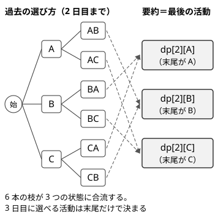
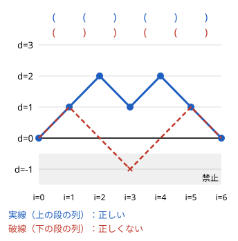

!!! abstract "要点"
    - **何ができるか**：過去の選び方をすべて覚える代わりに、この先の選び方と評価に影響する要約（直前の値・個数・末尾の数文字・開き括弧の数など）だけを状態に持ち、指数通りの選び方を少ない状態に合流させる。要約が同じ選び方は、どんな続きを付けても可否と増える値が同じなので、まとめても答えは変わらない。
    - **いつ使うか**：
        - 隣り合う〜が異なる・同じことを連続して〜しない。
        - 直前の選択でコストが変わる・モードが切り替わる。
        - 長さ K の回文・特定の短い文字列を部分文字列に含まない文字列の数。
        - 円形に並んでいる（最後と最初も隣り合う）。
        - `(` と `)` と `?` の列から正しい括弧列を作る方法の数。
        - 制約の一部だけが小さい（$K \le 5$、末尾の $K \le 10$ 文字、文字の種類 26）。
    - **計算量**：状態数 × 1 状態あたりの遷移数。2 種類の文字の末尾 $K - 1$ 文字を持つなら状態は $O(N \cdot 2^K)$ 個、括弧列なら $O(N^2)$ 個。環状の列で最初の状態を固定すると、その通り数だけ倍になる。
    - **前提**：[DP の基本](../dp/dp-basics.md)

<!-- textlint-disable -->
別名：状態設計・DP の状態・直前を状態に持つ・末尾の数文字を状態に持つ・環状 DP・円環 DP・括弧列の DP
<!-- textlint-enable -->

DP の状態の設計とは、「先頭から $i$ 個を決めた」という段階に、何を添えれば残りを正しく決められるかを見抜くことである。添えるものが多すぎると状態数が爆発し、少なすぎると遷移が書けないか答えを間違える。ちょうどよい要約は、たいてい問題の制約の「小さい部分」に現れる。

## 将来に効く要約だけを持てば合流できる理由 {#why-summary-works}

列の要素を先頭から 1 つずつ決める問題を考える。添字は 0-indexed で書く。先頭 $i$ 個の決め方は指数通りあるが、それらをすべて区別する必要はない。2 つの決め方 $x$ と $x'$ が次の性質を満たすなら、DP では同じ[状態](../guide/glossary.md#state)にまとめてよい。

> 残りの決め方 $y$ をどう選んでも、$x$ に $y$ を続けたものと $x'$ に $y$ を続けたものの可否が一致し、$y$ の部分で増える値も一致する。

この性質を満たす情報を要約 $\sigma$ と呼ぶ。要約が同じなら、続きの最善の選び方も同じになる。だから最適化なら要約ごとに今までの値の最大だけを、数え上げなら要約ごとの個数の和だけを持てば足りる。DP の表は次の意味になる。

$$
\mathrm{dp}[i][\sigma] = \text{先頭 } i \text{ 個を決めて要約が } \sigma \text{ になる決め方のうち、値の最大（数え上げなら個数）}
$$

要約が十分かどうかは、遷移を書いてみると確かめられる。次の 2 つが「今の要約 $\sigma$」と「次の選択 $c$」だけで書ければ、その要約で足りる。

- 次の要約 $\sigma' = \delta(\sigma, c)$（選択 $c$ が許されるかも含む）
- この 1 歩で増える値 $w(\sigma, c)$

逆に、遷移を書こうとして「もう 1 つ前の選択も知りたい」「今までの合計そのものが要る」となったら、要約が足りていない。足りないものを状態に足すのが状態の設計の基本の動きである。

次の図は、毎日 A・B・C の 3 つの活動から 1 つを選び、同じ活動を 2 日続けない問題で、2 日目までの決め方を表したものである。



3 日目に選べる活動は、2 日目に何をしたかだけで決まる。1 日目の活動は 3 日目以降に影響しない。そこで「最後の活動」を要約にすると、6 本の枝は 3 つの状態に合流する。日数が増えても状態は 1 日あたり 3 つのままで、決め方の数 $3 \cdot 2^{N-1}$ を数え上げずに済む。

??? question "確認問題：要約を持たないと"
    同じ活動を 2 日続けない問題で、$\mathrm{dp}[i]$ ＝「$i$ 日目までの幸福度の和の最大」だけを持つと、何が困るか。

    ??? success "答え"
        $i + 1$ 日目に選べる活動は $i$ 日目の活動で決まるのに、$\mathrm{dp}[i]$ からは $i$ 日目に何をしたかが分からない。最大を与えた決め方の最終日の活動を使うと、2 番目によい決め方（最終日の活動が違う）から伸ばした方がよい場合を取りこぼす。最終日の活動を状態に足して $\mathrm{dp}[i][j]$ とすれば、遷移は「$j \ne k$ なら $\mathrm{dp}[i][j]$ から $\mathrm{dp}[i+1][k]$ へ」と書ける。

## 典型の要約（直前の値・on/off・偶奇・個数・上限で打ち切った値） {#typical-summaries}

状態に足す要約には決まった型がある。問題文の条件が何に依存しているかを読み、次の表から当てはまるものを探す。

| 条件の形 | 状態に足す要約 | 足す状態の数 |
| --- | --- | --- |
| 隣り合うものが異なる・直前でコストが変わる | 直前の値（直前の選択） | 選択肢の数 |
| 毒で体調が変わる・モードが切り替わる | on/off・今のモード | 2〜数個 |
| 和が偶数・M の倍数 | 和の偶奇・和 mod M | 2・M |
| ちょうど K 個選ぶ・連続は K 回まで | 選んだ個数・今の連続の長さ | K + 1 |
| すべての値を P 以上にする | 値を P で打ち切ったもの | $(P + 1)^K$ |
| 目的地と行・列が一致するか | 一致するかどうかの組 | 4 |

**直前の値**は最もよく使う要約である。「同じことを連続してしない」「直前と同じなら追加のコスト」は、直前の選択だけで次の可否とコストが決まるので、それを持てば足りる。「同じことを 3 回以上続けない」のように連続の長さが効くなら、（直前の値, 今の連続の長さ）の組を持つ。

**on/off・モード**は、過去の出来事が今の「状態」を切り替える場合に使う。毒の料理を食べると体調が悪くなり、もう一度毒を食べると失敗する、という問題では、体調の良し悪しの 2 通りを持てばよい。食べた料理の並びは、体調を通してしか将来に効かない。

**偶奇・余り**は、条件が和の偶奇や $M$ の倍数のときに使う。和そのものは大きくても、足し算と mod の取り方が両立するので、和 mod $M$ だけで次の余りが決まる（[余り・個数を状態に持つ DP](../dp/dp-mod-state.md)）。

**上限で打ち切った値**は、「$P$ 以上になればよい」という条件で使う。値が $P$ に届いた後は、いくら増えても条件は満たしたままで、減ることもない。だから $P$ 以上の値はすべて $P$ と同一視してよい。$K$ 個のパラメータがあれば、各パラメータを $0, 1, \dots, P$ に打ち切った $K$ 個組を状態にし、$(P+1)$ 進数の整数に直して配列の添字にする。

**一致するかどうか**は、対称性で状態を潰す型である。壁のない盤面でルークを動かす経路の数を数えるとき、今いるマスそのものではなく、目的地と行が一致するか・列が一致するかの 4 通りにまとめられる。同じ組に属するマスからは、次の 1 手で各組へ移る方法の数が同じだからである。$H \times W$ 個の状態が 4 個になる。

??? question "確認問題：打ち切ってよい理由"
    「$K$ 個のパラメータをすべて $P$ 以上にする」問題で、値を $P$ で打ち切ってよいのはなぜか。「すべてちょうど $P$ にする」ならどうか。

    ??? success "答え"
        $P$ 以上の値は、この先何を選んでも $P$ 以上のままなので、続きの可否と費用が $P$ ちょうどの場合と同じになる。将来に効く情報が同じなので同一視してよい。「ちょうど $P$」なら、$P$ を超えた値は二度と条件を満たさないので、$P$ を超えたものを 1 つの「失敗」の状態にまとめる（または遷移で捨てる）。どちらも状態は $0$〜$P$ と 1 つ程度に収まる。

## 末尾の数文字を状態にする（禁止された並び・回文を避ける） {#last-characters}

「ある短い文字列を部分文字列に含まない」「長さ $K$ の回文を含まない」という条件では、末尾の数文字を状態にする。禁止された並びの長さが $L$ なら、新しい 1 文字を足したときに新しく生まれる長さ $L$ の部分文字列は、末尾の $L$ 文字の 1 つだけである。それを判定するには、足す前の末尾 $L - 1$ 文字があれば足りる。

- **状態**：$\mathrm{dp}[i][t]$ ＝ 先頭 $i$ 文字を決めて、禁止された並びをまだ含まず、末尾の $L - 1$ 文字が $t$ である決め方の数
- **遷移**：文字 $c$ を足し、$t$ と $c$ をつないだ $L$ 文字が禁止された並びなら捨てる。そうでなければ先頭の 1 文字を落とした $L - 1$ 文字が次の状態になる
- **初期値と答え**：$\mathrm{dp}[0][\text{空}] = 1$。答えは $\mathrm{dp}[N][t]$ の $t$ についての和

2 種類の文字なら $L - 1$ 文字は $(L-1)$ bit の整数で表せる。1 つ左にずらして空いた最下位に新しい文字を入れ、上位にはみ出た bit を落とせば、次の状態になる。長さ $K$ の回文を避けるなら、足した後の $K$ bit が回文かを調べる。

まだ $L - 1$ 文字そろっていない最初のうちは、足りない部分をダミーの文字で埋めておき、$L$ 文字そろうまで判定しない。判定する時点では窓の中が本物の文字だけになるので、ダミーの値は答えに影響しない。

次のコードは、`A`・`B`・`?` からなる文字列の `?` を埋めて長さ $K$ の回文を含まないようにする方法の数を求める。状態は末尾 $K - 1$ 文字の bit で、`B` を 1 とする。

```cpp
--8<-- "dp-state-design/avoid-palindrome.cpp:core"
```

状態は $2^{K-1}$ 個、遷移は 2 通りで、回文の判定に $O(K)$ かかるので、全体で $O(N K 2^K)$ になる。$K \le 10$ なら 1 文字あたり約 $10^4$ 回で済む。

禁止された並びが少し複雑でも、長さが短ければ同じ方法が使える。たとえば「隣り合う 2 文字を 1 回入れ替えると禁止された並びが現れる」という条件も、入れ替えた結果に現れうる並びを長さ 4 以下の禁止された並びとして書き出せば、末尾 3 文字の状態で判定できる（[ABC122 D の例題](#abc122_d)）。

禁止された並びが長いときは、末尾の文字をそのまま持つと $C^{L-1}$ 通り（$C$ は文字の種類の数）に増えすぎる。そのときは「並びの何文字目まで一致しているか」だけを持つ[照合オートマトン上の DP](../string/string-automaton-dp.md#kmp-automaton) に進む。末尾の数文字を持つ方法は、その簡易版にあたる。

## 括弧列の DP（開き括弧の残り数を状態にする） {#bracket-dp}

`(`・`)`・`?` からなる文字列の `?` を埋めて[正しい括弧列](../guide/glossary.md#balanced-parentheses)にする方法の数は、閉じていない `(` の数だけを状態にして数えられる。`(` を $+1$、`)` を $-1$ として左から足していった値を深さ $d$ とすると、正しい括弧列であることは次と同じである。

> 途中で一度も $d < 0$ にならず、最後に $d = 0$ になる。

どの `(` とどの `)` が対応するかは、この先の可否に影響しない。将来に効くのは「あといくつ閉じる必要があるか」だけなので、深さ $d$ が要約になる。



- **状態**：$\mathrm{dp}[i][d]$ ＝ 先頭 $i$ 文字を決めて、閉じていない `(` が $d$ 個ある決め方の数
- **遷移**：`(` を置けば $d \to d + 1$。`)` を置けるのは $d > 0$ のときだけで $d \to d - 1$。`?` は両方を試す
- **初期値と答え**：$\mathrm{dp}[0][0] = 1$。答えは $\mathrm{dp}[N][0]$

```cpp
--8<-- "dp-state-design/bracket.cpp:core"
```

$d$ の範囲は $0$ 以上 $N$ 以下なので、状態は $O(N^2)$ 個、遷移は 2 通りで、全体で $O(N^2)$ になる。$N$ が奇数なら答えは 0 である。残りの文字数より $d$ が大きい状態は最後に 0 へ戻れないので、$d \le N - i$ に絞ると定数倍が軽くなる。

括弧列の問われ方（判定・区間の判定・並べる順序など）との関係は[括弧列](../patterns/bracket-sequence.md#counting)のページにまとめてある。並べ替えて正しくする問題は貪欲で解くもので、この DP とは別物である。

## 環状の列（1 か所で切り、最初の状態を固定して DP を回す） {#dp-cyclic}

円形に並んだ列では、最後の要素と最初の要素も隣り合う。左から DP を回すと、最後の要素を決めるときに最初の要素の情報が要る。そこで列を最初の要素の前で切り開き、最初の要素について何かを固定してから DP を回し、最後に最初の要素との整合を確かめる。

固定の仕方は 2 通りある。

- **最初の状態を全通り固定する**：最初の要素の選択（たとえば選ぶ・選ばない）を 1 つ決めて DP を回し、最後の要素が最初の要素と矛盾しない状態だけを答えに入れる。これを最初の状態の全通りについて行う。計算量は最初の状態の数だけ倍になる
- **最初の要素との関係を要約にする**：最初の要素の値そのものではなく、「今の要素が最初の要素と同じか」だけを状態に足す。選択肢が多くても状態は 2 通りで済む

後者の例として、円形に並ぶ $N$ 人（$N \ge 2$）を $M$ 色で塗る方法の数を数える。条件は、隣り合う人どうしが異なる色になることである。1 人目の色を固定し、$i$ 人目が 1 人目と同じ色か異なる色かを状態にする。

- 同じ → 異なる：$M - 1$ 色、異なる → 同じ：1 色、異なる → 異なる：$M - 2$ 色、同じ → 同じ：0 色
- 1 人目は「同じ」の状態から始め、$N$ 人目は 1 人目と隣り合うので「異なる」の状態だけを数える
- 1 人目の色は $M$ 通りあり、どの色でも同じ数になるので、最後に $M$ を掛ける

```cpp
--8<-- "dp-state-design/cyclic-coloring.cpp:core"
```

計算量は $O(N)$ である。この数は $(M - 1)^N + (-1)^N (M - 1)$ と等しく、小さい $N, M$ で確かめられる。1 列の塗り分けとの関係は[一列の塗り分けと円環の塗り分け](../comb/counting-basics.md#coloring)を参照。

最適化の問題でも同じである。「円形に並ぶ要素から隣り合わないように選んで和を最大にする」なら、1 個目を選ぶ場合と選ばない場合で 2 回 DP を回す。1 個目を選んだ回では、最後の要素を選んだ状態を答えから外す。

??? question "確認問題：固定した後の掛け算"
    円形の塗り分けで 1 人目の色を固定して DP を回した後、$M$ を掛けてよいのはなぜか。1 人目にだけ使えない色があるときはどうするか。

    ??? success "答え"
        色の名前を入れ替えても隣り合う条件は保たれるので、1 人目の色ごとの数はすべて等しい。だから 1 通りだけ数えて $M$ を掛けてよい。1 人目に使えない色があるなど対称性が崩れるときは、1 人目の色ごとに DP を回して足すか、1 人目に使える色の数を掛ける（ほかの人に制約がなければ数は同じ）。

## 状態数の見積もり（(P+1)^K・2^K・末尾の数文字の組の数） {#state-count}

要約を決めたら、書き始める前に状態数 × 遷移数を見積もる。合計がおよそ $10^8$ 以下なら、C++ で 2 秒に収まることが多い。

| 要約 | 状態数（1 段あたり） | 例 |
| --- | --- | --- |
| $K$ 個の値を $P$ で打ち切る | $(P + 1)^K$ | $K = P = 5$ で 7776 |
| $K$ 個のものを使ったか（集合） | $2^K$ | $K = 20$ で約 $10^6$ |
| 2 種類の文字の末尾 $K - 1$ 文字 | $2^{K-1}$ | $K = 10$ で 512 |
| $C$ 種類の文字の末尾 $L - 1$ 文字 | $C^{L-1}$ | 4 種類・3 文字で 64 |
| 括弧の深さ | $N + 1$ | $N = 3000$ で 3001 |

表の値に段の数（列の長さ $N$）と遷移数を掛けたものが計算量になる。たとえば $N$ 個の案を採用するかどうか決める問題で、$K = P = 5$ の打ち切った値を状態にする。遷移は 2 通りで、1 回の遷移で $K$ 個の値を更新するので、$N \times 7776 \times 2 \times 5$ 程度になる。集合を状態にする場合は[bitDP](../dp/bit-dp.md#complexity) で見積もり方を扱う。

メモリは段の数 × 状態数になる。$\mathrm{dp}[i+1]$ が $\mathrm{dp}[i]$ だけから決まるなら、2 段分の配列を使い回してメモリを状態数 × 2 にできる。このページのコード片（末尾の数文字・括弧列・円環の塗り分け）はどれもこの形である。状態が多すぎるときは、使っていない次元を削る・値と添字を入れ替えるなどの[DP の状態の削減](../dp/dp-dimension-reduction.md)を考える。

## 落とし穴 {#pitfalls}

**最適値だけを持って状態を潰しすぎる**。要約ごとに最大値だけを残してよいのは、要約が同じなら続きでの増え方も同じ場合だけである。たとえば「マスごとに、負にもなりうる 2 つの値 $a_i, b_i$ のどちらを足すかを選び、最後の和の絶対値を最小にする」問題で、途中の和の絶対値の最小だけを持つのは誤りである。途中で大きく正に振れた和が、後で負の値と打ち消し合って 0 に近づくことがある。1 歩目に $+3$ か $-1$、2 歩目に $-3$ か $+5$ を選ぶなら、1 歩目で絶対値の小さい $-1$ だけを残すと最良は $|-1 - 3| = 4$ だが、$+3$ から伸ばせば $3 - 3 = 0$ になる。続きでの評価が途中の和そのものに依存するので、「途中の和」が要約になり、到達できる和の集合を持つ必要がある。最大値で潰す前に、要約が同じ 2 つの決め方の続きが本当に同じかを確かめる。

**要約を持ちすぎて状態数が爆発する**。末尾の文字を全部持つ、使った値をすべて持つ、などは要約になっていない。条件が「直前と異なる」だけなら直前の 1 文字で足りる。遷移の式に現れない情報は状態から外す。

**短い接頭辞で判定してしまう**。末尾の数文字を状態にするとき、まだ $L$ 文字そろっていないうちに窓を判定すると、ダミーの文字を含めて回文や禁止された並びとみなしてしまう。判定は、足した後の文字数が $L$ 以上になってから行う（$i$ 文字目を 0-indexed で足すなら $i + 1 \ge L$）。

**環状で最後と最初の整合を忘れる**。切り開いて 1 列の DP を回しただけでは、最後と最初の隣り合う条件が抜ける。最初の状態を固定したなら、答えに入れる最後の状態を必ず絞る。

**括弧列で負の深さや配列の外へ出る**。`)` の遷移で $d > 0$ を確かめないと、$d = -1$ の添字を読み書きする。`(` の遷移の $d + 1$ が配列の大きさを超えないよう、配列は $N + 2$ 程度の長さにする。

**同じ決め方を 2 つの状態で数える**。数え上げでは、どの決め方もちょうど 1 つの状態に属さなければならない。要約を「A を含む」「B を含む」のように別々の条件で立てると、A と B を両方含む決め方が 2 つの状態に入り、二重に数える。状態は「どれを含むか」の組のように、決め方からちょうど 1 つが決まる形にする（[重複の除き方](../comb/counting-dedup.md#in-dp)）。

## 例題 {#examples}

### EDPC C. Vacation {#dp_c}

<div class="kp-problems" data-role="example" markdown>

- [EDPC C. Vacation](https://atcoder.jp/contests/dp/tasks/dp_c)（diff —）：N 日間、毎日 3 つの活動から 1 つを選んで幸福度を得るとき、同じ活動を 2 日続けない場合の幸福度の和の最大を求める。

</div>

次の日に選べる活動は前日の活動だけで決まるので、前日の活動を状態に足す。$\mathrm{dp}[i][j]$ を「先頭 $i$ 日を決めて、最終日の活動が $j$ のときの幸福度の和の最大」とする。

??? note "解法の詳細"
    - 状態：$\mathrm{dp}[i][j]$（$j \in \{0, 1, 2\}$ は活動の番号）。日は 0-indexed で、$i$ 日目の活動 $k$ の幸福度を $h_{i,k}$ とする。先頭 $i$ 日の最終日は $i - 1$ 日目である。
    - 初期値：$\mathrm{dp}[1][k] = h_{0,k}$。
    - 遷移：$\mathrm{dp}[i+1][k] = \max_{j \ne k} \mathrm{dp}[i][j] + h_{i,k}$（$1 \le i < N$）。1 日あたり 6 通りの遷移なので $O(1)$。
    - 答え：$\max_j \mathrm{dp}[N][j]$。全体で $O(N)$。

### ABC359 D. Avoid K Palindrome {#abc359_d}

<div class="kp-problems" data-role="example" markdown>

- [ABC359 D. Avoid K Palindrome](https://atcoder.jp/contests/abc359/tasks/abc359_d)（diff 1381）：A・B・? からなる文字列の ? を A か B に置き換える方法のうち、長さ K（≤ 10）の回文を部分文字列に含まないものの数を求める。

</div>

`?` の埋め方は最大 $2^N$ 通りあり全探索できない。新しい 1 文字で生まれる長さ $K$ の部分文字列は末尾の 1 つだけなので、末尾 $K - 1$ 文字を bit で状態に持つ。$K \le 10$ なので状態は 512 個以下である。

??? note "解法の詳細"
    - 状態：$\mathrm{dp}[i][t]$ ＝ 先頭 $i$ 文字を決めて、長さ $K$ の回文をまだ含まず、末尾 $K - 1$ 文字が $t$（`B` を 1 とする bit）である埋め方の数。
    - 遷移：$i$ 文字目が `A` か `B` に決まっていればその文字だけ、`?` なら両方を試す。$t$ に文字を足した $K$ bit が回文なら捨て（足した後の文字数が $K$ 以上のときだけ判定する。$i$ 文字目を 0-indexed で足すなら $i + 1 \ge K$）、上位の 1 bit を落として次の状態にする。
    - 答え：$\mathrm{dp}[N][t]$ の和。全体で $O(N K 2^K)$。
    - コードは[末尾の数文字を状態にする](#last-characters)の節のものと同じ形である（入力の形と法は問題に合わせる）。

### ABC122 D. We Like AGC {#abc122_d}

<div class="kp-problems" data-role="example" markdown>

- [ABC122 D. We Like AGC](https://atcoder.jp/contests/abc122/tasks/abc122_d)（diff 1533）：A・C・G・T からなる長さ N の文字列のうち、AGC を部分文字列に含まず、隣り合う 2 文字を 1 回入れ替えても AGC が現れないものの数を求める。

</div>

入れ替えた後に `AGC` が現れる元の並びを書き出すと、長さ 4 以下の禁止された並びの集まりになる。だから末尾 3 文字を状態にし、1 文字足すたびに末尾 4 文字の中に禁止された並びがないかを調べればよい。

??? note "解法の詳細"
    - 禁止する並び：`AGC` そのものと、隣り合う 2 文字の入れ替えで `AGC` になる `GAC`・`ACG`、さらに 1 文字はさんだ `A?GC`・`AG?C`（`?` は任意の 1 文字）。最後の 2 つは、はさまれた 1 文字と隣の文字を入れ替えると `AGC` がそろう並びである（`A?GC` は先頭の 2 文字、`AG?C` は末尾の 2 文字を入れ替える）。
    - 状態：$\mathrm{dp}[i][a][b][c]$ ＝ 先頭 $i$ 文字を決めて、末尾 3 文字が $a, b, c$ である数。短いうちはダミーの文字で埋め、初期値は $\mathrm{dp}[0][\text{ダミー} \times 3] = 1$。
    - 遷移：4 文字のどれかを足し、末尾 4 文字（3 文字の並びは末尾 3 文字）に禁止する並びが現れたら捨てる。
    - 答え：$\mathrm{dp}[N]$ の和を $10^9 + 7$ で割った余り。状態は $5^3$ 程度で、全体で $O(N)$ の定数倍が小さい。

## 練習問題 {#practice}

<div class="kp-problems" data-role="practice" markdown>

- [ABC306 D. Poisonous Full-Course](https://atcoder.jp/contests/abc306/tasks/abc306_d)（diff 596）：解毒の料理と毒の料理を順に食べるか選び、死なずに食べた料理のおいしさの和の最大を求める。
- [ABC312 D. Count Bracket Sequences](https://atcoder.jp/contests/abc312/tasks/abc312_d)（diff 964）：'('・')'・'?' からなる文字列の '?' を置き換えて、正しい括弧列にする方法の数を求める。
- [ABC322 E. Product Development](https://atcoder.jp/contests/abc322/tasks/abc322_e)（diff 1193）：K（≤ 5）個のパラメータをすべて P 以上にするように開発案を選ぶときの、費用の最小を求める。
- [ABC307 E. Distinct Adjacent](https://atcoder.jp/contests/abc307/tasks/abc307_e)（diff 1240）：円形に並ぶ N 人に 0〜M−1 の整数を、隣り合う人どうしが異なるように配る方法の数を求める。
- [ABC232 E. Rook Path](https://atcoder.jp/contests/abc232/tasks/abc232_e)（diff 1380）：H×W の盤でルークを K 回動かして、指定のマスから指定のマスへ移動させる方法の数を求める。

</div>

??? note "練習の方針"
    - **ABC306 D**：体調の良し悪しの 2 通りを状態にし、それぞれでおいしさの和の最大を持つ。体調が悪いときに毒を食べる遷移は作らない。和は `int` に収まらないので `long long` にし、到達できない状態は十分小さい値で初期化する
    - **ABC312 D**：閉じていない `(` の数を状態にする。`)` は数が正のときだけ置ける。答えは最後に 0 の状態
    - **ABC322 E**：各パラメータを $P$ で打ち切った $K$ 個組を $(P+1)$ 進数の整数にして状態にし、案を採用するかしないかで遷移する。費用の最小を持ち、全部 $P$ の状態が答え（到達できなければ $-1$）
    - **ABC307 E**：1 人目の値を固定し、今の人が 1 人目と同じ値かどうかを状態にする。最後の人は 1 人目と異なる状態だけを数え、1 人目の値の通り数を掛ける
    - **ABC232 E**：今のマスを「目的地と行が一致するか・列が一致するか」の 4 通りにまとめ、1 手で各組へ移る方法の数を $H$ と $W$ の式で書く。$K$ 回の遷移を回すか、4×4 の[行列累乗](../math/matrix-power.md)で求める

## 力試し {#challenge}

<div class="kp-problems" data-role="challenge" markdown>

- [ABC345 E. Colorful Subsequence](https://atcoder.jp/contests/abc345/tasks/abc345_e)（diff 2356）：色と価値のついたボールの列からちょうど K 個を取り除き、残った列で隣り合う色がすべて異なるようにするときの、残った価値の和の最大を求める。

</div>

??? note "力試しの方針"
    - **ABC345 E**：$\mathrm{dp}[i][j]$ ＝「$i$ 番目までで $j$ 個を取り除き、$i$ 番目を残したときの価値の最大」とすると、末尾の色は $i$ 番目の色に決まる。素朴な遷移は $O(K)$ で全体 $O(NK^2)$ になり遅い。$i$ 番目を残すときの遷移元は、直前に残したボール $p$ と、その間で取り除いた個数 $i - 1 - p$ から決まる $\mathrm{dp}[p][j - (i - 1 - p)]$ で、$p$ を動かすと表の斜めの並びになる。この並びの累積として、最大値とその末尾の色、および最大値と色の異なる中で最大の値の 2 つだけを持つ。次の $i$ では並びが 1 つ伸びるだけなので、累積を使い回せる。次のボールと最大値の末尾が同じ色でも 2 番目を使えるので、遷移は $O(1)$、全体 $O(NK)$ になる。「上位を色違いで 2 つ持つ」のは、直前の値という要約を最大値で潰しすぎないための工夫である

## 確認問題 {#quiz}

??? question "確認問題：連続の制約"
    長さ $N$ の 0 と 1 の列で、1 が 3 個以上連続しないものを数える。状態に何を持てばよいか。

    ??? success "答え"
        今の末尾に連続している 1 の個数 $r \in \{0, 1, 2\}$ を持つ。0 を置けば $r \to 0$、1 を置けば $r \to r + 1$ で、$r + 1 = 3$ になる遷移は捨てる。どこで 1 が始まったかは将来に効かないので持たなくてよい。

??? question "確認問題：要約は足りているか"
    「選んだ要素の和が 3 の倍数になるように列から要素を選び、個数を最大にする」問題で、$\mathrm{dp}[i]$ ＝「先頭 $i$ 個までで選べる個数の最大」だけで足りるか。

    ??? success "答え"
        足りない。最後に和が 3 の倍数かどうかは、途中の和の 3 で割った余りに依存する。余りの違う 2 つの選び方は、続きでどれを選べばよいかが変わる。和 mod 3 を状態に足して $\mathrm{dp}[i][r]$ とし、答えは $\mathrm{dp}[N][0]$ にする。

## 使い分け {#comparison}

- 条件が和の余りや倍数なら、和 mod $M$ を要約にする（[余り・個数を状態に持つ DP](../dp/dp-mod-state.md)）
- 「使ったものの集合」が将来に効き、その数が 20 程度以下なら、集合を bit で持つ（[bitDP](../dp/bit-dp.md)）
- 禁止された並びが長い・多いなら、末尾の文字ではなく一致している長さを持つ（[照合オートマトン上の DP](../string/string-automaton-dp.md#kmp-automaton)）
- 「まだ始めていない・途中・終わった」のような段階が効くなら、段階を状態にする（[フェーズを状態に持つ DP](../dp/dp-phase.md)）
- 状態は決まったが数が多すぎるなら、次元を削るか値と添字を入れ替える（[DP の状態の削減](../dp/dp-dimension-reduction.md)）
- 段の数が $10^{18}$ のように大きく、状態が数十個なら、遷移を行列にして累乗する（[行列累乗](../math/matrix-power.md)）

## 参考 {#references}

- [drken「動的計画法超入門！ Educational DP Contest の A ～ E 問題の解説と類題集」](https://qiita.com/drken/items/dc53c683d6de8aeacf5a)：例題 EDPC C の状態の足し方と遷移
- [torus711「AtCoder Beginner Contest 359 : D - Avoid K Palindrome」](https://torus711.hatenablog.com/entry/2024/06/23/180513)：例題 ABC359 D の末尾の文字を bit で持つ状態と計算量
- [drken「AtCoder ABC 122 D - We Like AGC (400 点)」](https://drken1215.hatenablog.com/entry/2019/04/23/120400)：例題 ABC122 D の禁止する並びの書き出しと末尾 3 文字の状態
- [drken「AtCoder ABC 306 D - Poisonous Full-Course」](https://drken1215.hatenablog.com/entry/2024/07/10/005126)：練習 ABC306 D の体調の 2 状態と初期値
- [merom686「ABC312 D」](https://merom686.hatenablog.com/entry/2023/07/30/020536)：練習 ABC312 D の開き括弧の数の状態
- [drken「AtCoder ABC 322 E - Product Development」](https://drken1215.hatenablog.com/entry/2023/10/03/010702)：練習 ABC322 E の打ち切った値の状態と状態数
- [drken「AtCoder ABC 307 E - Distinct Adjacent」](https://drken1215.hatenablog.com/entry/2024/06/10/024932)：練習 ABC307 E の 1 人目と同じかどうかの状態と遷移の係数
- [ikatakos「AtCoder Beginner Contest 232 E 問題メモ」](https://ikatakos.com/pot/programming_algorithm/contest_history/atcoder/2021/1219_abc232)：練習 ABC232 E の 4 状態へのまとめ方（解説の部分だけを参照）
- [ikatakos「AtCoder Beginner Contest 345 E 問題メモ」](https://ikatakos.com/pot/programming_algorithm/contest_history/atcoder/2024/0316_abc345)：力試し ABC345 E の上位 2 つを色違いで持つ工夫（解説の部分だけを参照）
