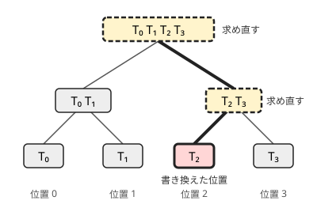

!!! abstract "要点"
    - **何ができるか**：列の各位置の遷移を小さな行列にしてセグメント木に載せると、1 点の書き換えのたびに DP の答えを $O(S^3 \log N)$ で求め直せる（$S$ は状態数）。行列の積は非可換なので、掛ける向きを最初に決める。
    - **いつ使うか**：
        - DP をする列に 1 点更新のクエリが来て、そのたびに DP の答えを求める
        - 列の区間 $[l, r)$ だけで DP をしたときの答えを、クエリごとに求める
    - **計算量**：構築 $O(S^3 N)$、1 点更新 $O(S^3 \log N)$、列全体の答えは根の値から $O(1)$、区間の答えは $O(S^3 \log N)$。木の上では HL 分解と組んで更新 $O(S^3 \log^2 N)$
    - **前提**：[行列累乗](../math/matrix-power.md)、[セグメント木に何を載せるか](../ds/segment-tree-monoids.md)

<!-- textlint-disable -->
別名：Dynamic DP・DDP・遷移行列のセグメント木
<!-- textlint-enable -->

動的 DP は、DP の 1 歩ごとの遷移を行列で表し、その積をセグメント木で持つことで、入力の書き換えに DP を追従させる方法である。中身は「[行列を載せたセグメント木](../ds/segment-tree-monoids.md#matrix)に 1 点更新を足したもの」で、新しいデータ構造は要らない。ABC で想定解になった問題は少ないが、DP の高速化の道具として知っておくと、更新つきの DP を見たときに方針が立つ。

## 何ができるか（1 点更新と区間の DP の答え） {#what-it-does}

列 $A = (A_0, \dots, A_{N-1})$（0-indexed）を左から読む DP で、状態を $S$ 個の値の組 $v$ にまとめられるとする。位置 $i$ を読む 1 歩が $v \leftarrow v T_i$ と行列の積で書け、$T_i$ が $A_i$ だけで決まるなら、列全体を読んだ後の状態は次の 1 つの積になる。

$$
v_N = v_0 \, T_0 T_1 \cdots T_{N-1}
$$

$A_p$ を書き換えると変わるのは $T_p$ だけである。積をセグメント木で持てば、葉の $T_p$ を差し替えて根までの $O(\log N)$ 個のノードを掛け直すだけで、全体の積が新しくなる。区間 $[l, r)$ だけで DP をした答えも、区間の積 $T_l \cdots T_{r-1}$ から取り出せる。



素朴に DP をやり直すと 1 回の更新ごとに $O(S^2 N)$ かかり、更新が $Q$ 回あれば $O(S^2 N Q)$ になる。動的 DP なら全体で $O(S^3 (N + Q \log N))$ である。行列の積が $O(S^3)$ なので、使えるのは状態数 $S$ が数個〜十数個のときに限られる。

使える条件は次の 2 つである。

- **遷移が行列で書ける**：次の状態の各値が、今の状態の値の線形結合（定数倍の和）で書ける。定数項は状態に 1 を足せば入る（[行列累乗の節](../math/matrix-power.md#write-as-matrix)）。費用の最小・最大を求める DP なら、和を min・max に、積を + に替えた [(min,+)・(max,+) の行列](../math/matrix-power.md#semiring)で書ける。
- **遷移がその位置だけで決まる**：$T_i$ は $A_i$（と位置 $i$ に固有の値）だけから作れる。遠く離れた位置の値を参照する遷移（「直前に同じ値が現れた位置の DP の値を引く」など）は、そのままでは行列にならない。直前の出現位置 $l$ の値を引く[部分列 DP の貰う形の式](../dp/subsequence-dp.md#next-table-dp) $f[i+1] = 2 f[i] - f[l]$ がその例で、状態を「末尾の文字ごとの数」に取り直すと行列になる（[例題](#abc246_h)）。

問題のサインは、DP の立式までは素直にでき、さらに「1 か所を書き換えて答えよ」というクエリが付いている形である。DP の状態数が小さく、遷移がその位置だけで決まるかを確かめる。

## 遷移を行列にしてセグメント木に載せる（ACL の segtree の S を行列にする） {#matrix-on-segment-tree}

ACL の `segtree<S, op, e>` の `S` を $S \times S$ の行列にし、`op` を行列の積、`e` を単位行列にすれば、そのまま動的 DP になる。行列の積は[結合法則](../guide/glossary.md#associativity)を満たすので、セグメント木の要件を満たす。

次のコード片は、[例題](#abc246_h)の DP の 3×3 行列を載せたものである。

```cpp
--8<-- "dynamic-dp/usage.cpp:core"
```

完全なプログラム：[`usage.cpp`](https://github.com/yuukougun/kyopro-atlas/blob/main/snippets/dynamic-dp/usage.cpp)（GitHub）。`mint` は ACL の `modint998244353`（[modint](../math/modint.md)）。
{ .kp-code-src }

更新のたびに葉を差し替えて、根の値（`all_prod`）から答えを読む。

```cpp
--8<-- "dynamic-dp/usage.cpp:query"
```

完全なプログラム：[`usage.cpp`](https://github.com/yuukougun/kyopro-atlas/blob/main/snippets/dynamic-dp/usage.cpp)（GitHub）。`mint` は ACL の `modint998244353`（[modint](../math/modint.md)）。
{ .kp-code-src }

!!! info "ACL では"
    `atcoder::segtree<S, op, e> seg(v);`。`seg.set(p, x)` と `seg.prod(l, r)` は `op` を $O(\log N)$ 回、`seg.all_prod()` は $O(1)$ で呼ぶ。`S` を行列にすると `op` 1 回が $O(S^3)$ なので、`set`・`prod` の計算量は $S^3$ 倍の $O(S^3 \log N)$ になる。`all_prod` は根の行列を返すだけである。`op` は結合法則を満たし、`e()` は単位元である必要がある。

自作するとき・ACL に載せるときの要点は次のとおりである。

- **行列の型は固定長にする**：`vector<vector<…>>` だと積のたびにメモリの確保が起き、定数倍が大きく悪化する。`array` で大きさを固定する。
- **ノードの数とメモリ**：ACL のセグメント木は、$N$ を 2 のべきに切り上げた数の 2 倍のノードを持ち、1 つが $S^2$ 個の値になる。$N = 2 \times 10^5$ ならノードは約 $5.2 \times 10^5$ 個で、$S = 10$ の `long long` の行列（1 つ 800 バイト）なら約 420 MB になる。状態数を減らすか、値の型を小さくする。
- **積の定数倍**：内側のループを i-k-j の順にすると、右の行列を行の向きに連続して読むので速い。
- **mod の掛け算のあふれ**：これは速さではなく正しさの注意である。mod の下の掛け算は、1 回ごとに余りを取ってあふれを防ぐ（[行列累乗の積の節](../math/matrix-power.md#fast-power)）。modint を使えば自動で行われる。
- **不要な状態を消す**：行列が上三角に近い、使わない状態がある、といった形なら、積の中の 0 の項を飛ばすか状態を詰める。状態数が半分になれば積は 8 分の 1 になる。

## 積の向きと単位行列 {#order-and-identity}

行列の積は $AB \ne BA$ なので、セグメント木の `op` の左右と、状態を横ベクトルと縦ベクトルのどちらで持つかをそろえる必要がある。このページは[セグメント木に何を載せるか](../ds/segment-tree-monoids.md#matrix)と同じく、次の書き方にそろえる。

- 状態は横ベクトル $v$ で、1 歩は $v \leftarrow v T_i$。
- 行列の $(p, q)$ 成分は「直前の状態 $p$ から次の状態 $q$ への係数（費用）」。
- 区間 $[l, r)$ の遷移は $T_l T_{l+1} \cdots T_{r-1}$ で、`op(a, b)` は積 $ab$（`a` が左の区間）。

ACL の `prod(l, r)` は左の区間の値を左に置いて結ぶので、この書き方ならそのまま使える。[行列累乗](../math/matrix-power.md)のページのように縦ベクトルで $v \leftarrow T_i v$ と書くと、区間の遷移は $T_{r-1} \cdots T_l$ と逆に並ぶ。その書き方のまま載せるなら `op(a, b)` を $ba$ にする。2 つの書き方の行列は互いの転置で、解説記事によってどちらも使われる。読んだ記事の行列をそのまま写すときは、どちらの流儀かを先に確かめる。

`e()` は単位行列にする。対角の成分と残りの成分は、普通の積で 1 と 0、(min,+) で 0 と $+\infty$、(max,+) で 0 と $-\infty$ である。0 で埋めた行列を `e()` にすると、空の区間や余った葉を掛けたところで答えが 0 になる。ACL の `prod` は `e()` から掛け始め、`all_prod` の根の値には余った葉の `e()` も掛かる。ただし `all_prod` だけを使い、$N$ が 2 のべきなら `e()` は根の値に入らないので、小さな例で試しても誤りに気づかないことがある。

??? question "確認問題：`op(a, b)` を積 $ba$ にしてしまうと、例題の DP はどうなるか"
    根の値は $T_{N-1} \cdots T_1 T_0$ になり、列を右から左へ読んだ DP の答えになる。例題の数え上げは、文字列を反転しても部分列の種類数が変わらないので、偶然すべての答えが一致してしまう。向きの誤りは、反転で答えが変わる DP（区間の左端に条件がある、など）で確かめる。$f_0(x) = 2x + 1$、$f_1(x) = 3x$ のような 1 次関数の合成（[非可換な演算の節](../ds/segment-tree-monoids.md#non-commutative)）で確かめるのが手早い。

## 木の上の動的 DP（Static Top Tree へ） {#on-trees}

この節は [HL 分解](../tree/hld.md)と[木 DP](../dp/tree-dp.md) を前提にする。

木 DP で、頂点の値を書き換えるたびに根の DP の値を求め直したいとする。木は列ではないが、HL 分解で重いパスに分けると、各重いパスの上では DP が列の DP になる。軽い子の DP の値は、親の頂点の行列の中に定数としてまとめて入れる。

例として、頂点に重み $a_v$ がある木の最大重み[独立集合](../guide/glossary.md#independent-set)を考える。$f_0(v)$・$f_1(v)$ を「$v$ を選ばない・選ぶときの、$v$ の部分木の答え」とし、$v$ の重い子を $h$ とする。軽い子 $c$ の分を

$$
g_0(v) = \sum_{c} \max\bigl(f_0(c), f_1(c)\bigr), \qquad g_1(v) = a_v + \sum_{c} f_0(c)
$$

とまとめると、$f_0(v) = g_0(v) + \max(f_0(h), f_1(h))$、$f_1(v) = g_1(v) + f_0(h)$ である。これは (max,+) の行列で書ける。

$$
\begin{pmatrix} f_0(v) \\ f_1(v) \end{pmatrix}
=
\begin{pmatrix} g_0(v) & g_0(v) \\ g_1(v) & -\infty \end{pmatrix}
\otimes
\begin{pmatrix} f_0(h) \\ f_1(h) \end{pmatrix}
$$

木では値が深い方から浅い方へ流れる。HL 分解の番号は重いパスの浅い方ほど小さいので、ここだけは縦ベクトルの書き方にすると、重いパスの区間の積が番号の順（$M_{\text{浅い}} \otimes \cdots \otimes M_{\text{深い}}$）に並ぶ。重いパスの末端は葉で、葉の行列（$g_0 = 0$、$g_1 = a_v$）に $(0, -\infty)^{\top}$ を掛ければ $(0, a_v)$ になる。値が番号の大きい方から小さい方へ流れるので、縦ベクトルでも `op(a, b)` は $a \otimes b$ のままでよい（[積の向きの節](#order-and-identity)の $ba$ は、値が番号の小さい方から流れる列の場合である）。

$a_v$ を書き換えたときの流れは次のとおりである。

1. $v$ の行列の $g_1(v)$ を直し、$v$ の重いパスのセグメント木を更新する
2. 重いパスの積から、パスの先頭 $u$ の $f_0(u)$・$f_1(u)$ を求め直す
3. $u$ は親 $\mathrm{par}[u]$ の軽い子なので、$\mathrm{par}[u]$ の $g_0$・$g_1$ を「古い寄与を引いて新しい寄与を足す」で直す。$\mathrm{par}[u]$ の重いパスへ移って 1 に戻る

軽い辺は根までに $O(\log N)$ 本なので、1 回の更新は $O(\log N)$ 本の重いパスでセグメント木を更新し、$O(S^3 \log^2 N)$ になる。軽い子の寄与を引き算で外せない演算（max でまとめるなど）なら、頂点ごとに軽い子の値を集める構造（多重集合やセグメント木）を別に持つ。

[Static Top Tree](../tree/static-top-tree.md#compress-rake) は、木を「パスの圧縮」と「部分木の併合」の 2 種類の操作で高さ $O(\log N)$ の木に組み直し、同じ更新を $O(\log N)$ 回の合成で済ませる方法である。行列にしなくてよく、圧縮と併合の 2 つの演算を直接書くので、遷移が行列で書きにくい木 DP にも使える。

## ライブラリでの検証 {#library}

列の動的 DP は、行列のセグメント木が向きも含めて正しいかを確かめれば、あとは遷移の行列を問題ごとに作るだけである。

- **Point Set Range Composite**（`point_set_range_composite`）：1 次関数の列で、1 つの関数の差し替えと、区間の関数を $f_l$ から順に施した値を問う。$x \mapsto cx + d$ は横ベクトル $(x, 1)$ に $\begin{pmatrix} c & 0 \\ d & 1 \end{pmatrix}$ を右から掛ける形で、このページの向きの書き方そのものになる。2×2 の行列を載せたセグメント木で通れば、積の向きと単位行列が正しい。
- **Point Set Tree Path Composite Sum (Fixed Root)**（`point_set_tree_path_composite_sum_fixed_root`）：根付き木で頂点の値か辺の 1 次関数を書き換える。そのたびに、各頂点の値に、その頂点から根までの辺の関数を頂点に近い方から順に施した値の総和を問う。木の上の動的 DP の検証に使える。

自作の行列のセグメント木は、全探索との比較も手早い。小さな $N$ でランダムな列と更新を作り、DP を毎回やり直した答えと比べる（コード片の `brute` がその形である）。

## 学ぶための資料 {#resources}

- 列の動的 DP は、[行列累乗](../math/matrix-power.md)と[セグメント木に何を載せるか](../ds/segment-tree-monoids.md#matrix)の組み合わせで足りる。
- [kmjp「AtCoder ABC #246 : Ex - 01? Queries」](https://kmjp.hatenablog.jp/entry/2022/04/04/0930)と [ikatakos「AtCoder Beginner Contest 246 Ex問題メモ」](https://ikatakos.com/pot/programming_algorithm/contest_history/atcoder/2022/0402_abc246)：例題の解説。同じ問題を 3×3 と 4×4 の別の状態の取り方で解いていて、状態の設計の幅を見るのによい。
- [OI Wiki「动态 DP」](https://oi-wiki.org/dp/dynamic/)（中国語）：木の上の動的 DP の解説。HL 分解の重いパスごとに行列のセグメント木を作る方法を、最大重み独立集合を題材に説明している。
- Static Top Tree は[Static Top Tree のページ](../tree/static-top-tree.md#resources)の資料を参照する。

## 例題 {#examples}

### ABC246 Ex. 01? Queries {#abc246_h}

<div class="kp-problems" data-role="example" markdown>

- [ABC246 Ex. 01? Queries](https://atcoder.jp/contests/abc246/tasks/abc246_h)（diff 2677）：0・1・? からなる文字列の 1 文字を書き換えるクエリのたびに、? を 0 か 1 に置き換えてできる文字列の部分列として現れうる、空でない文字列の種類数を答える。

</div>

方針：書き換えがなければ、異なる部分列を数える DP で 1 回 $O(N)$ に解ける。状態を「末尾が 0 の文字列の数・末尾が 1 の文字列の数・定数 1」の 3 つにすると、各文字の遷移が 3×3 の行列になる。行列をセグメント木に載せ、書き換えのたびに葉を差し替えて根の値から答える。

??? note "解法の詳細"
    **状態**：先頭から $i$ 文字を読んだ時点で、作れる空でない異なる文字列のうち、末尾が 0 のものの数を $x_0$、末尾が 1 のものの数を $x_1$ とする。

    **遷移**：文字列 $t$ が作れるかは、$t$ の文字を先頭から順に「その文字か ? である、最も左の位置」に当てていく貪欲な照合で判定できる（[最も左を取る取り出し方](../dp/subsequence-dp.md#leftmost)の ? を含む版）。次の文字が 0 か ? なら、末尾が 0 の文字列は「これまでに作れた文字列（空も含む）の末尾に 0 を付けたもの」すべてになる。これまでの末尾が 0 の文字列もこの中に含まれるので、$x_0 \leftarrow x_0 + x_1 + 1$ である。$x_1$ も、次の文字が 1 か ? なら同じ式で、そうでなければそのままである。? では 2 つの式を、どちらも更新前の値で計算する。

    **行列**：状態を横ベクトル $(x_0, x_1, 1)$ にすると、文字 0・1・? の行列は次のとおりである（行が直前の状態、列が次の状態）。

    $$
    T_{0} = \begin{pmatrix} 1 & 0 & 0 \\ 1 & 1 & 0 \\ 1 & 0 & 1 \end{pmatrix}, \quad
    T_{1} = \begin{pmatrix} 1 & 1 & 0 \\ 0 & 1 & 0 \\ 0 & 1 & 1 \end{pmatrix}, \quad
    T_{?} = \begin{pmatrix} 1 & 1 & 0 \\ 1 & 1 & 0 \\ 1 & 1 & 1 \end{pmatrix}
    $$

    **答え**：初めのベクトルは $(0, 0, 1)$ なので、全体の積 $P$ の 3 行目（添字 2 の行）が最後の $(x_0, x_1, 1)$ になる。答えは $P_{2,0} + P_{2,1}$ を 998244353 で割った余りである。

    **計算量**：構築が $O(3^3 N)$、1 回の書き換えが $O(3^3 \log N)$ である。コード片は[セグメント木に載せる節](#matrix-on-segment-tree)にある。

## 使い分け {#comparison}

- 書き換えがなく、同じ遷移を $10^{18}$ 回のように巨大な回数くり返すだけなら、セグメント木は要らず、[行列累乗](../math/matrix-power.md#dp-transition)で足りる。
- 入力の書き換えではなく、DP の段を進めるたびに前の段の数か所だけが変わる形なら、[インライン DP](../dp/inline-dp.md#diff-per-row) で 1 本の配列（または遅延セグメント木）を書き換える。
- 書き換えの回数 $Q$ が少なく、そのたびに DP をやり直す $O(S^2 N Q)$ が間に合うなら、遷移を行列にしなくてよい。
- 遷移の形からほかの高速化の道具を選ぶときは、[DP の高速化の選び方](../dp/dp-speedup-overview.md#shape-to-tool)の早見表を見る。

## 参考 {#references}

- [AtCoder「AC Library のドキュメント（document_ja）」](https://github.com/atcoder/ac-library/tree/master/document_ja)：ACL の囲みの `segtree` の宣言・計算量・要件
- [yosupo「Library Checker の問題（point_set_range_composite）」](https://github.com/yosupo06/library-checker-problems/tree/master/data_structure/point_set_range_composite)：検証に使う問題の内容
- [yosupo「Library Checker の問題（point_set_tree_path_composite_sum_fixed_root）」](https://github.com/yosupo06/library-checker-problems/tree/master/tree/point_set_tree_path_composite_sum_fixed_root)：木の版の検証に使う問題の内容
- [OI Wiki「动态 DP」](https://oi-wiki.org/dp/dynamic/)：学ぶための資料。木の上の動的 DP の構成の確認（文章・図は使っていない）
- [kmjp「AtCoder ABC #246 : Ex - 01? Queries」](https://kmjp.hatenablog.jp/entry/2022/04/04/0930)：例題 ABC246 Ex の 3×3 の状態と遷移
- [ikatakos「AtCoder Beginner Contest 246 Ex問題メモ」](https://ikatakos.com/pot/programming_algorithm/contest_history/atcoder/2022/0402_abc246)：例題 ABC246 Ex の 4×4 の状態の取り方と、積の左右の順序（解法の節だけを読んだ）
